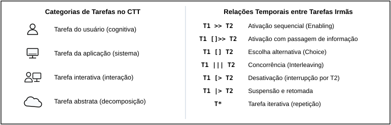
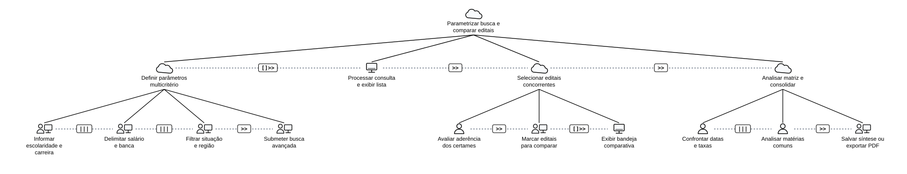
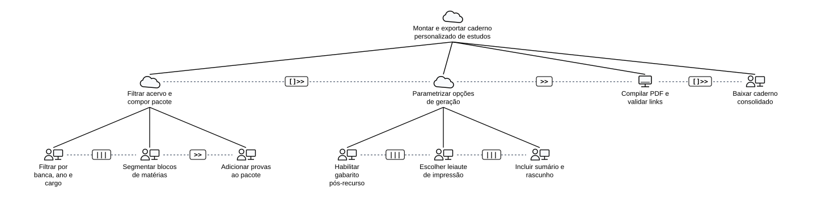
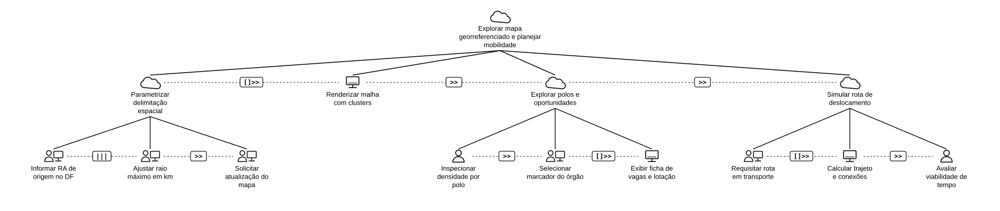
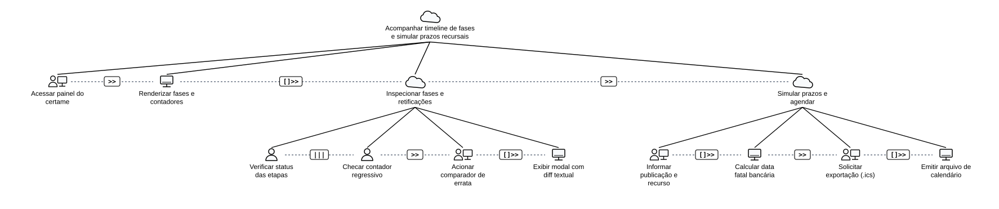
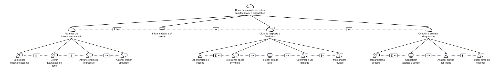
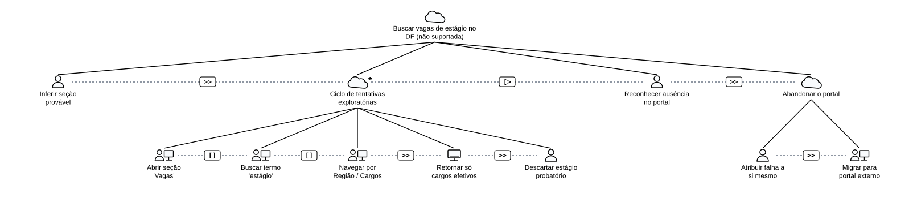
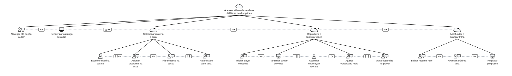
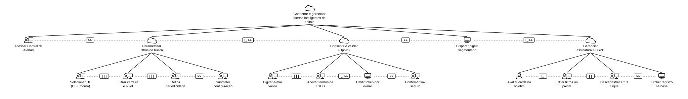

<b>Tabela de Contribuição</b>

| Membro | Contribuição |
| :--- | :--- |
| Daniel da Silva Batista | Fundamentação teórica de ConcurTaskTrees (Paternò, 1999; Barbosa e Silva, 2010), taxonomia de tipos de tarefas e operadores temporais, modelagem formal completa com diagramas e tabelas das Tarefas 01 e 02 e organização dos templates para a equipe. |
| Arthur Sismene Carvalho | Revisão dos operadores temporais de interação e modelagem CTT integral das Tarefas 05 e 06, com emprego dos operadores de iteração (`T*`), suspensão (`|>`), escolha alternativa (`[]`) e desativação (`[>`) para formalizar o ciclo de respostas e o padrão de tentativa e abandono. |
| Leonardo da Silva Lopes Júnior | Modelagem formal completa em CTT (árvores de tarefas e especificação de nós com operadores temporais) das Tarefas 07 e 08; refinamento da modelagem CTT das tarefas interativas propositivas (TAR-04, TAR-05 e TAR-08) com operadores formais ricos (`>>`, `[]>>`, `|||`, `[>`, `|>` e `*`) para resolução da Issue #14. |
| Pedro Rocha Ferreira Lima | Modelagem formal completa em CTT (árvores de tarefas e especificação de nós com operadores temporais) das Tarefas 03 e 04 com base no método sem usuário (DOC-02) e na persona Lucas Ferreira Rocha. |
| Gemini | Geração dos diagramas CTT vetoriais na notação oficial de Barbosa et al. (2021, Seção 8.2.2) e Paternò (1999) e auxílio na estruturação textual do artefato em Markdown (conforme Política de Uso de IA). |

<b>Fonte:</b> Daniel da Silva Batista (2026), com base em Paternò (1999) e Barbosa et al. (2021, Cap. 8, Seção 8.2.2).

### 1.1 Notação Gráfica Oficial de um Diagrama CTT (Barbosa et al., 2021)

Em estrita conformidade com o livro-texto *Interação Humano-Computador e Experiência do Usuário* (Barbosa et al., 2021, Seção 8.2.2) e com o padrão visual da ferramenta CTTE (Paternò, 1999; Mori, Paternò e Santoro, 2002), os diagramas CTT deste artefato utilizam:

1. **Ícones Oficiais de Categoria de Tarefa** posicionados acima do nome de cada nó (Nuvem para *Tarefa Abstrata*, Silhueta Humana para *Tarefa do Usuário*, Monitor para *Tarefa da Aplicação/Sistema* e Silhueta + Monitor para *Tarefa Interativa*), acompanhados do marcador `*` quando a tarefa é iterativa (`T*`);
2. **Relações Temporais Horizontais entre Tarefas Irmãs:** As linhas sólidas verticais/diagonais representam exclusivamente a decomposição hierárquica (pai $\rightarrow$ filhos), enquanto os operadores temporais (`>>`, `[]>>`, `|||`, `[]`, `[>`, `|>`) são posicionados **horizontalmente entre os nós irmãos do mesmo nível**, exatamente como preconizado por Barbosa et al. (2021);
3. **Especificação em Nível Mais Baixo de Abstração Abaixo dos Diagramas:** O diagrama de árvore preserva concisão visual de alto nível, e o detalhamento em nível mais baixo de abstração (parâmetros transmitidos por `[]>>`, critérios de escolha `[]`, gatilhos de desativação `[>` e tabela formal dos nós) é disposto imediatamente abaixo de cada figura.

<b>Figura 0:</b> Elementos gráficos e relações temporais de um diagrama CTT segundo Barbosa et al. (2021)

{ width="740" }

<b>Fonte:</b> Daniel da Silva Batista (2026), elaborado conforme Barbosa et al. (2021, Seção 8.2.2) e Paternò (1999).

# ConcurTaskTrees (CTT)

## 1. Introdução e Fundamentação Teórica

O método **ConcurTaskTrees** (CTT), concebido pelo pesquisador italiano Fabio Paternò (1999) no âmbito do CNR-ISTI e detalhado por Barbosa et al. (2021, Cap. 8, Seção 8.2.2) e Barbosa e Silva (2010, Cap. 8.4), é uma notação gráfica e formal desenvolvida especificamente para a Engenharia de Usabilidade e o Design de Interação. Diferentemente de métodos puramente funcionais, o CTT destaca-se por modelar com precisão as relações temporais e a concorrência entre as atividades, além de distinguir claramente a responsabilidade de execução entre o ser humano e a máquina.

### 1.1 Categorias de Tarefas e Operadores Temporais no CTT (Barbosa et al., 2021)

No CTT, as tarefas são decompostas hierarquicamente em uma árvore e categorizadas segundo quatro tipos (*Tarefa do Usuário*, *Tarefa da Aplicação/Sistema*, *Tarefa Interativa* e *Tarefa Abstrata*), articuladas horizontalmente entre tarefas irmãs por operadores temporais formais, conforme ilustrado na Figura 0 e detalhado na Tabela 1:

<b>Figura 0:</b> Elementos gráficos e relações temporais de um diagrama CTT segundo Barbosa et al. (2021)

{ width="720" }

<b>Fonte:</b> Daniel da Silva Batista (2026), elaborado conforme Barbosa et al. (2021, Seção 8.2.2) e Paternò (1999).

<b>Tabela 1: Operadores Temporais de Relação entre Tarefas Irmãs no CTT</b>

| Operador | Nome Formal | Significado Semântico |
| :---: | :--- | :--- |
| `T1 >> T2` | **Ativação Sequencial (*Enabling*)** | A tarefa `T2` só pode ser iniciada após a conclusão bem-sucedida de `T1`. |
| `T1 []>> T2` | **Ativação com Passagem de Informação** | `T1` habilita `T2` e transfere os dados produzidos para a entrada de `T2`. |
| `T1 [] T2` | **Escolha Alternativa (*Choice*)** | O usuário pode optar por executar `T1` **ou** `T2`; ao iniciar uma, a outra é descartada. |
| `T1 ||| T2` | **Concorrência (*Interleaving*)** | `T1` e `T2` podem ser executadas em qualquer ordem ou alternadamente sem interferência. |
| `T1 [> T2` | **Desativação (*Deactivation*)** | A execução de `T2` interrompe definitivamente a execução de `T1`. |
| `T1 |> T2` | **Suspensão e Retomada** | `T1` é temporariamente suspensa por `T2` e retoma sua execução após o término de `T2`. |
| `T*` | **Iteração** | A tarefa `T` é executada repetidas vezes até que uma condição de parada seja satisfeita. |

<b>Fonte:</b> Daniel da Silva Batista (2026), com base em Paternò (1999) e Barbosa et al. (2021).

---

## 2. Matriz de Tarefas do PCI Concursos

A equipe consolidou a matriz com as oito tarefas oficiais avaliadas no portal, mapeando a distribuição individual entre os quatro integrantes ativos:

<b>Tabela 2: Matriz Oficial de Tarefas Mapeadas para CTT</b>

| ID | Descrição da Tarefa | Integrante Responsável |
| :---: | :--- | :--- |
| **TAR-01** | Parametrizar busca avançada multicritério e comparar editais concorrentes lado a lado | Daniel da Silva Batista |
| **TAR-02** | Montar e exportar caderno personalizado de provas anteriores com gabarito comentado integrado | Daniel da Silva Batista |
| **TAR-03** | Explorar mapa interativo georreferenciado de oportunidades com cálculo de mobilidade (DF e RIDE) | Pedro Rocha Ferreira Lima |
| **TAR-04** | Acompanhar timeline interativa de fases do certame com simulador de prazos recursais e sincronização de calendário | Pedro Rocha Ferreira Lima |
| **TAR-05** | Realizar simulado de questões online interativo com feedback automático de gabarito e diagnóstico de desempenho | Arthur Sismene Carvalho |
| **TAR-06** | Buscar oportunidades de estágio de nível superior no DF *(Tarefa não suportada)* | Arthur Sismene Carvalho |
| **TAR-07** | Acessar videoaulas e dicas teóricas de disciplinas | Leonardo da Silva Lopes Júnior |
| **TAR-08** | Organizar e acompanhar múltiplos certames no Calendário Pessoal de Concursos com prazos de inscrição, pagamento de boleto e exportação para agenda digital | Leonardo da Silva Lopes Júnior |

<b>Fonte:</b> Daniel da Silva Batista e Pedro Rocha Ferreira Lima (2026).

---

## 3. Modelagem Detalhada das Tarefas (Daniel da Silva Batista)

### 3.1 Tarefa 01: Parametrizar busca avançada multicritério e comparar editais concorrentes lado a lado (TAR-01)

A árvore CTT para a Tarefa 01 formaliza o diálogo interativo e os operadores temporais envolvidos na busca avançada facetada e na comparação simultânea de certames. O modelo substitui a busca textual rasa por fluxos concorrentes (`|||`) de definição de critérios (escolaridade, remuneração, banca e status), passagem de parâmetros (`[]>>`) para o motor de busca, seleção de múltiplos certames e confrontação simultânea das regras editalícias em matriz paralela.

A representação em árvore de tarefas CTT é apresentada na Figura 1, e a especificação formal de seus nós, tipos e operadores temporais é apresentada na Tabela 3.

#### Diagrama de Árvore CTT (Figura 1)

<b>Figura 1:</b> Representação em Árvore CTT da Tarefa 01 - Busca avançada e comparação lado a lado

<b>Fonte:</b> Daniel da Silva Batista (2026), com base em Barbosa et al. (2021, Seção 8.2.2) e Paternò (1999).

#### Tabela de Especificação dos Nós e Operadores da Tarefa 01

<b>Tabela 3: Especificação Formal dos Nós CTT da Tarefa 01</b>

| Nó / Tarefa | Tipo CTT | Operador Subsequente | Descrição da Operação |
| :--- | :---: | :---: | :--- |
| **Parametrizar busca e comparar editais** | Abstrata | - | Tarefa raiz de tomada de decisão baseada na combinação de múltiplos filtros e na confrontação paralela de certames. |
| **Definir parâmetros de filtragem multicritério** | Abstrata | `[]>>` | Configuração simultânea dos parâmetros de consulta, repassando o payload de dados ao sistema. |
| **Especificar escolaridade e carreira** | Interação | `\|\|\|` | Seleção dos campos de nível de formação e áreas de atuação desejadas. |
| **Delimitar piso salarial e banca** | Interação | `\|\|\|` | Ajuste da faixa remuneratória mínima e marcação das instituições organizadoras. |
| **Filtrar situação e abrangência regional** | Interação | `>>` | Escolha do status (inscrições abertas) e das localidades de preferência. |
| **Submeter requisição de busca avançada** | Interação | `[]>>` | Disparo da consulta com transferência dos parâmetros de filtro para a camada de serviço. |
| **Processar consulta e renderizar catálogo** | Sistema | `>>` | O sistema compila os filtros facetados e exibe a listagem filtrada de oportunidades. |
| **Selecionar certames e acionar comparador** | Abstrata | `>>` | Subtarefa de triagem na qual o concurseiro elege os certames que disputarão sua atenção. |
| **Avaliar aderência dos certames listados** | Usuário | `>>` | Julgamento cognitivo sobre a relevância de cada concurso retornado frente à disponibilidade do candidato. |
| **Marcar certames concorrentes** | Interação | `[]>>` | Acionamento das caixas de seleção adicionando até 3 certames à bandeja comparativa. |
| **Renderizar painel flutuante de selecionados** | Sistema | `>>` | Atualização reativa da interface exibindo os cards fixados para confronto direto. |
| **Analisar matriz comparativa e consolidar** | Abstrata | - | Subtarefa de deliberação estratégica apoiada na matriz visual lado a lado. |
| **Confrontar datas de prova e taxas** | Usuário | `\|\|\|` | Análise cognitiva simultânea para checagem de sobreposição de calendários e custos de inscrição. |
| **Analisar convergência de conteúdos** | Usuário | `>>` | Comparação do percentual de compatibilidade das matérias para otimização do plano de estudos. |
| **Salvar síntese ou exportar relatório** | Interação | - | Persistência da análise comparativa nos certames favoritados ou geração de documento PDF estruturado. |

<b>Fonte:</b> Daniel da Silva Batista (2026).

---

### 3.2 Tarefa 02: Montar e exportar caderno personalizado de provas anteriores com gabarito comentado integrado (TAR-02)

A representação em árvore da Tarefa 02 substitui o download elementar de um PDF isolado por um fluxo completo de composição modular de material didático. A modelagem contempla a seleção de múltiplos blocos de prova por banca examinadora, ano e disciplina (`|||`), a inclusão de gabaritos oficiais pós-recurso com marcação de anulações, a parametrização de layout de impressão (`[]>>`) e o download verificado com garantia de integridade documental.

A árvore de tarefas CTT é apresentada na Figura 2, e sua especificação formal de nós e operadores é descrita na Tabela 4.

#### Diagrama de Árvore CTT (Figura 2)

<b>Figura 2:</b> Representação em Árvore CTT da Tarefa 02 - Montagem e exportação de caderno personalizado

<b>Fonte:</b> Daniel da Silva Batista (2026), com base em Barbosa et al. (2021, Seção 8.2.2) e Paternò (1999).

#### Tabela de Especificação dos Nós e Operadores da Tarefa 02

<b>Tabela 4: Especificação Formal dos Nós CTT da Tarefa 02</b>

| Nó / Tarefa | Tipo CTT | Operador Subsequente | Descrição da Operação |
| :--- | :---: | :---: | :--- |
| **Montar e exportar caderno personalizado** | Abstrata | - | Tarefa raiz de criação e compilação de material unificado de questões anteriores com chave de respostas. |
| **Filtrar repositório e compor pacote** | Abstrata | `[]>>` | Seleção dos cadernos de provas no catálogo com envio dos identificadores para o montador. |
| **Filtrar acervo por banca, ano e cargo** | Interação | `\|\|\|` | Parametrização dos critérios de busca no repositório de provas anteriores. |
| **Segmentar blocos disciplinares** | Interação | `>>` | Seleção de matérias específicas quando o candidato não deseja a íntegra da prova. |
| **Adicionar cadernos à cesta de compilação** | Interação | `[]>>` | Inclusão dos materiais selecionados na lista de compilação do pacote de estudo. |
| **Parametrizar opções pedagógicas e gráficas** | Abstrata | `>>` | Definição das diretrizes de formatação e consolidação dos anexos no documento final. |
| **Habilitar gabarito definitivo com anulações** | Interação | `\|\|\|` | Inclusão das respostas oficiais homologadas com sinalização expressa de questões anuladas. |
| **Selecionar leiaute de documento** | Interação | `\|\|\|` | Alternância entre modo econômico (duas colunas para impressão) ou digital com links interativos. |
| **Incluir sumário e folhas de rascunho** | Interação | `>>` | Inserção de numeração contínua de páginas e folhas de gabarito para simulação de preenchimento. |
| **Processar unificação e validar integridade** | Sistema | `[]>>` | O servidor mescla os arquivos PDF, checa a integridade dos links e gera o arquivo consolidado. |
| **Descarregar caderno consolidado** | Interação | - | Recepção e salvamento direto do arquivo PDF indexado sem redirecionamentos publicitários. |

<b>Fonte:</b> Daniel da Silva Batista (2026).

---

## 4. Modelagem Detalhada das Tarefas (Pedro Rocha Ferreira Lima)

### 4.1 Tarefa 03: Explorar mapa interativo georreferenciado de oportunidades com cálculo de mobilidade (DF e RIDE) (TAR-03)

A Tarefa 03 investiga o processo de busca, filtragem e planejamento geográfico no Distrito Federal e em sua Região Integrada de Desenvolvimento (RIDE), foco central da persona **Lucas Ferreira Rocha (`PER-02`)**. A modelagem CTT formaliza a exploração cartográfica interativa, superando a listagem estática de estados. O fluxo estrutura a parametrização de ponto de partida e raio de alcance (`|||`), a renderização reativa dos agrupamentos de vagas por Região Administrativa (`[]>>`), a exploração das oportunidades territoriais e a simulação assíncrona de rotas de transporte público para estimativa de deslocamento.

A representação em árvore de tarefas CTT é apresentada na Figura 3, e a especificação formal de seus nós, tipos e operadores temporais é detalhada na Tabela 5.

#### Diagrama de Árvore CTT (Figura 3)

<b>Figura 3:</b> Representação em Árvore CTT da Tarefa 03 - Mapa georreferenciado e cálculo de mobilidade

<b>Fonte:</b> Pedro Rocha Ferreira Lima (2026), com base em Barbosa et al. (2021, Seção 8.2.2) e Paternò (1999).

#### Tabela de Especificação dos Nós e Operadores da Tarefa 03

<b>Tabela 5: Especificação Formal dos Nós CTT da Tarefa 03</b>

| Nó / Tarefa | Tipo CTT | Operador Subsequente | Descrição da Operação |
| :--- | :---: | :---: | :--- |
| **Explorar mapa e planejar mobilidade** | Abstrata | - | Tarefa raiz de análise territorial de vagas e viabilidade de trânsito para o concurseiro. |
| **Parametrizar delimitação espacial** | Abstrata | `[]>>` | Configuração do perímetro geográfico desejado, transferindo os dados ao mapa. |
| **Delimitar bairro ou RA de residência** | Interação | `\|\|\|` | Indicação do ponto de partida do usuário no Distrito Federal. |
| **Ajustar raio de deslocamento máximo** | Interação | `>>` | Manipulação do controle deslizante de distância tolerável (ex.: até 25 km). |
| **Submeter requisição da malha** | Interação | `[]>>` | Envio dos limites espaciais para filtragem dos polos de vagas no banco. |
| **Renderizar malha cartográfica** | Sistema | `>>` | O sistema compila as coordenadas e desenha os clusters de vagas sobre o mapa. |
| **Explorar polos e examinar oportunidades** | Abstrata | `>>` | Navegação nos agrupamentos espaciais e triagem das informações dos certames. |
| **Inspecionar densidade de vagas** | Usuário | `>>` | Avaliação cognitiva da concentração de cargos por região administrativa. |
| **Selecionar marcador do polo** | Interação | `[]>>` | Acionamento do agrupamento territorial para visualizar o detalhamento do órgão. |
| **Exibir painel lateral com dados** | Sistema | `>>` | Abertura de gaveta lateral com vagas abertas, salários e locais prováveis de prova. |
| **Simular itinerário e estimar tempo** | Abstrata | - | Subtarefa de verificação do tempo gasto em trânsito até os locais do certame. |
| **Requisitar rota em transporte público** | Interação | `[]>>` | Solicitação de cálculo de trajeto considerando linhas distritais e metrô. |
| **Calcular itinerário com conexões** | Sistema | `>>` | O motor de rotas calcula o tempo total em minutos e as baldeações necessárias. |
| **Avaliar compatibilidade de trajeto** | Usuário | - | Deliberação do concurseiro sobre a sustentabilidade do deslocamento até a vaga. |

<b>Fonte:</b> Pedro Rocha Ferreira Lima (2026).

---

### 4.2 Tarefa 04: Acompanhar timeline interativa de fases do certame com simulador de prazos recursais e sincronização de calendário (TAR-04)

No âmbito do aprimoramento de escopo orientado pelas avaliações docentes, a Tarefa 04 transcende a consulta passiva a editais estáticos. A árvore CTT modela a interação dinâmica com a **Timeline de Fases do Certame**, englobando o monitoramento de marcos temporais em tempo real, a confrontação de retificações por meio de ferramenta visual de alterações (*diff* textual), a utilização de um simulador de prazos de recursos (calculando horários bancários e dias úteis) e a exportação assíncrona de eventos para agendas digitais (.ics / Google Calendar).

A árvore de tarefas CTT é apresentada na Figura 4, e sua especificação formal de nós, tipos e operadores temporais é descrita na Tabela 6.

#### Diagrama de Árvore CTT (Figura 4)

<b>Figura 4:</b> Representação em Árvore CTT da Tarefa 04 - Timeline interativa com simulador recursal

<b>Fonte:</b> Pedro Rocha Ferreira Lima (2026), com base em Barbosa et al. (2021, Seção 8.2.2) e Paternò (1999).

#### Tabela de Especificação dos Nós e Operadores da Tarefa 04

<b>Tabela 6: Especificação Formal dos Nós CTT da Tarefa 04</b>

| Nó / Tarefa | Tipo CTT | Operador Subsequente | Descrição da Operação |
| :--- | :---: | :---: | :--- |
| **Acompanhar timeline e simular prazos** | Abstrata | - | Tarefa raiz de gerenciamento cronológico contínuo e proteção contra perda de prazos editalícios. |
| **Acessar painel do certame** | Interação | `>>` | Seleção do certame para carregamento da visualização temporal especializada. |
| **Renderizar nós cronológicos e contadores** | Sistema | `[]>>` | Renderização visual da timeline com sinalização de fases ativas/passadas e contadores regressivos. |
| **Inspecionar fases, retificações e contadores** | Abstrata | `>>` | Exame visual das etapas e verificação de alterações publicadas pela banca. |
| **Inspecionar status das etapas** | Usuário | `\|\|\|` | Julgamento cognitivo do estágio de desenvolvimento do certame via código de cores semântico. |
| **Checar contador regressivo** | Usuário | `>>` | Avaliação da proximidade da data fatal de inscrições, provas ou envio de títulos. |
| **Acionar visualizador de retificações** | Interação | `[]>>` | Abertura da ferramenta de comparação para inspecionar alterações editalícias. |
| **Apresentar modal com realce textual** | Sistema | - | Exibição de texto comparativo confrontando redação original e retificada (*diff*). |
| **Simular prazos recursais e sincronizar** | Abstrata | - | Subtarefa de cálculo de prazos e automatização de lembretes na agenda pessoal do concurseiro. |
| **Parametrizar simulador de prazos** | Interação | `[]>>` | Inserção do marco inicial do prazo e seleção da modalidade recursal pretendida. |
| **Calcular data fatal com corte bancário** | Sistema | `>>` | Algoritmo que projeta o termo final respeitando expediente bancário e feriados distritais. |
| **Requisitar exportação para calendário** | Interação | `[]>>` | Solicitação de geração de payload para aplicativo de agenda do smartphone. |
| **Disparar arquivo com notificações** | Sistema | - | Emissão de arquivo `.ics` com alarmes preventivos de 24 horas e 2 horas de antecedência. |

<b>Fonte:</b> Pedro Rocha Ferreira Lima (2026).

---

## 5. Modelagem Detalhada das Tarefas (Arthur Sismene Carvalho)

### 5.1 Tarefa 05: Realizar simulado de questões online interativo com feedback automático de gabarito e diagnóstico de desempenho (TAR-05)

No escopo inicial do portal, a execução de simulados resumia-se a uma listagem estática e fragmentada de itens de múltipla escolha, sem possibilidade de parametrização da bateria nem consolidação diagnóstica de erros e acertos ao final. Em atendimento às diretrizes da **Issue #14**, a Tarefa 05 foi remodelada como uma **interação ergonômica de alta densidade pedagógica**, projetada com foco nas necessidades da persona **Thiago Mendonça Silva (`PER-01`)**, que estuda via smartphone em trajetos de transporte coletivo.

A modelagem CTT formaliza:
1. A **parametrização inicial da sessão** (disciplina, número fixo de questões e modo com temporizador regressivo);
2. O **ciclo iterativo de resposta (`T*`)**, com áreas de toque adequadas a alvos móveis ($\ge 48\times 48$ px), tolerância a falhas de conexão (*Zero Data Loss* com persistência assíncrona de estado), feedback imediato de acerto/erro com comentários didáticos e sinalização de itens para revisão;
3. O **painel consolidado de diagnóstico**, com cálculo automático da taxa de aproveitamento, tempo médio de resposta por item e visualização analítica por tópicos.

#### Diagrama de Árvore CTT (Figura 5)

<b>Figura 5:</b> Representação em Árvore CTT da Tarefa 05 - Simulado interativo com feedback e diagnóstico

<b>Fonte:</b> Arthur Sismene Carvalho e Leonardo da Silva Lopes Júnior (2026), com base em Barbosa et al. (2021, Seção 8.2.2) e Paternò (1999).

#### Tabela de Especificação dos Nós e Operadores da Tarefa 05

<b>Tabela 7: Especificação Formal dos Nós CTT da Tarefa 05</b>

| Nó / Tarefa | Tipo CTT | Operador Subsequente | Descrição da Operação |
| :--- | :---: | :---: | :--- |
| **Realizar simulado interativo com feedback e diagnóstico** | Abstrata | - | Tarefa raiz que abrange a parametrização do teste, o ciclo dinâmico de resolução e a análise de desempenho do concurseiro. |
| **Parametrizar bateria de simulado** | Abstrata | `[]>>` | Nó de composição que reúne as opções de customização da sessão de estudos antes do disparo. |
| **Selecionar disciplina e assunto pretendido** | Interação | `\|\|\|` | Escolha da matéria específica no menu de opções temáticas. |
| **Configurar quantidade de itens** | Interação | `\|\|\|` | Definição da quantidade de questões a serem resolvidas (ex.: bloco ágil de 10 itens para estudo em trânsito). |
| **Ativar temporizador com contagem regressiva** | Interação | `>>` | Habilitação do cronômetro regressivo simulando a restrição de tempo real de prova de concurso. |
| **Disparar botão 'Iniciar Simulado'** | Interação | `[]>>` | Acionamento físico do início do teste, enviando os parâmetros da sessão para a API do sistema. |
| **Inicializar sessão e renderizar primeira questão** | Sistema | `>>` | O sistema aloca a sessão, embaralha as questões selecionadas e exibe a primeira tela com cronômetro ativo. |
| **Ciclo iterativo de resposta com feedback imediato** | Abstrata | `>>` | Nó iterativo (`T*`) que se repete a cada questão até a submissão final do teste. |
| **Ler enunciado e alternativas com tipografia acessível** | Usuário | `[]>>` | Leitura e interpretação cognitiva do enunciado com contraste e legibilidade adequados para dispositivos móveis. |
| **Selecionar alternativa (área de toque >= 48px)** | Interação | `>>` | Toque seguro no componente de alternativa, prevenindo toques acidentais e erros de digitação. |
| **Persistir resposta em tempo real (Zero Data Loss)** | Sistema | `>>` | Gravação assíncrona imediata da opção marcada no armazenamento local/servidor, prevenindo perda de progresso em caso de queda de rede móvel. |
| **Confirmar resposta e solicitar validação** | Interação | `[]>>` | Acionamento do botão para checagem imediata da resposta escolhida. |
| **Exibir gabarito instantâneo e resolução comentada** | Sistema | `[>` | Apresentação imediata do status (Correto/Incorreto) acompanhado de comentário detalhado do professor especialista. |
| **Marcar questão para revisão posterior** | Interação | - | Sinalização opcional de dúvida (flag) para permitir reanálise antes da finalização do simulado. |
| **Concluir bateria e analisar diagnóstico analítico** | Abstrata | - | Subtarefa de fechamento da sessão e processamento dos resultados pedagógicos. |
| **Finalizar bateria de questões** | Interação | `[]>>` | Submissão do simulado após a resposta da última questão ou esgotamento do tempo. |
| **Consolidar taxa de acertos, tempo médio e matriz de erros** | Sistema | `>>` | O motor de processamento compila os resultados, classifica os tópicos de maior dificuldade e gera o sumário estatístico. |
| **Analisar gráfico de desempenho e diagnóstico** | Usuário | `[]` | Avaliação cognitiva do estudante sobre sua proficiência e áreas que necessitam de reforço. |
| **Reiniciar treino focado em erros ou exportar resultado** | Interação | - | Escolha do usuário entre gerar novo simulado adaptativo apenas com as questões erradas ou exportar relatório em PDF. |

<b>Fonte:</b> Arthur Sismene Carvalho e Leonardo da Silva Lopes Júnior (2026).

---

### 5.2 Tarefa 06: Buscar oportunidades de estágio de nível superior no DF (TAR-06)

!!! warning "Tarefa não suportada pelo sistema"
    Conforme registrado na [modelagem HTA da TAR-06](hta.md#52-tarefa-06-buscar-oportunidades-de-estagio-de-nivel-superior-no-df-tar-06) e fundamentado na [Análise Documental `DOC-03`](../perfil-de-usuario.md#53-analise-documental-03-responsavel-arthur-sismene-carvalho), o PCI Concursos **não indexa vagas de estágio**. A árvore CTT a seguir modela, portanto, um **padrão de tentativa e abandono**.

    A notação de Paternò (1999) é particularmente adequada a essa situação por dois recursos formais: o operador de **escolha alternativa** (`[]`), que expressa as hipóteses mutuamente excludentes que o usuário testa, e o operador de **desativação** (`[>`), que formaliza o momento em que o reconhecimento da ausência da funcionalidade interrompe definitivamente o ciclo exploratório. A modelagem evidencia ainda um desequilíbrio revelador: as tarefas de sistema do fluxo apenas **retornam acervo incompatível**, sem jamais comunicar a limitação de escopo.

#### Diagrama de Árvore CTT (Figura 6)

<b>Figura 6:</b> Representação em Árvore CTT da Tarefa 06 (padrão de tentativa e abandono)

<b>Fonte:</b> Arthur Sismene Carvalho (2026), com base em Barbosa et al. (2021, Seção 8.2.2), Paternò (1999) e Persona PER-03.

#### Tabela de Especificação dos Nós e Operadores da Tarefa 06

<b>Tabela 8: Especificação Formal dos Nós CTT da Tarefa 06</b>

| Nó / Tarefa | Tipo CTT | Operador Subsequente | Descrição da Operação |
| :--- | :---: | :---: | :--- |
| **Buscar vagas de estágio no DF** | Abstrata | - | Tarefa raiz cujo objetivo não é atingível no sistema avaliado, por ausência da funcionalidade correspondente. |
| **Inferir a seção provável da oferta** | Usuário | `>>` | Operação exclusivamente cognitiva: o usuário formula hipóteses de localização a partir do seu modelo mental de que o maior portal de oportunidades públicas cobriria estágio. |
| **Ciclo de tentativas exploratórias** | Abstrata | `[>` | Nó iterativo (`T*`) que agrupa as hipóteses testadas. É **desativado** pelo reconhecimento da ausência da funcionalidade, e não concluído com êxito. |
| **Abrir a seção "Vagas"** | Interação | `[]` | Primeira hipótese testada, em escolha alternativa com as demais. A seção indexa somente cargos efetivos. |
| **Buscar o termo "estágio"** | Interação | `[]` | Segunda hipótese. A busca textual é tecnicamente bem-sucedida e semanticamente inútil, por colisão com *estágio probatório*. |
| **Navegar por Centro-Oeste / Cargos** | Interação | `>>` | Terceira hipótese. O filtro geográfico e a taxonomia de mais de trezentos cargos operam sobre acervo que não contém o tipo de oportunidade buscada. |
| **Retornar acervo de cargos efetivos sem vagas de estágio** | Sistema | `>>` | **Nó crítico da modelagem:** a única tarefa de sistema do fluxo devolve resultados formalmente válidos e materialmente inúteis, **sem em nenhum momento comunicar a limitação de escopo do portal**. |
| **Triar resultados e descartar "estágio probatório"** | Usuário | — | Esforço cognitivo desperdiçado. Como o usuário é iniciante no domínio e desconhece a distinção entre as duas acepções do termo, a triagem é lenta e inicialmente conduz à falsa impressão de sucesso. |
| **Reconhecer a ausência da funcionalidade** | Usuário | `>>` | Conclusão cognitiva que **desativa** (`[>`) o ciclo de tentativas, alcançada apenas por exaustão das hipóteses e não por informação fornecida pelo sistema. |
| **Abandonar o portal** | Interação | - | Encerramento da interação sem cumprimento do objetivo. |
| **Atribuir a si o fracasso da busca** | Usuário | `>>` | Consequência mais grave do fluxo: na ausência de comunicação explícita de escopo, o usuário conclui que "não soube procurar", com prejuízo à autoconfiança — violação da heurística de visibilidade do estado do sistema (Nielsen, 1993). |
| **Migrar para portal externo de estágios** | Interação | - | Perda de retenção de um usuário que tenderia a converter-se em concurseiro pleno nos anos subsequentes. |

<b>Fonte:</b> Arthur Sismene Carvalho (2026), com base nas estatísticas da ABRES e na Persona PER-03.

---

## 6. Modelagem Detalhada das Tarefas (Leonardo da Silva Lopes Júnior)

### 6.1 Tarefa 07: Acessar videoaulas e dicas didáticas de disciplinas (TAR-07)

A Tarefa 07 formaliza o diálogo interativo e as restrições temporais envolvidas no consumo de conteúdos audiovisuais pedagógicos disponibilizados pelo PCI Concursos. O modelo reflete a realidade de uso da persona primária **Renata Cristina Freitas (`PER-04`)**, que estuda em janelas reduzidas de tempo (intervalos de trabalho ou deslocamentos) em dispositivo móvel sob rede celular. A fundamentação empírica e documental deriva da Análise Documental [`DOC-04`](../perfil-de-usuario.md#54-analise-documental-04-responsavel-leonardo-da-silva-lopes-junior) (Cetic.br, 2024; ABED, 2024), que revela a centralidade do smartphone como terminal de microaprendizagem, onde o usuário busca assimilar conceitos em vídeos curtos e objetivos.

Na árvore CTT da Tarefa 07 (Figura 7), destacam-se a passagem de informação entre a seleção da disciplina e a renderização do catálogo (`[]>>`), a concorrência entre a assimilação cognitiva do usuário e o streaming de vídeo (`|||`), a desativação do vídeo por ajustes de velocidade ou rotação (`[>`) e a modelagem formal das tarefas ausentes de trilha pedagógica e download de material de apoio.

#### Diagrama de Árvore CTT (Figura 7)

<b>Figura 7:</b> Representação em Árvore CTT da Tarefa 07 - Acessar videoaulas e dicas didáticas

<b>Fonte:</b> Leonardo da Silva Lopes Júnior (2026), com base em Barbosa et al. (2021, Seção 8.2.2), DOC-04 e Persona PER-04.

#### Tabela de Especificação dos Nós e Operadores da Tarefa 07

<b>Tabela 9: Especificação Formal dos Nós CTT da Tarefa 07</b>

| Nó / Tarefa | Tipo CTT | Operador Subsequente | Descrição da Operação |
| :--- | :---: | :---: | :--- |
| **Acessar videoaulas e dicas didáticas** | Abstrata | - | Tarefa raiz que engloba a navegação, a seleção da matéria, o controle da reprodução audiovisual e a busca de complementos didáticos. |
| **Navegar até o repositório de Aulas** | Interação | `>>` | O usuário seleciona o item "Aulas" no menu de navegação do portal. |
| **Renderizar catálogo de videoaulas** | Sistema | `[]>>` | O servidor consulta o acervo e exibe as categorias de matérias com miniaturas e títulos das aulas, repassando o catálogo à tela do usuário. |
| **Selecionar disciplina e videoaula temática** | Abstrata | `>>` | Nó de composição que engloba a escolha cognitiva da matéria e o acionamento do vídeo específico. |
| **Escolher disciplina básica pretendida** | Usuário | `[]>>` | Julgamento cognitivo sobre qual disciplina estudar (ex.: Direito Constitucional), transferindo a intenção para a ação na interface. |
| **Selecionar a matéria** | Interação | `>>` | Seleção da disciplina na listagem para carregar as respectivas aulas temáticas. |
| **Filtrar tópico por busca interna** | Interação | `[]` | **Tarefa pretendida pelo usuário e inexistente no portal.** A ausência de campo de busca interno impede a localização rápida de tópicos específicos de edital (ex.: "Artigo 5º"). |
| **Rolar catálogo e selecionar card da aula** | Interação | `>>` | Ação de varredura vertical e seleção do card da videoaula desejada em alternativa à busca direta. |
| **Ciclo de reprodução e controle do vídeo** | Abstrata | `>>` | Nó iterativo (`T*`) que modela a execução audiovisual da aula e as eventuais intervenções ergonômicas de reprodução. |
| **Iniciar reprodução no player embutido** | Interação | `>>` | Acionamento da reprodução no reprodutor incorporado (YouTube). |
| **Transmitir stream de mídia** | Sistema | `\|\|\|` | O servidor de streaming transfere o fluxo de áudio e vídeo de forma contínua para o dispositivo do estudante. |
| **Assimilar explicação teórica do professor** | Usuário | `[>` | Processamento cognitivo de escuta ativa e compreensão dos preceitos teóricos expostos na videoaula. |
| **Ajustar velocidade de reprodução ou tela cheia** | Interação | `\|\|\|` | Ação física sobre os controles do player para acelerar o vídeo (1.25x/1.5x) ou rotacionar o aparelho para modo paisagem, desativando temporariamente o foco de escuta pura. |
| **Ativar legendas do player em ambiente ruidoso** | Interação | `>>` | Acionamento das legendas para garantir acessibilidade comunicacional em locais com barulho ambiente (ex.: copa ou transporte público). |
| **Aprofundamento pós-aula e progressão na trilha** | Abstrata | — | Nó que agrupa as expectativas de fixação e continuidade pedagógica do concurseiro. |
| **Baixar resumo esquemático em PDF** | Interação | `>>` | **Tarefa esperada pelo estudante e não suportada.** O portal não fornece anexos em PDF, resumos ou slides vinculados às videoaulas para estudo offline. |
| **Avançar para próxima aula da trilha** | Interação | `>>` | **Tarefa não suportada.** Ausência de navegação sequencial pedagógica ("Próxima Aula") entre módulos de uma mesma matéria. |
| **Registrar progresso no histórico do aluno** | Sistema | — | **Tarefa de sistema esperada e ausente.** O sistema não armazena quais aulas já foram assistidas nem a porcentagem de conclusão do conteúdo programático. |

<b>Fonte:</b> Leonardo da Silva Lopes Júnior (2026), com base na Análise Documental DOC-04 e na Persona PER-04.

---

### 6.2 Tarefa 08: Organizar e acompanhar múltiplos certames no Calendário Pessoal de Concursos com prazos de inscrição, pagamento de boleto e exportação para agenda digital (TAR-08)

A Tarefa 08 formaliza a interação no **Calendário Pessoal de Concursos**, superando a consulta fragmentada e estática de editais em PDF e a carência de uma ferramenta unificada de gestão de prazos no portal. A tarefa atende prioritariamente à persona **Renata Cristina Freitas (`PER-04`)**, concurseira trabalhadora que concilia jornada de 44 horas semanais no setor privado com preparação para múltiplos concursos simultâneos (ex.: TJDFT e Correios). Com base nos dados da Análise Documental [`DOC-04`](../perfil-de-usuario.md#54-analise-documental-04-responsavel-leonardo-da-silva-lopes-junior), a restrição severa de tempo e a dispersão de informações impõem alto risco de perda de prazos de pagamento de boleto bancário da taxa de inscrição ou de sobreposição de datas de provas.

A modelagem CTT formaliza:
1. A **adição e consolidação interativa (`>>`)** de certames no painel pessoal do candidato;
2. A **alternância concorrente (`[]`)** entre a visualização de Linha do Tempo e Grade Mensal;
3. O **monitoramento e controle de pendências financeiras (`[]>>`)**, incluindo contagem regressiva de boleto e registro manual de status (`[Boleto Pago]`);
4. A **inspeção e tratamento de conflitos de datas (`[]`)** entre certames concorrentes;
5. A **exportação dinâmica com sincronização externa (`>>`)** para Google Agenda e download de arquivo universal `.ics`.

#### Diagrama de Árvore CTT (Figura 8)

```mermaid
flowchart TD
    classDef default fill:#ffffff,stroke:#000000,stroke-width:1.5px,color:#000000;
    subgraph Legenda ["Legenda CTT"]
        direction LR
        L_Abs["[Abstrata]"]
        L_Int["[Interação]"]
        L_Sis["[Sistema]"]
        L_Usu["[Usuário]"]
    end

    Root8["[Abstrata] Organizar múltiplos certames no Calendário Pessoal de Concursos"]

    Sub1["[Interação] Localizar e adicionar certames ao Calendário Pessoal"]
    Op1{">>"}
    Sub2["[Abstrata] Explorar e alternar visualizações cronológicas dos eventos"]
    Op2{"[]>>"}
    Sub3["[Abstrata] Monitorar prazos de pagamento e registrar status de inscrição"]
    Op3{"[]"}
    Sub4["[Abstrata] Inspecionar e resolver choques de datas entre certames"]
    Op4{"[]>>"}
    Sub5["[Abstrata] Sincronizar marcos com agenda digital e configurar lembretes"]

    Root8 --> Sub1
    Root8 --> Op1
    Root8 --> Sub2
    Root8 --> Op2
    Root8 --> Sub3
    Root8 --> Op3
    Root8 --> Sub4
    Root8 --> Op4
    Root8 --> Sub5

    %% Decomposição de Sub2 (Visualizações cronológicas)
    Sub2_1["[Interação] Inspecionar Linha do Tempo Unificada com contadores regressivos"]
    Sub2_Op1{"[]"}
    Sub2_2["[Interação] Alternar para visualização em Grade Mensal com marcação de órgãos"]

    Sub2 --> Sub2_1
    Sub2 --> Sub2_Op1
    Sub2 --> Sub2_2

    %% Decomposição de Sub3 (Controle de pagamento e status)
    Sub3_1["[Usuário] Verificar alerta de vencimento de boleto a menos de 48h"]
    Sub3_Op1{">>"}
    Sub3_2["[Interação] Marcar status de taxa como 'Boleto Pago' ou 'Isenção Deferida'"]
    Sub3_Op2{">>"}
    Sub3_3["[Sistema] Atualizar tarjeta visual de status e arquivar comprovante"]

    Sub3 --> Sub3_1
    Sub3 --> Sub3_Op1
    Sub3 --> Sub3_2
    Sub3 --> Sub3_Op2
    Sub3 --> Sub3_3

    %% Decomposição de Sub4 (Tratamento de conflito de datas)
    Sub4_1["[Sistema] Detectar colisão de datas de provas e emitir alerta visual"]
    Sub4_Op1{"[]>>"}
    Sub4_2["[Usuário] Avaliar viabilidade de turnos e priorizar certame principal"]
    Sub4_Op2{">>"}
    Sub4_3["[Interação] Ajustar notificações do certame secundário"]

    Sub4 --> Sub4_1
    Sub4 --> Sub4_Op1
    Sub4 --> Sub4_2
    Sub4 --> Sub4_Op2
    Sub4 --> Sub4_3

    %% Decomposição de Sub5 (Sincronização externa)
    Sub5_1["[Interação] Selecionar marcos e antecedência de lembretes (24h e 2h)"]
    Sub5_Op1{">>"}
    Sub5_2["[Interação] Acionar comando 'Sincronizar com Google Agenda' ou 'Baixar .ics'"]
    Sub5_Op2{">>"}
    Sub5_3["[Sistema] Gerar integração de calendário e confirmar agendamento de alertas"]

    Sub5 --> Sub5_1
    Sub5 --> Sub5_Op1
    Sub5 --> Sub5_2
    Sub5 --> Sub5_Op2
    Sub5 --> Sub5_3
```

<b>Figura 8:</b> Representação em Árvore CTT da Tarefa 08 - Calendário Pessoal de Concursos

<b>Fonte:</b> Leonardo da Silva Lopes Júnior (2026), com base em Barbosa et al. (2021, Seção 8.2.2), DOC-04 e Persona PER-04.

#### Tabela de Especificação dos Nós e Operadores da Tarefa 08

<b>Tabela 10: Especificação Formal dos Nós CTT da Tarefa 08</b>

| Nó / Tarefa | Tipo CTT | Operador Subsequente | Descrição da Operação |
| :--- | :---: | :---: | :--- |
| **Organizar múltiplos certames no Calendário Pessoal** | Abstrata | - | Tarefa raiz de gerenciamento unificado de marcos cronológicos, controle de boletos e sincronização de eventos de múltiplos concursos. |
| **Localizar e adicionar certames ao Calendário Pessoal** | Interação | `>>` | O usuário busca seleções no portal e aciona o comando *"Adicionar ao Meu Calendário"* para consolidá-las em seu painel pessoal. |
| **Explorar e alternar visualizações cronológicas** | Abstrata | `[]>>` | Nó de composição que permite alternância flexível entre a visão linear imediata e a visão panorâmica mensal. |
| **Inspecionar Linha do Tempo Unificada** | Interação | `[]` | Exibição sequencial com destaque de prazos fatais e contagem regressiva em dias e horas. |
| **Alternar para visualização em Grade Mensal** | Interação | `[]` | Exibição em calendário mensal com marcação cromática por órgão para planejamento espacial dos fins de semana. |
| **Monitorar prazos de pagamento e registrar status** | Abstrata | `[]` | Subtarefa de governança financeira para evitar o cancelamento de inscrições por perda da data do boleto bancário. |
| **Verificar alerta de vencimento de boleto a menos de 48h** | Usuário | `>>` | Percepção cognitiva de tarjeta amarela em destaque comunicando a iminência do vencimento bancário. |
| **Marcar status como 'Boleto Pago' ou 'Isenção'** | Interação | `>>` | Acionamento de seletor rápido para registrar a liquidação da taxa e anexar comprovante em PDF. |
| **Atualizar tarjeta visual de status e arquivar** | Sistema | - | O sistema desativa o alerta de urgência e exibe selo verde de *"Inscrição Confirmada"*. |
| **Inspecionar e resolver choques de datas** | Abstrata | `[]>>` | Subtarefa de contingência ativada quando o sistema detecta sobreposição temporal de provas. |
| **Detectar colisão de datas e emitir alerta visual** | Sistema | `[]>>` | O motor de validação compara datas e turnos dos certames marcados e emite banner vermelho de advertência. |
| **Avaliar viabilidade de turnos e priorizar certame** | Usuário | `>>` | Decisão cognitiva sobre prestar ambos os certames em turnos distintos ou concentrar esforços no órgão principal. |
| **Ajustar notificações do certame secundário** | Interação | - | Silenciamento ou reconfiguração de lembretes para evitar ruído mental na preparação. |
| **Sincronizar marcos com agenda digital** | Abstrata | - | Nó de composição para integração externa e automação de lembretes no ecossistema pessoal do concurseiro. |
| **Selecionar marcos e antecedência de lembretes** | Interação | `>>` | Configuração granular de caixas de seleção (*checkboxes*) e horários de alerta push (24h e 2h antes). |
| **Acionar 'Sincronizar com Google Agenda' ou '.ics'** | Interação | `>>` | Disparo da autorização OAuth ou geração do arquivo de calendário universal. |
| **Gerar integração de calendário e confirmar** | Sistema | - | O sistema comunica com a API externa, agenda os eventos com lembretes e exibe mensagem de sucesso. |

<b>Fonte:</b> Leonardo da Silva Lopes Júnior (2026), com base na Análise Documental DOC-04 e na Persona PER-04.

---

## 7. Referências Bibliográficas

> [1] BARBOSA, Simone D. J.; SILVA, Bruno S. da; SILVEIRA, Milene S.; GASPARINI, Isabela; DARIN, Ticianne; BARBOSA, Gabriel D. J. *Interação Humano-Computador e Experiência do Usuário*. Autopublicação, 2021.  
> [2] BARBOSA, Simone D. J.; SILVA, Bruno S. da. *Interação Humano-Computador*. Rio de Janeiro: Elsevier / Campus, 2010.  
> [3] MORI, Giulio; PATERNÒ, Fabio; SANTORO, Carmen. *CTTE: Support for Developing and Analyzing Task Models for Interactive System Design*. IEEE Transactions on Software Engineering, v. 28, n. 8, p. 797-813, 2002.  
> [4] NIELSEN, Jakob. *Usability Engineering*. San Francisco: Morgan Kaufmann, 1993.  
> [5] PATERNÒ, Fabio. *Model-Based Design and Evaluation of Human-Computer Interfaces*. London: Springer-Verlag, 1999.  

## 8. Histórico de Versões

| Versão | Data | Descrição | Autor(es) | Revisor(es) |
| :---: | :---: | :--- | :---: | :---: |
| `1.0` | 21/09/2026 | Fundamentação de CTT (Paternò; Barbosa & Silva), taxonomia de tarefas e operadores temporais, matriz das 10 tarefas, modelagem formal completa das Tarefas 01 e 02 (diagramas e tabelas de nós). | Daniel da Silva Batista | Pedro Rocha Ferreira Lima |
| `1.1` | 27/09/2026 | Inclusão da modelagem CTT completa das Tarefas 03 e 04 (árvores de tarefas e especificações de nós formais) baseadas na Análise Documental (DOC-02) e persona Lucas Ferreira Rocha. | Pedro Rocha Ferreira Lima | Daniel da Silva Batista |
| `1.2` | 27/09/2026 | Modelagem CTT completa das Tarefas 05 e 06 (Figuras 5 e 6, Tabelas 7 e 8), com formalização do ciclo iterativo de respostas, da suspensão não recuperável por perda de conexão e do padrão de tentativa e abandono da TAR-06 pelo operador de desativação. | Arthur Sismene Carvalho | Daniel da Silva Batista |
| `1.3` | 28/09/2026 | Modelagem CTT completa das Tarefas 07 e 08 (Figuras 7 e 8, Tabelas 9 e 10), formalizando ciclo audiovisual em viewport móvel e disparo assíncrono de alertas de vagas, fundamentadas em DOC-04 e na persona Renata Cristina Freitas (PER-04). | Leonardo da Silva Lopes Júnior | Daniel da Silva Batista |
| `1.4` | 06/10/2026 | Enriquecimento do escopo ergonômico das tarefas no CTT (Issue #14): remodelagem formal da TAR-04 (timeline interativa e sincronização com calendário), TAR-05 (simulados parametrizados, feedback imediato e diagnóstico analítico) e TAR-08 (central de alertas inteligentes com filtros multicritério e Double Opt-In sob a LGPD), alinhando operadores temporais (>>, []>>, \|\|\|, [>, \|>, *) às diretrizes do Grupo 06. | Leonardo da Silva Lopes Júnior | Daniel da Silva Batista |
| `1.5` | 09/10/2026 | Atendimento às OBS da avaliação docente: consolidação da matriz em exatamente 8 tarefas dos 4 integrantes ativos, padronização visual dos diagramas CTT no estilo do livro (Barbosa e Silva, 2010) eliminando tons rosados, correção do cabeçalho da Tabela de Contribuição e adequação de Referências Bibliográficas (ABNT). | Daniel da Silva Batista | Pedro Rocha Ferreira Lima, Arthur Sismene Carvalho |
| `1.6` | 22/10/2026 | Remodelagem formal da Tarefa 08 (TAR-08) no CTT: modelagem da árvore de tarefas do Calendário Pessoal de Concursos com operadores temporais formais (>>, []>>, [], |||) e tabela de especificação de nós (Tabela 10), atendendo ao feedback docente. | Leonardo da Silva Lopes Júnior | Daniel da Silva Batista |

