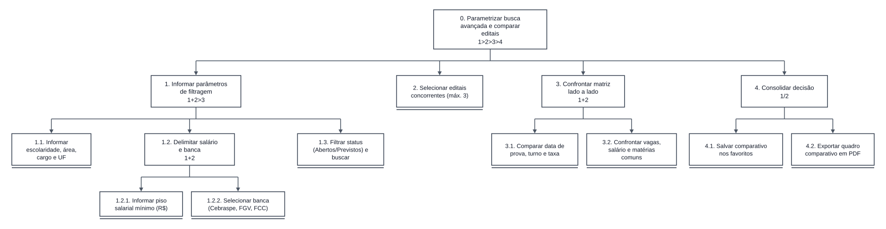
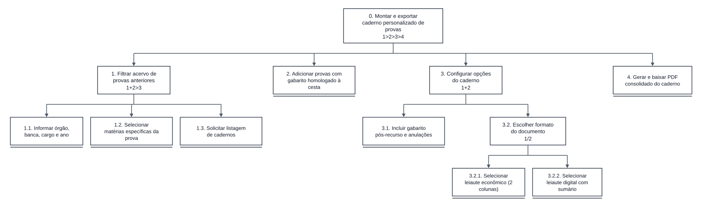
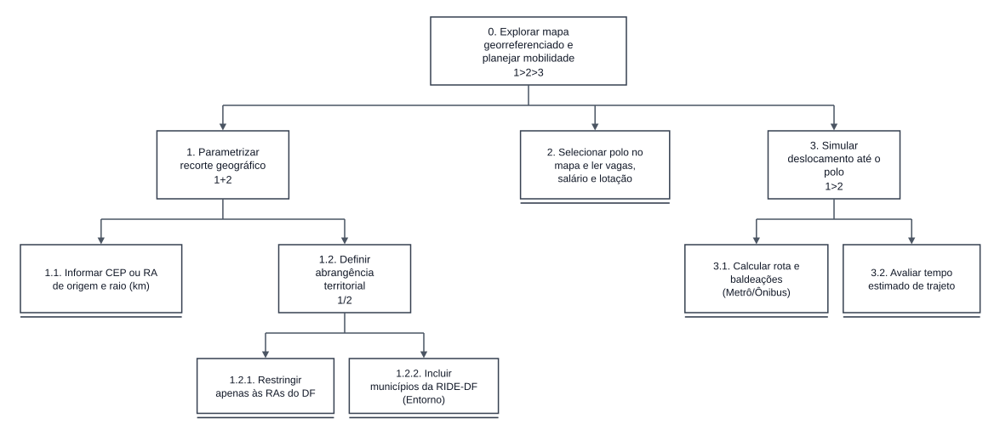
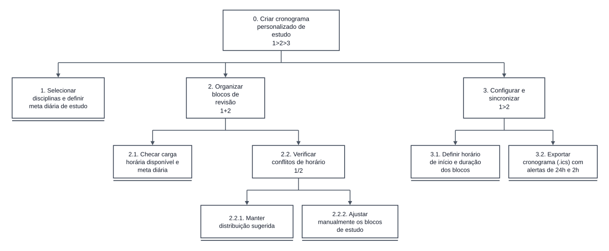
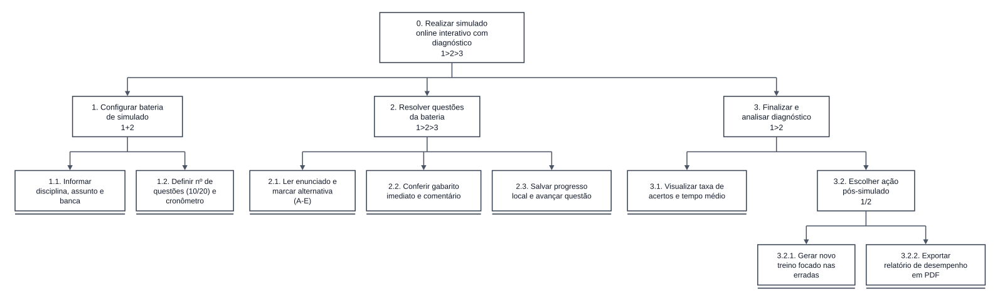
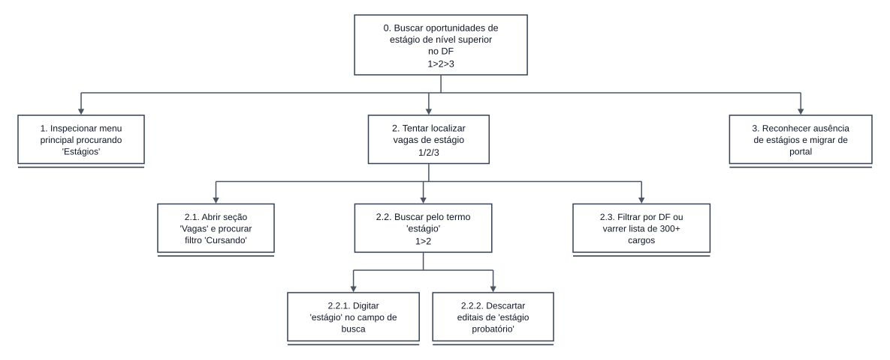
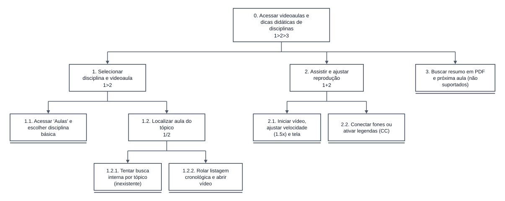
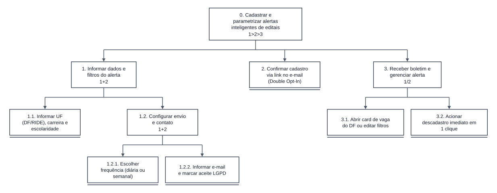

<b>Tabela de Contribuição</b>

| Membro | Contribuição |
| :--- | :--- |
| Daniel da Silva Batista | Fundamentação teórica de HTA (Annett & Duncan, 1967; Barbosa e Silva, 2010), elaboração da tabela de legenda da notação, estruturação da matriz de tarefas, modelagem formal completa com diagramas e tabelas das Tarefas 01 e 02 e organização dos templates para a equipe. |
| Arthur Sismene Carvalho | Revisão da decomposição funcional e modelagem HTA integral das Tarefas 05 e 06 (diagramas e tabelas analíticas), incluindo a caracterização da TAR-06 como tarefa não suportada e o levantamento da colisão terminológica de "estágio". |
| Leonardo da Silva Lopes Júnior | Modelagem formal completa em HTA (diagramas de decomposição e tabelas analíticas com problemas e recomendações de usabilidade) das Tarefas 07 e 08, fundamentadas em DOC-04 e na persona Renata Cristina Freitas (PER-04); estruturação da Seção 2.1 de enquadramento ergonômico e níveis de complexidade, e refinamento do escopo de tarefas interativas propositivas (TAR-04, TAR-05 e TAR-08) (Issue #14). |
| Pedro Rocha Ferreira Lima | Modelagem formal completa em HTA (diagramas e tabelas analíticas com problemas e recomendações) das Tarefas 03 e 04 com base no método sem usuário (DOC-02) e na persona Lucas Ferreira Rocha. |
| Gemini | Geração dos diagramas HTA vetoriais na notação oficial de Barbosa et al. (2021, Figura 8.1) e auxílio na estruturação textual do artefato em Markdown (conforme Política de Uso de IA). |

<b>Fonte:</b> Daniel da Silva Batista (2026).

# Análise Hierárquica de Tarefas (HTA)

## 1. Introdução e Fundamentação Teórica

A **Análise Hierárquica de Tarefas** (*Hierarchical Task Analysis* - HTA), desenvolvida originalmente por Annett e Duncan (1967) e detalhada por Barbosa et al. (2021, Cap. 8, Seção 8.2.1) e Barbosa e Silva (2010, Cap. 8.4), é um dos métodos clássicos e mais consolidados de análise de tarefas em Interação Humano-Computador. A técnica baseia-se na decomposição funcional de alto nível dos **objetivos** de um usuário em **subobjetivos** menores e, no nível mais baixo da árvore, em **operações** elementares — que correspondem às ações concretas executadas por pessoas ou sistemas para atingir cada estado desejado.

No HTA, conforme preceituam Barbosa et al. (2021), a decomposição de um objetivo em subobjetivos é regida por um **plano**, que define os subobjetivos necessários e as relações lógicas de execução entre eles: **sequencial (`>`)**, **seleção (`/`)** ou **paralelo (`+`)**. A Figura 0 e a Tabela 1 sintetizam a notação oficial adotada nos diagramas deste artefato:

<b>Figura 0:</b> Elementos de um diagrama HTA segundo o livro-texto IHC-UX

{ width="580" }

<b>Fonte:</b> Barbosa et al. (2021, Figura 8.1 — <i>Interação Humano-Computador e Experiência do Usuário</i>).

<b>Tabela 1: Notação e Legenda dos Elementos da HTA (Barbosa et al., 2021)</b>

| Elemento Gráfico / Estrutural | Representação no Diagrama | Significado e Função Metodológica |
| :--- | :---: | :--- |
| **Objetivo / Subobjetivo** | Caixa retangular simples `[ objetivo ]` com numeração hierárquica (`0.`, `1.`, `1.2.`) | Estado que o usuário deseja atingir e que ainda se decompõe em subobjetivos ou operações, trazendo na linha inferior a expressão algébrica do plano (`1>2`, `1/2`, `1+2`). |
| **Operação (Nível Mais Baixo)** | Caixa retangular com **linha horizontal abaixo da borda inferior** `[ operação ]` | Unidade terminal da decomposição HTA; especifica em nível mais baixo de abstração a ação concreta e os dados informados/manipulados pelo usuário ou sistema. |
| **Relação Sequencial (`>`)** | `1>2` (ou `1>2>3`) | O subobjetivo/operação `1` deve ser concluído antes do início do subobjetivo/operação `2`. |
| **Relação de Seleção (`/`)** | `1/2` (ou `1/2/3`) | Escolha condicional ou alternativa: executa-se `1` **ou** `2`, conforme a regra detalhada no rodapé específico de cada diagrama. |
| **Relação Paralela (`+`)** | `1+2` | Os subobjetivos `1` e `2` são ambos realizados, em paralelo ou em qualquer ordem, antes da etapa subsequente (ex.: `1+2>3`). |

<b>Fonte:</b> Daniel da Silva Batista (2026), com base em Barbosa et al. (2021, Figura 8.1) e Annett & Duncan (1967).

---

## 2. Matriz de Tarefas do PCI Concursos

Com base nos perfis de usuário delineados na pesquisa de requisitos e no escopo funcional do portal **PCI Concursos**, a Tabela 2 consolida as **oito tarefas representativas** modeladas pela equipe (duas tarefas por integrante ativo):

<b>Tabela 2: Matriz Oficial de Tarefas Avaliadas</b>

| ID | Descrição da Tarefa | Integrante Responsável |
| :---: | :--- | :--- |
| **TAR-01** | Parametrizar busca avançada multicritério e comparar editais concorrentes lado a lado | Daniel da Silva Batista |
| **TAR-02** | Montar e exportar caderno personalizado de provas anteriores com gabarito comentado integrado | Daniel da Silva Batista |
| **TAR-03** | Explorar mapa interativo georreferenciado de oportunidades com cálculo de mobilidade (DF e RIDE) | Pedro Rocha Ferreira Lima |
| **TAR-04** | Acompanhar timeline interativa de fases do certame com simulador de prazos recursais e sincronização de calendário | Pedro Rocha Ferreira Lima |
| **TAR-05** | Realizar simulado de questões online interativo com feedback automático de gabarito e diagnóstico de desempenho | Arthur Sismene Carvalho |
| **TAR-06** | Buscar oportunidades de estágio de nível superior no DF *(Tarefa não suportada)* | Arthur Sismene Carvalho |
| **TAR-07** | Acessar videoaulas e dicas teóricas de disciplinas | Leonardo da Silva Lopes Júnior |
| **TAR-08** | Cadastrar e parametrizar alertas inteligentes de editais por e-mail com filtros avançados multicritério | Leonardo da Silva Lopes Júnior |

<b>Fonte:</b> Daniel da Silva Batista e Pedro Rocha Ferreira Lima (2026).

---

## 3. Modelagem Detalhada das Tarefas (Daniel da Silva Batista)

### 3.1 Tarefa 01: Parametrizar busca avançada multicritério e comparar editais concorrentes lado a lado (TAR-01)

A Tarefa 01 foi reformulada para superar o modelo elementar de busca textual isolada, elevando o nível de maturidade ergonômica da plataforma. A tarefa modela o processo decisório de concurseiros adultos — representados pela persona primária **Maria Helena dos Santos (`PER-01`)** —, que necessitam conciliar múltiplos critérios de elegibilidade (escolaridade, faixa remuneratória, banca examinadora, lotação geográfica e status do certame) e confrontar diretamente certames com cronogramas conflitantes ou conteúdos programáticos concorrentes.

A decomposição hierárquica de objetivos e planos da Tarefa 01 é ilustrada na Figura 1, e a especificação detalhada de suas operações funcionais, problemas identificados e recomendações de design é apresentada na Tabela 2.

#### Diagrama de Decomposição HTA (Figura 1)

<b>Figura 1:</b> Diagrama HTA da Tarefa 01 - Parametrizar busca avançada multicritério e comparar editais concorrentes

<b>Fonte:</b> Daniel da Silva Batista (2026), em conformidade com a notação de Barbosa et al. (2021, Figura 8.1) e Persona PER-01.

#### Tabela HTA: Objetivos, Operações, Problemas e Recomendações

<b>Tabela 2: Análise HTA da Tarefa 01</b>

| Objetivos / Operações | Relações / Planos | Problemas Identificados | Recomendações de Usabilidade |
| :--- | :--- | :--- | :--- |
| **0. Parametrizar busca avançada e comparar editais concorrentes** | **Plano `0.` (`1>2>3>4`):** Executar 1, 2 e 3 em sequência. Se houver sobreposição de certames ou necessidade de escolha estratégica, executar 4. | O portal atual limita-se a um campo textual raso, desprovido de filtros combinados e de qualquer ferramenta de comparação entre certames. | Projetar mecanismo de busca facetada multicritério integrado a uma matriz comparativa lado a lado (`RF-DOC-01`). |
| **1. Definir parâmetros da busca avançada** | **Plano `1.` (`1+2+3>4`):** Executar 1.1, 1.2 e 1.3 em qualquer ordem (`+`); depois 1.4 (`>`). | **Inexistência de busca facetada:** o usuário é obrigado a realizar buscas textuais repetidas e navegar manualmente em múltiplas páginas. | Disponibilizar formulário de busca avançada com seletores dinâmicos de escolaridade, faixa salarial, banca e abrangência territorial. |
| **1.1 Especificar escolaridade e área** | Operação funcional | Ausência de taxonomia padronizada de cargos e áreas no mecanismo de consulta. | Implementar autocompletar semântico com agrupamento por carreira (ex.: Administrativa, Fiscal, TI). |
| **1.2 Delimitar faixa salarial e banca** | Operação funcional | Salários e bancas estão dispersos em textos corridos não indexados de forma estruturada. | Criar controles deslizantes (*sliders*) de remuneração e seleção múltipla de bancas examinadoras. |
| **1.3 Filtrar situação do certame** | Operação funcional | Certames suspensos, previstos e encerrados misturam-se indiscriminadamente na mesma listagem. | Adicionar filtros por status do edital com etiquetas visuais padronizadas (`[Inscrições Abertas]`, `[Previsto]`). |
| **1.4 Submeter parâmetros de consulta** | Operação de sistema | A busca atual recarrega a página inteira de forma síncrona, descartando seleções parciais. | Implementar filtragem reativa instantânea sem recarregamento da página (AJAX). |
| **2. Analisar certames e selecionar concorrentes** | **Plano `2.` (`1>2`):** Executar 2.1 e depois 2.2 (`>`). | Ausência de recurso para selecionar e fixar múltiplos certames para posterior confrontação. | Adicionar caixa de seleção (*checkbox*) em cada card de concurso: *"Adicionar à Comparação (máx. 3)"*. |
| **2.1 Avaliar aderência ao perfil** | Operação cognitiva | Cards de resultado apresentam layout sobrecarregado de publicidade contextual concorrente. | Isolar os resultados em cards limpos com tipografia contrastante e dados essenciais visíveis. |
| **2.2 Marcar certames concorrentes** | Operação funcional | O usuário perde o contexto ao abrir dezenas de abas simultâneas do navegador para analisar opções. | Exibir barra inferior flutuante (*dock*) exibindo os certames marcados para comparação direta. |
| **3. Confrontar matriz comparativa lado a lado** | **Plano `3.` (`1+2+3`):** Executar 3.1, 3.2 e 3.3 simultaneamente na matriz (`+`). | **Funcionalidade Ausente no Portal:** Impossibilidade de contrastar regras de editais concorrentes sem leitura integral dos anexos em PDF. | Construir visualização em grade tabular comparando os certames lado a lado em colunas paralelas (`RF-DOC-01`). |
| **3.1 Comparar datas de prova e taxas** | Operação cognitiva | Risco crítico de inscrição em dois certames que terão provas aplicadas no mesmo turno/data. | Sinalizar com alerta cromático de conflito quando as datas de prova coincidirem. |
| **3.2 Confrontar distribuição de vagas** | Operação cognitiva | Dificuldade para identificar cota de vagas para ampla concorrência, PCD e cadastro reserva. | Exibir tabela resumida com divisão de vagas imediatas e valor da remuneração inicial. |
| **3.3 Analisar convergência de disciplinas** | Operação cognitiva | Alto custo de atenção para mapear o percentual de disciplinas comuns entre os conteúdos programáticos. | Calcular índice percentual de afinidade de conteúdo (ex.: *"75% de matérias comuns entre os dois editais"*). |
| **4. Deliberar priorização e exportar síntese** | **Plano `4.` (`1/2`):** Executar 4.1 ou 4.2 (`/`) dependendo da preferência de arquivamento. | Impossibilidade de armazenar ou compartilhar a análise comparativa gerada. | Disponibilizar persistência em área de certames monitorados e exportação de sumário em PDF/impresso. |
| **4.1 Salvar painel nos favoritados** | Operação funcional | Falta de recurso de memorização de certames de interesse para acompanhamento contínuo. | Permitir fixação dos certames no painel do concurseiro com persistência local no navegador. |
| **4.2 Exportar relatório comparativo** | Operação funcional | Ausência de extrato consolidado para tomada de decisão em ambiente offline. | Gerar documento PDF sintetizado com a grade comparativa de oportunidades. |

<b>Fonte:</b> Daniel da Silva Batista (2026), com base na Análise Documental DOC-01 e na Persona PER-01.

---

### 3.2 Tarefa 02: Montar e exportar caderno personalizado de provas anteriores com gabarito comentado integrado (TAR-02)

A Tarefa 02 transcende o download elementar e passivo de arquivos isolados, remodelando a preparação prática por resolução de questões. Na rotina da persona primária **Maria Helena dos Santos (`PER-01`)**, que dispõe de tempo restrito de estudo e prioriza treino por repetição com cadernos impressos ou anotados, o modelo mental exige um compilador unificado de provas anteriores por disciplina, banca e ano, com gabarito oficial pós-recurso integrado e sem a intrusão de falsos botões de download patrocinados.

A decomposição da Tarefa 02 é apresentada no diagrama da Figura 2, e sua correspondente análise detalhada de operações, problemas e recomendações é fornecida na Tabela 3.

#### Diagrama de Decomposição HTA (Figura 2)

<b>Figura 2:</b> Diagrama HTA da Tarefa 02 - Montar e exportar caderno personalizado de estudos com gabarito

<b>Fonte:</b> Daniel da Silva Batista (2026), em conformidade com a notação de Barbosa et al. (2021, Figura 8.1) e Persona PER-01.

#### Tabela HTA: Objetivos, Operações, Problemas e Recomendações

<b>Tabela 3: Análise HTA da Tarefa 02</b>

| Objetivos / Operações | Relações / Planos | Problemas Identificados | Recomendações de Usabilidade |
| :--- | :--- | :--- | :--- |
| **0. Montar e exportar caderno personalizado com gabarito** | **Plano `0.` (`1>2>3>4`):** Executar 1, 2, 3 e 4 em sequência estrita (`>`). | Fragmentação extrema: o candidato precisa baixar arquivos PDF avulsos de provas e gabaritos em links separados, organizando tudo manualmente. | Projetar compilador de cadernos de estudo personalizados com unificação de provas, gabaritos e sumários (`RF-DOC-02`). |
| **1. Filtrar repositório de provas anteriores** | **Plano `1.` (`1+2+3>4`):** Executar 1.1, 1.2 e 1.3 em qualquer ordem (`+`); depois 1.4 (`>`). | O acervo de provas é exibido como uma lista alfabética estática e massiva, sem mecanismos de busca facetada por banca ou ano. | Implementar filtros estruturados com paginação dinâmica e busca instantânea por banca e cargo. |
| **1.1 Selecionar órgão, banca e ano** | Operação funcional | Falta de filtro combinado: não é possível selecionar simultaneamente "Cebraspe + 2023 a 2025". | Permitir seleção múltipla de anos de aplicação e bancas examinadoras. |
| **1.2 Especificar cargo ou escolaridade** | Operação funcional | Nomes de cargos sofrem com inconsistências ortográficas na base de dados antiga. | Normalizar a taxonomia de cargos por agrupamento de carreiras. |
| **1.3 Segmentar disciplinas temáticas** | Operação funcional | As provas só estão disponíveis na íntegra, sem possibilidade de extrair apenas matérias básicas (ex.: Português e Raciocínio Lógico). | Implementar categorização temática de blocos de questões por disciplina. |
| **1.4 Requisitar listagem de cadernos** | Operação de sistema | Lentidão no carregamento da tabela com grande volume de itens. | Adicionar pré-carregamento assíncrono com feedback de progresso. |
| **2. Selecionar cadernos e compor pacote** | **Plano `2.` (`1>2`):** Executar 2.1 e depois 2.2 (`>`). | Ausência de cesta/carrinho de estudo para agrupar múltiplos cadernos antes de descarregar. | Criar componente de "Montador de Caderno" onde o usuário adiciona cadernos com um único comando. |
| **2.1 Inspecionar cadernos e gabaritos** | Operação cognitiva | Falta de clareza sobre qual gabarito é o definitivo após os recursos judiciais/administrativos. | Exibir selo explícito: `[Gabarito Definitivo Homologado - 2 Questões Anuladas]`. |
| **2.2 Adicionar cadernos ao pacote** | Operação funcional | O usuário perde a conta de quantos arquivos já baixou individualmente no computador. | Exibir sumário em tempo real com contador de itens e estimativa de páginas totais. |
| **3. Configurar parâmetros de geração** | **Plano `3.` (`1+2+3`):** Executar 3.1, 3.2 e 3.3 simultaneamente (`+`) nas opções de compilação. | **Inexistência de personalização:** o usuário é obrigado a imprimir dezenas de páginas com layouts e cabeçalhos poluídos de terceiros. | Oferecer painel de opções de compilação gráfica e pedagógica antes da geração final do documento. |
| **3.1 Definir gabarito com sinalização** | Operação funcional | Gabaritos separados obrigam o estudante a alternar entre documentos ou telas para checar respostas. | Incorporar a chave de respostas ao final de cada bloco de prova com anulações devidamente justificadas. |
| **3.2 Selecionar modo de formatação** | Operação funcional | Arquivos PDF convencionais gastam muita tinta e papel com cabeçalhos e publicidade embutida. | Disponibilizar opção de "Modo Impressão Econômica" (duas colunas compactas, sem imagens decorativas). |
| **3.3 Habilitar folhas de rascunho e índice** | Operação funcional | O documento gerado carece de numeração de páginas sequencial contínua para estudo impresso. | Adicionar sumário interativo com numeração contínua e páginas de gabarito para simulação de preenchimento. |
| **4. Compilar e exportar caderno de estudos** | **Plano `4.` (`1>2`):** Executar 4.1 e depois 4.2 (`>`). | **Problema Crítico de Usabilidade e Segurança:** Presença de anúncios com botões fraudulentos de "Download", induzindo ao erro. | Isolar o fluxo de compilação em ambiente protegido, com entrega direta do documento indexado via download verificado. |
| **4.1 Iniciar compilação com validação** | Operação de sistema | Arquivos corrompidos ou links quebrados no repositório antigo causam erros sem mensagem clara. | Realizar checagem de integridade dos PDFs antes de consolidar o pacote final. |
| **4.2 Descarregar arquivo indexado** | Operação funcional | Download interceptado por janelas pop-up ou abertura forçada na mesma guia de navegação. | Disparar salvamento direto do arquivo PDF consolidado com nomenclatura padronizada (ex.: `Caderno_Estudos_MariaHelena_Cebraspe.pdf`). |

<b>Fonte:</b> Daniel da Silva Batista (2026), com base na Análise Documental DOC-01 e na Persona PER-01.

---

## 4. Modelagem Detalhada das Tarefas (Pedro Rocha Ferreira Lima)

### 4.1 Tarefa 03: Explorar mapa interativo georreferenciado de oportunidades com cálculo de mobilidade (DF e RIDE) (TAR-03)

A Tarefa 03 investiga o processo de busca, filtragem e planejamento geográfico no Distrito Federal e em sua Região Integrada de Desenvolvimento (RIDE), foco central da persona **Lucas Ferreira Rocha (`PER-02`)**. Respaldada pelas evidências da Análise Documental (`DOC-02`), que apontam que mais de 65% das vagas públicas da Região Centro-Oeste concentram-se no DF e seu entorno imediato, a tarefa supera a simples listagem de texto ao prover uma interface cartográfica interativa. Ela permite ao candidato aplicar filtros por raio de distância da sua moradia e calcular o tempo estimado de deslocamento em transporte público até os polos de aplicação de provas e de lotação dos órgãos.

A decomposição hierárquica é ilustrada na Figura 3, e a especificação detalhada de suas operações funcionais, problemas e recomendações é apresentada na Tabela 4.

#### Diagrama de Decomposição HTA (Figura 3)

<b>Figura 3:</b> Diagrama HTA da Tarefa 03 - Explorar mapa interativo georreferenciado com cálculo de mobilidade

<b>Fonte:</b> Pedro Rocha Ferreira Lima (2026), em conformidade com a notação de Barbosa et al. (2021, Figura 8.1), DOC-02 e Persona PER-02.

#### Tabela HTA: Objetivos, Operações, Problemas e Recomendações

<b>Tabela 4: Análise HTA da Tarefa 03</b>

| Objetivos / Operações | Relações / Planos | Problemas Identificados | Recomendações de Usabilidade |
| :--- | :--- | :--- | :--- |
| **0. Explorar mapa georreferenciado e planejar mobilidade** | **Plano `0.` (`1>2>3>4`):** Executar 1, 2 e 3 em sequência. Caso o candidato dependa de transporte intermunicipal no Entorno, executar 4. | O portal atual agrupa todos os estados do Centro-Oeste em lista estática corrida, sem mapa ou dados de lotação distrital. | Desenvolver visualização cartográfica interativa do DF/RIDE com cálculo de mobilidade integrada (`RF-DOC-03`). |
| **1. Parametrizar visualização no mapa** | **Plano `1.` (`1+2>3`):** Executar 1.1 e 1.2 simultaneamente (`+`); depois 1.3 (`>`). | Ausência de qualquer componente geográfico ou filtro por proximidade territorial. | Incorporar mapa vetorial reativo com seletores de Região Administrativa e raio em km. |
| **1.1 Delimitar ponto de origem no DF** | Operação funcional | O usuário precisa adivinhar quais órgãos têm sede próxima ao seu local de residência. | Permitir informar o bairro/RA de residência (ex.: Ceilândia, Taguatinga, Plano Piloto). |
| **1.2 Definir raio de alcance máximo** | Operação funcional | Falta de estimativa de esforço de deslocamento para concurseiros que dependem de ônibus/metrô. | Inserir controle deslizante (*slider*) de raio geográfico (5 km a 50 km). |
| **1.3 Requisitar renderização da malha** | Operação de sistema | Carga visual densa ao carregar centenas de pontos simultaneamente na tela. | Implementar agrupamento dinâmico de marcadores (*marker clustering*) por densidade de vagas. |
| **2. Inspecionar polos e agrupamentos** | **Plano `2.` (`1>2`):** Executar 2.1 e depois 2.2 (`>`). | Dificuldade para saber se a vaga é para o órgão central em Brasília ou posto regional descentralizado. | Diferenciar no marcador cartográfico a sede do órgão e os polos de prova. |
| **2.1 Explorar agrupamentos por RA** | Operação cognitiva | Sobrecarga de leitura de siglas em listas longas sem referência espacial. | Exibir painel lateral expansível com lista de concursos associados ao agrupamento selecionado. |
| **2.2 Examinar ficha territorial do órgão** | Operação funcional | O portal não informa os possíveis locais de lotação física do aprovado. | Apresentar card síntese contendo vagas, salário e endereços prováveis de exercício funcional. |
| **3. Simular itinerário e tempo em transporte** | **Plano `3.` (`1>2`):** Executar 3.1 e depois 3.2 (`>`). | **Funcionalidade Inexistente no Portal:** O candidato não sabe quanto tempo levará até o local de prova no domingo de manhã. | Integrar estimativa de tempo e itinerário com serviços de transporte público distrital (Metrô-DF e ônibus). |
| **3.1 Requisitar rota estimada e conexões** | Operação funcional | Risco de atraso e eliminação por desconhecimento das linhas dominicais de transporte. | Exibir tempo estimado de deslocamento em transporte público com indicação de baldeações. |
| **3.2 Avaliar viabilidade de deslocamento** | Operação cognitiva | Candidatos desistem de concursos após a inscrição ao perceberem incompatibilidade geográfica. | Gerar indicador de compatibilidade de mobilidade (ex.: *"Deslocamento estimado: 45 min"*). |
| **4. Expandir para municípios da RIDE-DF** | **Plano `4.` (`1>2`):** Executar 4.1 e depois 4.2 (`>`) se aplicável. | Concursos municipais de cidades vizinhas (ex.: Águas Lindas, Luziânia) ficam perdidos na seção genérica de Goiás. | Disponibilizar camada de visualização unificada DF + RIDE com filtragem específica de linhas intermunicipais. |
| **4.1 Habilitar camada do Entorno** | Operação funcional | Falta de visibilidade de seleções públicas na fronteira interestadual imediata. | Inserir alternador (*switch*) dedicado para exibição de oportunidades na RIDE. |
| **4.2 Filtrar por compatibilidade de transporte** | Operação funcional | Dificuldades extremas de horários em ônibus interestaduais não são alertadas ao candidato. | Destacar certames municipais com facilidade de acesso rodoviário direto a partir do DF. |

<b>Fonte:</b> Pedro Rocha Ferreira Lima (2026), com base na Análise Documental DOC-02 e na Persona PER-02.

---

### 4.2 Tarefa 04: Acompanhar timeline interativa de fases do certame com simulador de prazos recursais e sincronização de calendário (TAR-04)

A Tarefa 04 compreende o monitoramento do ciclo de vida de um concurso público, atividade essencial identificada na Análise Documental (`DOC-02`), segundo a qual até 80% dos editais sofrem retificações em suas semanas inaugurais. Centrada na persona **Lucas Ferreira Rocha (`PER-02`)**, a tarefa foi estruturada com alto dinamismo interativo: o candidato explora a linha do tempo cronológica de fases, inspeciona erratas com ferramenta visual de comparação de texto (*diff* antes x depois), utiliza um simulador de prazos de recursos (calculando dias úteis e horário de fechamento bancário) e exporta marcos diretamente para sua agenda digital (.ics / Google Agenda).

A decomposição hierárquica é ilustrada na Figura 4, e sua especificação analítica é descrita na Tabela 5.

#### Diagrama de Decomposição HTA (Figura 4)

<b>Figura 4:</b> Diagrama HTA da Tarefa 04 - Acompanhar timeline interativa com simulador de prazos recursais

<b>Fonte:</b> Pedro Rocha Ferreira Lima (2026), em conformidade com a notação de Barbosa et al. (2021, Figura 8.1), DOC-02 e Persona PER-02.

#### Tabela HTA: Objetivos, Operações, Problemas e Recomendações

<b>Tabela 5: Análise HTA da Tarefa 04</b>

| Objetivos / Operações | Relações / Planos | Problemas Identificados | Recomendações de Usabilidade |
| :--- | :--- | :--- | :--- |
| **0. Acompanhar timeline e simular prazos recursais** | **Plano `0.` (`1>2>4/1>2>3>4`):** Executar 1, 2 e 4 (`>`); se houver errata publicada (`/`), incluir 3 antes de 4. | **Risco Crítico de Perda de Prazos:** Editais com retificações não exibem alertas claros e não contam com linha do tempo de fases, induzindo à leitura exaustiva de PDFs. | Projetar componente de Timeline Interativa com comparador de retificações, calculadora de recursos e integração com agendas (`RF-DOC-04`). |
| **1. Acessar timeline cronológica** | **Plano `1.` (`1>2`):** Executar 1.1 e depois 1.2 (`>`). | Links de acesso competem com blocos de publicidade invasiva no cabeçalho. | Padronizar acesso ao painel do certame com card estruturado em destaque no topo. |
| **1.1 Selecionar certame na listagem/mapa** | Operação funcional | Falta de indicação visual sobre o estado atual do certame (ex.: fase de inscrição vs. fase de prova). | Exibir badges de status padronizados: `[Inscrições]`, `[Recursos]`, `[Homologado]`. |
| **1.2 Carregar painel interativo de etapas** | Operação de sistema | Páginas lentas e saltos de leiaute (*Cumulative Layout Shift*) ao carregar scripts publicitários. | Garantir estabilidade visual imediata da timeline durante o carregamento inicial. |
| **2. Navegar nas etapas e contadores** | **Plano `2.` (`1>2`):** Executar 2.1 e depois 2.2 (`>`). | Inexistência de representação gráfica do ciclo de vida do concurso (Inscrição $\rightarrow$ Isenção $\rightarrow$ Prova $\rightarrow$ Gabarito $\rightarrow$ Resultados). | Implementar timeline gráfica horizontal com nós interativos e indicação cromática da fase vigente. |
| **2.1 Inspecionar nós de etapas** | Operação cognitiva | O candidato precisa calcular mentalmente se determinada etapa já precluiu ou se ainda está aberta. | Adotar semântica cromática consistente: verde (concluído), azul (em andamento) e cinza neutro (futuro). |
| **2.2 Checar contador dinâmico regressivo** | Operação cognitiva | Incerteza sobre a hora limite exata para envio de títulos ou pagamento de boleto bancário. | Exibir contagem regressiva em tempo real: *"Encerra-se em 1 dia, 4 horas e 20 minutos"*. |
| **3. Inspecionar notas de retificação com comparativo** | **Plano `3.` (`1>2`):** Executar 3.1 e depois 3.2 (`>`) se houver retificação. | Erratas são divulgadas como textos pequenos no rodapé; o usuário precisa confrontar múltiplos PDFs manualmente. | Destacar selo de retificação no cabeçalho e oferecer modal de visualização comparativa (*diff* textual). |
| **3.1 Identificar selo de retificação** | Operação cognitiva | O candidato assume incorretamente que as datas antigas continuam válidas. | Posicionar badge âmbar destacado: `[⚠️ Retificação Publicada em DD/MM]`. |
| **3.2 Acionar visualizador comparativo de texto** | Operação funcional | Cansaço visual e risco de não perceber alterações sutis em requisitos de posse ou conteúdos de prova. | Exibir janela modal com realce de exclusão (tachado em vermelho) e inclusão (verde) das cláusulas retificadas. |
| **4. Simular prazos recursais e sincronizar** | **Plano `4.` (`1>2`):** Executar 4.1 e depois 4.2 (`>`). | **Funcionalidade Ausente no Portal:** Não há como calcular o prazo final de recursos nem exportar eventos para calendários digitais. | Construir calculadora de prazos processuais/bancários e exportador de eventos padrão RFC 5545 (`.ics`). |
| **4.1 Calcular prazo final e horário bancário** | Operação funcional | Candidatos perdem o prazo de recurso por desconsiderarem feriados locais ou horário de compensação bancária. | Desenvolver simulador que calcule a data fatal exata considerando horário bancário e dias úteis distritais. |
| **4.2 Exportar alertas para calendário (.ics)** | Operação funcional | Necessidade de transcrever manualmente todas as datas para a agenda do smartphone. | Disponibilizar botão de exportação com geração automática de alertas programados para 24h e 2h antes do prazo final. |

<b>Fonte:</b> Pedro Rocha Ferreira Lima (2026), com base na Análise Documental DOC-02 e na Persona PER-02.

---

---

## 5. Modelagem Detalhada das Tarefas (Arthur Sismene Carvalho)

### 5.1 Tarefa 05: Realizar simulado de questões online interativo com feedback automático de gabarito e diagnóstico de desempenho (TAR-05)

A decomposição hierárquica da Tarefa 05 é ilustrada na Figura 5, e a especificação de suas operações, problemas e recomendações é apresentada na Tabela 6. A modelagem considera o contexto de uso da persona **PER-03 (Thiago Moraes Albuquerque)**: execução em smartphone, em deslocamento de transporte público, sob conexão celular móvel instável.

#### Diagrama de Decomposição HTA (Figura 5)

<b>Figura 5:</b> Diagrama HTA da Tarefa 05 - Realizar simulado de questões online interativo

<b>Fonte:</b> Arthur Sismene Carvalho e Leonardo da Silva Lopes Júnior (2026), em conformidade com a notação de Barbosa et al. (2021, Figura 8.1), DOC-03 e Persona PER-03.

#### Tabela HTA: Objetivos, Operações, Problemas e Recomendações

<b>Tabela 6: Análise HTA da Tarefa 05</b>

| Objetivos / Operações | Relações / Planos | Problemas Identificados | Recomendações de Usabilidade |
| :--- | :--- | :--- | :--- |
| **0. Realizar simulado online interativo com feedback automático de gabarito** | **Plano `0.` (`1>2>3>4`):** Executar 1 e 2 (`>`); responder em 3 até concluir a bateria (`>`); consolidar em 4. | O portal atual trata o simulado como mera listagem corrida estática de questões, sem temporizador, sem feedback imediato e sem placar final. | Reconceber como **motor interativo de avaliação**: parametrizar, executar com feedback formativo imediato e emitir relatório de desempenho (`RF-DOC-04`). |
| **1. Acessar a seção de Simulados** | **Plano `1.` (`1>2`):** Executar 1.1 e depois 1.2 (`>`). | O link de simulados concorre com 15 itens sem agrupamento e compete com banners publicitários flutuantes. | Agrupar ferramentas de estudo na barra de navegação com destaque visual e ícones ilustrativos. |
| **1.1 Localizar item no menu** | Ação visual | Em tela de celular o menu exige rolagem longa e não traz ícones de identificação rápida. | Implementar barra de atalhos rápidos fixada no rodapé da visualização mobile com ícone de lápis/questões. |
| **1.2 Aguardar carregamento** | Tarefa de sistema | Blocos de propaganda causam saltos repentinos de tela (*Cumulative Layout Shift* - CLS), deslocando o conteúdo. | Reservar contêineres de altura fixa para publicidade garantindo *Zero CLS* durante o carregamento. |
| **2. Parametrizar sessão de simulado** | **Plano `2.` (`1+2>3`):** Executar 2.1 e 2.2 (`+`) e depois 2.3 (`>`). | **Funcionalidade Inexistente no Portal Atual:** O usuário não consegue escolher quantas questões quer resolver (10, 20 ou 30) nem colocar tempo limite. | Inserir configurador prévio de sessão: filtros de disciplina, banca examinadora, quantidade de itens e modo cronometrado. |
| **2.1 Selecionar disciplina e banca** | Ação física | Listagem hierárquica longa sem campo de busca instantânea nem histórico de matérias recentes. | Adicionar busca preditiva por disciplina e chips com bancas mais frequentes (Cebraspe, FGV, FCC). |
| **2.2 Refinar por assunto** | Ação física | Contagens de questões não informam o tempo médio estimado para resolução. | Exibir estimativa de tempo (ex.: *"10 questões ≈ 15 a 20 min"*). |
| **2.3 Definir volume e cronômetro** | Ação física | Falta de controle temporal: candidatos precisam treinar ritmo de prova contra o relógio. | Disponibilizar temporizador com contagem regressiva e aviso sonoro/visual discreto aos 5 minutos finais. |
| **3. Responder questões em mobile** | **Plano `3.` (`1>2>3>4`):** Executar 3.1 a 3.4 em sequência (`>`) para cada questão da bateria. | Áreas de toque muito reduzidas e instabilidade de conexão causam perda de dados em transporte público. | Assegurar alvos de toque $\ge 48\text{px}$ (WCAG 2.1 AA) e persistência local (*Zero Data Loss* via `localStorage`). |
| **3.1 Ler enunciado em tipografia fluida** | Operação cognitiva | Fontes minúsculas exigem gestos contínuos de zoom com os dedos em telas touch. | Adotar tipografia fluida com tamanho mínimo de 16px para enunciados e 14px para alternativas. |
| **3.2 Marcar alternativa escolhida** | Operação funcional | Seleção acidental na opção vizinha devido ao espaçamento insuficiente entre alternativas em tela touch. | Transformar todo o contêiner retangular da opção em área acionável com feedback cromático imediato (*active*). |
| **3.3 Receber feedback e comentário** | Tarefa de sistema | Ausência de feedback formativo: o sistema não explica a regra gramatical ou jurídica após a marcação. | Exibir caixa retrátil com o gabarito oficial e justificativa didática comentada por professores. |
| **3.4 Avançar com persistência local** | Ação física | Oscilação de rede 4G recarrega a página e descarta todas as questões já resolvidas. | Salvar estado da sessão localmente no dispositivo para retomada transparente sem perda de progresso. |
| **4. Concluir e avaliar diagnóstico** | **Plano `4.` (`1>2`):** Executar 4.1 e depois 4.2 (`>`). | **Grave Falha de IHC:** O candidato encerra o simulado **sem saber quantas questões acertou**, frustrando o objetivo pedagógico. | Gerar relatório de fechamento com total de acertos, gráfico percentual, tempo médio por questão e histórico de estudos. |
| **4.1 Submeter bateria e encerrar** | Ação física | Falta de botão formal de encerramento; o usuário apenas sai da página. | Exibir botão de destaque *"Finalizar Simulado e Ver Resultados"* com tela de confirmação. |
| **4.2 Analisar placar consolidado** | Operação cognitiva | Ausência de métricas de aprendizado para guiar pontos fracos de estudo. | Apresentar painel com acertos, taxa de precisão por subtópico e botão *"Refazer Questões Erradas"*. |

<b>Fonte:</b> Arthur Sismene Carvalho (2026), com base nas estatísticas da ABRES e na Persona PER-03.

---

### 5.2 Tarefa 06: Buscar oportunidades de estágio de nível superior no DF (TAR-06)

!!! warning "Tarefa não suportada pelo sistema"
    A inspeção da arquitetura de informação do PCI Concursos, realizada em 27/09/2026, constatou que **o portal não dispõe de seção, filtro ou categoria dedicada a vagas de estágio**: a seção "Vagas" indexa exclusivamente cargos efetivos de concursos e processos seletivos, e nenhum dos quinze itens do menu principal contempla estágio, estagiário ou programa de trainee.

    A modelagem a seguir, portanto, não descreve um fluxo bem-sucedido, mas o **percurso exploratório de tentativa e erro** que o usuário executa antes de abandonar a tarefa. Conforme Diaper e Stanton (2004), a análise de tarefas malsucedidas constitui evidência de primeira ordem para a identificação de lacunas funcionais, pois expõe requisitos que a modelagem de fluxos bem-sucedidos é incapaz de revelar. O confronto dessa ausência com a demanda reprimida documentada em [`DOC-03`](../perfil-de-usuario.md#53-analise-documental-03-responsavel-arthur-sismene-carvalho) — mais de 18 milhões de estudantes aptos e não colocados em estágio, segundo a ABRES — qualifica o achado como lacuna de alto impacto.

#### Diagrama de Decomposição HTA (Figura 6)

<b>Figura 6:</b> Diagrama HTA da Tarefa 06 - Busca de vagas de estágio (percurso de tentativa e abandono)

<b>Fonte:</b> Arthur Sismene Carvalho (2026), em conformidade com a notação de Barbosa et al. (2021, Figura 8.1), estatísticas da ABRES e Persona PER-03.

#### Tabela HTA: Objetivos, Operações, Problemas e Recomendações

<b>Tabela 7: Análise HTA da Tarefa 06</b>

| Objetivos / Operações | Relações / Planos | Problemas Identificados | Recomendações de Usabilidade |
| :--- | :--- | :--- | :--- |
| **0. Buscar oportunidades de estágio de nível superior no DF** | **Plano `0.` (`1>2/3/4>5`):** Executar 1 (`>`); tentar alternativamente 2, 3 ou 4 (`/`); esgotadas as opções, executar 5 (`>`). | **Lacuna funcional:** o sistema não oferece a funcionalidade buscada, e tampouco comunica essa ausência. O usuário despende cerca de doze minutos em exploração improdutiva antes de desistir. | Criar seção dedicada a estágios, jovem aprendiz e programas de ingresso, indexando processos seletivos de agentes de integração e de órgãos públicos (**RF-DOC-03**). |
| **1. Formular hipótese de localização** | **Plano `1.` (`1>2`):** Executar 1.1 e depois 1.2 (`>`). | Nenhum rótulo do menu comunica o escopo real de cobertura do portal, o que induz o usuário a presumir cobertura universal de oportunidades públicas. | Explicitar o escopo editorial em subtítulo ou descrição de seção (ex.: *"concursos e processos seletivos para cargos efetivos e temporários"*). |
| **1.1 Inspecionar rótulos do menu** | Operação cognitiva | Quinze itens de menu sem agrupamento semântico elevam a carga cognitiva da varredura visual. | Agrupar o menu por finalidade (Oportunidades, Estudo, Referência, Institucional). |
| **1.2 Inferir seção provável** | Operação cognitiva | O rótulo "Vagas" é semanticamente amplo e sugere abrangência que a seção não possui. | Renomear para rótulo específico (ex.: "Vagas por Cargo") ou ampliar a cobertura para corresponder à expectativa gerada. |
| **2. Tentar pela seção 'Vagas'** | **Plano `2.` (`1>2`):** Executar 2.1 e depois 2.2 (`>`). | A seção indexa apenas cargos efetivos, pressupondo candidato já qualificado. Não há filtro por escolaridade em curso nem por modalidade de contratação. | Adicionar faceta "Nível/Escolaridade" contemplando a opção *cursando*, e faceta "Modalidade" (efetivo, temporário, estágio, aprendiz). |
| **2.1 Varrer a listagem** | Ação física/cognitiva | Listagem extensa ordenada por profissão consolidada, sem correspondência possível ao perfil estudantil. | Oferecer estado vazio orientado ao perfil quando nenhum resultado for compatível. |
| **2.2 Procurar filtro de escolaridade** | **Operação frustrada** | O filtro pretendido não existe; o usuário não dispõe de meio para restringir a busca ao seu próprio perfil. | Implementar a faceta como requisito funcional (**RF-DOC-03**). |
| **3. Tentar pela busca textual** | **Plano `3.` (`1>2`):** Executar 3.1 e depois 3.2 (`>`). | **Colisão terminológica crítica:** no domínio de concursos, "estágio" designa majoritariamente o *estágio probatório* — período de avaliação do servidor recém-nomeado, presente em praticamente todos os editais. A busca retorna resultado tecnicamente correto e semanticamente inútil. | Desambiguar as duas acepções no mecanismo de busca, com sugestão explícita do tipo *"Você procura estágio para estudantes ou estágio probatório?"* (**RNF-DOC-03**). |
| **3.1 Digitar o termo 'estágio'** | Ação física | Ausência de autocompletar que antecipe a ambiguidade no momento da digitação. | Exibir sugestões desambiguadoras no autocompletar do campo de busca. |
| **3.2 Triar resultados** | Operação cognitiva | Usuário iniciante no domínio **não distingue as duas acepções** e inicialmente acredita ter encontrado o que buscava, o que prolonga o esforço improdutivo. | Rotular a categoria de cada resultado (ex.: *"menção em edital"* versus *"vaga aberta"*). |
| **4. Tentar pela navegação regional e por cargos** | **Plano `4.` (`1/2`):** Executar 4.1 ou 4.2 (`/`). | Ambos os caminhos retornam exclusivamente cargos permanentes; a listagem de mais de trezentos cargos não contempla a entrada "Estagiário". | Incluir "Estagiário" e "Jovem Aprendiz" na taxonomia de cargos, ainda que apenas para exibir estado vazio informativo. |
| **4.1 Filtrar por Centro-Oeste / DF** | Ação física | O filtro geográfico opera corretamente, mas sobre um acervo que não contém o tipo de oportunidade buscada. | Manter o filtro e estendê-lo ao novo acervo de estágios. |
| **4.2 Varrer listagem de cargos** | Operação cognitiva | Varredura de mais de trezentos itens com alto custo de atenção e resultado nulo. | Substituir varredura manual por busca com tolerância a sinônimos na taxonomia de cargos. |
| **5. Abandonar a tarefa** | **Plano `5.` (`1>2`):** Executar 5.1 e depois 5.2 (`>`). | **Problema mais grave do fluxo:** o sistema nunca informa que não cobre estágio, de modo que o usuário atribui a si o fracasso ("não soube procurar"), com prejuízo à autoconfiança e à percepção de competência. | Implementar estado vazio honesto e prestativo: *"Ainda não cobrimos vagas de estágio. Veja concursos de nível médio e superior com vagas para iniciantes."* |
| **5.1 Atribuir a falha a si** | Operação cognitiva | Violação direta da heurística de Nielsen (1993) de visibilidade do estado do sistema e de mensagens de erro compreensíveis. | Comunicar limitações de escopo de forma explícita e imediata. |
| **5.2 Migrar para portal externo** | Ação física | Perda de retenção de um usuário de longo prazo, que tende a converter-se em concurseiro pleno nos anos subsequentes. | Reter o usuário ofertando alternativa adjacente e cadastro de alerta para quando a cobertura de estágios for lançada. |

<b>Fonte:</b> Arthur Sismene Carvalho (2026), com base nas estatísticas da ABRES e na Persona PER-03.

---

## 6. Modelagem Detalhada das Tarefas (Leonardo da Silva Lopes Júnior)

### 6.1 Tarefa 07: Acessar videoaulas e dicas didáticas de disciplinas (TAR-07)

A Tarefa 07 investiga a navegação, seleção e consumo de conteúdos audiovisuais pedagógicos oferecidos pelo portal PCI Concursos. Esta tarefa é centrada nas demandas da persona primária **Renata Cristina Freitas (`PER-04`)**, concurseira em dupla jornada (trabalho CLT e estudos) que dispõe de janelas curtas de tempo — como intervalos de almoço e deslocamentos — para realizar sessões de microaprendizagem no smartphone. A modelagem fundamenta-se nos dados da Análise Documental [`DOC-04`](../perfil-de-usuario.md#54-analise-documental-04-responsavel-leonardo-da-silva-lopes-junior), apoiada nas pesquisas do Censo EAD.BR (ABED, 2024) e da TIC Domicílios (Cetic.br, 2024), que evidenciam o crescimento do consumo de videoaulas em telas móveis e sob conexões celulares 4G/5G.

A decomposição hierárquica da Tarefa 07 é ilustrada na Figura 7, e sua análise crítica de operações, problemas e recomendações é consolidada na Tabela 8.

#### Diagrama de Decomposição HTA (Figura 7)

<b>Figura 7:</b> Diagrama HTA da Tarefa 07 - Acessar videoaulas e dicas didáticas

<b>Fonte:</b> Leonardo da Silva Lopes Júnior (2026), em conformidade com a notação de Barbosa et al. (2021, Figura 8.1), DOC-04 e Persona PER-04.

#### Tabela HTA: Objetivos, Operações, Problemas e Recomendações

<b>Tabela 8: Análise HTA da Tarefa 07</b>

| Objetivos / Operações | Relações / Planos | Problemas Identificados | Recomendações de Usabilidade |
| :--- | :--- | :--- | :--- |
| **0. Acessar videoaulas e dicas didáticas de disciplinas** | **Plano `0.` (`1>2>3>4`):** Executar 1, 2 e 3 em sequência. Em contextos ruidosos ou mobile, executar 4. Caso o estudante busque aprofundamento ou progressão didática contínua, tentar 5. | **Ausência de trilha pedagógica estruturada:** o sistema exibe vídeos como elementos soltos em repositório plano, sem indicação de sequência lógica, pré-requisitos, profundidade ou aderência a editais específicos. | Reestruturar a seção sob a forma de "Trilhas de Aprendizagem por Carreira e Disciplina" com indicador de progresso cumulativo (`RF-DOC-05`). |
| **1. Navegar até a seção de Videoaulas no portal** | **Plano `1.` (`1>2`):** Executar 1.1 e depois 1.2 (`>`). | O rótulo "Aulas" compete indistintamente com outros quatorze itens no menu geral, carecendo de agrupamento semântico voltado a recursos de preparação teórica. | Agrupar as ferramentas pedagógicas (Aulas, Simulados, Provas) sob cabeçalho destacado de "Preparação e Estudos". |
| **1.1 Localizar item 'Aulas' no menu** | Ação visual | Em visualização móvel, o menu exige rolagem vertical longa e disputa visibilidade com banners flutuantes de anúncios publicitários. | Implementar barra de atalhos rápidos fixada no rodapé da visualização mobile com ícone de reprodução de vídeo e tamanho de toque acessível (WCAG 2.1). |
| **1.2 Carregar página do repositório** | Tarefa de sistema | A página carrega dezenas de scripts de rastreamento e múltiplos contêineres de vídeo simultaneamente, retardando o carregamento em redes móveis (4G/3G). | Aplicar carregamento postergado (*lazy loading*) em todos os iframes e contêineres de mídia externa (`RNF-DOC-04`). |
| **2. Selecionar disciplina e assunto de estudo** | **Plano `2.` (`1>2`):** Executar 2.1 e depois 2.2 (`>`). A operação 2.3 é pretendida pelo usuário, mas **não é suportada pelo portal**. | A seleção limita-se a escolher uma matéria geral (ex.: Direito Constitucional); a listagem resultante é puramente cronológica e não oferece filtro temático por tópicos do edital (ex.: "Artigo 5º", "Direitos Sociais"). | Incorporar filtro temático facetado por matéria, tópico de edital, banca examinadora e professor responsável. |
| **2.1 Escolher disciplina pretendida** | Ação física | A lista de matérias não informa a quantidade de aulas disponíveis nem a data da última atualização do conteúdo. | Exibir badges informativos junto ao nome da disciplina (ex.: *"Direito Constitucional - 18 aulas atualizadas em 2026"*). |
| **2.2 Rolar listagem e escolher videoaula** | Operação cognitiva | Cards de vídeo com títulos longos truncados, miniaturas genéricas sem padronização visual e ausência de indicação do tempo de duração do vídeo. | Padronizar os cards com título completo, miniatura nítida com logo da disciplina, minutagem explícita (ex.: *"12 min"*) e nível (básico/intermediário). |
| **2.3 Filtrar por tópico específico via busca interna** | **Operação não suportada** | Inexistência de pesquisa textual interna no acervo de aulas; o estudante é forçado a uma varredura visual exaustiva em tela de smartphone. | Implementar campo de busca textual instantânea com suporte a palavras-chave de editais (`RF-DOC-05`). |
| **3. Reproduzir e controlar a videoaula** | **Plano `3.` (`1>2+3`):** Executar 3.1 (`>`) e combinar 3.2 e 3.3 (`+`). | Poluição publicitária invasiva: anúncios gráficos piscantes circundam o player de vídeo, competindo intensamente pela atenção do usuário durante a explicação teórica. | Criar "Modo Foco / Cinema" que esmaeça a interface periférica e oculte publicidade durante a reprodução da aula. |
| **3.1 Acionar reprodutor de vídeo embutido** | Ação física | O iframe do player (YouTube) concorre com scripts de sobreposição da página, podendo registrar toques acidentais em áreas promocionais externas. | Isolar o contêiner do player em camada de z-index protegida, prevenindo cliques acidentais fora do controle de mídia. |
| **3.2 Rotacionar para modo paisagem** | Ação física | **Falha de responsividade em smartphones:** ao girar o aparelho para a horizontal, elementos publicitários sobrepõem-se à barra de rolagem e aos controles de tempo do player. | Ajustar regras de responsividade CSS (`@media landscape`) para expandir o reprodutor para 100% da viewport em modo horizontal. |
| **3.3 Ajustar parâmetros de reprodução** | Ação física | O ajuste de velocidade (1.25x/1.5x) e resolução gráfica é de difícil acionamento em telas touch de dimensões reduzidas devido ao tamanho minúsculo do ícone de engrenagem nativo do iframe. | Exibir controles complementares nativos na própria página do portal para velocidade de reprodução rápida e alternância de qualidade (`RNF-DOC-04`). |
| **4. Adequar consumo ao ambiente e ruído** | **Plano `4.` (`1/2`):** Executar 4.1 ou 4.2 (`/`) conforme o ambiente. | Limitação de acessibilidade auditiva: ausência de legendas próprias revisadas; o usuário depende da transcrição automática do YouTube, que comete erros frequentes em vocabulário jurídico e termos formais. | Disponibilizar legendas revisadas por humanos e transcrição textual completa sincronizada com o vídeo (WCAG 2.1, Critério 1.2.2). |
| **4.1 Conectar fones e regular volume** | Ação física | Volume das gravações despadronizado entre diferentes disciplinas e professores, provocando saltos bruscos de pressão sonora. | Aplicar normalização de áudio em decibéis (padrão EBU R128) nas faixas de áudio das aulas hospedadas. |
| **4.2 Ativar legendas do player** | Ação física | Botão de legendas do iframe fica oculto em telas menores de 5.5 polegadas ou sob corte de janela responsiva. | Exibir botão dedicado e destacado "Ativar Legendas" na barra de controle personalizada do portal. |
| **5. Obter material complementar e trilha** | **Plano `5.` (`1+2`):** Operações 5.1 e 5.2 (`+`) pretendidas pelo estudante, mas **não suportadas pelo sistema**. | Ao término do vídeo, a experiência encerra-se abruptamente com sugestões genéricas de terceiros geradas pelo algoritmo do YouTube, sem material em PDF de suporte nem continuidade pedagógica. | Integrar botão de download de resumo em PDF e navegação direta para a próxima aula da trilha temática (`RF-DOC-05`). |
| **5.1 Baixar resumo esquemático em PDF** | **Operação não suportada** | A indisponibilidade de materiais de apoio escritos impossibilita a revisão offline rápida em intervalos de trabalho ou viagens sem internet. | Associar a cada aula um anexo oficial para download direto com slides, esquema teórico e questões de fixação resolvidas. |
| **5.2 Avançar para a próxima aula da trilha** | **Operação não suportada** | O estudante é forçado a fechar a página, retornar à listagem geral e buscar visualmente a sequência temática do curso. | Inserir botões sequenciais *"Aula Anterior"* e *"Próxima Aula"* com histórico persistente de aulas já concluídas. |

<b>Fonte:</b> Leonardo da Silva Lopes Júnior (2026), com base na Análise Documental DOC-04 e na Persona PER-04.

---

### 6.2 Tarefa 08: Cadastrar e parametrizar alertas inteligentes de editais por e-mail com filtros avançados multicritério (TAR-08)

A Tarefa 08 compreende o processo de assinatura, parametrização avançada e recebimento de boletins informativos e notificações de novos certames e editais publicados. A tarefa responde diretamente à rotina da persona **Renata Cristina Freitas (`PER-04`)**, que, em virtude da jornada de trabalho integral de 44 horas semanais, necessita de mecanismos assíncronos e automatizados para não perder prazos de abertura de inscrições no Distrito Federal e entorno imediato. Os dados da Análise Documental [`DOC-04`](../perfil-de-usuario.md#54-analise-documental-04-responsavel-leonardo-da-silva-lopes-junior) corroboram que o e-mail segue sendo um dos canais corporativos e individuais de maior adesão no Brasil, tornando o serviço de newsletter uma ferramenta crítica para retenção e satisfação dos concurseiros ativos quando devidamente segmentado.

A decomposição hierárquica da Tarefa 08 é ilustrada na Figura 8, e a análise detalhada de seus gargalos e recomendações de design é apresentada na Tabela 9.

#### Diagrama de Decomposição HTA (Figura 8)

<b>Figura 8:</b> Diagrama HTA da Tarefa 08 - Cadastrar e parametrizar alertas inteligentes de editais por e-mail

<b>Fonte:</b> Leonardo da Silva Lopes Júnior (2026), em conformidade com a notação de Barbosa et al. (2021, Figura 8.1), DOC-04 e Persona PER-04.

#### Tabela HTA: Objetivos, Operações, Problemas e Recomendações

<b>Tabela 9: Análise HTA da Tarefa 08</b>

| Objetivos / Operações | Relações / Planos | Problemas Identificados | Recomendações de Usabilidade |
| :--- | :--- | :--- | :--- |
| **0. Cadastrar e parametrizar alertas inteligentes de editais por e-mail** | **Plano `0.` (`1>2>3>4`):** Executar 1, 2 e 3 em sequência. Confirmar recebimento em 4. Gerenciar preferências ou descadastrar em 5. | **Sobrecarga informativa (infoxicação):** o sistema oferece apenas uma captura universal e indiscriminada, disparando boletins diários densos com centenas de concursos de todo o Brasil, gerando frustração em concurseiros focados em seleções locais ou cargos específicos. | Converter o formulário em uma "Central de Alertas Personalizados de Vagas", permitindo seleção por UF, nível de escolaridade e carreira pretendida (`RF-DOC-06`). |
| **1. Localizar formulário de cadastro de alertas** | **Plano `1.` (`1>2`):** Executar 1.1 e depois 1.2 (`>`). | O bloco de cadastro de newsletter não possui posição fixa nem destaque visual de peso, situando-se próximo ao rodapé em meio a propagandas contextuais. | Posicionar o componente de assinatura com contraste visual suave no topo ou na barra lateral de serviços, sob o título claro *"Alertas de Concursos por E-mail"*. |
| **1.1 Percorrer página em busca do módulo** | Ação visual | Confusão perceptual: usuários confundem o campo de newsletter com a caixa de pesquisa do site devido à similaridade de estilo visual. | Adicionar ícone universal de envelope e rotular explicitamente o campo como *"Digite seu e-mail para receber vagas"*. |
| **1.2 Identificar a caixa de captura** | Operação cognitiva | **Conformidade com a LGPD e privacidade:** ausência de indicação explícita sobre a finalidade de uso do endereço eletrônico e inexistência de termo de consentimento prévio. | Incluir caixa de consentimento informada (opt-in explícito) com link direto para a Política de Privacidade e Proteção de Dados (`RNF-DOC-05`). |
| **2. Configurar preferências de notificação** | **Plano `2.` (`1+2+3>4`):** Parametrizar filtros 2.1 a 2.3 (`+`) e informar e-mail (`> 2.4`). | O formulário aceita unicamente o endereço de e-mail, sem possibilitar nenhum tipo de parametrização geográfica, de remuneração ou de formação acadêmica. | Adicionar seletores dinâmicos de preferências: Unidade Federativa (UF), Nível de Escolaridade (Médio/Técnico/Superior) e Carreira (Jurídica, Fiscal, Administrativa, etc.) (`RF-DOC-06`). |
| **2.1 Inserir e-mail válido** | Ação física | O campo não executa validação sintática imediata em tempo real (*client-side*), permitindo submeter e-mails incompletos ou com erros tipográficos óbvios (ex.: falta de `@` ou domínio incorreto). | Implementar validação imediata no navegador via HTML5 (`type="email"`) e regex com mensagem de ajuda explicativa. |
| **2.2 Segmentar alertas por região/UF** | **Operação não suportada** | Usuários residentes no Distrito Federal recebem compulsivamente vagas de conselhos municipais de regiões distantes sem qualquer relevância para seu perfil. | Tornar a seleção de estado/UF um parâmetro configurável obrigatório ou opcional na inscrição (`RF-DOC-06`). |
| **2.3 Segmentar alertas por escolaridade ou carreira** | **Operação não suportada** | Concurseiros com nível superior em Direito/Administração recebem alertas de cargos operacionais elementares, elevando o ruído cognitivo. | Permitir a seleção múltipla de áreas profissionais desejadas para entrega de conteúdo sob medida (`RF-DOC-06`). |
| **3. Submeter formulário e verificar confirmação** | **Plano `3.` (`1>2`):** Executar 3.1 e depois 3.2 (`>`). | Feedback visual precário e frágil: a confirmação é exibida como uma simples linha de texto cinza, sem confirmação segura em duas etapas (*double opt-in*). | Adicionar modal comemorativo de cadastro e implementar fluxo seguro de confirmação por e-mail (*double opt-in* com link de validação). |
| **3.1 Confirmar cadastro de alertas** | Operação de interface | O botão não exibe estado de carregamento (*loading spinner*), levando o usuário a múltiplos cliques na incerteza de envio. | Adicionar animação de carregamento e desabilitar o botão temporariamente após o primeiro acionamento. |
| **3.2 Avaliar mensagem de feedback** | Operação cognitiva | O usuário não é orientado sobre a periodicidade das mensagens (diária, semanal) nem sobre quando receberá a primeira edição. | Comunicar com precisão: *"Cadastro confirmado! Você receberá nosso boletim diário às 07h da manhã com as vagas selecionadas"*. |
| **4. Acessar caixa de entrada e validar boletim** | **Plano `4.` (`1>2`):** Executar 4.1 e depois 4.2 (`>`). | O e-mail recebido consiste em uma listagem longa e corrida em texto quase puro, sem hierarquia visual, sem sumário de destaques e sem formatação responsiva para leitura rápida em celulares. | Desenhar template HTML moderno de e-mail com cartões estruturados (Órgão, Vagas, Salário, Prazo Final) e destaques de editais do DF no topo. |
| **4.1 Abrir provedor de correio eletrônico** | Ação física | Risco de desvio das mensagens para a pasta de Spam ou Lixo Eletrônico devido à ausência de orientações de inclusão do remetente na lista de confiáveis. | Orientar o usuário na mensagem de confirmação: *"Adicione nosso remetente aos seus contatos para garantir a entrega"*. |
| **4.2 Triar editais pertinentes no boletim** | Operação cognitiva | **Custo cognitivo severo de triagem:** o usuário é obrigado a ler linha a linha de uma mensagem extensa para verificar se há alguma vaga em sua cidade. | Organizar o conteúdo do boletim com seções bem demarcadas por estado e links diretos para a página de inscrição oficial. |
| **5. Gerenciar preferências ou descadastrar** | **Plano `5.` (`1/2`):** Executar 5.1 ou 5.2 (`/`). | **Políticas de saída restritivas:** o e-mail não permite pausar envios nem ajustar a frequência (ex.: migrar de diário para semanal), oferecendo apenas o cancelamento total e definitivo. | Implementar central do assinante com opções de pausar envio por 30 dias, alternar para resumo semanal ou trocar as áreas de interesse (`RF-DOC-07`). |
| **5.1 Requisitar revogação de consentimento** | Operação funcional | O controle de cancelamento é apresentado em fonte minúscula (8px) no rodapé do e-mail, contrariando diretrizes de descadastramento rápido e transparente. | Disponibilizar comando claro e visível de descadastramento com revogação instantânea (*one-click unsubscribe*, padrão RFC 8058). |
| **5.2 Ajustar frequência de envio** | **Operação não suportada** | Inexistência de seletor de periodicidade; concurseiros com caixas postais lotadas não conseguem receber resumos consolidados aos finais de semana. | Oferecer opção de escolha: Diário, Semanal (às sextas-feiras) ou Apenas Grandes Editais (`RF-DOC-07`). |

<b>Fonte:</b> Leonardo da Silva Lopes Júnior (2026), com base na Análise Documental DOC-04 e na Persona PER-04.

---

## 7. Referências Bibliográficas

> [1] ANNETT, John; DUNCAN, Keith D. *Task Analysis and Training Design*. Journal of Occupational Psychology, v. 41, p. 211-221, 1967.  
> [2] BARBOSA, Simone D. J.; SILVA, Bruno S. da; SILVEIRA, Milene S.; GASPARINI, Isabela; DARIN, Ticianne; BARBOSA, Gabriel D. J. *Interação Humano-Computador e Experiência do Usuário*. Autopublicação, 2021.  
> [3] BARBOSA, Simone D. J.; SILVA, Bruno S. da. *Interação Humano-Computador*. Rio de Janeiro: Elsevier / Campus, 2010.  
> [4] DIAPER, Dan; STANTON, Neville. *The Handbook of Task Analysis for Human-Computer Interaction*. Mahwah: Lawrence Erlbaum Associates, 2004.  
> [5] NIELSEN, Jakob. *Usability Engineering*. San Francisco: Morgan Kaufmann, 1993.  
> [6] W3C. *Web Content Accessibility Guidelines (WCAG) 2.1*. World Wide Web Consortium, 2018. Disponível em: <https://www.w3.org/TR/WCAG21/>.  

## 8. Histórico de Versões

| Versão | Data | Descrição | Autor(es) | Revisor(es) |
| :---: | :---: | :--- | :---: | :---: |
| `1.0` | 21/09/2026 | Fundamentação de HTA (Annett & Duncan; Barbosa & Silva), matriz das 10 tarefas, modelagem completa das Tarefas 01 e 02 (diagramas Mermaid e tabelas com problemas/recomendações). | Daniel da Silva Batista | Pedro Rocha Ferreira Lima |
| `1.1` | 27/09/2026 | Inclusão da modelagem HTA completa das Tarefas 03 e 04 (diagramas Mermaid e tabelas com problemas e recomendações ergonômicas) baseadas na Análise Documental (DOC-02) e persona Lucas Ferreira Rocha. | Pedro Rocha Ferreira Lima | Daniel da Silva Batista |
| `1.2` | 27/09/2026 | Modelagem HTA completa das Tarefas 05 e 06 (Figuras 5 e 6, Tabelas 6 e 7), com registro da TAR-06 como tarefa não suportada pelo sistema, identificação da colisão terminológica "estágio/estágio probatório" e inclusão das referências Nielsen (1993) e WCAG 2.1. | Arthur Sismene Carvalho | Daniel da Silva Batista |
| `1.3` | 28/09/2026 | Modelagem HTA completa das Tarefas 07 e 08 (Figuras 7 e 8, Tabelas 8 e 9), detalhando consumo de videoaulas sob restrição móvel e formulário de alertas de vagas, fundamentadas em DOC-04 e na persona Renata Cristina Freitas (PER-04). | Leonardo da Silva Lopes Júnior | Daniel da Silva Batista |
| `1.4` | 06/10/2026 | Inclusão da Seção 2.1 de enquadramento ergonômico e níveis de complexidade das tarefas, enriquecimento de TAR-04 (timeline de fases), TAR-05 (simulado online interativo) e TAR-08 (central de alertas inteligentes com LGPD) (Issue #14). | Leonardo da Silva Lopes Júnior | Daniel da Silva Batista |
| `1.5` | 09/10/2026 | Atendimento às OBS da avaliação docente: inclusão da Tabela 1 com legenda e notação formal da HTA (objetivos, planos e operações), consolidação da matriz em 8 tarefas completas dos 4 membros ativos, correção do cabeçalho da Tabela de Contribuição, padronização visual dos diagramas no estilo de Barbosa & Silva (2010) eliminando tons rosados e adequação das Referências Bibliográficas (ABNT). | Daniel da Silva Batista | Pedro Rocha Ferreira Lima, Arthur Sismene Carvalho |
| `1.6` | 22/10/2026 | Adequação estrita dos diagramas HTA à notação oficial do livro *Interação Humano-Computador e Experiência do Usuário* (Barbosa et al., 2021, Figura 8.1): inclusão da Figura 0 oficial do livro, representação gráfica de objetivos com expressões algébricas de planos (`1>2`, `1/2`, `1+2`), sublinhado horizontal externo sob todas as caixas de operações terminais e posicionamento da especificação em nível mais baixo de abstração imediatamente abaixo de cada diagrama. | Daniel da Silva Batista | Pedro Rocha Ferreira Lima |

