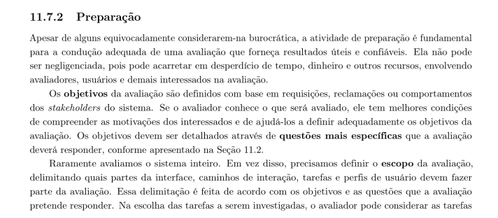
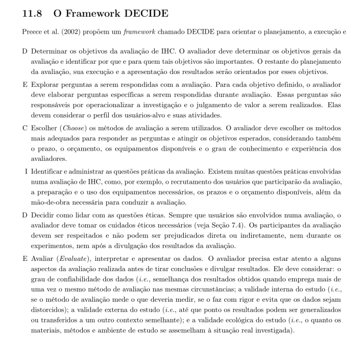
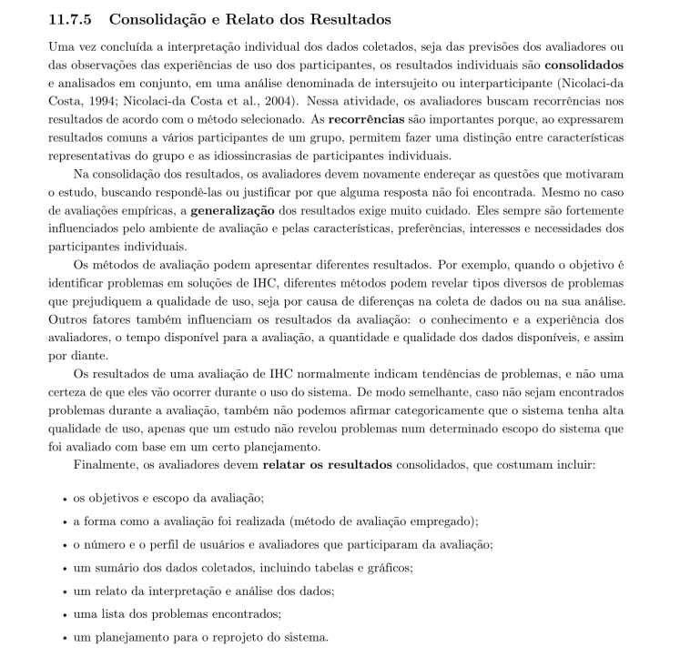
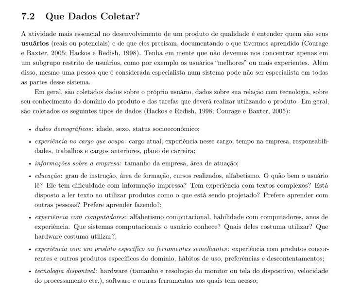

# Lista de Verificação — Etapa 4

## Avaliação do Storyboard e da Análise de Tarefas

### Verificação aplicada ao Grupo 06 (2026.2)

**Disciplina:** Interação Humano-Computador (IHC)  
**Professor:** André Barros de Sales  
**Instituição:** Universidade de Brasília — Faculdade UnB Gama (FGA)  
**Escopo analisado:** exclusivamente os artefatos da **Etapa 4 — Planejamento da avaliação** publicados no [GitHub Pages do Grupo 06](https://interacao-humano-computador.github.io/2026.2-Grupo06/).  
**Data da verificação:** 14/10/2026

---

## Tabela de Contribuição

| Integrante | Contribuição |
| :--- | :--- |
| Pedro Rocha Ferreira Lima | Elaboração da lista de verificação e análise dos artefatos da Etapa 4 do Grupo 06, com preenchimento das respostas e redação das observações justificativas. |
| Pedro Rocha Ferreira Lima, Leonardo da Silva Lopes Júnior e Daniel da Silva Batista | Elaboração dos itens adicionais do grupo avaliador (itens 24 a 27), incluindo critérios, referências bibliográficas e trechos de fundamentação. |
| Claude (Anthropic) | Apoio à organização e revisão textual do artefato, conforme a política de uso de inteligência artificial da disciplina. |

*Fonte: Pedro Rocha Ferreira Lima (2026).*

---

## 1. Objetivo e escopo

Este documento registra a aplicação da Lista de Verificação da Etapa 4 aos artefatos do Grupo 06 relacionados ao planejamento da avaliação do Storyboard e da Análise de Tarefas, bem como aos planejamentos dos respectivos relatos de resultados. A análise foi limitada ao conteúdo publicado na seção **Etapa 4 — Planejamento da avaliação**, sem usar artefatos de outras etapas para justificar conformidade, salvo quando o próprio critério exige explicitamente um registro geral e a evidência está vinculada à Etapa 4.

Foram consultados, entre outros, os seguintes artefatos disponíveis na seção:

1. [Storyboard — Oficina Legislativa](https://interacao-humano-computador.github.io/2026.2-Grupo06/entrega-4/individual/bruno/storyboard/);
2. [Planejamento da avaliação do Storyboard — Bruno](https://interacao-humano-computador.github.io/2026.2-Grupo06/entrega-4/individual/bruno/planejamento-avaliacao-storyboard/);
3. [Planejamento do relato dos resultados do Storyboard — Bruno](https://interacao-humano-computador.github.io/2026.2-Grupo06/entrega-4/individual/bruno/planejamento-relato-storyboard/);
4. [Planejamento da avaliação da Análise de Tarefas — Bruno](https://interacao-humano-computador.github.io/2026.2-Grupo06/entrega-4/individual/bruno/planejamento-avaliacao-analise-tarefas/);
5. [Planejamento do relato dos resultados da Análise de Tarefas — Bruno](https://interacao-humano-computador.github.io/2026.2-Grupo06/entrega-4/individual/bruno/planejamento-relato-analise-tarefas/);
6. [Storyboard — Caio](https://interacao-humano-computador.github.io/2026.2-Grupo06/entrega-4/caio/storyboard/);
7. Planejamentos correspondentes de Heitor e os demais artefatos de avaliação listados no índice da Etapa 4.

**Critério de decisão:** “Conforme” significa que foi encontrada evidência suficiente para atender ao enunciado; “Não conforme” significa que o requisito não foi demonstrado integralmente no escopo consultado; “Não se aplica” é usado somente quando o critério não se relaciona ao escopo. Quando há atendimento parcial, a resposta formal é “Não conforme” e a observação explica a limitação.

## 2. Tabela de contribuição

| Integrante | Contribuição |
| --- | --- |
| Pedro Rocha Ferreira Lima | Aplicação da lista de verificação da Etapa 4, análise dos artefatos publicados pelo Grupo 06 e redação das observações. |
| Claude (Anthropic) | Apoio à organização e redação do documento, conforme as regras acadêmicas aplicáveis ao uso de IA. |

**Fonte:** elaboração própria (2026), com base na lista de verificação fornecida e nos artefatos públicos da Etapa 4 do Grupo 06.

## 3. Síntese dos resultados

| Bloco | Itens | Conforme | Não conforme | Não se aplica |
| --- | :---: | :---: | :---: | :---: |
| Itens de desenvolvimento do projeto | 1–10 | 7 | 3 | 0 |
| Itens de conteúdo da disciplina | 11–23 | 10 | 3 | 0 |
| Itens elaborados pelo grupo | 24–27 | 2 | 2 | 0 |
| **Total** | **1–27** | **19** | **8** | **0** |

A síntese representa a inspeção realizada para este documento e não deve ser confundida com a autoverificação publicada pelo próprio Grupo 06. Os critérios foram aplicados aos enunciados da lista fornecida, que possui numeração e redação próprias.

---

## 4. Itens de desenvolvimento do projeto

| # | Critério | Resposta | Observação |
| :-: | --- | --- | --- |
| 1 | O GitHub Pages do projeto possui o histórico de versão padronizado? | **Conforme** | Os planejamentos da avaliação e dos relatos da Etapa 4 apresentam seção de histórico de versão com versão, data, descrição, autor(es) e revisor(es). O padrão está visível nos artefatos consultados. A conformidade aqui se refere aos documentos da Etapa 4, não a todas as páginas do site. |
| 2 | O GitHub Pages do projeto indica o(s) autor(es) e o(s) revisor(es) para cada artefato? | **Não conforme** | Os documentos identificam responsáveis e, em alguns casos, revisor designado; porém, há registros em que o revisor ou a revisão ainda aparece como “A definir” no cronograma da etapa. Assim, não é possível confirmar que autoria e revisão estejam efetivamente definidas para cada artefato da Etapa 4. |
| 3 | O GitHub Pages do projeto possui referências bibliográficas e/ou bibliografia em todos os artefatos? | **Conforme** | Os planejamentos consultados apresentam seção de referências e fundamentação em Barbosa e Silva, além de outras fontes pertinentes. Os artefatos também indicam fontes para figuras e tabelas. A decisão considera os documentos da Etapa 4 localizados na seção correspondente. |
| 4 | As tabelas e imagens possuem legenda e fonte e são chamadas dentro do texto? | **Conforme** | Nos planejamentos do Storyboard e da Análise de Tarefas, as tabelas aparecem numeradas, com título e fonte; a figura do framework DECIDE também possui legenda e fonte. O Storyboard de Caio identifica a figura, a versão, a quantidade de quadros e a origem dos desenhos, além de relacionar os quadros à análise de tarefas. |
| 5 | O GitHub Pages do projeto possui um texto fazendo uma introdução dos artefatos? | **Conforme** | Os planejamentos do Storyboard e da Análise de Tarefas iniciam com introduções que informam o objeto, o perfil de usuário e o propósito da avaliação. Os planejamentos dos relatos também explicam para que os resultados serão organizados e apresentados. |
| 6 | O GitHub Pages do projeto possui o cronograma executado, indicando quem realizou cada artefato ou atividade e as datas de início e fim? | **Não conforme** | O cronograma disponível para a Etapa 4 contém atividades planejadas, responsáveis previstos e datas futuras, enquanto o cronograma executado do site apresenta apenas registros limitados de etapas anteriores. Nos artefatos da Etapa 4, a avaliação e a entrevista ainda estão previstas para datas posteriores a 14/10/2026; portanto, não há evidência de execução concluída com início e fim reais para cada atividade. |
| 7 | O GitHub Pages do projeto possui ata(s) da(s) reunião(ões), com data, horário de início e fim, participantes, objetivo e atividades definidas? | **Não conforme** | O site possui uma área geral de atas, mas, respeitando o recorte solicitado, não foi localizada entre os artefatos próprios da Etapa 4 uma ata completa que documente todas as reuniões de planejamento com data, início e fim, participantes, objetivo e atividades definidas. A existência de uma seção geral fora dos artefatos não foi usada para presumir conformidade integral deste item. |
| 8 | O GitHub Pages do projeto possui a gravação da reunião do grupo? | **Não conforme** | Na seção da Etapa 4 foram encontrados planejamentos de sessões com participantes e previsão de registro de áudio, mas isso não equivale, por si só, à gravação de uma reunião interna do grupo. Não foi possível confirmar, dentro dos artefatos avaliados, uma gravação da reunião de planejamento como evidência específica para este critério. |
| 9 | O GitHub Pages do projeto possui vídeo de apresentação publicado na categoria “não listado” no YouTube? | **Não conforme** | Os documentos da Etapa 4 descrevem apresentações e sessões de avaliação previstas, mas não foi possível confirmar, exclusivamente nos artefatos de planejamento analisados, que o vídeo de apresentação da etapa esteja publicado no YouTube com a configuração “não listado”. Uma previsão de gravação não comprova que o vídeo foi publicado nem sua configuração de privacidade. |
| 10 | O GitHub Pages do projeto possui tabela de contribuição no início do artefato, com o nome de todos os integrantes? | **Conforme** | Os planejamentos e o Storyboard consultados apresentam tabelas de contribuição no início dos artefatos, indicando o responsável e as atividades atribuídas. A tabela de contribuição coletiva da lista de verificação do próprio grupo também identifica os integrantes envolvidos. A conformidade considera os artefatos em que a tabela foi encontrada; recomenda-se conferir se todos os documentos individuais mantêm o mesmo padrão. |

**Fonte:** análise dos artefatos da Etapa 4 do Grupo 06 (2026).

---

## 5. Itens de conteúdo da disciplina

| # | Critério | Resposta | Observação |
| :-: | --- | --- | --- |
| 11 | O GitHub Pages possui os artefatos: Planejamento da Avaliação do Storyboard e da Análise de Tarefas, e o Planejamento do Relato dos Resultados da avaliação do Storyboard e da Análise de Tarefas? | **Conforme** | Foram localizados os quatro tipos de artefato: planejamento da avaliação do Storyboard, planejamento do relato dos resultados do Storyboard, planejamento da avaliação da Análise de Tarefas e planejamento do relato dos resultados da Análise de Tarefas. Há documentos individuais, incluindo os de Bruno e Heitor, além do índice da Etapa 4. |
| 12 | O planejamento da avaliação segue o Framework DECIDE? | **Conforme** | Os planejamentos apresentam as seções correspondentes às seis atividades do DECIDE: determinar objetivos, explorar perguntas, escolher métodos, identificar questões práticas, decidir sobre questões éticas e avaliar/interpretar/apresentar os dados. O framework também é referenciado teoricamente. |
| 13 | Descreve o(s) objetivo(s) da avaliação? | **Conforme** | Os planejamentos estabelecem objetivos específicos. No Storyboard, buscam examinar compreensão, adequação ao contexto e pontos que precisam de revisão. Na Análise de Tarefas, propõem verificar se os modelos HTA e CTT representam a atividade e identificar lacunas ou divergências em relação à prática do participante. |
| 14 | Os métodos de avaliação a serem utilizados estão descritos, com referência bibliográfica e foto do texto da referência explicando os métodos? | **Conforme** | Os documentos descrevem entrevista semiestruturada apoiada no Storyboard e na Análise de Tarefas, com perguntas e procedimentos de execução. Há referências a Barbosa e Silva e apêndices com trechos/imagens do livro usados para fundamentar os métodos. |
| 15 | As questões práticas da avaliação são abordadas (recrutamento, perfil e quantidade de usuários, modalidade, equipamentos, prazos, orçamento e mão de obra)? | **Conforme** | Os planejamentos indicam o perfil do participante (professor), o recrutamento previsto, a quantidade e sua limitação exploratória, a modalidade remota pelo Google Meet, equipamentos e materiais, responsáveis pela condução e revisão, custos previstos e cronograma. As sessões ainda são apresentadas como agendamentos provisórios, o que não invalida a existência do planejamento prático. |
| 16 | As questões éticas são descritas, garantindo que os participantes não sejam prejudicados durante ou após a avaliação? | **Conforme** | Os planejamentos preveem TCLE, participação voluntária, possibilidade de desistência, confidencialidade, cuidado com os dados e autorização específica para gravação. Também se afirma que não haverá publicação, acesso autenticado ou emissão real de documentos durante a avaliação descrita. |
| 17 | O planejamento define a estrutura do relatório dos resultados, incluindo objetivos, método, perfil e número de participantes, tarefas executadas e problemas encontrados? | **Conforme** | Os planejamentos dos relatos definem seções para objetivos e escopo, método e execução, perfil dos participantes, atividades/tarefas, evidências coletadas, achados, análise, prioridades e encaminhamentos. Os resultados permanecem como campos a preencher após a coleta, mas a estrutura prevista está documentada. |
| 18 | Existe cronograma com data, horário e local para realização da avaliação do Storyboard e da Análise de Tarefas? | **Conforme** | Os planos registram sessões remotas pelo Google Meet, com datas e horários previstos: avaliação do Storyboard em 20/10/2026 e da Análise de Tarefas em 21/10/2026, ambas condicionadas à confirmação do participante. O piloto está previsto para ocorrer antes das sessões oficiais. |
| 19 | Cada desenho do Storyboard está relacionado a uma especificação do artefato da Análise de Tarefas? | **Conforme** | O planejamento do Storyboard contém tabela de rastreabilidade que relaciona os quadros QD01–QD07 às operações e subobjetivos da HTA e aos elementos da CTT. O Storyboard de Caio também associa quadros a identificadores da análise de tarefas. |
| 20 | A quantidade de storyboards é igual à quantidade de integrantes do grupo? | **Não conforme** | O planejamento informa que o requisito coletivo é de cinco Storyboards, um por integrante. Entretanto, a própria autoverificação publicada pelo Grupo 06 registrou esse ponto como “Incompleto” e observou que o Storyboard de Israel ainda não estava concluído. Assim, na data da consulta, não foi demonstrado que o conjunto completo atendia à quantidade exigida. |
| 21 | Há definição do teste-piloto e data anterior à avaliação, com referência bibliográfica e foto do texto da referência explicando o teste-piloto? | **Conforme** | Os planos definem o piloto como ensaio de consentimento, acesso, legibilidade, roteiro, duração e registro, com participante diferente do participante principal. O cronograma prevê o piloto em 17/10/2026, antes das entrevistas previstas para 20 e 21/10, e a fundamentação inclui Barbosa e Silva e imagens/trechos nos apêndices. |
| 22 | O resultado do teste-piloto não será apresentado no resultado da avaliação? | **Conforme** | Os planejamentos declaram que os dados do piloto não integrarão os resultados principais. O piloto será usado para ajustar materiais e procedimentos; apenas ajustes metodológicos desidentificados serão preservados, sem incorporar os dados preliminares à análise final. |
| 23 | São definidos os itens que o avaliador deve realizar/anotar, incluindo problemas encontrados e priorização de correções? | **Conforme** | Os planejamentos dos relatos preveem registros de evidências por pergunta/tarefa, ficha consolidada de achados, conferência técnica, interpretação dos dados e critérios de prioridade/controle das revisões. Isso oferece um procedimento para documentar problemas e orientar encaminhamentos. |

**Fonte:** análise dos planejamentos da avaliação e dos relatos da Etapa 4 do Grupo 06 (2026).

---

## 6. Itens elaborados pelo grupo

### 6.1 Item 24 — Rigor e Execução do Teste-Piloto

| Campo | Registro |
| --- | --- |
| **Critério** | Os planejamentos de avaliação (Análise de Tarefas e Storyboard) preveem a execução obrigatória de um teste-piloto prévio com data, horário, papéis definidos (avaliador e usuário simulado), tarefas-teste e diretriz explícita de descarte dos dados preliminares? |
| **Resposta** | **Conforme** |
| **Data da avaliação** | 14/10/2026 |
| **Autor do item na lista fornecida** | Arthur Sismene Carvalho |
| **Observação** | O planejamento do Storyboard descreve o piloto como ensaio do consentimento, acesso, legibilidade, leitura, entrevista, duração e registro, e prevê uma pessoa diferente do participante principal. O cronograma indica data e horário anteriores à sessão principal; o plano da Análise de Tarefas também prevê piloto e condições para iniciar a coleta. Os relatos indicam que os dados preliminares não serão incluídos nos resultados principais. Como as datas ainda são futuras na data desta verificação, a conformidade refere-se à existência de um planejamento explícito, não à comprovação de que o piloto já foi executado. |
| **Fonte** | BARBOSA, Simone Diniz Junqueira; SILVA, Bruno Santana da. *Interação humano-computador*. Rio de Janeiro: Elsevier, 2010. Cap. 11, seção sobre planejamento e teste-piloto, conforme referências dos artefatos. |

### 6.2 Item 25 — Mitigação do Viés de Concordância (*Acquiescence Bias*) na Entrevista

| Campo | Registro |
| --- | --- |
| **Critério** | O roteiro e o procedimento estipulam que o participante descreva primeiro como realiza a tarefa na interface atual ou fora dela, para só depois ter contato com o modelo ou desenho de proposta? |
| **Resposta** | **Não conforme** |
| **Data da avaliação** | 14/10/2026 |
| **Autor do item na lista fornecida** | Daniel da Silva Batista |
| **Observação** | O planejamento do Storyboard prevê que o participante leia a história e percorra os quadros antes de responder às perguntas Q1–Q7. Embora o moderador deva começar com um relato livre e usar perguntas neutras, não foi encontrada uma etapa explícita em que o participante descreva primeiro sua prática atual sem visualizar o Storyboard ou o diagrama. Como o contato inicial com o artefato ocorre antes ou durante a exploração orientada, não há garantia suficiente de mitigação do viés de concordância conforme o critério. |
| **Fonte** | BARBOSA, Simone Diniz Junqueira; SILVA, Bruno Santana da. *Interação humano-computador*. Rio de Janeiro: Elsevier, 2010, seção sobre entrevistas e técnicas de investigação; PREECE, Jennifer; ROGERS, Yvonne; SHARP, Helen. *Interaction Design: Beyond Human-Computer Interaction*. 2002. |

### 6.3 Item 26 — Escala Padronizada de Gravidade e Priorização de Problemas

| Campo | Registro |
| --- | --- |
| **Critério** | Os planejamentos de relato estabelecem critérios objetivos e escalas formais de severidade para fundamentar a tomada de decisão no reprojeto dos modelos e telas? |
| **Resposta** | **Conforme** |
| **Data da avaliação** | 14/10/2026 |
| **Autor do item na lista fornecida** | Pedro Rocha Ferreira Lima |
| **Observação** | Os planejamentos dos relatos incluem instrumentos para consolidar achados, classificar prioridades e controlar revisões. A estrutura prevê critérios de prioridade para orientar os encaminhamentos do reprojeto. A resposta considera a existência desses critérios nos artefatos consultados; recomenda-se garantir que a escala numérica ou categórica seja aplicada de maneira idêntica em todas as fichas e relatos, evitando interpretações divergentes entre avaliadores. |
| **Fonte** | NIELSEN, Jakob. *Usability Engineering*. 1993; BARBOSA, Simone Diniz Junqueira; SILVA, Bruno Santana da. *Interação humano-computador*. Rio de Janeiro: Elsevier, 2010, seção sobre consolidação e relato dos resultados. |

### 6.4 Item 27 — Rastreabilidade entre Amostra de Participantes e Elenco de Personas

| Campo | Registro |
| --- | --- |
| **Critério** | Os planejamentos garantem que os participantes recrutados (USR-06 a USR-09 em tarefas e USR-10 a USR-13 em Storyboards) correspondam explicitamente às características sociodemográficas e aos hábitos das personas mapeadas (PER-01 a PER-04)? |
| **Resposta** | **Não conforme** |
| **Data da avaliação** | 14/10/2026 |
| **Autor do item na lista fornecida** | Leonardo da Silva Lopes Júnior |
| **Observação** | Os planos do Grupo 06 identificam um participante previsto com perfil de professor e fazem referência à persona e ao cenário correspondentes. Contudo, não foi localizada uma tabela de correspondência que use os identificadores específicos USR-06 a USR-13 e PER-01 a PER-04 citados no enunciado, nem um mapeamento completo de cada participante da amostra para características sociodemográficas e hábitos da persona. Como a rastreabilidade solicitada não está demonstrada com esses identificadores e para toda a amostra, o item não pode ser marcado como conforme. |
| **Fonte** | BARBOSA, Simone Diniz Junqueira; SILVA, Bruno Santana da. *Interação humano-computador*. Rio de Janeiro: Elsevier, 2010, seção sobre personas; COOPER, Alan. *The Inmates Are Running the Asylum*. Indianapolis: Sams, 1999. |

---

## 7. Conclusão

A inspeção encontrou evidências consistentes de planejamento estruturado pelo DECIDE, definição dos objetivos e métodos, tratamento das questões práticas e éticas, planejamento dos relatos e rastreabilidade entre os quadros do Storyboard e os modelos de tarefas. As principais pendências observadas são a comprovação de autoria e revisão completas em todos os artefatos, a distinção entre cronograma planejado e executado, evidências de atas/gravações/apresentação dentro do recorte da Etapa 4, a conclusão do conjunto de Storyboards, a prevenção explícita do viés de concordância e a rastreabilidade nominal da amostra com as personas.

As respostas foram atribuídas com base no conteúdo público consultado em 14/10/2026. Como várias atividades estavam planejadas para datas posteriores, esta verificação avalia a documentação disponível nessa data e não presume que as avaliações já tenham ocorrido.

## 8. Referências

BARBOSA, Simone Diniz Junqueira; SILVA, Bruno Santana da. **Interação humano-computador**. Rio de Janeiro: Elsevier, 2010.

COOPER, Alan. **The Inmates Are Running the Asylum**. Indianapolis: Sams, 1999.

NIELSEN, Jakob. **Usability Engineering**. San Diego: Academic Press, 1993.

PREECE, Jennifer; ROGERS, Yvonne; SHARP, Helen. **Interaction Design: Beyond Human-Computer Interaction**. New York: John Wiley & Sons, 2002.

GRUPO 06 (2026.2). **GitHub Pages — Etapa 4: Planejamento da avaliação**. Universidade de Brasília, Faculdade UnB Gama. Disponível em: <https://interacao-humano-computador.github.io/2026.2-Grupo06/proximas/etapa-04/>. Acesso em: 14 out. 2026.

GRUPO 06 (2026.2). **Storyboard — Camila envia uma ideia**. Disponível em: <https://interacao-humano-computador.github.io/2026.2-Grupo06/entrega-4/caio/storyboard/>. Acesso em: 14 out. 2026.

GRUPO 06 (2026.2). **Planejamento da avaliação do Storyboard**. Disponível em: <https://interacao-humano-computador.github.io/2026.2-Grupo06/entrega-4/individual/bruno/planejamento-avaliacao-storyboard/>. Acesso em: 14 out. 2026.

GRUPO 06 (2026.2). **Planejamento da avaliação da Análise de Tarefas**. Disponível em: <https://interacao-humano-computador.github.io/2026.2-Grupo06/entrega-4/individual/bruno/planejamento-avaliacao-analise-tarefas/>. Acesso em: 14 out. 2026.

GRUPO 06 (2026.2). **Planejamento do relato dos resultados da avaliação do Storyboard e da Análise de Tarefas**. Disponível nas páginas da Etapa 4 do GitHub Pages do grupo. Acesso em: 14 out. 2026.

SALES, André Barros de. **Plano de Ensino FIHC 022026 — Turma 01**. Brasília: FCTE/UnB, 2026.

---

## 9. Histórico de versões

| Versão | Data | Descrição | Autor(es) | Revisor(es) |
| :-: | :-: | --- | --- | --- |
| 1.0 | 14/10/2026 | Criação do documento e aplicação da Lista de Verificação da Etapa 4 aos artefatos do Grupo 06, com observações justificadas. | Pedro Rocha Ferreira Lima | — |

