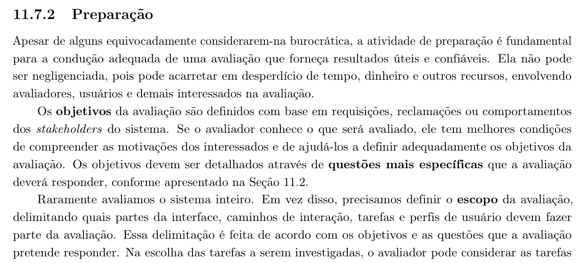
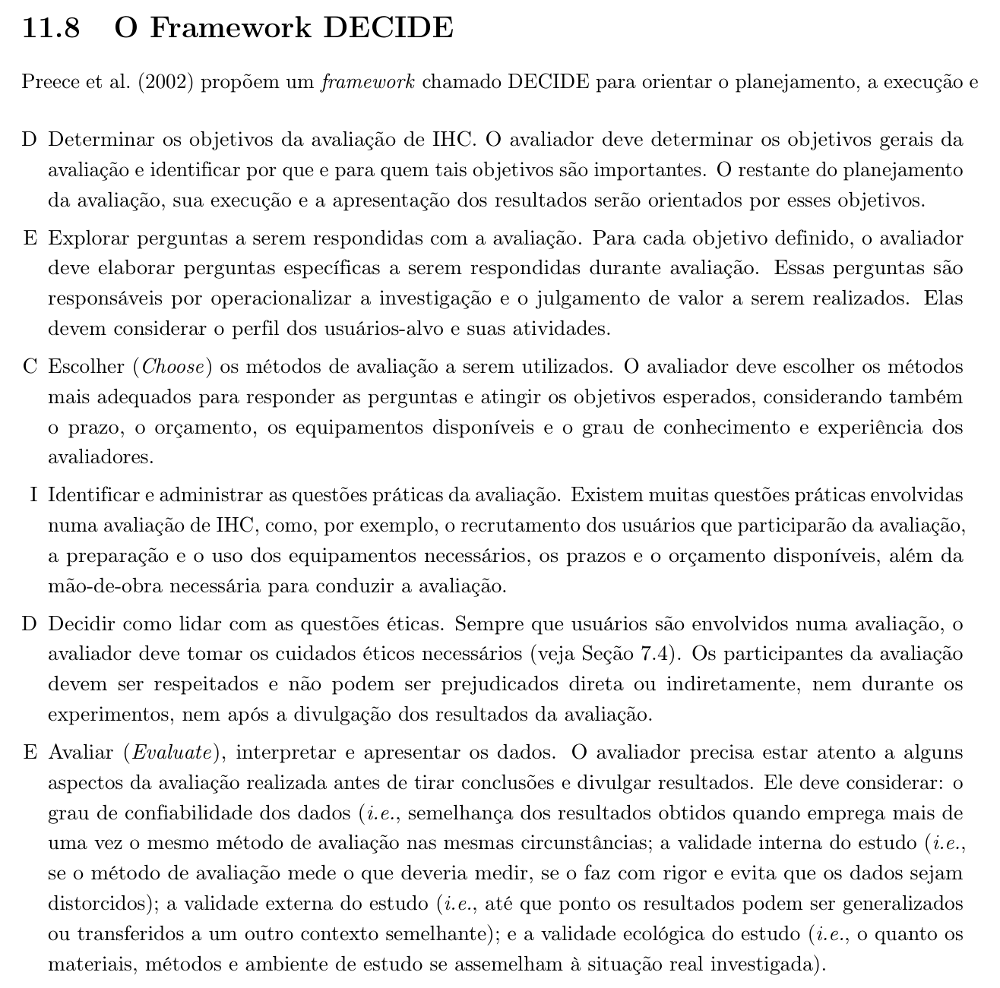
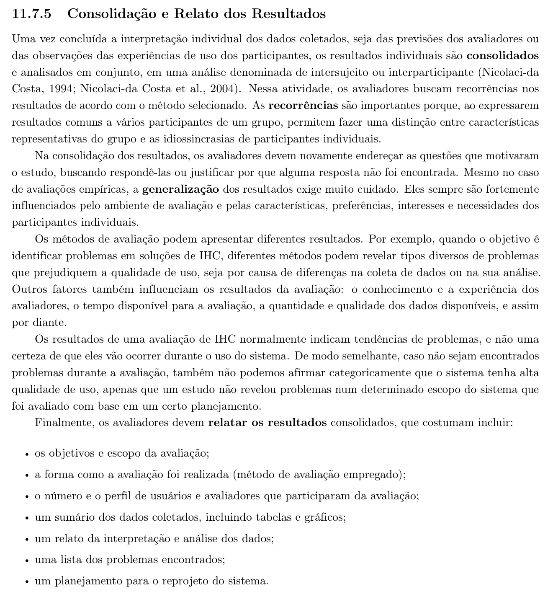
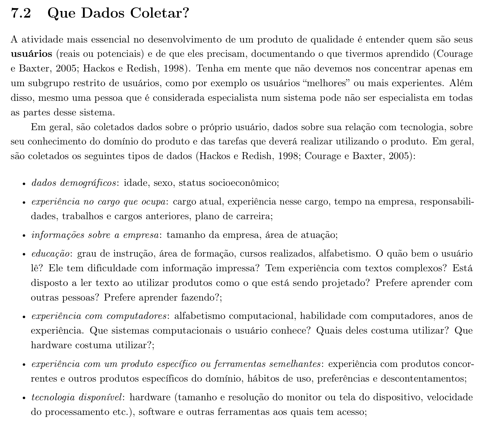

<b>Tabela de Contribuição</b>

| Membro | Contribuição |
| :--- | :--- |
| **Daniel da Silva Batista** | Transposição dos itens oficiais do plano de ensino (Itens 1 a 23), estruturação da página e elaboração do **Item extra 25** (Mitigação do Viés de Concordância na Entrevista). |
| **Arthur Sismene Carvalho** | Revisão técnica da lista e elaboração do **Item extra 24** (Rigor e Execução do Teste-Piloto). |
| **Pedro Rocha Ferreira Lima** | Revisão da fundamentação teórica e elaboração do **Item extra 26** (Escala Padronizada de Gravidade de Problemas). |
| **Leonardo da Silva Lopes Júnior** | Revisão da formatação e elaboração do **Item extra 27** (Rastreabilidade entre Amostra de Participantes e Elenco de Personas). |
| **Pedro Rocha Ferreira Lima** | Aplicação da lista de verificação aos artefatos da Etapa 4 do Grupo 06 e redação das respostas e observações (14/10/2026). |
| **Gemini** | Apoio na organização e diagramação Markdown (conforme Política de IA). |

<b>Fonte:</b> Daniel da Silva Batista (2026).

# Verificação — Etapa 4 (Grupo 06 — Grupo -1)

## 1. Objetivo e Escopo

Este artefato reúne a lista de verificação da **Etapa 4** do **Grupo 06 (Grupo -1)**, elaborada pelo Grupo 07 no âmbito da avaliação cruzada conforme as diretrizes pedagógicas da disciplina de Interação Humano-Computador (SALES, 2026). A auditoria recai sobre os artefatos de planejamento de avaliação e relato produzidos pelo Grupo 06 para o **Portal do Senado Federal** e publicados no [GitHub Pages do Grupo 06](https://interacao-humano-computador.github.io/2026.2-Grupo06/):

1. Planejamento da Avaliação da Análise de Tarefas
2. Planejamento do Relato dos Resultados da Avaliação da Análise de Tarefas
3. Planejamento da Avaliação do Storyboard
4. Planejamento do Relato dos Resultados da Avaliação do Storyboard

A avaliação reúne **27 itens de verificação**, organizados em três blocos normativos:
1. **10 itens de desenvolvimento do projeto** ([Seção 5](#5-itens-de-desenvolvimento-do-projeto)), relativos à padronização, governança técnica e conformidade editorial da wiki;
2. **13 itens de conteúdo da disciplina da Etapa 4 (Itens 11 a 23)** ([Seção 6](#6-itens-de-conteudo-da-disciplina)), critérios oficiais definidos no plano de ensino pelo professor André Barros de Sales, cobrindo o Framework DECIDE, metas, métodos com comprovação bibliográfica, questões práticas, éticas, estrutura de relato e testes-piloto;
3. **4 itens elaborados pelo grupo avaliador (Itens 24 a 27)** ([Seção 7](#7-itens-elaborados-pelo-grupo)), focados em teste-piloto, controle de viés em entrevistas, escalas de severidade e rastreabilidade amostral com personas.

---

## 2. Instruções de Preenchimento

Cada critério avaliado admite uma única classificação entre as três opções abaixo:

* **Sim** — o projeto do Grupo 06 atende integral e satisfatoriamente ao critério solicitado;
* **Não** — o projeto do Grupo 06 não contempla o critério ou a informação está ausente;
* **Incompleto** — o projeto atende apenas parcialmente ao que o critério exige, carecendo de complementação ou correções.

Para cada item avaliado, é registrada a resposta, a justificativa analítica com a indicação das evidências ou inconformidades encontradas no GitHub Pages do Grupo 06 e, nos itens de conteúdo e nos itens elaborados pelo grupo, o autor do Grupo 07 responsável e a data da inspeção.

---

## 3. Vídeo de Verificação — Etapa 4 (Grupo 06)

O vídeo a seguir documenta a auditoria e inspeção dos artefatos da Etapa 4 realizada pelo Grupo 07 sobre o projeto do Grupo 06 (Senado Federal).

> *Vídeo pendente de gravação pela equipe. Ao publicá-lo no YouTube, incorporar o player nesta seção e completar os dados abaixo.*

* **Categoria no YouTube:** não listado;
* **Participante:** a definir;
* **Data da gravação:** a definir.

---

## 4. Síntese dos Resultados

A Tabela 1 consolida a distribuição das respostas obtidas na avaliação dos artefatos da Etapa 4 do Grupo 06.

<b>Tabela 1: Síntese das Respostas da Avaliação Cruzada (Etapa 4 — Grupo 06)</b>

| Bloco | Total de Itens | Sim | Incompleto | Não |
| :--- | :---: | :---: | :---: | :---: |
| Desenvolvimento do projeto (Itens 1 a 10) | 10 | 5 | 3 | 2 |
| Conteúdo da disciplina (Itens 11 a 23) | 13 | 12 | 1 | 0 |
| Itens elaborados pelo grupo (Itens 24 a 27) | 4 | 2 | 2 | 0 |
| **Total Geral** | **27** | **19** | **6** | **2** |

<b>Fonte:</b> Daniel da Silva Batista (2026).

---

## 5. Itens de Desenvolvimento do Projeto

A Tabela 2 apresenta o instrumento de avaliação dos 10 itens gerais de desenvolvimento do projeto exigidos para a Entrega 4 (SALES, 2026).

<b>Tabela 2: Itens de Desenvolvimento do Projeto</b>

| Item | Critério Verificado | Resposta | Observação |
| :---: | :--- | :---: | :--- |
| 1 | O GitHub Pages do projeto possui o histórico de versão padronizado? | **Sim** | Os planejamentos da avaliação e dos relatos da Etapa 4 apresentam histórico de versão com versão, data, descrição, autor(es) e revisor(es). A resposta considera os documentos da Etapa 4, não todas as páginas do site. |
| 2 | O GitHub Pages do projeto indica o(s) autor(es) e o(s) revisor(es) para cada artefato? | **Incompleto** | Os documentos identificam os responsáveis e, em alguns casos, o revisor designado; porém, no cronograma da etapa o revisor ou a revisão ainda aparecem como "A definir", o que impede confirmar autoria e revisão definidas para cada artefato. |
| 3 | O GitHub Pages do projeto possui referências bibliográficas e/ou bibliografia em todos os artefatos? | **Sim** | Os planejamentos apresentam seção de referências, com fundamentação em Barbosa e Silva (2010) e outras fontes pertinentes, além da indicação de fonte nas figuras e tabelas. |
| 4 | No GitHub Pages do projeto, as tabelas e imagens possuem legenda e fonte e são chamadas dentro do texto? | **Sim** | Nos planejamentos do Storyboard e da Análise de Tarefas, as tabelas são numeradas, com título e fonte, e a figura do framework DECIDE possui legenda e fonte. O Storyboard de Caio identifica a figura, a versão, a quantidade de quadros e a origem dos desenhos. |
| 5 | O GitHub Pages do projeto possui um texto fazendo uma introdução dos artefatos? | **Sim** | Os planejamentos iniciam com introdução que informa o objeto, o perfil de usuário e o propósito da avaliação; os planejamentos dos relatos explicam como os resultados serão organizados e apresentados. |
| 6 | O GitHub Pages do projeto possui o cronograma executado, indicando quem realizou cada artefato ou atividade e as datas de início e fim? | **Incompleto** | O cronograma da Etapa 4 traz atividades planejadas, responsáveis previstos e datas futuras, mas o cronograma executado do site registra apenas etapas anteriores. Não há evidência de execução concluída, com início e fim reais, para cada atividade da etapa. |
| 7 | O GitHub Pages do projeto possui ata(s) da(s) reunião(ões), com data, horário de início e fim, participantes, objetivo e atividades definidas? | **Incompleto** | O site possui uma área geral de atas, mas não foi localizada ata das reuniões de planejamento da Etapa 4 com data, início e fim, participantes, objetivo e atividades definidas. |
| 8 | O GitHub Pages do projeto possui a gravação da reunião do grupo? | **Não** | Os planejamentos preveem a gravação das sessões com participantes, o que não equivale à gravação de uma reunião interna do grupo. Não foi encontrada gravação de reunião de planejamento da Etapa 4. |
| 9 | O GitHub Pages do projeto possui vídeo de apresentação publicado na categoria "não listado" no YouTube? | **Não** | Os documentos da Etapa 4 descrevem apresentações e sessões previstas, mas não foi encontrado o vídeo de apresentação da etapa publicado no YouTube na categoria "não listado". |
| 10 | O GitHub Pages do projeto possui tabela de contribuição no início do artefato, com o nome de todos os integrantes? | **Sim** | Os planejamentos e o Storyboard consultados apresentam tabela de contribuição no início, com o responsável e as atividades atribuídas; recomenda-se manter o mesmo padrão em todos os documentos individuais. |

<b>Fonte:</b> Daniel da Silva Batista (2026), adaptado de Sales (2026).

---

## 6. Itens de Conteúdo da Disciplina

A Tabela 3 detalha a avaliação dos 13 itens de conteúdo da disciplina (itens 11 a 23) estabelecidos no plano de ensino para a Etapa 4 pelo professor André Barros de Sales.

<b>Tabela 3: Itens de Conteúdo da Disciplina (Etapa 4)</b>

| Item | Critério Verificado | Resposta | Observação | Autor |
| :---: | :--- | :---: | :--- | :--- |
| 11 | O GitHub Pages possui os artefatos: Planejamento da Avaliação do Storyboard e da Análise de tarefas, e o Planejamento do Relato dos Resultados da avaliação do Storyboard e da Análise de tarefas? | **Sim** | Foram localizados os quatro artefatos: planejamento da avaliação do Storyboard, planejamento do relato dos resultados do Storyboard, planejamento da avaliação da Análise de Tarefas e planejamento do relato dos resultados da Análise de Tarefas, com versões individuais (Bruno e Heitor) e índice da Etapa 4. | Pedro Rocha Ferreira Lima |
| 12 | O planejamento da avaliação segue o Framework DECIDE? | **Sim** | Os planejamentos apresentam seções para as seis atividades do DECIDE (objetivos, perguntas, métodos, questões práticas, questões éticas e avaliação/interpretação dos dados), com referência teórica ao framework. | Pedro Rocha Ferreira Lima |
| 13 | Descreve o(s) objetivo(s) da avaliação? (apropriação de tecnologia pelos usuários; ideias e alternativas de design; conformidade com um padrão; e/ou problemas na interação e na interface na fase do modelo conceitual) | **Sim** | No Storyboard, os objetivos são examinar a compreensão, a adequação ao contexto e os pontos a revisar; na Análise de Tarefas, verificar se os modelos HTA e CTT representam a atividade e identificar divergências em relação à prática do participante. | Pedro Rocha Ferreira Lima |
| 14 | Os métodos de avaliação a serem utilizados? Adicionar referência bibliográfica da fonte e foto do texto da referência explicando os métodos de avaliação. | **Sim** | Os documentos descrevem entrevista semiestruturada apoiada no Storyboard e na Análise de Tarefas, com perguntas e procedimentos de execução, referências a Barbosa e Silva (2010) e apêndices com trechos e imagens do livro. | Pedro Rocha Ferreira Lima |
| 15 | As questões práticas da avaliação (sobre o recrutamento dos usuários que participarão da avaliação (onde e o perfil), quantos usuários participarão da avaliação e a razão dessa quantidade, presencial real ou remota; a preparação e o uso dos equipamentos necessários, os prazos; o orçamento; recursos de mão-de-obra necessária para conduzir a avaliação)? | **Sim** | Os planejamentos indicam o perfil do participante (professor), o recrutamento, a quantidade e sua limitação exploratória, a modalidade remota pelo Google Meet, equipamentos e materiais, responsáveis, custos e cronograma. As sessões aparecem como agendamentos provisórios, o que não invalida o planejamento. | Pedro Rocha Ferreira Lima |
| 16 | As questões éticas (se os participantes da avaliação devem ser respeitados e não podem ser prejudicados direta ou indiretamente, nem durante os experimentos, nem após a divulgação dos resultados da avaliação)? | **Sim** | Os planejamentos preveem TCLE, participação voluntária, possibilidade de desistência, confidencialidade, cuidado com os dados e autorização específica para gravação. | Pedro Rocha Ferreira Lima |
| 17 | A estrutura do relatório do resultado da avaliação (os objetivos da avaliação; uma breve descrição do método de prototipação em papel; o número e o perfil de avaliadores e dos participantes; as tarefas executadas pelos participantes; lista de problemas encontrados etc)? | **Sim** | Os planejamentos dos relatos definem seções para objetivos e escopo, método e execução, perfil dos participantes, tarefas, evidências, achados, análise, prioridades e encaminhamentos. | Pedro Rocha Ferreira Lima |
| 18 | Um cronograma (data e horário) e local para realização da avaliação do StoryBoard e da Análise das Tarefas? | **Sim** | As sessões são remotas pelo Google Meet, com data e horário previstos: Storyboard em 20/10/2026 e Análise de Tarefas em 21/10/2026, condicionadas à confirmação do participante. | Pedro Rocha Ferreira Lima |
| 19 | Cada desenho do StoryBoard está relacionado a uma especificação do artefato da Análise de Tarefas? | **Sim** | O planejamento do Storyboard traz tabela de rastreabilidade que relaciona os quadros QD01 a QD07 às operações e subobjetivos da HTA e aos elementos da CTT; o Storyboard de Caio também associa os quadros à análise de tarefas. | Pedro Rocha Ferreira Lima |
| 20 | A quantidade de storyboards é igual à quantidade de integrantes do grupo? | **Incompleto** | O requisito é de cinco storyboards, um por integrante, mas a autoverificação do próprio Grupo 06 registra que o storyboard de Israel ainda não estava concluído na data da consulta. | Pedro Rocha Ferreira Lima |
| 21 | A definição do teste piloto e data para realização do teste piloto antes da avaliação? Adicionar referência bibliográfica da fonte e foto do texto da referência explicando o teste piloto. | **Sim** | O piloto é definido como ensaio de consentimento, acesso, legibilidade, roteiro, duração e registro, com participante diferente do principal, previsto para 17/10/2026, antes das sessões de 20 e 21/10, com fundamentação em Barbosa e Silva (2010) e trechos do livro nos apêndices. | Pedro Rocha Ferreira Lima |
| 22 | O resultado do teste piloto não será apresentado no resultado da avaliação? | **Sim** | Os planejamentos declaram que os dados do piloto não integram os resultados principais e servem apenas para ajustar materiais e procedimentos. | Pedro Rocha Ferreira Lima |
| 23 | Os itens que o avaliador deve realizar/anotar durante a avaliação (listar os problemas encontrados, priorizar a correção dos problemas não resolvidos)? | **Sim** | Os planejamentos dos relatos preveem registro de evidências por pergunta e tarefa, ficha consolidada de achados, interpretação dos dados e critérios de prioridade e controle das revisões. | Pedro Rocha Ferreira Lima |

<b>Fonte:</b> Daniel da Silva Batista (2026), adaptado de Sales (2026).

---

## 7. Itens Elaborados pelo Grupo

Esta seção reúne critérios adicionais elaborados pela equipe do Grupo 07 com base na literatura clássica de IHC (*Interação Humano-Computador e Experiência do Usuário*, BARBOSA et al., 2021; PREECE et al., 2002; MAYHEW, 1999). Cada integrante concebeu e fundamentou 1 item acompanhado de recorte fotográfico da obra, sem se sobrepor aos itens do professor.

### 7.1 Item 24 — Rigor e Execução do Teste-Piloto

A Tabela 4 apresenta o Item 24 — rigor e execução do teste-piloto:

<b>Tabela 4: Item 24 — Rigor e Execução do Teste-Piloto</b>

| Campo | Registro |
| :--- | :--- |
| **Critério** | Os planejamentos de avaliação (tanto de Análise de Tarefas quanto de Storyboard) preveem a execução obrigatória de um teste-piloto prévio com data, horário, papéis definidos (avaliador e usuário simulado), tarefas-teste e a diretriz explícita de descarte dos dados preliminares? |
| **Resposta** | **Sim** |
| **Data da avaliação** | 14/10/2026 |
| **Observação** | O piloto do Storyboard ensaia consentimento, acesso, legibilidade, leitura, entrevista, duração e registro com pessoa diferente do participante principal; o cronograma indica data e horário anteriores às sessões e os relatos excluem os dados preliminares. Como as datas eram futuras, a resposta se refere ao planejamento, não à execução. |
| **Autor** | Arthur Sismene Carvalho |
| **Fonte** | BARBOSA et al. (2021), Cap. 11, Seção 11.7.4 (Teste-Piloto), p. 302. |

<b>Fonte:</b> Arthur Sismene Carvalho (2026).

A Figura 1 reproduz a referência bibliográfica — o teste-piloto em avaliação de IHC:

<b>Figura 1: Referência Bibliográfica — O Teste-Piloto em Avaliação de IHC</b>

<b>Fonte:</b> BARBOSA et al. (2021, p. 298).

---

### 7.2 Item 25 — Mitigação do Viés de Concordância (*Acquiescence Bias*) na Entrevista

A Tabela 5 apresenta o Item 25 — mitigação do viés de concordância na entrevista:

<b>Tabela 5: Item 25 — Mitigação do Viés de Concordância na Entrevista</b>

| Campo | Registro |
| :--- | :--- |
| **Critério** | O roteiro e o procedimento de execução das entrevistas com usuários estipulam que o participante descreva primeiro como realiza a tarefa na interface atual ou fora dela, para apenas depois ter contato com o modelo ou desenho de proposta, prevenindo que o usuário concorde passivamente com o artefato exibido? |
| **Resposta** | **Incompleto** |
| **Data da avaliação** | 14/10/2026 |
| **Observação** | O moderador inicia com relato livre e perguntas neutras, mas o participante lê a história e percorre os quadros antes das perguntas Q1 a Q7. Não há etapa explícita em que ele descreva primeiro a prática atual sem ver o Storyboard ou o diagrama. |
| **Autor** | Daniel da Silva Batista |
| **Fonte** | BARBOSA et al. (2021), Cap. 11, Seção 11.7.3 (Entrevistas e Técnicas de Investigação), p. 300–301; PREECE et al. (2002). |

<b>Fonte:</b> Daniel da Silva Batista (2026).

A Figura 2 reproduz a referência bibliográfica — o framework DECIDE e condução metodológica:

<b>Figura 2: Referência Bibliográfica — O Framework DECIDE e Condução Metodológica</b>

<b>Fonte:</b> BARBOSA et al. (2021, p. 303–304).

---

### 7.3 Item 26 — Escala Padronizada de Gravidade e Priorização de Problemas

A Tabela 6 apresenta o Item 26 — escala padronizada de gravidade de problemas:

<b>Tabela 6: Item 26 — Escala Padronizada de Gravidade de Problemas</b>

| Campo | Registro |
| :--- | :--- |
| **Critério** | Os planejamentos de relato estabelecem critérios objetivos e escalas formais de severidade (ex.: classificação em problema cosmético, leve, moderado, grave ou catastrófico) para fundamentar a tomada de decisão no reprojeto dos modelos e telas? |
| **Resposta** | **Sim** |
| **Data da avaliação** | 14/10/2026 |
| **Observação** | Os planejamentos dos relatos incluem instrumentos para consolidar achados, classificar prioridades e controlar revisões; recomenda-se aplicar a mesma escala em todas as fichas para evitar interpretações divergentes entre avaliadores. |
| **Autor** | Pedro Rocha Ferreira Lima |
| **Fonte** | NIELSEN (1993); BARBOSA et al. (2021), Cap. 11, Seção 11.7.5 (Consolidação e Relato dos Resultados), p. 303. |

<b>Fonte:</b> Pedro Rocha Ferreira Lima (2026).

A Figura 3 reproduz a referência bibliográfica — consolidação e relato dos resultados:

<b>Figura 3: Referência Bibliográfica — Consolidação e Relato dos Resultados</b>

<b>Fonte:</b> BARBOSA et al. (2021, p. 303).

---

### 7.4 Item 27 — Rastreabilidade entre Amostra de Participantes e Elenco de Personas

A Tabela 7 apresenta o Item 27 — rastreabilidade entre amostra e elenco de personas:

<b>Tabela 7: Item 27 — Rastreabilidade entre Amostra e Elenco de Personas</b>

| Campo | Registro |
| :--- | :--- |
| **Critério** | Os planejamentos de avaliação garantem que os participantes recrutados (USR-06 a USR-09 em tarefas, e USR-10 a USR-13 em storyboards) correspondam explicitamente às características sociodemográficas e aos hábitos de estudo das personas mapeadas (PER-01 a PER-04)? |
| **Resposta** | **Incompleto** |
| **Data da avaliação** | 14/10/2026 |
| **Observação** | Os planos identificam o participante previsto (perfil professor) e o relacionam à persona e ao cenário correspondentes, mas não há tabela que mapeie cada participante da amostra às características sociodemográficas e aos hábitos das personas. Os identificadores USR-06 a USR-13 e PER-01 a PER-04 do enunciado são do Grupo 07 e foram lidos como equivalentes. |
| **Autor** | Leonardo da Silva Lopes Júnior |
| **Fonte** | BARBOSA et al. (2021), Cap. 8, Seção 8.2 (Personas), p. 180; COOPER (1999). |

<b>Fonte:</b> Leonardo da Silva Lopes Júnior (2026).

A Figura 4 reproduz a referência bibliográfica — coleta de dados sociodemográficos e perfil de usuário:

<b>Figura 4: Referência Bibliográfica — Coleta de Dados Sociodemográficos e Perfil de Usuário</b>

<b>Fonte:</b> BARBOSA et al. (2021, p. 147).

---

## 8. Referências Bibliográficas

> [1] BARBOSA, Simone D. J.; SILVA, Bruno S. da; SILVEIRA, Milene S.; GASPARINI, Isabela; DARIN, Ticianne; BARBOSA, Gabriel D. J. *Interação Humano-Computador e Experiência do Usuário*. 1. ed. Autopublicação, 2021. ISBN: 978-65-00-19677-1.  
> [2] COOPER, Alan. *The Inmates Are Running the Asylum: Why High Tech Products Drive Us Crazy and How to Restore the Sanity*. Indianapolis: Sams Publishing, 1999.  
> [3] MAYHEW, Deborah J. *The Usability Engineering Lifecycle: A Practitioner's Handbook for User Interface Design*. San Francisco: Morgan Kaufmann, 1999.  
> [4] NIELSEN, Jakob. *Usability Engineering*. Boston: Academic Press, 1993.  
> [5] PATERNÒ, Fabio. *Model-Based Design and Evaluation of Interactive Applications*. London: Springer-Verlag, 1999.  
> [6] PREECE, Jennifer; ROGERS, Yvonne; SHARP, Helen. *Interaction Design: Beyond Human-Computer Interaction*. New York: John Wiley & Sons, 2002.  
> [7] SALES, André Barros de. *Plano de ensino FIHC 022026 – Turma 01*. Brasília: Faculdade de Ciências e Tecnologias em Engenharia (FCTE), Universidade de Brasília (UnB), 2026.    
> [8] GRUPO 06. *GitHub Pages — Etapa 4: Planejamento da avaliação*. Brasília: FCTE/UnB, 2026. Disponível em: <https://interacao-humano-computador.github.io/2026.2-Grupo06/>. Acesso em: 14 out. 2026.

---

## 9. Histórico de Versões

| Versão | Data | Descrição | Autor(es) | Revisor(es) |
| :---: | :---: | :--- | :---: | :---: |
| `1.0` | 14/10/2026 | Concepção, formulação e estruturação da Lista de Verificação da Etapa 4 para auditoria do Grupo 06 (Grupo -1), com 27 itens (10 de governança, 13 de conteúdo da disciplina do docente e 4 elaborados pela equipe com fundamentação teórica). | Daniel da Silva Batista | Pedro Rocha Ferreira Lima, Arthur Sismene Carvalho, Leonardo da Silva Lopes Júnior |
| `1.1` | 19/11/2026 | Preenchimento das respostas e observações dos 27 itens a partir da verificação realizada por Pedro Rocha Ferreira Lima em 14/10/2026 (PR #33), no formato das demais verificações, e síntese dos resultados. | Pedro Rocha Ferreira Lima, Daniel da Silva Batista | — |

<b>Fonte:</b> Daniel da Silva Batista (2026).

