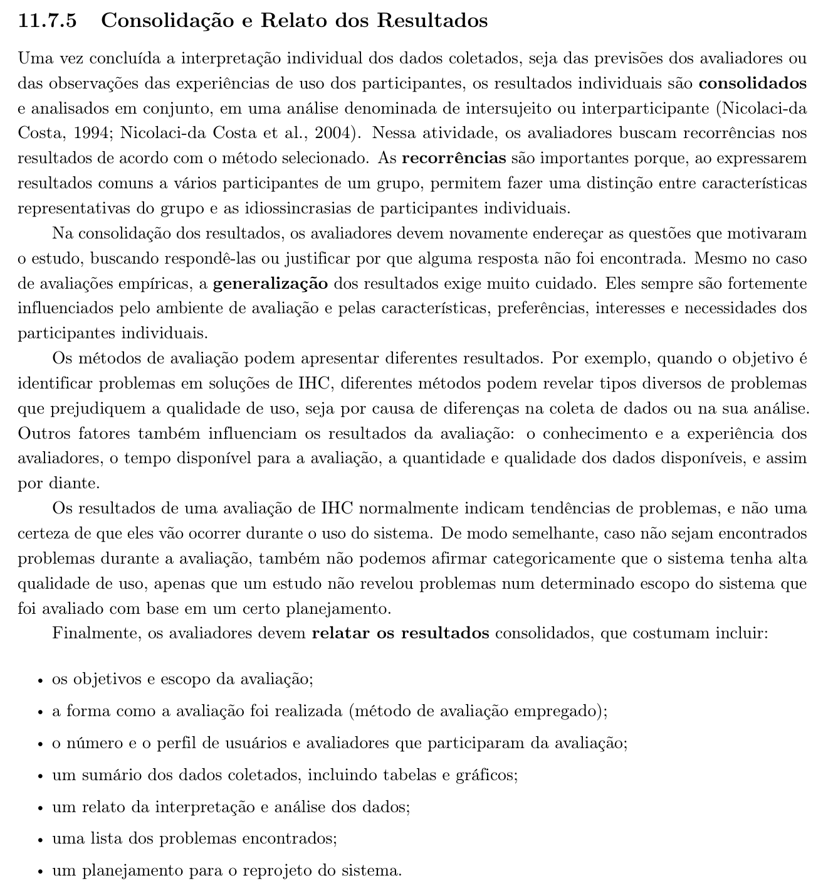
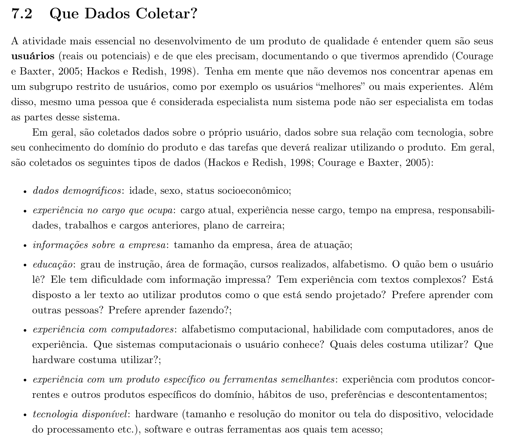

<b>Tabela de Contribuição</b>

| Membro | Contribuição |
| :--- | :--- |
| **Daniel da Silva Batista** | Transposição dos itens oficiais do plano de ensino (Itens 1 a 23), estruturação da página e elaboração do **Item extra 25** (Mitigação do Viés de Concordância na Entrevista). |
| **Arthur Sismene Carvalho** | Revisão técnica da lista e elaboração do **Item extra 24** (Rigor e Execução do Teste-Piloto). |
| **Pedro Rocha Ferreira Lima** | Revisão da fundamentação teórica e elaboração do **Item extra 26** (Escala Padronizada de Gravidade de Problemas). |
| **Leonardo da Silva Lopes Júnior** | Revisão da formatação e elaboração do **Item extra 27** (Rastreabilidade entre Amostra de Participantes e Elenco de Personas). |
| **Gemini** | Apoio na organização e diagramação Markdown (conforme Política de IA). |

<b>Fonte:</b> Daniel da Silva Batista (2026).

# Verificação — Etapa 4 (Grupo 06 — Grupo -1)

## 1. Objetivo e Escopo

Este artefato reúne a lista de verificação da **Etapa 4** do **Grupo 06 (Grupo -1)**, elaborada pelo Grupo 07 no âmbito da avaliação cruzada conforme as diretrizes pedagógicas da disciplina de Interação Humano-Computador (SALES, 2026). A auditoria recai sobre os artefatos de planejamento de avaliação e relato produzidos pelo Grupo 06 para o **Portal do Senado Federal** e publicados no [GitHub Pages do Grupo 06](https://interacao-humano-computador.github.io/2026.2-Grupo06/):

1. Planejamento da Avaliação da Análise de Tarefas
2. Planejamento do Relato dos Resultados da Avaliação da Análise de Tarefas
3. Planejamento da Avaliação do Storyboard
4. Planejamento do Relato dos Resultados da Avaliação do Storyboard

A avaliação reúne **27 itens de verificação**, organizados em três blocos normativos:
1. **10 itens de desenvolvimento do projeto** ([Seção 5](#5-itens-de-desenvolvimento-do-projeto)), relativos à padronização, governança técnica e conformidade editorial da wiki;
2. **13 itens de conteúdo da disciplina da Etapa 4 (Itens 11 a 23)** ([Seção 6](#6-itens-de-conteudo-da-disciplina)), critérios oficiais definidos no plano de ensino pelo professor André Barros de Sales, cobrindo o Framework DECIDE, metas, métodos com comprovação bibliográfica, questões práticas, éticas, estrutura de relato e testes-piloto;
3. **4 itens elaborados pelo grupo avaliador (Itens 24 a 27)** ([Seção 7](#7-itens-elaborados-pelo-grupo)), focados em teste-piloto, controle de viés em entrevistas, escalas de severidade e rastreabilidade amostral com personas.

---

## 2. Instruções de Preenchimento

Cada critério avaliado admite uma única classificação entre as três opções abaixo:

* **Sim** — o projeto do Grupo 06 atende integral e satisfatoriamente ao critério solicitado;
* **Não** — o projeto do Grupo 06 não contempla o critério ou a informação está ausente;
* **Incompleto** — o projeto atende apenas parcialmente ao que o critério exige, carecendo de complementação ou correções.

As tabelas encontram-se estruturadas com os campos de resposta, versão/data da avaliação e observação em aberto, prontas para preenchimento dinâmico durante a gravação da sessão de inspeção cruzada.

---

## 3. Vídeo de Verificação — Etapa 4 (Grupo 06)

O vídeo a seguir documenta a auditoria e inspeção dos artefatos da Etapa 4 realizada pelo Grupo 07 sobre o projeto do Grupo 06 (Senado Federal).

> *O vídeo de verificação da Etapa 4 do Grupo 06 será gravado pela equipe e disponibilizado nesta seção (categoria não listado no YouTube).*

---

## 4. Síntese dos Resultados

A Tabela 1 consolida a distribuição quantitativa das respostas obtidas na avaliação do Grupo 06 na Etapa 4 (a ser preenchida após a condução da reunião).

<b>Tabela 1: Síntese das Respostas da Avaliação Cruzada (Etapa 4 — Grupo 06)</b>

| Bloco | Total de Itens | Sim | Incompleto | Não |
| :--- | :---: | :---: | :---: | :---: |
| Desenvolvimento do projeto (Itens 1 a 10) | 10 | — | — | — |
| Conteúdo da disciplina (Itens 11 a 23) | 13 | — | — | — |
| Itens elaborados pelo grupo (Itens 24 a 27) | 4 | — | — | — |
| **Total Geral** | **27** | **—** | **—** | **—** |

<b>Fonte:</b> Daniel da Silva Batista (2026).

---

## 5. Itens de Desenvolvimento do Projeto

A Tabela 2 apresenta o instrumento de avaliação dos 10 itens gerais de desenvolvimento do projeto exigidos para a Entrega 4 (SALES, 2026).

<b>Tabela 2: Itens de Desenvolvimento do Projeto</b>

| Item | Critério Verificado | Resposta | Versão, Data e Hora da Avaliação | Observação |
| :---: | :--- | :---: | :---: | :--- |
| 1 | O GitHub Pages do projeto possui o histórico de versão padronizado? | | | |
| 2 | O GitHub Pages do projeto indica o(s) autor(es) e o(s) revisor(es) para cada artefato? | | | |
| 3 | O GitHub Pages do projeto possui referências bibliográficas e/ou bibliografia em todos os artefatos? | | | |
| 4 | No GitHub Pages do projeto, as tabelas e imagens possuem legenda e fonte e são chamadas dentro do texto? | | | |
| 5 | O GitHub Pages do projeto possui um texto fazendo uma introdução dos artefatos? | | | |
| 6 | O GitHub Pages do projeto possui o cronograma executado, indicando quem realizou cada artefato ou atividade e as datas de início e fim? | | | |
| 7 | O GitHub Pages do projeto possui ata(s) da(s) reunião(ões), com data, horário de início e fim, participantes, objetivo e atividades definidas? | | | |
| 8 | O GitHub Pages do projeto possui a gravação da reunião do grupo? | | | |
| 9 | O GitHub Pages do projeto possui vídeo de apresentação publicado na categoria "não listado" no YouTube? | | | |
| 10 | O GitHub Pages do projeto possui tabela de contribuição no início do artefato, com o nome de todos os integrantes? | | | |

<b>Fonte:</b> Daniel da Silva Batista (2026).

---

## 6. Itens de Conteúdo da Disciplina

A Tabela 3 detalha a avaliação dos 13 itens de conteúdo da disciplina (itens 11 a 23) estabelecidos no plano de ensino para a Etapa 4 pelo professor André Barros de Sales.

<b>Tabela 3: Itens de Conteúdo da Disciplina (Etapa 4)</b>

| Item | Critério Verificado | Resposta | Versão, Data e Hora da Avaliação | Observação |
| :---: | :--- | :---: | :---: | :--- |
| 11 | O GitHub Pages possui os artefatos: Planejamento da Avaliação do Storyboard e da Análise de tarefas, e o Planejamento do Relato dos Resultados da avaliação do Storyboard e da Análise de tarefas? | | | |
| 12 | O planejamento da avaliação segue o Framework DECIDE? | | | |
| 13 | Descreve o(s) objetivo(s) da avaliação? (apropriação de tecnologia pelos usuários; ideias e alternativas de design; conformidade com um padrão; e/ou problemas na interação e na interface na fase do modelo conceitual) | | | |
| 14 | Os métodos de avaliação a serem utilizados? Adicionar referência bibliográfica da fonte e foto do texto da referência explicando os métodos de avaliação. | | | |
| 15 | As questões práticas da avaliação (sobre o recrutamento dos usuários que participarão da avaliação (onde e o perfil), quantos usuários participarão da avaliação e a razão dessa quantidade, presencial real ou remota; a preparação e o uso dos equipamentos necessários, os prazos; o orçamento; recursos de mão-de-obra necessária para conduzir a avaliação)? | | | |
| 16 | As questões éticas (se os participantes da avaliação devem ser respeitados e não podem ser prejudicados direta ou indiretamente, nem durante os experimentos, nem após a divulgação dos resultados da avaliação)? | | | |
| 17 | A estrutura do relatório do resultado da avaliação (os objetivos da avaliação; uma breve descrição do método de prototipação em papel; o número e o perfil de avaliadores e dos participantes; as tarefas executadas pelos participantes; lista de problemas encontrados etc)? | | | |
| 18 | Um cronograma (data e horário) e local para realização da avaliação do StoryBoard e da Análise das Tarefas? | | | |
| 19 | Cada desenho do StoryBoard está relacionado a uma especificação do artefato da Análise de Tarefas? | | | |
| 20 | A quantidade de storyboards é igual à quantidade de integrantes do grupo? | | | |
| 21 | A definição do teste piloto e data para realização do teste piloto antes da avaliação? Adicionar referência bibliográfica da fonte e foto do texto da referência explicando o teste piloto. | | | |
| 22 | O resultado do teste piloto não será apresentado no resultado da avaliação? | | | |
| 23 | Os itens que o avaliador deve realizar/anotar durante a avaliação (listar os problemas encontrados, priorizar a correção dos problemas não resolvidos)? | | | |

<b>Fonte:</b> Daniel da Silva Batista (2026).

---

## 7. Itens Elaborados pelo Grupo

Esta seção reúne critérios adicionais elaborados pela equipe do Grupo 07 com base na literatura clássica de IHC (*Interação Humano-Computador e Experiência do Usuário*, BARBOSA et al., 2021; PREECE et al., 2002; MAYHEW, 1999). Cada integrante concebeu e fundamentou 1 item acompanhado de recorte fotográfico da obra, sem se sobrepor aos itens do professor.

### 7.1 Item 24 — Rigor e Execução do Teste-Piloto

<b>Tabela 4: Item 24 — Rigor e Execução do Teste-Piloto</b>

| Campo | Registro |
| :--- | :--- |
| **Critério** | Os planejamentos de avaliação (tanto de Análise de Tarefas quanto de Storyboard) preveem a execução obrigatória de um teste-piloto prévio com data, horário, papéis definidos (avaliador e usuário simulado), tarefas-teste e a diretriz explícita de descarte dos dados preliminares? |
| **Resposta** | |
| **Versão, Data e Hora** | |
| **Observação** | |
| **Autor** | Arthur Sismene Carvalho |
| **Fonte** | BARBOSA et al. (2021), Cap. 11, Seção 11.7.4 (Teste-Piloto), p. 302. |

<b>Fonte:</b> Arthur Sismene Carvalho (2026).

<b>Figura 1: Referência Bibliográfica — O Teste-Piloto em Avaliação de IHC</b>

<b>Fonte:</b> BARBOSA et al. (2021, p. 298).

---

### 7.2 Item 25 — Mitigação do Viés de Concordância (*Acquiescence Bias*) na Entrevista

<b>Tabela 5: Item 25 — Mitigação do Viés de Concordância na Entrevista</b>

| Campo | Registro |
| :--- | :--- |
| **Critério** | O roteiro e o procedimento de execução das entrevistas com usuários estipulam que o participante descreva primeiro como realiza a tarefa na interface atual ou fora dela, para apenas depois ter contato com o modelo ou desenho de proposta, prevenindo que o usuário concorde passivamente com o artefato exibido? |
| **Resposta** | |
| **Versão, Data e Hora** | |
| **Observação** | |
| **Autor** | Daniel da Silva Batista |
| **Fonte** | BARBOSA et al. (2021), Cap. 11, Seção 11.7.3 (Entrevistas e Técnicas de Investigação), p. 300–301; PREECE et al. (2002). |

<b>Fonte:</b> Daniel da Silva Batista (2026).

<b>Figura 2: Referência Bibliográfica — O Framework DECIDE e Condução Metodológica</b>

<b>Fonte:</b> BARBOSA et al. (2021, p. 303–304).

---

### 7.3 Item 26 — Escala Padronizada de Gravidade e Priorização de Problemas

<b>Tabela 6: Item 26 — Escala Padronizada de Gravidade de Problemas</b>

| Campo | Registro |
| :--- | :--- |
| **Critério** | Os planejamentos de relato estabelecem critérios objetivos e escalas formais de severidade (ex.: classificação em problema cosmético, leve, moderado, grave ou catastrófico) para fundamentar a tomada de decisão no reprojeto dos modelos e telas? |
| **Resposta** | |
| **Versão, Data e Hora** | |
| **Observação** | |
| **Autor** | Pedro Rocha Ferreira Lima |
| **Fonte** | NIELSEN (1993); BARBOSA et al. (2021), Cap. 11, Seção 11.7.5 (Consolidação e Relato dos Resultados), p. 303. |

<b>Fonte:</b> Pedro Rocha Ferreira Lima (2026).

<b>Figura 3: Referência Bibliográfica — Consolidação e Relato dos Resultados</b>

<b>Fonte:</b> BARBOSA et al. (2021, p. 303).

---

### 7.4 Item 27 — Rastreabilidade entre Amostra de Participantes e Elenco de Personas

<b>Tabela 7: Item 27 — Rastreabilidade entre Amostra e Elenco de Personas</b>

| Campo | Registro |
| :--- | :--- |
| **Critério** | Os planejamentos de avaliação garantem que os participantes recrutados (USR-06 a USR-09 em tarefas, e USR-10 a USR-13 em storyboards) correspondam explicitamente às características sociodemográficas e aos hábitos de estudo das personas mapeadas (PER-01 a PER-04)? |
| **Resposta** | |
| **Versão, Data e Hora** | |
| **Observação** | |
| **Autor** | Leonardo da Silva Lopes Júnior |
| **Fonte** | BARBOSA et al. (2021), Cap. 8, Seção 8.2 (Personas), p. 180; COOPER (1999). |

<b>Fonte:</b> Leonardo da Silva Lopes Júnior (2026).

<b>Figura 4: Referência Bibliográfica — Coleta de Dados Sociodemográficos e Perfil de Usuário</b>

<b>Fonte:</b> BARBOSA et al. (2021, p. 147).

---

## 8. Referências Bibliográficas

> [1] BARBOSA, Simone D. J.; SILVA, Bruno S. da; SILVEIRA, Milene S.; GASPARINI, Isabela; DARIN, Ticianne; BARBOSA, Gabriel D. J. *Interação Humano-Computador e Experiência do Usuário*. 1. ed. Autopublicação, 2021. ISBN: 978-65-00-19677-1.  
> [2] COOPER, Alan. *The Inmates Are Running the Asylum: Why High Tech Products Drive Us Crazy and How to Restore the Sanity*. Indianapolis: Sams Publishing, 1999.  
> [3] MAYHEW, Deborah J. *The Usability Engineering Lifecycle: A Practitioner's Handbook for User Interface Design*. San Francisco: Morgan Kaufmann, 1999.  
> [4] NIELSEN, Jakob. *Usability Engineering*. Boston: Academic Press, 1993.  
> [5] PATERNÒ, Fabio. *Model-Based Design and Evaluation of Interactive Applications*. London: Springer-Verlag, 1999.  
> [6] PREECE, Jennifer; ROGERS, Yvonne; SHARP, Helen. *Interaction Design: Beyond Human-Computer Interaction*. New York: John Wiley & Sons, 2002.  
> [7] SALES, André Barros de. *Plano de ensino FIHC 022026 – Turma 01*. Brasília: Faculdade de Ciências e Tecnologias em Engenharia (FCTE), Universidade de Brasília (UnB), 2026.  

---

## 9. Histórico de Versões

| Versão | Data | Descrição | Autor(es) | Revisor(es) |
| :---: | :---: | :--- | :---: | :---: |
| `1.0` | 14/10/2026 | Concepção, formulação e estruturação da Lista de Verificação da Etapa 4 para auditoria do Grupo 06 (Grupo -1), com 27 itens (10 de governança, 13 de conteúdo da disciplina do docente e 4 elaborados pela equipe com fundamentação teórica). | Daniel da Silva Batista | Pedro Rocha Ferreira Lima, Arthur Sismene Carvalho, Leonardo da Silva Lopes Júnior |

<b>Fonte:</b> Daniel da Silva Batista (2026).

