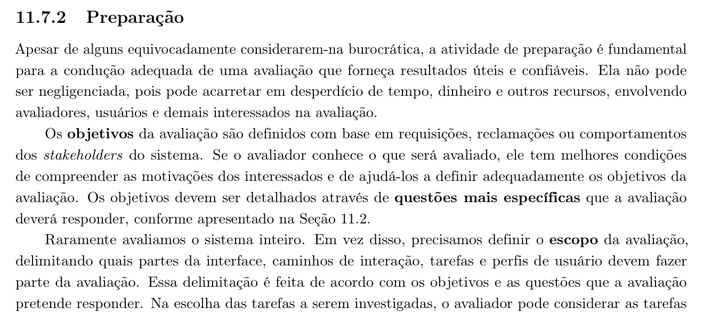
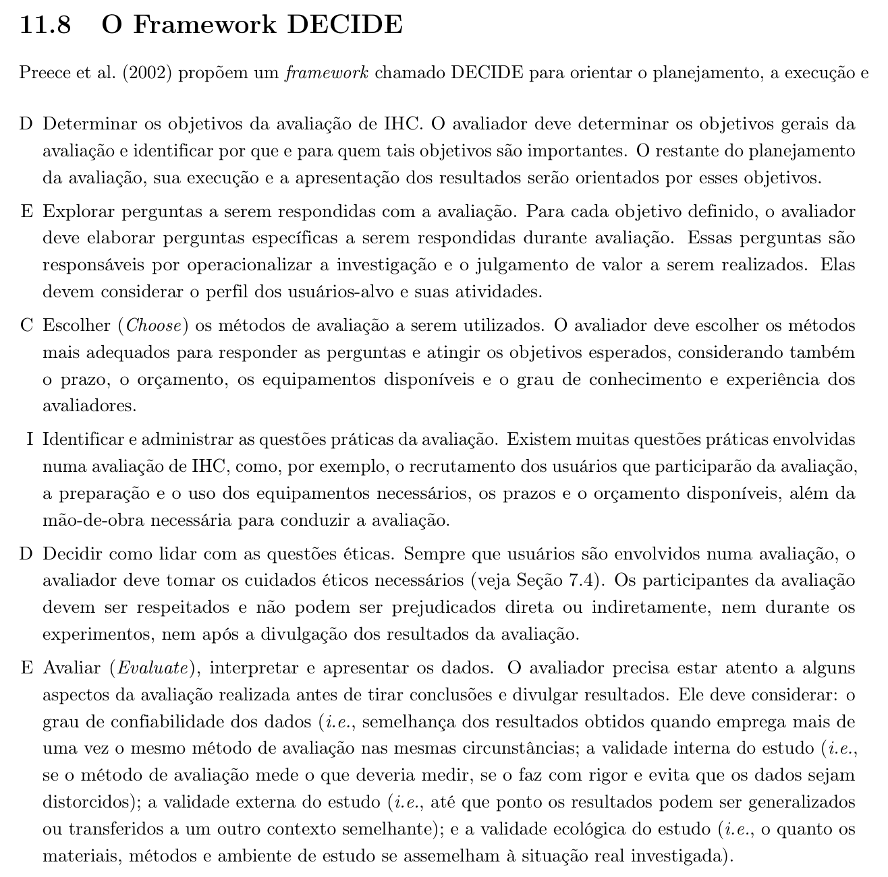
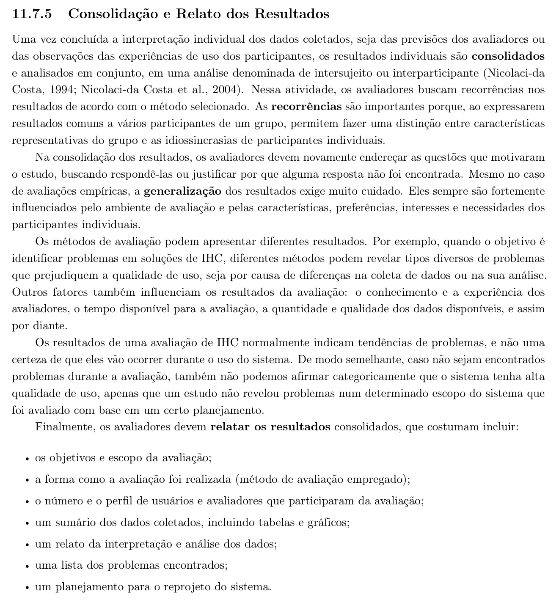
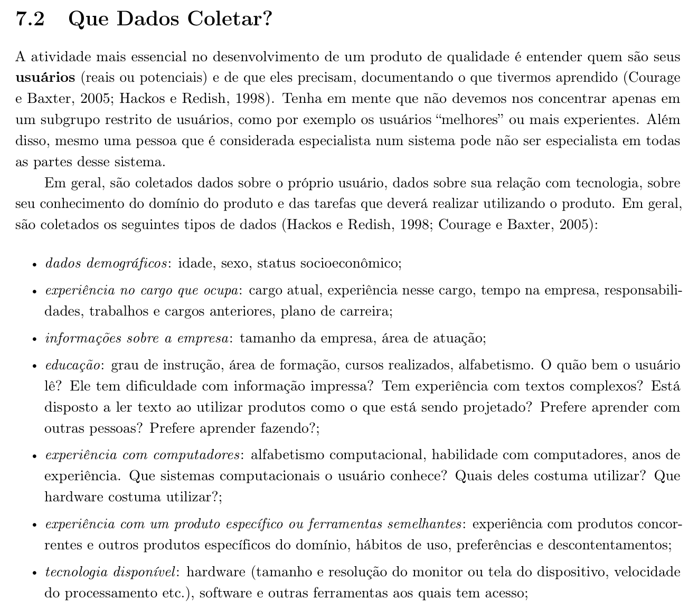

<b>Tabela de Contribuição</b>

| Membro | Contribuição |
| :--- | :--- |
| **Daniel da Silva Batista** | Transposição dos itens oficiais do plano de ensino (Itens 1 a 23), estruturação da página e elaboração do **Item extra 25** (Mitigação do Viés de Concordância na Entrevista) ([Item 25 — Mitigação do Viés de Concordância](#72-item-25-mitigacao-do-vies-de-concordancia-acquiescence-bias-na-entrevista)). |
| **Arthur Sismene Carvalho** | Revisão técnica da lista e elaboração do **Item extra 24** (Rigor e Execução do Teste-Piloto) ([Item 24 — Rigor e Execução do Teste-Piloto](#71-item-24-rigor-e-execucao-do-teste-piloto)). |
| **Pedro Rocha Ferreira Lima** | Revisão da fundamentação teórica e elaboração do **Item extra 26** (Escala Padronizada de Gravidade de Problemas) ([Item 26 — Escala de Gravidade](#73-item-26-escala-padronizada-de-gravidade-e-priorizacao-de-problemas)). |
| **Leonardo da Silva Lopes Júnior** | Revisão da formatação e elaboração do **Item extra 27** (Rastreabilidade entre Amostra de Participantes e Elenco de Personas) ([Item 27 — Rastreabilidade](#74-item-27-rastreabilidade-entre-amostra-de-participantes-e-elenco-de-personas)). |
| **Daniel da Silva Batista** | Aplicação da autoavaliação aos artefatos da Etapa 4 e redação das respostas e observações (19/11/2026) ([Vídeo de Autoavaliação — Etapa 4](#3-video-de-autoavaliacao-etapa-4)). |
| **Gemini** | Apoio na organização e diagramação Markdown (conforme Política de IA). |

<b>Fonte:</b> Daniel da Silva Batista (2026).

# Verificação — Etapa 4 (Grupo 07 — Autoavaliação)

## 1. Objetivo e Escopo

Este artefato reúne o instrumento da lista de verificação de **Autoavaliação da Etapa 4** do **Grupo 07**, elaborada com base nos critérios estabelecidos pelo professor André Barros de Sales no plano de ensino da disciplina de Interação Humano-Computador (SALES, 2026). A inspeção recai sobre os quatro artefatos normativos de planejamento produzidos para o Nível 1 do ciclo de Engenharia de Usabilidade do portal **PCI Concursos** (`pciconcursos.com.br`) e publicados no [GitHub Pages do projeto](https://interacao-humano-computador.github.io/2026.2-Grupo07/):

1. [Planejamento da Avaliação da Análise de Tarefas](../design-avaliacao-desenvolvimento/planejamento-avaliacao-analise-de-tarefas.md)
2. [Planejamento do Relato dos Resultados da Avaliação da Análise de Tarefas](../design-avaliacao-desenvolvimento/resultado-analise-de-tarefas.md)
3. [Planejamento da Avaliação do Storyboard](../avaliacao/planejamento-avaliacao-storyboard.md)
4. [Planejamento do Relato dos Resultados da Avaliação do Storyboard](../design-avaliacao-desenvolvimento/planejamento-relato-resultados-storyboard.md)

A lista reúne **27 itens**, organizados em três blocos normativos:
1. **10 itens de desenvolvimento do projeto** ([Seção 5](#5-itens-de-desenvolvimento-do-projeto)), comuns a todas as entregas da disciplina;
2. **13 itens de conteúdo da disciplina da Etapa 4 (Itens 11 a 23)** ([Seção 6](#6-itens-de-conteudo-da-disciplina)), critérios oficiais definidos no plano de ensino pelo professor André Barros de Sales, cobrindo o Framework DECIDE, metas, métodos com comprovação bibliográfica, questões práticas, éticas, estrutura de relato e testes-piloto;
3. **4 itens elaborados pelo grupo avaliador (Itens 24 a 27)** ([Seção 7](#7-itens-elaborados-pelo-grupo)), critérios originais elaborados por cada membro da equipe com imagens e citações do livro de referência (*Barbosa et al., 2021*), sem se repetirem com as do professor.

---

## 2. Instruções de Preenchimento

Cada critério avaliado admite uma única classificação entre as três opções abaixo:

* **Sim** — o artefato inspecionado atende integral e satisfatoriamente ao critério estabelecido;
* **Não** — o artefato não atende ao critério ou não apresenta a informação solicitada;
* **Incompleto** — o artefato atende apenas parcialmente ao que o critério exige.

Para cada item são registrados: a resposta obtida, a observação detalhada (com a localização das evidências ou das ações corretivas necessárias) e, nos itens de conteúdo e nos itens elaborados pelo grupo, o autor e a data da avaliação.

---

## 3. Vídeo de Autoavaliação — Etapa 4

O vídeo a seguir documenta a autoavaliação e a conferência dos artefatos da Etapa 4 realizada pelos integrantes do Grupo 07.

> *Vídeo pendente de gravação pela equipe. Ao publicá-lo no YouTube, incorporar o player nesta seção e completar os dados abaixo.*

* **Categoria no YouTube:** não listado;
* **Participante:** a definir;
* **Data da gravação:** a definir.

---

## 4. Síntese dos Resultados

A Tabela 1 consolida a distribuição das respostas obtidas na autoavaliação do Grupo 07 na Etapa 4.

<b>Tabela 1: Síntese das Respostas da Autoavaliação (Etapa 4)</b>

| Bloco | Total de Itens | Sim | Incompleto | Não |
| :--- | :---: | :---: | :---: | :---: |
| Desenvolvimento do projeto (Itens 1 a 10) | 10 | 5 | 3 | 2 |
| Conteúdo da disciplina (Itens 11 a 23) | 13 | 11 | 2 | 0 |
| Itens elaborados pelo grupo (Itens 24 a 27) | 4 | 2 | 2 | 0 |
| **Total Geral** | **27** | **18** | **7** | **2** |

<b>Fonte:</b> Daniel da Silva Batista (2026).

---

## 5. Itens de Desenvolvimento do Projeto

A Tabela 2 apresenta o instrumento de autoavaliação dos 10 itens gerais de governança e desenvolvimento do projeto exigidos para todas as entregas (SALES, 2026).

<b>Tabela 2: Itens de Desenvolvimento do Projeto</b>

| Item | Critério Verificado | Resposta | Observação |
| :---: | :--- | :---: | :--- |
| 1 | O GitHub Pages do projeto possui o histórico de versão padronizado? | **Sim** | Os quatro planejamentos e o `teste-piloto.md` apresentam histórico de versão com numeração, data, descrição, autor e revisor. |
| 2 | O GitHub Pages do projeto indica o(s) autor(es) e o(s) revisor(es) para cada artefato? | **Incompleto** | Os autores estão identificados em todos os artefatos, mas o revisor consta como "—" nas versões `1.2` a `1.4` de `planejamento-avaliacao-storyboard.md` e na versão `1.0` de `teste-piloto.md`. |
| 3 | O GitHub Pages do projeto possui referências bibliográficas e/ou bibliografia em todos os artefatos? | **Sim** | Todos os artefatos possuem seção de bibliografia, com Barbosa et al. (2021), Preece, Rogers e Sharp (2005) e Nielsen (1993), entre outras obras. |
| 4 | No GitHub Pages do projeto, as tabelas e imagens possuem legenda e fonte e são chamadas dentro do texto? | **Sim** | As tabelas e figuras são numeradas, com título acima, fonte abaixo e chamada no texto, após a padronização feita na issue #4 (PR #50), que corrigiu o Vídeo 1 de `teste-piloto.md`. |
| 5 | O GitHub Pages do projeto possui um texto fazendo uma introdução dos artefatos? | **Sim** | Os quatro planejamentos iniciam com a seção "1. Introdução", e `teste-piloto.md` abre com a fundamentação teórica do teste-piloto. |
| 6 | O GitHub Pages do projeto possui o cronograma executado, indicando quem realizou cada artefato ou atividade e as datas de início e fim? | **Incompleto** | A Tabela 8 de `cronograma.md` registra o cronograma executado da Etapa 4 com responsáveis e datas, mas três atribuições divergem da autoria dos artefatos: o Planejamento da Avaliação do Storyboard é atribuído a Daniel (autor: Arthur), o da Análise de Tarefas a Pedro (autor: Daniel) e o Relato do Storyboard a Arthur (autor: Leonardo). |
| 7 | O GitHub Pages do projeto possui ata(s) da(s) reunião(ões), com data, horário de início e fim, participantes, objetivo e atividades definidas? | **Não** | `ata-reuniao.md` contém apenas a ata da 1ª reunião (03/09/2026). A reunião de alinhamento da Etapa 4, prevista para 12/10/2026 na Tabela 7 de `cronograma.md`, não possui ata. |
| 8 | O GitHub Pages do projeto possui a gravação da reunião do grupo? | **Não** | Não há gravação de reunião do grupo referente à Etapa 4. |
| 9 | O GitHub Pages do projeto possui vídeo de apresentação publicado na categoria "não listado" no YouTube? | **Incompleto** | O vídeo da Etapa 4 está publicado no YouTube e incorporado em `apresentacao-4.md`, com link direto, mas a página não declara a categoria "não listado", como fazem as demais páginas de vídeo. |
| 10 | O GitHub Pages do projeto possui tabela de contribuição no início do artefato, com o nome de todos os integrantes? | **Sim** | Os quatro planejamentos e `teste-piloto.md` iniciam com tabela de contribuição com os quatro integrantes. |

<b>Fonte:</b> Daniel da Silva Batista (2026), adaptado de Sales (2026).

---

## 6. Itens de Conteúdo da Disciplina

A Tabela 3 detalha a autoavaliação dos 13 itens de conteúdo da disciplina (itens 11 a 23) estabelecidos no plano de ensino para a Etapa 4 pelo professor André Barros de Sales.

<b>Tabela 3: Itens de Conteúdo da Disciplina (Etapa 4)</b>

| Item | Critério Verificado | Resposta | Observação | Autor |
| :---: | :--- | :---: | :--- | :--- |
| 11 | O GitHub Pages possui os artefatos: Planejamento da Avaliação do Storyboard e da Análise de tarefas, e o Planejamento do Relato dos Resultados da avaliação do Storyboard e da Análise de tarefas? | **Sim** | Os quatro artefatos estão publicados: Planejamento da Avaliação e do Relato da Análise de Tarefas e Planejamento da Avaliação e do Relato do Storyboard. | Daniel da Silva Batista |
| 12 | O planejamento da avaliação segue o Framework DECIDE? | **Sim** | Os dois planejamentos de avaliação seguem as seis atividades do DECIDE nas Seções 3 a 8, e a Figura 1 de cada um reproduz o framework (Barbosa et al., 2021, p. 303–304). | Daniel da Silva Batista |
| 13 | Descreve o(s) objetivo(s) da avaliação? (apropriação de tecnologia pelos usuários; ideias e alternativas de design; conformidade com um padrão; e/ou problemas na interação e na interface na fase do modelo conceitual) | **Sim** | A Seção 3 dos dois planejamentos define objetivo geral e específicos: conformidade com as notações HTA/CTT e com os critérios de storyboard (conformidade com um padrão) e divergências entre o modelo e a prática dos usuários (problemas na fase do modelo conceitual). | Daniel da Silva Batista |
| 14 | Os métodos de avaliação a serem utilizados? Adicionar referência bibliográfica da fonte e foto do texto da referência explicando os métodos de avaliação. | **Incompleto** | A Tabela 3 de cada planejamento descreve os métodos (inspeção por lista de verificação e entrevista semiestruturada) com referência a Barbosa et al. (2021), mas as fotos de referência tratam do DECIDE e da preparação da avaliação; falta a foto do texto que explica os métodos escolhidos. | Daniel da Silva Batista |
| 15 | As questões práticas da avaliação (sobre o recrutamento dos usuários que participarão da avaliação (onde e o perfil), quantos usuários participarão da avaliação e a razão dessa quantidade, presencial real ou remota; a preparação e o uso dos equipamentos necessários, os prazos; o orçamento; recursos de mão-de-obra necessária para conduzir a avaliação)? | **Sim** | As Seções 6.2 a 6.6 tratam do recrutamento e perfil (Perfil 1), da quantidade (quatro participantes, justificada por Nielsen), da modalidade remota por videoconferência, do material, dos custos, dos papéis e do cronograma. | Daniel da Silva Batista |
| 16 | As questões éticas (se os participantes da avaliação devem ser respeitados e não podem ser prejudicados direta ou indiretamente, nem durante os experimentos, nem após a divulgação dos resultados da avaliação)? | **Sim** | A Seção 7 prevê leitura do TCLE antes da gravação, consentimento verbal registrado, participação voluntária com desistência a qualquer momento e o esclarecimento de que o objeto avaliado é o artefato, nunca o participante. | Daniel da Silva Batista |
| 17 | A estrutura do relatório do resultado da avaliação (os objetivos da avaliação; uma breve descrição do método de prototipação em papel; o número e o perfil de avaliadores e dos participantes; as tarefas executadas pelos participantes; lista de problemas encontrados etc)? | **Sim** | A Seção 3 dos planejamentos dos relatos define objetivos e escopo, método, número e perfil dos participantes, síntese da inspeção, problemas encontrados, sugestões e sumário por tarefa ou storyboard. | Daniel da Silva Batista |
| 18 | Um cronograma (data e horário) e local para realização da avaliação do StoryBoard e da Análise das Tarefas? | **Sim** | A Tabela 7 (Análise de Tarefas) e a Tabela 6 (Storyboard) trazem data e horário de cada sessão, realizadas remotamente por videoconferência. | Daniel da Silva Batista |
| 19 | Cada desenho do StoryBoard está relacionado a uma especificação do artefato da Análise de Tarefas? | **Sim** | A Tabela 4 do planejamento do Storyboard relaciona cada storyboard à tarefa, ao cenário e à persona (SB-01/TAR-01 a SB-04/TAR-08), e cada storyboard individual traz a correspondência de cada quadro com a tarefa modelada. | Daniel da Silva Batista |
| 20 | A quantidade de storyboards é igual à quantidade de integrantes do grupo? | **Sim** | São quatro storyboards (SB-01 a SB-04), um por integrante do grupo. | Daniel da Silva Batista |
| 21 | A definição do teste piloto e data para realização do teste piloto antes da avaliação? Adicionar referência bibliográfica da fonte e foto do texto da referência explicando o teste piloto. | **Incompleto** | A Seção 9 define o teste-piloto com data anterior às sessões (15/10/2026 e 19/10/2026) e referência a Barbosa et al. (2021), mas a foto de referência (Figura 2, p. 298) trata da preparação da avaliação e não mostra o trecho sobre o teste-piloto. | Daniel da Silva Batista |
| 22 | O resultado do teste piloto não será apresentado no resultado da avaliação? | **Sim** | Os dois planejamentos declaram que os dados do piloto são descartados. | Daniel da Silva Batista |
| 23 | Os itens que o avaliador deve realizar/anotar durante a avaliação (listar os problemas encontrados, priorizar a correção dos problemas não resolvidos)? | **Sim** | Os planejamentos dos relatos definem o modelo de registro de problemas e sugestões e a classificação por severidade, com ordem de correção por severidade e recorrência (Seção 4). | Daniel da Silva Batista |

<b>Fonte:</b> Daniel da Silva Batista (2026), adaptado de Sales (2026).

---

## 7. Itens Elaborados pelo Grupo

Esta seção reúne critérios adicionais formulados pela equipe do Grupo 07 com base na literatura clássica de IHC (*Interação Humano-Computador e Experiência do Usuário*, BARBOSA et al., 2021; PREECE et al., 2002; MAYHEW, 1999). Cada integrante concebeu e fundamentou 1 item acompanhado de recorte fotográfico da obra, sem se sobrepor aos itens do professor.

### 7.1 Item 24 — Rigor e Execução do Teste-Piloto

A Tabela 4 apresenta o Item 24 — rigor e execução do teste-piloto:

<b>Tabela 4: Item 24 — Rigor e Execução do Teste-Piloto</b>

| Campo | Registro |
| :--- | :--- |
| **Critério** | Os planejamentos de avaliação (tanto de Análise de Tarefas quanto de Storyboard) preveem a execução obrigatória de um teste-piloto prévio com data, horário, papéis definidos (avaliador e usuário simulado), tarefas-teste e a diretriz explícita de descarte dos dados preliminares? |
| **Resposta** | **Sim** |
| **Data da avaliação** | 19/11/2026 |
| **Observação** | O teste-piloto tem data e horário (Tabelas 7 e 6), papéis definidos (entrevistador e usuário), tarefas-teste (TAR-03 e TAR-04; SB-02) e descarte explícito dos dados. |
| **Autor** | Arthur Sismene Carvalho |
| **Fonte** | BARBOSA et al. (2021), Cap. 11, Seção 11.7.4 (Teste-Piloto), p. 302. |

<b>Fonte:</b> Arthur Sismene Carvalho (2026).

A Figura 1 reproduz a referência bibliográfica — o teste-piloto em avaliação de IHC:

<b>Figura 1: Referência Bibliográfica — O Teste-Piloto em Avaliação de IHC</b>

<b>Fonte:</b> BARBOSA et al. (2021, p. 298).

---

### 7.2 Item 25 — Mitigação do Viés de Concordância (*Acquiescence Bias*) na Entrevista

A Tabela 5 apresenta o Item 25 — mitigação do viés de concordância na entrevista:

<b>Tabela 5: Item 25 — Mitigação do Viés de Concordância na Entrevista</b>

| Campo | Registro |
| :--- | :--- |
| **Critério** | O roteiro e o procedimento de execução das entrevistas com usuários estipulam que o participante descreva primeiro como realiza a tarefa na interface atual ou fora dela, para apenas depois ter contato com o modelo ou desenho de proposta, prevenindo que o usuário concorde passivamente com o artefato exibido? |
| **Resposta** | **Incompleto** |
| **Data da avaliação** | 19/11/2026 |
| **Observação** | Na Análise de Tarefas, as perguntas 1 e 2 do roteiro são feitas antes de exibir o diagrama. No Storyboard, porém, o roteiro começa exibindo o storyboard, e a prática atual só é perguntada na questão 8. |
| **Autor** | Daniel da Silva Batista |
| **Fonte** | BARBOSA et al. (2021), Cap. 11, Seção 11.7.3 (Entrevistas e Técnicas de Investigação), p. 300–301; PREECE et al. (2002). |

<b>Fonte:</b> Daniel da Silva Batista (2026).

A Figura 2 reproduz a referência bibliográfica — o framework DECIDE e condução metodológica:

<b>Figura 2: Referência Bibliográfica — O Framework DECIDE e Condução Metodológica</b>

<b>Fonte:</b> BARBOSA et al. (2021, p. 303–304).

---

### 7.3 Item 26 — Escala Padronizada de Gravidade e Priorização de Problemas

A Tabela 6 apresenta o Item 26 — escala padronizada de gravidade de problemas:

<b>Tabela 6: Item 26 — Escala Padronizada de Gravidade de Problemas</b>

| Campo | Registro |
| :--- | :--- |
| **Critério** | Os planejamentos de relato estabelecem critérios objetivos e escalas formais de severidade (ex.: classificação em problema cosmético, leve, moderado, grave ou catastrófico) para fundamentar a tomada de decisão no reprojeto dos modelos e telas? |
| **Resposta** | **Sim** |
| **Data da avaliação** | 19/11/2026 |
| **Observação** | Os dois planejamentos dos relatos definem escala de severidade de três níveis com critérios objetivos e ordem de correção por severidade e recorrência. |
| **Autor** | Pedro Rocha Ferreira Lima |
| **Fonte** | NIELSEN (1993); BARBOSA et al. (2021), Cap. 11, Seção 11.7.5 (Consolidação e Relato dos Resultados), p. 303. |

<b>Fonte:</b> Pedro Rocha Ferreira Lima (2026).

A Figura 3 reproduz a referência bibliográfica — consolidação e relato dos resultados:

<b>Figura 3: Referência Bibliográfica — Consolidação e Relato dos Resultados</b>

<b>Fonte:</b> BARBOSA et al. (2021, p. 303).

---

### 7.4 Item 27 — Rastreabilidade entre Amostra de Participantes e Elenco de Personas

A Tabela 7 apresenta o Item 27 — rastreabilidade entre amostra e elenco de personas:

<b>Tabela 7: Item 27 — Rastreabilidade entre Amostra e Elenco de Personas</b>

| Campo | Registro |
| :--- | :--- |
| **Critério** | Os planejamentos de avaliação garantem que os participantes recrutados (USR-06 a USR-09 em tarefas, e USR-10 a USR-13 em storyboards) correspondam explicitamente às características sociodemográficas e aos hábitos de estudo das personas mapeadas (PER-01 a PER-04)? |
| **Resposta** | **Incompleto** |
| **Data da avaliação** | 19/11/2026 |
| **Observação** | No Storyboard, os participantes USR-10 a USR-13 se vinculam às personas pela Tabela 4 e pelo critério de aderência à persona. Na Análise de Tarefas, a Tabela 5 relaciona USR-06 a USR-09 à tarefa e ao perfil, mas não à persona. |
| **Autor** | Leonardo da Silva Lopes Júnior |
| **Fonte** | BARBOSA et al. (2021), Cap. 8, Seção 8.2 (Personas), p. 180; COOPER (1999). |

<b>Fonte:</b> Leonardo da Silva Lopes Júnior (2026).

A Figura 4 reproduz a referência bibliográfica — coleta de dados sociodemográficos e perfil de usuário:

<b>Figura 4: Referência Bibliográfica — Coleta de Dados Sociodemográficos e Perfil de Usuário</b>

<b>Fonte:</b> BARBOSA et al. (2021, p. 147).

---

## 8. Referências Bibliográficas

> [1] BARBOSA, Simone D. J.; SILVA, Bruno S. da; SILVEIRA, Milene S.; GASPARINI, Isabela; DARIN, Ticianne; BARBOSA, Gabriel D. J. *Interação Humano-Computador e Experiência do Usuário*. 1. ed. Autopublicação, 2021. ISBN: 978-65-00-19677-1.  
> [2] COOPER, Alan. *The Inmates Are Running the Asylum: Why High Tech Products Drive Us Crazy and How to Restore the Sanity*. Indianapolis: Sams Publishing, 1999.  
> [3] MAYHEW, Deborah J. *The Usability Engineering Lifecycle: A Practitioner's Handbook for User Interface Design*. San Francisco: Morgan Kaufmann, 1999.  
> [4] NIELSEN, Jakob. *Usability Engineering*. Boston: Academic Press, 1993.  
> [5] PATERNÒ, Fabio. *Model-Based Design and Evaluation of Interactive Applications*. London: Springer-Verlag, 1999.  
> [6] PREECE, Jennifer; ROGERS, Yvonne; SHARP, Helen. *Interaction Design: Beyond Human-Computer Interaction*. New York: John Wiley & Sons, 2002.  
> [7] SALES, André Barros de. *Plano de ensino FIHC 022026 – Turma 01*. Brasília: Faculdade de Ciências e Tecnologias em Engenharia (FCTE), Universidade de Brasília (UnB), 2026.  

---

## 9. Histórico de Versões

| Versão | Data | Descrição | Autor(es) | Revisor(es) |
| :---: | :---: | :--- | :---: | :---: |
| `1.0` | 14/10/2026 | Concepção, formulação e estruturação da Lista de Verificação da Etapa 4 (27 itens: 10 de governança do projeto, 13 de conteúdo da disciplina do docente e 4 elaborados pela equipe com fundamentação teórica). | Daniel da Silva Batista | Pedro Rocha Ferreira Lima, Arthur Sismene Carvalho, Leonardo da Silva Lopes Júnior |
| `1.1` | 19/11/2026 | Preenchimento da autoavaliação dos 27 itens no formato das demais verificações e síntese dos resultados. | Daniel da Silva Batista | — |

<b>Fonte:</b> Daniel da Silva Batista (2026).

