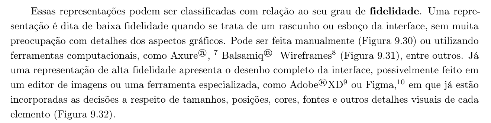
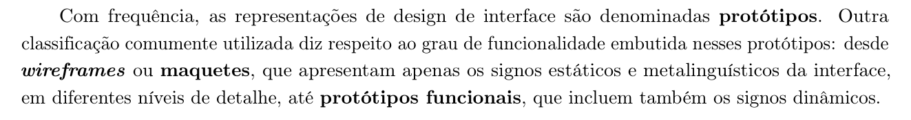
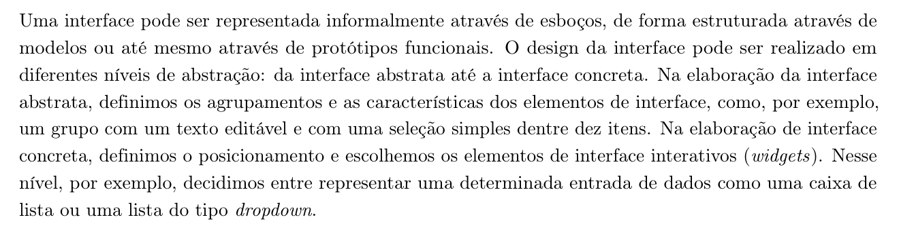
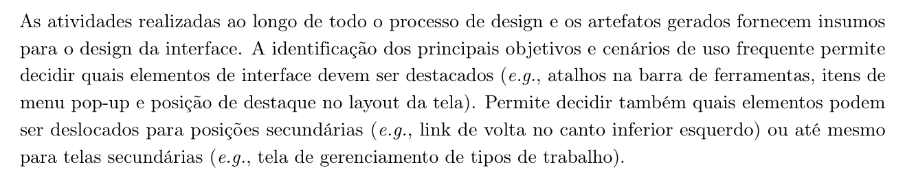
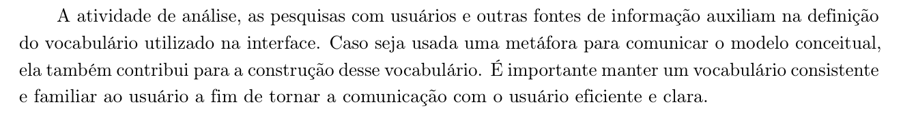
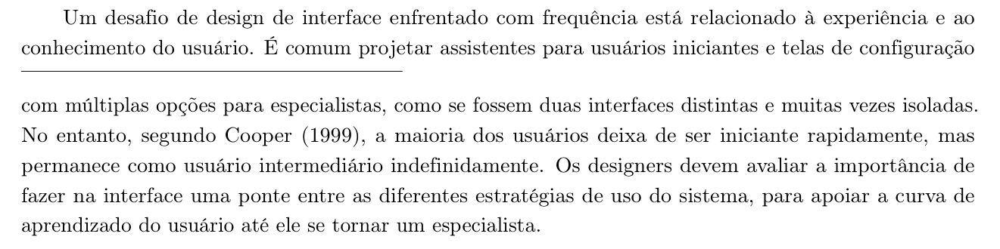
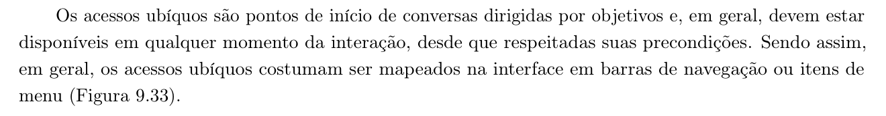
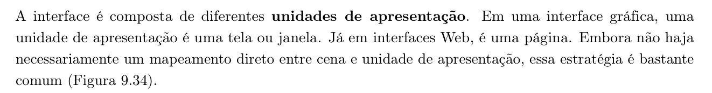
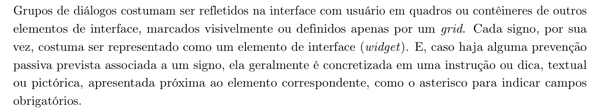

<b>Tabela de Contribuição</b>

| Membro | Contribuição |
| :--- | :--- |
| **Arthur Sismene Carvalho** | Elaboração da lista de verificação, inspeção dos três artefatos do Grupo 05, redação das respostas e observações, e redação desta página. |
| **Claude (Anthropic)** | Extração dos recortes bibliográficos do livro-texto, estruturação textual e diagramação Markdown (conforme Política de Uso de IA). |

<b>Fonte:</b> Arthur Sismene Carvalho (2026).

# Verificação — Etapa 6 (Grupo 05)

## 1. Objetivo e Escopo

Esta página registra a verificação dos artefatos do **Grupo 05** referentes ao protótipo de alta fidelidade, realizada pelo Grupo 07. A verificação emprega uma lista de 20 itens, distribuídos em dois blocos: o **Bloco A**, com 11 itens de padronização da documentação e do processo, derivado do padrão definido para a disciplina; e o **Bloco B**, com 9 itens sobre o protótipo de alta fidelidade enquanto representação da interface com o usuário, elaborados a partir das Seções 9.5.2 e 9.5.3 do Capítulo 9 de Barbosa et al. (2021).

Foram verificados **três artefatos**, indicados pelo próprio grupo avaliado:

<b>Tabela 1: Artefatos Verificados</b>

| Nº | Artefato | Nível | Endereço |
| :--- | :--- | :--- | :--- |
| A1 | Relato dos Resultados da Avaliação do Protótipo de Papel (TAR-07) | Nível 2 | [relato-resultados-prototipo-papel](https://interacao-humano-computador.github.io/2026.2-Grupo05/design-avaliacao-desenvolvimento/nivel2/relatos-individuais/arthur/relato-resultados-prototipo-papel/) |
| A2 | Planejamento da Avaliação do Protótipo de Alta Fidelidade (TAR-07) | Nível 3 | [arthur-planejamento-avaliacao-prototipo-alta-fidelidade](https://interacao-humano-computador.github.io/2026.2-Grupo05/design-avaliacao-desenvolvimento/nivel3/planejamentos-individuais/Arthur/arthur-planejamento-avaliacao-prototipo-alta-fidelidade/) |
| A3 | Planejamento do Relato dos Resultados da Avaliação do Protótipo de Alta Fidelidade (TAR-07) | Nível 3 | [arthur-planejamento-relato-prototipo-alta-fidelidade](https://interacao-humano-computador.github.io/2026.2-Grupo05/design-avaliacao-desenvolvimento/nivel3/planejamentos-individuais/Arthur/arthur-planejamento-relato-prototipo-alta-fidelidade/) |

<b>Fonte:</b> Arthur Sismene Carvalho (2026).

Os três artefatos são de autoria de Arthur Mariani, com revisão de Carlos Henrique, e integram a entrega que o Grupo 05 identifica como Entrega 6.

Quatro itens do Bloco A — cronograma, atas, gravação da reunião e vídeo de apresentação — não residem dentro dos artefatos individuais. Para esses, a verificação consultou também as páginas de **Cronograma**, **Atas de Reunião** e **Gravações** do site do Grupo 05, de modo a não registrar como ausente aquilo que existe fora dos três artefatos.

---

## 2. Instruções de Preenchimento

Cada item admite uma única resposta entre as três opções abaixo:

- **Conforme** — a entrega inspecionada atende integralmente ao que o item pergunta.
- **Não conforme** — a entrega não atende, atende apenas em parte ou não apresenta a informação solicitada.
- **Não se aplica** — a condição descrita no item não é pertinente à entrega inspecionada.

Toda resposta é acompanhada de observação que indica em qual dos três artefatos a constatação foi feita.

---

## 3. Vídeo de Verificação

<iframe width="720" height="405"
  src="https://www.youtube.com/embed/JByEXvPe0is"
  title="Verificação — Etapa 6 (Grupo 05) — Grupo 07"
  style="max-width: 100%;"
  frameborder="0"
  allow="accelerometer; autoplay; clipboard-write; encrypted-media; gyroscope; picture-in-picture"
  allowfullscreen>
</iframe>

<b>Vídeo 1:</b> Sessão de verificação dos artefatos do Grupo 05

<b>Link direto no YouTube:</b> <a href="https://youtu.be/JByEXvPe0is" target="_blank">https://youtu.be/JByEXvPe0is</a>

- **Categoria:** não listado
- **Verificador:** Arthur Sismene Carvalho
- **Data da gravação:** 08/11/2026

---

## 4. Síntese dos Resultados

<b>Tabela 2: Síntese das Respostas por Bloco</b>

| Bloco | Itens | Conforme | Não conforme | Não se aplica |
| :--- | :--- | :--- | :--- | :--- |
| A — Padronização da Entrega | 11 | 5 | 6 | 0 |
| B — Protótipo de Alta Fidelidade | 9 | 1 | 2 | 6 |
| **Total Geral** | **20** | **6** | **8** | **6** |

<b>Fonte:</b> Arthur Sismene Carvalho (2026).

O resultado do Bloco B pede uma explicação, sob pena de ser mal interpretado. Dos três artefatos verificados, dois são **planejamentos** da avaliação do protótipo de alta fidelidade e um é o **relato do protótipo de papel**, do nível anterior. O protótipo de alta fidelidade em si não é apresentado em nenhum deles. Por isso, os seis itens que só podem ser verificados sobre o artefato construído foram respondidos como "não se aplica", e não como "não conforme": a condição que eles descrevem ainda não é pertinente nesta fase da entrega.

Os dois itens do Bloco B marcados como não conformes são de natureza diferente. Eles perguntam pela **caracterização do artefato que será avaliado** — grau de fidelidade, ferramenta e grau de funcionalidade —, informação que um planejamento de avaliação precisa fixar antes da sessão, e que não consta.

---

## 5. Bloco A — Padronização da Entrega

<b>Tabela 3: Itens de Padronização da Entrega</b>

| Item | Critério Verificado | Resposta | Observação |
| :--- | :--- | :--- | :--- |
| 01 | O artefato apresenta histórico de versões padronizado, contendo o número da versão, a data, a descrição da alteração, o(s) autor(es) e o(s) revisor(es)? | Conforme | Os três artefatos trazem a tabela com Data, Versão, Descrição, Autor(es) e Revisor(es), além de uma coluna extra de declaração de ferramenta de IA |
| 02 | O artefato identifica o(s) autor(es) e o(s) revisor(es) responsáveis por ele? | Conforme | Arthur Mariani como autor e Carlos Henrique como revisor, na tabela de histórico de versão dos três artefatos |
| 03 | O artefato apresenta referências bibliográficas e/ou bibliografia? | Conforme | A1, A2 e A3 possuem seção de referências. Em A2 e A3 há uma única entrada, de Barbosa e Silva (2010), com capítulos, seções e páginas indicados |
| 04 | Todas as tabelas e imagens do artefato possuem legenda e indicação de fonte, e são chamadas no texto antes de serem apresentadas? | Não conforme | As figuras têm legenda e linha de fonte nos três artefatos, mas **nenhuma tabela possui legenda numerada nem linha de fonte**. Além disso, em A3 as Figuras 6 e 7 não são citadas por número no corpo do texto |
| 05 | O artefato apresenta um texto de introdução, explicando do que ele trata? | Conforme | Os três têm seção de introdução delimitando escopo, tarefa (TAR-07), cenário e persona |
| 06 | O cronograma executado informa quem realizou cada artefato ou atividade, com as datas de início e de fim da construção ou realização? | Não conforme | A página de Cronograma traz cronograma executado — com Atividade, Descrição, Autor(es), Revisor(es), Data de Início e Data de Fim — apenas para as Entregas 1, 2 e 4. Para os Níveis 2 e 3, objeto desta verificação, existe somente cronograma previsto, sem tabela de execução |
| 07 | As atas das reuniões registram data, horário de início e de término, participantes, objetivo da reunião e atividades definidas? | Não conforme | A Ata 10, de 03/11/2026, referente à inspeção da Entrega 6, registra data, horário de início (22h45), participantes, objetivo e atividades, mas **não informa o horário de término** — consta apenas a duração da gravação |
| 08 | A gravação da reunião do grupo está disponibilizada e acessível a partir do artefato? | Conforme | A Ata 10 incorpora o vídeo da reunião de inspeção da Entrega 6 |
| 09 | O vídeo de apresentação está publicado no YouTube na categoria "não listado"? | Não conforme | Na página de Gravações, a Entrega 6 consta como "Pendente", sem link. A Entrega 4 está como "Link em fase de upload". A página também não informa a categoria de nenhum dos vídeos publicados |
| 10 | O artefato apresenta, logo no início, tabela de contribuição com o nome de todos os integrantes, a contribuição de cada um e hiperligação para a atividade e para a gravação, quando houver? | Não conforme | Nenhum dos três artefatos possui tabela de contribuição. Há apenas autor e revisor na tabela de histórico de versão, sem a contribuição individual de cada integrante nem hiperligações |
| 11 | O artefato apresenta seção de agradecimentos informando o uso de Inteligência Artificial (IA) Generativa? | Não conforme | Não há seção de agradecimentos em nenhum dos três. A declaração de uso do Google Gemini, para estruturação em Markdown e revisão textual, aparece como coluna da tabela de histórico de versão: a informação existe, mas não no formato exigido |

<b>Fonte:</b> Arthur Sismene Carvalho (2026).

---

## 6. Bloco B — Protótipo de Alta Fidelidade

Os nove itens deste bloco derivam das Seções 9.5.2 e 9.5.3 do Capítulo 9 — Design de IHC — de Barbosa et al. (2021). Cada item é apresentado com a sua resposta e com o trecho do livro que o fundamenta.

### 6.1 Item 12 — Grau de Fidelidade e Ferramenta

<b>Tabela 4: Registro da Verificação do Item 12</b>

| Campo | Registro |
| :--- | :--- |
| **Critério** | O artefato declara que o protótipo é de alta fidelidade, isto é, que apresenta o desenho completo da interface, com as decisões já incorporadas a respeito de tamanhos, posições, cores, fontes e demais detalhes visuais de cada elemento, e informa a ferramenta utilizada — um editor de imagens ou uma ferramenta especializada, como Adobe XD ou Figma? |
| **Resposta** | Não conforme |
| **Data da avaliação** | 08/11/2026 |
| **Observação** | O artefato A2 trata da avaliação do protótipo de alta fidelidade, mas não caracteriza o artefato que será avaliado: não declara o grau de detalhe visual nem informa a ferramenta empregada. Refere-se apenas, de forma genérica, a "fluxo navegável", "telas necessárias" e "estados simulados" a configurar antes do piloto |
| **Autor** | Arthur Sismene Carvalho |
| **Fonte** | BARBOSA et al. (2021, p. 249) |

<b>Fonte:</b> Arthur Sismene Carvalho (2026).

<b>Figura 1:</b> Referência Bibliográfica — Grau de Fidelidade das Representações da Interface

<b>Fonte:</b> BARBOSA et al. (2021, p. 249).

### 6.2 Item 13 — Grau de Funcionalidade

<b>Tabela 5: Registro da Verificação do Item 13</b>

| Campo | Registro |
| :--- | :--- |
| **Critério** | Está registrado o grau de funcionalidade do protótipo, ou seja, se ele é um wireframe ou maquete — que apresenta apenas os signos estáticos e metalinguísticos da interface — ou um protótipo funcional, que inclui também os signos dinâmicos? |
| **Resposta** | Não conforme |
| **Data da avaliação** | 08/11/2026 |
| **Observação** | Não há registro em A2 nem em A3. As menções a "fluxo navegável" e a "respostas simuladas" sugerem um protótipo funcional, mas a classificação não é declarada, o que deixa indefinido o que exatamente será submetido ao teste de usabilidade planejado |
| **Autor** | Arthur Sismene Carvalho |
| **Fonte** | BARBOSA et al. (2021, p. 249) |

<b>Fonte:</b> Arthur Sismene Carvalho (2026).

<b>Figura 2:</b> Referência Bibliográfica — Grau de Funcionalidade: de Wireframes a Protótipos Funcionais

<b>Fonte:</b> BARBOSA et al. (2021, p. 249).

### 6.3 Item 14 — Interface Concreta e Escolha dos Widgets

<b>Tabela 6: Registro da Verificação do Item 14</b>

| Campo | Registro |
| :--- | :--- |
| **Critério** | O protótipo representa a interface concreta, definindo o posicionamento e a escolha dos elementos de interface interativos (widgets) — por exemplo, decidindo entre uma caixa de lista e uma lista do tipo dropdown para representar uma mesma entrada de dados? |
| **Resposta** | Não se aplica |
| **Data da avaliação** | 08/11/2026 |
| **Observação** | O protótipo de alta fidelidade não é apresentado em nenhum dos três artefatos verificados. Registra-se, como evidência de que o grupo trabalha nesse nível de concretude, que o artefato A1 descreve os widgets do protótipo de papel: opções "Sim", "Não" e "Ainda não confirmei", botões "Encontrar atendimento", "Não resolveu" e "Voltar", e campo para informar endereço |
| **Autor** | Arthur Sismene Carvalho |
| **Fonte** | BARBOSA et al. (2021, p. 247) |

<b>Fonte:</b> Arthur Sismene Carvalho (2026).

<b>Figura 3:</b> Referência Bibliográfica — Da Interface Abstrata à Interface Concreta

<b>Fonte:</b> BARBOSA et al. (2021, p. 247).

### 6.4 Item 15 — Destaques do Layout Derivados dos Objetivos e Cenários

<b>Tabela 7: Registro da Verificação do Item 15</b>

| Campo | Registro |
| :--- | :--- |
| **Critério** | Os elementos destacados no layout do protótipo — como atalhos na barra de ferramentas, itens de menu pop-up e posições de destaque na tela — decorrem dos principais objetivos e cenários de uso frequente identificados no projeto, tendo os elementos menos frequentes sido deslocados para posições secundárias ou para telas secundárias? |
| **Resposta** | Não se aplica |
| **Data da avaliação** | 08/11/2026 |
| **Observação** | Não há layout a inspecionar nos três artefatos. Registra-se que A2 vincula explicitamente a avaliação à TAR-07, ao Cenário 4 e à persona Maria Eduarda Santos, o que fornece o insumo exigido pelo critério, ainda que o layout dele decorrente não esteja apresentado |
| **Autor** | Arthur Sismene Carvalho |
| **Fonte** | BARBOSA et al. (2021, p. 249) |

<b>Fonte:</b> Arthur Sismene Carvalho (2026).

<b>Figura 4:</b> Referência Bibliográfica — Insumos do Processo para o Design da Interface

<b>Fonte:</b> BARBOSA et al. (2021, p. 249).

### 6.5 Item 16 — Vocabulário Consistente e Familiar ao Usuário

<b>Tabela 8: Registro da Verificação do Item 16</b>

| Campo | Registro |
| :--- | :--- |
| **Critério** | O vocabulário empregado na interface do protótipo é consistente e familiar ao usuário, tendo sido definido a partir da atividade de análise, das pesquisas com usuários e, quando houver, da metáfora adotada para comunicar o modelo conceitual? |
| **Resposta** | Conforme |
| **Data da avaliação** | 08/11/2026 |
| **Observação** | O protótipo emprega vocabulário cotidiano e familiar ao usuário, consistente com o público-alvo. O artefato A1 registra a escolha de rótulos em linguagem do dia a dia, como "Cartão ou crédito com problema", em vez de jargão institucional, definida a partir da atividade de análise — o que atende ao critério |
| **Autor** | Arthur Sismene Carvalho |
| **Fonte** | BARBOSA et al. (2021, p. 249) |

<b>Fonte:</b> Arthur Sismene Carvalho (2026).

<b>Figura 5:</b> Referência Bibliográfica — Definição do Vocabulário da Interface

<b>Fonte:</b> BARBOSA et al. (2021, p. 249).

### 6.6 Item 17 — Ponte entre as Estratégias de Uso

<b>Tabela 9: Registro da Verificação do Item 17</b>

| Campo | Registro |
| :--- | :--- |
| **Critério** | O protótipo faz na interface uma ponte entre as diferentes estratégias de uso do sistema, de modo a apoiar a curva de aprendizado do usuário, em vez de separar iniciantes e especialistas em duas interfaces distintas e isoladas? |
| **Resposta** | Não se aplica |
| **Data da avaliação** | 08/11/2026 |
| **Observação** | O critério só pode ser verificado sobre a interface construída, que não é apresentada nos três artefatos |
| **Autor** | Arthur Sismene Carvalho |
| **Fonte** | BARBOSA et al. (2021, p. 249-251) |

<b>Fonte:</b> Arthur Sismene Carvalho (2026).

<b>Figura 6:</b> Referência Bibliográfica — Experiência do Usuário e Curva de Aprendizado

<b>Fonte:</b> BARBOSA et al. (2021, p. 249-251).

### 6.7 Item 18 — Acessos Ubíquos na Navegação

<b>Tabela 10: Registro da Verificação do Item 18</b>

| Campo | Registro |
| :--- | :--- |
| **Critério** | Os acessos ubíquos — pontos de início de conversas dirigidas por objetivos, que devem estar disponíveis em qualquer momento da interação, respeitadas suas precondições — estão mapeados no protótipo em barras de navegação ou em itens de menu? |
| **Resposta** | Não se aplica |
| **Data da avaliação** | 08/11/2026 |
| **Observação** | Não há navegação de alta fidelidade a inspecionar. Registra-se que A1 descreve, no protótipo de papel, um atalho de acesso rápido rotulado "Cartão ou crédito com problema" na página principal, e uma navegação linear de cinco telas |
| **Autor** | Arthur Sismene Carvalho |
| **Fonte** | BARBOSA et al. (2021, p. 251) |

<b>Fonte:</b> Arthur Sismene Carvalho (2026).

<b>Figura 7:</b> Referência Bibliográfica — Acessos Ubíquos Mapeados na Interface

<b>Fonte:</b> BARBOSA et al. (2021, p. 251).

### 6.8 Item 19 — Unidades de Apresentação

<b>Tabela 11: Registro da Verificação do Item 19</b>

| Campo | Registro |
| :--- | :--- |
| **Critério** | Cada unidade de apresentação do protótipo — uma tela ou janela, em interface gráfica, ou uma página, em interface Web — corresponde a uma cena da modelagem da interação? |
| **Resposta** | Não se aplica |
| **Data da avaliação** | 08/11/2026 |
| **Observação** | O critério exige confrontar as telas do protótipo com a modelagem da interação, e as telas de alta fidelidade não constam dos artefatos verificados |
| **Autor** | Arthur Sismene Carvalho |
| **Fonte** | BARBOSA et al. (2021, p. 251) |

<b>Fonte:</b> Arthur Sismene Carvalho (2026).

<b>Figura 8:</b> Referência Bibliográfica — Unidades de Apresentação da Interface

<b>Fonte:</b> BARBOSA et al. (2021, p. 251).

### 6.9 Item 20 — Contêineres e Prevenções Passivas

<b>Tabela 12: Registro da Verificação do Item 20</b>

| Campo | Registro |
| :--- | :--- |
| **Critério** | Os grupos de diálogos estão refletidos na interface em quadros ou contêineres, marcados visivelmente ou definidos por um grid, e as prevenções passivas associadas a um signo aparecem como instrução ou dica, textual ou pictórica, próxima ao elemento correspondente — como o asterisco para indicar campos obrigatórios? |
| **Resposta** | Não se aplica |
| **Data da avaliação** | 08/11/2026 |
| **Observação** | Não há interface de alta fidelidade a inspecionar. Observa-se que A1 registra, no protótipo de papel, um campo para informar endereço sem indicação de obrigatoriedade ou de formato esperado — ponto a observar quando a interface for construída |
| **Autor** | Arthur Sismene Carvalho |
| **Fonte** | BARBOSA et al. (2021, p. 251) |

<b>Fonte:</b> Arthur Sismene Carvalho (2026).

<b>Figura 9:</b> Referência Bibliográfica — Grupos de Diálogos e Prevenção Passiva

<b>Fonte:</b> BARBOSA et al. (2021, p. 251).

---

## 7. Considerações Finais

A documentação dos três artefatos é consistente naquilo que o Grupo 05 padronizou: histórico de versão completo, autoria e revisão identificadas, introdução delimitando escopo, referências e, nos trechos do livro, figuras com legenda e fonte. A declaração de uso de IA generativa existe em todos, o que nem sempre se vê.

As não conformidades do Bloco A concentram-se em dois pontos. O primeiro é de **forma**: as tabelas não têm legenda numerada nem linha de fonte, não há tabela de contribuição, e a declaração de IA está em coluna de tabela em vez de seção de agradecimentos. O segundo é de **rastreabilidade da entrega**: o cronograma executado para de registrar a partir da Entrega 4, a Ata 10 não informa horário de término, e o vídeo de apresentação da Entrega 6 ainda consta como pendente.

No Bloco B, a constatação central é que **o protótipo de alta fidelidade ainda não está apresentado** nos artefatos desta entrega, que compreende os seus planejamentos. Daí os seis "não se aplica". Os dois pontos efetivamente em aberto são a caracterização do artefato a ser testado — grau de fidelidade, ferramenta e grau de funcionalidade —, que um planejamento de avaliação precisa fixar antes do teste-piloto para que se saiba o que está sendo avaliado.

---

## 8. Referências Bibliográficas

> BARBOSA, S. D. J.; SILVA, B. S. da; SILVEIRA, M. S.; GASPARINI, I.; DARIN, T.; BARBOSA, G. D. J. **Interação Humano-Computador e Experiência do Usuário**. 1. ed. Autopublicação, 2021. ISBN 978-65-00-19677-1.

> BARBOSA, S. D. J.; SILVA, B. S. da. **Interação Humano-Computador**. Rio de Janeiro: Elsevier/Campus, 2010. Obra de referência adotada nos artefatos verificados do Grupo 05.

> COOPER, A. **The Inmates Are Running the Asylum**. Indianapolis: Sams Publishing, 1999. Citado por Barbosa et al. (2021, p. 251).

> CONSTANTINE, L. L.; LOCKWOOD, L. A. D. **Software for Use: A Practical Guide to the Models and Methods of Usage-Centered Design**. New York: ACM Press, 1999. Citado por Barbosa et al. (2021, p. 247).

> ANTHROPIC. **Claude (versão Opus 5)**. [Modelo de linguagem de grande escala]. Utilizado como apoio à extração dos recortes bibliográficos e à estruturação desta página. Disponível em: https://claude.ai. Acesso em: 8 nov. 2026.

---

## 9. Histórico de Versões

<b>Tabela 13: Histórico de Versões da Página</b>

| Versão | Data | Descrição | Autor(es) | Revisor(es) |
| :--- | :--- | :--- | :--- | :--- |
| `1.0` | 08/11/2026 | Criação da página: lista de 20 itens em dois blocos, verificação dos três artefatos do Grupo 05 e síntese dos resultados | Arthur Sismene Carvalho | _(a preencher)_ |

<b>Fonte:</b> Arthur Sismene Carvalho (2026).

