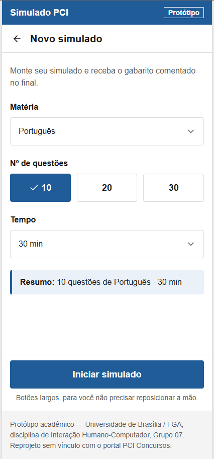
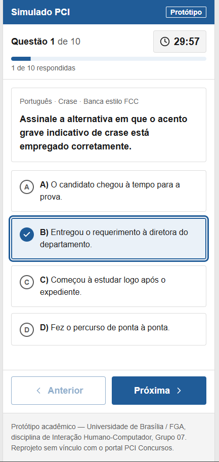
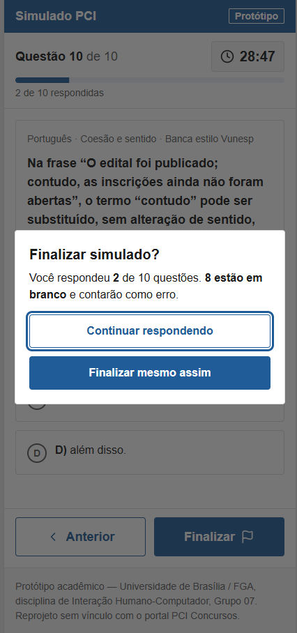
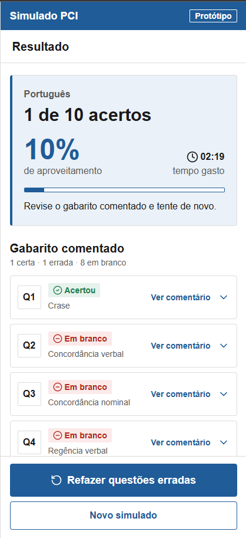
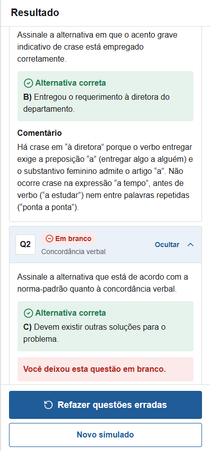

<b>Tabela de Contribuição</b>

| Membro | Contribuição |
| :--- | :--- |
| Arthur Sismene Carvalho | Especificação do protótipo de alta fidelidade a partir do protótipo de papel, condução da construção na plataforma Lovable, autoinspeção analítica, teste-piloto, moderação das sessões empíricas, captura das telas, análise dos resultados e redação desta página. |
| Claude (Anthropic) | Auxílio na estruturação textual, organização das tabelas, implementação dos modais de zoom, formatação em Markdown e intermediação das instruções enviadas ao agente da plataforma Lovable (conforme Política de Uso de IA). |

<b>Fonte:</b> Arthur Sismene Carvalho (2026).

# Avaliação e Relato Individual — Protótipo de Alta Fidelidade (Arthur Sismene Carvalho)

## 1. Identificação do Integrante e Escopo de Atuação

Esta página registra a avaliação individual do protótipo de alta fidelidade de **Nível 3** sob responsabilidade de Arthur Sismene Carvalho. Ela dá continuidade direta ao que foi levantado em [Avaliação e Relato Individual — Protótipo de Papel](arthur-carvalho-prototipo-papel.md): o protótipo aqui apresentado é a materialização interativa daquele protótipo de papel, já com os dois problemas identificados na sessão empírica corrigidos.

<b>Tabela 1: Resumo do Escopo Individual de Arthur Sismene Carvalho (Nível 3)</b>

| Atributo | Detalhamento |
| :--- | :--- |
| **Integrante responsável** | Arthur Sismene Carvalho |
| **Protótipo Interativo (Lovable)** | [simulado-pci-grupo07.lovable.app](https://simulado-pci-grupo07.lovable.app) |
| **Perfil de usuário focado** | [Perfil 1 — Candidato/Concurseiro](../../analise-de-requisitos/perfil-de-usuario.md) |
| **Persona de referência** | <abbr title="Persona 03">PER-03</abbr> — Thiago Moraes Albuquerque, 21 anos, estudante noturno, acesso predominantemente por smartphone |
| **Cenário de uso** | <abbr title="Cenário 05">CEN-05</abbr> — Resolução de Simulado Online Interativo com Feedback de Gabarito no Smartphone |
| **Tarefa de autoria** | <abbr title="Tarefa 05">TAR-05</abbr> — Simulado online interativo com feedback automático de gabarito |
| **Tipo de artefato** | Protótipo digital interativo de alta fidelidade, construído na plataforma **Lovable** (React, TypeScript e Tailwind CSS), sem persistência em servidor |
| **Técnica e modalidade de avaliação** | Teste de usabilidade presencial com protocolo *Think-Aloud* e entrevista pós-teste |
| **Escopo da inspeção** | Autoinspeção analítica com lista de verificação ergonômica (Nielsen, 1993) e critérios de plataforma do grupo |
| **Participante da sessão** | 1 participante aderente ao Perfil 1 + 1 participante piloto (autoteste, descartado) |

<b>Fonte:</b> Arthur Sismene Carvalho (2026).

O cenário condiciona o artefato do mesmo modo que condicionou o protótipo de papel: o CEN-05 descreve o uso **no smartphone**. O protótipo é, portanto, *mobile-first* — funciona a partir de 320 px de largura e, no desktop, permanece centralizado em uma coluna de 420 px, em vez de se espalhar pela tela. Os critérios de plataforma definidos pelo grupo em [Características da Plataforma](../caracteristicas-da-plataforma.md) — alvo de toque mínimo de 44 × 44 px, uma ação principal por tela e corpo de texto legível sem ampliação — foram adotados como requisitos de construção, e não como recomendações.

---

## 2. Apresentação do Protótipo de Alta Fidelidade (Lovable)

O protótipo cobre o fluxo completo da TAR-05 em três telas, nas mesmas fronteiras definidas no protótipo de papel: configurar o simulado, responder às questões sob cronômetro e ler o resultado com o gabarito comentado. Não há *login*, banco de dados nem servidor: o estado vive em memória durante a sessão de uso, o que é suficiente para o teste de usabilidade e mantém o artefato no escopo de um protótipo.

### 2.1 Rastreabilidade entre o Protótipo de Papel e o de Alta Fidelidade

Antes das telas, registra-se o que mudou e por quê. A Tabela 2 confronta cada achado da avaliação do protótipo de papel com a decisão de projeto adotada na alta fidelidade. Os identificadores `OPO-SM` e `VAL-SM` são os da página do protótipo de papel.

<b>Tabela 2: Rastreio dos Achados do Protótipo de Papel na Implementação de Alta Fidelidade</b>

| Achado de origem | Severidade | Decisão de projeto na alta fidelidade | Situação |
| :---: | :---: | :--- | :---: |
| **OPO-SM01** — o marcador vermelho sobre a alternativa selecionada foi lido como "stop" / "questão anulada" | Média | A alternativa marcada passou a usar o **azul institucional** (`#205c98`), o mesmo da ação primária: bloco com borda e preenchimento azul-claro e indicador circular preenchido com um ícone de **✓**, que substitui a letra. O vermelho foi reservado exclusivamente para erro, e apenas na tela de resultado. A codificação deixou de depender só da cor: há cor, preenchimento e ícone. | **Implementado** |
| **OPO-SM02** — o destaque da questão e o comentário no gabarito foram lidos como "ressalva"/anulação, e não como a questão errada | Alta | Cada questão do gabarito passou a exibir um **rótulo textual explícito** — "Acertou", "Errou" ou "Em branco" — com ícone e cor próprios. Ao abrir a questão, o participante vê um bloco verde "Alternativa correta", um bloco vermelho "Você marcou" com a alternativa que ele de fato escolheu, e o comentário sob o título "Comentário". O gatilho de expansão alterna entre "Ver comentário" e "Ocultar", tornando explícita a ação disponível. | **Implementado** |
| **VAL-SM01** — a configuração do simulado na Tela 1 foi compreendida sem auxílio | — | Estrutura preservada: matéria, número de questões em *chips*, tempo, resumo da escolha e um único botão primário na faixa inferior. | **Mantido** |
| **VAL-SM02** — o cronômetro foi compreendido como contagem do tempo restante | — | Comportamento preservado e ampliado: a contagem é regressiva e real; abaixo de cinco minutos o cronômetro muda para âmbar com ícone de alerta; ao chegar a zero, o simulado é encerrado automaticamente. | **Mantido e ampliado** |

<b>Fonte:</b> Arthur Sismene Carvalho (2026).

Duas funcionalidades foram acrescentadas sem origem em achado do papel, por decorrerem de diretrizes de projeto. A primeira é a **confirmação antes de finalizar** com questões em branco, que informa quantas são e que contarão como erro — prevenção passiva de erro, no sentido de Barbosa *et al.* (2021). A segunda é o botão **"Refazer questões erradas"**, que remonta um novo simulado apenas com as questões erradas e em branco, fechando o ciclo de estudo previsto no CEN-05.

### 2.2 Tela 1: Configuração e Início do Simulado (`/`)

A tela reúne os três parâmetros do simulado e um único botão de ação, fixo na faixa inferior ao alcance do polegar. O número de questões é escolhido por *chip*, e não por campo numérico, para evitar o teclado em tela pequena. A faixa de resumo — "Resumo: 10 questões de Português · 30 min" — é atualizada a cada mudança e é anunciada a leitores de tela, atendendo à visibilidade do estado do sistema.

  

  <button onclick="openModalAF01()" class="md-button md-button--primary" style="font-size: 0.82em; padding: 5px 16px; border-radius: 20px; cursor: pointer; display: inline-flex; align-items: center; gap: 6px;">
    🔍 <b>Zoom / Tela Cheia</b>
  </button>

<b>Figura 1:</b> Protótipo de Alta Fidelidade, Tela 1 — Configuração de Matéria, Número de Questões e Tempo

<b>Fonte:</b> Captura de tela do protótipo elaborado por Arthur Sismene Carvalho no Lovable (2026).

<!-- Modal AF Tela 1 -->

  

    <a href="../../../assets/images/prototipo-alta-fidelidade/af-arthur-tela-01.png" download="Prototipo_AF_Tela01_ArthurSismene.png" class="md-button md-button--primary" style="font-size: 0.85em; padding: 6px 16px; border-radius: 6px; text-decoration: none; color: white;">📥 Baixar</a>
    <button onclick="closeModalAF01()" class="md-button" style="font-size: 0.85em; padding: 6px 16px; border-radius: 6px; background: #e11d48; color: white; border: none; cursor: pointer;">✕ Fechar (ESC)</button>
  

  

    
  

  
Pressione <b>ESC</b> ou clique fora da imagem para fechar.

### 2.3 Tela 2: Resolução das Questões sob Cronômetro (`/simulado`)

O cabeçalho é fixo e concentra três indicadores de estado: a posição na prova ("Questão 1 de 10"), o cronômetro regressivo e a barra de progresso com o número de questões já respondidas. As alternativas são blocos inteiros clicáveis, com altura mínima de 64 px — bem acima do mínimo de 44 px exigido pela plataforma —, o que dispensa a mira fina no indicador circular.

  

  <button onclick="openModalAF02()" class="md-button md-button--primary" style="font-size: 0.82em; padding: 5px 16px; border-radius: 20px; cursor: pointer; display: inline-flex; align-items: center; gap: 6px;">
    🔍 <b>Zoom / Tela Cheia</b>
  </button>

<b>Figura 2:</b> Protótipo de Alta Fidelidade, Tela 2 — Questão em Aberto, Cronômetro e Alternativas

<b>Fonte:</b> Captura de tela do protótipo elaborado por Arthur Sismene Carvalho no Lovable (2026).

<!-- Modal AF Tela 2 -->

  

    <a href="../../../assets/images/prototipo-alta-fidelidade/af-arthur-tela-02.png" download="Prototipo_AF_Tela02_ArthurSismene.png" class="md-button md-button--primary" style="font-size: 0.85em; padding: 6px 16px; border-radius: 6px; text-decoration: none; color: white;">📥 Baixar</a>
    <button onclick="closeModalAF02()" class="md-button" style="font-size: 0.85em; padding: 6px 16px; border-radius: 6px; background: #e11d48; color: white; border: none; cursor: pointer;">✕ Fechar (ESC)</button>
  

  

    
  

  
Pressione <b>ESC</b> ou clique fora da imagem para fechar.

A caixa de diálogo de encerramento só aparece quando há questões em branco e explicita a consequência da ação antes que ela ocorra. A ação de menor risco — "Continuar respondendo" — fica em primeiro lugar na ordem de leitura.

  

  <button onclick="openModalAF03()" class="md-button md-button--primary" style="font-size: 0.82em; padding: 5px 16px; border-radius: 20px; cursor: pointer; display: inline-flex; align-items: center; gap: 6px;">
    🔍 <b>Zoom / Tela Cheia</b>
  </button>

<b>Figura 3:</b> Protótipo de Alta Fidelidade, Tela 2 — Confirmação de Encerramento com Questões em Branco

<b>Fonte:</b> Captura de tela do protótipo elaborado por Arthur Sismene Carvalho no Lovable (2026).

<!-- Modal AF Tela 2 (Finalizar) -->

  

    <a href="../../../assets/images/prototipo-alta-fidelidade/af-arthur-modal-finalizar.png" download="Prototipo_AF_ModalFinalizar_ArthurSismene.png" class="md-button md-button--primary" style="font-size: 0.85em; padding: 6px 16px; border-radius: 6px; text-decoration: none; color: white;">📥 Baixar</a>
    <button onclick="closeModalAF03()" class="md-button" style="font-size: 0.85em; padding: 6px 16px; border-radius: 6px; background: #e11d48; color: white; border: none; cursor: pointer;">✕ Fechar (ESC)</button>
  

  

    
  

  
Pressione <b>ESC</b> ou clique fora da imagem para fechar.

### 2.4 Tela 3: Resultado e Gabarito Comentado (`/resultado`)

A tela abre com a faixa de desempenho — acertos, percentual de aproveitamento, tempo gasto e barra de proporção — e segue com o gabarito comentado em lista expansível. Cada questão exibe o veredito **por escrito** ao lado do ícone: "Acertou", "Errou" ou "Em branco". É a resposta direta ao `OPO-SM02`, em que a sinalização apenas visual do protótipo de papel foi lida como ressalva.

  

  <button onclick="openModalAF04()" class="md-button md-button--primary" style="font-size: 0.82em; padding: 5px 16px; border-radius: 20px; cursor: pointer; display: inline-flex; align-items: center; gap: 6px;">
    🔍 <b>Zoom / Tela Cheia</b>
  </button>

<b>Figura 4:</b> Protótipo de Alta Fidelidade, Tela 3 — Faixa de Desempenho e Lista do Gabarito Comentado

<b>Fonte:</b> Captura de tela do protótipo elaborado por Arthur Sismene Carvalho no Lovable (2026).

<!-- Modal AF Tela 3 (Resultado) -->

  

    <a href="../../../assets/images/prototipo-alta-fidelidade/af-arthur-tela-03.png" download="Prototipo_AF_Tela03_ArthurSismene.png" class="md-button md-button--primary" style="font-size: 0.85em; padding: 6px 16px; border-radius: 6px; text-decoration: none; color: white;">📥 Baixar</a>
    <button onclick="closeModalAF04()" class="md-button" style="font-size: 0.85em; padding: 6px 16px; border-radius: 6px; background: #e11d48; color: white; border: none; cursor: pointer;">✕ Fechar (ESC)</button>
  

  

    
  

  
Pressione <b>ESC</b> ou clique fora da imagem para fechar.

Ao acionar "Ver comentário", a questão se expande e apresenta três blocos distintos: a alternativa correta em verde, a alternativa efetivamente marcada em vermelho — presente apenas quando houve erro — e o comentário sob título próprio. A separação entre "o que era certo", "o que você marcou" e "por quê" é o que distingue esta versão do protótipo de papel, em que os três conteúdos ocupavam uma única tira de papel e foram confundidos entre si.

  

  <button onclick="openModalAF05()" class="md-button md-button--primary" style="font-size: 0.82em; padding: 5px 16px; border-radius: 20px; cursor: pointer; display: inline-flex; align-items: center; gap: 6px;">
    🔍 <b>Zoom / Tela Cheia</b>
  </button>

<b>Figura 5:</b> Protótipo de Alta Fidelidade, Tela 3 — Questão Expandida com Alternativa Correta, Resposta Marcada e Comentário

<b>Fonte:</b> Captura de tela do protótipo elaborado por Arthur Sismene Carvalho no Lovable (2026).

<!-- Modal AF Tela 3 (Gabarito expandido) -->

  

    <a href="../../../assets/images/prototipo-alta-fidelidade/af-arthur-gabarito-expandido.png" download="Prototipo_AF_GabaritoExpandido_ArthurSismene.png" class="md-button md-button--primary" style="font-size: 0.85em; padding: 6px 16px; border-radius: 6px; text-decoration: none; color: white;">📥 Baixar</a>
    <button onclick="closeModalAF05()" class="md-button" style="font-size: 0.85em; padding: 6px 16px; border-radius: 6px; background: #e11d48; color: white; border: none; cursor: pointer;">✕ Fechar (ESC)</button>
  

  

    
  

  
Pressione <b>ESC</b> ou clique fora da imagem para fechar.

---

## 3. Autoinspeção Analítica Prévia do Protótipo de Alta Fidelidade

Antes de levar o protótipo a qualquer participante, foi feita uma inspeção analítica própria, conduzida pelo autor sobre a versão publicada. A lista de verificação combina as heurísticas de Nielsen (1993) com os critérios de plataforma definidos pelo próprio grupo. O resultado está na Tabela 3.

<b>Tabela 3: Autoinspeção Analítica do Protótipo de Alta Fidelidade</b>

| # | Critério verificado | Evidência no protótipo | Atende |
| :---: | :--- | :--- | :---: |
| **1** | **Visibilidade do estado do sistema** (Nielsen, 1993) | Contador "Questão N de 10", cronômetro regressivo, barra de progresso e linha "X de 10 respondidas", todos no cabeçalho fixo | **Sim** |
| **2** | **Correspondência com o mundo real** (Nielsen, 1993) | Vocabulário do domínio de concursos: "simulado", "gabarito comentado", "questões em branco", "banca". Não há termos de sistema como "submeter respostas" ou "sessão de avaliação" | **Sim** |
| **3** | **Controle e liberdade do usuário** (Nielsen, 1993) | Navegação livre entre questões por "Anterior" e "Próxima"; a caixa de confirmação oferece "Continuar respondendo"; o resultado oferece "Novo simulado" | **Sim** |
| **4** | **Consistência e padrões** (Nielsen, 1993) | Paleta, tipografia, raio de borda e espaçamento definidos em variáveis únicas; azul institucional `#205c98` herdado do portal oficial; uma única ação primária por tela | **Sim** |
| **5** | **Prevenção de erros** (Nielsen, 1993) | Confirmação antes de finalizar com questões em branco, declarando quantas são e que contarão como erro | **Sim** |
| **6** | **Reconhecer em vez de lembrar** (Nielsen, 1993) | No gabarito, a alternativa correta e a alternativa marcada pelo usuário aparecem lado a lado, sem exigir que ele se lembre do que respondeu | **Sim** |
| **7** | **Critérios de plataforma do grupo** | Funciona a partir de 320 px sem rolagem horizontal; alvos de toque a partir de 44 px, com as alternativas em 64 px; corpo de texto em 16 px | **Sim** |
| **8** | **Contraste mínimo de 4,5:1 para texto** (ISO/IEC 9241-11) | O âmbar do cronômetro em estado de alerta fica em **3,9:1** sobre seu próprio fundo. A relação só é aceitável por se tratar de texto grande em negrito, e não atinge o patamar adotado no restante da interface | **Parcial** |

<b>Fonte:</b> Arthur Sismene Carvalho (2026).

O item 8 é o único em desacordo e foi registrado antes das sessões, para que a correção não seja apresentada depois como se tivesse sido descoberta pelos participantes. O encaminhamento está em `REP-AF01`, na Seção 6.7.

---

## 4. Teste-Piloto do Protótipo de Alta Fidelidade (Presencial)

Em conformidade com Barbosa *et al.* (2021, p. 276 e 300), o teste-piloto foi executado presencialmente antes das sessões definitivas para calibrar o roteiro de tarefas, verificar o tempo médio de interação em meio digital e validar a captação de áudio e tela.

### 4.1 Dados Logísticos do Teste-Piloto

<b>Tabela 4: Dados Logísticos do Teste-Piloto</b>

| Parâmetro | Detalhamento |
| :--- | :--- |
| **Data** | 15/11/2026 |
| **Horário de início e término** | 18:00 (início) |
| **Duração da gravação** | 03 min 06 s |
| **Participante do piloto** | Arthur Sismene Carvalho (o próprio autor — autoteste de calibração) |
| **Ambiente e dispositivo** | Presencial; captura de tela em **iPhone 15 Pro Max** (smartphone) |
| **Custo** | R$ 0,00 |

<b>Fonte:</b> Arthur Sismene Carvalho (2026).

### 4.2 Registro Audiovisual do Teste-Piloto

A gravação do teste-piloto está disponível na íntegra a seguir, hospedada no YouTube:

<iframe width="720" height="405" src="https://www.youtube.com/embed/6dCESeNs3EE" title="Gravação do Teste-Piloto - Protótipo de Alta Fidelidade - Arthur Sismene Carvalho (Grupo 07 IHC)" frameborder="0" allow="accelerometer; autoplay; clipboard-write; encrypted-media; gyroscope; picture-in-picture; web-share" allowfullscreen style="border: 1px solid #d0d7de; border-radius: 8px; box-shadow: 0 4px 12px rgba(0,0,0,0.08); margin: 16px auto; display: block;"></iframe>

<b>Vídeo 1:</b> Gravação do Teste-Piloto — Avaliação do Protótipo de Alta Fidelidade (<a href="https://youtu.be/6dCESeNs3EE" target="_blank">https://youtu.be/6dCESeNs3EE</a>)

<iframe width="340" height="605" src="https://www.youtube.com/embed/Yzw_y7gRBPA" title="Gravação de tela (iPhone 15 Pro Max) - Teste-Piloto - Protótipo de Alta Fidelidade - Arthur Sismene Carvalho (Grupo 07 IHC)" frameborder="0" allow="accelerometer; autoplay; clipboard-write; encrypted-media; gyroscope; picture-in-picture; web-share" allowfullscreen style="border: 1px solid #d0d7de; border-radius: 8px; box-shadow: 0 4px 12px rgba(0,0,0,0.08); margin: 16px auto; display: block;"></iframe>

<b>Vídeo 1 (complementar):</b> Gravação de tela do dispositivo durante o teste-piloto — iPhone 15 Pro Max, 52 s (<a href="https://youtube.com/shorts/Yzw_y7gRBPA" target="_blank">https://youtube.com/shorts/Yzw_y7gRBPA</a>)

> **Declaração de descarte dos dados do piloto.** Os dados do teste-piloto são descartados formalmente e não compõem os resultados da Seção 5, conforme Dumas e Redish (1999). A finalidade do piloto é validar o roteiro, a duração e a instrumentação.

### 4.3 Ajustes Decorrentes do Teste-Piloto

O teste-piloto **validou o planejamento sem ajustes**. O roteiro de tarefas, a duração prevista e a instrumentação — captura de tela do dispositivo (iPhone 15 Pro Max) e áudio da verbalização — mostraram-se adequados, de modo que nenhuma alteração foi necessária no protótipo ou na condução antes das sessões definitivas.

---

## 5. Avaliação Empírica com Usuários Reais (Sessões Presenciais)

### 5.1 Protocolo Ético e Caracterização dos Participantes

Todos os participantes receberam, antes do início, o esclarecimento sobre o objetivo da avaliação, sobre o fato de que o objeto avaliado é a interface e não o seu desempenho pessoal, e sobre a gravação. O Termo de Consentimento Livre e Esclarecido (<abbr title="Termo de Consentimento Livre e Esclarecido">TCLE</abbr>) foi registrado no próprio vídeo, conforme a Resolução nº 466/2012 do Conselho Nacional de Saúde.

<b>Tabela 5: Caracterização dos Participantes das Sessões</b>

| Participante | Idade | Ocupação | Rotina com concursos | Dispositivo habitual | Consentimento |
| :---: | :---: | :--- | :--- | :--- | :---: |
| **P1** | Não informado | Estudante de Direito | Interesse por concursos da área jurídica (selecionou Direito Constitucional no protótipo) | Computador (interface *mobile* espelhada via Teams para a gravação) | Aceito verbalmente em vídeo |

<b>Fonte:</b> Arthur Sismene Carvalho (2026).

### 5.2 Registro Audiovisual das Sessões Presenciais

<b>Tabela 6: Registro das Sessões Presenciais</b>

| Sessão | Moderador | Participante | Data e Horário | Duração | Modalidade | Link da Gravação |
| :---: | :--- | :---: | :---: | :---: | :---: | :--- |
| **S1** | Arthur Sismene Carvalho | P1 | 15/11/2026 às 19:30 | 04 min 15 s | Presencial (tela espelhada via Teams) | [Vídeo da Sessão 1 (YouTube)](https://youtu.be/KS8WGJiboIA) |

<b>Fonte:</b> Arthur Sismene Carvalho (2026).

<iframe width="720" height="405" src="https://www.youtube.com/embed/KS8WGJiboIA" title="Sessão 1 - Protótipo de Alta Fidelidade - Arthur Sismene Carvalho (Grupo 07 IHC)" frameborder="0" allow="accelerometer; autoplay; clipboard-write; encrypted-media; gyroscope; picture-in-picture; web-share" allowfullscreen style="border: 1px solid #d0d7de; border-radius: 8px; box-shadow: 0 4px 12px rgba(0,0,0,0.08); margin: 16px auto; display: block;"></iframe>

<b>Vídeo 2:</b> Gravação da Sessão 1 — Avaliação do Protótipo de Alta Fidelidade (<a href="https://youtu.be/KS8WGJiboIA" target="_blank">https://youtu.be/KS8WGJiboIA</a>)

### 5.3 Desempenho nas Tarefas e Feedbacks Coletados

A TAR-05 foi decomposta nas mesmas três tarefas usadas na avaliação do protótipo de papel, o que permite comparar diretamente os dois momentos:

- **Tarefa 1 (Tela 1):** montar um simulado de 10 questões de Português com 30 minutos e iniciá-lo.
- **Tarefa 2 (Tela 2):** responder à primeira questão e avançar, verbalizando o que o cronômetro indica.
- **Tarefa 3 (Tela 3):** finalizar o simulado, identificar uma questão errada e ler o comentário dela.

#### 5.3.1 Sessão 1 — Participante 1

<b>Tabela 7: Desempenho do Participante 1</b>

| Tarefa | Ação observada em *think-aloud* | Resultado | Tempo |
| :--- | :--- | :---: | :---: |
| Tarefa 1 — Montar o simulado | Entendeu de imediato que criava um simulado para resolver questões e ver o gabarito. Explorou o seletor de matéria, escolheu Direito Constitucional e percebeu que o sistema indicava apenas 4 questões disponíveis; voltou para Português, ajustou o tempo para 15 min e iniciou os 10 itens. | **Sucesso autônomo** | ~1 min 25 s |
| Tarefa 2 — Responder e navegar | Respondeu e pulou questões pela navegação, deixando algumas em branco. Elogiou o cabeçalho/progresso ("gostei da mesinha ali em cima") e **sugeriu um indicador de quais questões já foram respondidas**. | **Sucesso autônomo** | ~50 s |
| Tarefa 3 — Resultado e gabarito | Leu a faixa de desempenho (1 de 10 acertos, aproveitamento em % e tempo gasto) e aprovou o uso de porcentagem; abriu o gabarito comentado, gostou do comentário conciso (um parágrafo) e entendeu "Refazer questões erradas" (que separa as erradas) e "Novo simulado". | **Sucesso autônomo** | ~1 min 25 s |

<b>Fonte:</b> Arthur Sismene Carvalho (2026).

**Síntese pós-teste (Participante 1):** Avaliou a interface como clara e fluida, concluindo as três tarefas sem auxílio. **Organização visual:** elogiou o cabeçalho/barra de progresso ("a mesinha ali em cima"), a faixa de desempenho com porcentagem de aproveitamento e tempo gasto, e o comentário conciso do gabarito ("um negócio rápido é legal"). **O que gerou dúvida:** nenhuma dúvida bloqueadora; percebeu e aceitou a limitação do banco (apenas 4 questões em Direito Constitucional), por estar sinalizada na tela. **O que mudaria:** sugeriu incluir, na tela de resolução, um indicador de quais questões já foram respondidas.

---

## 6. Relato dos Resultados da Avaliação do Protótipo de Alta Fidelidade

Esta seção segue a estrutura de consolidação e relato proposta por Barbosa *et al.* (2021).

### 6.1 Objetivos da Avaliação

1. Verificar se as duas correções derivadas do protótipo de papel (`OPO-SM01` e `OPO-SM02`) de fato eliminaram as interpretações equivocadas observadas na avaliação anterior.
2. Verificar se o participante conclui a TAR-05 de ponta a ponta sem auxílio do moderador.
3. Identificar problemas de interação que só se manifestam em um artefato interativo, e que o papel não é capaz de revelar — notadamente a percepção da passagem do tempo no cronômetro.
4. Levantar oportunidades de reprojeto para a versão seguinte.

### 6.2 Escopo da Avaliação

O escopo são as três rotas do protótipo — `/`, `/simulado` e `/resultado` — mais a caixa de confirmação de encerramento, cobrindo integralmente a TAR-05.

Registra-se uma delimitação: a **TAR-06** (busca de oportunidades de estágio), também de autoria do mesmo integrante na matriz de tarefas do grupo, **não** está contemplada neste protótipo. O recorte foi deliberado e é o mesmo adotado no protótipo de papel, de modo que o par papel/alta fidelidade permaneça comparável. A TAR-06 permanece sem protótipo próprio.

### 6.3 Breve Descrição do Método Utilizado

Teste de usabilidade presencial, com protocolo *Think-Aloud* (Ericsson; Simon, 1993) durante a execução e entrevista semiestruturada ao final. A sessão foi precedida de um teste-piloto, cujos dados foram descartados. O moderador não intervém enquanto o participante não solicita ajuda ou não permanece bloqueado.

### 6.4 Conjunto de Diretrizes e Critérios Avaliados

- Heurísticas de usabilidade de Nielsen (1993), nos oito itens listados na Tabela 3.
- Metas de usabilidade da ISO/IEC 9241-11 — eficácia, eficiência e satisfação.
- Critérios de plataforma definidos pelo grupo em Características da Plataforma.
- Continuidade com os achados do protótipo de papel, verificados item a item na Tabela 2.

### 6.5 Número e Perfil dos Avaliadores e Participantes

Um moderador (o próprio autor) e **um participante** aderente ao Perfil 1 — Candidato/Concurseiro (estudante de Direito, caracterizado na Tabela 5). Com um único participante, os resultados são tratados como **indícios qualitativos** — úteis para a avaliação formativa (Krug, 2010; Nielsen, 1993), mas sem pretensão estatística; a validação com mais usuários do perfil fica indicada para a sequência.

### 6.6 Resultados Observados e Limitações do Protótipo

Na sessão realizada, o participante concluiu as três tarefas da TAR-05 de forma autônoma, sem auxílio do moderador (Tabela 7). Confrontando com os objetivos da Seção 6.1: as duas correções herdadas do protótipo de papel mostraram-se eficazes — o participante não repetiu o equívoco de `OPO-SM01` (reconheceu a alternativa selecionada sem confundi-la com erro/anulação) nem o de `OPO-SM02` (interpretou corretamente acertos, erros, questões em branco e o comentário do gabarito). A percepção da passagem do tempo (objetivo 3), que o papel não revela, foi observada e bem recebida — o participante valorizou o tempo gasto exibido no resultado e a porcentagem de aproveitamento. Como oportunidade (objetivo 4), registrou-se `OPO-AF02`: um indicador de quais questões já foram respondidas na Tela 2.

Com um único participante, os achados acima são indícios qualitativos. Independentemente disso, três limitações do artefato já são conhecidas e precisam constar do relato:

1. **Banco de questões reduzido e desbalanceado.** O protótipo traz 10 questões de Português e 4 de cada uma das demais matérias. Pedir 20 ou 30 questões, ou escolher outra matéria, devolve silenciosamente menos questões do que o solicitado, sem avisar o usuário. É a razão pela qual a Tarefa 1 fixa Português e 10 questões.
2. **Ausência de persistência.** Sem servidor, recarregar a página descarta o simulado em andamento. Um sistema real precisaria retomar a prova do ponto em que parou — exigência previsível para o uso em deslocamento descrito no CEN-05.
3. **Contraste do estado de alerta do cronômetro.** Registrado na Tabela 3 e encaminhado em `REP-AF01`.

### 6.7 Síntese dos Achados e Encaminhamentos de Reprojeto

<b>Tabela 10: Síntese dos Achados da Avaliação do Protótipo de Alta Fidelidade</b>

| ID | Tela | Descrição resumida | Severidade |
| :---: | :---: | :--- | :---: |
| **OPO-AF01** | Tela 2 | Contraste de 3,9:1 no estado de alerta do cronômetro, identificado em autoinspeção | Baixa |
| **OPO-AF02** | Tela 2 | Ausência de um indicador de quais questões já foram respondidas durante o simulado (sugestão de P1 na Sessão 1) | Baixa |
| **VAL-AF01** | Telas 1 e 3 | Propósito do simulado, faixa de desempenho (acertos, % de aproveitamento e tempo), comentário conciso do gabarito e os botões "Refazer questões erradas"/"Novo simulado" compreendidos e elogiados sem auxílio (P1) | — |

<b>Fonte:</b> Arthur Sismene Carvalho (2026).

<b>Tabela 11: Cronograma de Reprojeto</b>

| ID | Ação de reprojeto | Achado de origem | Data prevista | Status |
| :---: | :--- | :---: | :---: | :---: |
| **REP-AF01** | Escurecer o tom âmbar do estado de alerta do cronômetro até atingir 4,5:1 sobre o próprio fundo e sobre o branco | OPO-AF01 | Trabalho futuro (pós-entrega) | Planejado |
| **REP-AF02** | Incluir na Tela 2 um indicador por questão de respondida/não respondida (ex.: grade de navegação das questões) | OPO-AF02 | Trabalho futuro (pós-entrega) | Planejado |

<b>Fonte:</b> Arthur Sismene Carvalho (2026).

---

## 7. Agradecimentos e Declaração de Uso de Inteligência Artificial Generativa

O protótipo de alta fidelidade foi construído na plataforma **Lovable**, cujo agente gera o código da aplicação a partir de instruções em linguagem natural. A especificação funcional, o recorte de escopo, as decisões de projeto registradas na Tabela 2, a autoinspeção da Tabela 3 e a condução das sessões são de autoria do integrante responsável. A redação e a diagramação desta página contaram com o apoio do assistente **Claude (Anthropic)**, que também intermediou as instruções enviadas ao agente da plataforma. O uso está declarado conforme a política de uso de IA generativa adotada pelo grupo.

Agradece-se aos participantes das sessões, que cederam seu tempo voluntariamente, e aos colegas de grupo pelo apoio na logística das gravações.

---

## 8. Referências Bibliográficas

> [1] BARBOSA, Simone Diniz Junqueira et al. *Interação Humano-Computador e Experiência do Usuário*. 1. ed. Rio de Janeiro: Autopublicação, 2021. ISBN: 978-65-00-19677-1.
> [2] BRASIL. Conselho Nacional de Saúde. *Resolução nº 466, de 12 de dezembro de 2012*. Brasília, DF: Diário Oficial da União, 2013.
> [3] DUMAS, Joseph S.; REDISH, Janice C. *A Practical Guide to Usability Testing*. Revised ed. Exeter: Intellect Books, 1999.
> [4] ERICSSON, K. Anders; SIMON, Herbert A. *Protocol Analysis: Verbal Reports as Data*. Revised ed. Cambridge: MIT Press, 1993.
> [5] INTERNATIONAL ORGANIZATION FOR STANDARDIZATION. *ISO/IEC 9241-11: Ergonomics of human-system interaction — Part 11: Usability: Definitions and concepts*. Genebra: ISO, 2018.
> [6] KRUG, Steve. *Rocket Surgery Made Easy: The Do-It-Yourself Guide to Finding and Fixing Usability Problems*. Berkeley: New Riders, 2010.
> [7] NIELSEN, Jakob. *Usability Engineering*. San Diego: Academic Press, 1993.
> [8] SALES, André Barros de. *Plano de ensino FIHC 022026 — Turma 01*. Brasília: FGA/UnB, 2026.

---

## 9. Histórico de Versões

| Versão | Data | Descrição | Autor(es) | Revisor(es) |
| :---: | :---: | :--- | :---: | :---: |
| `1.0` | 15/11/2026 | Criação da página: escopo individual, apresentação do protótipo de alta fidelidade, rastreio dos achados do protótipo de papel, autoinspeção analítica e estrutura do relato dos resultados. | Arthur Sismene Carvalho | _(a preencher)_ |
| `1.1` | 15/11/2026 | Padronização visual conforme a entrega do Daniel (contribuição centralizada, tabelas e figuras em `
` com modais de zoom, referências em blockquote); organização das imagens no subfolder `prototipo-alta-fidelidade/`. Campos empíricos reservados. | Arthur Sismene Carvalho | _(a preencher)_ |
| `1.2` | 15/11/2026 | Inclusão da Figura 5 (questão do gabarito expandida, com alternativa correta, questão em branco e comentário) com modal de zoom; integração da página ao site (entrada no `nav` e publicação em `docs/`). | Arthur Sismene Carvalho | _(a preencher)_ |
| `1.3` | 15/11/2026 | Preenchimento do teste-piloto e da Sessão 1 (participante estudante de Direito); **redução da avaliação empírica a um participante**; consolidação da Seção 6 (resultados confrontados com os objetivos, `OPO-AF02`/`VAL-AF01` e cronograma de reprojeto). | Arthur Sismene Carvalho | _(a preencher)_ |

<b>Fonte:</b> Arthur Sismene Carvalho (2026).

