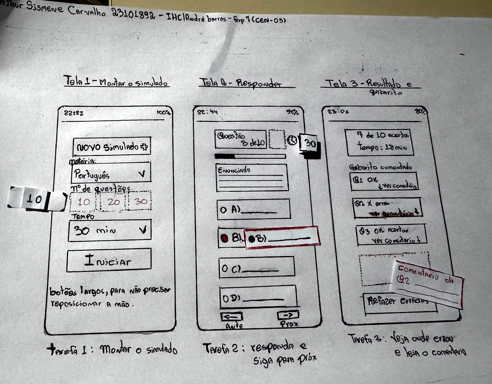
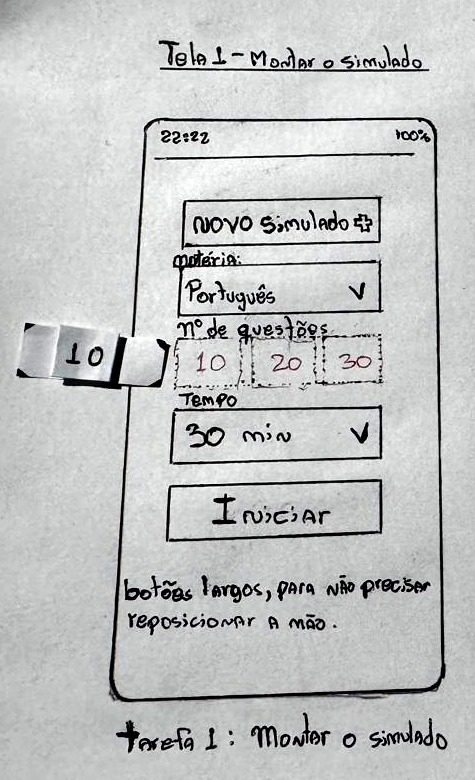
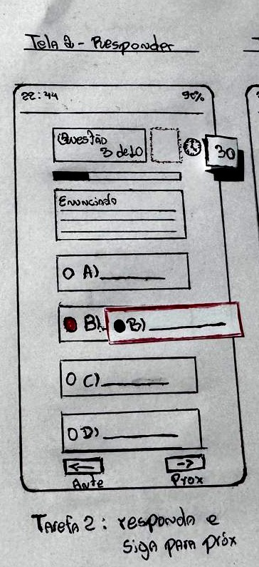
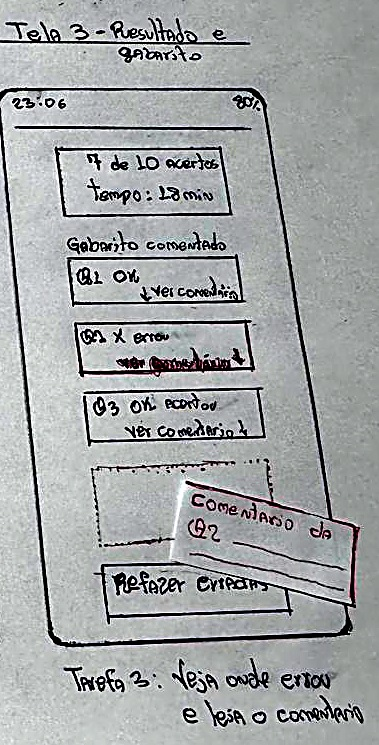

<b>Tabela de Contribuição</b>

| Membro | Contribuição |
| :--- | :--- |
| Arthur Sismene Carvalho | Concepção e desenho do protótipo de papel das três telas, elaboração das quatro peças móveis, autoinspeção analítica, condução do teste-piloto, moderação da sessão S03, análise dos resultados e redação desta página. |
| Leonardo da Silva Lopes Júnior | Atuação como Computador Humano (*Wizard of Oz*) na sessão S03. |
| Daniel da Silva Batista | Observação e registro da sessão S03. |
| Claude (Anthropic) | Auxílio na estruturação textual e formatação em Markdown (conforme Política de Uso de IA). |

<b>Fonte:</b> Arthur Sismene Carvalho (2026).

# Avaliação e Relato Individual — Protótipo de Papel (Arthur Sismene Carvalho)

## 1. Identificação do Integrante e Escopo de Atuação

Esta página registra a avaliação individual do protótipo de papel de Nível 2 sob responsabilidade de Arthur Sismene Carvalho. O planejamento que a origina está em [Planejamento da Avaliação do Protótipo de Papel](planejamento-avaliacao-prototipo-papel.md), e a estrutura do relato segue o que foi definido em [Planejamento do Relato dos Resultados do Protótipo de Papel](planejamento-relato-prototipo-papel.md).

<b>Tabela 1: Resumo do Escopo Individual de Arthur Sismene Carvalho (Nível 2)</b>

| Atributo | Detalhamento |
| :--- | :--- |
| **Integrante responsável** | Arthur Sismene Carvalho |
| **Perfil de usuário focado** | Perfil 1 — Candidato/Concurseiro |
| **Persona de referência** | PER-03 — Thiago Moraes Albuquerque, 21 anos, estudante noturno, acesso predominantemente por smartphone |
| **Cenário de uso** | CEN-05 — Resolução de Simulado Online Interativo com Feedback de Gabarito no Smartphone |
| **Tarefa de autoria** | TAR-05 — Simulado online interativo com feedback automático de gabarito |
| **Tipo de artefato** | Protótipo de baixa fidelidade desenhado à mão, com três molduras no formato de tela de celular e peças móveis sobrepostas (*Paper Prototyping*) |
| **Técnica de avaliação** | Simulação mecânica com o "Computador Humano" (*Wizard of Oz*) e verbalização em *Think-Aloud* |
| **Escopo da inspeção** | Autoinspeção analítica com lista de verificação derivada de Nielsen (1993) e Snyder (2003) |
| **Participante da sessão** | Um participante (Marcos, 59 anos, trabalhador); por indisponibilidade de usuário do Perfil 1 na data, a sessão foi conduzida com participante fora do perfil-alvo — ver ressalva na Seção 6.7 |

<b>Fonte:</b> Arthur Sismene Carvalho (2026).

Uma característica do cenário condiciona todo o artefato: o CEN-05 descreve o uso **no smartphone**. O protótipo não foi desenhado como tela cheia de computador, e sim como três molduras verticais de celular, proporcionais a um aparelho real. A decisão dialoga diretamente com o que o grupo especificou em [Características da Plataforma](../caracteristicas-da-plataforma.md) — alvo de toque mínimo de 44 px, uma ação principal por tela e conteúdo legível sem ampliação. A própria anotação manuscrita abaixo da Tela 1, *"botões largos, para não precisar reposicionar a mão"*, registra esse critério no artefato.

---

## 2. Apresentação das Peças do Protótipo de Papel

O protótipo é composto por **três telas** desenhadas à mão a caneta, dispostas lado a lado em uma única folha de papel sulfite, e por **quatro peças móveis** recortadas em papel solto. As peças não são coladas: elas são posicionadas pelo Computador Humano em resposta às ações do participante, o que é o que permite simular interatividade sem nenhum software.

As três telas cobrem o fluxo completo da TAR-05, da configuração do simulado até a leitura do gabarito comentado.

<b>Figura 1:</b> Folha Completa do Protótipo de Papel, com as Três Telas e as Peças Móveis Posicionadas

<b>Fonte:</b> Elaborado por Arthur Sismene Carvalho à mão livre em papel sulfite (2026).

### 2.1 Tela 1: Configuração e Início do Simulado

<b>Figura 2:</b> Protótipo de Papel, Tela 1 — Configuração de Matéria, Número de Questões e Tempo

<b>Fonte:</b> Elaborado por Arthur Sismene Carvalho à mão livre em papel sulfite (2026).

A tela concentra os três parâmetros do simulado — matéria, número de questões e tempo — e um único botão de ação, posicionado na faixa inferior alcançável pelo polegar. O número de questões é selecionado por chip, e não por campo de digitação, para evitar o teclado numérico em tela pequena.

### 2.2 Tela 2: Resolução da Questão com Cronômetro

<b>Figura 3:</b> Protótipo de Papel, Tela 2 — Questão, Alternativas e Navegação entre Questões

<b>Fonte:</b> Elaborado por Arthur Sismene Carvalho à mão livre em papel sulfite (2026).

É a tela de maior permanência do usuário. O estado do sistema é comunicado por três elementos simultâneos: o contador textual "Questão 3 de 10", a barra de progresso preenchida proporcionalmente e o cronômetro. O cronômetro foi desenhado como **espaço reservado tracejado**, preenchido por peça móvel, de modo que o Computador Humano possa trocar o tempo restante ao longo da sessão. O marcador da alternativa também é peça móvel, sobreposta à letra que o participante apontar.

### 2.3 Tela 3: Resultado e Gabarito Comentado

<b>Figura 4:</b> Protótipo de Papel, Tela 3 — Desempenho Consolidado e Gabarito Comentado por Questão

<b>Fonte:</b> Elaborado por Arthur Sismene Carvalho à mão livre em papel sulfite (2026).

O resultado foi desenhado com **7 de 10 acertos**, e não com desempenho perfeito, por uma razão de método: sem questões erradas não haveria comentário a abrir, e a terceira tarefa da sessão ficaria sem objeto. Abaixo da lista de questões há um **espaço reservado tracejado**, onde a peça do comentário é encaixada quando o participante aciona "ver comentário".

### 2.4 Peças Móveis

<b>Tabela 2: Peças Móveis e Função de Cada Uma na Simulação</b>

| Peça | Tela | Função na simulação |
| :--- | :---: | :--- |
| Chip do número de questões | 1 | Encaixado sobre a faixa de opções para registrar a escolha entre 10, 20 e 30 |
| Chip do cronômetro | 2 | Preenche o espaço reservado no topo; é trocado ao longo da sessão para simular a contagem do tempo |
| Marcador da alternativa | 2 | Tira sobreposta à alternativa apontada pelo participante, com o círculo preenchido |
| Comentário da questão | 3 | Entra no espaço reservado abaixo da lista quando o participante aciona "ver comentário" |

<b>Fonte:</b> Arthur Sismene Carvalho (2026).

Duas decisões de representação merecem registro. A primeira é que os **espaços reservados foram desenhados em tracejado** nas telas 2 e 3: sem eles, a peça móvel pareceria um papel solto por cima do desenho, e não um elemento que o sistema preenche. A segunda é que a **barra de status varia entre as três telas** — 22:22 com 100% de bateria na Tela 1, 22:44 com 90% na Tela 2 e 23:06 com 80% na Tela 3. É um detalhe deliberado: comunica ao participante que houve passagem de tempo entre as telas, e reforça o contexto de uso noturno e móvel da persona PER-03.

---

## 3. Autoinspeção Analítica do Protótipo de Papel

Antes de levar o artefato a qualquer participante, o próprio autor o inspecionou com a lista abaixo, derivada dos critérios de prototipação em papel de Snyder (2003) e das heurísticas de Nielsen (1993). A inspeção prévia evita gastar uma sessão com um defeito que a equipe poderia ter corrigido sozinha.

<b>Tabela 3: Lista de Verificação da Autoinspeção do Protótipo de Papel</b>

| Item | Critério avaliado | Resposta | Justificativa / Observação |
| :---: | :--- | :---: | :--- |
| **01** | **Baixa fidelidade autêntica** — o protótipo usa materiais distintos do produto final, sem componentes codificados | **Sim** | Desenhado à mão livre, a caneta, em papel sulfite, com peças recortadas. Nenhum elemento foi gerado digitalmente |
| **02** | **Affordances** — os elementos interativos comunicam a própria função | **Sim** | Alternativas com círculo de seleção visível, botão principal em caixa larga e destacada, setas explícitas em "Ante" e "Próx", e seta para baixo indicando que "ver comentário" expande |
| **03** | **Cobertura do fluxo** — a sequência de telas cobre a TAR-05 do início ao fim | **Sim** | As três telas percorrem configuração, resolução e leitura do gabarito comentado, sem salto de etapa |
| **04** | **Peças móveis** — o artefato permite representar respostas e feedbacks em tempo real | **Sim** | Quatro peças recortadas, descritas na Tabela 2, com espaços reservados tracejados nas telas que as recebem |
| **05** | **Linguagem do usuário** — os termos refletem o vocabulário do concurseiro | **Sim** | Empregados "simulado", "matéria", "gabarito comentado", "refazer erradas". Evitados termos de sistema como "submeter respostas" ou "sessão de avaliação" |

<b>Fonte:</b> Arthur Sismene Carvalho (2026).

### 3.1 Cuidado de Condução Decorrente do Formato

As três telas estão desenhadas na mesma folha, lado a lado. Isso é conveniente para a montagem e para o registro fotográfico, mas introduz um risco na condução: o participante enxerga a Tela 3 antes de concluir a Tarefa 1, o que antecipa o resultado e pode contaminar o comportamento observado nas tarefas anteriores.

A medida adotada é operacional e fica a cargo do Computador Humano: **manter cobertas, com uma folha em branco, as telas que não estão em uso**, revelando uma de cada vez conforme o participante avança. O procedimento foi verificado no teste-piloto e está registrado na Seção 4.3.

---

## 4. Teste-Piloto da Avaliação do Protótipo de Papel

Conforme Barbosa et al. (2021, p. 276 e 300), o teste-piloto foi conduzido previamente pelo avaliador Arthur Sismene Carvalho com o propósito de calibrar o tempo de condução da sessão, verificar o sincronismo na troca mecânica das peças móveis e conferir a legibilidade das telas desenhadas em vídeo.

### 4.1 Dados Logísticos do Teste-Piloto

<b>Tabela 4: Dados Logísticos do Teste-Piloto do Protótipo de Papel</b>

| Parâmetro | Detalhamento |
| :--- | :--- |
| **Data e horário** | 03/11/2026 às 18:30 |
| **Duração da gravação** | 03 min 48 s |
| **Avaliador responsável** | Arthur Sismene Carvalho |
| **Computador Humano** | Leonardo da Silva Lopes Júnior |
| **Ambiente de gravação** | Presencial, com câmera focalizando a mesa de testes |
| **Artefatos exercitados** | Folha com as três telas da TAR-05 e as quatro peças móveis |
| **Custos envolvidos** | R$ 0,00 — material de escritório próprio |

<b>Fonte:</b> Arthur Sismene Carvalho (2026).

### 4.2 Registro Audiovisual do Teste-Piloto

A gravação do teste-piloto com o protótipo de papel está disponível na íntegra a seguir, hospedada no YouTube:

<iframe width="720" height="405" src="https://www.youtube.com/embed/RgzF8ngqAzc" title="Gravação do Teste-Piloto - Protótipo de Papel - Arthur Sismene Carvalho (Grupo 07 IHC)" frameborder="0" allow="accelerometer; autoplay; clipboard-write; encrypted-media; gyroscope; picture-in-picture; web-share" allowfullscreen style="border: 1px solid #d0d7de; border-radius: 8px; box-shadow: 0 4px 12px rgba(0,0,0,0.08); margin: 16px auto; display: block;"></iframe>

<b>Vídeo 1:</b> Gravação do Teste-Piloto — Avaliação do Protótipo de Papel (TAR-05)

<b>Link direto no YouTube:</b> <a href="https://youtu.be/RgzF8ngqAzc" target="_blank">https://youtu.be/RgzF8ngqAzc</a>

> **Declaração de descarte.** Os dados coletados no teste-piloto **não** compõem os resultados desta avaliação. O piloto teve por objetivo avaliar o próprio planejamento — a clareza das instruções, a legibilidade das telas em vídeo, o manuseio das peças móveis pelo Computador Humano e a adequação do tempo previsto. Conforme Barbosa et al. (2021, p. 300), os dados do piloto são descartados por poderem estar contaminados por problemas ocorridos durante ele ou por serem incompatíveis com o planejamento revisado.

### 4.3 Ajustes Decorrentes do Piloto

O teste-piloto validou o planejamento sem exigir alterações no desenho das telas ou nas peças móveis. Dois ajustes de **condução** foram incorporados antes da sessão definitiva: (i) o procedimento de cobrir, com uma folha em branco, as telas que não estão em uso — descrito na Seção 3.1 — foi exercitado e confirmado como suficiente para impedir que o participante antecipasse a leitura da Tela 3; e (ii) padronizou-se o momento em que o Computador Humano troca o chip do cronômetro na Tela 2, de modo que a contagem do tempo apareça logo após o participante registrar a resposta, e não antes. Nenhum problema de legibilidade das telas em vídeo foi identificado.

---

## 5. Avaliação com Usuário (Sessão Empírica)

### 5.1 Protocolo Ético e Caracterização do Participante

A sessão seguiu o definido em [Aspectos Éticos](../../analise-de-requisitos/aspectos-eticos.md), com base nos princípios da autonomia, beneficência, não maleficência, e justiça e equidade, e na Resolução CNS nº 466/2012. O TCLE foi lido em voz alta antes do início da gravação, e o consentimento verbal ficou registrado no começo do arquivo. Ficou explícito ao participante que o objeto da avaliação é o protótipo, nunca ele: hesitar diante de uma tela é defeito da tela.

<b>Tabela 5: Perfil do Participante da Avaliação Empírica</b>

| Participante | Perfil | Idade / Ocupação | Rotina com concursos | Dispositivo habitual | Status do TCLE |
| :---: | :--- | :--- | :--- | :--- | :---: |
| **Marcos (Sessão S03)** | Fora do Perfil 1 (não concurseiro) | 59 anos / trabalhador | Não é concurseiro; sem rotina de preparação para concursos | Não informado | Aceito verbalmente em vídeo |

<b>Fonte:</b> Arthur Sismene Carvalho (2026).

> **Observação sobre o perfil.** Por indisponibilidade de um usuário do Perfil 1 na data da sessão, a avaliação foi conduzida com um participante **fora do perfil-alvo** (Marcos, 59 anos, trabalhador, não concurseiro). A escolha é registrada com transparência e sua implicação para a interpretação dos resultados está detalhada na ressalva da Seção 6.7.

### 5.2 Registro Audiovisual da Entrevista

<b>Tabela 6: Registro Audiovisual da Sessão do Protótipo de Papel</b>

| Sessão | Moderador | Computador Humano | Participante | Data e horário | Duração | Link da gravação |
| :---: | :--- | :--- | :---: | :---: | :---: | :--- |
| **Sessão S03** | Arthur Sismene Carvalho | Leonardo da Silva Lopes Júnior | Marcos (59 anos) | 03/11/2026 às 19:30 | 08 min 49 s | [Vídeo da Sessão S03 (YouTube — 08m 49s)](https://youtu.be/4fV01RN8s9o) |

<b>Fonte:</b> Arthur Sismene Carvalho (2026).

A gravação da sessão S03 com o participante está disponível na íntegra a seguir, hospedada no YouTube:

<iframe width="720" height="405" src="https://www.youtube.com/embed/4fV01RN8s9o" title="Sessão S03 - Protótipo de Papel - Arthur Sismene Carvalho (Grupo 07 IHC)" frameborder="0" allow="accelerometer; autoplay; clipboard-write; encrypted-media; gyroscope; picture-in-picture; web-share" allowfullscreen style="border: 1px solid #d0d7de; border-radius: 8px; box-shadow: 0 4px 12px rgba(0,0,0,0.08); margin: 16px auto; display: block;"></iframe>

<b>Vídeo 2:</b> Gravação da Sessão S03 — Avaliação do Protótipo de Papel (TAR-05)

<b>Link direto no YouTube:</b> <a href="https://youtu.be/4fV01RN8s9o" target="_blank">https://youtu.be/4fV01RN8s9o</a>

### 5.3 Tarefas Solicitadas

As três tarefas abaixo foram lidas na redação prevista no planejamento, de modo a assegurar a validade da condução. Elas estão registradas também no próprio artefato, abaixo de cada tela.

<b>Tabela 7: Instruções Fornecidas ao Participante</b>

| Tarefa | Instrução lida ao participante | Tela exercitada | Peças móveis envolvidas |
| :--- | :--- | :---: | :--- |
| **Tarefa 1** | "Monte um simulado de 10 questões de Português, com 30 minutos, e comece." | Tela 1 | Chip do número de questões |
| **Tarefa 2** | "Responda esta questão e siga para a próxima." | Tela 2 | Chip do cronômetro, marcador da alternativa |
| **Tarefa 3** | "Veja onde você errou e leia o comentário dessa questão." | Tela 3 | Comentário da questão |

<b>Fonte:</b> Arthur Sismene Carvalho (2026).

### 5.4 Desempenho nas Tarefas e Feedbacks Coletados

A sessão foi conduzida como um **percurso guiado** pelas três telas: o Computador Humano posicionou as peças móveis (o chip do número de questões, o chip do cronômetro, o marcador da alternativa e o comentário) e, a cada estado, o participante verbalizou em *think-aloud* o que compreendia da tela, do fluxo e das sobreposições. As falas abaixo estão transcritas na gravação (Vídeo 2).

<b>Tabela 8: Desempenho e Compreensão do Participante no Protótipo de Papel</b>

| Tarefa avaliada | Instrução fornecida | Interpretação verbalizada (*think-aloud*) | Resultado | Tempo na tela (aprox.) |
| :--- | :--- | :--- | :---: | :---: |
| **Tarefa 1 — Montar o simulado** | *(ver Tabela 7)* | Reconheceu a tela como material de Português e "proposta de avaliação". Ao receber o chip "10" sobre a faixa, entendeu tratar-se de 10 questões a serem avaliadas, mantendo os 30 minutos, e identificou o botão "Iniciar" como o que dá início à avaliação. | **Compreensão correta** | ~1 min 50 s |
| **Tarefa 2 — Responder a questão** | *(ver Tabela 7)* | Entendeu a tela como de resposta, com ~30 minutos para responder; identificou as alternativas A, B, C e D e as setas "Ante"/"Próx". Compreendeu a troca do cronômetro de 30 para 20 como a contagem do tempo restante. **Porém**, ao receber o marcador vermelho sobre a alternativa B, interpretou o vermelho como "stop"/"questão anulada" ou mero destaque — e não como a alternativa selecionada. | **Compreensão parcial** — equívoco na cor do marcador | ~2 min 20 s |
| **Tarefa 3 — Ler o gabarito comentado** | *(ver Tabela 7)* | Reconheceu a tela como tabela de resultado/gabarito com as respostas corretas. Ao receber a peça do comentário sobre a questão 2, interpretou-a como uma "ressalva"/justificativa de cancelamento da questão, e não como o comentário da questão que havia errado. A intenção só ficou clara após esclarecimento do moderador. | **Compreensão parcial** — equívoco acerto/erro e função do comentário | ~1 min 20 s |

<b>Fonte:</b> Arthur Sismene Carvalho (2026).

**Síntese das respostas pós-teste (Participante da Sessão S03):**

- **Compreensão do fluxo:** percorreu as três telas e compreendeu o propósito geral do simulado — configurar (matéria, número de questões e tempo), responder sob cronômetro e consultar o gabarito —, reconhecendo alternativas e navegação sem auxílio.
- **Equívocos observados:** a cor **vermelha** foi o principal ruído. O marcador da alternativa (Tela 2) e o tratamento da questão destacada (Tela 3) foram lidos como "anulação/alerta", e não como "alternativa selecionada" e "questão errada". A função do comentário como explicação do erro só ficou clara após o esclarecimento do moderador.
- **Insight para reprojeto:** revisar o código de cores e os rótulos — reservar o vermelho para o erro no gabarito, usar outra cor para a alternativa selecionada e rotular explicitamente acerto/erro e a função do comentário.

---

## 6. Relato dos Resultados da Avaliação do Protótipo de Papel

### 6.1 Objetivos da Avaliação

- Verificar se a navegação entre as três telas e as affordances dos elementos permitem que um concurseiro realize a TAR-05 de ponta a ponta, sem auxílio, em um protótipo de papel no formato de celular.
- Confirmar se os rótulos e os termos empregados correspondem ao vocabulário do concurseiro e são compreendidos sem explicação.
- Verificar se o feedback de gabarito é localizado e interpretado corretamente, uma vez que é o elemento central do CEN-05.
- Identificar oportunidades de melhoria a serem implementadas no protótipo de alta fidelidade (Nível 3).

### 6.2 Escopo da Avaliação

- **Artefatos analisados:** três telas de papel no formato de celular e quatro peças móveis.
- **Tarefas contempladas:** TAR-05, decomposta nas três tarefas da Tabela 7.
- **Nível de fidelidade:** baixa, sem qualquer componente codificado.
- **Fora do escopo:** a viabilidade técnica do banco de questões, o conteúdo pedagógico dos comentários e qualquer avaliação da interface atual do portal.

### 6.3 Breve Descrição do Método Utilizado

A avaliação empregou **prototipação em papel** (Snyder, 2003), com a técnica do **Computador Humano** — conhecida como *Wizard of Oz* —, em que um integrante da equipe posiciona manualmente as peças móveis em resposta às ações do participante, simulando o comportamento do sistema sem que exista software.

Durante a execução, o participante foi orientado a verbalizar o raciocínio em **think-aloud** (Ericsson e Simon, 1993), o que permite capturar intenções e hesitações que a observação do comportamento, sozinha, não revelaria. A técnica foi aplicada com cautela: ela pode interferir nos próprios resultados, por levar o participante a pensar mais antes de agir e a gastar mais tempo na execução.

Antes da sessão definitiva, foi conduzido um **teste-piloto**, cujos dados foram descartados, conforme registrado na Seção 4.2.

### 6.4 Conjunto de Diretrizes e Critérios Avaliados

- **Heurísticas de Nielsen (1993):** visibilidade do estado do sistema, comunicada em três elementos simultâneos na Tela 2 — contador de questões, barra de progresso e cronômetro; correspondência com o mundo real, no vocabulário do concurseiro; e controle e liberdade do usuário, na navegação entre questões e na opção de refazer as questões erradas.
- **Metas de usabilidade do projeto:** eficácia, aferida pela compreensão autônoma de cada tela e do fluxo; eficiência, aproximada pela permanência em cada tela; e satisfação, coletada na entrevista pós-teste. As metas estão definidas em [Metas de Usabilidade](../metas-de-usabilidade.md).
- **Critérios de prototipação em papel (Snyder, 2003):** os cinco itens da autoinspeção da Tabela 3.

### 6.5 Número e Perfil dos Avaliadores e Participantes

- **Avaliadores:** um moderador, Arthur Sismene Carvalho, apoiado por um Computador Humano, Leonardo da Silva Lopes Júnior, e por um observador, Daniel da Silva Batista, conforme a escala de sessões do planejamento de grupo.
- **Participante:** um participante (Marcos, 59 anos, trabalhador), **fora do Perfil 1** — Candidato/Concurseiro — e da faixa etária da persona PER-03, por indisponibilidade de usuário do perfil-alvo na data da sessão. A caracterização está na Tabela 5 e a ressalva metodológica, na Seção 6.7.

A avaliação do grupo distribui cinco participantes entre os integrantes, conforme a recomendação de que cinco usuários bastam para encontrar a maioria dos problemas de interface, com boa relação custo–benefício (Nielsen, 2000, apud Barbosa et al., 2021, p. 298). A esta sessão individual coube **um** participante; os resultados aqui relatados são tratados como indícios, e não como medidas com significância estatística, e serão lidos em conjunto com as demais sessões do grupo.

### 6.6 Lista de Problemas Encontrados e Oportunidades de Reprojeto

Os achados são classificados em dois tipos. **`OPO-SM`** identifica uma oportunidade de melhoria, isto é, um ponto em que o comportamento observado divergiu do resultado esperado. **`VAL-SM`** identifica uma decisão de design **validada**, que será mantida na alta fidelidade. Registrar o que funcionou é tão parte da avaliação quanto registrar o que falhou: sem isso, não há como justificar o que será preservado no Nível 3.

<b>Tabela 9: Síntese de Confronto entre Comportamento Observado e Resultado Esperado</b>

| ID | Contexto da interação | Comportamento observado nos testes | Resultado esperado pelo projeto | Alteração proposta / encaminhamento para a alta fidelidade | Origem da proposta |
| :---: | :--- | :--- | :--- | :--- | :---: |
| `OPO-SM01` | **Tela 2:** marcador vermelho da alternativa selecionada | O participante leu o marcador vermelho sobre a alternativa B como "stop"/"questão anulada" ou mero destaque, e não como a alternativa que havia selecionado. | Reconhecimento imediato de que o marcador indica a alternativa escolhida pelo usuário. | Adotar na alta fidelidade uma **cor de seleção não vermelha** (p. ex., azul ou verde) para a alternativa marcada, reservando o vermelho para a sinalização de erro. | Participante e Avaliador |
| `OPO-SM02` | **Tela 3:** indicação de acerto/erro e comentário da questão | O participante interpretou a questão destacada e o comentário como "ressalva"/anulação, e não como a questão errada e sua explicação; a intenção só ficou clara após o esclarecimento do moderador. | Leitura autônoma de que a questão destacada é a que o usuário errou e de que o comentário explica o erro — elemento central do CEN-05. | Rotular explicitamente **"Você errou"/"Você acertou"** com ícones e cores legendadas (verde ✓ / vermelho ✗) e nomear o campo como "Comentário da questão que você errou". | Participante e Planejamento |
| `VAL-SM01` | **Tela 1:** configuração do simulado | O participante compreendeu a matéria (Português), o chip "10" como 10 questões, a manutenção dos 30 minutos e o botão "Iniciar" como o início da avaliação, sem auxílio. | Parametrização compreendida sem recurso a teclado e sem dúvidas sobre os seletores. | Manter a seleção por chip e o botão único de início na alta fidelidade; prever estados visuais de chip selecionado. | Validado (Sessão S03) |
| `VAL-SM02` | **Tela 2:** cronômetro e navegação entre questões | O participante entendeu a troca do cronômetro (30 → 20) como a contagem do tempo restante e identificou as alternativas A–D e as setas "Ante"/"Próx". | Percepção correta do tempo decorrido e da navegação entre questões. | Manter o cronômetro e a navegação na alta fidelidade, tornando a contagem animada (sem depender de troca manual de peça). | Validado (Sessão S03) |

<b>Fonte:</b> Arthur Sismene Carvalho (2026).

Seguindo a escala de severidade de Nielsen (1993), cada oportunidade de reprojeto é detalhada a seguir nos seus atributos fundamentais:

#### • OPO-SM01: Cor do Marcador da Alternativa Selecionada

- **Local onde ocorre:** Tela 2 — marcador da alternativa.
- **Descrição do problema:** o marcador da alternativa escolhida foi desenhado em vermelho; o participante associou o vermelho a "parar"/"anular" e não reconheceu que ele indicava a alternativa selecionada.
- **Diretriz violada:** correspondência com o mundo real e consistência/padrões (Nielsen, 1993) — o vermelho carrega, por convenção, o significado de erro/alerta.
- **Severidade:** **Média** — não impede a navegação, mas induz interpretação equivocada da própria resposta.
- **Ação de reprojeto na alta fidelidade:** usar uma cor de seleção neutra ou positiva (azul ou verde) para a alternativa marcada, reservando o vermelho para a sinalização de erro no gabarito.

#### • OPO-SM02: Legibilidade do Acerto/Erro e do Comentário no Gabarito

- **Local onde ocorre:** Tela 3 — gabarito comentado.
- **Descrição do problema:** o participante não reconheceu espontaneamente que a questão destacada era a que havia errado, nem que o comentário explicava esse erro; interpretou tudo como ressalva/anulação. A intenção só ficou clara após o moderador explicar.
- **Diretriz violada:** visibilidade do estado do sistema e reconhecimento em vez de recordação (Nielsen, 1993).
- **Severidade:** **Alta** — compromete a leitura do feedback de gabarito, que é o elemento central do CEN-05.
- **Ação de reprojeto na alta fidelidade:** rotular explicitamente acerto e erro com ícones e cores legendadas (verde ✓ / vermelho ✗) e nomear o comentário como "Comentário da questão que você errou", evitando ambiguidade.

<b>Tabela 10: Cronograma de Implementação das Ações de Reprojeto na Alta Fidelidade (Nível 3)</b>

| ID | Ação de reprojeto na alta fidelidade | Origem da oportunidade | Responsável | Data prevista | Status |
| :---: | :--- | :---: | :---: | :---: | :---: |
| `REP-SM01` | Nova cor de seleção (azul/verde) para a alternativa marcada, reservando o vermelho para a sinalização de erro | `OPO-SM01` | Arthur Sismene Carvalho | 10/11/2026 | Planejado |
| `REP-SM02` | Rótulos e legenda explícitos de acerto/erro (verde ✓ / vermelho ✗) e do comentário da questão errada | `OPO-SM02` | Arthur Sismene Carvalho | 12/11/2026 | Planejado |

<b>Fonte:</b> Arthur Sismene Carvalho (2026).

### 6.7 Ressalvas sobre a Interpretação

1. O participante da sessão (Marcos, 59 anos, trabalhador) **não pertence ao Perfil 1 — Candidato/Concurseiro** nem à faixa etária da persona PER-03. Os achados são, portanto, indícios de compreensão da interface por um usuário leigo no domínio, e não medem a adequação ao público-alvo; a validação com usuários do perfil permanece pendente para a avaliação de alta fidelidade.
2. Os resultados indicam **tendências de problemas**, e não a certeza de que eles ocorrerão no sistema implementado.
3. A ausência de problema em uma tela não prova que ela esteja correta: significa apenas que um estudo, com um participante e neste escopo, não os revelou.
4. A validade ecológica é limitada: o participante manipula papel, não um aparelho. Comportamentos dependentes de toque real, rolagem e tempo de resposta só poderão ser observados na avaliação do protótipo de alta fidelidade.
5. As três telas compartilham a mesma folha. Ainda que o procedimento da Seção 3.1 reduza o problema, não é possível garantir que o participante não tenha antecipado a leitura de uma tela posterior.

---

## 7. Referências Bibliográficas

> [1] BARBOSA, Simone Diniz Junqueira et al. *Interação Humano-Computador e Experiência do Usuário*. Rio de Janeiro: Autopublicação, 2021. ISBN: 978-65-00-19677-1.
> [2] ERICSSON, K. Anders; SIMON, Herbert A. *Protocol Analysis: Verbal Reports as Data*. Revised edition. Cambridge: MIT Press, 1993.
> [3] MAYHEW, Deborah J. *The Usability Engineering Lifecycle: A Practitioner's Handbook for User Interface Design*. San Francisco: Morgan Kaufmann, 1999.
> [4] NIELSEN, Jakob. *Usability Engineering*. San Diego: Academic Press, 1993.
> [5] PREECE, Jennifer; ROGERS, Yvonne; SHARP, Helen. *Design de Interação: além da interação homem-computador*. Porto Alegre: Bookman, 2005.
> [6] SNYDER, Carolyn. *Paper Prototyping: The Fast and Easy Way to Design and Refine User Interfaces*. San Francisco: Morgan Kaufmann, 2003.
> [7] BRASIL. Conselho Nacional de Saúde. *Resolução nº 466, de 12 de dezembro de 2012*. Brasília, DF: Diário Oficial da União, 2013.

---

## 8. Histórico de Versões

| Versão | Data | Descrição | Autor(es) | Revisor(es) |
| :---: | :---: | :--- | :---: | :---: |
| `1.0` | 03/11/2026 | Criação da página: escopo individual, autoinspeção analítica e estrutura do relato dos resultados. | Arthur Sismene Carvalho | *(a preencher)* |
| `1.1` | 03/11/2026 | Inclusão das fotografias do protótipo de papel executado, descrição das quatro peças móveis e registro do cuidado de condução decorrente do formato em folha única. | Arthur Sismene Carvalho | *(a preencher)* |
| `1.2` | 03/11/2026 | Padronização visual conforme as demais páginas do projeto; redução da avaliação a um participante (Sessão S03); preenchimento do teste-piloto, do desempenho nas tarefas, da síntese de confronto (Tabela 9) e do cronograma de reprojeto (Tabela 10). | Arthur Sismene Carvalho | *(a preencher)* |
| `1.3` | 03/11/2026 | Inclusão dos registros audiovisuais do teste-piloto e da sessão S03 (players incorporados) e consolidação dos resultados reais da entrevista — Tabela 8, síntese pós-teste e revisão das oportunidades/validações (Tabelas 9 e 10) com base na transcrição, com destaque ao equívoco de leitura da cor vermelha. | Arthur Sismene Carvalho | *(a preencher)* |
| `1.4` | 04/11/2026 as 00:30 | Identificação do participante real (Marcos, 59 anos, trabalhador) e registro transparente de que está fora do Perfil 1 / da persona PER-03, com a ressalva metodológica correspondente (Seção 6.7). | Arthur Sismene Carvalho | *(a preencher)* |

<b>Fonte:</b> Arthur Sismene Carvalho (2026).

