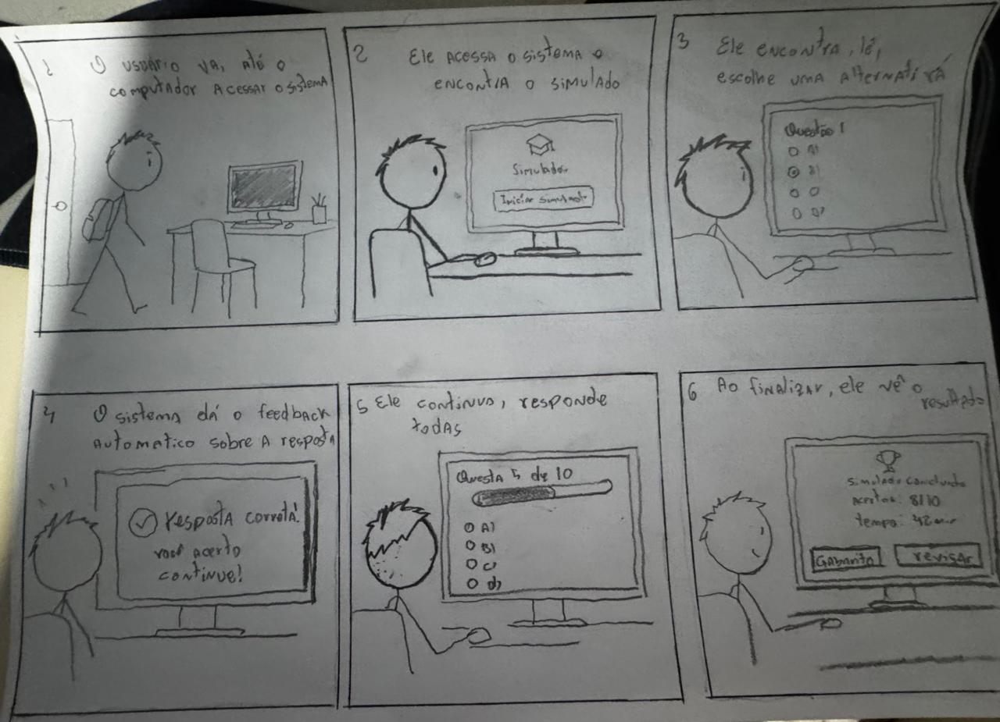

<b>Tabela de Contribuição</b>

| Membro | Contribuição |
| :--- | :--- |
| Arthur Sismene Carvalho | Elaboração do Storyboard SB-03, autoinspeção analítica dos modelos HTA/CTT e do storyboard, condução do teste-piloto e das entrevistas de avaliação com usuários reais (TAR-05 e SB-03), consolidação individual e propostas de reprojeto. |
| Claude | Auxílio na estruturação textual, organização das tabelas e formatação em Markdown (conforme Política de Uso de IA). |

<b>Fonte:</b> Arthur Sismene Carvalho (2026).

# Avaliação e Relato Individual — Arthur Sismene Carvalho

## 1. Identificação do Integrante e Escopo de Atuação

Este artefato reúne todo o ciclo de **avaliação formativa de Nível 1 (Análise de Tarefas e Storyboard)** conduzido individualmente por **Arthur Sismene Carvalho** na Etapa 5 do projeto **PCI Concursos**, em conformidade com o framework DECIDE (*Barbosa et al.*, 2021) e o Plano de Ensino da disciplina (*Sales*, 2026).

<b>Tabela 1: Resumo do Escopo Individual de Arthur Sismene Carvalho</b>

| Atributo | Detalhamento |
| :--- | :--- |
| **Integrante Responsável** | Arthur Sismene Carvalho |
| **Perfil de Usuário Focado** | [Perfil 1 — Candidato / Concurseiro](../../analise-de-requisitos/perfil-de-usuario.md#41-perfil-1-candidato-concurseiro-consumidor-final-de-oportunidades) |
| **Persona Protagonista** | [PER-03 — Thiago Moraes Albuquerque (estudante universitário, 21 anos)](../../analise-de-requisitos/personas.md#43-persona-3-thiago-moraes-albuquerque-responsavel-arthur-sismene-carvalho) |
| **Cenário de Uso** | [CEN-05 — Resolução de Simulado Online Interativo com Feedback de Gabarito](../../analise-de-requisitos/cenarios.md#45-cenario-05-resolucao-de-simulado-online-interativo-com-feedback-de-gabarito-no-smartphone-cen-05) |
| **Tarefa Prioritária de Autoria** | [TAR-05 — Realizar simulado de questões online interativo com feedback automático de gabarito e diagnóstico de desempenho](../../analise-de-requisitos/analise-de-tarefas/hta.md#51-tarefa-05-realizar-simulado-de-questoes-online-interativo-com-feedback-automatico-de-gabarito-e-diagnostico-de-desempenho-tar-05) |
| **Storyboard de Autoria** | [SB-03 — Simulado Online Interativo com Feedback Automático](#2-storyboard-individual-sb-03) |
| **Escopo da Inspeção** | Autoinspeção analítica dos próprios artefatos (HTA e CTT da `TAR-05` e Storyboard `SB-03`) |
| **Participante das Entrevistas** | 1 participante do Perfil 1 (Candidato/Concurseiro), com perfil aderente à persona PER-03 |

<b>Fonte:</b> Arthur Sismene Carvalho (2026).

---

## 2. Storyboard Individual (SB-03)

O Storyboard `SB-03` ilustra a jornada do usuário (Perfil 1 — Candidato/Concurseiro, representado pela persona PER-03 — Thiago Moraes Albuquerque) utilizando a funcionalidade de **simulado online interativo com feedback automático de gabarito e diagnóstico de desempenho** no PCI Concursos, permitindo verificar visualmente o modelo conceitual de interação concebido na `TAR-05`.

A narrativa retrata uma **sessão de estudo aprofundada de fim de semana**: diferentemente do uso predominante da persona em *microlearning* no smartphone durante os deslocamentos de transporte público (foco primário do [CEN-05](../../analise-de-requisitos/cenarios.md#45-cenario-05-resolucao-de-simulado-online-interativo-com-feedback-de-gabarito-no-smartphone-cen-05)), o Quadro retratado captura o momento em que Thiago recorre ao **notebook compartilhado da família** — contexto de uso explicitamente previsto na modelagem da [Persona PER-03](../../analise-de-requisitos/personas.md#43-persona-3-thiago-moraes-albuquerque-responsavel-arthur-sismene-carvalho) — para realizar uma bateria completa de questões com tempo e concentração. A diferença de dispositivo em relação ao desenho mobile-first da tarefa é registrada formalmente como oportunidade de reprojeto `OPO-A01` na autoinspeção (Seção 3.5).

### 2.1 Ilustração do Storyboard SB-03

  

  <button onclick="openFullscreenModal()" class="md-button md-button--primary" style="font-size: 0.82em; padding: 5px 16px; border-radius: 20px; cursor: pointer; display: inline-flex; align-items: center; gap: 6px;">
    🔍 <b>Zoom / Tela Cheia</b>
  </button>

<b>Figura 1:</b> Storyboard SB-03 — Simulado Online Interativo com Feedback Automático e Diagnóstico de Desempenho

<b>Fonte:</b> Elaborado por Arthur Sismene Carvalho à mão livre (2026), fundamentado no Cenário 05 e Tarefa 05.

<!-- Modal / Lightbox de Tela Cheia -->

  

    <a href="../../../assets/images/storyboards/storyboard-sb03.jpg" download="Storyboard_SB03_ArthurSismene.jpg" class="md-button md-button--primary" style="font-size: 0.85em; padding: 6px 16px; border-radius: 6px; text-decoration: none; color: white;">📥 Baixar</a>
    <button onclick="closeFullscreenModal()" class="md-button" style="font-size: 0.85em; padding: 6px 16px; border-radius: 6px; background: #e11d48; color: white; border: none; cursor: pointer;">✕ Fechar (ESC)</button>
  

  

    
  

  
Pressione <b>ESC</b> ou clique fora da imagem para fechar.

### 2.2 Detalhamento Sequencial dos Quadros

<b>Tabela 2: Detalhamento Sequencial dos Quadros do SB-03</b>

| Quadro | Ação Representada | Correspondência com a Tarefa TAR-05 | Legenda Textual do Quadro |
| :---: | :--- | :--- | :--- |
| **1** | Thiago chega à mesa de estudos e caminha até o computador (notebook da família) para iniciar uma sessão de estudos no fim de semana. | **Objetivo 0 (Gatilho/Motivação):** decisão de realizar um simulado para calibrar o próprio nível de preparo. | *"O usuário vai até o computador para acessar o sistema."* |
| **2** | Já sentado, ele acessa o portal e localiza o componente de Simulados, pronto para iniciar a sessão (`Iniciar simulado`). | **Subtarefa 1 (Acessar a seção de Simulados)** e disparo da **Subtarefa 2 (Parametrizar sessão).** | *"Ele acessa o sistema e encontra o simulado disponível."* |
| **3** | A primeira questão é exibida (*Questão 1*, alternativas A–D); ele lê o enunciado e marca a alternativa escolhida (B). | **Subtarefas 3.1 (Ler enunciado em tipografia fluida)** e **3.2 (Marcar alternativa escolhida).** | *"Ele lê a primeira questão e escolhe uma alternativa."* |
| **4** | O sistema devolve feedback formativo imediato: *"Resposta correta! Você acertou a questão 1. Continue!"*. | **Subtarefa 3.3 (Receber feedback e comentário)** — feedback automático de gabarito. | *"O sistema dá um feedback automático sobre a resposta."* |
| **5** | Ele prossegue pela bateria (*Questão 5 de 10*, com barra de progresso), respondendo as demais questões em sequência. | **Subtarefa 3.4 (Avançar com persistência local)** e iteração do **Objetivo 3 (Responder questões).** | *"Ele continua o simulado, respondendo as próximas questões."* |
| **6** | Tela de resultado: *"Simulado concluído! Acertos: 8/10 · Tempo: 42 min"*, com as ações *Ver gabarito* e *Revisar respostas*. | **Subtarefas 4.1 (Submeter bateria e encerrar)** e **4.2 (Analisar placar consolidado e diagnóstico).** | *"Ao finalizar, ele vê o resultado do simulado."* |

<b>Fonte:</b> Arthur Sismene Carvalho (2026).

---

## 3. Avaliação por Inspeção (Autoinspeção / Verificação da TAR-05 e SB-03)

Conforme o planejamento das listas de verificação da Etapa 4 e a deliberação docente de condução individual das avaliações na Etapa 5, esta seção documenta a **avaliação analítica por inspeção** conduzida por **Arthur Sismene Carvalho** sobre os seus próprios artefatos de Nível 1: o diagrama **HTA da TAR-05**, o modelo **CTT da TAR-05** e o **Storyboard SB-03**. O objetivo é identificar pontos fortes e oportunidades prévias de reprojeto antes da aplicação das entrevistas com usuários reais.

### 3.1 Identificação da Sessão de Inspeção e Registro em Vídeo

<b>Tabela 3: Dados da Sessão de Inspeção Analítica Individual</b>

| Atributo | Detalhamento |
| :--- | :--- |
| **Avaliador (Inspetor)** | Arthur Sismene Carvalho |
| **Autor dos Modelos Inspecionados** | Arthur Sismene Carvalho (Autoinspeção / Verificação Individual) |
| **Modelos de Tarefa Inspecionados** | [HTA da TAR-05](../../analise-de-requisitos/analise-de-tarefas/hta.md#51-tarefa-05-realizar-simulado-de-questoes-online-interativo-com-feedback-automatico-de-gabarito-e-diagnostico-de-desempenho-tar-05) e [CTT da TAR-05](../../analise-de-requisitos/analise-de-tarefas/ctt.md#51-tarefa-05-realizar-simulado-de-questoes-online-interativo-com-feedback-automatico-de-gabarito-e-diagnostico-de-desempenho-tar-05) |
| **Storyboard Inspecionado** | [SB-03 — Simulado Online Interativo com Feedback Automático](#2-storyboard-individual-sb-03) |
| **Ambiente de Gravação** | Microsoft Teams (resolução Full HD 1080p, divisão de tela e câmera ativa) |
| **Data da Gravação** | 25/10/2026 às 18:00 |
| **Duração do Vídeo** | 13 minutos e 2 segundos |
| **Link Direto do Vídeo** | [Gravação da Autoinspeção no YouTube](https://youtu.be/h4vBYrZegRs) |

<b>Fonte:</b> Arthur Sismene Carvalho (2026).

A gravação completa da autoinspeção analítica individual está disponível no player a seguir, hospedado no YouTube:

<iframe width="720" height="405" src="https://www.youtube.com/embed/h4vBYrZegRs" title="Gravação da Autoinspeção Analítica de Nível 1 - Arthur Sismene (Grupo 07 IHC)" frameborder="0" allow="accelerometer; autoplay; clipboard-write; encrypted-media; gyroscope; picture-in-picture; web-share" allowfullscreen style="border: 1px solid #d0d7de; border-radius: 8px; box-shadow: 0 4px 12px rgba(0,0,0,0.08); margin: 16px auto; display: block;"></iframe>

<b>Vídeo 1:</b> Gravação da Autoinspeção Analítica Individual — TAR-05 (HTA e CTT) e Storyboard SB-03

<b>Link direto:</b> <a href="https://youtu.be/h4vBYrZegRs" target="_blank">https://youtu.be/h4vBYrZegRs</a>

### 3.2 Inspeção do Diagrama HTA — TAR-05: Realizar Simulado Online Interativo com Feedback Automático

O modelo inspecionado é a **Figura 5 de HTA** e a respectiva **Tabela 6** em [Análise de Tarefas — HTA](../../analise-de-requisitos/analise-de-tarefas/hta.md#51-tarefa-05-realizar-simulado-de-questoes-online-interativo-com-feedback-automatico-de-gabarito-e-diagnostico-de-desempenho-tar-05), de autoria de Arthur Sismene Carvalho.

<b>Tabela 4: Lista de Verificação Aplicada ao HTA da TAR-05 (Autor: Arthur Sismene)</b>

| Item | Critério Verificado | Resposta | Observação |
| :---: | :--- | :---: | :--- |
| 1 | O objetivo principal da tarefa (nível 0) foi identificado antes das ações operacionais e está formulado como um estado ou meta que o usuário deseja atingir (verbo no infinitivo + objeto)? | Sim | O objetivo raiz está formulado com precisão: *"0. Realizar simulado online interativo com feedback automático de gabarito"*, definindo a meta pedagógica do concurseiro antes de qualquer decomposição operacional (Barbosa et al., 2021). |
| 2 | A tarefa foi decomposta de forma hierárquica coerente, desmembrando o objetivo de alto nível (0) em subobjetivos intermediários (1., 2...) e estes em operações concretas nos níveis inferiores (1.1., 1.2., 1.2.1.)? | Sim | A tarefa decompõe-se do objetivo raiz (0) em 4 subobjetivos intermediários (1. Acessar a seção de Simulados, 2. Parametrizar sessão, 3. Responder questões em mobile, 4. Concluir e avaliar diagnóstico), que se desdobram em operações nos níveis 1.1–1.2, 2.1–2.3, 3.1–3.4 e 4.1–4.2. |
| 3 | Os subobjetivos subordinados a um mesmo objetivo-pai são mutuamente exclusivos (sem sobreposição de escopo entre irmãos) e coletivamente exaustivos (juntos cumprem 100% do objetivo-pai, sem etapas ocultas)? | Sim | Os ramos cobrem o ciclo avaliativo completo: acesso à ferramenta, parametrização da bateria, ciclo de resposta com feedback e fechamento diagnóstico, sem sobreposição de atribuições entre irmãos. |
| 4 | O diagrama diferencia visualmente os objetivos não terminais (retângulos simples que possuem filhos) das operações/nós-folha (retângulos com linha dupla horizontal na base, que não são mais decompostos)? | Sim | O diagrama `hta-tar05.svg` adota a convenção canônica de Barbosa et al. (2021, Figura 8.1): retângulos simples para os nós compostos (0, 1, 2, 3 e 4) e traço duplo horizontal na base dos nós terminais (1.1, 1.2, 2.1–2.3, 3.1–3.4, 4.1 e 4.2). |
| 5 | Cada nó do diagrama e da tabela recebe numeração hierárquica estritamente fiel à sua posição na árvore (0 para raiz; 1., 2. para nível 1; 1.1., 1.2. para filhos do nó 1.; 1.2.1., 1.2.2. para filhos do nó 1.2.)? | Sim | Consonância posicional e semântica (1:1) entre o diagrama SVG e a Tabela 6 analítica, preservando numeração decimal posicional contínua e sem saltos em todos os ramos. |
| 6 | Todo objetivo que possui subobjetivos apresenta um plano explícito (p:) posicionado junto à linha vertical de decomposição, definindo a regra e a ordem de execução dos seus filhos diretos? | Sim | Todos os nós compostos trazem planos explícitos: Plano `0.` (`1>2>3>4`), Plano `1.` (`1>2`), Plano `2.` (`1+2>3`), Plano `3.` (`1>2>3>4` por questão) e Plano `4.` (`1>2`). |
| 7 | Os planos empregam corretamente a notação de operadores da HTA: sequência fixa (1 > 2), seleção/decisão condicional (1 / 2 com regra se...) ou paralelismo (1 + 2), referenciando apenas os filhos daquele nó? | Sim | São empregados corretamente os operadores de sequência (`>`) no fluxo linear das telas e de paralelismo (`+`) na parametrização simultânea de disciplina e refinamento por assunto (Plano `2.`). **Oportunidade de refinamento:** o fluxo não emprega seleção condicional (`/`); recomenda-se introduzi-la no nó 4.2 para a escolha *"Refazer Questões Erradas"* vs. encerrar (ver `OPO-A02`). |
| 8 | A decomposição respeita um critério claro de parada (regra P x C ou foco no que o usuário realiza sem descer a microações mecânicas irrelevantes), mantendo nível de abstração adequado ao reprojeto? | Sim | A granularidade estanca em operações cognitivas, funcionais e de sistema relevantes (ler enunciado, marcar alternativa, receber feedback, persistir estado), sem descambar para microações de hardware. |
| 9 | As operações e objetivos de nível inferior estão acompanhados da especificação de input (circunstância de ativação), ação e feedback (resposta do sistema que indica o atingimento do objetivo)? | Sim | Na Tabela 6, as operações têm a natureza classificada (ação física, operação cognitiva, operação funcional, tarefa de sistema) e as circunstâncias de input e retorno estão descritas (feedback cromático imediato na marcação, gabarito comentado, persistência local e placar consolidado). |
| 10 | Além do diagrama hierárquico, o artefato apresenta a representação complementar em tabela contendo objetivos/operações, planos, input, feedback, problemas/dificuldades identificados e recomendações de design? | Sim | O artefato traz a Tabela 6 analítica completa em `hta.md`, associando as limitações reais do simulado atual do PCI Concursos a recomendações ergonômicas fundamentadas (`RF-DOC-04`), com base nas estatísticas da ABRES e na Persona PER-03. |

<b>Fonte:</b> Arthur Sismene Carvalho (2026).

### 3.3 Inspeção do Modelo CTT — TAR-05: Realizar Simulado Online Interativo com Feedback Automático

O modelo inspecionado é a **Figura 5 de CTT** e a respectiva **Tabela 7** em [Análise de Tarefas — CTT](../../analise-de-requisitos/analise-de-tarefas/ctt.md#51-tarefa-05-realizar-simulado-de-questoes-online-interativo-com-feedback-automatico-de-gabarito-e-diagnostico-de-desempenho-tar-05), de autoria de Arthur Sismene Carvalho.

<b>Tabela 5: Lista de Verificação Aplicada ao CTT da TAR-05 (Autor: Arthur Sismene)</b>

| Item | Critério Verificado | Resposta | Observação |
| :---: | :--- | :---: | :--- |
| 1 | As tarefas foram corretamente classificadas e representadas com os ícones canônicos dos quatro tipos do CTT: tarefa do usuário (pessoa), tarefa do sistema (computador), tarefa interativa (pessoa + tela) ou tarefa abstrata (nuvem)? | Sim | Utiliza a iconografia de Paternò (1999): nuvem para tarefas Abstratas (raiz, *Parametrizar bateria*, *Ciclo iterativo de resposta* e *Concluir bateria*), pessoa para Tarefas do Usuário (*Ler enunciado e alternativas*, *Analisar gráfico de desempenho*), computador para Tarefas do Sistema (*Inicializar sessão e renderizar questão*, *Persistir resposta*, *Exibir gabarito*, *Consolidar taxa de acertos*) e pessoa + tela para Interação (*Selecionar disciplina*, *Configurar quantidade*, *Iniciar Simulado*, *Selecionar alternativa*, *Confirmar resposta*, *Finalizar bateria*). |
| 2 | A decomposição hierárquica está coerente entre tarefas superiores e subordinadas, garantindo que a raiz e todos os nós intermediários sejam tarefas abstratas e que nenhuma tarefa abstrata apareça como nó-folha? | Sim | A raiz (*Realizar simulado interativo com feedback e diagnóstico*) e as 3 subtarefas intermediárias agregadoras (*Parametrizar bateria*, *Ciclo iterativo de resposta* e *Concluir bateria e analisar diagnóstico*) são abstratas. Nenhuma tarefa abstrata figura como folha terminal do modelo. |
| 3 | As relações de ativação sequencial (T1 >> T2) e de ativação com passagem de informação (T1 []>> T2) indicam corretamente quando a segunda tarefa depende do término da primeira e quando há transferência obrigatória de dados? | Sim | A ativação com passagem de dados (`[]>>`) foi empregada onde há transferência obrigatória de estado (parâmetros da sessão → *Iniciar Simulado* → API; leitura do enunciado → marcação; submissão → consolidação). A ativação simples (`>>`) rege a progressão linear das telas. |
| 4 | As escolhas entre tarefas alternativas foram representadas com o operador de escolha (T1 [] T2) nos pontos em que duas opções estão disponíveis, mas o início de uma desabilita a outra no ciclo atual? | Sim | A alternância final entre *reiniciar treino focado nas questões erradas* ou *exportar o relatório de resultado* está modelada com o operador de escolha (`[]`) na folha de consolidação. |
| 5 | Tarefas simultâneas ou realizáveis em qualquer ordem (sem dependência de dados entre si) foram identificadas como concorrentes por meio do operador de concorrência (T1 \|\|\| T2)? | Sim | O operador de concorrência pura (`\|\|\|`) foi empregado na parametrização da bateria, onde *Selecionar disciplina e assunto* e *Configurar quantidade de itens* podem ser definidos em qualquer ordem, sem dependência mútua. |
| 6 | Quando tarefas concorrentes precisam trocar informações ou sincronizar estados durante sua execução paralela, essa relação foi explicitamente representada pelo operador de concorrência e comunicação (T1 \|[]\| T2)? | N/A | Não se aplica: na TAR-05 as tarefas paralelas de parametrização não demandam sincronização mútua bidirecional contínua em tempo de execução via `\|[]\|`. |
| 7 | As tarefas que podem ser executadas em qualquer ordem, mas sem sobreposição temporal, utilizam corretamente o operador de independência (T1 \|=\| T2)? | N/A | Não se aplica: o autor modelou a parametrização simultânea como processo totalmente concorrente (`\|\|\|`), e não como independência sem sobreposição. |
| 8 | As relações de interrupção distinguem adequadamente a desativação definitiva sem retorno (T1 [> T2) da suspensão temporária com retomada (T1 \|> T2)? | Não | **Oportunidade de melhoria:** o modelo emprega a desativação (`[>`) na exibição do gabarito instantâneo, mas não representa a **suspensão temporária com retomada (`\|>`)** de uma sessão cronometrada — situação recorrente da persona PER-03, que pode ser interrompida em trânsito e precisa pausar/retomar o simulado sem perda de progresso (ver `OPO-A03`). |
| 9 | O modelo explicita com clareza as relações temporais entre todas as tarefas irmãs por linha horizontal pontilhada e indica operadores unários de opcionalidade ([T]) e iteratividade (T*) quando aplicáveis? | Sim | O nó *Ciclo iterativo de resposta com feedback imediato* é explicitamente iterativo (`T*`), repetindo-se a cada questão, e *Marcar questão para revisão posterior* é opcional (`[T]`). As linhas horizontais e os operadores binários estão legíveis na Figura 5. |
| 10 | Considerando os limites da notação gráfica do CTT quanto à modelagem detalhada de erros, tais mecanismos e fluxos de exceção estão devidamente registrados na documentação complementar (tabelas, HTA ou cenários)? | Sim | Os fluxos de exceção (queda de rede 4G com persistência *Zero Data Loss*, esgotamento do temporizador, toque acidental em alvo < 48px) estão especificados na Tabela 7 de CTT, na Tabela 6 de HTA e nos *Eventos* do CEN-05. |

<b>Fonte:</b> Arthur Sismene Carvalho (2026).

### 3.4 Inspeção do Storyboard SB-03 (Autor: Arthur Sismene)

O modelo inspecionado é o [Storyboard SB-03](#2-storyboard-individual-sb-03), elaborado por Arthur Sismene Carvalho para a tarefa prioritária **TAR-05**, fundamentado no Cenário `CEN-05` e na persona PER-03 (Perfil 1 — Candidato/Concurseiro).

<b>Tabela 6: Lista de Verificação Aplicada ao Storyboard SB-03 (Autor: Arthur Sismene)</b>

| Item | Critério Verificado | Resposta | Observação |
| :---: | :--- | :---: | :--- |
| 1 | O artefato caracteriza-se efetivamente como um protótipo de baixa fidelidade, construído em formato visual simplificado sem capturas de tela finais codificadas ou interfaces de alta fidelidade? | Sim | Trata-se de protótipo de baixa fidelidade autêntico, elaborado à mão livre a lápis em papel, sem componentes codificados ou capturas de tela finais (Barbosa et al., 2021). |
| 2 | O storyboard consiste em uma série sequencial de desenhos/quadros que mostra como o usuário pode progredir em uma tarefa utilizando o produto em desenvolvimento na ordem esperada? | Sim | Composto por 6 quadros sequenciais cronológicos: chegada ao computador → acesso e localização do simulado → leitura e marcação da 1ª questão → feedback imediato → prosseguimento da bateria (5 de 10) → resultado consolidado. |
| 3 | A finalidade do storyboard como instrumento de concepção e verificação preliminar do modelo conceitual da tarefa está explicitamente declarada no documento? | Sim | A Seção 2 declara com clareza a finalidade do SB-03 de ilustrar a jornada do usuário e verificar visualmente o modelo conceitual concebido na TAR-05. |
| 4 | O storyboard retrata exemplos de telas/esboços de interface articulados à ação humana (e não um mero fluxograma abstrato nem apenas telas isoladas sem ator)? | Sim | Todos os quadros articulam a ação humana à interface esboçada no monitor: a tela de *Iniciar simulado*, as alternativas A–D, a caixa de feedback, a barra de progresso e o placar final, sempre com o ator operando o computador. |
| 5 | O storyboard é utilizado em conjunto direto com um cenário escrito previamente especificado no projeto, mantendo fidelidade à situação-problema do usuário? | Sim | Alinhado ao Cenário `CEN-05` e à persona PER-03. **Ressalva de dispositivo:** o CEN-05 posiciona o uso primário no smartphone em trânsito; este storyboard retrata a sessão complementar de fim de semana no notebook da família (contexto previsto na persona), diferença formalizada em `OPO-A01`. |
| 6 | A sequência visual acrescenta mais detalhes contextuais ao cenário escrito (ambiente físico, postura, dispositivo, reação emocional), permitindo visualizar a situação de uso real? | Sim | Apresenta riqueza contextual: a mesa de estudos com a mochila do estudante, a postura sentada operando mouse e monitor, e a reação de satisfação no quadro final ao visualizar o desempenho. |
| 7 | Existe rastreabilidade explícita e inequívoca entre o storyboard, o usuário protagonista (Perfil de Usuário), o cenário e a tarefa modelada na Análise de Tarefas? | Sim | Rastreabilidade mantida: o artefato referencia o Perfil 1 / persona PER-03, o Cenário `CEN-05` e os nós 0, 1, 2, 3 e 4 da decomposição HTA da `TAR-05` (Tabela 2), ressalvada a diferença de dispositivo registrada em `OPO-A01`. |
| 8 | A narrativa visual preserva o arco completo do cenário: início (gatilho/motivação e dor atual), meio (interação passo a passo com a solução) e fim (desfecho e satisfação da necessidade)? | Sim | Preserva o arco dramático: gatilho (decisão de estudar), meio interativo (acesso, resposta e feedback formativo imediato) e desfecho resolutivo (diagnóstico claro de 8/10 com opções de revisão). |
| 9 | Cada quadro (frame) descreve com precisão um passo específico da sequência da tarefa, sem omitir etapas essenciais da decomposição HTA/CTT nem incluir passos excedentes? | Sim | Cada quadro mapeia diretamente nós da HTA (Quadro 1 = Nó 0; Quadro 2 = Nó 1/2; Quadro 3 = Nós 3.1/3.2; Quadro 4 = Nó 3.3; Quadro 5 = Nó 3.4; Quadro 6 = Nó 4). **Observação:** a parametrização da sessão (Nó 2 — nº de questões e cronômetro) é sintetizada na transição do Quadro 2 para o 3; recomenda-se torná-la explícita no protótipo de papel (ver `OPO-A04`). |
| 10 | A técnica de esboço (sketching) apoia-se em símbolos e traços simples e consistentes (figuras humanas esquemáticas, ícones básicos, setas indicativas), dispensando detalhamento artístico complexo? | Sim | Emprega traços simples e consistentes: figuras esquemáticas (*stick figures*), ícones de capelo (simulado), marca de verificação (acerto) e troféu (conclusão), com tipografia manual limpa. |
| 11 | Os desenhos permitem identificar visualmente quem é a pessoa retratada, quais objetos/dispositivos ela está usando e onde ela está (ambiente físico)? | Sim | Identifica-se o estudante, o computador (monitor, teclado e mouse), a mesa de estudos com a cadeira e o ambiente doméstico de preparação. |
| 12 | Cada quadro possui uma legenda descritiva clara (e transcrição textual acessível) e o conjunto visual permite ao leitor reconhecer e nomear a tarefa representada? | Sim | Todos os quadros contam com legendas numeradas (1 a 6), complementadas pela Tabela 2 de transcrição detalhada da Seção 2.2. |
| 13 | O storyboard foi elaborado no momento metodológico correto do ciclo de design (Nível 1 — fase inicial/conceitual, antes da prototipação em papel de Nível 2)? | Sim | Produzido na etapa conceitual de Nível 1, servindo de insumo direto para a elaboração do protótipo de papel de Nível 2. |
| 14 | O storyboard foi (ou está planejado e preparado para ser) exibido a usuários potenciais representativos do perfil-alvo para coletar críticas e validar a compreensão da história? | Sim | O artefato foi exibido à Participante 1 (Perfil 1, aderente à persona PER-03) na Entrevista 1, que validou a compreensão da história e reconheceu de imediato a tarefa de simulado (ver Seção 5). |
| 15 | Os quadros oferecem elementos suficientes para que a equipe de projeto e os participantes percorram mentalmente (walkthrough) e simulem a interação com o produto? | Sim | A clareza dos 6 quadros permite a qualquer avaliador ou usuário simular mentalmente a transição entre iniciar o simulado, responder com feedback imediato e chegar ao diagnóstico final. |
| 16 | O artefato é tratado de forma aberta à iteração e modificação, prevendo o registro de alterações sugeridas pelos usuários e a evolução para nova versão quando necessário? | Sim | Por ser desenho esquemático em papel, propicia rápida iteração e acolhimento de sugestões coletadas nas entrevistas. |
| 17 | As limitações metodológicas do storyboard (não testar navegabilidade real, tempo de execução nem detalhes finos de layout) estão explicitamente reconhecidas na documentação? | Sim | A documentação reconhece o papel do SB-03 como protótipo de baixa fidelidade conceitual, que não testa navegabilidade real, ergonomia de toque mobile (alvos ≥ 48px) nem tempo de execução — aspectos reservados aos protótipos de papel e de alta fidelidade. |
| 18 | As concessões de prototipação (trade-offs) — priorizar rapidez, baixo custo e foco no contexto em detrimento da fidelidade visual de componentes — foram respeitadas? | Sim | Respeita os trade-offs clássicos: rapidez de confecção e foco na experiência contextual do estudante em detrimento da precisão de componentes finais. |
| 19 | O storyboard articula-se com os artefatos complementares do projeto (tabelas de correspondência com subobjetivos HTA e tarefas CTT) para cobrir regras que o desenho estático não expressa sozinho? | Sim | Articula-se com a Tabela 2 da Seção 2.2, que mapeia cada quadro aos subobjetivos correspondentes da HTA e às tarefas CTT. |
| 20 | O storyboard é utilizado estritamente como material de exploração conceitual para orientar as decisões do próximo nível (Protótipo de Papel), sem ser tomado como especificação definitiva? | Sim | O artefato funciona como instrumento de validação conceitual para guiar a concepção das telas do protótipo de papel. |

<b>Fonte:</b> Arthur Sismene Carvalho (2026).

### 3.5 Síntese de Oportunidades de Reprojeto para a TAR-05 e SB-03

<b>Tabela 7: Síntese de Oportunidades de Reprojeto Identificadas na Autoinspeção</b>

| ID | Modelo Afetado | Elemento / Passo | Observação / Oportunidade de Refinamento Detectada | Ação de Reprojeto para o Protótipo de Papel |
| :---: | :---: | :--- | :--- | :--- |
| `OPO-A01` | Storyboard SB-03 | Dispositivo retratado (Quadros 1–6) | **Divergência de Dispositivo:** o storyboard ilustra o fluxo em computador/notebook, enquanto o CEN-05 e a HTA/CTT da TAR-05 adotam premissa *mobile-first* (uso em smartphone no transporte público). O desenho cobre o fluxo conceitual, mas não evidencia a ergonomia móvel. | Produzir, no protótipo de papel, a variante mobile da jornada (alvos de toque ≥ 48px, uso com uma mão, persistência *Zero Data Loss*), mantendo o storyboard de desktop como cenário complementar de sessão longa de fim de semana. |
| `OPO-A02` | HTA TAR-05 | Nó 4.2 (Analisar placar consolidado) | **Ausência de Seleção Condicional (`/`):** a HTA não modela formalmente a bifurcação de decisão ao final do simulado entre *Refazer Questões Erradas* (treino adaptativo) e encerrar/exportar. | Inserir no plano do nó 4.2 o operador de seleção (`/`) e desenhar a tela de diagnóstico com o botão *"Refazer Questões Erradas"* como caminho adaptativo explícito. |
| `OPO-A03` | CTT TAR-05 | Ramo do ciclo iterativo de resposta | **Ausência de Operador de Suspensão (`\|>`):** o grafo CTT não modela a pausa/retomada de uma sessão cronometrada, situação recorrente da persona PER-03 (interrupção em trânsito), representando apenas a desativação (`[>`). | Inserir no modelo CTT a tarefa interativa de *pausar/retomar simulado* vinculada pelo operador de suspensão temporária (`\|>`), preservando o estado e o cronômetro. |
| `OPO-A04` | Storyboard SB-03 | Transição Quadro 2 → Quadro 3 | **Parametrização Implícita:** o storyboard salta da tela *Iniciar simulado* diretamente para a Questão 1, sem evidenciar a etapa de configuração da bateria (quantidade de questões, disciplina e cronômetro) — um diferencial central da TAR-05. | Projetar no protótipo de papel um quadro/tela dedicado à parametrização da sessão (nº de itens, disciplina/banca e temporizador) antes do início da bateria. |

<b>Fonte:</b> Arthur Sismene Carvalho (2026).

---

## 4. Teste-Piloto da Avaliação de Nível 1

Conforme as diretrizes de Barbosa et al. (2021, p. 276 e 300), o teste-piloto é planejado para ser executado previamente pelo avaliador Arthur Sismene Carvalho com o objetivo de testar os equipamentos, calibrar o roteiro de entrevista, avaliar a legibilidade do Storyboard `SB-03` e do diagrama HTA da `TAR-05`, e verificar o tempo de condução da sessão antes do início formal das entrevistas oficiais.

### 4.1 Dados da Sessão do Teste-Piloto

<b>Tabela 8: Dados Técnicos da Execução do Teste-Piloto</b>

| Atributo | Detalhamento |
| :--- | :--- |
| **Avaliador Responsável:** | Arthur Sismene Carvalho |
| **Plataforma Utilizada:** | Microsoft Teams (com gravação em nuvem e compartilhamento de tela Full HD) |
| **Artefatos Exercitados:** | [Storyboard SB-03](#2-storyboard-individual-sb-03) e [Análise de Tarefas HTA da TAR-05](../../analise-de-requisitos/analise-de-tarefas/hta.md#51-tarefa-05-realizar-simulado-de-questoes-online-interativo-com-feedback-automatico-de-gabarito-e-diagnostico-de-desempenho-tar-05) |
| **Custos Envolvidos:** | R$ 0,00 (infraestrutura acadêmica gratuita) |
| **Data e Horário:** | 25/10/2026 às 18:30 |
| **Duração da Gravação:** | 8 minutos e 43 segundos |

<b>Fonte:</b> Arthur Sismene Carvalho (2026).

### 4.2 Registro Audiovisual do Teste-Piloto

A gravação completa do teste-piloto individual está disponível na íntegra no player a seguir, hospedado no YouTube:

<iframe width="720" height="405" src="https://www.youtube.com/embed/yRWpVlsT0Lo" title="Gravação do Teste-Piloto de Nível 1 - Arthur Sismene (Grupo 07 IHC)" frameborder="0" allow="accelerometer; autoplay; clipboard-write; encrypted-media; gyroscope; picture-in-picture; web-share" allowfullscreen style="border: 1px solid #d0d7de; border-radius: 8px; box-shadow: 0 4px 12px rgba(0,0,0,0.08); margin: 16px auto; display: block;"></iframe>

<b>Vídeo 2:</b> Gravação do Teste-Piloto Individual — Avaliação de Nível 1 (Storyboard SB-03 e TAR-05)

<b>Link direto:</b> <a href="https://youtu.be/yRWpVlsT0Lo" target="_blank">https://youtu.be/yRWpVlsT0Lo</a>

### 4.3 Ficha de Avaliação e Calibração Técnica Pós-Piloto

Após a execução da gravação, o avaliador preencheu a Ficha de Calibração confrontando os critérios de qualidade estabelecidos com o resultado observado, tendo **aprovado todos os itens verificados**:

<b>Tabela 9: Ficha de Avaliação e Calibração Técnica Pós-Piloto</b>

| # | Item Verificado | Critério de Aprovação | Resultado Observado | Ajuste / Ação Realizada |
| :---: | :--- | :--- | :---: | :--- |
| **1** | **Clareza do Roteiro** | Linguagem natural, direta e sem termos técnicos que induzam respostas. | **Aprovado** | Nenhum ajuste necessário. |
| **2** | **Duração da Sessão** | Sessão conduzida de forma concisa e fluida (estimativa de 15 a 20 min com usuários). | **Aprovado** | Nenhum ajuste necessário. |
| **3** | **Enquadramento do SB-03** | Desenho de papel exibido com boa legibilidade e zoom adequado. | **Aprovado** | Nenhum ajuste necessário. |
| **4** | **Legibilidade do HTA** | Diagrama e ramos de tarefas legíveis durante a projeção. | **Aprovado** | Nenhum ajuste necessário. |
| **5** | **Alinhamento HTA vs. Roteiro** | Enunciado das perguntas cobrindo os 4 blocos da hierarquia. | **Aprovado** | Nenhum ajuste necessário. |
| **6** | **Qualidade do Áudio** | Captação clara da voz do avaliador sem ecos ou ruídos de fundo. | **Aprovado** | Nenhum ajuste necessário. |
| **7** | **Qualidade do Vídeo** | Resolução Full HD (1080p) sem perdas de quadros ou congelamentos. | **Aprovado** | Nenhum ajuste necessário. |
| **8** | **Registro do TCLE** | Consentimento ético verbal registrado explicitamente no áudio. | **Aprovado** | Nenhum ajuste necessário. |

<b>Fonte:</b> Arthur Sismene Carvalho (2026).

> **Declaração de Descarte de Dados do Piloto:** Declara-se formalmente que os dados e registros do teste-piloto foram utilizados exclusivamente para a calibração do roteiro de entrevista, verificação das ferramentas tecnológicas de gravação e treinamento de postura do avaliador. Conforme preceitua a literatura de IHC (Barbosa et al., 2021, p. 300), esses dados não foram somados nem misturados aos resultados da entrevista com o participante real.

---

## 5. Avaliação com Usuários (Entrevistas Empíricas – TAR-05 e SB-03)

Sessão de validação empírica da tarefa prioritária **TAR-05** e do Storyboard **SB-03**, conduzida individualmente por Arthur Sismene Carvalho com um participante real representativo do **Perfil 1 – Candidato/Concurseiro**, com aderência à persona PER-03 (estudante com uso predominantemente móvel).

### 5.1 Protocolo Ético e Caracterização dos Participantes

Em estrita consonância com o [Perfil de Usuário](../../analise-de-requisitos/perfil-de-usuario.md#41-perfil-1-candidato-concurseiro-consumidor-final-de-oportunidades) e a Resolução CNS nº 466/2012, o Termo de Consentimento Livre e Esclarecido (TCLE) foi apresentado e formalizado verbalmente no início da gravação em áudio e vídeo, garantindo voluntariedade, confidencialidade e uso restrito para fins de pesquisa acadêmica na UnB.

<b>Tabela 10: Perfil do Participante Recrutado</b>

| Participante | Perfil Concurseiro | Faixa Etária / Ocupação | Experiência com Concursos | Dispositivo Habitual | Status do TCLE |
| :---: | :--- | :--- | :--- | :--- | :---: |
| **Participante 1** | Perfil 1 – Candidato | 32 anos / Enfermeira | Concurseira inativa (ex-candidata) | Computador (desktop) | Aceito formalmente em vídeo |

<b>Fonte:</b> Arthur Sismene Carvalho (2026).

### 5.2 Registro Audiovisual das Entrevistas

A Tabela 11 documenta a logística e os registros da sessão empírica executada. O reprodutor audiovisual da entrevista está incorporado a seguir:

<b>Tabela 11: Registro Audiovisual das Entrevistas</b>

| Sessão | Entrevistador | Participante | Data e Horário | Duração | Link da Gravação |
| :---: | :--- | :---: | :---: | :---: | :--- |
| **Entrevista 1** | Arthur Sismene Carvalho | Participante 1 | 25/10/2026 às 19:10 | 11 min 50 s | [Vídeo da Entrevista 1 (YouTube - 11m 50s)](https://youtu.be/WhWYubJcwwQ) |

<b>Fonte:</b> Arthur Sismene Carvalho (2026).

#### Vídeo 3: Gravação da Entrevista 1 com Usuário (Participante 1)

<iframe width="720" height="405" src="https://www.youtube.com/embed/WhWYubJcwwQ" title="Gravação da Entrevista 1 com Usuário (TAR-05 e SB-03) - Arthur Sismene (Grupo 07 IHC)" frameborder="0" allow="accelerometer; autoplay; clipboard-write; encrypted-media; gyroscope; picture-in-picture; web-share" allowfullscreen style="border: 1px solid #d0d7de; border-radius: 8px; box-shadow: 0 4px 12px rgba(0,0,0,0.08); margin: 16px auto; display: block;"></iframe>

<b>Vídeo 3:</b> Sessão de Entrevista 1 conduzida por Arthur Sismene avaliando o Storyboard SB-03 e os diagramas HTA/CTT com a Participante 1 (Duração: 11m 50s).

### 5.3 Síntese dos Feedbacks Empíricos Coletados

Em conformidade com a metodologia de análise qualitativa recomendada por Barbosa e Silva (2021, p. 278), a Entrevista 1, conduzida com a Participante 1 (Perfil 1 — Candidato/Concurseiro; ex-candidata, 32 anos, enfermeira), revelou os seguintes achados e percepções essenciais:

* **Validação Conceitual e Aderência do Storyboard (`SB-03`):** A participante reconheceu de imediato e sem explicação prévia que a atividade central ilustrada é a **realização de um simulado**. Identificou com clareza o protagonista (um estudante), o dispositivo (computador) e o conteúdo de cada tela, e considerou as legendas e os textos de apoio **claros e sem ambiguidades**. Apontou o **Quadro 2 (acesso e início do simulado) como a cena mais importante**, por ser onde "começa o simulado", confirmando que o gatilho da tarefa ficou evidente.
* **Validade Ecológica:** A situação ilustrada foi considerada fiel à prática real — *"parece muito com o que eu fazia quando estava estudando para concurso"* —, confirmando a aderência do cenário `CEN-05` ao contexto do usuário.
* **Momento do Feedback (origem da `OPO-E01`):** A participante sugeriu espontaneamente que o **feedback de acerto/erro apareça ao final da bateria**, após a resolução de todas as questões, e não imediatamente após cada item, aproximando a experiência da dinâmica de uma prova real (*"essa resposta correta poderia vir ao final, depois de tudo"*).
* **Dor de Uso — Seleção de Disciplina (origem da `OPO-E02`):** Ao ser questionada sobre o que mais a atrapalha nesse tipo de tarefa, apontou a **dificuldade de escolher uma matéria/disciplina específica** para estudar, que hoje "não é bem claro", reforçando empiricamente a necessidade de tornar a parametrização da sessão explícita (conexão direta com a `OPO-A04` e com o nó 2.1 da HTA).
* **Acompanhamento de Evolução (origem da `OPO-E03`):** Sugeriu incluir um mecanismo para **saber se está evoluindo nos estudos** — "ranquear onde a pessoa estaria depois das questões" e acompanhar uma média de desempenho —, evitando "fazer questões sem estudo".
* **Legibilidade do Diagrama HTA:** Inicialmente a participante estranhou a **orientação horizontal** da hierarquia (esperava leitura vertical), mas, após breve explicação de que os nós lado a lado representam etapas equivalentes/sequenciais e os nós abaixo representam subtarefas, **compreendeu e validou a estrutura**. O achado sugere, como refinamento de baixa severidade, agregar uma legenda/guia de leitura ao diagrama para leitores não técnicos.
* **Divisão Usuário × Sistema no CTT:** A separação entre a ação do usuário e o processamento automático do sistema foi considerada **clara e de fácil entendimento**. *(Ver observação metodológica a seguir.)*
* **Métricas Ergonômicas Consolidadas (Participante 1):**
  * **Dispositivo Preferencial:** **computador (desktop)** para o estudo aprofundado — *"para estudo, desktop; celular sem condições"* —, reconhecendo que o celular "daria para fazer também", porém o computador é preferível para fixar o conhecimento e anotar. Esse dado **corrobora empiricamente** a representação em desktop do `SB-03` (ver `OPO-A01`) para sessões longas de estudo, reservando o smartphone às práticas rápidas em trânsito.
  * **Expectativa de Tempo:** cerca de **30 minutos** para uma sessão completa (conforme a quantidade de questões) e **menos de 10 minutos** para um estudo rápido.

!!! note "Observação metodológica — associação espontânea com filtros de busca"
    Durante a apresentação do CTT — corretamente o diagrama da `TAR-05` —, a participante associou espontaneamente a etapa de parametrização do simulado a critérios de **filtros de edital** que conhece da prática (escolaridade, faixa salarial, banca e região), chegando a sugerir que o filtro de salário seria dispensável. Como esses critérios pertencem ao domínio da busca de editais (`TAR-01`), e não ao escopo do simulado (`TAR-05`), optou-se por **não** convertê-los em oportunidade de reprojeto desta tarefa, registrando-se apenas a observação — que evidencia a familiaridade do usuário com a lógica de filtragem do portal.

---

## 6. Relato dos Resultados da Avaliação (Barbosa e Silva, 2021, p. 309)

Conforme a estrutura normativa preconizada por Barbosa et al. (2021, Subseção 11.7.5, p. 279 e Subseção 12.1, p. 309), esta seção consolida o **Relato dos Resultados** da avaliação dos modelos de Nível 1 (Storyboard `SB-03` e Análise de Tarefas `TAR-05`), integrando a **inspeção analítica (autoinspeção)** e a **entrevista empírica com usuário (Participante 1)**.

### 6.1 Objetivos da Avaliação
* Avaliar a conformidade técnica, consistência hierárquica e decomposição dos modelos de tarefas HTA e CTT da `TAR-05`.
* Avaliar a clareza da narrativa visual, a adequação ao contexto de uso e a legibilidade do Storyboard `SB-03`.
* Identificar precocemente problemas de usabilidade e oportunidades de melhoria para fundamentar o reprojeto na Etapa 6 (Protótipo de Papel).

### 6.2 Escopo da Avaliação
* **Artefatos Analisados:** [Storyboard Individual SB-03](#2-storyboard-individual-sb-03), [HTA da TAR-05](../../analise-de-requisitos/analise-de-tarefas/hta.md#51-tarefa-05-realizar-simulado-de-questoes-online-interativo-com-feedback-automatico-de-gabarito-e-diagnostico-de-desempenho-tar-05) e [CTT da TAR-05](../../analise-de-requisitos/analise-de-tarefas/ctt.md#51-tarefa-05-realizar-simulado-de-questoes-online-interativo-com-feedback-automatico-de-gabarito-e-diagnostico-de-desempenho-tar-05).
* **Escopo Funcional:** Funcionalidade de simulado online interativo com parametrização de bateria, feedback automático de gabarito e diagnóstico de desempenho no portal PCI Concursos.

### 6.3 Breve Descrição do Método Utilizado
Foram planejadas duas abordagens consagradas na literatura:
1. **Método de Inspeção Analítica (Autoinspeção / Verificação) — *executado nesta versão*:** Avaliação guiada por listas de verificação estruturadas aplicadas individualmente sobre os próprios artefatos produzidos (Fagan, 1976; Nielsen, 1993; Barbosa et al., 2021).
2. **Método de Investigação Empírica (Entrevista Semiestruturada) — *executado (Entrevista 1 realizada)*:** Sessão avaliativa com usuário real orientada por roteiro, gravação audiovisual, exploração de situações de exceção e técnica de verbalização concorrente (*think-aloud*), calibrada previamente por teste-piloto.

### 6.4 Conjunto de Diretrizes e Listas de Verificação Utilizadas
* **Checklist da Tarefa HTA (Tabela 4):** 10 critérios normativos baseados em Análise Hierárquica de Tarefas (decomposição, planos de execução e feedback).
* **Checklist da Tarefa CTT (Tabela 5):** 10 critérios baseados em ConcurTaskTrees (tipologia de tarefas e operadores temporais).
* **Checklist do Storyboard (Tabela 6):** 20 critérios de conformidade visual, narrativa e de contexto para Storyboards de IHC.
* **Roteiro Semiestruturado de Investigação (aplicado na Entrevista 1):** Eixos qualitativos de percepção, fluxo de tarefas, dores de uso e expectativas ergonômicas.

### 6.5 Número e Perfil dos Avaliadores e Participantes
* **Avaliador/Entrevistador (1 avaliador):** Arthur Sismene Carvalho (Estudante de Engenharia de Software da UnB / Grupo 07 IHC).
* **Participante (Perfil 1 – Candidato/Concurseiro):**
  * **Participante 1 (Entrevista 1 executada):** Mulher, 32 anos, enfermeira, ex-candidata (concurseira inativa), usuária habitual de computador (desktop) para estudo. Termo de Consentimento (TCLE) aceito formalmente em vídeo.

### 6.6 Lista de Problemas Encontrados e Oportunidades de Reprojeto

Conforme detalhado no livro de **Barbosa e Silva (2021, p. 309)**, cada problema ou oportunidade identificado deve especificar expressamente: **(1) local onde ocorre**, **(2) descrição do problema**, **(3) diretriz violada**, **(4) severidade do problema** e **(5) sugestões de solução**:

---

#### • OPO-A01: Divergência de Dispositivo entre o Storyboard e a Premissa *Mobile-First* da Tarefa
* **Local onde ocorre:** Storyboard SB-03 — Quadros 1 a 6 (dispositivo retratado).
* **Descrição do problema:** O storyboard ilustra a jornada em computador/notebook, enquanto o CEN-05, a HTA e a CTT da TAR-05 adotam premissa *mobile-first* (uso em smartphone no transporte público). O desenho cobre fielmente o fluxo conceitual, mas não evidencia a ergonomia móvel central da tarefa.
* **Diretriz violada:** Fidelidade ao Contexto de Uso e Rastreabilidade Storyboard–Cenário (Barbosa et al., 2021).
* **Severidade do problema:** **Baixa** (não compromete o entendimento funcional da tarefa; trata-se de complemento de contexto).
* **Sugestões de solução (Ação de Reprojeto):** Produzir, no protótipo de papel, a variante mobile da jornada (alvos de toque ≥ 48px, uso com uma mão, persistência *Zero Data Loss*), mantendo este storyboard de desktop como cenário complementar de sessão longa de fim de semana — contexto já previsto na persona PER-03.

---

#### • OPO-A02: Ausência de Seleção Condicional no Fechamento do Simulado
* **Local onde ocorre:** HTA da TAR-05 — Sub-objetivo 4.2 (*Analisar placar consolidado*).
* **Descrição do problema:** A decomposição hierárquica não modela a bifurcação de decisão ao final da bateria entre *Refazer Questões Erradas* (treino adaptativo) e encerrar/exportar o resultado.
* **Diretriz violada:** Flexibilidade e Eficiência de Uso e Controle do Usuário (Nielsen, 1993; Barbosa et al., 2021).
* **Severidade do problema:** **Média** (reduz o valor pedagógico do diagnóstico ao não oferecer caminho de reforço imediato).
* **Sugestões de solução (Ação de Reprojeto):** Introduzir o operador de seleção (`/`) no plano do nó 4.2 e desenhar na tela de diagnóstico o botão *"Refazer Questões Erradas"* como caminho adaptativo explícito.

---

#### • OPO-A03: Ausência de Suspensão/Retomada da Sessão Cronometrada no CTT
* **Local onde ocorre:** CTT da TAR-05 — Ramo do ciclo iterativo de resposta.
* **Descrição do problema:** O grafo formal CTT representa a desativação (`[>`) na exibição do gabarito, mas não modela a **pausa e retomada** de uma sessão cronometrada — situação recorrente da persona PER-03, que pode ser interrompida em trânsito.
* **Diretriz violada:** Completude na Modelagem de Relações Temporais em CTT e Prevenção de Perda de Dados (Paternò, 1999; Nielsen, 1993).
* **Severidade do problema:** **Média** (inconsistência na modelagem formal de controle do usuário sobre a sessão).
* **Sugestões de solução (Ação de Reprojeto):** Inserir no grafo CTT a tarefa interativa de *pausar/retomar simulado* vinculada pelo operador de suspensão temporária (`\|>`), preservando o estado e o cronômetro.

---

#### • OPO-A04: Parametrização da Sessão Implícita no Storyboard
* **Local onde ocorre:** Storyboard SB-03 — transição do Quadro 2 (*Iniciar simulado*) para o Quadro 3 (*Questão 1*).
* **Descrição do problema:** O storyboard salta da tela de início diretamente para a primeira questão, sem evidenciar a etapa de configuração da bateria (quantidade de questões, disciplina/banca e cronômetro), que é um diferencial central da TAR-05 frente ao portal atual.
* **Diretriz violada:** Visibilidade do Estado do Sistema e Correspondência entre Modelo Conceitual e Representação (Nielsen, 1993; Barbosa et al., 2021).
* **Severidade do problema:** **Baixa** (não impede a compreensão da narrativa, mas omite um passo distintivo da tarefa).
* **Sugestões de solução (Ação de Reprojeto):** Projetar no protótipo de papel um quadro/tela dedicado à parametrização da sessão (nº de itens, disciplina/banca e temporizador) antes do início da bateria.

---

#### • OPO-E01: Opção de Momento do Feedback (Imediato vs. Consolidado ao Final)
* **Local onde ocorre:** Storyboard SB-03 — Quadro 4 (*feedback automático*) e HTA da TAR-05 — Sub-objetivo 3.3 (*Receber feedback e comentário*).
* **Descrição do problema:** A Participante 1 indicou que o feedback de acerto/erro poderia ser apresentado ao final da bateria, após todas as questões, aproximando a experiência de uma prova real, em vez de imediatamente após cada item.
* **Diretriz violada:** Flexibilidade e Eficiência de Uso e Correspondência com o Mundo Real (Nielsen, 1993; Barbosa et al., 2021).
* **Severidade do problema:** **Média** (afeta a adequação do modo de estudo à expectativa de simulação de prova).
* **Sugestões de solução (Ação de Reprojeto):** Oferecer, no protótipo de papel, alternância entre **modo estudo** (feedback formativo imediato) e **modo prova** (gabarito e correção consolidados somente ao final), preservando ambos os fluxos.

---

#### • OPO-E02: Clareza na Seleção de Disciplina/Matéria (Reforço Empírico da OPO-A04)
* **Local onde ocorre:** HTA da TAR-05 — Sub-objetivo 2.1 (*Selecionar disciplina e banca*) e parametrização da sessão no Storyboard.
* **Descrição do problema:** A participante relatou que a maior dificuldade na tarefa é escolher uma matéria/disciplina específica para estudar, que atualmente "não é bem claro".
* **Diretriz violada:** Visibilidade do Estado do Sistema e Reconhecer em vez de Lembrar (Nielsen, 1993).
* **Severidade do problema:** **Média** (impacta a eficiência na configuração do estudo).
* **Sugestões de solução (Ação de Reprojeto):** Tornar a parametrização da sessão explícita, com busca preditiva de disciplina e *chips* de assuntos e bancas frequentes, reforçando a ação já prevista na `OPO-A04`.

---

#### • OPO-E03: Indicador de Evolução e Ranqueamento de Desempenho
* **Local onde ocorre:** HTA da TAR-05 — Sub-objetivo 4.2 (*Analisar placar consolidado*).
* **Descrição do problema:** A participante sugeriu um mecanismo para saber se está evoluindo nos estudos (posição/ranqueamento e média de desempenho ao longo do tempo), evitando "fazer questões sem estudo".
* **Diretriz violada:** Visibilidade do Estado do Sistema e Feedback de Progresso (Nielsen, 1993; Barbosa et al., 2021).
* **Severidade do problema:** **Baixa** (melhoria de valor pedagógico, sem bloqueio de tarefa).
* **Sugestões de solução (Ação de Reprojeto):** Ampliar o painel de diagnóstico com histórico de evolução, média de acertos por período e posicionamento relativo (ranking), além do resultado pontual da sessão.

---

## 7. Apresentação da Etapa 5

Esta seção reúne o vídeo da **apresentação individual da Etapa 5** (Storyboard, Análise de Tarefas e Avaliação de Nível 1 da `TAR-05` / `SB-03`), conduzida por Arthur Sismene Carvalho. Caso o player incorporado não reproduza diretamente na página, acesse pelo link direto: [Apresentação da Etapa 5 no YouTube](https://youtu.be/KZMoZYpHLv0).

<b>Tabela 12: Dados da Gravação da Apresentação da Etapa 5</b>

| Atributo | Detalhamento |
| :--- | :--- |
| **Apresentador** | Arthur Sismene Carvalho |
| **Etapa / Escopo** | Etapa 5 — Storyboard SB-03, Análise de Tarefas (TAR-05) e Avaliação de Nível 1 |
| **Data da Gravação** | 25/10/2026 |
| **Duração do Vídeo** | 7 minutos e 13 segundos |
| **Link Direto do Vídeo** | [Apresentação da Etapa 5 no YouTube](https://youtu.be/KZMoZYpHLv0) |

<b>Fonte:</b> Arthur Sismene Carvalho (2026).

<iframe width="720" height="405" src="https://www.youtube.com/embed/KZMoZYpHLv0" title="Apresentação da Etapa 5 - Arthur Sismene (Grupo 07 IHC)" frameborder="0" allow="accelerometer; autoplay; clipboard-write; encrypted-media; gyroscope; picture-in-picture; web-share" allowfullscreen style="border: 1px solid #d0d7de; border-radius: 8px; box-shadow: 0 4px 12px rgba(0,0,0,0.08); margin: 16px auto; display: block;"></iframe>

<b>Vídeo 4:</b> Apresentação Individual da Etapa 5 — Arthur Sismene Carvalho (Duração: 7m 13s)

<b>Link direto:</b> <a href="https://youtu.be/KZMoZYpHLv0" target="_blank">https://youtu.be/KZMoZYpHLv0</a>

---

## 8. Referências Bibliográficas

> [1] BARBOSA, Simone Diniz Junqueira et al. *Interação Humano-Computador e Experiência do Usuário*. Rio de Janeiro: Autopublicação, 2021. ISBN: 978-65-00-19677-1.  
> [2] FAGAN, Michael E. *Design and Code Inspections to Reduce Errors in Program Development*. IBM Systems Journal, v. 15, n. 3, p. 182-211, 1976.  
> [3] NIELSEN, Jakob. *Usability Engineering*. San Francisco: Morgan Kaufmann, 1993.  
> [4] PATERNÒ, Fabio. *Model-Based Design and Evaluation of Interactive Applications*. London: Springer-Verlag, 1999.  
> [5] PREECE, Jennifer; ROGERS, Yvonne; SHARP, Helen. *Design de Interação: além da interação homem-computador*. Porto Alegre: Bookman, 2005.  
> [6] SALES, André Barros de. *Plano de Ensino: Interação Humano Computador*. Brasília: Universidade de Brasília, FGA/UnB, 2026.  

---

## 9. Histórico de Versões

| Versão | Data | Descrição | Autor(es) | Revisor(es) |
| :---: | :---: | :--- | :---: | :---: |
| `0.1` | 23/10/2026 | Estrutura preliminar do relato individual reservada para preenchimento. | Arthur Sismene Carvalho | — |
| `1.0` | 25/10/2026 | Estruturação completa da parte escrita da Etapa 5: Storyboard SB-03 (ilustração e detalhamento dos 6 quadros), autoinspeção analítica com checklists de HTA, CTT e Storyboard (Tabelas 4 a 6), síntese de oportunidades de reprojeto (Tabela 7) e relato dos resultados (Seção 6). Seções audiovisuais (autoinspeção, teste-piloto e entrevistas) reservadas para incorporação das gravações. | Arthur Sismene Carvalho | — |
| `1.1` | 25/10/2026 | Incorporação da gravação da autoinspeção analítica (Vídeo 1 — YouTube: h4vBYrZegRs), com registro da data (25/10/2026 às 18:00) e duração (13 min 2 s) da sessão. | Arthur Sismene Carvalho | — |
| `1.2` | 25/10/2026 | Incorporação da gravação do teste-piloto (Vídeo 2 — YouTube: yRWpVlsT0Lo), com registro da data (25/10/2026 às 18:30) e duração (8 min 43 s) da sessão. | Arthur Sismene Carvalho | — |
| `1.3` | 25/10/2026 | Incorporação da gravação da Entrevista 1 (Vídeo 3 — YouTube: WhWYubJcwwQ), perfil da Participante 1 (Tabela 10) e registro audiovisual (Tabela 11). | Arthur Sismene Carvalho | — |
| `1.4` | 25/10/2026 | Consolidação da síntese qualitativa da Entrevista 1 (Participante 1) e das oportunidades empíricas OPO-E01 a OPO-E03 (Seção 6.6); preenchimento da Ficha de Calibração do teste-piloto (todos os itens aprovados); ajuste do escopo da avaliação para 1 participante; registro de observação metodológica (CTT da TAR-05 confirmado como o diagrama exibido; associação espontânea da participante com filtros de busca). | Arthur Sismene Carvalho | — |
| `1.5` | 25/10/2026 | Incorporação do vídeo da apresentação individual da Etapa 5 (Vídeo 4 — YouTube: KZMoZYpHLv0, 7 min 13 s) na nova Seção 7, com renumeração das Referências Bibliográficas (8) e do Histórico de Versões (9). | Arthur Sismene Carvalho | — |

<b>Fonte:</b> Arthur Sismene Carvalho (2026).

