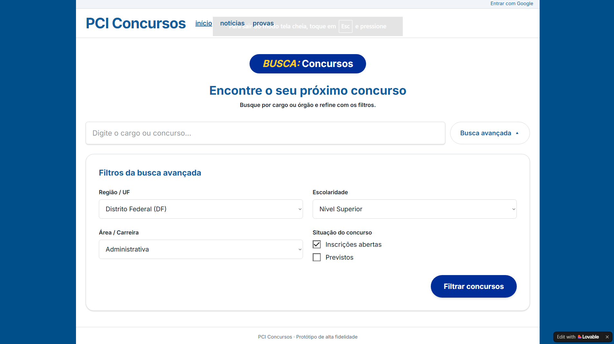
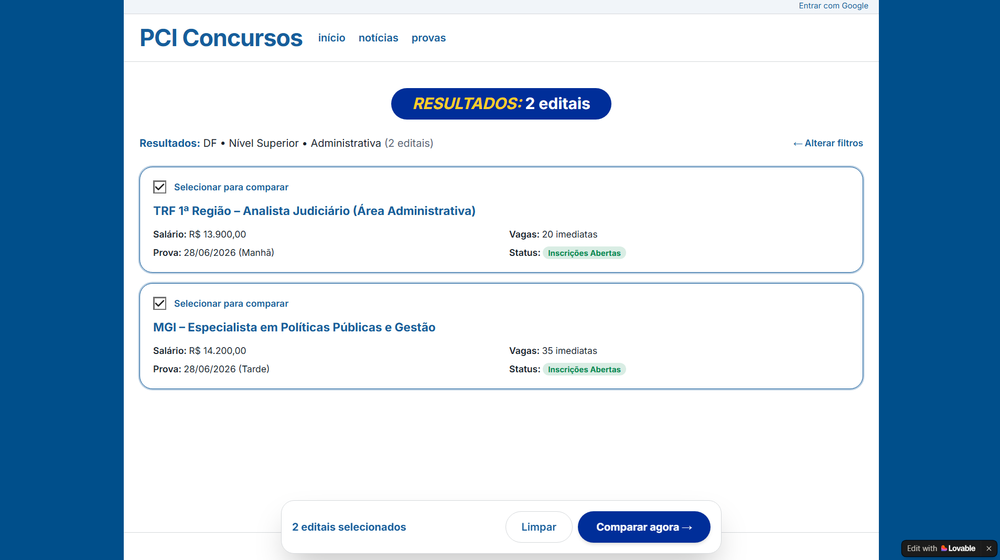
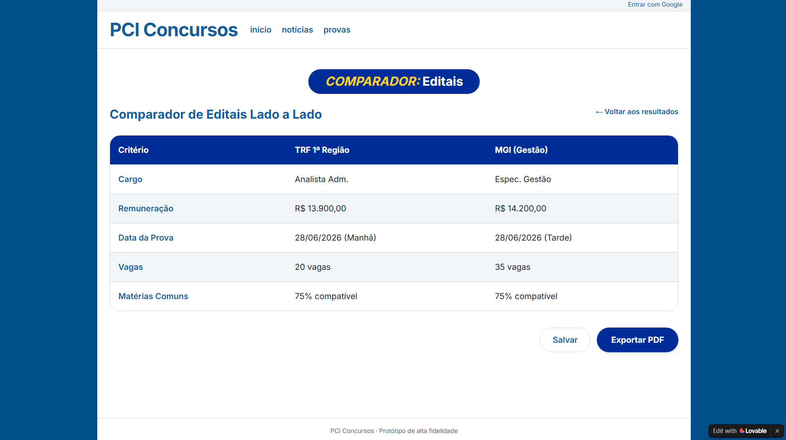
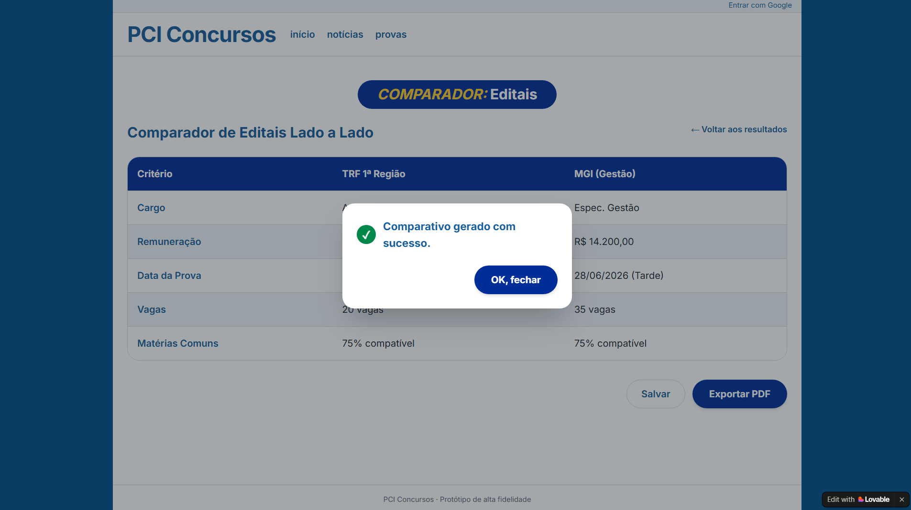

<b>Tabela de Contribuição</b>

| Membro | Contribuição |
| :--- | :--- |
| Daniel da Silva Batista | Concepção e modelagem do Protótipo de Alta Fidelidade no Lovable (`TAR-01` e `TAR-02`), autoinspeção analítica com base nas heurísticas de Nielsen e no Guia de Estilo, condução e gravação do teste-piloto e das três sessões empíricas com usuários reais (*Think-Aloud* e entrevista pós-teste), publicação dos vídeos no YouTube, captura das telas do protótipo, análise dos resultados e consolidação do relato individual (Barbosa e Silva, 2021, p. 309). |
| Gemini | Auxílio na estruturação textual, organização das tabelas, implementação dos modais de zoom e formatação em Markdown (conforme Política de Uso de IA). |

<b>Fonte:</b> Daniel da Silva Batista (2026).

# Avaliação e Relato Individual — Protótipo de Alta Fidelidade (Daniel da Silva Batista)

## 1. Identificação do Integrante e Escopo de Atuação

Este artefato reúne todo o ciclo de **avaliação formativa de Nível 3 (Protótipo de Alta Fidelidade)** conduzido individualmente por **Daniel da Silva Batista** no âmbito do projeto **PCI Concursos**, em conformidade com o framework **DECIDE** (*Barbosa et al.*, 2021), as **10 Heurísticas de Usabilidade de Nielsen (1993)** e as diretrizes do plano de ensino da disciplina de Interação Humano-Computador (*Sales*, 2026).

<b>Tabela 1: Resumo do Escopo Individual de Daniel da Silva Batista (Nível 3)</b>

| Atributo | Detalhamento |
| :--- | :--- |
| **Integrante Responsável** | Daniel da Silva Batista |
| **Protótipo Interativo (Lovable)** | [Protótipo de Alta Fidelidade — PCI Concursos (Lovable)](https://sketch-to-test-studio.lovable.app) |
| **Perfil de Usuário Focado** | [Perfil 1 — Candidato / Concurseiro](../../analise-de-requisitos/perfil-de-usuario.md) |
| **Cenário de Uso** | [<abbr title="Cenário 01">CEN-01</abbr> — Parametrização de Busca Avançada e Comparação de Editais Concorrentes no DF](../../analise-de-requisitos/cenarios.md#41-cenario-01-parametrizacao-de-busca-avancada-e-comparacao-de-editais-concorrentes-no-df-cen-01) |
| **Tarefa Prioritária de Autoria** | **<abbr title="Tarefa 01">TAR-01</abbr> — Parametrizar busca avançada multicritério e comparar editais concorrentes lado a lado**: [<abbr title="Análise Hierárquica de Tarefas">HTA</abbr>](../../analise-de-requisitos/analise-de-tarefas/hta.md#31-tarefa-01-parametrizar-busca-avancada-multicriterio-e-comparar-editais-concorrentes-lado-a-lado-tar-01) \| [<abbr title="ConcurTaskTrees">CTT</abbr>](../../analise-de-requisitos/analise-de-tarefas/ctt.md#31-tarefa-01-parametrizar-busca-avancada-multicriterio-e-comparar-editais-concorrentes-lado-a-lado-tar-01) |
| **Tarefa Complementar de Autoria** | **<abbr title="Tarefa 02">TAR-02</abbr> — Montar e exportar caderno personalizado de provas anteriores com gabarito comentado integrado**: [<abbr title="Análise Hierárquica de Tarefas">HTA</abbr>](../../analise-de-requisitos/analise-de-tarefas/hta.md#32-tarefa-02-montar-e-exportar-caderno-personalizado-de-provas-anteriores-com-gabarito-comentado-integrado-tar-02) \| [<abbr title="ConcurTaskTrees">CTT</abbr>](../../analise-de-requisitos/analise-de-tarefas/ctt.md#32-tarefa-02-montar-e-exportar-caderno-personalizado-de-provas-anteriores-com-gabarito-comentado-integrado-tar-02) |
| **Tipo de Artefato** | Protótipo digital interativo de alta fidelidade desenvolvido no **Lovable** (React + Tailwind CSS) |
| **Técnica e Modalidade de Avaliação** | **Teste de Usabilidade Presencial** com Protocolo de Pensar em Voz Alta (*Think-Aloud*) e Entrevista Pós-Teste |
| **Escopo da Inspeção** | Autoinspeção analítica com lista de verificação ergonômica (Nielsen, 1993) e conformidade com o [Guia de Estilo](../guia-de-estilo.md) |
| **Participantes das Sessões** | 3 participantes reais representativos do Perfil 1 (Candidato/Concurseiro) + 1 participante piloto (descartado) |

<b>Fonte:</b> Daniel da Silva Batista (2026).

---

## 2. Apresentação do Protótipo de Alta Fidelidade (Lovable)

O protótipo de alta fidelidade materializa em ambiente web interativo as telas validadas no [Protótipo de Papel (Nível 2)](./daniel-batista-prototipo-papel.md), aplicando rigorosamente a identidade visual do [Guia de Estilo](../guia-de-estilo.md) (paleta azul institucional `#003B8E`, pílulas de destaque em amarelo, tipografia limpa e espaçamento adequado) e incorporando as ações de reprojeto levantadas na etapa anterior.

<b>Tabela 2: Rastreabilidade da Evolução do Nível 2 (Papel) para o Nível 3 (Alta Fidelidade)</b>

| Origem (Nível 2) | Descrição da Oportunidade / Validação | Implementação no Protótipo de Alta Fidelidade (Nível 3) | Status |
| :---: | :--- | :--- | :---: |
| [`VAL-PP01`](./daniel-batista-prototipo-papel.md#66-lista-de-problemas-encontrados-e-oportunidades-de-reprojeto-para-o-prototipo-de-alta-fidelidade) | Parametrização simultânea dos filtros avançados (<abbr title="Unidade Federativa">UF</abbr>, escolaridade, área e situação) | Mantida a arquitetura do formulário na Tela 1 com seletores nativos claros e botão primário de alto contraste `Filtrar concursos`. | **Implementado** |
| [`OPO-PP01`](./daniel-batista-prototipo-papel.md#66-lista-de-problemas-encontrados-e-oportunidades-de-reprojeto-para-o-prototipo-de-alta-fidelidade) | Posicionamento fixo da barra de comparação (*Sticky Bottom Bar*) em listagens longas | Barra flutuante inferior fixa (`2 editais selecionados \| Limpar \| Comparar agora →`) exibida dinamicamente ao marcar checkboxes, com ação `Limpar` (Controle e Liberdade). | **Implementado** |
| [`VAL-PP02`](./daniel-batista-prototipo-papel.md#66-lista-de-problemas-encontrados-e-oportunidades-de-reprojeto-para-o-prototipo-de-alta-fidelidade) | Exportação do relatório comparativo em <abbr title="Portable Document Format">PDF</abbr> com modal de confirmação | Botão `Exportar PDF` no rodapé da matriz comparativa acionando modal acessível `✓ Comparativo gerado com sucesso` com botão `OK, fechar`. | **Implementado** |
| [`OPO-PP02`](./daniel-batista-prototipo-papel.md#66-lista-de-problemas-encontrados-e-oportunidades-de-reprojeto-para-o-prototipo-de-alta-fidelidade) | Destaque visual de compatibilidade ou choque de turnos de prova na matriz | Mantida a exibição textual dos turnos (`Manhã` vs `Tarde`); nenhum participante relatou dificuldade com essa informação. | **Mantido**  |

<b>Fonte:</b> Daniel da Silva Batista (2026).

### 2.1 Tela 1: Busca Avançada com Filtros Multicritério (`/`)

A tela inicial apresenta a barra de navegação limpa do portal, o selo identificador `BUSCA: Concursos`, o campo de pesquisa textual e o painel expansível **Filtros da busca avançada** com seletores para **Região / UF** (`Distrito Federal (DF)`), **Escolaridade** (`Nível Superior`), **Área / Carreira** (`Administrativa`) e **Situação do concurso** (`Inscrições abertas`, `Previstos`), culminando no botão primário `Filtrar concursos`.

  

  <button onclick="openModalAF01()" class="md-button md-button--primary" style="font-size: 0.82em; padding: 5px 16px; border-radius: 20px; cursor: pointer; display: inline-flex; align-items: center; gap: 6px;">
    🔍 <b>Zoom / Tela Cheia</b>
  </button>

<b>Figura 1:</b> Protótipo de Alta Fidelidade — Tela 1: Busca Avançada com Filtros Multicritério

<b>Fonte:</b> Elaborado por Daniel da Silva Batista no Lovable (2026).

<!-- Modal AF Tela 1 -->

  

    <a href="../../../assets/images/prototipo-alta-fidelidade/prototipo-af-tela-01.png" download="Prototipo_AF_Tela01_DanielBatista.png" class="md-button md-button--primary" style="font-size: 0.85em; padding: 6px 16px; border-radius: 6px; text-decoration: none; color: white;">📥 Baixar</a>
    <button onclick="closeModalAF01()" class="md-button" style="font-size: 0.85em; padding: 6px 16px; border-radius: 6px; background: #e11d48; color: white; border: none; cursor: pointer;">✕ Fechar (ESC)</button>
  

  

    
  

  
Pressione <b>ESC</b> ou clique fora da imagem para fechar.

---

### 2.2 Tela 2: Listagem de Editais Filtrados e Barra Flutuante de Seleção (`/editais`)

A segunda tela exibe os resultados filtrados (`Resultados: DF • Nível Superior • Administrativa (2 editais)`) com o atalho `← Alterar filtros` e cards estruturados para cada certame (**TRF 1ª Região** e **MGI**), destacando salário, vagas, data/turno da prova, badge verde `Inscrições Abertas` e checkbox `Selecionar para comparar`.

Ao selecionar os editais, surge na base da janela a **barra flutuante fixa (*sticky bottom bar*)** implementando o reprojeto `OPO-PP01`, exibindo `2 editais selecionados`, botão `Limpar` e botão primário `Comparar agora →`.

  

  <button onclick="openModalAF02()" class="md-button md-button--primary" style="font-size: 0.82em; padding: 5px 16px; border-radius: 20px; cursor: pointer; display: inline-flex; align-items: center; gap: 6px;">
    🔍 <b>Zoom / Tela Cheia</b>
  </button>

<b>Figura 2:</b> Protótipo de Alta Fidelidade — Tela 2: Listagem de Resultados com Barra Flutuante de Seleção (<code>OPO-PP01</code>)

<b>Fonte:</b> Elaborado por Daniel da Silva Batista no Lovable (2026).

<!-- Modal AF Tela 2 -->

  

    <a href="../../../assets/images/prototipo-alta-fidelidade/prototipo-af-tela-02.png" download="Prototipo_AF_Tela02_DanielBatista.png" class="md-button md-button--primary" style="font-size: 0.85em; padding: 6px 16px; border-radius: 6px; text-decoration: none; color: white;">📥 Baixar</a>
    <button onclick="closeModalAF02()" class="md-button" style="font-size: 0.85em; padding: 6px 16px; border-radius: 6px; background: #e11d48; color: white; border: none; cursor: pointer;">✕ Fechar (ESC)</button>
  

  

    
  

  
Pressione <b>ESC</b> ou clique fora da imagem para fechar.

---

### 2.3 Tela 3: Matriz Comparativa Lado a Lado e Confirmação de Exportação (`/comparar`)

A terceira tela exibe o **Comparador de Editais Lado a Lado**, confrontando os certames selecionados em colunas paralelas quanto a **Cargo**, **Remuneração**, **Data da Prova**, **Vagas** e **Matérias Comuns (75% compatível)**, além do atalho `← Voltar aos resultados` e dos botões de ação `Salvar` e `Exportar PDF`.

  

  <button onclick="openModalAF03()" class="md-button md-button--primary" style="font-size: 0.82em; padding: 5px 16px; border-radius: 20px; cursor: pointer; display: inline-flex; align-items: center; gap: 6px;">
    🔍 <b>Zoom / Tela Cheia</b>
  </button>

<b>Figura 3:</b> Protótipo de Alta Fidelidade — Tela 3: Matriz Comparativa Lado a Lado

<b>Fonte:</b> Elaborado por Daniel da Silva Batista no Lovable (2026).

<!-- Modal AF Tela 3 -->

  

    <a href="../../../assets/images/prototipo-alta-fidelidade/prototipo-af-tela-03.png" download="Prototipo_AF_Tela03_DanielBatista.png" class="md-button md-button--primary" style="font-size: 0.85em; padding: 6px 16px; border-radius: 6px; text-decoration: none; color: white;">📥 Baixar</a>
    <button onclick="closeModalAF03()" class="md-button" style="font-size: 0.85em; padding: 6px 16px; border-radius: 6px; background: #e11d48; color: white; border: none; cursor: pointer;">✕ Fechar (ESC)</button>
  

  

    
  

  
Pressione <b>ESC</b> ou clique fora da imagem para fechar.

Ao acionar `Exportar PDF`, o protótipo sobrepõe um diálogo modal acessível (`role="alertdialog"`) confirmando: `✓ Comparativo gerado com sucesso.` e botão de fechamento `OK, fechar`.

  

  <button onclick="openModalAF04()" class="md-button md-button--primary" style="font-size: 0.82em; padding: 5px 16px; border-radius: 20px; cursor: pointer; display: inline-flex; align-items: center; gap: 6px;">
    🔍 <b>Zoom / Tela Cheia</b>
  </button>

<b>Figura 4:</b> Protótipo de Alta Fidelidade — Modal de Confirmação da Exportação em PDF

<b>Fonte:</b> Elaborado por Daniel da Silva Batista no Lovable (2026).

<!-- Modal AF Tela 4 -->

  

    <a href="../../../assets/images/prototipo-alta-fidelidade/prototipo-af-tela-04.png" download="Prototipo_AF_Tela04_DanielBatista.png" class="md-button md-button--primary" style="font-size: 0.85em; padding: 6px 16px; border-radius: 6px; text-decoration: none; color: white;">📥 Baixar</a>
    <button onclick="closeModalAF04()" class="md-button" style="font-size: 0.85em; padding: 6px 16px; border-radius: 6px; background: #e11d48; color: white; border: none; cursor: pointer;">✕ Fechar (ESC)</button>
  

  

    
  

  
Pressione <b>ESC</b> ou clique fora da imagem para fechar.

---

## 3. Autoinspeção Analítica Prévia do Protótipo de Alta Fidelidade

Antes da aplicação dos testes presenciais com usuários reais, o autor conduziu uma autoinspeção analítica com base nas **10 Heurísticas de Usabilidade de Nielsen (1993)** e nos padrões do [Guia de Estilo](../guia-de-estilo.md):

<b>Tabela 3: Lista de Verificação da Autoinspeção Analítica do Protótipo de Alta Fidelidade</b>

| Item | Critério / Heurística Avaliada | Resposta | Observação Técnica |
| :---: | :--- | :---: | :--- |
| **1** | **Consistência e Padrões:** o protótipo aplica a paleta, tipografia e identidade definidas no Guia de Estilo? | **Sim** | Mantém as laterais no azul institucional do PCI Concursos, pílulas de título com destaque amarelo e alto contraste entre texto e fundo. |
| **2** | **Visibilidade do Estado do Sistema:** o usuário percebe imediatamente quantos editais foram selecionados? | **Sim** | A barra flutuante inferior (*sticky bar*) surge imediatamente ao marcar um card, exibindo a contagem dinâmica (`2 editais selecionados`). |
| **3** | **Controle e Liberdade do Usuário:** há saídas claras para desfazer seleções ou voltar aos filtros? | **Sim** | Botão `Limpar` na barra flutuante, link `← Alterar filtros` na listagem e `← Voltar aos resultados` na matriz comparativa. |
| **4** | **Correspondência com o Mundo Real:** rótulos e critérios refletem o vocabulário habitual dos concurseiros? | **Sim** | Emprega termos canônicos: *Inscrições abertas*, *Vagas imediatas*, *Matérias comuns* e *Data da Prova (Manhã/Tarde)*. |
| **5** | **Prevenção de Erros e Feedback:** a interface previne confusões de turno de prova e confirma ações críticas? | **Parcial** | A exportação possui modal acessível (`alertdialog`) de sucesso; entretanto, a indicação de compatibilidade de turnos ainda é apenas textual. |
| **6** | **Estética e Design Minimalista:** a interface elimina ruídos visuais presentes no portal original? | **Sim** | Remove banners dispersivos e tabelas densas, priorizando respiro visual (*whitespace*) e leitura escaneável. |

<b>Fonte:</b> Daniel da Silva Batista (2026).

---

## 4. Teste-Piloto do Protótipo de Alta Fidelidade (Presencial)

Em conformidade com **Barbosa e Silva (2021, p. 276 e 300)**, o teste-piloto foi executado presencialmente antes das sessões definitivas para calibrar o roteiro de tarefas, verificar o tempo médio de interação em meio digital e validar a captação de áudio e tela.

### 4.1 Dados Logísticos do Teste-Piloto

<b>Tabela 4: Dados Logísticos do Teste-Piloto do Protótipo de Alta Fidelidade</b>

| Parâmetro | Detalhamento |
| :--- | :--- |
| **Data e Horário:** | 10/11/2026 |
| **Duração da Gravação:** | 01min 48s |
| **Avaliador Responsável:** | Daniel da Silva Batista |
| **Modalidade e Local:** | **Presencial** (notebook com mouse e captura local de tela/áudio) |
| **Artefato Exercitado:** | Protótipo de Alta Fidelidade no Lovable (`TAR-01` e `TAR-02` — 3 telas interativas e modal de exportação) |
| **Custos Envolvidos:** | R$ 0,00 (equipamento próprio) |

<b>Fonte:</b> Daniel da Silva Batista (2026).

### 4.2 Registro Audiovisual do Teste-Piloto

<iframe width="720" height="405" src="https://www.youtube.com/embed/QT031apbo1E" title="Gravação do Teste-Piloto - Protótipo de Alta Fidelidade - Daniel Batista (Grupo 07 IHC)" frameborder="0" allow="accelerometer; autoplay; clipboard-write; encrypted-media; gyroscope; picture-in-picture; web-share" allowfullscreen style="border: 1px solid #d0d7de; border-radius: 8px; box-shadow: 0 4px 12px rgba(0,0,0,0.08); margin: 16px auto; display: block;"></iframe>

<b>Vídeo 1:</b> Gravação do Teste-Piloto — Avaliação do Protótipo de Alta Fidelidade (<a href="https://youtu.be/QT031apbo1E" target="_blank">https://youtu.be/QT031apbo1E</a>)

> **Declaração de Descarte de Dados do Piloto:** Em estrita conformidade com **Barbosa e Silva (2021, p. 300)**, declara-se que os dados coletados na sessão-piloto serviram exclusivamente para calibração do roteiro de tarefas, checagem da fluidez de navegação do protótipo digital e validação dos equipamentos de gravação presencial, sendo formalmente descartados do cômputo dos resultados finais.

---

## 5. Avaliação Empírica com Usuários Reais (Sessões Presenciais)

### 5.1 Protocolo Ético e Caracterização dos Participantes

O recrutamento seguiu rigorosamente o [Perfil 1 — Candidato/Concurseiro](../../analise-de-requisitos/perfil-de-usuario.md). O Termo de Consentimento Livre e Esclarecido (<abbr title="Termo de Consentimento Livre e Esclarecido">TCLE</abbr>) foi formalizado verbalmente no início de cada gravação, assegurando que o foco do teste é o protótipo digital e jamais a capacidade individual do participante:

<b>Tabela 5: Perfil dos Participantes da Avaliação Empírica</b>

| Participante | Perfil Concurseiro | Ocupação / Formação | Rotina com Concursos | Modalidade | Status do TCLE |
| :---: | :--- | :--- | :--- | :---: | :---: |
| **Participante 1** | Perfil 1 – Candidato | Desenvolvedor (Área de Tecnologia) | Busca concursos na área de TI e carreiras bancárias (ex.: Banco do Brasil e Caixa Econômica) no DF. | **Presencial** | Aceito formalmente em vídeo |
| **Participante 2** | Perfil 1 – Candidato | Residente no Distrito Federal | Busca oportunidades com inscrições abertas no DF em diferentes níveis de escolaridade e áreas. | **Presencial** | Aceito formalmente em vídeo |
| **Participante 3** | Perfil 1 – Candidato | Graduado (Nível Superior) | Busca concursos de nível superior na área administrativa no DF, avaliando rapidamente pré-requisitos antes de ler o edital completo. | **Presencial** | Aceito formalmente em vídeo |

<b>Fonte:</b> Daniel da Silva Batista (2026).

### 5.2 Registro Audiovisual das Sessões Presenciais

A Tabela 6 documenta as três sessões empíricas conduzidas **presencialmente** no dia 12/11/2026:

<b>Tabela 6: Registro Audiovisual das Entrevistas do Protótipo de Alta Fidelidade</b>

| Sessão | Moderador | Participante | Data e Horário | Duração | Modalidade | Link da Gravação |
| :---: | :--- | :---: | :---: | :---: | :---: | :--- |
| **Sessão 1** | Daniel da Silva Batista | Participante 1 | 12/11/2026 às 08:41 | 03min 36s | **Presencial** | [Vídeo da Sessão 1 (YouTube)](https://youtu.be/n2EIKmw1AmI) |
| **Sessão 2** | Daniel da Silva Batista | Participante 2 | 12/11/2026 (manhã) | 01min 42s | **Presencial** | [Vídeo da Sessão 2 (YouTube)](https://youtu.be/AFV6sD1eogA) |
| **Sessão 3** | Daniel da Silva Batista | Participante 3 | 12/11/2026 às 08:50 | 02min 19s | **Presencial** | [Vídeo da Sessão 3 (YouTube)](https://youtu.be/pJD2UU934sA) |

<b>Fonte:</b> Daniel da Silva Batista (2026).

<iframe width="720" height="405" src="https://www.youtube.com/embed/n2EIKmw1AmI" title="Sessão 01 - Protótipo de Alta Fidelidade - Daniel Batista (Grupo 07 IHC)" frameborder="0" allow="accelerometer; autoplay; clipboard-write; encrypted-media; gyroscope; picture-in-picture; web-share" allowfullscreen style="border: 1px solid #d0d7de; border-radius: 8px; box-shadow: 0 4px 12px rgba(0,0,0,0.08); margin: 16px auto; display: block;"></iframe>

<b>Vídeo 2:</b> Gravação da Sessão 1 Presencial — Avaliação do Protótipo de Alta Fidelidade (<a href="https://youtu.be/n2EIKmw1AmI" target="_blank">https://youtu.be/n2EIKmw1AmI</a>)

<iframe width="720" height="405" src="https://www.youtube.com/embed/AFV6sD1eogA" title="Sessão 02 - Protótipo de Alta Fidelidade - Daniel Batista (Grupo 07 IHC)" frameborder="0" allow="accelerometer; autoplay; clipboard-write; encrypted-media; gyroscope; picture-in-picture; web-share" allowfullscreen style="border: 1px solid #d0d7de; border-radius: 8px; box-shadow: 0 4px 12px rgba(0,0,0,0.08); margin: 16px auto; display: block;"></iframe>

<b>Vídeo 3:</b> Gravação da Sessão 2 Presencial — Avaliação do Protótipo de Alta Fidelidade (<a href="https://youtu.be/AFV6sD1eogA" target="_blank">https://youtu.be/AFV6sD1eogA</a>)

<iframe width="720" height="405" src="https://www.youtube.com/embed/pJD2UU934sA" title="Sessão 03 - Protótipo de Alta Fidelidade - Daniel Batista (Grupo 07 IHC)" frameborder="0" allow="accelerometer; autoplay; clipboard-write; encrypted-media; gyroscope; picture-in-picture; web-share" allowfullscreen style="border: 1px solid #d0d7de; border-radius: 8px; box-shadow: 0 4px 12px rgba(0,0,0,0.08); margin: 16px auto; display: block;"></iframe>

<b>Vídeo 4:</b> Gravação da Sessão 3 Presencial — Avaliação do Protótipo de Alta Fidelidade (<a href="https://youtu.be/pJD2UU934sA" target="_blank">https://youtu.be/pJD2UU934sA</a>)

### 5.3 Desempenho nas Tarefas e Feedbacks Coletados

Durante as sessões presenciais individuais, os participantes executaram o fluxo interativo completo no protótipo digital sob o protocolo de *Think-Aloud* (pensar em voz alta) seguido de entrevista pós-teste:

#### 5.3.1 Sessão 1 — Participante 1

<b>Tabela 7: Desempenho e Eficácia do Participante 1 no Protótipo de Alta Fidelidade</b>

| Tarefa Avaliada | Instrução Fornecida | Ação Executada pelo Participante (*Think-Aloud*) | Resultado | Tempo de Execução |
| :--- | :--- | :--- | :---: | :---: |
| **Tarefa 1: Busca Avançada (`TAR-01`)** | *"Utilize os filtros avançados para pesquisar concursos e comparar datas, prazos, salários e dias de prova."* | Manteve *Distrito Federal (DF)* e tentou buscar pela área *Tecnologia* (primeiro em *Nível Médio*, depois em *Nível Superior*), obtendo `0 editais` em ambas as tentativas por ausência de registros mockados dessa área. Em seguida, retornou à busca, selecionou **Área / Carreira: Todas** com *Nível Superior* e *Inscrições abertas*, obtendo **4 editais** (`00:38–01:28`). | **Sucesso Autônomo** *(com adaptação de filtro)* | ~50 s |
| **Tarefa 2: Seleção e Barra Flutuante (`TAR-01`)** | *"Selecione os concursos que gostaria de realizar e compare-os."* | Analisou os 4 editais retornados, comparou mentalmente os cargos e decidiu confrontar **TRF 1ª Região** e **STJ** (*Analista Judiciário*). Marcou ambos os checkboxes, visualizou a barra flutuante inferior (`2 editais selecionados`) e clicou imediatamente em `Comparar agora →` (`01:28–01:55`). | **Sucesso Autônomo** | ~27 s |
| **Tarefa 3: Matriz Comparativa e Exportação (`TAR-02`)** | *"Analise o comparativo lado a lado e verifique as ações disponíveis."* | Confrontou remuneração (R$ 13.900,00 em ambos), intervalo entre datas de prova (`28/06/2026 (Manhã)` vs `05/07/2026 (Tarde)`), vagas (`20` vs `18`) e compatibilidade de matérias (`75%` vs `65%`). Clicou em `Exportar PDF` (`✓ Comparativo gerado com sucesso.`), fechou o modal e também testou o botão `Salvar` (`✓ Comparativo salvo.`) (`01:56–02:35`). | **Sucesso Autônomo** | ~39 s |

<b>Fonte:</b> Daniel da Silva Batista (2026).

* **Síntese Pós-Teste (Participante 1):** Avaliou positivamente a navegabilidade e a solidez do fluxo comparativo (*"acredito que a navegabilidade tá boa... tá bem sólido"*), destacando a utilidade de comparar editais da sua área. Como melhorias, sugeriu: (1) adicionar um **filtro por faixa salarial** na busca inicial e (2) incluir **recursos de acessibilidade** na interface.

#### 5.3.2 Sessão 2 — Participante 2

<b>Tabela 8: Desempenho e Eficácia do Participante 2 no Protótipo de Alta Fidelidade</b>

| Tarefa Avaliada | Instrução Fornecida | Ação Executada pelo Participante (*Think-Aloud*) | Resultado | Tempo de Execução |
| :--- | :--- | :--- | :---: | :---: |
| **Tarefa 1: Busca Avançada (`TAR-01`)** | *"Utilize os filtros avançados para pesquisar concursos que deseja realizar."* | Manteve *Distrito Federal (DF)*, alterou **Escolaridade** para *Todas* (*"concurso pra mim pode ser qualquer um"*), alterou **Área / Carreira** para *Todas*, manteve *Inscrições abertas* e clicou em `Filtrar concursos`, retornando **5 editais** (`00:27–00:48`). | **Sucesso Autônomo** | ~21 s |
| **Tarefa 2: Seleção e Barra Flutuante (`TAR-01`)** | *"Selecione os concursos para gerar o comparativo lado a lado."* | Leu os resumos dos cards (salário, dia da prova e vagas), selecionou **TRF 1ª Região** e **SEEC-DF – Técnico Administrativo**, e acionou `Comparar agora →` na barra flutuante assim que ela surgiu (`00:49–01:05`). | **Sucesso Autônomo** | ~16 s |
| **Tarefa 3: Matriz Comparativa e Exportação (`TAR-02`)** | *"Analise o comparativo gerado e utilize a exportação."* | Conferiu cargo, remuneração, data/turno da prova, vagas e destacou positivamente o indicador de compatibilidade de matérias (`75%` vs `70%` — *"ainda coloca que as matérias são compatíveis, massa"*). Clicou em `Exportar PDF` e fechou o modal `✓ Comparativo gerado com sucesso.` (`01:06–01:25`). | **Sucesso Autônomo** | ~19 s |

<b>Fonte:</b> Daniel da Silva Batista (2026).

* **Síntese Pós-Teste (Participante 2):** Relatou interação fluida e sem dificuldades (*"para mim foi tranquilo, consegui entender tudo, a navegabilidade tá boa, gostei"*), elogiando especialmente a clareza da comparação lado a lado, o percentual de matérias compatíveis e a opção de exportar em PDF.

#### 5.3.3 Sessão 3 — Participante 3

<b>Tabela 9: Desempenho e Eficácia do Participante 3 no Protótipo de Alta Fidelidade</b>

| Tarefa Avaliada | Instrução Fornecida | Ação Executada pelo Participante (*Think-Aloud*) | Resultado | Tempo de Execução |
| :--- | :--- | :--- | :---: | :---: |
| **Tarefa 1: Busca Avançada (`TAR-01`)** | *"Filtre por região, carreira, escolaridade e situação do concurso."* | Identificou rapidamente a barra de busca e optou diretamente pelos filtros avançados (*"vou logo direto nos filtros, porque eu quero pegar mais dados"*). Confirmou *Distrito Federal (DF)*, *Nível Superior*, *Administrativa* e *Inscrições abertas*, clicou em `Filtrar concursos` e obteve **2 editais** (`00:32–00:59`). | **Sucesso Autônomo** | ~27 s |
| **Tarefa 2: Seleção e Barra Flutuante (`TAR-01`)** | *"Selecione dois ou mais concursos para comparar."* | Analisou os cards de **TRF 1ª Região** e **MGI**, destacando que o resumo direto (salário, turno da prova, vagas e status) *"vai me salvar muito"* no dia a dia antes de abrir o edital completo. Marcou os dois checkboxes e clicou em `Comparar agora →` na barra flutuante (`01:00–01:51`). | **Sucesso Autônomo** | ~51 s |
| **Tarefa 3: Matriz Comparativa e Exportação (`TAR-02`)** | *"Verifique o comparativo gerado e exporte o resultado."* | Comparou salário, data/turno da prova (`28/06/2026 (Manhã)` vs `(Tarde)`) e ressaltou a compatibilidade de matérias (`75% compatível`), observando o aproveitamento de estudos entre os dois certames. Clicou em `Exportar PDF`, visualizou `✓ Comparativo gerado com sucesso.` e fechou o modal (`01:52–02:06`). | **Sucesso Autônomo** | ~14 s |

<b>Fonte:</b> Daniel da Silva Batista (2026).

* **Síntese Pós-Teste (Participante 3):** Considerou a interface *"bem intuitiva"* e não encontrou barreiras na navegação. Como sugestões de evolução, apontou o desejo de contar com **mais filtros na busca inicial** para refinar resultados e uma opção para **visualizar os conteúdos/matérias do edital** (*"ver o que eu tenho que estudar"*).

---

## 6. Relato dos Resultados da Avaliação do Protótipo de Alta Fidelidade (Barbosa e Silva, 2021, p. 309)

Em estrita conformidade com a estrutura canônica prescrita por **Barbosa e Silva (2021, Subseção 11.7.5, p. 279 e Subseção 12.1, p. 309)** e com o [Planejamento do Relato](./planejamento-relato-alta-fidelidade.md), esta seção consolida os resultados da avaliação empírica do Protótipo de Alta Fidelidade.

### 6.1 Objetivos da Avaliação
Alinhados diretamente aos objetivos de avaliação de IHC definidos por **Barbosa e Silva (2021, p. 262-264)**:
* **Avaliar a apropriação da tecnologia pelos usuários:** verificar como os candidatos operam os filtros avançados, a barra flutuante de seleção e a matriz comparativa em meio digital;
* **Avaliar ideias e alternativas de design:** validar se o protótipo interativo no Lovable resolve os gargalos levantados no protótipo de papel (`OPO-PP01`);
* **Avaliar a conformidade com um padrão:** constatar a aderência visual ao [Guia de Estilo](../guia-de-estilo.md) e às **10 Heurísticas de Nielsen (1993)**;
* **Identificar problemas na interação e na interface:** mapear dificuldades residuais para orientar os ajustes finais antes da versão definitiva.

### 6.2 Escopo da Avaliação
* **Artefato Avaliado:** Protótipo Digital Interativo de Alta Fidelidade desenvolvido no **Lovable**, cobrindo 3 rotas interativas (`/`, `/editais`, `/comparar`) e diálogo modal de confirmação.
* **Tarefas Contempladas:** **<abbr title="Tarefa 01">TAR-01</abbr>** ([HTA](../../analise-de-requisitos/analise-de-tarefas/hta.md#31-tarefa-01-parametrizar-busca-avancada-multicriterio-e-comparar-editais-concorrentes-lado-a-lado-tar-01) \| [CTT](../../analise-de-requisitos/analise-de-tarefas/ctt.md#31-tarefa-01-parametrizar-busca-avancada-multicriterio-e-comparar-editais-concorrentes-lado-a-lado-tar-01)) e **<abbr title="Tarefa 02">TAR-02</abbr>** ([HTA](../../analise-de-requisitos/analise-de-tarefas/hta.md#32-tarefa-02-montar-e-exportar-caderno-personalizado-de-provas-anteriores-com-gabarito-comentado-integrado-tar-02) \| [CTT](../../analise-de-requisitos/analise-de-tarefas/ctt.md#32-tarefa-02-montar-e-exportar-caderno-personalizado-de-provas-anteriores-com-gabarito-comentado-integrado-tar-02)).
* **Nível de Fidelidade:** Alta fidelidade digital (navegação em tela cheia, respostas imediatas a cliques, estados dinâmicos e feedback modal).

### 6.3 Breve Descrição do Método Utilizado
* **Teste de Usabilidade Presencial:** condução individual em computador com interação direta no navegador;
* **Protocolo de Pensar em Voz Alta (*Think-Aloud*, Ericsson e Simon, 1993):** verbalização contínua das expectativas e percepções durante a execução;
* **Entrevista Pós-Teste (Barbosa e Silva, 2021, p. 278):** coleta qualitativa sobre clareza visual, utilidade e sugestões de melhoria;
* **Teste-Piloto Prévio:** sessão presencial calibratória com descarte formal dos dados.

### 6.4 Conjunto de Diretrizes e Critérios Avaliados
* **10 Heurísticas de Usabilidade de Nielsen (1993):** Visibilidade do Estado do Sistema, Correspondência com o Mundo Real, Controle e Liberdade do Usuário, Consistência e Padrões, Prevenção de Erros e Estética Minimalista;
* **Metas de Usabilidade (Barbosa et al., 2021; ISO/IEC 9241-11):** eficácia na conclusão autônoma das tarefas, eficiência temporal, facilidade de aprendizado e satisfação subjetiva;
* **Guia de Estilo do Projeto:** conformidade cromática, hierarquia tipográfica e affordance dos componentes.

### 6.5 Número e Perfil dos Avaliadores e Participantes
* **Avaliador / Moderador (1 integrante):** Daniel da Silva Batista (Engenharia de Software — UnB / Grupo 07 IHC).
* **Participantes (3 usuários reais do Perfil 1 – Candidato/Concurseiro):** caracterizados na Tabela 5, com aceite formal do **TCLE** registrado em vídeo.

### 6.6 Resultados Observados e Limitações do Protótipo

Os três participantes concluíram as três tarefas de forma autônoma, sem pedir ajuda ao moderador, e avaliaram a navegação como clara e intuitiva (Tabelas 7 a 9). Como esta é a etapa final do projeto, não há nova rodada de reprojeto; as observações abaixo ficam registradas apenas como **limitações do protótipo e sugestões dos participantes**:

* **Cobertura da base de demonstração (Sessão 1):** a busca pela área *Tecnologia* retornou `0 editais`, pois o protótipo não possui editais cadastrados para essa área. O participante contornou selecionando *Todas*.
* **Sugestões de funcionalidades (Sessões 1 e 3):** filtro por faixa salarial, mais filtros na busca inicial e visualização do conteúdo programático do edital.
* **Acessibilidade (Sessão 1):** o participante mencionou a ausência de recursos de acessibilidade explícitos na interface.
* **Compatibilidade de turnos de prova (autoinspeção, item 5 da Tabela 3):** a indicação de turnos (`Manhã` vs `Tarde`) permanece apenas textual; nenhum participante relatou dificuldade com isso.

---

## 7. Referências Bibliográficas

> [1] BARBOSA, Simone Diniz Junqueira et al. *Interação Humano-Computador e Experiência do Usuário*. Rio de Janeiro: Autopublicação, 2021. ISBN: 978-65-00-19677-1.  
> [2] DUMAS, Joseph S.; REDISH, Janice C. *A Practical Guide to Usability Testing*. Revised ed. Exeter: Intellect Books, 1999.  
> [3] ERICSSON, K. Anders; SIMON, Herbert A. *Protocol Analysis: Verbal Reports as Data*. Cambridge: MIT Press, 1993.  
> [4] KRUG, Steve. *Rocket Surgery Made Easy: The Do-It-Yourself Guide to Finding and Fixing Usability Problems*. Berkeley: New Riders, 2010.  
> [5] NIELSEN, Jakob. *Usability Engineering*. San Francisco: Morgan Kaufmann, 1993.  
> [6] SALES, André Barros de. *Plano de ensino FIHC 022026 – Turma 01*. Brasília: Faculdade de Ciências e Tecnologias em Engenharia (FCTE), Universidade de Brasília (UnB), 2026.  

---

## 8. Histórico de Versões

| Versão | Data | Descrição | Autor(es) |
| :---: | :---: | :--- | :---: |
| `1.0` | 13/11/2026 | Elaboração inicial do Relato Individual do Protótipo de Alta Fidelidade (Nível 3 / Entrega 07) com estrutura canônica de Barbosa e Silva (2021, p. 309), incorporando as adequações do feedback da Etapa 6 (objetivos DECIDE alinhados ao livro, modalidade presencial, links HTA/CTT e `<abbr>` nas siglas). | Daniel da Silva Batista |

<b>Fonte:</b> Daniel da Silva Batista (2026).

