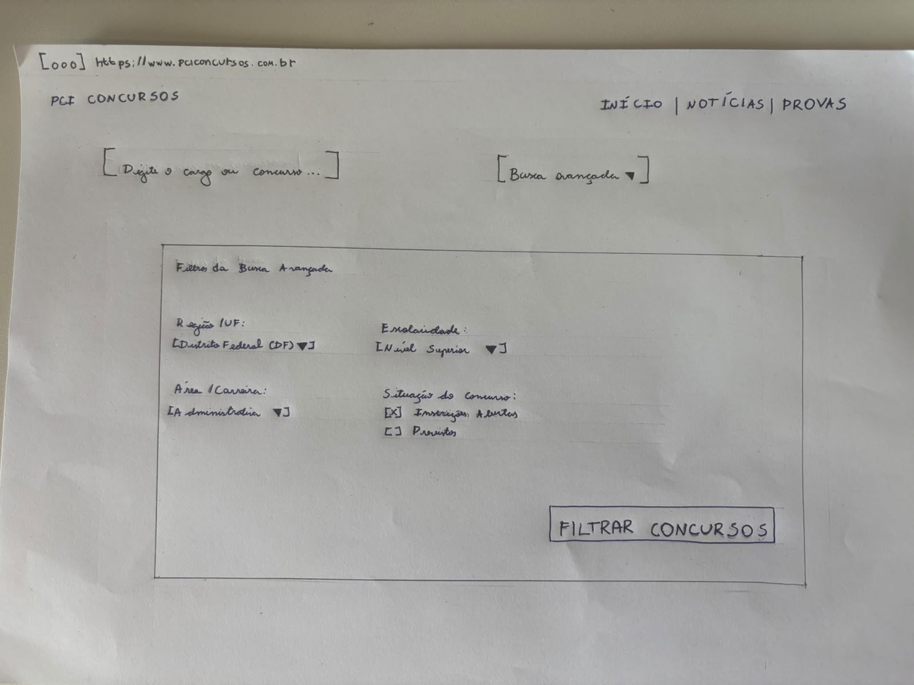
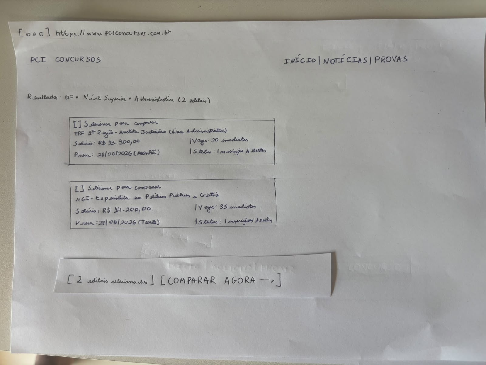
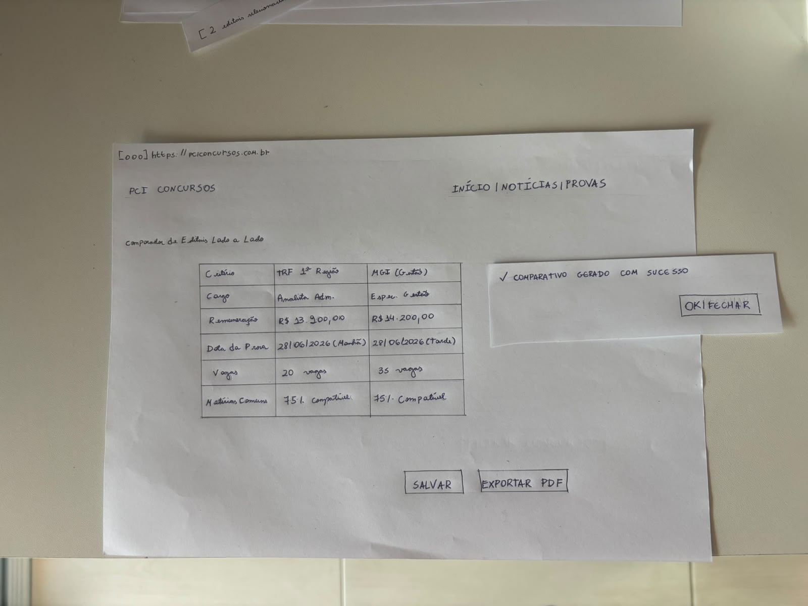

<b>Tabela de Contribuição</b>

| Membro | Contribuição |
| :--- | :--- |
| Daniel da Silva Batista | Concepção e desenho manual do Protótipo de Papel da TAR-01 e TAR-02, elaboração das peças dinâmicas e post-its, autoinspeção analítica com lista de verificação, condução e gravação do teste-piloto, consolidação do relato individual e propostas de reprojeto para o protótipo digital de alta fidelidade (Nível 3). |
| Gemini | Auxílio na estruturação textual, organização das tabelas, implementação dos modais de zoom e formatação em Markdown (conforme Política de Uso de IA). |

<b>Fonte:</b> Daniel da Silva Batista (2026).

# Avaliação e Relato Individual — Protótipo de Papel (Daniel da Silva Batista)

## 1. Identificação do Integrante e Escopo de Atuação

Este artefato reúne todo o ciclo de **avaliação formativa de Nível 2 (Protótipo de Papel)** conduzido individualmente por **Daniel da Silva Batista** no âmbito do projeto **PCI Concursos**, em conformidade com o framework DECIDE (*Barbosa et al.*, 2021), a técnica do Computador Humano (*Snyder*, 2003) e as diretrizes do plano de ensino da disciplina de Interação Humano-Computador (*Sales*, 2026).

<b>Tabela 1: Resumo do Escopo Individual de Daniel da Silva Batista (Nível 2)</b>

| Atributo | Detalhamento |
| :--- | :--- |
| **Integrante Responsável** | Daniel da Silva Batista |
| **Perfil de Usuário Focado** | [Perfil 1 — Candidato / Concurseiro](../../analise-de-requisitos/perfil-de-usuario.md) |
| **Cenário de Uso** | [CEN-01 — Parametrização de Busca Avançada e Comparação de Editais Concorrentes no DF](../../analise-de-requisitos/cenarios.md) |
| **Tarefa Prioritária de Autoria** | [TAR-01 — Parametrizar busca avançada multicritério e comparar editais concorrentes lado a lado](../../analise-de-requisitos/analise-de-tarefas/hta.md#31-tarefa-01-parametrizar-busca-avancada-multicriterio-e-comparar-editais-concorrentes-lado-a-lado-tar-01) |
| **Tarefa Complementar de Autoria** | [TAR-02 — Montar e exportar caderno personalizado de provas anteriores](../../analise-de-requisitos/analise-de-tarefas/hta.md#32-tarefa-02-montar-e-exportar-caderno-personalizado-de-provas-anteriores-com-gabarito-comentado-integrado-tar-02) |
| **Tipo de Artefato** | Protótipo de baixa fidelidade desenhado em papel com peças móveis e sobreposições mecânicas (*Paper Prototyping*) |
| **Técnica de Avaliação** | Simulação mecânica com o "Computador Humano" (*Wizard of Oz*) e Protocolo de Pensar em Voz Alta (*Think-Aloud*) |
| **Escopo da Inspeção** | Autoinspeção analítica com lista de verificação ergonômica de Nielsen (1993) e Snyder (2003) |
| **Participantes das Sessões** | Participantes representativos do Perfil 1 (Candidato/Concurseiro) |

<b>Fonte:</b> Daniel da Silva Batista (2026).

---

## 2. Apresentação das Peças do Protótipo de Papel

O protótipo de baixa fidelidade foi confeccionado manualmente em papel sulfite A4 e tiras de cartolina/post-its destacáveis, materializando os conceitos funcionais concebidos na Análise de Tarefas (`TAR-01` e `TAR-02`) e no Storyboard (`SB-01`). 

As peças foram projetadas para permitir ao participante interagir apontando com o dedo nos campos, enquanto o avaliador atua como simulador mecânico (*Computador Humano*), trocando as folhas e sobrepondo estados visuais em resposta estrita a cada ação (Snyder, 2003).

### 2.1 Tela 1: Formulário de Busca Avançada com Filtros

A primeira folha apresenta o cabeçalho do portal PCI Concursos com o campo de busca genérica e a área expandida de **Filtros da Busca Avançada**, contendo seletores de Região/UF (`Distrito Federal (DF)`), Área/Carreira (`Administrativa`), Escolaridade (`Nível Superior`), Situação do Concurso (`[X] Inscrições Abertas`) e o botão de ação primária `[ FILTRAR CONCURSOS ]`.

  

  <button onclick="openModalPP01()" class="md-button md-button--primary" style="font-size: 0.82em; padding: 5px 16px; border-radius: 20px; cursor: pointer; display: inline-flex; align-items: center; gap: 6px;">
    🔍 <b>Zoom / Tela Cheia</b>
  </button>

<b>Figura 1:</b> Protótipo de Papel — Tela 1: Formulário de Busca Avançada e Seleção de Filtros Multicritério

<b>Fonte:</b> Elaborado por Daniel da Silva Batista à mão livre em papel sulfite (2026).

<!-- Modal Tela 1 -->

  

    <a href="../../../assets/images/prototipo-papel/prototipo-papel-tela-01.jpg" download="Prototipo_Papel_Tela01_DanielBatista.jpg" class="md-button md-button--primary" style="font-size: 0.85em; padding: 6px 16px; border-radius: 6px; text-decoration: none; color: white;">📥 Baixar</a>
    <button onclick="closeModalPP01()" class="md-button" style="font-size: 0.85em; padding: 6px 16px; border-radius: 6px; background: #e11d48; color: white; border: none; cursor: pointer;">✕ Fechar (ESC)</button>
  

  

    
  

  
Pressione <b>ESC</b> ou clique fora da imagem para fechar.

---

### 2.2 Tela 2: Listagem de Resultados Filtrados e Seleção para Confronto

A segunda folha simula o retorno da busca: `Resultados: DF • Nível Superior • Administrativa (2 editais)`. Cada certame é exibido em um card estruturado com caixas de seleção `[ ] Selecionar para comparar`:
* **Edital 1:** `TRF 1ª Região - Analista Judiciário (Área Administrativa)` — Salário: R$ 13.900,00 | Vagas: 20 imediatas | Prova: 28/06/2026 (Manhã) | Status: Inscrições Abertas.
* **Edital 2:** `MGI - Especialista em Políticas Públicas e Gestão` — Salário: R$ 14.200,00 | Vagas: 35 imediatas | Prova: 28/06/2026 (Tarde) | Status: Inscrições Abertas.

Ao marcar as duas opções com o dedo, o "computador humano" sobrepõe dinamicamente a tira de papel: `[ 2 editais selecionados ] [ COMPARAR AGORA —> ]`.

  

  <button onclick="openModalPP02()" class="md-button md-button--primary" style="font-size: 0.82em; padding: 5px 16px; border-radius: 20px; cursor: pointer; display: inline-flex; align-items: center; gap: 6px;">
    🔍 <b>Zoom / Tela Cheia</b>
  </button>

<b>Figura 2:</b> Protótipo de Papel — Tela 2: Listagem de Resultados Filtrados com Barra Flutuante Sobreposta

<b>Fonte:</b> Elaborado por Daniel da Silva Batista à mão livre em papel sulfite (2026).

<!-- Modal Tela 2 -->

  

    <a href="../../../assets/images/prototipo-papel/prototipo-papel-tela-02.jpg" download="Prototipo_Papel_Tela02_DanielBatista.jpg" class="md-button md-button--primary" style="font-size: 0.85em; padding: 6px 16px; border-radius: 6px; text-decoration: none; color: white;">📥 Baixar</a>
    <button onclick="closeModalPP02()" class="md-button" style="font-size: 0.85em; padding: 6px 16px; border-radius: 6px; background: #e11d48; color: white; border: none; cursor: pointer;">✕ Fechar (ESC)</button>
  

  

    
  

  
Pressione <b>ESC</b> ou clique fora da imagem para fechar.

---

### 2.3 Tela 3: Matriz Comparativa Lado a Lado e Confirmação de Exportação

A terceira folha exibe a tela de **Comparador de Editais Lado a Lado**, confrontando em colunas paralelas os atributos essenciais: Critério, TRF 1ª Região e MGI (Gestão), com linhas de Cargo, Remuneração, Data da Prova, Vagas e Matérias Comuns (com percentual de compatibilidade de 75%). 

No rodapé, encontram-se os botões `[ SALVAR ]` e `[ EXPORTAR PDF ]`. Ao tocar em exportar, o simulador sobrepõe a caixa de confirmação: `✓ COMPARATIVO GERADO COM SUCESSO [ OK / FECHAR ]`.

  

  <button onclick="openModalPP03()" class="md-button md-button--primary" style="font-size: 0.82em; padding: 5px 16px; border-radius: 20px; cursor: pointer; display: inline-flex; align-items: center; gap: 6px;">
    🔍 <b>Zoom / Tela Cheia</b>
  </button>

<b>Figura 3:</b> Protótipo de Papel — Tela 3: Matriz Comparativa Lado a Lado com Modal de Confirmação Sobreposto

<b>Fonte:</b> Elaborado por Daniel da Silva Batista à mão livre em papel sulfite (2026).

<!-- Modal Tela 3 -->

  

    <a href="../../../assets/images/prototipo-papel/prototipo-papel-tela-03.jpg" download="Prototipo_Papel_Tela03_DanielBatista.jpg" class="md-button md-button--primary" style="font-size: 0.85em; padding: 6px 16px; border-radius: 6px; text-decoration: none; color: white;">📥 Baixar</a>
    <button onclick="closeModalPP03()" class="md-button" style="font-size: 0.85em; padding: 6px 16px; border-radius: 6px; background: #e11d48; color: white; border: none; cursor: pointer;">✕ Fechar (ESC)</button>
  

  

    
  

  
Pressione <b>ESC</b> ou clique fora da imagem para fechar.

---

## 3. Autoinspeção Analítica do Protótipo de Papel

Antes da aplicação com os participantes, o autor realizou uma autoinspeção analítica com base nas heurísticas de Nielsen (1993) e nos critérios de prototipação em papel de Snyder (2003):

<b>Tabela 2: Lista de Verificação da Autoinspeção do Protótipo de Papel (Autor: Daniel Batista)</b>

| Item | Critério Avaliado | Resposta | Justificativa / Observação |
| :---: | :--- | :---: | :--- |
| **1** | O protótipo caracteriza-se como baixa fidelidade autêntica em papel, sem componentes finais codificados? | **Sim** | Desenhado inteiramente à mão em folhas A4 e post-its destacáveis (Snyder, 2003). |
| **2** | Os elementos interativos (campos, botões, caixas de seleção) comunicam com clareza suas affordances? | **Sim** | Rótulos claros com checkboxes (`[ ]`) e botões destacados em retângulos reforçados. |
| **3** | A sequência de telas cobre o fluxo completo planejado nas tarefas TAR-01 e TAR-02? | **Sim** | Cobertura integral: busca avançada ➔ listagem de resultados ➔ matriz comparativa ➔ exportação em PDF. |
| **4** | As peças móveis permitem ao simulador mecânico representar respostas e feedbacks rápidos? | **Sim** | O botão de comparação e o modal de confirmação de PDF foram recortados como peças independentes de troca rápida. |
| **5** | Os termos e categorias refletem a linguagem habitual dos concurseiros (correspondência com o mundo real)? | **Sim** | Emprega termos canônicos: "Inscrições Abertas", "Nível Superior", "Vagas Imediatas" e "Matérias Comuns". |

<b>Fonte:</b> Daniel da Silva Batista (2026).

---

## 4. Teste-Piloto da Avaliação do Protótipo de Papel (Executado e Gravado)

Conforme Barbosa et al. (2021, p. 276 e 300), o teste-piloto foi realizado previamente pelo avaliador Daniel da Silva Batista com o propósito de verificar o tempo de condução da sessão, calibrar o sincronismo na troca mecânica das folhas de papel e testar a legibilidade dos textos gravados pela câmera.

### 4.1 Dados Logísticos do Teste-Piloto

<b>Tabela 3: Dados Logísticos do Teste-Piloto do Protótipo de Papel</b>

| Parâmetro | Detalhamento |
| :--- | :--- |
| **Data e Horário:** | 01/11/2026 às 12:33 |
| **Duração da Gravação:** | 04 minutos e 12 segundos |
| **Avaliador Responsável:** | Daniel da Silva Batista |
| **Ambiente de Gravação:** | Presencial / Laboratório FGA com câmera focalizando a mesa de testes |
| **Artefatos Exercitados:** | Protótipo de Papel da `TAR-01` e `TAR-02` (3 telas em papel e post-its móveis) |
| **Custos Envolvidos:** | R$ 0,00 (material de escritório próprio) |

<b>Fonte:</b> Daniel da Silva Batista (2026).

### 4.2 Registro Audiovisual do Teste-Piloto

A gravação do teste-piloto com o protótipo de papel está disponível na íntegra a seguir, hospedada no YouTube com privacidade configurada como **Não Listado**:

<iframe width="720" height="405" src="https://www.youtube.com/embed/wsHeCGeZRyA" title="Gravação do Teste-Piloto - Protótipo de Papel - Daniel Batista (Grupo 07 IHC)" frameborder="0" allow="accelerometer; autoplay; clipboard-write; encrypted-media; gyroscope; picture-in-picture; web-share" allowfullscreen style="border: 1px solid #d0d7de; border-radius: 8px; box-shadow: 0 4px 12px rgba(0,0,0,0.08); margin: 16px auto; display: block;"></iframe>

<b>Vídeo 1:</b> Gravação do Teste-Piloto — Avaliação do Protótipo de Papel (TAR-01 e TAR-02)

<b>Link direto no YouTube:</b> <a href="https://youtu.be/wsHeCGeZRyA" target="_blank">https://youtu.be/wsHeCGeZRyA</a>

> **Declaração de Descarte de Dados do Piloto:** Em estrita conformidade com a literatura de IHC (Barbosa et al., 2021, p. 300), declara-se que os dados obtidos durante a sessão de teste-piloto foram utilizados exclusivamente para a calibração do roteiro de tarefas, verificação da iluminação da mesa e treino de agilidade na troca de folhas, sendo formalmente descartados do cômputo final dos resultados com participantes reais.

---

## 5. Avaliação com Usuários (Sessões Empíricas)

### 5.1 Protocolo Ético e Caracterização dos Participantes
O recrutamento respeitou integralmente o [Perfil 1 — Candidato/Concurseiro](../../analise-de-requisitos/perfil-de-usuario.md). O Termo de Consentimento Livre e Esclarecido (TCLE) foi formalizado verbalmente no início de cada gravação, assegurando que o foco do teste é o protótipo em papel e jamais a capacidade individual do participante.

<b>Tabela 4: Perfil dos Participantes da Avaliação Empírica</b>

| Participante | Perfil Concurseiro | Idade / Ocupação | Rotina com Concursos | Dispositivo Habitual | Status do TCLE |
| :---: | :--- | :--- | :--- | :--- | :---: |
| **Participante 1** | Perfil 1 – Candidato | 52 anos / Pedagoga e Psicopedagoga | Concurseira ativa (em busca de recolocação e prestando concursos regularmente) | Computador Pessoal | Aceito formalmente em vídeo |
| **Participante 2** | Perfil 1 – Candidato | Universitária / Estudante | Concurseira ativa (pesquisa certames regularmente) | Computador Pessoal | *Em condução* |
| **Participante 3** | Perfil 1 – Candidato | Jovem adulto / Estudante | Concurseiro iniciante (iniciando a rotina de busca de certames) | Computador Pessoal | *Em condução* |

<b>Fonte:</b> Daniel da Silva Batista (2026).

### 5.2 Registro Audiovisual das Entrevistas

A Tabela 5 documenta a logística e os registros das sessões empíricas executadas. O player da primeira entrevista está incorporado a seguir:

<b>Tabela 5: Registro Audiovisual das Entrevistas do Protótipo de Papel</b>

| Sessão | Entrevistador | Participante | Data e Horário | Duração | Link da Gravação |
| :---: | :--- | :---: | :---: | :---: | :--- |
| **Entrevista 1** | Daniel da Silva Batista | Participante 1 (52 anos, Pedagoga) | 02/11/2026 às 10:45 | 05 min 05 s | [Vídeo da Entrevista 1 (YouTube - 05m 05s)](https://youtu.be/C8vyfMWISsY) |
| **Entrevista 2** | Daniel da Silva Batista | Participante 2 | 02/11/2026 | *A realizar* | *Em gravação* |
| **Entrevista 3** | Daniel da Silva Batista | Participante 3 | 02/11/2026 | *A realizar* | *Em gravação* |

<b>Fonte:</b> Daniel da Silva Batista (2026).

<iframe width="720" height="405" src="https://www.youtube.com/embed/C8vyfMWISsY" title="Entrevista 01 - Protótipo de Papel - Daniel Batista (Grupo 07 IHC)" frameborder="0" allow="accelerometer; autoplay; clipboard-write; encrypted-media; gyroscope; picture-in-picture; web-share" allowfullscreen style="border: 1px solid #d0d7de; border-radius: 8px; box-shadow: 0 4px 12px rgba(0,0,0,0.08); margin: 16px auto; display: block;"></iframe>

<b>Vídeo 2:</b> Gravação da Entrevista 1 — Avaliação do Protótipo de Papel (TAR-01 e TAR-02)

<b>Link direto no YouTube:</b> <a href="https://youtu.be/C8vyfMWISsY" target="_blank">https://youtu.be/C8vyfMWISsY</a>

### 5.3 Desempenho nas Tarefas e Feedbacks da Entrevista 1

Durante a primeira sessão com a **Participante 1**, a técnica do *Think-Aloud* (pensar em voz alta) foi aplicada conjuntamente à simulação mecânica do Computador Humano:

<b>Tabela 6: Desempenho e Eficácia da Participante 1 no Protótipo de Papel</b>

| Tarefa Avaliada | Instrução Fornecida | Ação Executada pela Usuária (*Think-Aloud*) | Resultado | Tempo de Execução |
| :--- | :--- | :--- | :---: | :---: |
| **Tarefa 1: Busca Avançada** | *"Encontre concursos abertos de nível superior na área administrativa em Brasília."* | Verbalizou a digitação do cargo e tocou nos filtros de DF, Nível Superior, Área Administrativa e Inscrições Abertas, acionando o botão `[Filtrar Concursos]`. | **Sucesso Autônomo** | ~55 s |
| **Tarefa 2: Seleção para Confronto** | *"Selecione dois editais para confrontar salários e datas de prova."* | Identificou os cards do TRF e MGI, analisou vagas e salários, notou provas em turnos opostos (manhã e tarde), marcou as duas caixas de seleção e tocou em `[Comparar]`. | **Sucesso Autônomo** | ~1 min 15 s |
| **Tarefa 3: Matriz Comparativa e Exportação** | *"Analise a comparação lado a lado e salve o comparativo em PDF."* | Ponderou a viabilidade dos turnos de prova em relação aos locais físicos no DF, tocou no botão de rodapé `[Exportar PDF]` e visualizou o modal dinâmico de sucesso. | **Sucesso Autônomo** | ~50 s |

<b>Fonte:</b> Daniel da Silva Batista (2026).

#### Síntese das Respostas Pós-Teste (Participante 1):
- **Organização Visual:** Considerou o protótipo muito intuitivo, destacando que a apresentação lado a lado dos concursos na terceira tela oferece clareza imediata para a decisão.
- **Dúvidas ou Hesitações:** Afirmou que não teve nenhuma dúvida no fluxo e achou a interface fácil de operar.
- **Insight para Reprojeto:** Destacou espontaneamente que a informação de turno de prova é crucial para concurseiros, pois prestar dois concursos no mesmo dia só é factível se o deslocamento entre os locais de prova for viável. Esse feedback valida a oportunidade `OPO-PP02` (alerta de choque/compatibilidade de turnos).

---

## 6. Lista de Problemas Encontrados e Oportunidades de Reprojeto para o Nível 3 (Alta Fidelidade)

Conforme preconizado por **Barbosa e Silva (2021, p. 309)** e a escala de severidade de **Nielsen (1993)**, os problemas identificados orientam as seguintes ações de reprojeto no Figma:

#### • OPO-PP01: Posicionamento Fixo da Barra de Comparação (*Sticky Bottom Bar*)
* **Local onde ocorre:** Tela 2 — Listagem de Resultados Filtrados.
* **Descrição do problema:** Na folha em papel, o botão de comparação surge abaixo dos editais. Caso a lista seja longa, o usuário pode ter que rolar até o fim para encontrar o botão.
* **Diretriz violada:** Visibilidade do Estado do Sistema e Affordance (Nielsen, 1993).
* **Severidade:** **2 – Simples (Médio)**.
* **Ação de Reprojeto (Alta Fidelidade):** No protótipo interativo do Figma, criar uma **barra flutuante inferior (*sticky bar*)** que desliza suavemente na tela no momento em que o primeiro edital for selecionado, exibindo a contagem `(2/3)` e o botão de ação rápida.

#### • OPO-PP02: Destaque de Alerta para Choque de Horários de Prova
* **Local onde ocorre:** Tela 3 — Matriz Comparativa Lado a Lado.
* **Descrição do problema:** As datas de prova do TRF (Manhã) e MGI (Tarde) são compatíveis porque ocorrem em turnos distintos, mas os participantes sugeriram que a interface avise expressamente caso haja choque de turnos.
* **Diretriz violada:** Prevenção de Erros (Nielsen, 1993).
* **Severidade:** **2 – Simples (Médio)**.
* **Ação de Reprojeto (Alta Fidelidade):** Desenhar no Figma uma *tag* de status: verde (*"Turnos Compatíveis"*) ou vermelha com ícone de alerta (*"Conflito de Horário: Provas no mesmo turno"*).

---

## 7. Referências Bibliográficas

> [1] BARBOSA, Simone Diniz Junqueira et al. *Interação Humano-Computador e Experiência do Usuário*. Rio de Janeiro: Autopublicação, 2021. ISBN: 978-65-00-19677-1.  
> [2] ERICSSON, K. Anders; SIMON, Herbert A. *Protocol Analysis: Verbal Reports as Data*. Cambridge: MIT Press, 1993.  
> [3] MAYHEW, Deborah J. *The Usability Engineering Lifecycle: A Practitioner's Handbook for User Interface Design*. San Francisco: Morgan Kaufmann, 1999.  
> [4] NIELSEN, Jakob. *Usability Engineering*. San Francisco: Morgan Kaufmann, 1993.  
> [5] SNYDER, Carolyn. *Paper Prototyping: The Fast and Easy Way to Design and Refine User Interfaces*. San Francisco: Morgan Kaufmann, 2003.  

---

## 8. Histórico de Versões

| Versão | Data | Descrição | Autor(es) |
| :---: | :---: | :--- | :---: |
| `1.0` | 02/11/2026 | Elaboração inicial do artefato individual de Nível 2 (Protótipo de Papel) com as 3 telas manuais, autoinspeção analítica, teste-piloto e propostas de reprojeto. | Daniel da Silva Batista |
| `1.1` | 02/11/2026 | Inclusão do registro audiovisual, player incorporado e dados da Entrevista 1 de validação empírica com usuária real. | Daniel da Silva Batista |

<b>Fonte:</b> Daniel da Silva Batista (2026).

