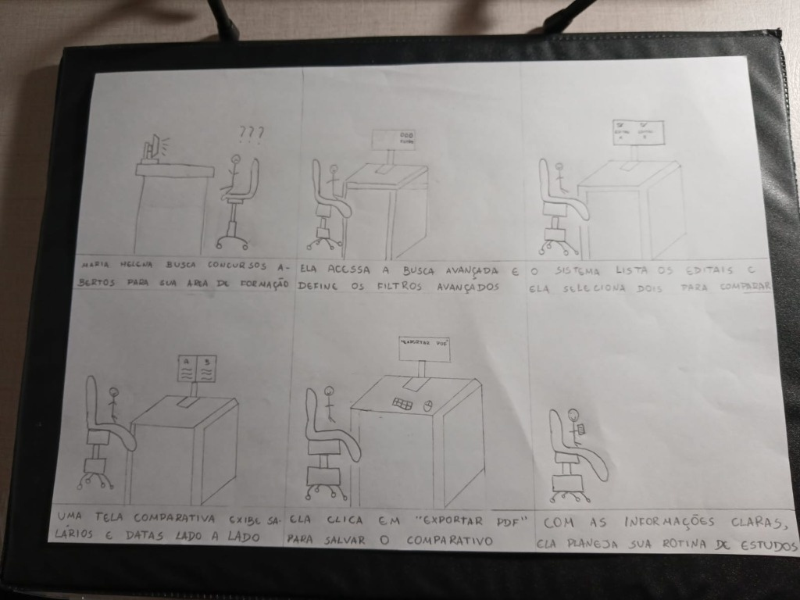

<b>Tabela de Contribuição</b>

| Membro | Contribuição |
| :--- | :--- |
| **Daniel da Silva Batista** | Elaboração do Storyboard SB-01, condução e registro da inspeção par a par dos modelos de tarefa de Pedro Rocha Ferreira Lima (TAR-04), condução do teste-piloto e entrevista de avaliação com usuário real (TAR-01 e SB-01), consolidação individual e propostas de reprojeto. |
| **Gemini** | Apoio na estruturação em Markdown e padronização visual das tabelas (conforme Política de IA). |

<b>Fonte:</b> Daniel da Silva Batista (2026).

# Avaliação e Relato Individual — Daniel da Silva Batista

## 1. Identificação do Integrante e Escopo de Atuação

Este artefato reúne todo o ciclo de **avaliação formativa de Nível 1 (Análise de Tarefas e Storyboard)** conduzido individualmente por **Daniel da Silva Batista** na Etapa 5 do projeto **PCI Concursos**, em conformidade com o framework DECIDE (*Barbosa et al.*, 2021) e o Plano de Ensino da disciplina (*Sales*, 2026).

<b>Tabela 1: Resumo do Escopo Individual de Daniel da Silva Batista</b>

| Atributo | Detalhamento |
| :--- | :--- |
| **Integrante Responsável** | Daniel da Silva Batista |
| **Perfil de Usuário Focado** | [Perfil 1 — Candidato / Concurseiro](../../analise-de-requisitos/perfil-de-usuario.md) |
| **Cenário de Uso** | [CEN-01 — Parametrização de Busca Avançada e Comparação de Editais Concorrentes no DF](../../analise-de-requisitos/cenarios.md) |
| **Tarefa Prioritária de Autoria** | [TAR-01 — Parametrizar busca avançada multicritério e comparar editais concorrentes lado a lado](../../analise-de-requisitos/analise-de-tarefas/hta.md#31-tarefa-01-parametrizar-busca-avancada-multicriterio-e-comparar-editais-concorrentes-lado-a-lado-tar-01) |
| **Storyboard de Autoria** | [SB-01 — Parametrização de Busca Avançada e Comparação de Editais](#2-storyboard-individual-sb-01) |
| **Par Inspecionado** | **Pedro Rocha Ferreira Lima** (Tarefas: HTA e CTT da `TAR-04`; Storyboard: `SB-02`) |
| **Participantes das Entrevistas** | 3 participantes do Perfil 1 (Candidato/Concurseiro) |

<b>Fonte:</b> Daniel da Silva Batista (2026).

---

## 2. Storyboard Individual (SB-01)

O Storyboard `SB-01` ilustra a jornada do usuário (Perfil 1 — Candidato/Concurseiro) utilizando a funcionalidade de busca avançada multicritério e o comparador de editais concorrentes lado a lado no PCI Concursos, permitindo verificar visualmente o modelo conceitual de interação concebido na `TAR-01`.

### 2.1 Ilustração do Storyboard SB-01

  

  <button onclick="openFullscreenModal()" class="md-button md-button--primary" style="font-size: 0.82em; padding: 5px 16px; border-radius: 20px; cursor: pointer; display: inline-flex; align-items: center; gap: 6px;">
    🔍 <b>Zoom / Tela Cheia</b>
  </button>

<b>Figura 1:</b> Storyboard SB-01 — Parametrização de Busca Avançada e Comparação de Editais Concorrentes

<b>Fonte:</b> Elaborado por Daniel da Silva Batista à mão livre (2026), fundamentado no Cenário 01 e Tarefa 01.

<!-- Modal / Lightbox de Tela Cheia -->

  

    <a href="../../../assets/images/storyboards/storyboard-sb01.png" download="Storyboard_SB01_DanielBatista.png" class="md-button md-button--primary" style="font-size: 0.85em; padding: 6px 16px; border-radius: 6px; text-decoration: none; color: white;">📥 Baixar</a>
    <button onclick="closeFullscreenModal()" class="md-button" style="font-size: 0.85em; padding: 6px 16px; border-radius: 6px; background: #e11d48; color: white; border: none; cursor: pointer;">✕ Fechar (ESC)</button>
  

  

    
  

  
Pressione <b>ESC</b> ou clique fora da imagem para fechar.

### 2.2 Detalhamento Sequencial dos Quadros

<b>Tabela 2: Detalhamento Sequencial dos Quadros do SB-01</b>

| Quadro | Ação Representada | Correspondência com a Tarefa TAR-01 | Legenda Textual do Quadro |
| :---: | :--- | :--- | :--- |
| **1** | Candidato(a) em frente ao computador na mesa de estudos, demonstrando dúvida e sobrecarga (`???`). | **Objetivo 0:** Iniciar busca e identificar certames da sua área de formação. | *"O usuário busca concursos abertos para sua área de formação."* |
| **2** | O usuário opera a interface aplicando seletores e caixas de filtro combinados na tela. | **Subtarefa 1:** Definir parâmetros da busca avançada multicritério (escolaridade, região, carreira). | *"Ela acessa a Busca Avançada e define os filtros avançados."* |
| **3** | A tela retorna os editais filtrados e o usuário marca dois certames concorrentes (`✓`). | **Subtarefa 2:** Analisar certames retornados e selecionar concorrentes no comparador. | *"O sistema lista os editais e ela seleciona dois para comparar."* |
| **4** | O monitor divide-se em duas colunas (*A* e *B*) confrontando salários, vagas e datas lado a lado. | **Subtarefa 3:** Confrontar matriz comparativa lado a lado em tempo real. | *"Uma tela comparativa exibe salários e datas lado a lado."* |
| **5** | O usuário clica no botão de ação primária `[Exportar PDF]`. | **Subtarefa 4:** Deliberar priorização e exportar síntese comparativa estruturada. | *"Ela clica em 'Exportar PDF' para salvar o comparativo."* |
| **6** | O usuário relaxa na cadeira, sorrindo e segurando a síntese impressa para organizar seu plano de estudos. | **Meta Atingida:** Decisão fundamentada com economia de tempo e esforço cognitivo. | *"Com as informações claras, ela planeja sua rotina de estudos."* |

<b>Fonte:</b> Daniel da Silva Batista (2026).

---

## 3. Inspeção Cruzada Par a Par (Avaliando: Pedro Rocha Ferreira Lima)

Conforme o planejamento da inspeção por pares (Fagan, 1976; Barbosa et al., 2021), a revisão deve ser conduzida por um avaliador independente sobre o trabalho do colega. Daniel da Silva Batista inspeciona os diagramas da **TAR-04** e o **Storyboard SB-02** elaborados por **Pedro Rocha Ferreira Lima**.

### 3.1 Identificação da Sessão de Inspeção e Registro em Vídeo

<b>Tabela 3: Dados da Sessão de Inspeção Cruzada</b>

| Atributo | Detalhamento |
| :--- | :--- |
| **Avaliador (Inspetor)** | Daniel da Silva Batista |
| **Autor Inspecionado** | Pedro Rocha Ferreira Lima |
| **Modelos de Tarefa Inspecionados** | [HTA da TAR-04](../../analise-de-requisitos/analise-de-tarefas/hta.md#42-tarefa-04-acompanhar-timeline-interativa-de-fases-do-certame-com-simulador-de-prazos-recursais-e-sincronizacao-de-calendario-tar-04) e [CTT da TAR-04](../../analise-de-requisitos/analise-de-tarefas/ctt.md#42-tarefa-04-acompanhar-timeline-interativa-de-fases-do-certame-com-simulador-de-prazos-recursais-e-sincronizacao-de-calendario-tar-04) |
| **Storyboard Inspecionado** | SB-02 (Acompanhamento de Timeline de Fases e Prazos) |
| **Data da Gravação** | *(A preencher durante a gravação)* |
| **Duração do Vídeo** | *(A preencher durante a gravação)* |
| **Link do Vídeo da Inspeção** | [Gravação da Inspeção no YouTube / Drive](javascript:void(0)) *(Inserir link após gravação)* |

<b>Fonte:</b> Daniel da Silva Batista (2026).

### 3.2 Inspeção do Diagrama HTA — TAR-04: Acompanhar Timeline Interativa de Fases

O modelo inspecionado é a **Figura 4 de HTA** e a respectiva **Tabela 5** em [Análise de Tarefas — HTA](../../analise-de-requisitos/analise-de-tarefas/hta.md#42-tarefa-04-acompanhar-timeline-interativa-de-fases-do-certame-com-simulador-de-prazos-recursais-e-sincronizacao-de-calendario-tar-04), de autoria de Pedro Rocha Ferreira Lima.

<b>Tabela 4: Lista de Verificação Aplicada ao HTA da TAR-04 (Autor: Pedro Rocha)</b>

| Item | Critério Verificado | Resposta | Observação |
| :---: | :--- | :---: | :--- |
| 1 | O objetivo principal da tarefa (nível 0) foi identificado antes das ações operacionais e está formulado como um estado ou meta que o usuário deseja atingir (verbo no infinitivo + objeto)? |  |  |
| 2 | A tarefa foi decomposta de forma hierárquica coerente, desmembrando o objetivo de alto nível (0) em subobjetivos intermediários (1., 2...) e estes em operações concretas nos níveis inferiores (1.1., 1.2., 1.2.1.)? |  |  |
| 3 | Os subobjetivos subordinados a um mesmo objetivo-pai são mutuamente exclusivos (sem sobreposição de escopo entre irmãos) e coletivamente exaustivos (juntos cumprem 100% do objetivo-pai, sem etapas ocultas)? |  |  |
| 4 | O diagrama diferencia visualmente os objetivos não terminais (retângulos simples que possuem filhos) das operações/nós-folha (retângulos com linha dupla horizontal na base, que não são mais decompostos)? |  |  |
| 5 | Cada nó do diagrama e da tabela recebe numeração hierárquica estritamente fiel à sua posição na árvore (0 para raiz; 1., 2. para nível 1; 1.1., 1.2. para filhos do nó 1.; 1.2.1., 1.2.2. para filhos do nó 1.2.)? |  |  |
| 6 | Todo objetivo que possui subobjetivos apresenta um plano explícito (p:) posicionado junto à linha vertical de decomposição, definindo a regra e a ordem de execução dos seus filhos diretos? |  |  |
| 7 | Os planos empregam corretamente a notação de operadores da HTA: sequência fixa (1 > 2), seleção/decisão condicional (1 / 2 com regra se...) ou paralelismo (1 + 2), referenciando apenas os filhos daquele nó? |  |  |
| 8 | A decomposição respeita um critério claro de parada (regra P x C ou foco no que o usuário realiza sem descer a microações mecânicas irrelevantes), mantendo nível de abstração adequado ao reprojeto? |  |  |
| 9 | As operações e objetivos de nível inferior estão acompanhados da especificação de input (circunstância de ativação), ação e feedback (resposta do sistema que indica o atingimento do objetivo)? |  |  |
| 10 | Além do diagrama hierárquico, o artefato apresenta a representação complementar em tabela contendo objetivos/operações, planos, input, feedback, problemas/dificuldades identificados e recomendações de design? |  |  |

<b>Fonte:</b> Daniel da Silva Batista (2026).

### 3.3 Inspeção do Modelo CTT — TAR-04: Acompanhar Timeline Interativa de Fases

O modelo inspecionado é a **Figura 4 de CTT** e a respectiva **Tabela 6** em [Análise de Tarefas — CTT](../../analise-de-requisitos/analise-de-tarefas/ctt.md#42-tarefa-04-acompanhar-timeline-interativa-de-fases-do-certame-com-simulador-de-prazos-recursais-e-sincronizacao-de-calendario-tar-04), de autoria de Pedro Rocha Ferreira Lima.

<b>Tabela 5: Lista de Verificação Aplicada ao CTT da TAR-04 (Autor: Pedro Rocha)</b>

| Item | Critério Verificado | Resposta | Observação |
| :---: | :--- | :---: | :--- |
| 1 | As tarefas foram corretamente classificadas e representadas com os ícones canônicos dos quatro tipos do CTT: tarefa do usuário (pessoa), tarefa do sistema (computador), tarefa interativa (pessoa + tela) ou tarefa abstrata (nuvem)? |  |  |
| 2 | A decomposição hierárquica está coerente entre tarefas superiores e subordinadas, garantindo que a raiz e todos os nós intermediários sejam tarefas abstratas e que nenhuma tarefa abstrata apareça como nó-folha? |  |  |
| 3 | As relações de ativação sequencial (T1 >> T2) e de ativação com passagem de informação (T1 []>> T2) indicam corretamente quando a segunda tarefa depende do término da primeira e quando há transferência obrigatória de dados? |  |  |
| 4 | As escolhas entre tarefas alternativas foram representadas com o operador de escolha (T1 [] T2) nos pontos em que duas opções estão disponíveis, mas o início de uma desabilita a outra no ciclo atual? |  |  |
| 5 | Tarefas simultâneas ou realizáveis em qualquer ordem (sem dependência de dados entre si) foram identificadas como concorrentes por meio do operador de concorrência (T1 ||| T2)? |  |  |
| 6 | Quando tarefas concorrentes precisam trocar informações ou sincronizar estados durante sua execução paralela, essa relação foi explicitamente representada pelo operador de concorrência e comunicação (T1 |[]| T2)? |  |  |
| 7 | As tarefas que podem ser executadas em qualquer ordem, mas sem sobreposição temporal, utilizam corretamente o operador de independência (T1 |=| T2)? |  |  |
| 8 | As relações de interrupção distinguem adequadamente a desativação definitiva sem retorno (T1 [> T2) da suspensão temporária com retomada (T1 |> T2)? |  |  |
| 9 | O modelo explicita com clareza as relações temporais entre todas as tarefas irmãs por linha horizontal pontilhada e indica operadores unários de opcionalidade ([T]) e iteratividade (T*) quando aplicáveis? |  |  |
| 10 | Considerando os limites da notação gráfica do CTT quanto à modelagem detalhada de erros, tais mecanismos e fluxos de exceção estão devidamente registrados na documentação complementar (tabelas, HTA ou cenários)? |  |  |

<b>Fonte:</b> Daniel da Silva Batista (2026).

### 3.4 Inspeção do Storyboard SB-02 (Autor: Pedro Rocha)

*Nota: Esta inspeção será concluída assim que o arquivo final do Storyboard SB-02 for disponibilizado pelo autor Pedro Rocha.*

<b>Tabela 6: Lista de Verificação Aplicada ao Storyboard SB-02 (Autor: Pedro Rocha)</b>

| Item | Critério Verificado | Resposta | Observação |
| :---: | :--- | :---: | :--- |
| 1 | O artefato caracteriza-se efetivamente como um protótipo de baixa fidelidade, construído em formato visual simplificado sem capturas de tela finais codificadas ou interfaces de alta fidelidade? |  |  |
| 2 | O storyboard consiste em uma série sequencial de desenhos/quadros que mostra como o usuário pode progredir em uma tarefa utilizando o produto em desenvolvimento na ordem esperada? |  |  |
| 3 | A finalidade do storyboard como instrumento de concepção e verificação preliminar do modelo conceitual da tarefa está explicitamente declarada no documento? |  |  |
| 4 | O storyboard retrata exemplos de telas/esboços de interface articulados à ação humana (e não um mero fluxograma abstrato nem apenas telas isoladas sem ator)? |  |  |
| 5 | O storyboard é utilizado em conjunto direto com um cenário escrito previamente especificado no projeto, mantendo fidelidade à situação-problema do usuário? |  |  |
| 6 | A sequência visual acrescenta mais detalhes contextuais ao cenário escrito (ambiente físico, postura, dispositivo, reação emocional), permitindo visualizar a situação de uso real? |  |  |
| 7 | Existe rastreabilidade explícita e inequívoca entre o storyboard, a persona protagonista, o cenário e a tarefa modelada na Análise de Tarefas? |  |  |
| 8 | A narrativa visual preserva o arco completo do cenário: início (gatilho/motivação e dor atual), meio (interação passo a passo com a solução) e fim (desfecho e satisfação da necessidade)? |  |  |
| 9 | Cada quadro (frame) descreve com precisão um passo específico da sequência da tarefa, sem omitir etapas essenciais da decomposição HTA/CTT nem incluir passos excedentes? |  |  |
| 10 | A técnica de esboço (sketching) apoia-se em símbolos e traços simples e consistentes (figuras humanas esquemáticas, ícones básicos, setas indicativas), dispensando detalhamento artístico complexo? |  |  |
| 11 | Os desenhos permitem identificar visualmente quem é a pessoa retratada, quais objetos/dispositivos ela está usando e onde ela está (ambiente físico)? |  |  |
| 12 | Cada quadro possui uma legenda descritiva clara (e transcrição textual acessível) e o conjunto visual permite ao leitor reconhecer e nomear a tarefa representada? |  |  |
| 13 | O storyboard foi elaborado no momento metodológico correto do ciclo de design (Nível 1 — fase inicial/conceitual, antes da prototipação em papel de Nível 2)? |  |  |
| 14 | O storyboard foi (ou está planejado e preparado para ser) exibido a usuários potenciais representativos do perfil-alvo para coletar críticas e validar a compreensão da história? |  |  |
| 15 | Os quadros oferecem elementos suficientes para que a equipe de projeto e os participantes percorram mentalmente (walkthrough) e simulem a interação com o produto? |  |  |
| 16 | O artefato é tratado de forma aberta à iteração e modificação, prevendo o registro de alterações sugeridas pelos usuários e a evolução para nova versão quando necessário? |  |  |
| 17 | As limitações metodológicas do storyboard (não testar navegabilidade real, tempo de execução nem detalhes finos de layout) estão explicitamente reconhecidas na documentação? |  |  |
| 18 | As concessões de prototipação (trade-offs) — priorizar rapidez, baixo custo e foco no contexto em detrimento da fidelidade visual de componentes — foram respeitadas? |  |  |
| 19 | O storyboard articula-se com os artefatos complementares do projeto (tabelas de correspondência com subobjetivos HTA e tarefas CTT) para cobrir regras que o desenho estático não expressa sozinho? |  |  |
| 20 | O storyboard é utilizado estritamente como material de exploração conceitual para orientar as decisões do próximo nível (Protótipo de Papel), sem ser tomado como especificação definitiva? |  |  |

<b>Fonte:</b> Daniel da Silva Batista (2026).

### 3.5 Síntese de Problemas Encontrados e Recomendações ao Colega

<b>Tabela 7: Síntese de Problemas e Oportunidades de Reprojeto para Pedro Rocha</b>

| ID | Modelo Afetado | Elemento / Passo | Problema de Usabilidade / Notação Detectado | Recomendação de Reprojeto |
| :---: | :---: | :--- | :--- | :--- |
| `PAT-P01` | HTA / CTT TAR-04 | *(A preencher na inspeção)* | *(Registro da inconsistência)* | *(Ação sugerida para ajuste)* |

<b>Fonte:</b> Daniel da Silva Batista (2026).

---

## 4. Teste-Piloto da Avaliação de Nível 1 (Executado e Gravado)

Conforme as diretrizes de Barbosa et al. (2021, p. 276 e 300), o teste-piloto foi planejado e executado previamente pelo avaliador Daniel da Silva Batista com o objetivo de testar os equipamentos, calibrar o roteiro de entrevista, avaliar a legibilidade do Storyboard `SB-01` e do diagrama HTA da `TAR-01`, e verificar o tempo de condução da sessão antes do início formal das entrevistas oficiais.

### 4.1 Dados da Sessão do Teste-Piloto

<b>Tabela 8: Dados Técnicos da Execução do Teste-Piloto</b>

| Atributo | Detalhamento |
| :--- | :--- |
| **Data e Horário:** | 21/10/2026 às 17:29 |
| **Duração da Gravação:** | 6 minutos e 18 segundos |
| **Avaliador Responsável:** | Daniel da Silva Batista |
| **Plataforma Utilizada:** | Microsoft Teams (com gravação em nuvem e compartilhamento de tela Full HD) |
| **Artefatos Exercitados:** | [Storyboard SB-01](#2-storyboard-individual-sb-01) e [Análise de Tarefas HTA da TAR-01](../../analise-de-requisitos/analise-de-tarefas/hta.md) |
| **Custos Envolvidos:** | R$ 0,00 (infraestrutura acadêmica gratuita) |

<b>Fonte:</b> Daniel da Silva Batista (2026).

### 4.2 Registro Audiovisual do Teste-Piloto

A gravação completa do teste-piloto individual está disponível na íntegra no player a seguir, hospedado no YouTube com privacidade configurada como **Não Listado**:

<iframe width="720" height="405" src="https://www.youtube.com/embed/wsHeCGeZRyA" title="Gravação do Teste-Piloto de Nível 1 - Daniel Batista (Grupo 07 IHC)" frameborder="0" allow="accelerometer; autoplay; clipboard-write; encrypted-media; gyroscope; picture-in-picture; web-share" allowfullscreen style="border: 1px solid #d0d7de; border-radius: 8px; box-shadow: 0 4px 12px rgba(0,0,0,0.08); margin: 16px auto; display: block;"></iframe>

<b>Vídeo 1:</b> Gravação do Teste-Piloto Individual — Avaliação de Nível 1 (Storyboard SB-01 e TAR-01)

<b>Link direto:</b> <a href="https://youtu.be/wsHeCGeZRyA" target="_blank">https://youtu.be/wsHeCGeZRyA</a>

### 4.3 Ficha de Avaliação e Calibração Técnica Pós-Piloto

Após a execução da gravação solo no Teams, o avaliador preencheu a Ficha de Calibração confrontando os critérios de qualidade estabelecidos com o resultado observado:

<b>Tabela 9: Ficha de Avaliação e Calibração Técnica Pós-Piloto</b>

| # | Item Verificado | Critério de Aprovação | Resultado Observado | Ajuste / Ação Realizada |
| :---: | :--- | :--- | :---: | :--- |
| **1** | **Clareza do Roteiro** | Linguagem natural, direta e sem termos técnicos que induzam respostas. | **Aprovado** | Nenhuma alteração estrutural no roteiro. |
| **2** | **Duração da Sessão** | Sessão de calibração realizada de forma concisa e fluida. | **Aprovado** | 6 min 18 s na gravação solo; estimativa de 15 a 20 min mantida para sessões com usuários. |
| **3** | **Enquadramento do SB-01** | Desenho de papel exibido sem título, com rotação horizontal e boa legibilidade. | **Aprovado** | Exibição em janela dedicada com zoom de 130%. |
| **4** | **Legibilidade do HTA** | Diagrama Mermaid e ramos de tarefas legíveis durante a projeção. | **Aprovado** | Utilização do modo tela cheia a 110% de zoom. |
| **5** | **Alinhamento HTA vs. Roteiro** | Enunciado das perguntas cobrindo exatamente os 4 blocos da hierarquia. | **Calibrado** | Ajustada a pergunta verbal para citar textualmente os 4 objetivos do diagrama. |
| **6** | **Qualidade do Áudio** | Captação clara da voz do avaliador sem ecos ou ruídos de fundo. | **Aprovado** | Uso de fone de ouvido com microfone integrado. |
| **7** | **Qualidade do Vídeo** | Resolução Full HD (1080p) sem perdas de quadros ou congelamentos. | **Aprovado** | Gravação estável via Microsoft Teams. |
| **8** | **Registro do TCLE** | Consentimento ético verbal registrado explicitamente no áudio. | **Aprovado** | Protocolo validado para abertura das entrevistas oficiais. |

<b>Fonte:</b> Daniel da Silva Batista (2026).

> **Declaração de Descarte de Dados do Piloto:** Declara-se formalmente que os dados e registros deste teste-piloto foram utilizados exclusivamente para a calibração do roteiro de entrevista, verificação das ferramentas tecnológicas de gravação e treinamento de postura do avaliador. Conforme preceitua a literatura de IHC (Barbosa et al., 2021, p. 300), esses dados não foram somados nem misturados aos resultados das entrevistas com os participantes reais.

---

## 5. Avaliação com Usuários (3 Entrevistas — TAR-01 e SB-01)

Sessões de validação empírica da tarefa prioritária **TAR-01** e do Storyboard **SB-01** conduzidas individualmente por Daniel da Silva Batista com **três participantes reais** representativos do **Perfil 1 — Candidato/Concurseiro**.

### 5.1 Protocolo Ético e Recrutamento dos Participantes

Todos os três participantes foram selecionados em conformidade com o [Perfil de Usuário](../../analise-de-requisitos/perfil-de-usuario.md). Antes de cada gravação, o Termo de Consentimento Livre e Esclarecido (TCLE) foi apresentado e assinado (ou formalizado verbalmente no início da gravação), garantindo anonimato, confidencialidade e direito de interrupção a qualquer momento (Resolução CNS 466/2012 e LGPD).

<b>Tabela 10: Perfil dos Três Participantes Recrutados</b>

| Participante | Perfil do Concurseiro | Experiência com Concursos | Dispositivo Habitual | Status do TCLE |
| :---: | :--- | :--- | :--- | :---: |
| **Participante 1** | Perfil 1 — Candidato/Concurseiro | *(A preencher pós-entrevista)* | *(Desktop / Smartphone)* | Assinado |
| **Participante 2** | Perfil 1 — Candidato/Concurseiro | *(A preencher pós-entrevista)* | *(Desktop / Smartphone)* | Assinado |
| **Participante 3** | Perfil 1 — Candidato/Concurseiro | *(A preencher pós-entrevista)* | *(Desktop / Smartphone)* | Assinado |

<b>Fonte:</b> Daniel da Silva Batista (2026).

### 5.2 Gravações em Vídeo das 3 Entrevistas

<b>Tabela 11: Registro Audiovisual das Três Entrevistas</b>

| Sessão | Entrevistador | Participante | Data e Horário | Duração | Link do Vídeo (YouTube / Drive) |
| :---: | :--- | :---: | :---: | :---: | :--- |
| **Entrevista 1** | Daniel da Silva Batista | Participante 1 | *(A preencher)* | *(A preencher)* | [Vídeo da Entrevista 1](javascript:void(0)) *(Inserir link)* |
| **Entrevista 2** | Daniel da Silva Batista | Participante 2 | *(A preencher)* | *(A preencher)* | [Vídeo da Entrevista 2](javascript:void(0)) *(Inserir link)* |
| **Entrevista 3** | Daniel da Silva Batista | Participante 3 | *(A preencher)* | *(A preencher)* | [Vídeo da Entrevista 3](javascript:void(0)) *(Inserir link)* |

<b>Fonte:</b> Daniel da Silva Batista (2026).

### 5.3 Respostas Coletadas e Análise Qualitativa Comparativa

A Tabela 12 sintetiza as respostas obtidas dos três participantes nas nove perguntas do roteiro semiestruturado, permitindo confrontar percepções e triangular evidências qualitativas:

<b>Tabela 12: Respostas dos Três Participantes (TAR-01 e SB-01)</b>

| Nº | Pergunta Aplicada | Participante 1 | Participante 2 | Participante 3 | Síntese / Implicação de Usabilidade |
| :---: | :--- | :--- | :--- | :--- | :--- |
| **1** | Olhando o storyboard sem título, que tarefa você diria que esta sequência representa? | | | | |
| **2** | A ordem dos quadros corresponde à ordem em que você esperaria realizar essa tarefa? | | | | |
| **3** | Falta algum passo nessa sequência? Qual? | | | | |
| **4** | Sobra algum passo que você não faria? | | | | |
| **5** | Nos desenhos, você consegue identificar quem é a pessoa, o que ela usa e onde está? | | | | |
| **6** | A legenda descreve com clareza o passo a passo? | | | | |
| **7** | A situação retratada é parecida com o seu dia a dia de estudo/busca de editais? | | | | |
| **8** | Hoje, para comparar dois editais concorrentes, o que você faz e o que mais te atrapalha? | | | | |
| **9** | Você mudaria alguma coisa nessa sequência da busca avançada e comparador? | | | | |

<b>Fonte:</b> Daniel da Silva Batista (2026).

---

## 6. Síntese Geral dos Resultados e Proposta de Reprojeto

Síntese individual consolidando os apontamentos da inspeção cruzada e os feedbacks da entrevista empírica, direcionando os ajustes para a prototipação de Nível 2 (Protótipo de Papel).

<b>Tabela 13: Proposta Individual de Reprojeto para a TAR-01 e SB-01</b>

| Item | Problema / Oportunidade Identificada | Origem (Inspeção / Entrevista) | Gravidade / Prioridade | Ação de Reprojeto Sugerida |
| :---: | :--- | :---: | :---: | :--- |
| `1` | *(Síntese de problema)* | Entrevista USR-06 | Média | *(Ajuste na tela do protótipo de papel)* |

<b>Fonte:</b> Daniel da Silva Batista (2026).

---

## 7. Referências Bibliográficas

> [1] BARBOSA, Simone Diniz Junqueira et al. *Interação Humano-Computador e Experiência do Usuário*. Rio de Janeiro: Autopublicação, 2021. ISBN: 978-65-00-19677-1.  
> [2] FAGAN, Michael E. *Design and Code Inspections to Reduce Errors in Program Development*. IBM Systems Journal, v. 15, n. 3, p. 182-211, 1976.  
> [3] NIELSEN, Jakob. *Usability Engineering*. San Francisco: Morgan Kaufmann, 1993.  
> [4] PREECE, Jennifer; ROGERS, Yvonne; SHARP, Helen. *Design de Interação: além da interação homem-computador*. Porto Alegre: Bookman, 2005.  
> [5] SALES, André Barros de. *Plano de Ensino: Interação Humano Computador*. Brasília: Universidade de Brasília, FGA/UnB, 2026.  

---

## 8. Histórico de Versões

| Versão | Data | Descrição | Autor(es) | Revisor(es) |
| :---: | :---: | :--- | :---: | :---: |
| `1.0` | 23/10/2026 | Estruturação inicial do artefato individual de avaliação e relato da Etapa 5: incorporação do Storyboard SB-01, preparação das matrizes de inspeção do colega Pedro Rocha (HTA e CTT da TAR-04), estrutura do teste-piloto e roteiro de entrevista. | Daniel da Silva Batista | — |

<b>Fonte:</b> Daniel da Silva Batista (2026).

