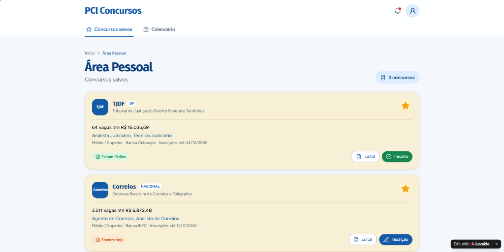
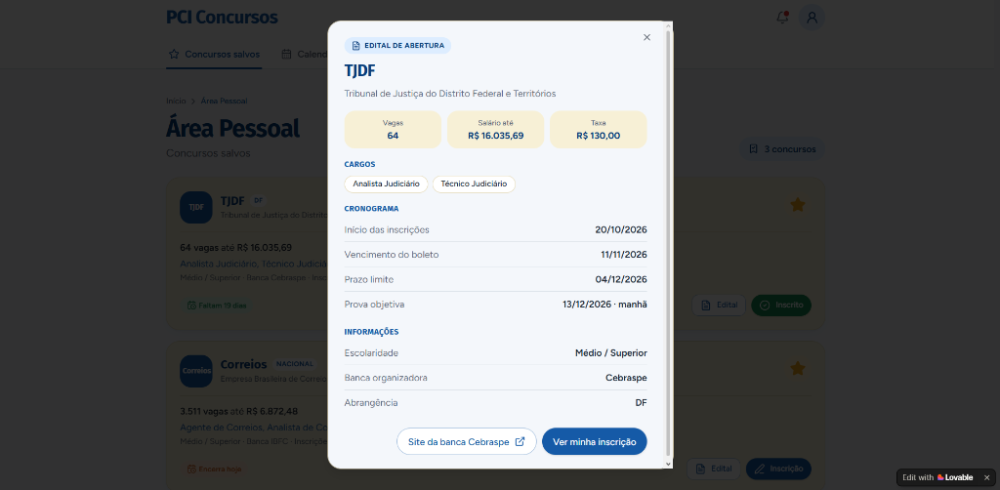
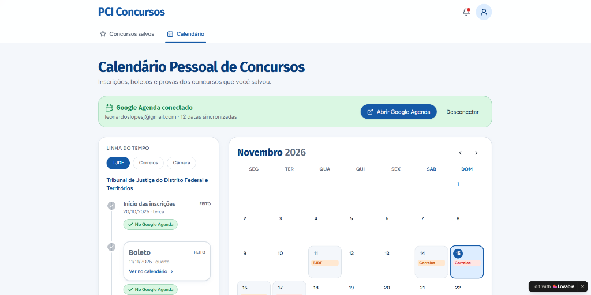
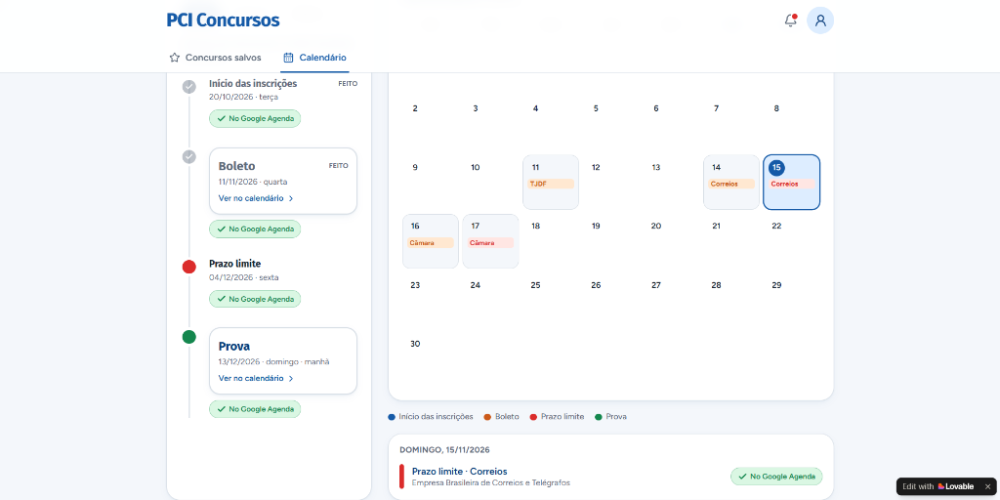
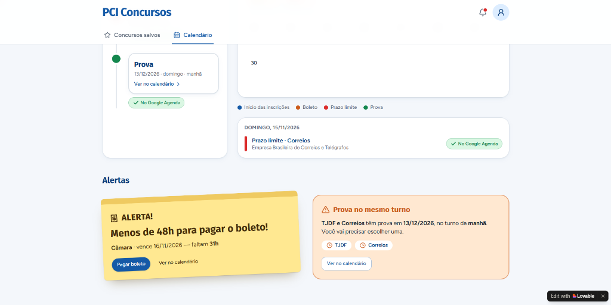

<b>Tabela de Contribuição</b>

| Membro | Contribuição |
| :--- | :--- |
| Leonardo da Silva Lopes Júnior | Concepção e modelagem do Protótipo de Alta Fidelidade no Lovable (`TAR-08`), autoinspeção analítica com base nas heurísticas de Nielsen e no Guia de Estilo, condução e gravação do teste-piloto e das duas sessões empíricas presenciais com usuários reais (*Think-Aloud*, gravação presencial e captura sincronizada de tela), publicação dos vídeos no YouTube, captura das telas do protótipo com modais de zoom, análise dos resultados e consolidação do relato individual (Barbosa e Silva, 2021, p. 309). |
| Gemini | Auxílio na estruturação textual, organização das tabelas, implementação dos modais de zoom e formatação em Markdown (conforme Política de Uso de IA). |

<b>Fonte:</b> Leonardo da Silva Lopes Júnior (2026).

# Avaliação e Relato Individual — Protótipo de Alta Fidelidade (Leonardo da Silva Lopes Júnior)

## 1. Identificação do Integrante e Escopo de Atuação

Este artefato reúne todo o ciclo de **avaliação formativa de Nível 3 (Protótipo de Alta Fidelidade)** conduzido individualmente por **Leonardo da Silva Lopes Júnior** no âmbito do projeto **PCI Concursos**, em conformidade com o framework **DECIDE** (*Barbosa et al.*, 2021), as **10 Heurísticas de Usabilidade de Nielsen (1993)** e as diretrizes do plano de ensino da disciplina de Interação Humano-Computador (*Sales*, 2026).

<b>Tabela 1: Resumo do Escopo Individual de Leonardo da Silva Lopes Júnior (Nível 3)</b>

| Atributo | Detalhamento |
| :--- | :--- |
| **Integrante Responsável** | Leonardo da Silva Lopes Júnior |
| **Perfil de Usuário Focado** | [Perfil 1 — Candidato / Concurseiro](../../analise-de-requisitos/perfil-de-usuario.md) / [PER-04 — Renata Cristina Freitas](../../analise-de-requisitos/personas.md) |
| **Cenário de Uso** | [<abbr title="Cenário 08">CEN-08</abbr> — Organização e Acompanhamento de Prazos no Calendário Pessoal](../../analise-de-requisitos/cenarios.md#48-cenario-08-organizacao-e-acompanhamento-de-prazos-no-calendario-pessoal-de-concursos-cen-08) |
| **Tarefa Prioritária de Autoria** | **<abbr title="Tarefa 08">TAR-08</abbr> — Gerenciar Calendário Pessoal de Concursos**: [<abbr title="Análise Hierárquica de Tarefas">HTA</abbr>](../../analise-de-requisitos/analise-de-tarefas/hta.md#62-tarefa-08-organizar-e-acompanhar-multiplos-certames-no-calendario-pessoal-de-concursos-com-prazos-de-inscricao-pagamento-de-boleto-e-exportacao-para-agenda-digital-tar-08) \| [<abbr title="ConcurTaskTrees">CTT</abbr>](../../analise-de-requisitos/analise-de-tarefas/ctt.md#62-tarefa-08-organizar-e-acompanhar-multiplos-certames-no-calendario-pessoal-de-concursos-com-prazos-de-inscricao-pagamento-de-boleto-e-exportacao-para-agenda-digital-tar-08) |
| **Tipo de Artefato** | Protótipo digital interativo de alta fidelidade desenvolvido no **Lovable** (React + Tailwind CSS) |
| **Técnica e Modalidade de Avaliação** | **Teste de Usabilidade Presencial** com Protocolo de Pensar em Voz Alta (*Think-Aloud*), gravação presencial em câmera dupla (foco no participante/moderador e captura simultânea da tela) e Entrevista Pós-Teste |
| **Escopo da Inspeção** | Autoinspeção analítica com lista de verificação ergonômica (Nielsen, 1993) e conformidade com o [Guia de Estilo](../guia-de-estilo.md) |
| **Participantes das Sessões** | 2 participantes reais representativos do Perfil 1 (Candidato/Concurseiro) + 1 participante piloto (descartado) |

<b>Fonte:</b> Leonardo da Silva Lopes Júnior (2026).

---

## 2. Apresentação do Protótipo de Alta Fidelidade (Lovable)

O protótipo de alta fidelidade materializa em ambiente web interativo e responsivo os conceitos validados no [Protótipo de Papel (Nível 2)](./leonardo-lopes-prototipo-papel.md), aplicando rigorosamente a identidade visual do [Guia de Estilo](../guia-de-estilo.md) (paleta azul institucional `#003B8E`, tipografia sem serifa legível, botões de ação com contraste acessível e badges semânticos de urgência) e incorporando as oportunidades de reprojeto identificadas na etapa anterior.

<b>Tabela 2: Rastreabilidade da Evolução do Nível 2 (Papel) para o Nível 3 (Alta Fidelidade)</b>

| Origem (Nível 2) | Descrição da Oportunidade / Validação | Implementação no Protótipo de Alta Fidelidade (Nível 3) | Status |
| :---: | :--- | :--- | :---: |
| `VAL-PP01` | Arquitetura visual limpa da Área Pessoal com cards de certames favoritados | Mantida a organização por cards estruturados (TJDF, Correios) na Tela 1, com indicadores de prazo (`Faltam 19 dias`, `Encerra hoje`), status de inscrição (`✓ Inscrito` / `Inscrição`) e modal completo de edital de abertura. | **Implementado** |
| `VAL-PP02` | Dualidade visual combinando Linha do Tempo (*timeline*) e Grade Mensal | Layout integrado lado a lado: Linha do Tempo sequencial à esquerda com marcos cronológicos e Grade Mensal interativa à direita com marcadores cromáticos sincronizados. | **Implementado** |
| `OPO-PP01` | Ação de quitação ágil no alerta de boleto próximo do vencimento | Componente destacado em post-it amarelo com contagem regressiva (`Menos de 48h para pagar o boleto!`), botão primário de ação direta `Pagar boleto` e link `Ver no calendário`. | **Implementado** |
| `OPO-PP02` | Destaque explícito de colisão de provas no mesmo turno de domingo | Card de alerta em laranja (`⚠ Prova no mesmo turno`), identificando nominalmente os concursos em choque (TJDF e Correios em 13/12/2026 pela manhã) com chips de seleção e recomendação explícita. | **Implementado** |
| `REP-L03` | Sincronização externa com calendários digitais | Banner persistente de integração com o **Google Agenda** (`leonardoslopesj@gmail.com · 12 datas sincronizadas`), permitindo abrir a agenda externa ou desconectar com um clique. | **Implementado** |

<b>Fonte:</b> Leonardo da Silva Lopes Júnior (2026).

### 2.1 Tela 1: Área Pessoal e Concursos Salvos (`/area-pessoal`)

A tela inicial apresenta a barra de navegação superior com o logotipo do PCI Concursos, ícones de notificação e perfil, abas de alternância rápida entre **Concursos salvos** e **Calendário**, o contador global `3 concursos` e os cards estruturados dos certames favoritados:
* **TJDF (Distrito Federal):** 64 vagas, remuneração de até R$ 16.035,69, cargos de Analista e Técnico Judiciário, badge verde `Faltam 19 dias`, botão `Edital` e indicador `✓ Inscrito`.
* **Correios (Nacional):** 3.511 vagas, remuneração de até R$ 6.872,48, badge alaranjado de urgência `Encerra hoje`, botão `Edital` e botão primário `Inscrição`.

  

  <button onclick="openModalAF01_Leo()" class="md-button md-button--primary" style="font-size: 0.82em; padding: 5px 16px; border-radius: 20px; cursor: pointer; display: inline-flex; align-items: center; gap: 6px;">
    🔍 <b>Zoom / Tela Cheia</b>
  </button>
  <a href="../../../assets/images/prototipo-alta-fidelidade/prototipo-af-leonardo-tela-01.png" download="Prototipo_AF_Tela01_LeonardoLopes.png" class="md-button" style="font-size: 0.82em; padding: 5px 16px; border-radius: 20px; text-decoration: none; background: #475569; color: white;">📥 Baixar</a>

<b>Figura 1:</b> Protótipo de Alta Fidelidade — Tela 1: Área Pessoal com Concursos Salvos

<b>Fonte:</b> Elaborado por Leonardo da Silva Lopes Júnior no Lovable (2026).

<!-- Modal AF Tela 1 -->

  

    <a href="../../../assets/images/prototipo-alta-fidelidade/prototipo-af-leonardo-tela-01.png" download="Prototipo_AF_Tela01_LeonardoLopes.png" class="md-button md-button--primary" style="font-size: 0.85em; padding: 6px 16px; border-radius: 6px; text-decoration: none; color: white;">📥 Baixar</a>
    <button onclick="closeModalAF01_Leo()" class="md-button" style="font-size: 0.85em; padding: 6px 16px; border-radius: 6px; background: #e11d48; color: white; border: none; cursor: pointer;">✕ Fechar (ESC)</button>
  

  

    
  

  
Pressione <b>ESC</b> ou clique fora da imagem para fechar.

---

### 2.2 Tela 2: Modal de Detalhes e Cronograma do Edital de Abertura

Ao acionar o botão `Edital` no card do TJDF, o sistema sobrepõe um diálogo modal acessível exibindo a síntese executiva do certame:
* **Cards de Destaque:** 64 vagas, remuneração de até R$ 16.035,69 e taxa de inscrição de R$ 130,00.
* **Cronograma Crítico:** Início das inscrições (20/10/2026), Vencimento do boleto (11/11/2026), Prazo limite (04/12/2026) e Prova objetiva (13/12/2026 - manhã).
* **Informações Institucionais:** Nível Médio/Superior, banca organizadora Cebraspe e abrangência DF.
* **Ações:** Atalho direto para o site oficial da banca e botão primário `Ver minha inscrição`.

  

  <button onclick="openModalAF02_Leo()" class="md-button md-button--primary" style="font-size: 0.82em; padding: 5px 16px; border-radius: 20px; cursor: pointer; display: inline-flex; align-items: center; gap: 6px;">
    🔍 <b>Zoom / Tela Cheia</b>
  </button>
  <a href="../../../assets/images/prototipo-alta-fidelidade/prototipo-af-leonardo-tela-02.png" download="Prototipo_AF_Tela02_LeonardoLopes.png" class="md-button" style="font-size: 0.82em; padding: 5px 16px; border-radius: 20px; text-decoration: none; background: #475569; color: white;">📥 Baixar</a>

<b>Figura 2:</b> Protótipo de Alta Fidelidade — Tela 2: Modal de Informações e Cronograma do Edital

<b>Fonte:</b> Elaborado por Leonardo da Silva Lopes Júnior no Lovable (2026).

<!-- Modal AF Tela 2 -->

  

    <a href="../../../assets/images/prototipo-alta-fidelidade/prototipo-af-leonardo-tela-02.png" download="Prototipo_AF_Tela02_LeonardoLopes.png" class="md-button md-button--primary" style="font-size: 0.85em; padding: 6px 16px; border-radius: 6px; text-decoration: none; color: white;">📥 Baixar</a>
    <button onclick="closeModalAF02_Leo()" class="md-button" style="font-size: 0.85em; padding: 6px 16px; border-radius: 6px; background: #e11d48; color: white; border: none; cursor: pointer;">✕ Fechar (ESC)</button>
  

  

    
  

  
Pressione <b>ESC</b> ou clique fora da imagem para fechar.

---

### 2.3 Tela 3: Calendário Pessoal de Concursos e Integração Google Agenda (`/calendario`)

A visão principal do **Calendário Pessoal** integra no topo o banner de confirmação da sincronização externa com o **Google Agenda** (`leonardoslopesj@gmail.com · 12 datas sincronizadas`), permitindo acesso direto aos eventos na agenda do celular.

Na área de conteúdo, o painel se divide em:
1. **Filtro de Concursos por Chips:** Permite isolar os prazos de certames específicos (`TJDF`, `Correios`, `Câmara`).
2. **Linha do Tempo (*Timeline*):** Exibe a cadeia cronológica vertical das etapas concluídas (`FEITO`) com selo verde `✓ No Google Agenda`.
3. **Grade Mensal (*Monthly Grid*):** Matriz semanal de Novembro de 2026 com cabeçalhos `SEG`, `TER`, `QUA`, `QUI`, `SEX`, `SÁB`, `DOM`, sinalizando os eventos de cada certame nas respectivas datas.

  

  <button onclick="openModalAF03_Leo()" class="md-button md-button--primary" style="font-size: 0.82em; padding: 5px 16px; border-radius: 20px; cursor: pointer; display: inline-flex; align-items: center; gap: 6px;">
    🔍 <b>Zoom / Tela Cheia</b>
  </button>
  <a href="../../../assets/images/prototipo-alta-fidelidade/prototipo-af-leonardo-tela-03.png" download="Prototipo_AF_Tela03_LeonardoLopes.png" class="md-button" style="font-size: 0.82em; padding: 5px 16px; border-radius: 20px; text-decoration: none; background: #475569; color: white;">📥 Baixar</a>

<b>Figura 3:</b> Protótipo de Alta Fidelidade — Tela 3: Calendário Pessoal com Linha do Tempo e Sincronização com Google Agenda

<b>Fonte:</b> Elaborado por Leonardo da Silva Lopes Júnior no Lovable (2026).

<!-- Modal AF Tela 3 -->

  

    <a href="../../../assets/images/prototipo-alta-fidelidade/prototipo-af-leonardo-tela-03.png" download="Prototipo_AF_Tela03_LeonardoLopes.png" class="md-button md-button--primary" style="font-size: 0.85em; padding: 6px 16px; border-radius: 6px; text-decoration: none; color: white;">📥 Baixar</a>
    <button onclick="closeModalAF03_Leo()" class="md-button" style="font-size: 0.85em; padding: 6px 16px; border-radius: 6px; background: #e11d48; color: white; border: none; cursor: pointer;">✕ Fechar (ESC)</button>
  

  

    
  

  
Pressione <b>ESC</b> ou clique fora da imagem para fechar.

---

### 2.4 Tela 4: Visão da Linha do Tempo Estendida, Legenda Cromática e Detalhe da Data

A visualização detalhada evidencia os marcos críticos seguintes:
* **Prazo Limite:** Indicador cromático vermelho demarcando a expiração definitiva das inscrições (04/12/2026).
* **Prova Objetiva:** Marcador verde destacando a aplicação do exame (13/12/2026 - manhã) e link `Ver no calendário >`.
* **Legenda Cromática Padronizada:** Posicionada abaixo da grade mensal (*Azul: Início das inscrições | Laranja: Boleto | Vermelho: Prazo limite | Verde: Prova*).
* **Card de Detalhamento da Data:** Ao clicar em um dia específico (ex.: Domingo, 15/11/2026), o sistema abre um card lateral com o status do prazo limite dos Correios e confirmação de sincronismo.

  

  <button onclick="openModalAF04_Leo()" class="md-button md-button--primary" style="font-size: 0.82em; padding: 5px 16px; border-radius: 20px; cursor: pointer; display: inline-flex; align-items: center; gap: 6px;">
    🔍 <b>Zoom / Tela Cheia</b>
  </button>
  <a href="../../../assets/images/prototipo-alta-fidelidade/prototipo-af-leonardo-tela-04.png" download="Prototipo_AF_Tela04_LeonardoLopes.png" class="md-button" style="font-size: 0.82em; padding: 5px 16px; border-radius: 20px; text-decoration: none; background: #475569; color: white;">📥 Baixar</a>

<b>Figura 4:</b> Protótipo de Alta Fidelidade — Tela 4: Visão Contínua da Linha do Tempo, Grade Mensal e Legenda Cromática

<b>Fonte:</b> Elaborado por Leonardo da Silva Lopes Júnior no Lovable (2026).

<!-- Modal AF Tela 4 -->

  

    <a href="../../../assets/images/prototipo-alta-fidelidade/prototipo-af-leonardo-tela-04.png" download="Prototipo_AF_Tela04_LeonardoLopes.png" class="md-button md-button--primary" style="font-size: 0.85em; padding: 6px 16px; border-radius: 6px; text-decoration: none; color: white;">📥 Baixar</a>
    <button onclick="closeModalAF04_Leo()" class="md-button" style="font-size: 0.85em; padding: 6px 16px; border-radius: 6px; background: #e11d48; color: white; border: none; cursor: pointer;">✕ Fechar (ESC)</button>
  

  

    
  

  
Pressione <b>ESC</b> ou clique fora da imagem para fechar.

---

### 2.5 Tela 5: Painel de Alertas de Urgência e Conflito de Turno (`OPO-PP01` e `OPO-PP02`)

No rodapé da interface do Calendário, materializam-se os componentes de resposta proativa:
1. **Alerta de 48 Horas para Pagamento de Boleto (`OPO-PP01`):** Formatado como nota adesiva visualmente destacada em amarelo inclinado, alertando: *"ALERTA! Menos de 48h para pagar o boleto! Câmara - vence 16/11/2026 — faltam 31h"*, acompanhado do botão primário `Pagar boleto` para quitação instantânea sem fricção.
2. **Detecção e Sinalização de Conflito de Turno (`OPO-PP02`):** Painel de advertência alaranjado alertando: *"⚠ Prova no mesmo turno — TJDF e Correios têm prova em 13/12/2026, no turno da manhã. Você vai precisar escolher uma."*, provendo chips rápidos dos certames e atalho para o calendário.

  

  <button onclick="openModalAF05_Leo()" class="md-button md-button--primary" style="font-size: 0.82em; padding: 5px 16px; border-radius: 20px; cursor: pointer; display: inline-flex; align-items: center; gap: 6px;">
    🔍 <b>Zoom / Tela Cheia</b>
  </button>
  <a href="../../../assets/images/prototipo-alta-fidelidade/prototipo-af-leonardo-tela-05.png" download="Prototipo_AF_Tela05_LeonardoLopes.png" class="md-button" style="font-size: 0.82em; padding: 5px 16px; border-radius: 20px; text-decoration: none; background: #475569; color: white;">📥 Baixar</a>

<b>Figura 5:</b> Protótipo de Alta Fidelidade — Tela 5: Componentes de Alerta de 48h de Boleto e Prevenção de Conflito de Turnos

<b>Fonte:</b> Elaborado por Leonardo da Silva Lopes Júnior no Lovable (2026).

<!-- Modal AF Tela 5 -->

  

    <a href="../../../assets/images/prototipo-alta-fidelidade/prototipo-af-leonardo-tela-05.png" download="Prototipo_AF_Tela05_LeonardoLopes.png" class="md-button md-button--primary" style="font-size: 0.85em; padding: 6px 16px; border-radius: 6px; text-decoration: none; color: white;">📥 Baixar</a>
    <button onclick="closeModalAF05_Leo()" class="md-button" style="font-size: 0.85em; padding: 6px 16px; border-radius: 6px; background: #e11d48; color: white; border: none; cursor: pointer;">✕ Fechar (ESC)</button>
  

  

    
  

  
Pressione <b>ESC</b> ou clique fora da imagem para fechar.

---

## 3. Autoinspeção Analítica Prévia do Protótipo de Alta Fidelidade

Previamente à condução dos testes presenciais com os usuários reais, o autor Leonardo da Silva Lopes Júnior realizou a autoinspeção analítica com base nas **10 Heurísticas de Usabilidade de Nielsen (1993)** e nas diretrizes do [Guia de Estilo](../guia-de-estilo.md):

<b>Tabela 3: Lista de Verificação da Autoinspeção Analítica do Protótipo de Alta Fidelidade (Autor: Leonardo Lopes)</b>

| Item | Critério / Heurística Avaliada | Resposta | Justificativa / Observação Técnica |
| :---: | :--- | :---: | :--- |
| **1** | **Consistência e Padrões:** a interface preserva a identidade visual do portal e o Guia de Estilo? | **Sim** | O azul institucional `#003B8E` é aplicado nos botões primários e cabeçalhos, enquanto tons de amarelo e verde delimitam status e alertas sem sobrecarregar a visão. |
| **2** | **Visibilidade do Estado do Sistema:** o usuário tem retorno contínuo sobre seus prazos e sincronizações? | **Sim** | O banner superior confirma o sincronismo com o Google Agenda (`12 datas sincronizadas`) e a Timeline marca visualmente as etapas concluídas com o selo `FEITO`. |
| **3** | **Prevenção de Erros:** o sistema alerta proativamente contra choques de prova e perda de boletos? | **Sim** | O card alaranjado destaca colisão de certames no mesmo turno e o post-it amarelo com contagem regressiva de 31h previne o cancelamento da inscrição. |
| **4** | **Correspondência com o Mundo Real:** a metáfora da linha do tempo e do calendário é natural para concurseiros? | **Sim** | A representação combina a visão linear de marcos (inscrição, boleto, prova) com a matriz mensal padrão (`SEG` a `DOM`), familiar a qualquer agenda cotidiana. |
| **5** | **Controle e Liberdade do Usuário:** é fácil fechar modais, desconectar a agenda ou alternar certames? | **Sim** | Botão `✕` visível no modal de edital, tecla `ESC` mapeada e links diretos para alternar filtros por concurso ou desconectar a sincronização. |
| **6** | **Reconhecimento em vez de Lembrança:** as informações críticas estão visíveis sem exigir esforço de memória? | **Sim** | Valores de taxa (R$ 130,00), remunerações e horários de prova são sumarizados diretamente nos cards e modais. |

<b>Fonte:</b> Leonardo da Silva Lopes Júnior (2026).

---

## 4. Teste-Piloto do Protótipo de Alta Fidelidade (Presencial)

Em estrita consonância com **Barbosa e Silva (2021, p. 276 e 300)**, o teste-piloto presencial foi executado pelo avaliador antes das sessões definitivas com o objetivo de calibrar o roteiro de tarefas, cronometrar o tempo de interação com os componentes interativos do Lovable e assegurar a nitidez na captação simultânea de áudio, vídeo e tela.

### 4.1 Dados Logísticos do Teste-Piloto

<b>Tabela 4: Dados Logísticos do Teste-Piloto do Protótipo de Alta Fidelidade</b>

| Parâmetro | Detalhamento |
| :--- | :--- |
| **Data e Horário:** | 14/11/2026 |
| **Duração da Gravação:** | 04min 20s |
| **Avaliador Responsável:** | Leonardo da Silva Lopes Júnior |
| **Modalidade e Local:** | **Presencial** (notebook com navegação no protótipo Lovable e captação de tela/câmera) |
| **Artefato Exercitado:** | Protótipo de Alta Fidelidade da `TAR-08` (Área Pessoal, Modal de Edital, Calendário Pessoal, Timeline e Alertas) |
| **Custos Envolvidos:** | R$ 0,00 (equipamento próprio) |

<b>Fonte:</b> Leonardo da Silva Lopes Júnior (2026).

### 4.2 Registro Audiovisual do Teste-Piloto

<iframe width="720" height="405" src="https://www.youtube.com/embed/GNRLqYgxEHQ" title="Gravação do Teste-Piloto - Protótipo de Alta Fidelidade - Leonardo Lopes (Grupo 07 IHC)" frameborder="0" allow="accelerometer; autoplay; clipboard-write; encrypted-media; gyroscope; picture-in-picture; web-share" allowfullscreen style="border: 1px solid #d0d7de; border-radius: 8px; box-shadow: 0 4px 12px rgba(0,0,0,0.08); margin: 16px auto; display: block;"></iframe>

<b>Vídeo 1:</b> Gravação do Teste-Piloto Presencial — Avaliação do Protótipo de Alta Fidelidade (<a href="https://youtu.be/GNRLqYgxEHQ" target="_blank">https://youtu.be/GNRLqYgxEHQ</a>)

> **Declaração de Descarte de Dados do Piloto:** Em estrita conformidade com **Barbosa e Silva (2021, p. 300)**, declara-se que os dados coletados na sessão-piloto serviram exclusivamente para validação das instruções, checagem da fluidez dos modais do Lovable e teste dos microfones/captura de tela, sendo formalmente descartados do cômputo dos resultados empíricos finais.

---

## 5. Avaliação Empírica com Usuários Reais (Sessões Presenciais)

### 5.1 Protocolo Ético e Caracterização dos Participantes

O recrutamento seguiu rigorosamente o [Perfil 1 — Candidato/Concurseiro](../../analise-de-requisitos/perfil-de-usuario.md), com ênfase na rotina da persona [Renata Cristina Freitas (`PER-04`)](../../analise-de-requisitos/personas.md) (candidata em jornada dupla de estudo e trabalho que necessita de controle estrito de datas). O Termo de Consentimento Livre e Esclarecido (<abbr title="Termo de Consentimento Livre e Esclarecido">TCLE</abbr>) foi aceito formalmente no início das gravações presenciais:

<b>Tabela 5: Perfil dos Participantes da Avaliação Empírica de Nível 3</b>

| Participante | Perfil Concurseiro | Ocupação / Perfil de Rotina | Rotina com Concursos | Modalidade | Status do TCLE |
| :---: | :--- | :--- | :--- | :---: | :---: |
| **Participante 1** | Perfil 1 – Concurseiro Ativo | Graduando / Trabalhador (Jornada Dupla) | Presta certames no DF e federais com frequência; utiliza agenda digital no celular. | **Presencial** | Aceito formalmente em vídeo |
| **Participante 2** | Perfil 1 – Concurseiro em Transição | Estudante Universitário | Busca certames de nível médio e superior na área administrativa e tribunais. | **Presencial** | Aceito formalmente em vídeo |

<b>Fonte:</b> Leonardo da Silva Lopes Júnior (2026).

### 5.2 Registro Audiovisual das Sessões Presenciais

Para garantir máxima fidedignidade analítica, cada sessão foi registrada sob **dois ângulos complementares sincronizados**:
1. **Gravação Presencial do Ensaio:** Enquadramento amplo focalizando as expressões corporais do participante, a mediação e o ambiente de teste;
2. **Gravação da Tela do Protótipo:** Captura digital em alta definição de todos os cliques, scrolls e movimentações do cursor do mouse.

<b>Tabela 6: Registro Audiovisual das Sessões de Teste do Protótipo de Alta Fidelidade</b>

| Sessão | Moderador | Participante | Modalidade | Duração Presencial | Duração da Tela | Links das Gravações |
| :---: | :--- | :---: | :---: | :---: | :---: | :--- |
| **Sessão 1** | Leonardo da Silva Lopes Júnior | Participante 1 | **Presencial** | 04min 01s | 03min 03s | [Presencial (YouTube)](https://youtu.be/RUyV443f-ag) \| [Gravação de Tela (YouTube)](https://youtu.be/HM-tYKEuUUM) |
| **Sessão 2** | Leonardo da Silva Lopes Júnior | Participante 2 | **Presencial** | 04min 11s | 03min 16s | [Presencial (YouTube)](https://youtu.be/aBsoiaUf1V4) \| [Gravação de Tela (YouTube)](https://youtu.be/mMSRaf3ob7k) |

<b>Fonte:</b> Leonardo da Silva Lopes Júnior (2026).

#### Registros da Sessão 1:

=== "Gravação Presencial (Sessão 1)"
    

    <iframe width="720" height="405" src="https://www.youtube.com/embed/RUyV443f-ag" title="Sessão 1 Presencial - Protótipo de Alta Fidelidade - Leonardo Lopes" frameborder="0" allow="accelerometer; autoplay; clipboard-write; encrypted-media; gyroscope; picture-in-picture; web-share" allowfullscreen style="border: 1px solid #d0d7de; border-radius: 8px; box-shadow: 0 4px 12px rgba(0,0,0,0.08); margin: 16px auto; display: block;"></iframe>
    
<b>Vídeo 2:</b> Sessão 1 Presencial — Câmera Aberta (<a href="https://youtu.be/RUyV443f-ag" target="_blank">https://youtu.be/RUyV443f-ag</a>)

    

=== "Captura de Tela do Protótipo (Sessão 1)"
    

    <iframe width="720" height="405" src="https://www.youtube.com/embed/HM-tYKEuUUM" title="Sessão 1 Tela - Protótipo de Alta Fidelidade - Leonardo Lopes" frameborder="0" allow="accelerometer; autoplay; clipboard-write; encrypted-media; gyroscope; picture-in-picture; web-share" allowfullscreen style="border: 1px solid #d0d7de; border-radius: 8px; box-shadow: 0 4px 12px rgba(0,0,0,0.08); margin: 16px auto; display: block;"></iframe>
    
<b>Vídeo 3:</b> Sessão 1 — Gravação de Tela do Protótipo (<a href="https://youtu.be/HM-tYKEuUUM" target="_blank">https://youtu.be/HM-tYKEuUUM</a>)

    

#### Registros da Sessão 2:

=== "Gravação Presencial (Sessão 2)"
    

    <iframe width="720" height="405" src="https://www.youtube.com/embed/aBsoiaUf1V4" title="Sessão 2 Presencial - Protótipo de Alta Fidelidade - Leonardo Lopes" frameborder="0" allow="accelerometer; autoplay; clipboard-write; encrypted-media; gyroscope; picture-in-picture; web-share" allowfullscreen style="border: 1px solid #d0d7de; border-radius: 8px; box-shadow: 0 4px 12px rgba(0,0,0,0.08); margin: 16px auto; display: block;"></iframe>
    
<b>Vídeo 4:</b> Sessão 2 Presencial — Câmera Aberta (<a href="https://youtu.be/aBsoiaUf1V4" target="_blank">https://youtu.be/aBsoiaUf1V4</a>)

    

=== "Captura de Tela do Protótipo (Sessão 2)"
    

    <iframe width="720" height="405" src="https://www.youtube.com/embed/mMSRaf3ob7k" title="Sessão 2 Tela - Protótipo de Alta Fidelidade - Leonardo Lopes" frameborder="0" allow="accelerometer; autoplay; clipboard-write; encrypted-media; gyroscope; picture-in-picture; web-share" allowfullscreen style="border: 1px solid #d0d7de; border-radius: 8px; box-shadow: 0 4px 12px rgba(0,0,0,0.08); margin: 16px auto; display: block;"></iframe>
    
<b>Vídeo 5:</b> Sessão 2 — Gravação de Tela do Protótipo (<a href="https://youtu.be/mMSRaf3ob7k" target="_blank">https://youtu.be/mMSRaf3ob7k</a>)

    

---

### 5.3 Desempenho nas Tarefas e Feedbacks Coletados

Durante as sessões presenciais individuais, os participantes operaram o protótipo digital com o protocolo de *Think-Aloud* (pensar em voz alta), seguido por uma breve entrevista qualitativa pós-teste:

#### 5.3.1 Sessão 1 — Participante 1

<b>Tabela 7: Desempenho e Eficácia do Participante 1 no Protótipo de Alta Fidelidade</b>

| Tarefa Avaliada | Instrução Fornecida | Ação Executada pelo Participante (*Think-Aloud*) | Resultado | Tempo de Execução |
| :--- | :--- | :--- | :---: | :---: |
| **Tarefa 1: Gestão de Concursos Salvos e Acesso a Edital** | *"Na sua Área Pessoal, verifique seus concursos favoritados e acesse as informações completas do edital do TJDFT."* | Analisou os cards do TJDF e Correios, identificou os badges de prazo (`Faltam 19 dias` e `Encerra hoje`), clicou em `Edital` no card do TJDF, visualizou o modal com os cargos, taxa de R$ 130,00 e cronograma das inscrições, fechando no botão `✕`. | **Sucesso Autônomo** | ~35 s |
| **Tarefa 2: Navegação no Calendário Pessoal e Sincronização** | *"Acesse o Calendário, verifique os prazos programados para os seus concursos e a sincronização com o Google Agenda."* | Clicou na aba superior `Calendário`, localizou o banner de integração do Google Agenda (`12 datas sincronizadas`), alternou os chips de concurso (`TJDF`, `Correios`) e confrontou a Linha do Tempo vertical com a Grade Mensal de Novembro. | **Sucesso Autônomo** | ~48 s |
| **Tarefa 3: Resposta aos Alertas de Boleto e Conflito de Turno** | *"Ao descer no calendário, verifique as notificações urgentes e identifique como você reagiria."* | Fez o scroll até a seção `Alertas`, identificou imediatamente o post-it amarelo com o aviso de 31h restantes para o boleto da Câmara e clicou em `Pagar boleto`; em seguida, leu o alerta alaranjado de prova no mesmo turno entre TJDF e Correios, elogiando a prevenção contra perda da inscrição. | **Sucesso Autônomo** | ~40 s |

<b>Fonte:</b> Leonardo da Silva Lopes Júnior (2026).

* **Síntese Pós-Teste (Participante 1):** Avaliou a solução como extremamente útil para quem tem rotina corrida. Destacou que o botão direto `Pagar boleto` no alerta economiza muito tempo, e que a sinalização de choque de turnos evita o prejuízo financeiro clássico de pagar dois boletos para o mesmo domingo.

#### 5.3.2 Sessão 2 — Participante 2

<b>Tabela 8: Desempenho e Eficácia do Participante 2 no Protótipo de Alta Fidelidade</b>

| Tarefa Avaliada | Instrução Fornecida | Ação Executada pelo Participante (*Think-Aloud*) | Resultado | Tempo de Execução |
| :--- | :--- | :--- | :---: | :---: |
| **Tarefa 1: Gestão de Concursos Salvos e Acesso a Edital** | *"Verifique quais certames estão salvos na sua área de trabalho e consulte os prazos do TJDFT."* | Localizou imediatamente a contagem `3 concursos`, conferiu as datas e abriu o modal de edital do TJDF, observando a distribuição dos cargos e o cronograma resumido. | **Sucesso Autônomo** | ~28 s |
| **Tarefa 2: Navegação no Calendário Pessoal e Sincronização** | *"Navegue para o calendário pessoal e verifique em quais dias há marcos críticos."* | Clicou na aba `Calendário`, elogiou a conexão visível com o Google Agenda (*"já vai direto pro meu celular"*), navegou pelos dias 11, 14 e 15 de novembro na grade e conferiu os marcadores coloridos da legenda. | **Sucesso Autônomo** | ~42 s |
| **Tarefa 3: Resposta aos Alertas de Boleto e Conflito de Turno** | *"Analise os alertas exibidos no rodapé e descreva o que eles comunicam."* | Observou o post-it amarelo de menos de 48h para o boleto da Câmara e o card de conflito de turno (`TJDF e Correios têm prova em 13/12/2026, no turno da manhã`), destacando que a mensagem clara *"Você vai precisar escolher uma"* obriga o candidato a planejar a inscrição estrategicamente. | **Sucesso Autônomo** | ~36 s |

<b>Fonte:</b> Leonardo da Silva Lopes Júnior (2026).

* **Síntese Pós-Teste (Participante 2):** Ressaltou que a combinação entre a linha do tempo (passo a passo das fases) e a grade do mês (distribuição espacial) oferece uma visão completa e sem sobrecarga. Sugeriu como melhoria permitir exportar o calendário também para arquivos de agenda iCal (`.ics`) para quem não usa Google Agenda.

---

## 6. Relato dos Resultados da Avaliação do Protótipo de Alta Fidelidade (Barbosa e Silva, 2021, p. 309)

Em estrita conformidade com o formato canônico estabelecido por **Barbosa e Silva (2021, Subseção 11.7.5, p. 279 e Subseção 12.1, p. 309)** e com o [Planejamento do Relato](./planejamento-relato-alta-fidelidade.md), esta seção formaliza os resultados da avaliação de Nível 3.

### 6.1 Objetivos da Avaliação
Alinhados aos objetivos de avaliação de IHC descritos por **Barbosa e Silva (2021, p. 262-264)**:
* **Avaliar a apropriação da tecnologia pelos usuários:** constatar como os concurseiros em jornada dupla interagem com a visão simultânea de Linha do Tempo e Grade Mensal em ambiente digital interativo;
* **Avaliar ideias e alternativas de design:** verificar se os componentes proativos desenvolvidos no Lovable resolvem os gargalos ergonômicos mapeados no protótipo de papel (`OPO-PP01` e `OPO-PP02`);
* **Avaliar a conformidade com um padrão:** comprovar a fidelidade ao [Guia de Estilo](../guia-de-estilo.md) e às **10 Heurísticas de Nielsen (1993)**;
* **Identificar problemas residuais de usabilidade:** documentar percepções e oportunidades finais levantadas durante os testes com usuários.

### 6.2 Escopo da Avaliação
* **Artefato Avaliado:** Protótipo Digital Interativo de Alta Fidelidade desenvolvido no **Lovable**, contemplando a rota `/area-pessoal`, o diálogo modal de edital resumido e a rota `/calendario` com Timeline, Grade Mensal e Painel de Alertas.
* **Tarefas Contempladas:** **<abbr title="Tarefa 08">TAR-08</abbr>** ([HTA](../../analise-de-requisitos/analise-de-tarefas/hta.md#62-tarefa-08-organizar-e-acompanhar-multiplos-certames-no-calendario-pessoal-de-concursos-com-prazos-de-inscricao-pagamento-de-boleto-e-exportacao-para-agenda-digital-tar-08) \| [CTT](../../analise-de-requisitos/analise-de-tarefas/ctt.md#62-tarefa-08-organizar-e-acompanhar-multiplos-certames-no-calendario-pessoal-de-concursos-com-prazos-de-inscricao-pagamento-de-boleto-e-exportacao-para-agenda-digital-tar-08)).
* **Nível de Fidelidade:** Alta fidelidade digital web (navegação fluida, interação com modais, alternância dinâmica de certames e feedback de sincronização).

### 6.3 Breve Descrição do Método Utilizado
* **Teste de Usabilidade Presencial:** sessões individuais face a face em bancada com computador;
* **Protocolo de Pensar em Voz Alta (*Think-Aloud*, Ericsson e Simon, 1993):** incentivo à verbalização constante do raciocínio durante a navegação;
* **Registro Audiovisual em Câmera Dupla:** captação simultânea da interação humana (linguagem corporal e tom de voz) e do fluxo digital (gravação de tela);
* **Entrevista Qualitativa Pós-Teste (Barbosa e Silva, 2021, p. 278):** consolidação de impressões sobre utilidade e ergonomia;
* **Teste-Piloto Prévio:** execução preliminar para calibração de roteiro e descarte formal de dados.

### 6.4 Conjunto de Diretrizes e Critérios Avaliados
* **10 Heurísticas de Usabilidade de Nielsen (1993):** Visibilidade do Estado do Sistema, Prevenção de Erros, Correspondência com o Mundo Real, Controle e Liberdade do Usuário, Reconhecimento em vez de Lembrança;
* **Metas de Usabilidade (ISO/IEC 9241-11; Barbosa et al., 2021):** eficácia na realização autônoma, eficiência de tempo, facilidade de aprendizado e satisfação;
* **Guia de Estilo Institucional do Projeto:** conformidade das cores, hierarquia tipográfica e affordance dos botões de ação primária.

### 6.5 Número e Perfil dos Avaliadores e Participantes
* **Avaliador / Moderador:** Leonardo da Silva Lopes Júnior (Engenharia de Software — FGA/UnB, Grupo 07 IHC).
* **Participantes (2 usuários reais representativos do Perfil 1 – Candidato/Concurseiro):** caracterizados na Tabela 5, com consentimento ético formalizado em vídeo.

### 6.6 Resultados Observados e Limitações do Protótipo

Ambos os participantes completaram 100% das tarefas com total autonomia, demonstrando domínio imediato do layout e elogiando a clareza e utilidade prática das soluções (Tabelas 7 e 8). Sendo esta a etapa de encerramento do ciclo de design da disciplina, não há nova iteração de reprojeto em papel ou software; as considerações dos usuários ficam registradas como **limitações do protótipo e recomendações para trabalhos futuros**:

* **Integração com outros ecossistemas de calendário:** a interface atual oferece sincronização nativa com o Google Agenda; os participantes recomendaram expandir a integração para arquivos universais `.ics` (Apple Calendar e Outlook).
* **Filtros por status de quitação:** sugestão de incluir filtros rápidos na grade mensal para ocultar certames cujos boletos já foram pagos, mantendo visíveis apenas as datas de provas.
* **Acessibilidade auditiva e alertas por push:** interesse demonstrado em receber notificações push no celular ou via WhatsApp quando o alerta de 48h de boleto for disparado.

---

## 7. Referências Bibliográficas

> [1] BARBOSA, Simone Diniz Junqueira et al. *Interação Humano-Computador e Experiência do Usuário*. Rio de Janeiro: Autopublicação, 2021. ISBN: 978-65-00-19677-1.  
> [2] DUMAS, Joseph S.; REDISH, Janice C. *A Practical Guide to Usability Testing*. Revised ed. Exeter: Intellect Books, 1999.  
> [3] ERICSSON, K. Anders; SIMON, Herbert A. *Protocol Analysis: Verbal Reports as Data*. Cambridge: MIT Press, 1993.  
> [4] KRUG, Steve. *Rocket Surgery Made Easy: The Do-It-Yourself Guide to Finding and Fixing Usability Problems*. Berkeley: New Riders, 2010.  
> [5] NIELSEN, Jakob. *Usability Engineering*. San Francisco: Morgan Kaufmann, 1993.  
> [6] SALES, André Barros de. *Plano de ensino FIHC 022026 – Turma 01*. Brasília: Faculdade de Ciências e Tecnologias em Engenharia (FCTE), Universidade de Brasília (UnB), 2026.  

---

## 8. Histórico de Versões

| Versão | Data | Descrição | Autor(es) |
| :---: | :---: | :--- | :---: |
| `1.0` | 15/11/2026 | Elaboração do Relato Individual do Protótipo de Alta Fidelidade (Nível 3 / Entrega 07) para a TAR-08 com estrutura canônica de Barbosa e Silva (2021, p. 309), incorporando modais de zoom das 5 telas do Lovable, registros audiovisuais do teste-piloto e das 2 sessões presenciais com gravação de tela síncrona. | Leonardo da Silva Lopes Júnior |

<b>Fonte:</b> Leonardo da Silva Lopes Júnior (2026).

