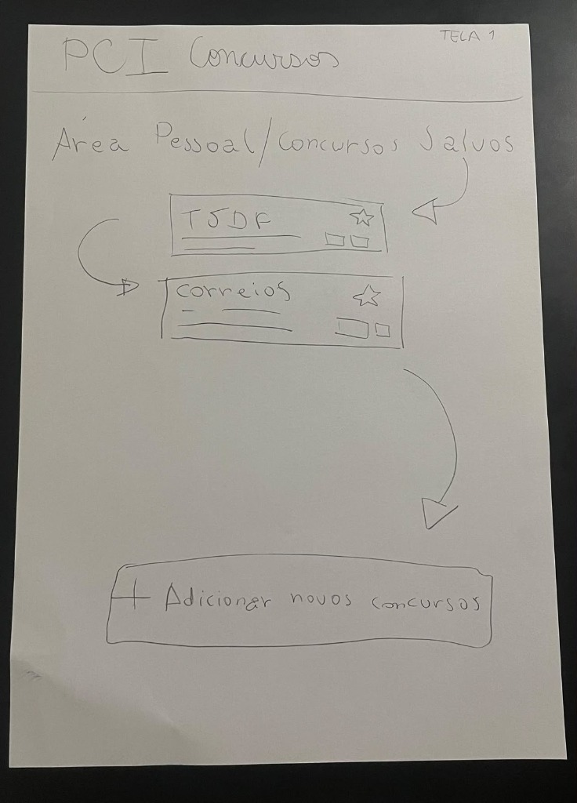
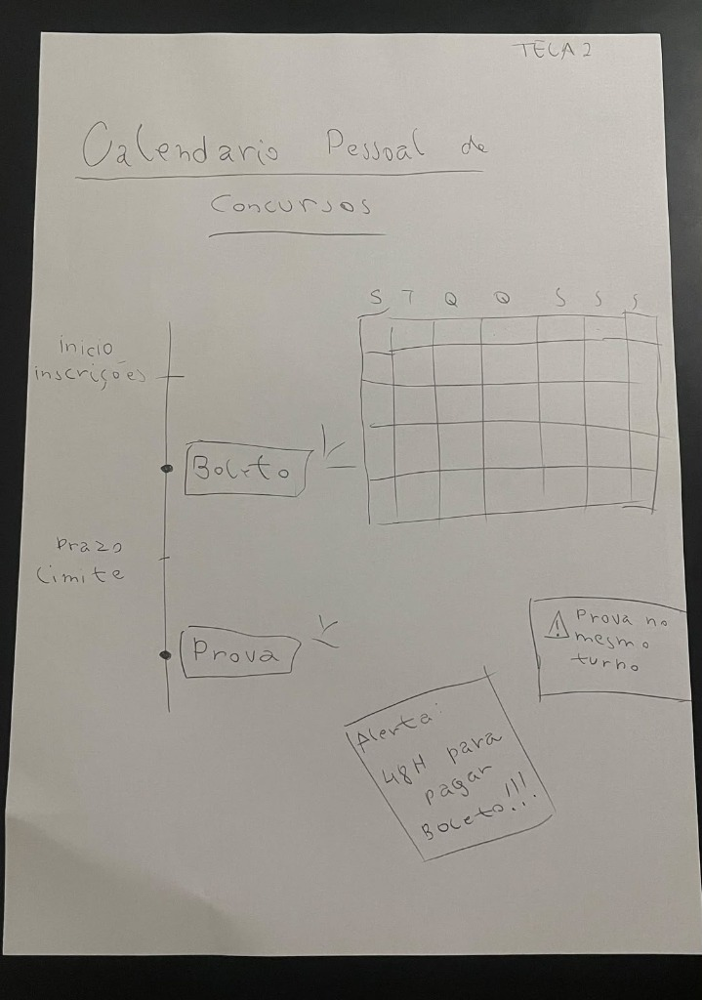

<b>Tabela de Contribuição</b>

| Membro | Contribuição |
| :--- | :--- |
| Leonardo da Silva Lopes Júnior | Concepção e desenho manual do Protótipo de Papel da TAR-08 (Telas 1 e 2 com componentes de linha do tempo, grade mensal e cartões de alerta), detalhamento funcional e estruturação do artefato individual (Nível 2). |
| Gemini | Auxílio na estruturação textual, organização e formatação em Markdown (conforme Política de Uso de IA). |

<b>Fonte:</b> Leonardo da Silva Lopes Júnior (2026).

# Avaliação e Relato Individual — Protótipo de Papel (Leonardo da Silva Lopes Júnior)

## 1. Identificação do Integrante e Escopo de Atuação

Este artefato reúne o ciclo de **avaliação formativa de Nível 2 (Protótipo de Papel)** conduzido individualmente por **Leonardo da Silva Lopes Júnior** no âmbito do projeto **PCI Concursos**, em conformidade com o framework DECIDE (*Barbosa et al.*, 2021), a técnica de simulação mecânica do Computador Humano (*Snyder*, 2003) e as diretrizes do plano de ensino da disciplina de Interação Humano-Computador (*Sales*, 2026).

<b>Tabela 1: Resumo do Escopo Individual de Leonardo da Silva Lopes Júnior (Nível 2)</b>

| Atributo | Detalhamento |
| :--- | :--- |
| **Integrante Responsável** | Leonardo da Silva Lopes Júnior |
| **Perfil de Usuário Focado** | [Perfil 1 — Candidato / Concurseiro](../../analise-de-requisitos/perfil-de-usuario.md) / [PER-04 — Renata Cristina Freitas](../../analise-de-requisitos/personas.md) |
| **Cenário de Uso** | [CEN-08 — Organização e Acompanhamento de Prazos no Calendário Pessoal](../../analise-de-requisitos/cenarios.md#48-cenario-08-organizacao-e-acompanhamento-de-prazos-no-calendario-pessoal-de-concursos-cen-08) |
| **Tarefa Prioritária de Autoria** | [TAR-08 — Gerenciar Calendário Pessoal de Concursos](../../analise-de-requisitos/analise-de-tarefas/hta.md#62-tarefa-08-organizar-e-acompanhar-multiplos-certames-no-calendario-pessoal-de-concursos-com-prazos-de-inscricao-pagamento-de-boleto-e-exportacao-para-agenda-digital-tar-08) |
| **Tipo de Artefato** | Protótipo de baixa fidelidade desenhado em papel sulfite A4 com componentes dinâmicos e cartões sobrepostos (*Paper Prototyping*) |
| **Técnica Prevista** | Simulação mecânica com o "Computador Humano" (*Wizard of Oz*) e Protocolo de Pensar em Voz Alta (*Think-Aloud*) |
| **Status da Avaliação** | Concepção e confecção das peças em papel concluídas; realização dos testes com usuários em fase de preparação |

<b>Fonte:</b> Leonardo da Silva Lopes Júnior (2026).

---

## 2. Apresentação das Peças do Protótipo de Papel

O protótipo de baixa fidelidade foi elaborado manualmente à mão livre em papel sulfite A4 e cartões de aviso destacados, materializando os conceitos concebidos na Análise Hierárquica de Tarefas (`TAR-08`) e na narrativa visual do Storyboard (`SB-04`).

As peças foram construídas para permitir que o participante interaja apontando com o dedo nos elementos desenhados na mesa, enquanto o avaliador atua como simulador mecânico (*Computador Humano*), alternando as folhas e sobrepondo componentes dinâmicos em resposta imediata a cada ação do usuário (Snyder, 2003; Barbosa et al., 2021).

### 2.1 Tela 1: Área Pessoal e Concursos Salvos

A primeira folha apresenta a visão inicial da área de trabalho do concurseiro no portal PCI Concursos. No topo, identifica-se o cabeçalho oficial do sistema e o título **"Área Pessoal / Concursos Salvos"**. Na área central, são exibidos os cards estruturados dos certames já favoritados pela usuária (**TJDF** e **Correios**), contendo ícones de estrela para favoritar e seletores de status de acompanhamento. Na parte inferior, destaca-se o botão de ação primária `[ + Adicionar novos concursos ]`, permitindo enriquecer o calendário com novos certames abertos.

  

  <button onclick="openModalPP01_Leo()" class="md-button md-button--primary" style="font-size: 0.82em; padding: 5px 16px; border-radius: 20px; cursor: pointer; display: inline-flex; align-items: center; gap: 6px;">
    🔍 <b>Zoom / Tela Cheia</b>
  </button>
  <a href="../../../assets/images/prototipo-papel/prototipo-papel-leonardo-tela-01.jpg" download="Prototipo_Papel_Tela01_LeonardoLopes.jpg" class="md-button" style="font-size: 0.82em; padding: 5px 16px; border-radius: 20px; text-decoration: none; background: #475569; color: white;">📥 Baixar Tela 1</a>

<b>Figura 1:</b> Protótipo de Papel — Tela 1: Área Pessoal / Concursos Salvos

<b>Fonte:</b> Elaborado por Leonardo da Silva Lopes Júnior à mão livre (2026).

<!-- Modal / Lightbox Tela 1 -->

  

    <button onclick="closeModalPP01_Leo()" class="md-button" style="font-size: 0.85em; padding: 6px 16px; border-radius: 6px; background: #e11d48; color: white; border: none; cursor: pointer;">✕ Fechar (ESC)</button>
  

  

    
  

  
Pressione <b>ESC</b> ou clique fora da imagem para fechar.

---

### 2.2 Tela 2: Calendário Pessoal de Concursos e Componentes Móveis

A segunda folha materializa o painel central da tarefa `TAR-08` (**"Calendário Pessoal de Concursos"**), integrando duas perspectivas complementares de navegação e componentes dinâmicos de resposta:

1. **Eixo Cronológico (Linha do Tempo / *Timeline* — à esquerda):** Mapeia verticalmente a progressão temporal contínua dos concursos cadastrados, demarcando os marcos críticos: *Início das inscrições*, marcador interativo de `[ Boleto ]`, indicador de *Prazo limite* de pagamento e o marcador final da `[ Prova ]`.
2. **Grade Mensal (*Monthly Calendar Grid* — à direita no topo):** Apresenta a matriz semanal com cabeçalhos `S T Q Q S S S` (Domingo a Sábado), permitindo ao concurseiro visualizar a distribuição espacial das datas no mês.
3. **Componentes Móveis e Cartões de Resposta Dinâmica:**
   - **Cartão de Conflito de Turno:** `⚠ Prova no mesmo turno`, posicionado mecanicamente sobre a data do calendário caso dois certames tenham aplicação no mesmo domingo e período.
   - **Post-it / Card de Alerta Crítico:** `Alerta: 48H para pagar boleto!!!`, sobreposto pelo simulador mecânico para notificar a usuária quando faltam dois dias para a expiração da taxa de inscrição.

  

  <button onclick="openModalPP02_Leo()" class="md-button md-button--primary" style="font-size: 0.82em; padding: 5px 16px; border-radius: 20px; cursor: pointer; display: inline-flex; align-items: center; gap: 6px;">
    🔍 <b>Zoom / Tela Cheia</b>
  </button>
  <a href="../../../assets/images/prototipo-papel/prototipo-papel-leonardo-tela-02.jpg" download="Prototipo_Papel_Tela02_LeonardoLopes.jpg" class="md-button" style="font-size: 0.82em; padding: 5px 16px; border-radius: 20px; text-decoration: none; background: #475569; color: white;">📥 Baixar Tela 2</a>

<b>Figura 2:</b> Protótipo de Papel — Tela 2: Calendário Pessoal de Concursos com Linha do Tempo, Grade Mensal e Cartões de Alerta

<b>Fonte:</b> Elaborado por Leonardo da Silva Lopes Júnior à mão livre (2026).

<!-- Modal / Lightbox Tela 2 -->

  

    <button onclick="closeModalPP02_Leo()" class="md-button" style="font-size: 0.85em; padding: 6px 16px; border-radius: 6px; background: #e11d48; color: white; border: none; cursor: pointer;">✕ Fechar (ESC)</button>
  

  

    
  

  
Pressione <b>ESC</b> ou clique fora da imagem para fechar.

---

## 3. Teste-Piloto e Avaliação com Usuários

*(Em elaboração pelo integrante — aguardando condução e gravação do ensaio com a técnica do Computador Humano)*

---

## 4. Síntese dos Resultados e Reprojeto

*(Aguardando realização das sessões de teste para consolidação do relato de resultados e oportunidades de reprojeto segundo Barbosa e Silva, 2021, p. 309)*

---

## 5. Referências Bibliográficas

> [1] BARBOSA, Simone Diniz Junqueira et al. *Interação Humano-Computador e Experiência do Usuário*. Rio de Janeiro: Autopublicação, 2021. ISBN: 978-65-00-19677-1.  
> [2] MAYHEW, Deborah J. *The Usability Engineering Lifecycle: A Practitioner's Handbook for User Interface Design*. San Francisco: Morgan Kaufmann, 1999.  
> [3] NIELSEN, Jakob. *Usability Engineering*. San Francisco: Morgan Kaufmann, 1993.  
> [4] SALES, André Barros de. *Plano de Ensino: Interação Humano Computador*. Brasília: Universidade de Brasília, FGA/UnB, 2026.  
> [5] SNYDER, Carolyn. *Paper Prototyping: The Fast and Easy Way to Design and Refine User Interfaces*. San Francisco: Morgan Kaufmann, 2003.  

---

## 6. Histórico de Versões

| Versão | Data | Descrição | Autor(es) |
| :---: | :---: | :--- | :---: |
| `1.0` | 03/11/2026 | Concepção e publicação do Protótipo de Papel da TAR-08 com desenhos manuais (Telas 1 e 2), detalhamento dos componentes de interface e estruturação do artefato individual (Nível 2). | Leonardo da Silva Lopes Júnior |

<b>Fonte:</b> Leonardo da Silva Lopes Júnior (2026).

