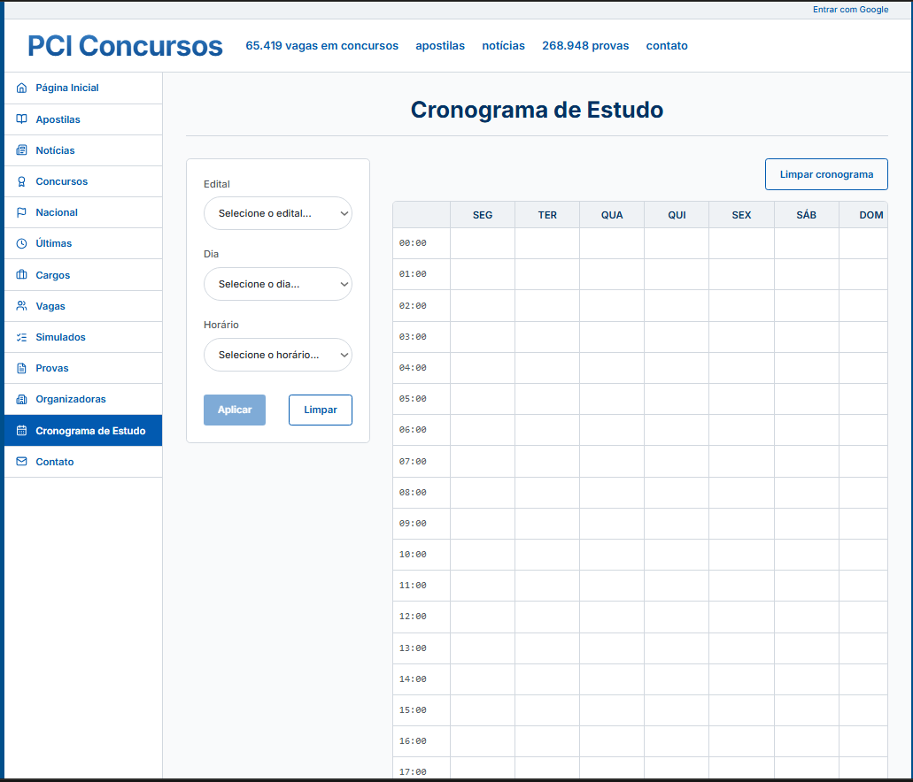
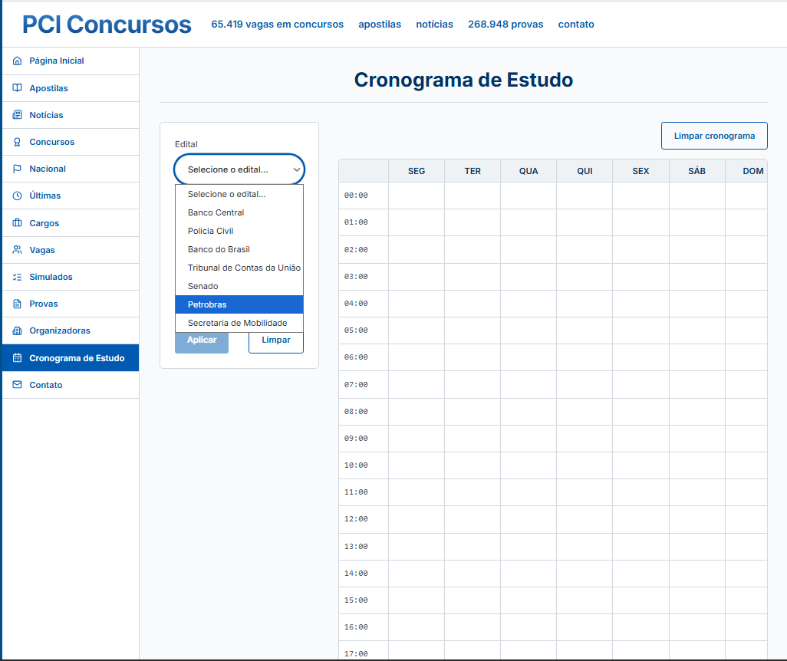
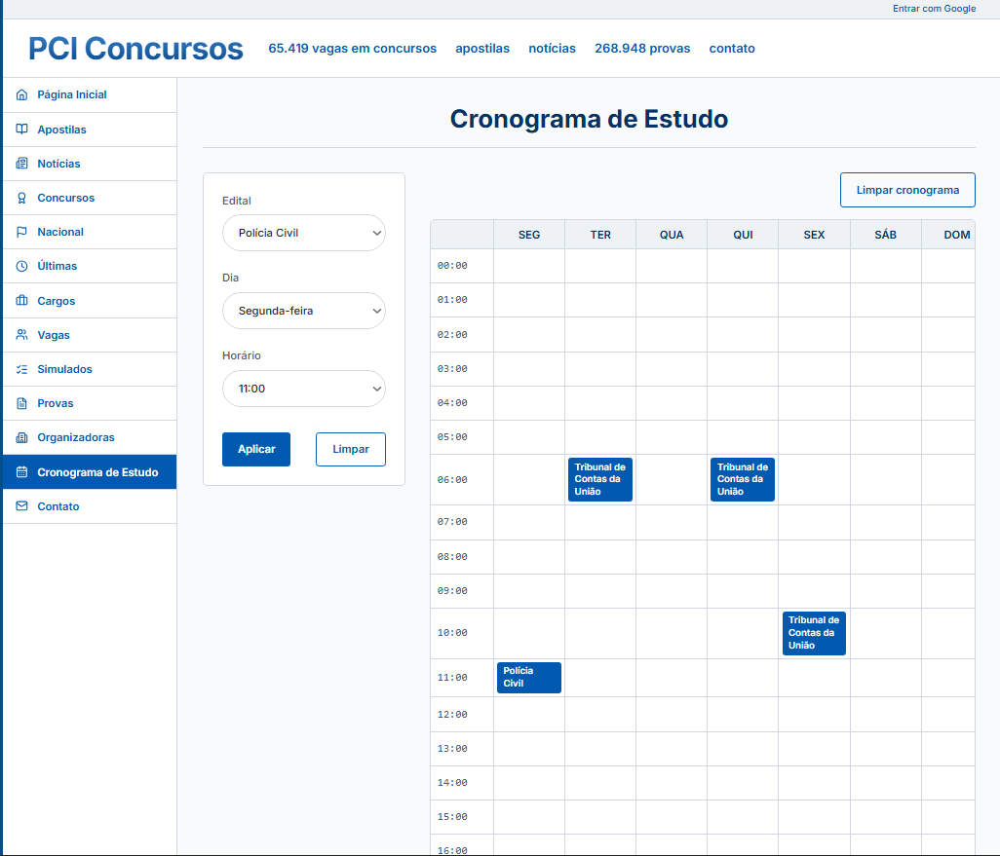

<b>Tabela de Contribuição</b>

| Membro | Contribuição |
| :--- | :--- |
| Pedro Rocha Ferreira Lima | Concepção e construção do Protótipo de Alta Fidelidade do Cronograma de Estudo no Lovable (`TAR-04`), a partir do Protótipo de Papel do Nível 2, autoinspeção analítica com base nas heurísticas de Nielsen, condução e gravação do teste-piloto e das três sessões com usuários (*Think-Aloud* e entrevista pós-teste), publicação dos vídeos no YouTube, captura das telas do protótipo, análise dos resultados e consolidação do relato individual (Barbosa e Silva, 2021, p. 309). |
| Claude (Anthropic) | Auxílio na estruturação textual, organização das tabelas, implementação dos modais de zoom e formatação em Markdown (conforme Política de Uso de IA). |

<b>Fonte:</b> Pedro Rocha Ferreira Lima (2026).

# Avaliação e Relato Individual — Protótipo de Alta Fidelidade (Pedro Rocha Ferreira Lima)

## 1. Identificação do Integrante e Escopo de Atuação

Este artefato documenta a **avaliação formativa de Nível 3 (Protótipo de Alta Fidelidade)** conduzida individualmente por **Pedro Rocha Ferreira Lima** no projeto **PCI Concursos**. O trabalho segue o framework **DECIDE** (*Barbosa et al.*, 2021), as **10 Heurísticas de Usabilidade de Nielsen (1993)** e o plano de ensino da disciplina de Interação Humano-Computador (*Sales*, 2026). O protótipo digital dá continuidade ao [Protótipo de Papel (Nível 2)](./pedro-rocha-prototipo-papel.md) e ao Storyboard `SB-02`, e as sessões com usuários seguiram a lógica de testes pequenos e rápidos defendida por *Krug* (2010), com três participantes.

A Tabela 1 apresenta o resumo do escopo individual de Pedro Rocha Ferreira Lima (Nível 3):

<b>Tabela 1: Resumo do Escopo Individual de Pedro Rocha Ferreira Lima (Nível 3)</b>

| Atributo | Detalhamento |
| :--- | :--- |
| **Integrante Responsável** | Pedro Rocha Ferreira Lima |
| **Protótipo Interativo (Lovable)** | [Protótipo de Alta Fidelidade — Cronograma de Estudo, PCI Concursos (Lovable)](https://edital-estudo-compass.lovable.app) |
| **Perfil de Usuário Focado** | [Perfil 1 — Candidato / Concurseiro](../../analise-de-requisitos/perfil-de-usuario.md) |
| **Persona de Referência** | [PER-02 — Lucas Ferreira Rocha](../../analise-de-requisitos/personas.md) |
| **Cenário de Uso** | [<abbr title="Cenário 04">CEN-04</abbr> — Cenário associado à TAR-04 na matriz de rastreabilidade](../../analise-de-requisitos/cenarios.md#44-cenario-04-acompanhamento-de-timeline-de-fases-com-simulador-de-prazos-recursais-e-sincronizacao-cen-04) |
| **Tarefa Prioritária de Autoria** | **<abbr title="Tarefa 04">TAR-04</abbr> — Criar cronograma personalizado de estudo** (recorte avaliado: montar a grade semanal vinculando editais a dias e horários): [<abbr title="Análise Hierárquica de Tarefas">HTA</abbr>](../../analise-de-requisitos/analise-de-tarefas/hta.md#42-tarefa-04-criar-cronograma-personalizado-de-estudo-com-distribuicao-de-blocos-de-revisao-e-sincronizacao-de-lembretes-tar-04) \| [<abbr title="ConcurTaskTrees">CTT</abbr>](../../analise-de-requisitos/analise-de-tarefas/ctt.md#42-tarefa-04-criar-cronograma-personalizado-de-estudo-com-distribuicao-de-blocos-de-revisao-e-sincronizacao-de-lembretes-tar-04) |
| **Storyboard de Origem** | [SB-02](./pedro-rocha.md) |
| **Artefato Anterior (Nível 2)** | [Protótipo de Papel — Pedro Rocha Ferreira Lima](./pedro-rocha-prototipo-papel.md) |
| **Tipo de Artefato** | Protótipo digital interativo de alta fidelidade desenvolvido no **Lovable** |
| **Técnica e Modalidade de Avaliação** | **Teste de Usabilidade Presencial** com Protocolo de Pensar em Voz Alta (*Think-Aloud*) e Entrevista Pós-Teste |
| **Escopo da Inspeção** | Autoinspeção analítica com lista de verificação ergonômica (Nielsen, 1993) e conformidade com o [Guia de Estilo](../guia-de-estilo.md) |
| **Participantes das Sessões** | 3 participantes reais representativos do Perfil 1 (Candidato/Concurseiro) + 1 participante piloto (descartado) |

<b>Fonte:</b> Pedro Rocha Ferreira Lima (2026).

---

## 2. Apresentação do Protótipo de Alta Fidelidade (Lovable)

O protótipo de alta fidelidade foi construído a partir do **Protótipo de Papel** que o autor desenhou e avaliou no Nível 2. Aquela versão, feita em folha A4 com post-its móveis e operada por um "computador humano", já definia a lógica da tarefa: três seletores encadeados (edital, dia e horário), um botão `Aplicar` que posiciona o concurso na grade semanal e duas ações de reversão, `Limpar` e `Limpar cronograma`. Nesta etapa, a mesma ideia passa a funcionar de verdade no navegador, inserida no layout do portal **PCI Concursos**, com cabeçalho, menu lateral e a opção `Cronograma de Estudo` em destaque, e seguindo a paleta azul e a tipografia sem serifa do [Guia de Estilo](../guia-de-estilo.md).

Algumas decisões do papel foram levadas adiante com ajustes visíveis nas telas. A grade deixou de ter linhas de duas horas e passou a ter **uma linha por hora, de `00:00` em diante**, sem a linha duplicada que existia no desenho. O seletor de edital ganhou **sete opções** (`Banco Central`, `Polícia Civil`, `Banco do Brasil`, `Tribunal de Contas da União`, `Senado`, `Petrobras` e `Secretaria de Mobilidade`), reunindo órgãos do papel e novos certames conhecidos pelo público concurseiro. O botão `Aplicar` nasce **desabilitado** e só ganha destaque quando os três campos estão preenchidos, o que evita o envio de seleções incompletas.

A tarefa da versão digital segue o mesmo fluxo do papel: o candidato escolhe o edital, o dia e o horário, toca em `Aplicar` e vê o nome do concurso aparecer na célula correspondente da grade, podendo repetir o processo quantas vezes quiser. As telas a seguir mostram os três estados principais da interface.

### 2.1 Tela 1: Cronograma de Estudo em Estado Inicial

A primeira tela mostra o portal com o título **Cronograma de Estudo**, o painel lateral com os seletores **Edital**, **Dia** e **Horário** (todos com o texto-guia `Selecione...`), o botão `Aplicar` ainda desabilitado e o botão `Limpar`. Acima da grade, à direita, fica o botão `Limpar cronograma`. A grade exibe as colunas `SEG` a `DOM` e as linhas horárias, ainda totalmente vazias.

A Figura 1 apresenta o protótipo de alta fidelidade — Tela 1: cronograma de estudo em estado inicial:

<b>Figura 1:</b> Protótipo de Alta Fidelidade — Tela 1: Cronograma de Estudo em Estado Inicial

  

  <button onclick="openModalAF01()" class="md-button md-button--primary" style="font-size: 0.82em; padding: 5px 16px; border-radius: 20px; cursor: pointer; display: inline-flex; align-items: center; gap: 6px;">
    🔍 <b>Zoom / Tela Cheia</b>
  </button>

<b>Fonte:</b> Elaborado por Pedro Rocha Ferreira Lima no Lovable (2026).

<!-- Modal AF Tela 1 -->

  

    <a href="../../../assets/images/prototipo-alta-fidelidade/Cronograma1.png" download="Prototipo_AF_Tela01_PedroRocha.png" class="md-button md-button--primary" style="font-size: 0.85em; padding: 6px 16px; border-radius: 6px; text-decoration: none; color: white;">📥 Baixar</a>
    <button onclick="closeModalAF01()" class="md-button" style="font-size: 0.85em; padding: 6px 16px; border-radius: 6px; background: #e11d48; color: white; border: none; cursor: pointer;">✕ Fechar (ESC)</button>
  

  

    
  

  
Pressione <b>ESC</b> ou clique fora da imagem para fechar.

---

### 2.2 Tela 2: Seleção do Edital na Lista Suspensa

Ao abrir o seletor **Edital**, o protótipo exibe a lista suspensa com as sete opções disponíveis, precedidas pelo texto-guia `Selecione o edital...`. Na captura, o cursor está sobre `Petrobras`, que aparece realçado. Os seletores de dia e horário seguem a mesma lógica de lista suspensa, com opções como `Segunda-feira` e `11:00`.

A Figura 2 apresenta o protótipo de alta fidelidade — Tela 2: lista suspensa de editais:

<b>Figura 2:</b> Protótipo de Alta Fidelidade — Tela 2: Lista Suspensa de Editais

  

  <button onclick="openModalAF02()" class="md-button md-button--primary" style="font-size: 0.82em; padding: 5px 16px; border-radius: 20px; cursor: pointer; display: inline-flex; align-items: center; gap: 6px;">
    🔍 <b>Zoom / Tela Cheia</b>
  </button>

<b>Fonte:</b> Elaborado por Pedro Rocha Ferreira Lima no Lovable (2026).

<!-- Modal AF Tela 2 -->

  

    <a href="../../../assets/images/prototipo-alta-fidelidade/Cronograma2.png" download="Prototipo_AF_Tela02_PedroRocha.png" class="md-button md-button--primary" style="font-size: 0.85em; padding: 6px 16px; border-radius: 6px; text-decoration: none; color: white;">📥 Baixar</a>
    <button onclick="closeModalAF02()" class="md-button" style="font-size: 0.85em; padding: 6px 16px; border-radius: 6px; background: #e11d48; color: white; border: none; cursor: pointer;">✕ Fechar (ESC)</button>
  

  

    
  

  
Pressione <b>ESC</b> ou clique fora da imagem para fechar.

---

### 2.3 Tela 3: Aplicação das Seleções e Cronograma Preenchido

Com os três campos preenchidos (na captura, `Polícia Civil`, `Segunda-feira` e `11:00`), o botão `Aplicar` passa a ter fundo azul sólido. Cada clique em `Aplicar` insere uma etiqueta azul com o nome do concurso na célula correspondente da grade: aqui aparecem `Polícia Civil` na segunda às 11:00 e `Tribunal de Contas da União` na terça e na quinta às 06:00 e na sexta às 10:00. Nomes longos quebram em mais de uma linha e aumentam a altura da linha horária. As duas ações de reversão continuam à vista: `Limpar`, no painel lateral, e `Limpar cronograma`, acima da grade.

A Figura 3 apresenta o protótipo de alta fidelidade — Tela 3: cronograma de estudo com blocos aplicados:

<b>Figura 3:</b> Protótipo de Alta Fidelidade — Tela 3: Cronograma de Estudo com Blocos Aplicados

  

  <button onclick="openModalAF03()" class="md-button md-button--primary" style="font-size: 0.82em; padding: 5px 16px; border-radius: 20px; cursor: pointer; display: inline-flex; align-items: center; gap: 6px;">
    🔍 <b>Zoom / Tela Cheia</b>
  </button>

<b>Fonte:</b> Elaborado por Pedro Rocha Ferreira Lima no Lovable (2026).

<!-- Modal AF Tela 3 -->

  

    <a href="../../../assets/images/prototipo-alta-fidelidade/Cronograma3.png" download="Prototipo_AF_Tela03_PedroRocha.png" class="md-button md-button--primary" style="font-size: 0.85em; padding: 6px 16px; border-radius: 6px; text-decoration: none; color: white;">📥 Baixar</a>
    <button onclick="closeModalAF03()" class="md-button" style="font-size: 0.85em; padding: 6px 16px; border-radius: 6px; background: #e11d48; color: white; border: none; cursor: pointer;">✕ Fechar (ESC)</button>
  

  

    
  

  
Pressione <b>ESC</b> ou clique fora da imagem para fechar.

---

## 3. Autoinspeção Analítica Prévia do Protótipo de Alta Fidelidade

Antes das sessões com usuários, o autor percorreu o protótipo com uma lista de verificação baseada nas **10 Heurísticas de Usabilidade de Nielsen (1993)**, nos problemas registrados no [Protótipo de Papel](./pedro-rocha-prototipo-papel.md) e nos padrões do [Guia de Estilo](../guia-de-estilo.md):

A Tabela 2 apresenta a lista de verificação da autoinspeção analítica do protótipo de alta fidelidade:

<b>Tabela 2: Lista de Verificação da Autoinspeção Analítica do Protótipo de Alta Fidelidade</b>

| Item | Critério / Heurística Avaliada | Resposta | Observação Técnica |
| :---: | :--- | :---: | :--- |
| **1** | **Consistência e Padrões:** o protótipo segue a identidade visual do portal e do Guia de Estilo? | **Sim** | Usa o azul institucional do PCI Concursos, tipografia sem serifa, menu lateral com a opção ativa em destaque e botões em dois estilos (preenchido para ação principal e contornado para ações secundárias). |
| **2** | **Correspondência com o Mundo Real:** os rótulos e as opções refletem o vocabulário do concurseiro? | **Sim** | Os editais têm nomes de órgãos reais (Banco do Brasil, TCU, Senado, Petrobras), os dias aparecem como `Segunda-feira` e os horários no formato `11:00`, com colunas abreviadas `SEG` a `DOM`. |
| **3** | **Visibilidade do Estado do Sistema:** o usuário percebe imediatamente o resultado de cada ação? | **Parcial** | O botão `Aplicar` muda de aparência quando habilitado e a etiqueta surge na célula escolhida. Porém a grade cobre 24 horas e a primeira tela mostra só as linhas até cerca de `17:00`; blocos noturnos podem ficar fora da área visível até o usuário rolar a página. |
| **4** | **Consistência entre Seletores e Grade:** as opções de dia e horário correspondem às colunas e linhas da grade? | **Sim** | A grade tem uma linha por hora, de `00:00` em diante, sem linha duplicada, e os horários escolhidos nos seletores têm o mesmo formato das linhas. Isso resolve a inconsistência apontada no papel. <!-- CONFIRMAR no Lovable: se o seletor de dia NÃO incluir "Domingo", trocar a resposta para "Parcial" e acrescentar essa ressalva. --> |
| **5** | **Prevenção de Erros:** a interface impede ações incompletas? | **Sim** | O botão `Aplicar` permanece desabilitado até que edital, dia e horário estejam preenchidos. |
| **6** | **Controle e Liberdade do Usuário:** há saídas claras para desfazer ações? | **Parcial** | Existem `Limpar` (reinicia os seletores) e `Limpar cronograma` (esvazia a grade), mas os rótulos são parecidos e os dois botões têm o mesmo estilo contornado, sem diferenciação visual de ação destrutiva. |
| **7** | **Estética e Design Minimalista:** o layout comporta o conteúdo aplicado sem ruído? | **Parcial** | O layout é limpo e escaneável, mas nomes longos como `Tribunal de Contas da União` ocupam até três linhas na célula e aumentam a altura da linha horária. |
| **8** | **Eficiência de Uso:** montar vários blocos de estudo exige poucos passos? | **Parcial** | Cada clique em `Aplicar` insere um único bloco (um dia e um horário), então preencher uma semana inteira exige repetir as três seleções para cada bloco. |

<b>Fonte:</b> Pedro Rocha Ferreira Lima (2026), com base nas heurísticas de Nielsen (1993).

---

## 4. Teste-Piloto do Protótipo de Alta Fidelidade (Presencial)

Conforme **Barbosa e Silva (2021, p. 276 e 300)**, o teste-piloto antecede as sessões definitivas para calibrar o roteiro, medir o tempo de interação com o protótipo digital e conferir se a captação de áudio e de tela funciona.

### 4.1 Dados Logísticos do Teste-Piloto

A Tabela 3 apresenta os dados logísticos do teste-piloto do protótipo de alta fidelidade:

<b>Tabela 3: Dados Logísticos do Teste-Piloto do Protótipo de Alta Fidelidade</b>

| Parâmetro | Detalhamento |
| :--- | :--- |
| **Data e Horário:** | 11/11/2026 às 22:34 |
| **Duração da Gravação:** | 46s |
| **Avaliador Responsável:** | Pedro Rocha Ferreira Lima |
| **Modalidade e Local:** | **Presencial** (computador com captura local de tela e áudio) |
| **Artefato Exercitado:** | Protótipo de Alta Fidelidade do Cronograma de Estudo no Lovable (`TAR-04` — seleção de edital, dia e horário, aplicação na grade e ações de limpeza) |
| **Custos Envolvidos:** | R$ 0,00 (equipamento próprio) |

<b>Fonte:</b> Pedro Rocha Ferreira Lima (2026).

### 4.2 Registro Audiovisual do Teste-Piloto

O Vídeo 1 apresenta a gravação do teste-piloto — avaliação do protótipo de alta fidelidade:

<b>Vídeo 1:</b> Gravação do Teste-Piloto — Avaliação do Protótipo de Alta Fidelidade (<a href="https://youtu.be/EhIQk0318TA" target="_blank">https://youtu.be/EhIQk0318TA</a>)

<iframe width="720" height="405" src="https://www.youtube.com/embed/EhIQk0318TA" title="Gravação do Teste-Piloto - Protótipo de Alta Fidelidade - Pedro Rocha (Grupo 07 IHC)" frameborder="0" allow="accelerometer; autoplay; clipboard-write; encrypted-media; gyroscope; picture-in-picture; web-share" allowfullscreen style="border: 1px solid #d0d7de; border-radius: 8px; box-shadow: 0 4px 12px rgba(0,0,0,0.08); margin: 16px auto; display: block;"></iframe>

<b>Fonte:</b> Pedro Rocha Ferreira Lima (2026).

> **Declaração de Descarte de Dados do Piloto:** Em conformidade com **Barbosa e Silva (2021, p. 300)**, declara-se que os dados da sessão-piloto servem apenas para calibrar o roteiro, verificar a fluidez do protótipo digital e validar os equipamentos de gravação, sendo formalmente descartados do cômputo dos resultados finais.

---

## 5. Avaliação Empírica com Usuários Reais (Sessões Presenciais)

### 5.1 Protocolo Ético e Caracterização dos Participantes

O recrutamento seguiu o [Perfil 1 — Candidato/Concurseiro](../../analise-de-requisitos/perfil-de-usuario.md). Como em *Krug* (2010), a avaliação foi feita com **três participantes**, número suficiente para revelar os problemas mais evidentes sem tornar o teste pesado. O Termo de Consentimento Livre e Esclarecido (<abbr title="Termo de Consentimento Livre e Esclarecido">TCLE</abbr>) foi assinado previamente e reiterado verbalmente no início das gravações, com o esclarecimento de que o objeto do teste é o protótipo e nunca a capacidade do participante:

<b>Tabela 4: Perfil dos Participantes da Avaliação Empírica</b>

| Participante | Perfil Concurseiro | Ocupação / Formação | Rotina com Concursos | Modalidade | Status do TCLE |
| :---: | :--- | :--- | :--- | :---: | :---: |
| **Participante 1** | Perfil 1 – Candidato | Estudante de Engenharia de Software | Demonstrou interesse em prestar o concurso do Banco do Brasil, escolhido por ele durante a sessão. | **Presencial** | Aceito formalmente em vídeo |
| **Participante 2** | Perfil 1 – Candidato | Estudante de Agronomia | Declarou que estuda muito para concursos. | **Presencial** | Aceito formalmente em vídeo |
| **Participante 3** | Perfil 1 – Candidato | Estudante de Engenharia | Declarou-se concurseiro e imaginou usar o cronograma para organizar o estudo de mais de um concurso. | **Presencial** | Assinado previamente; autorização de áudio e vídeo solicitada em vídeo |

<b>Fonte:</b> Pedro Rocha Ferreira Lima (2026).

### 5.2 Registro Audiovisual das Sessões Presenciais

A Tabela 5 documenta as três sessões empíricas conduzidas **presencialmente**, nos dias 12/11/2026 e 13/11/2026:

<b>Tabela 5: Registro Audiovisual das Entrevistas do Protótipo de Alta Fidelidade</b>

| Sessão | Moderador | Participante | Data e Horário | Duração | Modalidade | Link da Gravação |
| :---: | :--- | :---: | :---: | :---: | :---: | :--- |
| **Sessão 1** | Pedro Rocha Ferreira Lima | Participante 1 | 13/11/2026 (noite) | 02min 53s | **Presencial** | [Vídeo da Sessão 1 (YouTube)](https://youtu.be/eCkZXgLAmhQ) |
| **Sessão 2** | Pedro Rocha Ferreira Lima | Participante 2 | 13/11/2026 (noite) | 01min 51s | **Presencial** | [Vídeo da Sessão 2 (YouTube)](https://youtu.be/Vz16IQpVEpA) |
| **Sessão 3** | Pedro Rocha Ferreira Lima | Participante 3 | 12/11/2026 às 13:52 | 02min 33s | **Presencial** | [Vídeo da Sessão 3 (YouTube)](https://youtu.be/LwW0BXSQ2ZE) |

<b>Fonte:</b> Pedro Rocha Ferreira Lima (2026).

O Vídeo 2 apresenta a gravação da Sessão 1 presencial — avaliação do protótipo de alta fidelidade:

<b>Vídeo 2:</b> Gravação da Sessão 1 Presencial — Avaliação do Protótipo de Alta Fidelidade (<a href="https://youtu.be/eCkZXgLAmhQ" target="_blank">https://youtu.be/eCkZXgLAmhQ</a>)

<iframe width="720" height="405" src="https://www.youtube.com/embed/eCkZXgLAmhQ" title="Sessão 01 - Protótipo de Alta Fidelidade - Pedro Rocha (Grupo 07 IHC)" frameborder="0" allow="accelerometer; autoplay; clipboard-write; encrypted-media; gyroscope; picture-in-picture; web-share" allowfullscreen style="border: 1px solid #d0d7de; border-radius: 8px; box-shadow: 0 4px 12px rgba(0,0,0,0.08); margin: 16px auto; display: block;"></iframe>

<b>Fonte:</b> Pedro Rocha Ferreira Lima (2026).

O Vídeo 3 apresenta a gravação da Sessão 2 presencial — avaliação do protótipo de alta fidelidade:

<b>Vídeo 3:</b> Gravação da Sessão 2 Presencial — Avaliação do Protótipo de Alta Fidelidade (<a href="https://youtu.be/Vz16IQpVEpA" target="_blank">https://youtu.be/Vz16IQpVEpA</a>)

<iframe width="720" height="405" src="https://www.youtube.com/embed/Vz16IQpVEpA" title="Sessão 02 - Protótipo de Alta Fidelidade - Pedro Rocha (Grupo 07 IHC)" frameborder="0" allow="accelerometer; autoplay; clipboard-write; encrypted-media; gyroscope; picture-in-picture; web-share" allowfullscreen style="border: 1px solid #d0d7de; border-radius: 8px; box-shadow: 0 4px 12px rgba(0,0,0,0.08); margin: 16px auto; display: block;"></iframe>

<b>Fonte:</b> Pedro Rocha Ferreira Lima (2026).

O Vídeo 4 apresenta a gravação da Sessão 3 presencial — avaliação do protótipo de alta fidelidade:

<b>Vídeo 4:</b> Gravação da Sessão 3 Presencial — Avaliação do Protótipo de Alta Fidelidade (<a href="https://youtu.be/LwW0BXSQ2ZE" target="_blank">https://youtu.be/LwW0BXSQ2ZE</a>)

<iframe width="720" height="405" src="https://www.youtube.com/embed/LwW0BXSQ2ZE" title="Sessão 03 - Protótipo de Alta Fidelidade - Pedro Rocha (Grupo 07 IHC)" frameborder="0" allow="accelerometer; autoplay; clipboard-write; encrypted-media; gyroscope; picture-in-picture; web-share" allowfullscreen style="border: 1px solid #d0d7de; border-radius: 8px; box-shadow: 0 4px 12px rgba(0,0,0,0.08); margin: 16px auto; display: block;"></iframe>

<b>Fonte:</b> Pedro Rocha Ferreira Lima (2026).

### 5.3 Desempenho nas Tarefas e Feedbacks Coletados

Nas sessões individuais, cada participante recebeu uma breve descrição do protótipo e a orientação de **explorar o Cronograma de Estudo livremente, falando em voz alta** o que fazia (*Think-Aloud*). Ao final, respondeu a uma entrevista pós-teste sobre facilidade de uso e impressões gerais. Como a instrução foi aberta, as etapas abaixo foram identificadas pelo moderador a partir da sequência natural da tarefa `TAR-04`: montar o primeiro bloco, acrescentar outros blocos e reverter ações.

#### 5.3.1 Sessão 1 — Participante 1

<b>Tabela 6: Desempenho e Eficácia do Participante 1 no Protótipo de Alta Fidelidade</b>

| Etapa Avaliada | Ação Executada pelo Participante (*Think-Aloud*) | Resultado | Tempo de Execução |
| :--- | :--- | :---: | :---: |
| **Etapa 1: Montar o primeiro bloco (`TAR-04`)** | Anunciou que olharia o cronograma de estudo e os editais disponíveis, escolheu o **Banco do Brasil** ("que eu quero fazer"), o dia **segunda-feira** e o horário das **10h**, e clicou em `Aplicar`. Comentou que o bloco já havia aparecido no cronograma (`01:01–01:33`). | **Sucesso Autônomo** | ~32 s |
| **Etapa 2: Acrescentar outros blocos (`TAR-04`)** | Concluiu que poderia colocar mais blocos, aplicou novamente na **segunda às 11h** e comentou que o novo bloco apareceu. Em seguida testou **outro concurso** na **quinta-feira às 18h** e confirmou o resultado na grade (`01:33–02:21`). | **Sucesso Autônomo** | ~48 s |
| **Etapa 3: Reverter ações (`TAR-04`)** | Não acionou nem comentou os botões `Limpar` e `Limpar cronograma` durante a sessão. | **Não observada** | — |

<b>Fonte:</b> Pedro Rocha Ferreira Lima (2026). Tempos medidos a partir do início da gravação.

* **Síntese Pós-Teste (Participante 1):** Achou o sistema de fácil uso e "bem intuitivo". Destacou que são três opções simples de identificar (qual concurso, qual dia e qual horário) e que o resultado "já aparece ali na hora" no cronograma.

#### 5.3.2 Sessão 2 — Participante 2

A Tabela 7 apresenta o desempenho e eficácia do Participante 2 no protótipo de alta fidelidade:

<b>Tabela 7: Desempenho e Eficácia do Participante 2 no Protótipo de Alta Fidelidade</b>

| Etapa Avaliada | Ação Executada pelo Participante (*Think-Aloud*) | Resultado | Tempo de Execução |
| :--- | :--- | :---: | :---: |
| **Etapa 1: Montar o primeiro bloco (`TAR-04`)** | Escolheu o edital do **Banco do Brasil**, o dia **sexta-feira** e o horário das **20:00**, e clicou em `Aplicar`. Notou que o bloco "ficou para baixo", isto é, na parte da grade que não estava visível na tela, e ao descer a página confirmou que ele aparecia "tudo certinho" (`00:48–01:13`). | **Sucesso Autônomo** *(com rolagem)* | ~25 s |
| **Etapa 2: Acrescentar outros blocos (`TAR-04`)** | Não acrescentou outros blocos nesta sessão. | **Não realizada** | — |
| **Etapa 3: Reverter ações (`TAR-04`)** | Explicou que, para esvaziar o cronograma, bastava clicar em `Limpar cronograma` e que, se escolhesse uma data errada, era só limpar (`01:13–01:24`). | **Identificou as ações** | ~11 s |

<b>Fonte:</b> Pedro Rocha Ferreira Lima (2026). Tempos medidos a partir do início da gravação.

* **Síntese Pós-Teste (Participante 2):** Considerou o sistema "muito fácil de usar" e "muito objetivo", afirmando que não há como a pessoa se confundir ao marcar um horário para estudar.

#### 5.3.3 Sessão 3 — Participante 3

<b>Tabela 8: Desempenho e Eficácia do Participante 3 no Protótipo de Alta Fidelidade</b>

| Etapa Avaliada | Ação Executada pelo Participante (*Think-Aloud*) | Resultado | Tempo de Execução |
| :--- | :--- | :---: | :---: |
| **Etapa 1: Montar o primeiro bloco (`TAR-04`)** | Começou reconhecendo a tela: leu o cronograma, os seletores e os itens do menu lateral, e perguntou se uma das opções seria a dos últimos concursos, ao que o moderador esclareceu que o menu era apenas parte do portal e o foco do teste era o cronograma. Escolheu o **Banco do Brasil**, **segunda-feira** e **10 horas**, e aplicou. | **Sucesso Autônomo** | n/d |
| **Etapa 2: Acrescentar outros blocos (`TAR-04`)** | Repetiu o processo para a **quarta-feira**, no mesmo horário, e viu o novo bloco na grade. | **Sucesso Autônomo** | n/d |
| **Etapa 3: Reverter ações (`TAR-04`)** | Observou que, ao limpar a seleção, conseguiria escolher outro edital, e que também podia limpar o cronograma inteiro. | **Identificou as ações** | n/d |

<b>Fonte:</b> Pedro Rocha Ferreira Lima (2026). A transcrição desta sessão não traz marcações de tempo por etapa; a sessão completa durou 2min 33s.

* **Síntese Pós-Teste (Participante 3):** Achou o sistema "bem intuitivo" e rápido para montar o cronograma. Destacou que a pessoa decide em quais horários vai estudar e quais concursos incluir, e que a ferramenta ajuda quem estuda para mais de um concurso. Afirmou que usaria o recurso na sua rotina e o classificou como eficiente.

---

## 6. Relato dos Resultados da Avaliação do Protótipo de Alta Fidelidade (Barbosa e Silva, 2021, p. 309)

Seguindo a estrutura prescrita por **Barbosa e Silva (2021, Subseção 11.7.5, p. 279 e Subseção 12.1, p. 309)** e o [Planejamento do Relato](./planejamento-relato-alta-fidelidade.md), esta seção reúne os resultados da avaliação empírica do Protótipo de Alta Fidelidade.

### 6.1 Objetivos da Avaliação
Alinhados aos objetivos de avaliação de IHC definidos por **Barbosa e Silva (2021, p. 262-264)**:
* **Avaliar a apropriação da tecnologia pelos usuários:** observar como os candidatos operam os seletores, o botão `Aplicar` e a grade semanal no ambiente digital;
* **Avaliar ideias e alternativas de design:** verificar se o protótipo interativo resolve as questões levantadas no protótipo de papel, como a correspondência entre seletores e grade;
* **Avaliar a conformidade com um padrão:** conferir a aderência ao [Guia de Estilo](../guia-de-estilo.md) e às **10 Heurísticas de Nielsen (1993)**;
* **Identificar problemas na interação e na interface:** registrar dificuldades remanescentes para orientar os ajustes finais.

### 6.2 Escopo da Avaliação
* **Artefato Avaliado:** Protótipo Digital Interativo de Alta Fidelidade desenvolvido no **Lovable**, com a tela `Cronograma de Estudo` e seus três estados principais (inicial, seletor aberto e cronograma preenchido).
* **Tarefa Contemplada:** **<abbr title="Tarefa 04">TAR-04</abbr>** ([HTA](../../analise-de-requisitos/analise-de-tarefas/hta.md#42-tarefa-04-criar-cronograma-personalizado-de-estudo-com-distribuicao-de-blocos-de-revisao-e-sincronizacao-de-lembretes-tar-04) \| [CTT](../../analise-de-requisitos/analise-de-tarefas/ctt.md#42-tarefa-04-criar-cronograma-personalizado-de-estudo-com-distribuicao-de-blocos-de-revisao-e-sincronizacao-de-lembretes-tar-04)), no recorte de montagem manual da grade semanal. A distribuição automática de blocos de revisão, os lembretes e a exportação para agenda digital, previstos no modelo completo da tarefa, não fazem parte do protótipo.
* **Nível de Fidelidade:** Alta fidelidade digital (interface no layout do portal, respostas imediatas aos cliques e estados dinâmicos dos botões).

### 6.3 Breve Descrição do Método Utilizado
* **Teste de Usabilidade Presencial no estilo de Krug (2010):** sessões curtas, individuais e com três participantes, em computador, com interação direta no navegador;
* **Protocolo de Pensar em Voz Alta (*Think-Aloud*, Ericsson e Simon, 1993):** verbalização contínua das expectativas e percepções durante a execução;
* **Entrevista Pós-Teste (Barbosa e Silva, 2021, p. 278):** coleta qualitativa sobre facilidade de uso e impressões gerais;
* **Teste-Piloto Prévio:** sessão presencial de calibração, com descarte formal dos dados.

### 6.4 Conjunto de Diretrizes e Critérios Avaliados
* **10 Heurísticas de Usabilidade de Nielsen (1993):** Visibilidade do Estado do Sistema, Correspondência com o Mundo Real, Controle e Liberdade do Usuário, Consistência e Padrões, Prevenção de Erros e Estética e Design Minimalista;
* **Metas de Usabilidade (Barbosa et al., 2021; ISO/IEC 9241-11):** eficácia na conclusão autônoma da tarefa, eficiência temporal, facilidade de aprendizado e satisfação subjetiva;
* **Guia de Estilo do Projeto:** conformidade cromática, hierarquia tipográfica e *affordance* dos componentes.

### 6.5 Número e Perfil dos Avaliadores e Participantes
* **Avaliador / Moderador (1 integrante):** Pedro Rocha Ferreira Lima (Grupo 07 IHC).
* **Participantes (3 usuários reais do Perfil 1 – Candidato/Concurseiro):** caracterizados na Tabela 4, todos estudantes universitários, com TCLE assinado e confirmado em vídeo.

### 6.6 Resultados Observados e Limitações do Protótipo

Os três participantes montaram blocos no cronograma de forma autônoma, sem pedir ajuda ao moderador, e classificaram a interface como fácil e intuitiva (Tabelas 6 a 8). Os três escolheram o edital do **Banco do Brasil** ao montar o primeiro bloco. Como esta é a etapa final do projeto, não há nova rodada de reprojeto; as observações abaixo ficam registradas como **limitações do protótipo e sugestões para trabalhos futuros**:

* **Blocos fora da área visível (Sessão 2):** a grade cobre as 24 horas do dia e, na primeira tela, só as linhas até cerca de `17:00` aparecem. O bloco aplicado às `20:00` ficou "para baixo", e o participante precisou rolar a página para vê-lo. Como estudar à noite é comum entre concurseiros, uma rolagem automática até o bloco aplicado ou uma grade que comece em horários de estudo reduziria esse esforço.
* **Um bloco por aplicação (Sessão 1):** o Participante 1 repetiu a seleção três vezes para inserir blocos em dias e horários diferentes. Uma seleção múltipla de dias e horários tornaria a montagem da semana mais rápida.
* **Ações de limpeza com rótulos próximos:** `Limpar` e `Limpar cronograma` têm nomes parecidos e o mesmo estilo visual. Nenhum participante relatou dificuldade com isso, mas a distinção continua apenas textual.
* **Itens do portal fora do escopo (Sessão 3):** o Participante 3 explorou o menu lateral e perguntou sobre uma das opções, mostrando que ele atrai atenção mesmo quando não faz parte da tarefa avaliada. O moderador esclareceu que o foco era o cronograma.
* **Recorte da tarefa:** o protótipo cobre a montagem manual do cronograma. Distribuição automática de blocos de revisão, lembretes e exportação para agenda digital (previstos na `TAR-04` completa) ficam como evolução futura.
* **Limitações do estudo:** três participantes com perfil parecido (estudantes universitários) e sessões curtas, de cerca de 2 a 3 minutos, com tarefa aberta. Os resultados indicam tendências e não permitem generalização estatística.

---

## 7. Referências Bibliográficas

> [1] BARBOSA, Simone Diniz Junqueira et al. *Interação Humano-Computador e Experiência do Usuário*. Rio de Janeiro: Autopublicação, 2021. ISBN: 978-65-00-19677-1.  
> [2] ERICSSON, K. Anders; SIMON, Herbert A. *Protocol Analysis: Verbal Reports as Data*. Cambridge: MIT Press, 1993.  
> [3] KRUG, Steve. *Rocket Surgery Made Easy: The Do-It-Yourself Guide to Finding and Fixing Usability Problems*. Berkeley: New Riders, 2010.  
> [4] NIELSEN, Jakob. *Usability Engineering*. San Francisco: Morgan Kaufmann, 1993.  
> [5] SALES, André Barros de. *Plano de ensino FIHC 022026 – Turma 01*. Brasília: Faculdade de Ciências e Tecnologias em Engenharia (FCTE), Universidade de Brasília (UnB), 2026.  
> [6] SNYDER, Carolyn. *Paper Prototyping: The Fast and Easy Way to Design and Refine User Interfaces*. San Francisco: Morgan Kaufmann, 2003.  

---

## 8. Histórico de Versões

| Versão | Data | Descrição | Autor(es) | Revisor(es) |
| :---: | :---: | :--- | :---: | :---: |
| `1.0` | 15/11/2026 | Elaboração inicial do Relato Individual do Protótipo de Alta Fidelidade (Nível 3) da `TAR-04`, com apresentação das telas, autoinspeção analítica, estrutura do teste-piloto, registro das três sessões com usuários e relato dos resultados conforme Barbosa e Silva (2021, p. 309). | Pedro Rocha Ferreira Lima | Daniel da Silva Batista, Arthur Sismene Carvalho e Leonardo da Silva Lopes Júnior |

<b>Fonte:</b> Pedro Rocha Ferreira Lima (2026).

