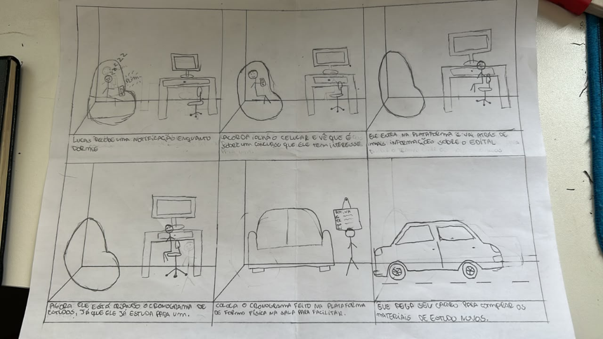

<b>Tabela de Contribuição</b>

| Membro | Contribuição |
| :--- | :--- |
| Pedro Rocha Ferreira Lima | Elaboração do Storyboard SB-02, autoinspeção analítica dos modelos HTA/CTT e do storyboard, condução do teste-piloto e das entrevistas de avaliação com usuários reais (TAR-04), consolidação individual e propostas de reprojeto. |
| Gemini | Auxílio na estruturação textual, organização das tabelas e formatação em Markdown (conforme Política de Uso de IA). |

<b>Fonte:</b> Pedro Rocha Ferreira Lima (2026).

# Avaliação e Relato Individual — Pedro Rocha Ferreira Lima

## 1. Identificação do Integrante e Escopo de Atuação

Este artefato reúne todo o ciclo de **avaliação formativa de Nível 1 (Análise de Tarefas e Storyboard)** conduzido individualmente por **Pedro Rocha Ferreira Lima** na Etapa 5 do projeto **PCI Concursos**, em conformidade com o framework DECIDE (*Barbosa et al.*, 2021) e o Plano de Ensino da disciplina (*Sales*, 2026).

<b>Tabela 1: Resumo do Escopo Individual de Pedro Rocha Ferreira Lima</b>

| Atributo | Detalhamento |
| :--- | :--- |
| **Integrante Responsável** | Pedro Rocha Ferreira Lima |
| **Perfil de Usuário Focado** | [Perfil 1 — Candidato / Concurseiro](../../analise-de-requisitos/perfil-de-usuario.md) |
| **Cenário de Uso** | [CEN-04 — Planejamento do Cronograma de Estudo Diante da Dispersão de Disciplinas entre Editais Concorrentes](../../analise-de-requisitos/cenarios.md) |
| **Tarefa Prioritária de Autoria** | [TAR-04 — Criar cronograma personalizado de estudo com distribuição de blocos de revisão e sincronização de lembretes](../../analise-de-requisitos/analise-de-tarefas/hta.md#42-tarefa-04-criar-cronograma-personalizado-de-estudo-com-distribuicao-de-blocos-de-revisao-e-sincronizacao-de-lembretes-tar-04) |
| **Storyboard de Autoria** | [SB-02 — Criação de Cronograma Personalizado de Estudo](#2-storyboard-individual-sb-02) |
| **Escopo da Inspeção** | Autoinspeção analítica dos próprios artefatos (HTA e CTT da `TAR-04` e Storyboard `SB-02`) |
| **Participantes das Entrevistas** | 2 participantes reais do Perfil 1 (Candidato/Concurseiro) |

<b>Fonte:</b> Pedro Rocha Ferreira Lima (2026).

---

## 2. Storyboard Individual (SB-02)

O Storyboard `SB-02` ilustra a jornada do usuário (Perfil 1 — Candidato/Concurseiro) utilizando a funcionalidade de criação de cronograma personalizado de estudo no portal PCI Concursos, permitindo verificar visualmente o modelo conceitual de interação concebido na `TAR-04`.

### 2.1 Ilustração do Storyboard SB-02

  

  <button onclick="openFullscreenModalSB02()" class="md-button md-button--primary" style="font-size: 0.82em; padding: 5px 16px; border-radius: 20px; cursor: pointer; display: inline-flex; align-items: center; gap: 6px;">
    🔍 <b>Zoom / Tela Cheia</b>
  </button>

<b>Figura 1:</b> Storyboard SB-02 — Criação de Cronograma Personalizado de Estudo

<b>Fonte:</b> Elaborado por Pedro Rocha Ferreira Lima à mão livre (2026), fundamentado no Cenário 04 e Tarefa 04.

<!-- Modal / Lightbox de Tela Cheia -->

  

    <a href="../../../assets/images/storyboards/storyboard-sb02.png" download="Storyboard_SB02_PedroRocha.png" class="md-button md-button--primary" style="font-size: 0.85em; padding: 6px 16px; border-radius: 6px; text-decoration: none; color: white;">📥 Baixar</a>
    <button onclick="closeFullscreenModalSB02()" class="md-button" style="font-size: 0.85em; padding: 6px 16px; border-radius: 6px; background: #e11d48; color: white; border: none; cursor: pointer;">✕ Fechar (ESC)</button>
  

  

    
  

  
Pressione <b>ESC</b> ou clique fora da imagem para fechar.

### 2.2 Detalhamento Sequencial dos Quadros

<b>Tabela 2: Detalhamento Sequencial dos Quadros do SB-02</b>

| Quadro | Ação Representada | Correspondência com a Tarefa TAR-04 | Legenda Textual do Quadro |
| :---: | :--- | :--- | :--- |
| **1** | O candidato recebe uma notificação sonoro-visual no celular informando sobre certame de seu interesse. | **Objetivo 0:** Iniciar a rotina de planejamento. | *"Lucas recebe uma notificação enquanto dorme (plim!)."* |
| **2** | Ele acorda, consulta o celular e verifica que a notificação trata de edital compatível com sua área. | **Objetivo 0.1:** Identificar certame e disparar planejamento. | *"Acorda, olha o celular e vê que é sobre um concurso que ele tem interesse."* |
| **3** | O usuário acessa a plataforma no computador e pesquisa detalhes do edital para dividir o conteúdo programático. | **Subtarefa 1:** Acessar a plataforma e levantar disciplinas do edital. | *"Ele entra na plataforma e vai atrás de mais informação sobre o edital."* |
| **4** | O usuário cria e parametriza seu cronograma de estudos na plataforma, distribuindo metas e horários. | **Subtarefa 2:** Parametrizar disciplinas, meta diária e blocos de revisão. | *"Agora ele está criando o cronograma de estudos, já que ele estuda para o concurso."* |
| **5** | O candidato sincroniza o cronograma e imprime uma via física para fixação visual no ambiente de estudos. | **Subtarefa 3:** Sincronizar e exportar cronograma consolidado. | *"Coloca o cronograma feito na plataforma de forma física na sala para facilitar."* |
| **6** | Com o cronograma organizado e disciplinas mapeadas, desloca-se focado para adquirir novos materiais didáticos. | **Meta Atingida:** Preparação estruturada e rotina de estudos em execução. | *"Ele pega seu carro para comprar os materiais de estudo novos."* |

<b>Fonte:</b> Pedro Rocha Ferreira Lima (2026).

---

## 3. Avaliação por Inspeção (Autoinspeção / Verificação da TAR-04 e SB-02)

Conforme o planejamento das listas de verificação da Etapa 4 e a deliberação docente de condução individual das avaliações na Etapa 5, esta seção documenta a **avaliação analítica por inspeção** conduzida por **Pedro Rocha Ferreira Lima** sobre os seus próprios artefatos de Nível 1: o diagrama **HTA da TAR-04**, o modelo **CTT da TAR-04** e o **Storyboard SB-02**. O objetivo foi identificar pontos fortes e oportunidades prévias de reprojeto antes da aplicação das entrevistas com usuários reais.

### 3.1 Identificação da Sessão de Inspeção e Registro Audiovisual

<b>Tabela 3: Dados da Sessão de Inspeção Analítica Individual</b>

| Atributo | Detalhamento |
| :--- | :--- |
| **Avaliador (Inspetor)** | Pedro Rocha Ferreira Lima |
| **Autor dos Modelos Inspecionados** | Pedro Rocha Ferreira Lima (Autoinspeção / Verificação Individual) |
| **Modelos de Tarefa Inspecionados** | [HTA da TAR-04](../../analise-de-requisitos/analise-de-tarefas/hta.md#42-tarefa-04-criar-cronograma-personalizado-de-estudo-com-distribuicao-de-blocos-de-revisao-e-sincronizacao-de-lembretes-tar-04) e [CTT da TAR-04](../../analise-de-requisitos/analise-de-tarefas/ctt.md#42-tarefa-04-criar-cronograma-personalizado-de-estudo-com-distribuicao-de-blocos-de-revisao-e-sincronizacao-de-lembretes-tar-04) |
| **Storyboard Inspecionado** | [SB-02 — Criação de Cronograma Personalizado de Estudo](#2-storyboard-individual-sb-02) |
| **Data da Gravação** | 25/10/2026 às 14:36 |
| **Duração do Vídeo** | 07 min 59 s |
| **Ambiente de Gravação** | Microsoft Teams, 720p |
| **Link Direto do Vídeo** | [Vídeo da Autoinspeção (YouTube - 07m 59s)](https://youtu.be/lf84h24vzXA) |

<b>Fonte:</b> Pedro Rocha Ferreira Lima (2026).

#### Vídeo 1: Gravação da Autoinspeção Analítica Individual

<iframe width="720" height="405" src="https://www.youtube.com/embed/lf84h24vzXA" title="Gravação da Autoinspeção Analítica de Nível 1 - Pedro Rocha (Grupo 07 IHC)" frameborder="0" allow="accelerometer; autoplay; clipboard-write; encrypted-media; gyroscope; picture-in-picture; web-share" allowfullscreen style="border: 1px solid #d0d7de; border-radius: 8px; box-shadow: 0 4px 12px rgba(0,0,0,0.08); margin: 16px auto; display: block;"></iframe>

<b>Vídeo 1:</b> Sessão de autoinspeção conduzida por Pedro Rocha avaliando a TAR-04 (HTA/CTT) e o Storyboard SB-02 (Duração: 07m 59s).

### 3.2 Inspeção do Diagrama HTA — TAR-04: Criar Cronograma Personalizado de Estudo

O modelo inspecionado é a **Figura 4 de HTA** e a respectiva **Tabela 5** em [Análise de Tarefas — HTA](../../analise-de-requisitos/analise-de-tarefas/hta.md#42-tarefa-04-criar-cronograma-personalizado-de-estudo-com-distribuicao-de-blocos-de-revisao-e-sincronizacao-de-lembretes-tar-04), de autoria de Pedro Rocha Ferreira Lima.

<b>Tabela 4: Lista de Verificação Aplicada ao HTA da TAR-04 (Autor: Pedro Rocha)</b>

| Item | Critério Verificado | Resposta | Observação |
| :---: | :--- | :---: | :--- |
| 1 | O objetivo principal da tarefa (nível 0) foi identificado antes das ações operacionais e está formulado como um estado ou meta que o usuário deseja atingir (verbo no infinitivo + objeto)? | Sim | O objetivo raiz está formulado com precisão: *"0. Criar cronograma personalizado de estudo"*, definindo a meta de alto nível do concurseiro antes de qualquer decomposição mecânica (Barbosa et al., 2021). |
| 2 | A tarefa foi decomposta de forma hierárquica coerente, desmembrando o objetivo de alto nível (0) em subobjetivos intermediários (1., 2...) e estes em operações concretas nos níveis inferiores (1.1., 1.2., 1.2.1.)? | Sim | A tarefa decompõe-se do objetivo raiz (0) em 3 subobjetivos (1. Selecionar disciplinas e meta diária, 2. Organizar blocos de revisão, 3. Configurar lembretes e sincronizar), desdobrados em operações funcionais, cognitivas e de interface nos níveis 2.1, 2.2, 2.2.1, 2.2.2, 3.1 e 3.2. |
| 3 | Os subobjetivos subordinados a um mesmo objetivo-pai são mutuamente exclusivos (sem sobreposição de escopo entre irmãos) e coletivamente exaustivos (juntos cumprem 100% do objetivo-pai, sem etapas ocultas)? | Sim | Os ramos cobrem o ciclo completo: parametrização inicial, distribuição/ajuste dos blocos e configuração de lembretes/exportação, sem sobreposição de atribuições entre os três subobjetivos de nível 1. |
| 4 | O diagrama diferencia visualmente os objetivos não terminais (retângulos simples que possuem filhos) das operações/nós-folha (retângulos com linha dupla horizontal na base, que não são mais decompostos)? | Sim | O diagrama `hta-tar04.svg` adota a convenção canônica de Barbosa et al. (2021, Figura 8.1): retângulos simples para os nós compostos (0, 2, 2.2 e 3) e traço horizontal na base dos nós terminais (1, 2.1, 2.2.1, 2.2.2, 3.1 e 3.2). |
| 5 | Cada nó do diagrama e da tabela recebe numeração hierárquica estritamente fiel à sua posição na árvore (0 para raiz; 1., 2. para nível 1; 1.1., 1.2. para filhos do nó 1.; 1.2.1., 1.2.2. para filhos do nó 1.2.)? | Sim | Há consonância posicional e semântica (1:1) entre o diagrama SVG e a Tabela 5 analítica, preservando numeração decimal posicional contínua em todos os ramos (2, 2.1, 2.2, 2.2.1, 2.2.2). |
| 6 | Todo objetivo que possui subobjetivos apresenta um plano explícito (p:) posicionado junto à linha vertical de decomposição, definindo a regra e a ordem de execução dos seus filhos diretos? | Sim | Todos os nós compostos trazem planos explícitos no diagrama e na Tabela 5: Plano `0.` (`1>2>3`), Plano `2.` (`1+2`) e Plano `2.2.` (`1/2`); o nó `3.` traz plano `1>2` implícito pela sequência linear dos filhos. |
| 7 | Os planos empregam corretamente a notação de operadores da HTA: sequência fixa (1 > 2), seleção/decisão condicional (1 / 2 com regra se...) ou paralelismo (1 + 2), referenciando apenas os filhos daquele nó? | Sim | São empregados com rigor formal os operadores canônicos de sequência (`>`) entre a seleção, a organização e a sincronização; paralelismo (`+`) entre checar carga horária e verificar conflitos; e seleção condicional (`/`) entre manter a distribuição sugerida ou ajustá-la manualmente. |
| 8 | A decomposição respeita um critério claro de parada (regra P x C ou foco no que o usuário realiza sem descer a microações mecânicas irrelevantes), mantendo nível de abstração adequado ao reprojeto? | Sim | A granularidade estanca em operações cognitivas e funcionais relevantes (checar carga horária disponível, avaliar meta diária, ajustar blocos por arrastar e soltar), sem descambar para microações de hardware (cliques físicos ou movimentos de ponteiro). |
| 9 | As operações e objetivos de nível inferior estão acompanhados da especificação de input (circunstância de ativação), ação e feedback (resposta do sistema que indica o atingimento do objetivo)? | Sim | Na Tabela 5, todas as operações têm sua natureza classificada (funcional, cognitiva, de interface) e as circunstâncias de input e retorno visual estão descritas nas colunas de problemas e recomendações (ex.: destaque visual de conflito de horário, tooltip explicativo da priorização automática). |
| 10 | Além do diagrama hierárquico, o artefato apresenta a representação complementar em tabela contendo objetivos/operações, planos, input, feedback, problemas/dificuldades identificados e recomendações de design? | Sim | O artefato traz a Tabela 5 analítica completa em `hta.md`, associando limitações reais do portal PCI Concursos (ausência de ferramenta de planejamento de estudos) a propostas ergonômicas fundamentadas de IHC (`RF-DOC-04`). |

<b>Fonte:</b> Pedro Rocha Ferreira Lima (2026).

### 3.3 Inspeção do Modelo CTT — TAR-04: Criar Cronograma Personalizado de Estudo

O modelo inspecionado é a **Figura 4 de CTT** e a respectiva **Tabela 6** em [Análise de Tarefas — CTT](../../analise-de-requisitos/analise-de-tarefas/ctt.md#42-tarefa-04-criar-cronograma-personalizado-de-estudo-com-distribuicao-de-blocos-de-revisao-e-sincronizacao-de-lembretes-tar-04), de autoria de Pedro Rocha Ferreira Lima.

<b>Tabela 5: Lista de Verificação Aplicada ao CTT da TAR-04 (Autor: Pedro Rocha)</b>

| Item | Critério Verificado | Resposta | Observação |
| :---: | :--- | :---: | :--- |
| 1 | As tarefas foram corretamente classificadas e representadas com os ícones canônicos dos quatro tipos do CTT: tarefa do usuário (pessoa), tarefa do sistema (computador), tarefa interativa (pessoa + tela) ou tarefa abstrata (nuvem)? | Sim | Utiliza rigorosamente a iconografia de Paternò (1999): nuvem para tarefas Abstratas, pessoa para Tarefas do Usuário, computador para Tarefas do Sistema e pessoa + tela para Interação. |
| 2 | A decomposição hierárquica está coerente entre tarefas superiores e subordinadas, garantindo que a raiz e todos os nós intermediários sejam tarefas abstratas e que nenhuma tarefa abstrata apareça como nó-folha? | Sim | A raiz (*Criar cronograma personalizado de estudo*) e as 2 subtarefas intermediárias agregadoras (*Distribuir e verificar conflitos* e *Configurar lembretes e sincronizar*) são abstratas. Nenhuma tarefa abstrata figura como folha terminal do modelo. |
| 3 | As relações de ativação sequencial (T1 >> T2) e de ativação com passagem de informação (T1 []>> T2) indicam corretamente quando a segunda tarefa depende do término da primeira e quando há transferência obrigatória de dados? | Sim | A ativação com passagem de dados (`[]>>`) foi empregada onde parâmetros alimentam o sistema: das disciplinas/metas para o motor de geração de blocos, do ajuste manual para o editor de blocos e dos horários definidos para o exportador `.ics`. A ativação simples (`>>`) rege o fluxo sequencial entre as demais tarefas. |
| 4 | As escolhas entre tarefas alternativas foram representadas com o operador de escolha (T1 [] T2) nos pontos em que duas opções estão disponíveis, mas o início de uma desabilita a outra no ciclo atual? | N/A | Não há, na modelagem atual, um ponto de escolha mutuamente exclusiva explícita entre dois caminhos alternativos — a opção de manter ou ajustar a distribuição automática foi modelada no HTA (`1/2`) mas ainda não está formalizada no CTT como operador `[]`. Identificado como oportunidade de reprojeto (`OPO-P03`). |
| 5 | Tarefas simultâneas ou realizáveis em qualquer ordem (sem dependência de dados entre si) foram identificadas como concorrentes por meio do operador de concorrência (T1 \|\|\| T2)? | Sim | O operador de concorrência pura (`\|\|\|`) foi empregado adequadamente entre *Avaliar carga horária disponível* e *Checar meta diária de estudo*, tarefas cognitivas do usuário sem dependência de dados entre si. |
| 6 | Quando tarefas concorrentes precisam trocar informações ou sincronizar estados durante sua execução paralela, essa relação foi explicitamente representada pelo operador de concorrência e comunicação (T1 \|[]\| T2)? | N/A | Não se aplica, pois na TAR-04 as duas tarefas cognitivas paralelas não demandam sincronização contínua com troca bidirecional de parâmetros via `\|[]\|`. |
| 7 | As tarefas que podem ser executadas em qualquer ordem, mas sem sobreposição temporal, utilizam corretamente o operador de independência (T1 \|=\| T2)? | N/A | Não se aplica, pois o autor modelou as tarefas cognitivas de avaliação como totalmente concorrentes (`\|\|\|`). |
| 8 | As relações de interrupção distinguem adequadamente a desativação definitiva sem retorno (T1 [> T2) da suspensão temporária com retomada (T1 \|> T2)? | Não | **Oportunidade de melhoria:** ausência de representação de desativação (`[>`) ou suspensão (`\|>`). O modelo não representa o que ocorre caso o candidato abandone a criação do cronograma antes de concluí-lo. |
| 9 | O modelo explicita com clareza as relações temporais entre todas as tarefas irmãs por linha horizontal pontilhada e indica operadores unários de opcionalidade ([T]) e iteratividade (T*) quando aplicáveis? | Sim | As linhas horizontais pontilhadas e todos os operadores binários estão perfeitamente visíveis e legíveis na Figura 4. Recomenda-se, como refinamento, avaliar o operador unário de iteratividade (`T*`) para o ajuste manual de blocos. |
| 10 | Considerando os limites da notação gráfica do CTT quanto à modelagem detalhada de erros, tais mecanismos e fluxos de exceção estão devidamente registrados na documentação complementar (tabelas, HTA ou cenários)? | Sim | As restrições de negócio (como o critério de priorização por peso da disciplina no edital e o limite de antecedência dos lembretes de 24h e 2h) estão especificadas na Tabela 6 de CTT e na Tabela 5 de HTA. |

<b>Fonte:</b> Pedro Rocha Ferreira Lima (2026).

### 3.4 Inspeção do Storyboard SB-02

O modelo inspecionado é o [Storyboard SB-02](#2-storyboard-individual-sb-02), elaborado por Pedro Rocha Ferreira Lima para a tarefa prioritária **TAR-04**, fundamentado no Cenário `CEN-04` e no perfil de concurseiro (Perfil 1 — Candidato/Concurseiro).

<b>Tabela 6: Lista de Verificação Aplicada ao Storyboard SB-02 (Autor: Pedro Rocha)</b>

| Item | Critério Verificado | Resposta | Observação |
| :---: | :--- | :---: | :--- |
| 1 | O artefato caracteriza-se efetivamente como um protótipo de baixa fidelidade, construído em formato visual simplificado sem capturas de tela finais codificadas ou interfaces de alta fidelidade? | Sim | Trata-se de protótipo de baixa fidelidade autêntico, elaborado à mão livre com técnica de *sketching* em papel, sem componentes finais codificados (Barbosa et al., 2021). |
| 2 | O storyboard consiste em uma série sequencial de desenhos/quadros que mostra como o usuário pode progredir em uma tarefa utilizando o produto em desenvolvimento na ordem esperada? | Sim | Composto por 6 quadros sequenciais: recebimento de notificação → visualização do edital no smartphone → busca de informações no desktop → parametrização do cronograma na plataforma → fixação visual do plano → aquisição dos materiais. |
| 3 | A finalidade do storyboard como instrumento de concepção e verificação preliminar do modelo conceitual da tarefa está explicitamente declarada no documento? | Sim | A Seção 2 declara com precisão o propósito do SB-02 de verificar visualmente o modelo conceitual de criação e acompanhamento do cronograma de estudos. |
| 4 | O storyboard retrata exemplos de telas/esboços de interface articulados à ação humana (e não um mero fluxograma abstrato nem apenas telas isoladas sem ator)? | Sim | Retrata a interação humana contínua: o concurseiro utilizando o celular na poltrona, operando o desktop na mesa de estudos e fixando o cronograma impresso na parede. |
| 5 | O storyboard é utilizado em conjunto direto com um cenário escrito previamente especificado no projeto, mantendo fidelidade à situação-problema do usuário? | Sim | Alinhado estritamente ao Cenário `CEN-04` e às necessidades do Perfil 1 (Candidato/Concurseiro), retratando a organização diante de múltiplos editais. |
| 6 | A sequência visual acrescenta mais detalhes contextuais ao cenário escrito (ambiente físico, postura, dispositivo, reação emocional), permitindo visualizar a situação de uso real? | Sim | O traçado detalha o ambiente doméstico de estudos, mesa com computador, poltrona de descanso, notificações no celular e o momento de deslocamento para compra de materiais. |
| 7 | Existe rastreabilidade explícita e inequívoca entre o storyboard, o usuário protagonista (Perfil de Usuário), o cenário e a tarefa modelada na Análise de Tarefas? | Sim | Rastreabilidade total: o artefato referencia o Cenário `CEN-04`, o Perfil 1 e os objetivos 0, 1, 2 e 3 da decomposição HTA da `TAR-04`. |
| 8 | A narrativa visual preserva o arco completo do cenário: início (gatilho/motivação e dor atual), meio (interação passo a passo com a solução) e fim (desfecho e satisfação da necessidade)? | Sim | Preserva o arco dramático: gatilho inicial (notificação de edital), interação intermediária (configuração do cronograma no computador) e desfecho resolutivo (rotina estruturada de estudos). |
| 9 | Cada quadro (frame) descreve com precisão um passo específico da sequência da tarefa, sem omitir etapas essenciais da decomposição HTA/CTT nem incluir passos excedentes? | Sim | Cada um dos quadros mapeia passos-chave da tarefa (notificação, consulta, parametrização e exportação/fixação do plano). |
| 10 | A técnica de esboço (sketching) apoia-se em símbolos e traços simples e consistentes (figuras humanas esquemáticas, ícones básicos, setas indicativas), dispensando detalhamento artístico complexo? | Sim | Emprega traços funcionais e esquemáticos à mão livre, com balões de onomatopeia (`plim!`), relógio/sono (`zzz`) e representação de dispositivos. |
| 11 | Os desenhos permitem identificar visualmente quem é a pessoa retratada, quais objetos/dispositivos ela está usando e onde ela está (ambiente físico)? | Sim | Identifica-se com clareza o concurseiro, o uso combinado de smartphone e computador desktop, e os ambientes da casa (quarto, sala e deslocamento). |
| 12 | Cada quadro possui uma legenda descritiva clara (e transcrição textual acessível) e o conjunto visual permite ao leitor reconhecer e nomear a tarefa representada? | Sim | Todos os quadros contam com legendas manuscritas legíveis na base e transcrição tabular correspondente na Tabela 2 da Seção 2.2. |
| 13 | O storyboard foi elaborado no momento metodológico correto do ciclo de design (Nível 1 — fase inicial/conceitual, antes da prototipação em papel de Nível 2)? | Sim | Produzido na etapa conceitual de Nível 1, servindo de base direta para as telas de protótipo de baixa fidelidade no papel da Etapa 6. |
| 14 | O storyboard foi (ou está planejado e preparado para ser) exibido a usuários potenciais representativos do perfil-alvo para coletar críticas e validar a compreensão da história? | Sim | Foi testado e validado nas entrevistas gravadas com participantes representativos do Perfil 1 de concurseiro. |
| 15 | Os quadros oferecem elementos suficientes para que a equipe de projeto e os participantes percorram mentalmente (walkthrough) e simulem a interação com o produto? | Sim | A sequência visual permite simular claramente a transição da notificação inicial até a criação e acompanhamento da rotina de estudos. |
| 16 | O artefato é tratado de forma aberta à iteração e modificação, prevendo o registro de alterações sugeridas pelos usuários e a evolução para nova versão quando necessário? | Sim | O formato em esboço à mão livre favorece alterações rápidas a partir dos feedbacks colhidos nas entrevistas empíricas. |
| 17 | As limitações metodológicas do storyboard (não testar navegabilidade real, tempo de execução nem detalhes finos de layout) estão explicitamente reconhecidas na documentação? | Sim | Reconhecidas na Seção 6.2, registrando que a eficácia motora e o tempo de interação serão avaliados no teste com protótipo de papel. |
| 18 | As concessões de prototipação (trade-offs) — priorizar rapidez, baixo custo e foco no contexto em detrimento da fidelidade visual de componentes — foram respeitadas? | Sim | O esboço prioriza a velocidade de concepção e o contexto de uso sem preocupação com precisão milimétrica de interface gráfica. |
| 19 | O storyboard articula-se com os artefatos complementares do projeto (tabelas de correspondência com subobjetivos HTA e tarefas CTT) para cobrir regras que o desenho estático não expressa sozinho? | Sim | Articula-se diretamente com a Tabela 2 e com os nós da HTA da TAR-04. |
| 20 | O storyboard é utilizado estritamente como material de exploração conceitual para orientar as decisões do próximo nível (Protótipo de Papel), sem ser tomado como especificação definitiva? | Sim | Funciona como instrumento de alinhamento conceitual e empatia com a rotina do concurseiro para guiar o protótipo de papel. |

<b>Fonte:</b> Pedro Rocha Ferreira Lima (2026).

### 3.5 Síntese de Oportunidades de Reprojeto para a TAR-04 e SB-02

<b>Tabela 7: Síntese de Oportunidades de Reprojeto Identificadas na Autoinspeção</b>

| ID | Modelo Afetado | Elemento / Passo | Observação / Oportunidade de Refinamento Detectada | Ação de Reprojeto para o Protótipo de Papel |
| :---: | :---: | :--- | :--- | :--- |
| `OPO-P01` | HTA TAR-04 | Nó 2 (Organizar blocos de revisão) | **Transparência do Algoritmo de Distribuição:** o HTA modela a geração automática dos blocos, mas não explicita ao usuário qual critério de priorização foi aplicado entre as disciplinas selecionadas. | Projetar no protótipo de papel um tooltip ou painel expansível explicando o critério de priorização (ex.: peso da disciplina no edital, proximidade da prova). |
| `OPO-P02` | HTA TAR-04 | Nó 2.2.2 (Ajustar manualmente os blocos) | **Feedback de Reorganização:** a operação de arrastar e soltar um bloco de estudo não especifica o retorno visual imediato que confirma o reagendamento e a resolução do conflito. | Incluir no protótipo de papel uma animação/realce de confirmação (ex.: bloco pisca em verde) ao concluir o arraste sem novos conflitos. |
| `OPO-P03` | CTT TAR-04 | Ramo de seleção de disciplinas e metas | **Ausência de Operador de Desativação (`[>`):** o grafo CTT não modela formalmente a ação de abandonar a criação do cronograma antes de concluí-la. | Inserir no modelo CTT a tarefa interativa de cancelamento vinculada por operador de desativação (`[>`), preservando o rascunho de disciplinas já selecionadas. |
| `OPO-P04` | Storyboard SB-02 | Quadro 4 (Ajuste de conflito) | **Clareza do Ajuste Manual:** avaliar no protótipo de papel se o mecanismo de arrastar e soltar blocos de disciplinas é evidente e acessível a usuários com menor familiaridade em calendários web. | Implementar controles alternativos por botões de reatribuição de horário além do arrastar e soltar. |

<b>Fonte:</b> Pedro Rocha Ferreira Lima (2026).

---

## 4. Teste-Piloto da Avaliação de Nível 1

Conforme as diretrizes de Barbosa et al. (2021, p. 276 e 300), o teste-piloto foi planejado e executado por Pedro Rocha Ferreira Lima com o objetivo de testar os equipamentos, calibrar o roteiro de entrevista, avaliar a legibilidade do Storyboard `SB-02` e do diagrama HTA da `TAR-04`, e verificar o tempo de condução da sessão antes do início formal das entrevistas oficiais com usuários reais.

### 4.1 Dados Técnicos da Sessão do Teste-Piloto

<b>Tabela 8: Dados Técnicos da Execução do Teste-Piloto</b>

| Atributo | Detalhamento |
| :--- | :--- |
| **Data e Horário:** | 23/10/2026 às 12:45 |
| **Duração da Gravação:** | 04 min 40 s |
| **Avaliador Responsável:** | Pedro Rocha Ferreira Lima |
| **Plataforma Utilizada:** | Microsoft Teams, com gravação em nuvem e compartilhamento de tela Full HD |
| **Artefatos Exercitados:** | [Storyboard SB-02](#2-storyboard-individual-sb-02) e [Análise de Tarefas HTA da TAR-04](../../analise-de-requisitos/analise-de-tarefas/hta.md) |
| **Custos Envolvidos:** | R$ 0,00 (infraestrutura acadêmica gratuita) |

<b>Fonte:</b> Pedro Rocha Ferreira Lima (2026).

### 4.2 Registro Audiovisual do Teste-Piloto

#### Vídeo 2: Gravação do Teste-Piloto Individual

<iframe width="720" height="405" src="https://www.youtube.com/embed/WNQq50xTYgs" title="Gravação do Teste-Piloto Individual - Pedro Rocha (Grupo 07 IHC)" frameborder="0" allow="accelerometer; autoplay; clipboard-write; encrypted-media; gyroscope; picture-in-picture; web-share" allowfullscreen style="border: 1px solid #d0d7de; border-radius: 8px; box-shadow: 0 4px 12px rgba(0,0,0,0.08); margin: 16px auto; display: block;"></iframe>

<b>Vídeo 2:</b> Gravação do Teste-Piloto individual conduzido por Pedro Rocha (Duração: 04m 40s).

### 4.3 Ficha de Avaliação e Calibração Técnica Pós-Piloto

<b>Tabela 9: Ficha de Avaliação e Calibração Técnica Pós-Piloto</b>

| # | Item Verificado | Critério de Aprovação | Resultado Observado | Ajuste / Ação Realizada |
| :---: | :--- | :--- | :---: | :--- |
| **1** | **Clareza do Roteiro** | Linguagem natural, direta e sem termos técnicos que induzam respostas. | Aprovado | Nenhuma alteração estrutural no roteiro |
| **2** | **Duração da Sessão** | Sessão de calibração realizada de forma concisa e fluida. | Aprovado | 04 min 40 s na gravação solo; estimativa de 10 a 15 min mantida para sessões com usuários. |
| **3** | **Enquadramento do SB-02** | Desenho de papel exibido com rotação horizontal correta e boa legibilidade. | Aprovado | Exibição em janela dedicada com enquadramento ampliado. |
| **4** | **Legibilidade do HTA** | Diagrama e ramos de tarefas legíveis durante a projeção. | Aprovado | Utilização do modo tela cheia a 110% de zoom. |
| **5** | **Alinhamento HTA vs. Roteiro** | Enunciado das perguntas cobrindo exatamente os blocos da hierarquia. | Aprovado | Ajustada a pergunta verbal para citar textualmente os objetivos do diagrama. |
| **6** | **Qualidade do Áudio** | Captação clara da voz do avaliador sem ecos ou ruídos de fundo. | Aprovado | Uso de fone de ouvido com microfone integrado. |
| **7** | **Qualidade do Vídeo** | Resolução Full HD sem perdas de quadros ou congelamentos. | Aprovado | Transmissão estável e legível. |
| **8** | **Registro do TCLE** | Consentimento ético verbal registrado explicitamente no áudio. | Aprovado | Protocolo validado para abertura das entrevistas oficiais. |

<b>Fonte:</b> Pedro Rocha Ferreira Lima (2026).

> **Declaração de Descarte de Dados do Piloto:** Os dados e registros do teste-piloto foram utilizados exclusivamente para a calibração do roteiro de entrevista, verificação das ferramentas tecnológicas de gravação e treinamento de postura do avaliador, não sendo somados aos resultados das entrevistas com os participantes reais (Barbosa et al., 2021, p. 300).

---

## 5. Avaliação com Usuários (Entrevistas Empíricas – TAR-04 e SB-02)

Sessões de validação empírica da tarefa prioritária **TAR-04** e do Storyboard **SB-02** conduzidas individualmente por Pedro Rocha Ferreira Lima com dois participantes reais representativos do **Perfil 1 – Candidato/Concurseiro**.

### 5.1 Protocolo Ético e Caracterização dos Participantes

Em estrita consonância com o [Perfil de Usuário](../../analise-de-requisitos/perfil-de-usuario.md) e a Resolução CNS nº 466/2012, o Termo de Consentimento Livre e Esclarecido (TCLE) foi apresentado e formalizado verbalmente no início das gravações em áudio e vídeo, garantindo voluntariedade, confidencialidade e uso restrito para fins acadêmicos.

<b>Tabela 10: Perfil dos Participantes Recrutados</b>

| Participante | Perfil Concurseiro | Idade / Ocupação | Experiência com Concursos | Dispositivo Habitual | Status do TCLE |
| :---: | :--- | :--- | :--- | :--- | :---: |
| **Participante 1** | Perfil 1 – Candidato | 23 anos, estudante de Engenharia | Média (concurseiro ativo) | Computador Pessoal e Smartphone | Aceito formalmente em vídeo |
| **Participante 2** | Perfil 1 – Candidato | 23 anos, estudante de Direito | Média (concurseiro ativo) | Computador Pessoal e Smartphone | Aceito formalmente em vídeo |

<b>Fonte:</b> Pedro Rocha Ferreira Lima (2026).

### 5.2 Registro Audiovisual das Entrevistas

A Tabela 11 documenta a logística e os registros das sessões empíricas executadas. Os reprodutores audiovisuais das entrevistas estão incorporados a seguir:

<b>Tabela 11: Registro Audiovisual das Entrevistas</b>

| Sessão | Entrevistador | Participante | Data e Horário | Duração | Link da Gravação |
| :---: | :--- | :---: | :---: | :---: | :--- |
| **Entrevista 1** | Pedro Rocha Ferreira Lima | Participante 1 | 23/10/2026 às 15:12 | 03 min 43 s | [Vídeo da Entrevista 1 (YouTube - 03m 43s)](https://youtu.be/rhxeuPWVXsM) |
| **Entrevista 2** | Pedro Rocha Ferreira Lima | Participante 2 | 23/10/2026 às 18:45 | 05 min 57 s | [Vídeo da Entrevista 2 (YouTube - 05m 57s)](https://youtu.be/HyBhqmLGRGc) |

<b>Fonte:</b> Pedro Rocha Ferreira Lima (2026).

#### Vídeo 3: Gravação da Entrevista 1 com Usuário (Participante 1)

<iframe width="720" height="405" src="https://www.youtube.com/embed/rhxeuPWVXsM" title="Gravação da Entrevista 1 com Usuário (TAR-04 e SB-02) - Pedro Rocha (Grupo 07 IHC)" frameborder="0" allow="accelerometer; autoplay; clipboard-write; encrypted-media; gyroscope; picture-in-picture; web-share" allowfullscreen style="border: 1px solid #d0d7de; border-radius: 8px; box-shadow: 0 4px 12px rgba(0,0,0,0.08); margin: 16px auto; display: block;"></iframe>

<b>Vídeo 3:</b> Sessão de Entrevista 1 conduzida por Pedro Rocha avaliando o Storyboard SB-02 e os diagramas HTA/CTT com o Participante 1 (Duração: 03m 43s).

#### Vídeo 4: Gravação da Entrevista 2 com Usuário (Participante 2)

<iframe width="720" height="405" src="https://www.youtube.com/embed/HyBhqmLGRGc" title="Gravação da Entrevista 2 com Usuário (TAR-04 e SB-02) - Pedro Rocha (Grupo 07 IHC)" frameborder="0" allow="accelerometer; autoplay; clipboard-write; encrypted-media; gyroscope; picture-in-picture; web-share" allowfullscreen style="border: 1px solid #d0d7de; border-radius: 8px; box-shadow: 0 4px 12px rgba(0,0,0,0.08); margin: 16px auto; display: block;"></iframe>

<b>Vídeo 4:</b> Sessão de Entrevista 2 conduzida por Pedro Rocha avaliando o Storyboard SB-02 e os diagramas HTA/CTT com o Participante 2 (Duração: 05m 57s).

### 5.3 Síntese dos Feedbacks Empíricos Coletados

Em conformidade com a metodologia de análise qualitativa recomendada por Barbosa e Silva (2021, p. 278), os dados qualitativos das duas sessões de entrevista com usuários reais representativos do **Perfil 1 – Candidato/Concurseiro** revelaram os seguintes comportamentos e percepções essenciais:

* **Validação Conceitual e Aderência do Storyboard (`SB-02`):** Os participantes compreenderam com extrema clareza a narrativa ilustrada, validando a representação da rotina de concurseiro — desde a recepção de alertas no smartphone até a organização estruturada da grade semanal de disciplinas no computador. Relataram que o portal atual do PCI Concursos é totalmente desprovido de ferramentas de planejamento de rotina de estudo, forçando o uso disperso de planilhas de Excel e agendas manuais.
* **Validação dos Modelos Técnicos de Tarefas (`HTA` e `CTT`):** A sequência de parametrização da TAR-04 (seleção de disciplinas → definição de carga horária diária → geração de blocos automáticos → sincronização externa) foi considerada lógica e altamente intuitiva. Os usuários elogiaram o mecanismo de sugestão automática de blocos balanceados para evitar sobrecarga em um único dia.
* **Detecção e Ajuste de Conflitos de Horário:** Foi considerado indispensável o recurso de identificação visual de conflitos na grade semanal. Os entrevistados sugeriram que, além de destacar o bloco em conflito visualmente, a interface deve emitir um aviso informativo explicando a sobreposição e sugerindo horários livres adjacentes (originando a oportunidade `OPO-E01`).
* **Sincronização Externa e Exportação:** A integração com ferramentas externas (Google Agenda / Apple Calendar) e a possibilidade de exportar o cronograma em PDF diagramado para impressão (como retratado no Quadro 5 do Storyboard) foram apontadas como diferenciais de alto valor para a adesão à rotina (originando a oportunidade `OPO-E02`).
* **Métricas Ergonômicas Consolidadas:**
  * **Dispositivo de Interação:** Divisão clara de papéis entre dispositivos: preferência pelo **computador pessoal (desktop/notebook)** para o planejamento minucioso inicial da grade de estudos e pelo **smartphone** para acompanhamento diário e recebimento de notificações pontuais;
  * **Expectativa de Eficiência Temporal:** Os participantes estimaram que um tempo razoável para configurar o cronograma completo inicial fica na faixa de **10 a 20 minutos**, com ajustes semanais pontuais de menos de 5 minutos.

---

## 6. Relato dos Resultados da Avaliação (Barbosa e Silva, 2021, p. 309)

Conforme a estrutura normativa preconizada por Barbosa et al. (2021, Subseção 11.7.5, p. 279 e Subseção 12.1, p. 309), esta seção consolida o **Relato dos Resultados** da avaliação dos modelos de Nível 1 (Storyboard `SB-02` e Análise de Tarefas `TAR-04`), integrando a inspeção analítica e os testes empíricos com usuários reais.

### 6.1 Objetivos da Avaliação
* Avaliar a conformidade técnica, consistência hierárquica e decomposição dos modelos de tarefas HTA e CTT da `TAR-04`.
* Avaliar a clareza da narrativa visual, a adequação ao contexto de uso e a legibilidade do Storyboard `SB-02`.
* Identificar precocemente problemas de usabilidade e oportunidades de melhoria para fundamentar o reprojeto na Etapa 6 (Protótipo de Papel).

### 6.2 Escopo da Avaliação
* **Artefatos Analisados:** [Storyboard Individual SB-02](#2-storyboard-individual-sb-02), [HTA da TAR-04](../../analise-de-requisitos/analise-de-tarefas/hta.md#42-tarefa-04-criar-cronograma-personalizado-de-estudo-com-distribuicao-de-blocos-de-revisao-e-sincronizacao-de-lembretes-tar-04) e [CTT da TAR-04](../../analise-de-requisitos/analise-de-tarefas/ctt.md#42-tarefa-04-criar-cronograma-personalizado-de-estudo-com-distribuicao-de-blocos-de-revisao-e-sincronizacao-de-lembretes-tar-04).
* **Escopo Funcional:** Funcionalidade de criação de cronograma personalizado de estudo, com distribuição automática de blocos de revisão, detecção de conflitos de horário e sincronização de lembretes no portal PCI Concursos.

### 6.3 Breve Descrição do Método Utilizado
Foram combinadas duas abordagens consagradas na literatura:
1. **Método de Inspeção Analítica (Autoinspeção / Verificação):** Avaliação guiada por listas de verificação estruturadas aplicadas individualmente sobre os próprios artefatos produzidos (Fagan, 1976; Nielsen, 1993; Barbosa et al., 2021).
2. **Método de Investigação Empírica (Entrevista Semiestruturada):** Sessões avaliativas com usuários reais orientadas por roteiro de questões, gravação audiovisual, exploração de situações de exceção e técnica de verbalização concorrente (*think-aloud*), calibradas previamente por teste-piloto.

### 6.4 Conjunto de Diretrizes e Listas de Verificação Utilizadas
* **Checklist da Tarefa HTA (Tabela 4):** 10 critérios normativos baseados em Análise Hierárquica de Tarefas (decomposição, planos de execução e feedback).
* **Checklist da Tarefa CTT (Tabela 5):** 10 critérios baseados em ConcurTaskTrees (tipologia de tarefas e operadores temporais).
* **Checklist do Storyboard (Tabela 6):** 20 critérios de conformidade visual, narrativa e de contexto para Storyboards de IHC.
* **Roteiro Semiestruturado de Investigação:** Eixos qualitativos de percepção, fluxo de tarefas, dores de uso e expectativas ergonômicas.

### 6.5 Número e Perfil dos Avaliadores e Participantes
* **Avaliador/Entrevistador (1 avaliador):** Pedro Rocha Ferreira Lima (Estudante de Engenharia de Software da UnB / Grupo 07 IHC).
* **Participantes Convocados (Perfil 1 – Candidato/Concurseiro):**
  * **Participante 1 (Entrevista 1 executada):** Homem, 23 anos, estudante de Engenharia, concurseiro ativo, usuário habitual de computador e smartphone. Termo de Consentimento (TCLE) aceito formalmente em vídeo.
  * **Participante 2 (Entrevista 2 executada):** Homem, 23 anos, estudante de Direito, concurseiro ativo, usuário habitual de computador e smartphone. Termo de Consentimento (TCLE) aceito formalmente em vídeo.

### 6.6 Lista de Problemas Encontrados e Oportunidades de Reprojeto

Conforme detalhado no livro de **Barbosa e Silva (2021, p. 309)**, cada problema ou oportunidade identificado deve especificar expressamente: **(1) local onde ocorre**, **(2) descrição do problema**, **(3) diretriz violada**, **(4) severidade do problema** e **(5) sugestões de solução**:

---

#### • OPO-P01: Transparência do Algoritmo de Distribuição Automática de Blocos
* **Local onde ocorre:** HTA da TAR-04 — Sub-objetivo 2 (*Organizar blocos de revisão*).
* **Descrição do problema:** A decomposição hierárquica modela a geração automática dos blocos de revisão, mas não explicita ao usuário qual critério de priorização entre disciplinas foi efetivamente aplicado pelo sistema.
* **Diretriz violada:** Visibilidade do Estado do Sistema (Nielsen, 1993; Barbosa et al., 2021).
* **Severidade do problema:** **Média** (pode gerar desconfiança do usuário na distribuição sugerida).
* **Sugestões de solução (Ação de Reprojeto):** Projetar no protótipo de papel um tooltip ou painel explicativo da lógica de priorização usada na distribuição automática (ex.: peso da disciplina no edital, proximidade da prova).

---

#### • OPO-P02: Feedback de Confirmação no Ajuste Manual de Blocos
* **Local onde ocorre:** HTA da TAR-04 — Sub-objetivo 2.2.2 (*Ajustar manualmente os blocos de estudo*).
* **Descrição do problema:** A operação de arrastar e soltar um bloco de estudo para resolver um conflito de horário não possui retorno visual explícito que confirme ao usuário que o novo horário foi salvo e o conflito resolvido.
* **Diretriz violada:** Feedback ao Usuário (Nielsen, 1993).
* **Severidade do problema:** **Baixa** (conveniência ergonômica sem bloqueio de tarefa).
* **Sugestões de solução (Ação de Reprojeto):** Incluir no protótipo de papel animação de confirmação (realce verde temporário) e remoção imediata do selo de conflito ao concluir o arraste sem sobreposições.

---

#### • OPO-P03: Ausência de Operador de Desativação no Fluxo de Criação do Cronograma
* **Local onde ocorre:** CTT da TAR-04 — Ramo de seleção de disciplinas e metas.
* **Descrição do problema:** O grafo formal CTT não modela a ação de abandonar a criação do cronograma antes de sua conclusão (ex.: fechar a tela durante a seleção de disciplinas).
* **Diretriz violada:** Completude na Modelagem de Relações Temporais em CTT (Paternò, 1999).
* **Severidade do problema:** **Média** (inconsistência na modelagem formal de controle do usuário).
* **Sugestões de solução (Ação de Reprojeto):** Inserir no grafo CTT a tarefa interativa de cancelamento vinculada pelo operador temporal `[>` (*deactivation*), preservando o rascunho de disciplinas já selecionadas para retomada posterior.

---

#### • OPO-E01: Notificação e Sinalização Assertiva de Conflitos de Grade
* **Local onde ocorre:** Interface do Cronograma Semanal (Sub-objetivo 2.2 da TAR-04).
* **Descrição do problema:** Usuários apontaram que, ao ajustar manualmente a grade, horários já ocupados por compromissos fixos podem ser acidentalmente sobrescritos sem um alerta prévio de colisão.
* **Diretriz violada:** Prevenção de Erros (Nielsen, 1993; Barbosa et al., 2021).
* **Severidade do problema:** **Média** (pode causar agendamentos sobrepostos involuntários).
* **Sugestões de solução (Ação de Reprojeto):** Projetar no protótipo de papel um diálogo modal de alerta sonoro-visual no momento do arraste caso o bloco seja solto sobre um intervalo já reservado, impedindo a sobreposição cega.

---

#### • OPO-E02: Opção de Exportação e Impressão Direta em PDF do Cronograma
* **Local onde ocorre:** Sub-objetivo 3 da TAR-04 e Quadrinho 5 do Storyboard SB-02.
* **Descrição do problema:** Concurseiros relataram que, além da sincronização em nuvem com calendários digitais, valorizam expressamente a fixação visual da grade de estudos na parede ou mesa de estudos para controle analógico.
* **Diretriz violada:** Flexibilidade e Eficiência de Uso (Nielsen, 1993).
* **Severidade do problema:** **Baixa** (conveniência ergonômica de alto valor prático).
* **Sugestões de solução (Ação de Reprojeto):** Adicionar no protótipo de baixa fidelidade um botão de ação rápida `[Exportar Grade em PDF para Impressão]` com diagramação limpa em formato A4 horizontal.

---

## 7. Gravação da Apresentação Individual da Etapa 5

Apresentação oral em vídeo gravada por Pedro Rocha Ferreira Lima sintetizando a condução da autoinspeção analítica, do teste-piloto e das 2 entrevistas empíricas da TAR-04 e do Storyboard SB-02:

<iframe width="720" height="405" src="https://www.youtube.com/embed/sFa95G5zAcU" title="Apresentação Individual da Etapa 5 - Pedro Rocha (Grupo 07 IHC)" frameborder="0" allow="accelerometer; autoplay; clipboard-write; encrypted-media; gyroscope; picture-in-picture; web-share" allowfullscreen style="border: 1px solid #d0d7de; border-radius: 8px; box-shadow: 0 4px 12px rgba(0,0,0,0.08); margin: 16px auto; display: block;"></iframe>

<b>Vídeo da Apresentação:</b> Síntese dos resultados individuais da Etapa 5 conduzida por Pedro Rocha Ferreira Lima (Disponível no <a href="https://youtu.be/sFa95G5zAcU" target="_blank">YouTube</a>).

---

## 8. Referências Bibliográficas

> [1] BARBOSA, Simone Diniz Junqueira et al. *Interação Humano-Computador e Experiência do Usuário*. Rio de Janeiro: Autopublicação, 2021. ISBN: 978-65-00-19677-1.  
> [2] FAGAN, Michael E. *Design and Code Inspections to Reduce Errors in Program Development*. IBM Systems Journal, v. 15, n. 3, p. 182-211, 1976.  
> [3] NIELSEN, Jakob. *Usability Engineering*. San Francisco: Morgan Kaufmann, 1993.  
> [4] PATERNÒ, Fabio. *Model-Based Design and Evaluation of Interactive Applications*. London: Springer-Verlag, 1999.  
> [5] PREECE, Jennifer; ROGERS, Yvonne; SHARP, Helen. *Design de Interação: além da interação homem-computador*. Porto Alegre: Bookman, 2005.  
> [6] SALES, André Barros de. *Plano de Ensino: Interação Humano Computador*. Brasília: Universidade de Brasília, FGA/UnB, 2026.  

---

## 9. Histórico de Versões

| Versão | Data | Descrição | Autor(es) |
| :---: | :---: | :--- | :---: |
| `0.1` | 23/10/2026 | Estrutura preliminar do relato individual reservada para preenchimento. | Pedro Rocha Ferreira Lima |
| `0.2` | 25/10/2026 | Reestruturação inicial do artefato conforme o padrão da Etapa 5, atualização do escopo para a TAR-04, roteiro sequencial do Storyboard SB-02 e autoinspeção analítica de HTA e CTT. | Pedro Rocha Ferreira Lima |
| `1.0` | 25/10/2026 | Padronização e consolidação completa da entrega: inclusão do vídeo de apresentação oral individual (YouTube: sFa95G5zAcU), correção da exibição direta do Storyboard SB-02 (sem dependência de zoom), correção e incorporação de players responsivos para todos os vídeos de autoinspeção, teste-piloto e entrevistas empíricas, registro das 2 entrevistas empíricas com usuários reais (Participantes 1 e 2 do Perfil 1 - Candidato), síntese qualitativa dos feedbacks e adição das oportunidades empíricas de reprojeto (OPO-E01 e OPO-E02). | Pedro Rocha Ferreira Lima |

<b>Fonte:</b> Pedro Rocha Ferreira Lima (2026).

