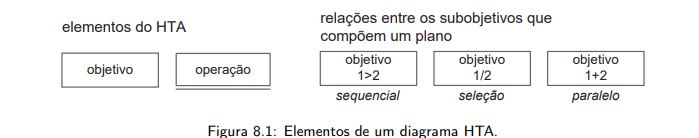
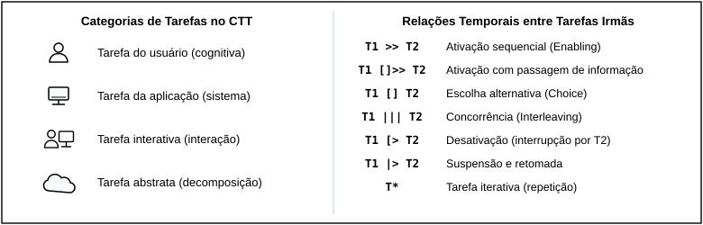

<b>Tabela de Contribuição</b>

| Membro | Contribuição |
| :--- | :--- |
| **Daniel da Silva Batista** | Concepção, estruturação e elaboração integral das 3 Listas de Verificação de Inspeção da Etapa 4 (Lista de Verificação de HTA com 10 itens, Lista de Verificação de CTT com 10 itens em 3 blocos e Lista de Verificação de Storyboard com 20 itens em 5 blocos), fundamentadas em *Barbosa et al.* (2021) e *Preece, Rogers e Sharp* (2005). |
| **Gemini** | Apoio na organização e diagramação Markdown (conforme Política de IA). |

<b>Fonte:</b> Daniel da Silva Batista (2026).

# Listas de Verificação para Inspeção — Etapa 4 (HTA, CTT e Storyboard)

## 1. Introdução e Orientações de Aplicação

Este artefato reúne os **três instrumentos normativos de inspeção por lista de verificação (*checklists*)** elaborados pelo **Grupo 07** para a avaliação e verificação cruzada dos modelos de **Análise de Tarefas (HTA e CTT)** e dos **Storyboards** do projeto **PCI Concursos** (`pciconcursos.com.br`), servindo como base metodológica para os planejamentos da **Etapa 4** e preparando o terreno para a execução das inspeções e consolidação dos relatos na **Etapa 5**:

1. **[Lista de Verificação para Análise Hierárquica de Tarefas (HTA)](#2-lista-de-verificacao-para-hta-10-itens)** — **10 itens** voltados à estrutura hierárquica, formulação do objetivo, decomposição mutuamente exclusiva e exaustiva, notação gráfica, numeração posicional, planos com operadores lógicos, critério de parada e representação tabular (*Barbosa et al., 2021*);
2. **[Lista de Verificação para Árvores de Tarefas Concorrentes (CTT)](#3-lista-de-verificacao-para-ctt-10-itens-em-3-blocos)** — **10 itens organizados em 3 blocos** (Bloco I: Estrutura do modelo e classificação nos 4 tipos; Bloco II: Relações e operadores temporais entre tarefas irmãs; Bloco III: Alcance e limitações da notação quanto ao tratamento de erros) (*Barbosa et al., 2021*);
3. **[Lista de Verificação para Storyboard](#4-lista-de-verificacao-para-storyboard-20-itens-em-5-blocos)** — **20 itens organizados em 5 blocos** (Bloco I: Caracterização do storyboard como protótipo; Bloco II: Articulação com os cenários; Bloco III: Conteúdo dos quadros e técnica de esboço; Bloco IV: Uso no processo de design; Bloco V: Limitações, concessões e complementos) (*Preece, Rogers & Sharp, 2005, Cap. 8; Barbosa et al., 2021*).

### 1.1 Critérios de Julgamento

Cada pergunta de verificação é autocontida e deve ser respondida pelo inspetor com uma única marcação entre as três opções padronizadas:

* **Conforme (`☑ Conforme`)** — O artefato inspecionado atende integralmente ao critério estabelecido na literatura;
* **Não conforme (`☑ Não conforme`)** — O artefato viola o critério ou omite elemento obrigatório (todo item classificado como *Não conforme* gera obrigatoriamente um registro de problema `PAT-nn` ou `PSB-nn` no Relato dos Resultados);
* **Não se aplica (`☑ Não se aplica`)** — O critério avalia uma condição ou operador específico que legitimamente não ocorre no escopo daquela tarefa ou narrativa.

## 2. Lista de Verificação para HTA (10 Itens)

A Tabela 1 apresenta os **10 itens de verificação** aplicados a cada modelo de [Análise Hierárquica de Tarefas (HTA)](../analise-de-requisitos/analise-de-tarefas/hta.md), elaborados a partir de *Barbosa et al.* (2021, Cap. 6 / Cap. 8) e alinhados ao [Planejamento da Avaliação da Análise de Tarefas](planejamento-avaliacao-analise-de-tarefas.md#67-roteiro-da-inspecao) (Tabela 8) e ao [Planejamento do Relato da Análise de Tarefas](resultado-analise-de-tarefas.md#34-sintese-da-inspecao-por-lista-de-verificacao) (Tabela 2).

<b>Tabela 1: Lista de Verificação para Análise Hierárquica de Tarefas (HTA)</b>

| ID | Dimensão Verificada | Pergunta de Verificação | Fonte / Fundamentação |
| :---: | :--- | :--- | :--- |
| **HTA-01** | **Formulação do Objetivo** | O objetivo principal da tarefa (nível `0`) foi identificado antes das ações operacionais e está formulado como um estado ou meta que o usuário deseja atingir (verbo no infinitivo + objeto)? | Barbosa et al. (2021, Cap. 8, Seção de HTA); Diaper (2004). |
| **HTA-02** | **Estrutura Hierárquica** | A tarefa foi decomposta de forma hierárquica coerente, desmembrando o objetivo de alto nível (`0`) em subobjetivos intermediários (`1.`, `2.`...) e estes em operações concretas nos níveis inferiores (`1.1.`, `1.2.`, `1.2.1.`)? | Barbosa et al. (2021, Cap. 8, Fig. 8.1 e Fig. 8.2). |
| **HTA-03** | **Exclusividade e Exaustão** | Os subobjetivos subordinados a um mesmo objetivo-pai são mutuamente exclusivos (sem sobreposição de escopo entre irmãos) e coletivamente exaustivos (juntos cumprem 100% do objetivo-pai, sem etapas ocultas)? | Barbosa et al. (2021, Cap. 8, Passos da HTA). |
| **HTA-04** | **Notação Gráfica de Objetivos e Operações** | O diagrama diferencia visualmente os objetivos não terminais (retângulos simples que possuem filhos) das operações/nós-folha (retângulos com linha dupla horizontal na base, que não são mais decompostos)? | Barbosa et al. (2021, Cap. 8, Fig. 8.1 — Elementos de um diagrama HTA). |
| **HTA-05** | **Numeração Hierárquica Posicional** | Cada nó do diagrama e da tabela recebe numeração hierárquica estritamente fiel à sua posição na árvore (`0` para raiz; `1.`, `2.` para nível 1; `1.1.`, `1.2.` para filhos do nó `1.`; `1.2.1.`, `1.2.2.` para filhos do nó `1.2.`)? | Barbosa et al. (2021, Cap. 8, Fig. 8.2 — Exemplo de diagrama HTA). |
| **HTA-06** | **Presença Obrigatória de Planos** | Todo objetivo que possui subobjetivos apresenta um plano explícito (`p:`) posicionado junto à linha vertical de decomposição, definindo a regra e a ordem de execução dos seus filhos diretos? | Barbosa et al. (2021, Cap. 8, Fig. 8.1 e Fig. 8.2). |
| **HTA-07** | **Operadores Lógicos dos Planos** | Os planos empregam corretamente a notação de operadores da HTA: sequência fixa (`1 > 2`), seleção/decisão condicional (`1 / 2` com especificação da regra `se...`) ou paralelismo (`1 + 2`), referenciando apenas os filhos daquele nó? | Barbosa et al. (2021, Cap. 8, Fig. 8.1 — Relações entre subobjetivos). |
| **HTA-08** | **Critério de Parada da Decomposição** | A decomposição respeita um critério claro de parada (como a regra $P \times C$ ou o foco no *o quê* o usuário realiza sem descer a microações mecânicas irrelevantes), mantendo nível de abstração adequado ao reprojeto? | Barbosa et al. (2021, Cap. 8, Passos da HTA); Annett & Duncan (1967). |
| **HTA-09** | **Especificação de Input, Ação e Feedback** | As operações e objetivos de nível inferior estão acompanhados da especificação de *input* (circunstância de ativação), *ação* e *feedback* (resposta do sistema que indica o atingimento do objetivo)? | Barbosa et al. (2021, Cap. 8, Fig. 8.1 e Tabela 8.1). |
| **HTA-10** | **Representação em Tabela com Problemas e Recomendações** | Além do diagrama hierárquico, o artefato apresenta a representação complementar em tabela contendo os objetivos/operações, planos, *input*, *feedback*, problemas/dificuldades identificados e recomendações de design? | Barbosa et al. (2021, Cap. 8, Tabela 8.1 — Representação das tarefas da HTA em tabela). |

<b>Fonte:</b> Daniel da Silva Batista (2026), com base em BARBOSA et al. (2021).

---

## 3. Lista de Verificação para CTT (10 Itens em 3 Blocos)

A Tabela 2 apresenta os **10 itens de verificação** aplicados a cada modelo de [Árvores de Tarefas Concorrentes (CTT)](../analise-de-requisitos/analise-de-tarefas/ctt.md), estruturados nos **três blocos normativos** definidos no [Planejamento da Avaliação da Análise de Tarefas](planejamento-avaliacao-analise-de-tarefas.md#67-roteiro-da-inspecao) (Tabela 8) e no [Planejamento do Relato da Análise de Tarefas](resultado-analise-de-tarefas.md#34-sintese-da-inspecao-por-lista-de-verificacao) (Tabela 3), com base em *Paternò* (1999) e *Barbosa et al.* (2021, Cap. 8).

<b>Tabela 2: Lista de Verificação para Árvores de Tarefas Concorrentes (CTT)</b>

| Bloco | ID | Pergunta de Verificação | Fonte / Fundamentação |
| :--- | :---: | :--- | :--- |
| **Bloco I — Estrutura do modelo e classificação das tarefas (Itens 1 a 2)** | **CTT-01** | As tarefas foram corretamente classificadas e representadas com os ícones canônicos dos quatro tipos do CTT: **tarefa do usuário** (pessoa — ação cognitiva/física fora do sistema), **tarefa do sistema** (computador — processamento interno sem diálogo), **tarefa interativa** (pessoa + tela — diálogo direto na interface) ou **tarefa abstrata** (nuvem — agrupamento)? | Barbosa et al. (2021, Cap. 8, Fig. 8.3 — Tipos de tarefas no CTT); Paternò (1999). |
| **Bloco I — Estrutura do modelo e classificação das tarefas (Itens 1 a 2)** | **CTT-02** | A decomposição hierárquica está coerente entre tarefas superiores e subordinadas, garantindo que a raiz e todos os nós intermediários (que possuem filhos) sejam **tarefas abstratas** (nuvem) e que nenhuma tarefa abstrata apareça como nó-folha no nível mais baixo? | Barbosa et al. (2021, Cap. 8, Fig. 8.3 e Fig. 8.5 — Exemplo de modelo CTT). |
| **Bloco II — Relações temporais entre tarefas irmãs (Itens 3 a 8)** | **CTT-03** | As relações de **ativação sequencial (`T1 >> T2`)** e de **ativação com passagem de informação (`T1 []>> T2`)** indicam corretamente quando a segunda tarefa depende do término da primeira e quando há transferência obrigatória de dados produzidos entre elas? | Barbosa et al. (2021, Cap. 8, Fig. 8.4 — Relações no CTT). |
| **Bloco II — Relações temporais entre tarefas irmãs (Itens 3 a 8)** | **CTT-04** | As escolhas entre tarefas alternativas foram representadas com o operador de **escolha (`T1 [] T2`)** nos pontos em que duas opções estão disponíveis, mas o início de uma desabilita a outra no ciclo atual? | Barbosa et al. (2021, Cap. 8, Fig. 8.4 e Fig. 8.5). |
| **Bloco II — Relações temporais entre tarefas irmãs (Itens 3 a 8)** | **CTT-05** | Tarefas simultâneas ou realizáveis em qualquer ordem (sem dependência de dados entre si) foram identificadas como concorrentes por meio do operador de **concorrência (`T1 ||| T2`)**? | Barbosa et al. (2021, Cap. 8, Fig. 8.4 e Fig. 8.5). |
| **Bloco II — Relações temporais entre tarefas irmãs (Itens 3 a 8)** | **CTT-06** | Quando tarefas concorrentes precisam trocar informações ou sincronizar estados durante sua execução paralela, essa relação foi explicitamente representada pelo operador de **concorrência e comunicação (`T1 |[]| T2`)**? | Barbosa et al. (2021, Cap. 8, Fig. 8.4 — Tarefas concorrentes e comunicantes). |
| **Bloco II — Relações temporais entre tarefas irmãs (Itens 3 a 8)** | **CTT-07** | As tarefas que podem ser executadas em qualquer ordem, mas sem sobreposição temporal (uma vez iniciada, precisa terminar antes que a outra comece), utilizam corretamente o operador de **independência (`T1 |=| T2`)**? | Barbosa et al. (2021, Cap. 8, Fig. 8.4 — Tarefas independentes). |
| **Bloco II — Relações temporais entre tarefas irmãs (Itens 3 a 8)** | **CTT-08** | As relações de interrupção distinguem adequadamente a **desativação definitiva sem retorno (`T1 [> T2`**, ex.: encerrar ou cancelar tarefa) da **suspensão temporária com retomada (`T1 |> T2`**, ex.: ajustar filtro e retomar do ponto em que parou)? | Barbosa et al. (2021, Cap. 8, Fig. 8.4 — Desativação e Suspensão/Retomada). |
| **Bloco III — Alcance e limitações da notação (Itens 9 a 10)** | **CTT-09** | O modelo explicita com clareza as relações temporais entre todas as tarefas irmãs por linha horizontal pontilhada e indica operadores unários de **opcionalidade (`[T]`)** e **iteratividade (`T*`)** quando aplicáveis ao fluxo real do usuário? | Barbosa et al. (2021, Cap. 8, Fig. 8.4 e Fig. 8.5). |
| **Bloco III — Alcance e limitações da notação (Itens 9 a 10)** | **CTT-10** | Considerando os limites da notação gráfica do CTT quanto à modelagem detalhada de prevenção e tratamento de erros humanos, tais mecanismos e fluxos de exceção estão devidamente registrados na documentação complementar do artefato (tabelas analíticas, HTA ou cenários)? | Barbosa et al. (2021, Cap. 8); Planejamento da Avaliação (Seção 6.7). |

<b>Fonte:</b> Daniel da Silva Batista (2026), com base em BARBOSA et al. (2021) e PATERNÒ (1999).

---

## 4. Lista de Verificação para Storyboard (20 Itens em 5 Blocos)

A Tabela 3 apresenta os **20 itens de verificação** aplicados a cada Storyboard individual da equipe, estruturados nos **cinco blocos normativos** definidos no [Planejamento da Avaliação do Storyboard](../avaliacao/planejamento-avaliacao-storyboard.md#67-roteiro-da-inspecao) (Tabela 7 e Tabela 8) e no [Planejamento do Relato dos Resultados do Storyboard](planejamento-relato-resultados-storyboard.md#34-sintese-da-inspecao-por-lista-de-verificacao) (Tabela 2), elaborados a partir do **Capítulo 8 de Preece, Rogers e Sharp (2005, p. 262–265)** e de *Barbosa et al.* (2021, Cap. 8 e Cap. 11).

<b>Tabela 3: Lista de Verificação para Storyboard (20 Itens em 5 Blocos)</b>

| Bloco | ID | Pergunta de Verificação | Fonte / Fundamentação |
| :--- | :---: | :--- | :--- |
| **Bloco I — Caracterização do storyboard como protótipo (Itens 1 a 4)** | **SB-01** | O artefato caracteriza-se efetivamente como um **protótipo de baixa fidelidade**, construído em formato visual simplificado sem empregar capturas de tela finais codificadas ou interfaces de alta fidelidade? | Preece, Rogers & Sharp (2005, Cap. 8, Seção 8.2, p. 262–263). |
| **Bloco I — Caracterização do storyboard como protótipo (Itens 1 a 4)** | **SB-02** | O storyboard consiste em uma **série sequencial de desenhos/quadros** que mostra como o usuário pode progredir em uma tarefa utilizando o produto em desenvolvimento na ordem esperada? | Preece, Rogers & Sharp (2005, Cap. 8, Seção 8.2.1 — *Storyboarding*, p. 263). |
| **Bloco I — Caracterização do storyboard como protótipo (Itens 1 a 4)** | **SB-03** | A finalidade do storyboard como instrumento de concepção e verificação preliminar do modelo conceitual da tarefa está explicitamente declarada no documento? | Preece, Rogers & Sharp (2005, Cap. 8, p. 263); Barbosa et al. (2021, Cap. 11). |
| **Bloco I — Caracterização do storyboard como protótipo (Itens 1 a 4)** | **SB-04** | O storyboard retrata exemplos de telas/esboços de interface articulados à ação humana (e não um mero fluxograma abstrato nem apenas telas isoladas sem ator)? | Preece, Rogers & Sharp (2005, Cap. 8, p. 263). |
| **Bloco II — Articulação com os cenários (Itens 5 a 8)** | **SB-05** | O storyboard é utilizado em conjunto direto com um **cenário escrito** previamente especificado no projeto ([Cenários](../analise-de-requisitos/cenarios.md)), mantendo fidelidade à situação-problema do usuário? | Preece, Rogers & Sharp (2005, Cap. 8, p. 263). |
| **Bloco II — Articulação com os cenários (Itens 5 a 8)** | **SB-06** | A sequência visual acrescenta **mais detalhes contextuais** ao cenário escrito (ambiente físico, postura, dispositivo, reação emocional), permitindo visualizar a situação de uso real? | Preece, Rogers & Sharp (2005, Cap. 8, p. 263). |
| **Bloco II — Articulação com os cenários (Itens 5 a 8)** | **SB-07** | Existe rastreabilidade explícita e inequívoca entre o storyboard, a **persona** protagonista ([Personas](../analise-de-requisitos/personas.md)), o **cenário** e a **tarefa modelada** na [Análise de Tarefas](../analise-de-requisitos/analise-de-tarefas/hta.md)? | Barbosa et al. (2021, Cap. 8); Plano de Ensino (Sales, 2026, Item 19). |
| **Bloco II — Articulação com os cenários (Itens 5 a 8)** | **SB-08** | A narrativa visual preserva o arco completo do cenário: **início** (gatilho/motivação e dor atual), **meio** (interação passo a passo com a solução proposta) e **fim** (desfecho e satisfação da necessidade)? | Preece, Rogers & Sharp (2005, Cap. 8, p. 263); Klemmer (2012). |
| **Bloco III — Conteúdo dos quadros e técnica de esboço (Itens 9 a 12)** | **SB-09** | Cada quadro (*frame*) descreve com precisão um passo específico da sequência da tarefa, sem omitir etapas essenciais da decomposição HTA/CTT nem incluir passos excedentes? | Preece, Rogers & Sharp (2005, Cap. 8, Fig. 8.3, p. 263–264). |
| **Bloco III — Conteúdo dos quadros e técnica de esboço (Itens 9 a 12)** | **SB-10** | A técnica de *sketching* (esboço) apoia-se em **símbolos e traços simples** e consistentes (figuras humanas esquemáticas, ícones básicos, setas indicativas), dispensando detalhamento artístico complexo? | Preece, Rogers & Sharp (2005, Cap. 8, Seção 8.2.2 — *Sketching*, p. 264). |
| **Bloco III — Conteúdo dos quadros e técnica de esboço (Itens 9 a 12)** | **SB-11** | Os desenhos permitem identificar visualmente **quem é a pessoa retratada**, **quais objetos/dispositivos ela está usando** (celular ou computador) e **onde ela está** (ambiente físico)? | Preece, Rogers & Sharp (2005, Cap. 8, p. 263–264); Roteiro de Entrevista (Item 11). |
| **Bloco III — Conteúdo dos quadros e técnica de esboço (Itens 9 a 12)** | **SB-12** | Cada quadro possui uma **legenda descritiva clara** (e transcrição textual acessível) e o conjunto visual permite ao leitor reconhecer e nomear a tarefa representada? | Preece, Rogers & Sharp (2005, Cap. 8, p. 263); Roteiro de Entrevista (Item 12). |
| **Bloco IV — Uso no processo de design (Itens 13 a 16)** | **SB-13** | O storyboard foi elaborado no momento metodológico correto do ciclo de Engenharia de Usabilidade (Nível 1 — fase inicial/conceitual, antes da prototipação em papel de Nível 2)? | Preece, Rogers & Sharp (2005, Cap. 8, p. 262); Mayhew (1999). |
| **Bloco IV — Uso no processo de design (Itens 13 a 16)** | **SB-14** | O storyboard foi (ou está planejado e preparado para ser) exibido a **usuários potenciais** representativos do perfil-alvo para coletar críticas e validar a compreensão da história? *(Verificação de fechamento pós-entrevista)* | Preece, Rogers & Sharp (2005, Cap. 8, p. 263); Planejamento (Seção 6.7). |
| **Bloco IV — Uso no processo de design (Itens 13 a 16)** | **SB-15** | Os quadros oferecem elementos suficientes para que a equipe de projeto e os participantes **percorram mentalmente (*walkthrough*) e simulem a interação** com o produto? | Preece, Rogers & Sharp (2005, Cap. 8, p. 263). |
| **Bloco IV — Uso no processo de design (Itens 13 a 16)** | **SB-16** | O artefato é tratado de forma aberta à **iteração e modificação**, prevendo o registro de alterações sugeridas pelos usuários e a evolução para nova versão quando necessário? *(Verificação de fechamento pós-entrevista)* | Preece, Rogers & Sharp (2005, Cap. 8, p. 262–264); Planejamento (Seção 6.7). |
| **Bloco V — Limitações, concessões e complementos (Itens 17 a 20)** | **SB-17** | As **limitações metodológicas** do storyboard (não testar navegabilidade real, tempo de execução nem detalhes finos de layout) estão explicitamente reconhecidas na documentação? | Preece, Rogers & Sharp (2005, Cap. 8, Tabela 8.1, p. 265); Barbosa et al. (2021, p. 303). |
| **Bloco V — Limitações, concessões e complementos (Itens 17 a 20)** | **SB-18** | As **concessões de prototipação (*trade-offs*)** — priorizar rapidez, baixo custo e foco no contexto em detrimento da fidelidade visual de componentes — foram respeitadas? | Preece, Rogers & Sharp (2005, Cap. 8, Seção 8.2.5 — *Concessões na prototipação*, p. 265). |
| **Bloco V — Limitações, concessões e complementos (Itens 17 a 20)** | **SB-19** | O storyboard articula-se com os artefatos complementares do projeto (tabelas de correspondência com subobjetivos HTA e tarefas CTT) para cobrir regras que o desenho estático não expressa sozinho? | Barbosa et al. (2021, Cap. 8); Preece, Rogers & Sharp (2005, Cap. 8). |
| **Bloco V — Limitações, concessões e complementos (Itens 20)** | **SB-20** | O storyboard é utilizado estritamente como **material de exploração conceitual** para orientar as decisões do próximo nível (Protótipo de Papel), sem ser tomado como especificação definitiva? | Preece, Rogers & Sharp (2005, Cap. 8, p. 262–265); Barbosa et al. (2021). |

<b>Fonte:</b> Daniel da Silva Batista (2026), com base em PREECE, ROGERS & SHARP (2005, Cap. 8, p. 262–265) e BARBOSA et al. (2021).

---

## 5. Fundamentação Visual das Listas de Verificação

As Figuras 1 e 2 apresentam as referências visuais canônicas extraídas da literatura de base da disciplina (*Barbosa et al.*, 2021, Cap. 8) que fundamentam os critérios de notação das Listas de Verificação de HTA e de CTT.

<b>Figura 1: Elementos Canônicos e Relações de Planos no Diagrama HTA (Itens HTA-01 a HTA-10)</b>

<b>Fonte:</b> BARBOSA et al. (2021, Cap. 8, Figura 8.1).

<b>Figura 2: Tipos de Tarefas e Operadores Temporais no Modelo CTT (Itens CTT-01 a CTT-10)</b>

<b>Fonte:</b> Adaptado de BARBOSA et al. (2021, Cap. 8, Figuras 8.3 e 8.4) e PATERNÒ (1999).

---

## 6. Referências Bibliográficas

> [1] ANNETT, John; DUNCAN, Keith D. *Task Analysis and training design. *Occupational Psychology*, v. 41, p. 211–221, 1967.  
> [2] BARBOSA, Simone D. J.; SILVA, Bruno S. da. *Interação Humano-Computador*. 1. ed. Rio de Janeiro: Elsevier, 2010.  
> [3] BARBOSA, Simone Diniz Junqueira et al. *Interação Humano-Computador e Experiência do Usuário*. Autopublicação, 2021. Cap. 8 (Organização do Espaço de Problema) e Cap. 11 (Planejamento da Avaliação de IHC).  
> [4] FAGAN, Michael E. *Design and Code Inspections to reduce errors in program development. *IBM Systems Journal*, v. 15, n. 3, p. 182–211, 1976.  
> [5] PATERNÒ, Fabio. *Model-Based Design and Evaluation of Interactive Applications*. London: Springer-Verlag, 1999.  
> [6] PREECE, Jennifer; ROGERS, Yvonne; SHARP, Helen. *Design de Interação: além da interação homem-computador*. Porto Alegre: Bookman / São Paulo: Érica, 2005. Cap. 8 (Design, Prototipação e Construção, p. 262–265).  
> [7] SALES, André Barros de. *Plano de Ensino: Interação Humano Computador*. Brasília: Universidade de Brasília, FGA/UnB, 2026.  

---

## Histórico de Versões

| Versão | Data | Descrição | Autor(es) | Revisor(es) |
| :---: | :---: | :--- | :--- | :--- |
| `1.0` | 23/10/2026 | Elaboração e consolidação das 3 Listas de Verificação para Inspeção da Etapa 4: HTA (10 itens), CTT (10 itens em 3 blocos) e Storyboard (20 itens em 5 blocos), com fundamentação na literatura e critérios de julgamento. | Daniel da Silva Batista | — |
