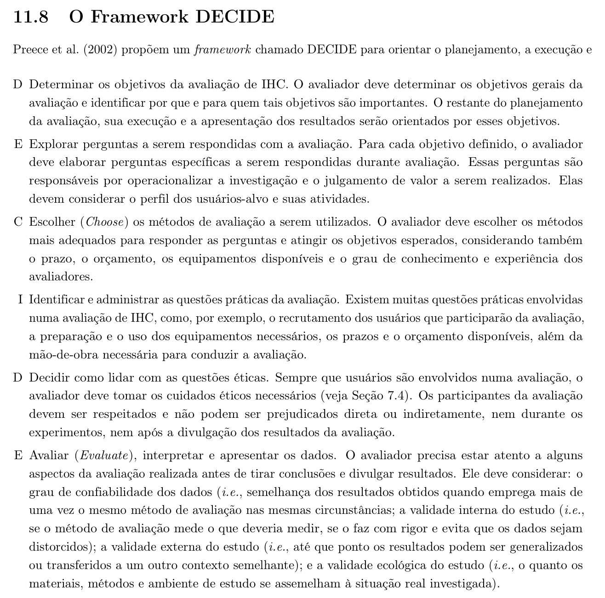
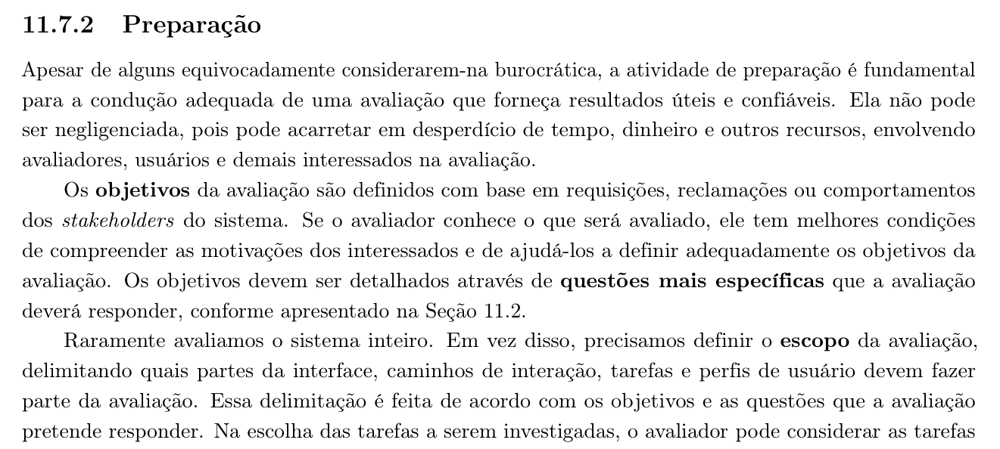

<b>Tabela de Contribuição</b>

| Membro | Contribuição |
| :--- | :--- |
| Daniel da Silva Batista | Redação do planejamento, fundamentação teórica (DECIDE), definição do escopo e dos objetivos, elaboração do roteiro de inspeção e de entrevista e condução da entrevista com o USR-06. |
| Arthur Sismene Carvalho | Condução da entrevista com o USR-08 e apoio na revisão dos objetivos de avaliação. |
| Leonardo da Silva Lopes Júnior | Preparação do material de apoio e condução da entrevista com o USR-09. |
| Pedro Rocha Ferreira Lima | Revisão técnica geral, recrutamento dos participantes e condução da entrevista com o USR-07. |
| Gemini | Auxílio na estruturação textual, organização das tabelas e formatação em Markdown (conforme Política de Uso de IA). |

<b>Fonte:</b> Daniel da Silva Batista (2026).

# Planejamento da Avaliação da Análise de Tarefas

## 1. Introdução

Este documento planeja a avaliação dos artefatos de **Análise de Tarefas** produzidos pelo grupo — os modelos em [HTA](../analise-de-requisitos/analise-de-tarefas/hta.md) e em [CTT](../analise-de-requisitos/analise-de-tarefas/ctt.md) das oito tarefas que o reprojeto do PCI Concursos deve apoiar. O documento define o que será avaliado, com que objetivo, por qual método, com quais participantes, em que prazo e sob quais cuidados éticos. Os resultados serão registrados em página própria, cuja estrutura está definida no [Planejamento do Relato dos Resultados](resultado-analise-de-tarefas.md).

Avaliar a análise de tarefas tem precedência sobre as demais avaliações da etapa, e por um motivo prático: os storyboards, os protótipos e o próprio guia de estilo são construídos a partir dela. Um passo mal decomposto aqui se propaga silenciosamente por todos os artefatos seguintes, e fica cada vez mais caro de corrigir.

---

## 2. Metodologia

O planejamento segue o framework **DECIDE**, proposto por Preece et al. (2002) e apresentado por Barbosa et al. (2021) na Seção 11.8. Cada letra corresponde a uma atividade do planejamento, e as atividades são interligadas e executadas iterativamente. A Tabela 1 apresenta as seis atividades.

<b>Tabela 1: Atividades do Framework DECIDE</b>

| Letra | Atividade |
| :---: | :--- |
| **D** | Determinar os objetivos da avaliação de IHC |
| **E** | Explorar perguntas a serem respondidas com a avaliação |
| **C** | Escolher (*Choose*) os métodos de avaliação a serem utilizados |
| **I** | Identificar e administrar as questões práticas da avaliação |
| **D** | Decidir como lidar com as questões éticas |
| **E** | Avaliar (*Evaluate*), interpretar e apresentar os dados |

<b>Fonte:</b> BARBOSA et al. (2021, p. 303–304).

A Figura 1 reproduz o trecho da literatura (Seção 11.8, p. 303–304) que apresenta o framework e descreve as seis atividades que o compõem.

<b>Figura 1: Referência Bibliográfica — O Framework DECIDE</b>

<b>Fonte:</b> BARBOSA et al. (2021, p. 303–304).

---

## 3. D — Determinar os Objetivos da Avaliação

**Objetivo geral:** verificar se os modelos de tarefa em HTA e em CTT descrevem corretamente as tarefas que o PCI Concursos reprojetado deve apoiar, e se estão construídos conforme as regras das duas notações.

**Objetivos específicos:**

1. Verificar a conformidade dos modelos com as regras de notação de HTA e de CTT.
2. Confrontar a decomposição modelada com o modo como os usuários esperam alcançar cada objetivo, identificando passos ausentes, desnecessários ou fora de ordem.
3. Identificar caminhos alternativos de realização das tarefas que não foram previstos na modelagem.
4. Registrar os pontos de atrito e de desistência no procedimento que os usuários adotam hoje para alcançar os mesmos objetivos, verificando se a tarefa proposta os elimina.
5. Verificar a coerência entre cada modelo de tarefa e o [cenário](../analise-de-requisitos/cenarios.md) e a [persona](../analise-de-requisitos/personas.md) a que ele está associado.

**Para quem esses objetivos importam:** para a equipe, que depende desses modelos como entrada dos artefatos das etapas seguintes; e para os usuários, cuja forma real de trabalhar é o critério de correção do modelo.

---

## 4. E — Explorar as Perguntas a Serem Respondidas

As perguntas da Tabela 2 operacionalizam os objetivos da seção anterior.

<b>Tabela 2: Perguntas da Avaliação</b>

| ID | Pergunta | Objetivo relacionado |
| :---: | :--- | :---: |
| **PA-01** | Os diagramas HTA respeitam a notação: objetivo no topo, decomposição em subtarefas, numeração hierárquica e planos descritos? | 1 |
| **PA-02** | Os modelos CTT classificam cada tarefa em um dos quatro tipos previstos e empregam corretamente os operadores temporais entre tarefas irmãs? | 1 |
| **PA-03** | A decomposição modelada corresponde à sequência de passos que o usuário esperaria executar para alcançar o objetivo da tarefa? | 2 |
| **PA-04** | Há passos que o usuário considera necessários e que não aparecem no modelo, ou passos modelados que ele considera dispensáveis? | 2 |
| **PA-05** | Existem caminhos alternativos para alcançar o mesmo objetivo que não foram modelados? | 3 |
| **PA-06** | Como os usuários alcançam hoje esses mesmos objetivos, em que ponto encontram atrito, e a tarefa modelada resolve esse atrito? | 4 |
| **PA-07** | A tarefa modelada é compatível com o cenário e com a persona a que está associada, sobretudo quanto ao dispositivo e ao tempo disponível? | 5 |

<b>Fonte:</b> Daniel da Silva Batista (2026).

---

## 5. C — Escolher os Métodos de Avaliação

A análise de tarefas é um **modelo**, não uma interface: não há tela para o usuário operar, e por isso nenhum método que dependa de observar o uso do sistema se aplica diretamente ao artefato. A avaliação é conduzida em duas etapas, pela mesma razão apresentada por Barbosa et al. (2021, p. 297): avaliar conformidade com um padrão pede inspeção, enquanto avaliar como os usuários realizam suas atividades pede a participação deles. A Tabela 3 apresenta os métodos selecionados.

<b>Tabela 3: Métodos Selecionados</b>

| Etapa | Método | Responde a | Participantes | Justificativa |
| :--- | :--- | :---: | :--- | :--- |
| **1ª — Inspeção** | Inspeção por lista de verificação, usando as *Listas de Verificação para HTA* e *para CTT* (10 itens cada) elaboradas na disciplina a partir de Barbosa et al. (2021) | PA-01 e PA-02 | Os quatro integrantes do grupo, em inspeção cruzada | É o método adequado para verificar conformidade com uma notação, e dispensa usuários |
| **2ª — Investigação** | Entrevista semiestruturada com roteiro, em que o participante relata como alcança o objetivo hoje e depois avalia a decomposição proposta no diagrama | PA-03 a PA-07 | Quatro usuários externos (USR-06 a USR-09) | Revela caminhos percorridos pelos usuários de forma criativa e oportunista, que o avaliador não previu |

<b>Fonte:</b> Daniel da Silva Batista (2026).

Uma característica das tarefas avaliadas condiciona todo o roteiro: elas descrevem o que o **sistema reprojetado** deve apoiar, e boa parte delas não existe no portal atual — não há mapa georreferenciado, simulador de prazos recursais, caderno exportável nem comparação de editais lado a lado. Logo, o participante não pode ser solicitado a descrever como executa essas tarefas hoje. O roteiro faz duas coisas em sequência: pergunta primeiro **como ele alcança o objetivo hoje**, com os recursos que existem ou fora do portal, e só então apresenta a decomposição proposta para que ele a julgue. A ordem importa — apresentado o modelo antes, é mais fácil concordar com ele do que contradizê-lo.

---

## 6. I — Identificar e Administrar as Questões Práticas

A Figura 2 reproduz o trecho da literatura (Seção 11.7.2, p. 298) que trata da atividade de preparação da avaliação, na qual se definem os objetivos por meio de questões específicas e se delimita o escopo do que será avaliado.

<b>Figura 2: Referência Bibliográfica — A Atividade de Preparação da Avaliação</b>

<b>Fonte:</b> BARBOSA et al. (2021, p. 298).

### 6.1 Escopo

Entram na avaliação as **oito tarefas** da versão vigente da matriz de tarefas do grupo, TAR-01 a TAR-08, nas duas notações — dezesseis modelos ao todo. Cada tarefa está associada a um [cenário](../analise-de-requisitos/cenarios.md) e a uma persona, e essa associação faz parte do que será verificado. A Tabela 4 apresenta as tarefas no escopo.

<b>Tabela 4: Tarefas no Escopo da Avaliação</b>

| Tarefa | Enunciado | Cenário | Persona | Responsável pela modelagem |
| :---: | :--- | :---: | :--- | :--- |
| **TAR-01** | Parametrizar busca avançada multicritério e comparar editais concorrentes lado a lado | CEN-01 | PER-01 — Maria Helena dos Santos | Daniel da Silva Batista |
| **TAR-02** | Montar e exportar caderno personalizado de provas anteriores com gabarito comentado integrado | CEN-02 | PER-01 — Maria Helena dos Santos | Daniel da Silva Batista |
| **TAR-03** | Explorar mapa interativo georreferenciado de oportunidades com cálculo de mobilidade | CEN-03 | PER-02 — Lucas Ferreira Rocha | Pedro Rocha Ferreira Lima |
| **TAR-04** | Acompanhar timeline interativa de fases do certame com simulador de prazos recursais e sincronização de calendário | CEN-04 | PER-02 — Lucas Ferreira Rocha | Pedro Rocha Ferreira Lima |
| **TAR-05** | Simulado online interativo com feedback automático de gabarito | CEN-05 | PER-03 — Thiago Moraes Albuquerque | Arthur Sismene Carvalho |
| **TAR-06** | Busca de oportunidades de estágio | CEN-06 | PER-03 — Thiago Moraes Albuquerque | Arthur Sismene Carvalho |
| **TAR-07** | Consulta a videoaulas e dicas didáticas | CEN-07 | PER-04 — Renata Cristina Freitas | Leonardo da Silva Lopes Júnior |
| **TAR-08** | Alertas inteligentes de editais por e-mail com filtros avançados | CEN-08 | PER-04 — Renata Cristina Freitas | Leonardo da Silva Lopes Júnior |

<b>Fonte:</b> Daniel da Silva Batista (2026), a partir da matriz de tarefas e da página de Cenários.

A inspeção cobre os dezesseis modelos. As entrevistas cobrem as oito tarefas distribuídas entre **quatro sessões**, duas tarefas por sessão — uma sessão por integrante do grupo, com cada integrante validando as tarefas que ele próprio modelou. Cada tarefa é validada uma única vez; a consequência disso para a análise está registrada na Seção 8. A Tabela 5 apresenta essa distribuição.

<b>Tabela 5: Distribuição das Tarefas entre as Sessões</b>

| Sessão | Participante | Tarefas validadas | Persona de referência | Entrevistador |
| :---: | :---: | :--- | :--- | :--- |
| **S1** | USR-06 | TAR-01 e TAR-02 | PER-01 — Maria Helena dos Santos | Daniel da Silva Batista |
| **S2** | USR-07 | TAR-03 e TAR-04 | PER-02 — Lucas Ferreira Rocha | Pedro Rocha Ferreira Lima |
| **S3** | USR-08 | TAR-05 e TAR-06 | PER-03 — Thiago Moraes Albuquerque | Arthur Sismene Carvalho |
| **S4** | USR-09 | TAR-07 e TAR-08 | PER-04 — Renata Cristina Freitas | Leonardo da Silva Lopes Júnior |

<b>Fonte:</b> Daniel da Silva Batista (2026).

O agrupamento não é arbitrário: as duas tarefas de cada sessão pertencem à mesma persona, de modo que o participante recrutado para aquela sessão só precisa se reconhecer em um perfil, e não em dois.

Fora do escopo: a avaliação da interface atual do portal e a verificação de viabilidade técnica das funcionalidades propostas. O objeto aqui é o modelo de tarefas — se a decomposição descreve corretamente o que o usuário precisa fazer —, não se o recurso pode ou não ser implementado.

### 6.2 Recrutamento e perfil dos participantes

São **quatro participantes**, um recrutado por integrante do grupo, todos do **Perfil 1 — Candidato/Concurseiro**, conforme o [Perfil de Usuário](../analise-de-requisitos/perfil-de-usuario.md). O número é um a menos que os cinco usuários apontados como suficientes para encontrar a maioria dos problemas de interface (Nielsen, 2000, apud Barbosa et al., 2021, p. 298), e decorre do tamanho da equipe: cada integrante conduz uma sessão. A Tabela 6 apresenta os critérios de seleção.

<b>Tabela 6: Critérios de Seleção dos Participantes</b>

| Critério | Exigência |
| :--- | :--- |
| Perfil | Perfil 1 — Candidato/Concurseiro |
| Aderência à persona | Cada participante deve se aproximar da persona de referência da sua sessão, conforme a Tabela 5, sobretudo em faixa etária, rotina de estudo e dispositivo de acesso |
| Faixa etária | 18 a 55 anos — o conjunto das quatro sessões cobre as quatro personas e, com elas, toda a faixa |
| Experiência com o domínio | Ter se inscrito ou estudado para ao menos um concurso público |
| Experiência com o portal | Ter utilizado o PCI Concursos nos últimos seis meses, condição necessária para relatar como alcança hoje os objetivos das tarefas |
| Dispositivo de acesso habitual | Ao menos dois dos quatro participantes devem ser usuários predominantemente de smartphone |
| Vínculo com o avaliador | Evitar parentes, amigos próximos e colegas de turma do avaliador |

<b>Fonte:</b> Daniel da Silva Batista (2026).

Os participantes são identificados pelos códigos **USR-06** a **USR-09**, dando continuidade à numeração adotada no Perfil de Usuário. Os participantes desta avaliação **não** participam da avaliação dos storyboards: quem já discutiu a decomposição de uma tarefa reconheceria aquela mesma sequência nos desenhos, e a validação do storyboard perderia o sentido.

### 6.3 Papéis e preparação

Cada sessão tem **um entrevistador**, que conduz o roteiro, observa e anota, e preferencialmente um observador silencioso responsável apenas pelo registro. As sessões são **remotas**, por videoconferência, com compartilhamento de tela pelo entrevistador para exibir os diagramas no momento previsto do roteiro.

Os diagramas HTA são exibidos aos participantes; os modelos **CTT não são**. A notação CTT exige conhecimento prévio dos operadores temporais, e pedir que um usuário a interprete testaria o conhecimento dele sobre a notação, não a correção do modelo. O que a entrevista coleta para o CTT é a informação de ordem e simultaneidade entre passos — pergunta 6 do roteiro —, que a equipe traduz depois para os operadores.

Como várias tarefas descrevem recursos que o portal ainda não possui, o entrevistador apresenta cada uma com uma frase curta de enquadramento antes de exibir o diagrama, deixando claro que se trata de uma **proposta** e não de algo que o participante deveria conhecer. Essa frase é a mesma para todos os participantes e consta do roteiro de abertura.

### 6.4 Material de apoio

- **Termo de Consentimento Livre e Esclarecido (TCLE)**, conforme o modelo definido em [Aspectos Éticos](../analise-de-requisitos/aspectos-eticos.md);
- **Roteiro de abertura**, com objetivos, procedimento, cuidados éticos e as frases de enquadramento de cada tarefa;
- **Diagramas HTA** das duas tarefas de cada sessão, em arquivo legível em tela;
- **Roteiro de entrevista** (Tabela 9);
- **Formulário de acompanhamento**, para registro do procedimento atual relatado, das divergências e dos caminhos alternativos;
- **[Listas de Verificação para HTA e para CTT](../apresentacao/listas-verificacao-hta-ctt-storyboard.md)**, usadas na etapa de inspeção.

Todos os participantes recebem o mesmo material e as mesmas orientações.

### 6.5 Custos e recursos

Sessões remotas em ferramentas gratuitas: **não há custo financeiro**. Os recursos necessários são computador com câmera e microfone, conexão à internet, ferramenta de videoconferência com gravação e armazenamento em nuvem restrito à equipe.

### 6.6 Cronograma

A Tabela 7 apresenta o cronograma planejado da avaliação.

<b>Tabela 7: Cronograma Planejado da Avaliação</b>

| Etapa | Responsável | Data | Horário |
| :--- | :--- | :---: | :---: |
| Inspeção cruzada dos modelos HTA e CTT | Todos os integrantes | 14/10/2026 | 20:00 às 21:30 |
| Correção dos modelos após a inspeção | Autores de cada tarefa | 15/10/2026 | — |
| Teste-piloto | Arthur Sismene Carvalho e Leonardo da Silva Lopes Júnior | 15/10/2026 | 20:00 às 20:45 |
| Sessão S1 — USR-06 | Daniel da Silva Batista | 16/10/2026 | 19:00 às 19:40 |
| Sessão S2 — USR-07 | Pedro Rocha Ferreira Lima | 16/10/2026 | 20:00 às 20:40 |
| Sessão S3 — USR-08 | Arthur Sismene Carvalho | 17/10/2026 | 18:00 às 18:40 |
| Sessão S4 — USR-09 | Leonardo da Silva Lopes Júnior | 17/10/2026 | 19:00 às 19:40 |
| Consolidação e redação do relato | Todos os integrantes | 19/10/2026 | 14:00 às 17:00 |

<b>Fonte:</b> Daniel da Silva Batista (2026).

Cada sessão é dimensionada em **40 minutos**, para duas tarefas. A estimativa respeita o limite de cerca de 20 minutos por tarefa e mantém a sessão bem abaixo da hora que costuma ser o limite confortável para o participante.

### 6.7 Roteiro da inspeção

A inspeção usa as duas listas de verificação elaboradas na disciplina, aplicadas uma vez para cada modelo e descritas na Tabela 8.

<b>Tabela 8: Instrumentos de Inspeção</b>

| Instrumento | Itens | O que verifica |
| :--- | :---: | :--- |
| [Lista de Verificação para HTA](../apresentacao/listas-verificacao-hta-ctt-storyboard.md#2-lista-de-verificacao-para-hta-10-itens) | 10 | Estrutura hierárquica, formulação do objetivo, decomposição em subtarefas, numeração, planos e critério de parada |
| [Lista de Verificação para CTT](../apresentacao/listas-verificacao-hta-ctt-storyboard.md#3-lista-de-verificacao-para-ctt-10-itens-em-3-blocos) | 10, em três blocos | Bloco I — estrutura do modelo e classificação das tarefas nos quatro tipos; Bloco II — emprego dos operadores temporais entre tarefas irmãs; Bloco III — alcance e limitações da notação |

<b>Fonte:</b> Daniel da Silva Batista (2026), a partir das Listas de Verificação para HTA e para CTT.

Cada item é respondido como **Conforme**, **Não conforme** ou **Não se aplica**. A inspeção é **cruzada**: nenhum integrante inspeciona o modelo que ele próprio construiu, e cada modelo recebe duas respostas independentes. As divergências são resolvidas em reunião, e o item 10 da lista de CTT — que trata do registro de mecanismos de prevenção e tratamento de erro, ausentes da notação — é respondido consultando os demais artefatos do projeto, não apenas o diagrama.

À inspeção por lista soma-se uma verificação de coerência externa, que responde à PA-07: para cada tarefa, confere-se se o objetivo modelado é o mesmo declarado no cenário correspondente e se as condições da persona — dispositivo, tempo disponível, familiaridade com tecnologia — são compatíveis com a decomposição proposta. Uma tarefa de doze passos atribuída a uma persona que estuda em blocos de dez minutos no celular é uma incoerência que a lista de verificação, sozinha, não detecta.

### 6.8 Roteiro da entrevista

As perguntas 1 a 5 da Tabela 9 são feitas uma vez para cada tarefa da sessão. As perguntas 6 a 8 encerram a sessão.

<b>Tabela 9: Roteiro de Entrevista</b>

| Nº | Pergunta | Respostas possíveis | Pergunta da avaliação |
| :---: | :--- | :--- | :---: |
| 1 | *(ler o objetivo da tarefa, sem exibir o diagrama)* Hoje, quando você precisa alcançar esse objetivo, o que você faz? Pode ser no PCI Concursos ou fora dele. | Discursiva | PA-06 |
| 2 | Nesse procedimento que você acabou de descrever, o que mais te atrasa ou te irrita? | Discursiva | PA-06 |
| 3 | *(exibir o diagrama HTA e enquadrar como proposta)* Esses passos fazem sentido para alcançar esse objetivo? A ordem é a que você esperaria? | Sim / Não / Em parte — com justificativa | PA-03 |
| 4 | Falta algum passo no diagrama? Em que ponto ele entraria? | Discursiva | PA-04 |
| 5 | Algum passo do diagrama parece desnecessário ou complicado demais? | Discursiva | PA-04 |
| 6 | Entre esses passos, quais poderiam ser feitos em qualquer ordem e quais precisariam obrigatoriamente vir antes de outros? | Discursiva | PA-02 |
| 7 | Você imagina outro caminho para chegar a esse mesmo objetivo? Qual? | Discursiva | PA-05 |
| 8 | Você faria isso pelo celular ou pelo computador? Quanto tempo aceitaria gastar nessa tarefa? | Discursiva | PA-07 |

<b>Fonte:</b> Daniel da Silva Batista (2026).

### 6.9 Execução do roteiro

As perguntas 1 e 2 são as mais importantes do roteiro e as mais fáceis de estragar. O entrevistador não deve completar frases, sugerir o próximo passo nem adiantar o que a tarefa proposta fará: uma pausa longa do participante é um dado, não um silêncio a ser preenchido. Se o participante responder que nunca precisou daquilo, o entrevistador registra e segue — a ausência de demanda para uma tarefa proposta é, por si só, um resultado relevante da avaliação.

A pergunta 6 alimenta a revisão dos operadores temporais do CTT. A pergunta 8 alimenta a verificação de coerência com a persona, confrontando o dispositivo e o tempo que o participante declara com os que o cenário pressupõe.

Caso específico da **TAR-06**: a busca de estágio é hoje uma lacuna do portal. A pergunta 1 serve para verificar se os usuários chegam a procurar estágio ali e desistem, ou se nunca cogitaram o PCI Concursos para isso. A diferença entre as duas respostas muda a tarefa: um percurso que ninguém tenta percorrer não é uma tarefa frustrada, é uma tarefa inexistente.

Toda divergência apontada é registrada como o participante a formulou e discutida depois, em grupo — nunca contestada durante a sessão.

---

## 7. D — Decidir Como Lidar com as Questões Éticas

A avaliação segue o que está definido em [Aspectos Éticos](../analise-de-requisitos/aspectos-eticos.md), apoiado nos princípios da autonomia, beneficência, não maleficência, e justiça e equidade, e na Resolução CNS nº 466/2012, na Resolução CNS nº 510/2016 e na Lei nº 13.709/2018 (LGPD).

Para cada sessão:

- o TCLE é lido em voz alta antes de qualquer gravação, e o consentimento verbal é registrado no início do arquivo;
- fica explícito que o objeto da avaliação é o modelo de tarefas, nunca o participante — não existe forma errada de usar o site, e divergir do diagrama é exatamente o dado procurado;
- a participação é voluntária e pode ser interrompida a qualquer momento, sem justificativa;
- os participantes são identificados apenas pelos códigos USR-06 a USR-09;
- as gravações ficam restritas aos integrantes do grupo e são apagadas a pedido do participante.

Dois cuidados adicionais nesta avaliação. A pergunta 1 pede que o participante descreva de memória um procedimento, o que pode gerar constrangimento em quem não o recorda; o entrevistador deixa claro, antes de começar, que não lembrar é uma resposta válida e informativa. E, como parte das tarefas descreve recursos que o portal não tem, o entrevistador não deve criar expectativa de que eles serão implementados: fica dito, no roteiro de abertura, que se trata de um trabalho acadêmico de reprojeto, sem vínculo com o portal real.

---

## 8. E — Avaliar, Interpretar e Apresentar os Dados

Os dados de cada sessão são interpretados primeiro individualmente — **análise intraparticipante** —, comparando o procedimento atual relatado e o julgamento do participante com o modelo proposto. Em seguida vem a consolidação em **análise interparticipante**, buscando recorrências entre as sessões. Como cada tarefa é validada por um único participante, a recorrência não pode ser medida sobre a mesma tarefa: ela é buscada **entre tarefas**, isto é, no mesmo tipo de divergência aparecendo em modelos diferentes — um passo de autenticação omitido em três das oito tarefas é um padrão de modelagem, não um acaso. Divergências isoladas em uma única tarefa são registradas como indício a confirmar, e não como defeito comprovado.

Quatro aspectos são considerados antes de qualquer conclusão, conforme a última atividade do DECIDE. A Tabela 10 descreve como cada um é tratado.

<b>Tabela 10: Aspectos Considerados na Interpretação dos Dados</b>

| Aspecto | Como é tratado nesta avaliação |
| :--- | :--- |
| **Confiabilidade** | Mesmo roteiro e mesmo material para todos; dois inspetores independentes por modelo. Nas entrevistas não há replicação: cada tarefa é avaliada por um participante apenas |
| **Validade interna** | O relato do procedimento atual precede a exibição do diagrama, o que evita a concordância induzida; o roteiro é revisado no teste-piloto para eliminar perguntas que sugiram a resposta |
| **Validade externa** | Quatro participantes não produzem significância estatística; os resultados são tratados e apresentados como indícios |
| **Validade ecológica** | Limitada em dois graus: o participante não executa a tarefa, e boa parte das tarefas ainda não existe no portal — ele julga uma intenção de design, não uma experiência vivida. A limitação é registrada no relato, e a verificação em uso fica para a avaliação do protótipo |

<b>Fonte:</b> Daniel da Silva Batista (2026).

A apresentação dos dados segue a estrutura definida no [Planejamento do Relato dos Resultados](resultado-analise-de-tarefas.md).

---

## 9. Planejamento do Teste-Piloto

O teste-piloto avalia **o próprio planejamento**: verifica se a avaliação, tal como planejada, produz os dados necessários para responder às perguntas da Tabela 2. A Tabela 11 resume sua configuração.

<b>Tabela 11: Configuração do Teste-Piloto</b>

| Item | Definição |
| :--- | :--- |
| Data e horário | Conforme a Tabela 7 |
| Participantes | Arthur Sismene Carvalho como entrevistador e Leonardo da Silva Lopes Júnior no papel de usuário |
| Tarefas utilizadas | TAR-03 e TAR-04, modeladas por integrante que não participa do piloto |
| Local | Videoconferência, com gravação |

<b>Fonte:</b> Daniel da Silva Batista (2026).

O piloto é conduzido como uma sessão normal, do TCLE à última pergunta. Verifica se as perguntas 1 e 2 produzem um relato utilizável sem indução, se a frase de enquadramento deixa claro que a tarefa é uma proposta, se os diagramas são legíveis no compartilhamento de tela, se a pergunta 6 é compreensível para quem não conhece a notação CTT, e se os 40 minutos comportam duas tarefas. O entrevistador faz ainda uma análise breve dos dados, para confirmar que eles respondem às perguntas da avaliação.

A escolha das TAR-03 e TAR-04 para o piloto é deliberada: são as duas tarefas mais distantes do que o portal oferece hoje — mapa georreferenciado e simulador de prazos recursais —, e portanto as que submetem o enquadramento ao teste mais duro. Se o roteiro funciona com elas, funciona com as demais.

**Os dados do piloto são descartados.** Quem faz o papel de usuário não participou da modelagem das tarefas utilizadas. Detectado qualquer problema, o planejamento e o material são corrigidos, e um novo piloto é executado se as mudanças forem muitas.

---

## 10. Bibliografia

> [1] BARBOSA, Simone D. J. et al. *Interação Humano-Computador e Experiência do Usuário*. 1. ed. Autopublicação, 2021. ISBN: 978-65-00-19677-1.  
> [2] BRASIL. Conselho Nacional de Saúde. *Resolução nº 466, de 12 de dezembro de 2012*. Brasília, DF: Diário Oficial da União, 2013.  
> [3] PATERNÒ, Fabio. *Model-Based Design and Evaluation of Interactive Applications*. London: Springer-Verlag, 1999.  
> [4] PREECE, Jennifer; ROGERS, Yvonne; SHARP, Helen. *Interaction Design: Beyond Human-Computer Interaction*. New York: John Wiley & Sons, 2002. Citado por Barbosa et al. (2021, p. 303).

---

## 11. Histórico de Versões

| Versão | Data | Descrição | Autor(es) | Revisor(es) |
| :---: | :---: | :--- | :---: | :---: |
| `1.0` | 13/10/2026 | Criação do planejamento da avaliação da análise de tarefas: objetivos, perguntas, métodos (framework DECIDE), questões práticas, questões éticas e teste-piloto. | Daniel da Silva Batista | Pedro Rocha Ferreira Lima |
| `1.1` | 13/10/2026 | Atualização do escopo para a versão vigente da matriz de tarefas; vínculo de cada tarefa ao cenário e à persona; revisão do roteiro de entrevista para tarefas do sistema reprojetado; inclusão da verificação de coerência com cenário e persona (PA-07). | Daniel da Silva Batista | Arthur Sismene Carvalho |
| `1.2` | 13/10/2026 | Padronização visual conforme o Planejamento da Avaliação do Storyboard: Tabela de Contribuição, legendas e fontes centralizadas em tabelas e figuras, numeração das seções, formatação da bibliografia e data do teste-piloto concentrada na Tabela 7; correção do link para o Planejamento do Relato dos Resultados. | Daniel da Silva Batista | Arthur Sismene Carvalho |

<b>Fonte:</b> Daniel da Silva Batista (2026).

