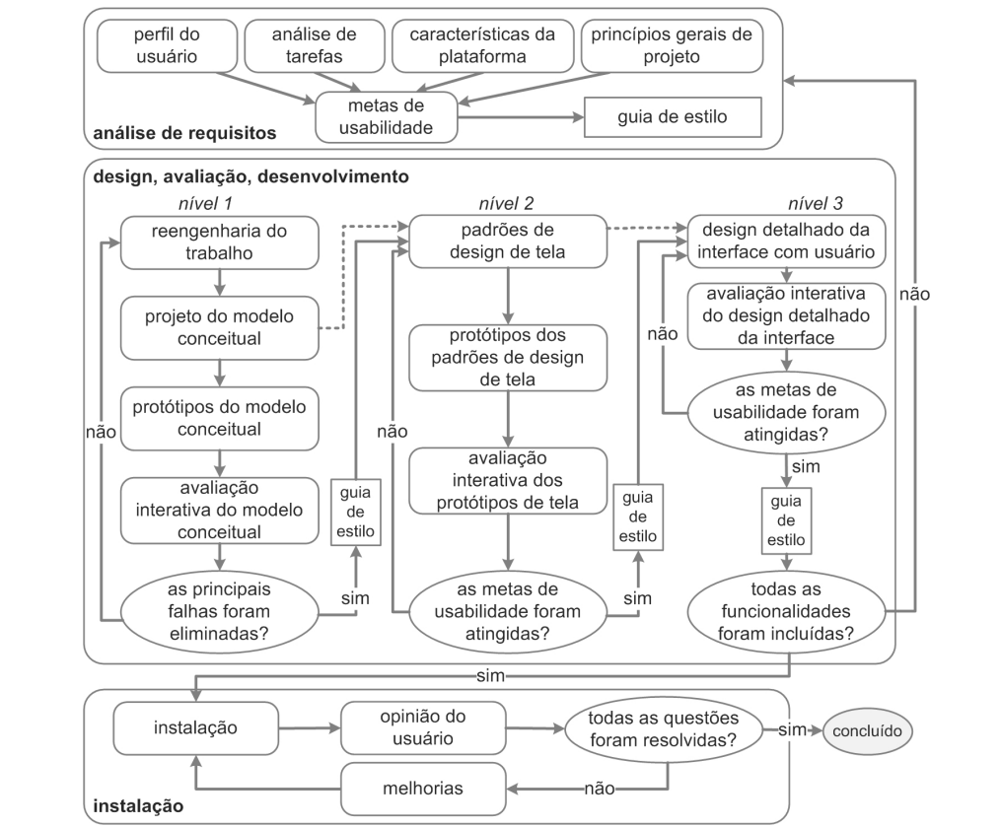

<b>Tabela de Contribuição</b>

| Membro | Contribuição |
| :--- | :--- |
| Daniel da Silva Batista | [Pesquisa dos ciclos de vida de IHC, redação do documento, detalhamento de Mayhew e aplicação prática](#2-escolha-do-processo-engenharia-de-usabilidade-de-mayhew) |
| Arthur Sismene Carvalho | [Revisão conceitual da metodologia de design de Mayhew e citação da Figura 1](#21-as-fases-de-mayhew) |
| Pedro Rocha Ferreira Lima | [Revisão técnica do alinhamento do processo com o cronograma e escopo](#3-aplicacao-pratica-no-projeto-pci-concursos) |
| Gemini | Apoio na revisão textual e padronização em Markdown (conforme Política de IA). |

<b>Fonte:</b> Daniel da Silva Batista (2026).

# Processo de Design

## 1. Introdução

Um processo de design em Interação Humano-Computador (IHC) consiste em um conjunto de atividades básicas – análise, síntese e avaliação – que visa projetar sistemas interativos com alta qualidade de uso. Existem diversas propostas de ciclos de vida na literatura, como o Ciclo de Vida Simples, o Ciclo de Vida em Estrela e a Engenharia de Usabilidade de Nielsen.

Para a condução deste projeto focado na reestruturação e avaliação do portal **PCI Concursos**, a equipe escolheu adotar o **Ciclo de Vida da Engenharia de Usabilidade de Mayhew** (MAYHEW, 1999; BARBOSA e SILVA, 2010).

## 2. Escolha do Processo: Engenharia de Usabilidade de Mayhew

A decisão por utilizar a Engenharia de Usabilidade de Mayhew baseou-se em dois fatores principais:

1. **Recomendação Acadêmica e Didática:** Conforme orientado pelo professor em sala de aula, o ciclo de Mayhew é considerado a melhor alternativa para equipes de estudantes e profissionais que estão tendo o primeiro contato prático com o ciclo de vida completo de IHC. Isso ocorre porque as etapas de Mayhew são extremamente bem detalhadas, autoexplicativas e guiadas passo a passo, reduzindo a margem de erro para quem nunca executou um projeto desse tipo antes.
2. **Alinhamento com o Cronograma:** O fluxograma proposto por Mayhew divide-se em fases e níveis de detalhamento que espelham perfeitamente as avaliações e entregas exigidas no Plano de Ensino da disciplina (desde a análise do perfil de usuário até a avaliação de protótipos de alta fidelidade).

### 2.1 As Fases de Mayhew

O processo de Mayhew é estruturado em três fases principais:

* **Fase 1: Análise de Requisitos**
    Envolve a definição das metas de usabilidade baseadas no perfil do usuário, na análise de tarefas, nas possibilidades e limitações da plataforma e nos princípios gerais de design.
* **Fase 2: Design, Avaliação e Desenvolvimento**
    Esta é a fase iterativa central do projeto. Ocorre em três níveis crescentes de fidelidade:
    * *Nível 1:* Reengenharia do trabalho e prototipação do modelo conceitual (Baixa fidelidade).
    * *Nível 2:* Estabelecimento de padrões de design de tela (Média fidelidade).
    * *Nível 3:* Design detalhado da interface (Alta fidelidade).
    Ao fim de cada nível, os protótipos são avaliados para garantir o cumprimento das metas de usabilidade.
* **Fase 3: Instalação**
    Corresponde à etapa de coleta de feedback e opiniões dos usuários após o sistema ser implementado, buscando correções em novas iterações.

A estrutura completa das três fases do ciclo e seus caminhos de retroalimentação iterativa são apresentados na **Figura 1**.

<b>Figura 1:</b> Engenharia de Usabilidade de Mayhew. <b>Fonte:</b> BARBOSA e SILVA (2010, p. 110).

## 3. Aplicação Prática no Projeto PCI Concursos

A teoria de Mayhew é aplicada de forma pragmática ao longo do nosso projeto no portal **PCI Concursos** da seguinte forma:

- Na **Fase 1 (Análise de Requisitos)**, a equipe conduziu levantamento com usuários reais (entrevistas e questionários) para caracterizar o Perfil de Usuário de candidatos e concurseiros, construindo personas, cenários e análise de tarefas (HTA e CTT), além de definir as metas de usabilidade e princípios de projeto.
- Na **Fase 2 (Design, Avaliação e Desenvolvimento)**, é conduzido o reprojeto da interface do portal, concebendo primeiro protótipos de baixa fidelidade/papel (Nível 1) e storyboards, evoluindo para padrões de tela (Nível 2) e o protótipo de alta fidelidade navegável (Nível 3), sempre submetidos a avaliações formativas e testes empíricos com usuários.
- Na **Fase 3 (Instalação)**, são consolidados os relatórios finais de avaliação, confrontando o produto com as metas estabelecidas.

---

## 4. Referências Bibliográficas

> BARBOSA, Simone D. J.; SILVA, Bruno S. da. *Interação Humano-Computador*. Rio de Janeiro: Elsevier / Campus, 2010.  
> MAYHEW, Deborah J. *The Usability Engineering Lifecycle: A Practitioner's Handbook for User Interface Design*. San Francisco: Morgan Kaufmann, 1999.  
> SALES, André Barros de. *Plano de ensino FIHC 022026 – Turma 01*. Brasília: Faculdade de Ciências e Tecnologias em Engenharia (FCTE), Universidade de Brasília (UnB), 2026.

---

## 5. Histórico de Versões

| Versão | Data | Descrição | Autor(es) | Revisor(es) |
| :---: | :---: | :--- | :---: | :---: |
| `1.0` | 06/09/2026 | Criação do documento de Processo de Design e definição da metodologia. | Daniel da Silva Batista | Pedro Rocha Ferreira Lima |
| `1.1` | 17/09/2026 | Adição da Tabela de Contribuição e padronização da IA Gemini. | Leonardo da Silva Lopes Júnior | Daniel da Silva Batista |
| `1.2` | 09/10/2026 | Correção das observações do monitor (OBS 8): chamada explícita da Figura 1 no texto, adequação do contexto para o portal PCI Concursos, inclusão de agradecimentos e referências bibliográficas. | Daniel da Silva Batista | Arthur Sismene Carvalho |

