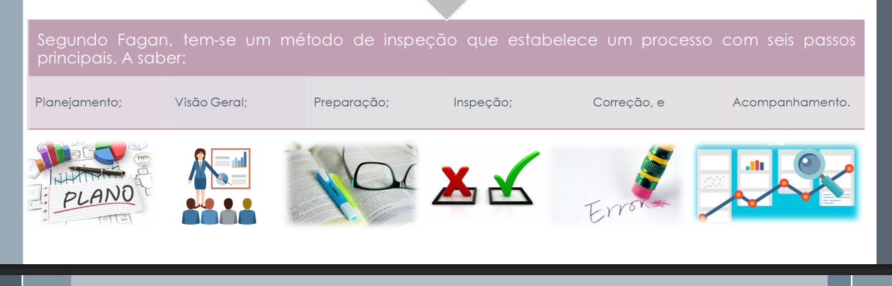

<b>Tabela de Contribuição</b>

| Membro | Contribuição |
| :--- | :--- |
| **Daniel da Silva Batista** | Estruturação da Etapa 8, descrição do método de inspeção de Fagan e planejamento da verificação (escopo, papéis, composição das listas e cronograma) ([Método de Inspeção de Fagan](#2-metodo-de-inspecao-de-fagan)). |
| **Arthur Sismene Carvalho** | Elaboração dos itens 06 a 10 das 5 listas v2 (HTA, CTT, Storyboard, Protótipo de Papel e Protótipo de Alta Fidelidade); recortes do livro a inserir ([Composição das Listas de Verificação](#31-composicao-das-listas-de-verificacao)). |
| **Pedro Rocha Ferreira Lima** | Elaboração dos itens 11 a 15 das 12 listas de verificação ([Composição das Listas de Verificação](#31-composicao-das-listas-de-verificacao)). |
| **Claude (Anthropic)** | Apoio na organização da página (conforme Política de IA). |

<b>Fonte:</b> Daniel da Silva Batista (2026).

# Verificação — Etapa 8 (Inspeção de Fagan)

## 1. Introdução

A Etapa 8 verifica os artefatos produzidos pelo Grupo 07 ao longo do projeto. A verificação é feita por **inspeção**, técnica proposta por Fagan (1976): os artefatos são examinados por integrantes que não são seus autores, com o apoio de **listas de verificação**, para encontrar e corrigir defeitos antes da entrega final.

Para isso, o grupo elabora uma lista de verificação para **cada tipo de artefato de IHC** (análise de tarefas, storyboard, protótipos, testes com usuários etc.) e depois inspeciona os próprios artefatos com essas listas. As listas cobrem os artefatos de análise, design e avaliação do projeto; os artefatos de gestão (equipe, cronograma, atas e ferramentas) e os de caráter descritivo (aspectos éticos, processo de design, sites avaliados, plataforma, princípios, metas e guia de estilo) não fazem parte da inspeção. As listas que já existiam em etapas anteriores ganham uma **versão 2 (v2)**, com link para a versão original (v1).

## 2. Método de Inspeção de Fagan

Segundo Fagan (1976), a inspeção segue um processo com seis passos principais, apresentados na Figura 1:

<b>Figura 1: Os Seis Passos do Método de Inspeção de Fagan</b>

<b>Fonte:</b> SALES (2026), com base em FAGAN (1976).

A Tabela 1 descreve como cada passo é aplicado nesta etapa:

<b>Tabela 1: Aplicação dos Passos de Fagan na Etapa 8</b>

| Passo | O que é feito | Registro |
| :--- | :--- | :--- |
| **1. Planejamento** | Definir os artefatos a inspecionar, as listas de verificação de cada tipo de artefato, os papéis (autor e inspetor) e o cronograma. | Esta página ([Seção 3](#3-planejamento-da-verificacao)). |
| **2. Visão Geral** | No início do vídeo de inspeção de cada artefato, o inspetor apresenta o artefato: o que é, qual tarefa cobre e onde está publicado. | Vídeo de inspeção e ficha de inspeção. |
| **3. Preparação** | Cada inspetor estuda sozinho o artefato que vai inspecionar, com a lista de verificação correspondente, e anota possíveis defeitos. | Anotações do inspetor. |
| **4. Inspeção** | Em um vídeo por artefato, a lista é aplicada item a item (Sim, Não ou Incompleto) e cada defeito encontrado é registrado. Nenhuma correção é feita nesse momento. | Ficha de inspeção de cada artefato. |
| **5. Correção** | O autor corrige os defeitos registrados no artefato. | Ficha de inspeção, com o link da correção. |
| **6. Acompanhamento** | O inspetor confere se cada correção resolveu o defeito e decide se o artefato está aprovado ou precisa de nova inspeção. | Ficha de inspeção e quadro-resumo. |

<b>Fonte:</b> Daniel da Silva Batista (2026), com base em FAGAN (1976).

## 3. Planejamento da Verificação

### 3.1 Composição das Listas de Verificação

Cada lista de verificação tem **15 itens**, e cada integrante elabora 5 deles. Os itens seguem as regras abaixo:

* cada item é uma **pergunta objetiva**, que pode ser respondida com Sim, Não ou Incompleto;
* a pergunta é **autoexplicativa**: termos técnicos vêm acompanhados de uma explicação entre parênteses, para que alguém que não conhece o artefato entenda o que está sendo verificado;
* cada item indica o **autor**, a **fonte** (obra e página) e o **recorte do livro** que o fundamenta.

### 3.2 Papéis

Na inspeção, ninguém inspeciona o próprio artefato. Fagan (1976) prevê também um moderador; neste projeto, pelo tamanho do grupo, as funções do moderador ficam com o inspetor. Os papéis são:

* **Autor** — quem elaborou o artefato; apresenta a visão geral e corrige os defeitos;
* **Inspetor** — conduz a inspeção, aplica a lista de verificação ao artefato, registra os defeitos e, no acompanhamento, confere as correções.

### 3.3 Listas de Verificação

A Tabela 2 apresenta as listas de verificação da Etapa 8, os artefatos a que se aplicam e a versão anterior, quando existe:

<b>Tabela 2: Listas de Verificação da Etapa 8</b>

| Lista | Versão | Aplica-se a | Versão anterior |
| :--- | :---: | :--- | :--- |
| [HTA](listas/hta-v2.md) | v2 | Análise de Tarefas — HTA | [v1 (Etapa 4)](../design-avaliacao-desenvolvimento/listas-verificacao-etapa-4.md#2-lista-de-verificacao-para-hta-10-itens) |
| [CTT](listas/ctt-v2.md) | v2 | Análise de Tarefas — CTT | [v1 (Etapa 4)](../design-avaliacao-desenvolvimento/listas-verificacao-etapa-4.md#3-lista-de-verificacao-para-ctt-10-itens-em-3-blocos) |
| [Storyboard](listas/storyboard-v2.md) | v2 | Storyboards SB-01 a SB-04 | [v1 (Etapa 4)](../design-avaliacao-desenvolvimento/listas-verificacao-etapa-4.md#4-lista-de-verificacao-para-storyboard-20-itens-em-5-blocos) |
| [Protótipo de Papel](listas/prototipo-papel-v2.md) | v2 | Relatos do protótipo de papel | Autoinspeções de [Daniel](../design-avaliacao-desenvolvimento/etapa-5/daniel-batista-prototipo-papel.md#3-autoinspecao-analitica-do-prototipo-de-papel), [Arthur](../design-avaliacao-desenvolvimento/etapa-5/arthur-carvalho-prototipo-papel.md#3-autoinspecao-analitica-do-prototipo-de-papel) e [Pedro](../design-avaliacao-desenvolvimento/etapa-5/pedro-rocha-prototipo-papel.md#3-autoinspecao-analitica-do-prototipo-de-papel) |
| [Protótipo de Alta Fidelidade](listas/prototipo-alta-fidelidade-v2.md) | v2 | Relatos do protótipo de alta fidelidade | Autoinspeções de [Daniel](../design-avaliacao-desenvolvimento/etapa-5/daniel-batista-alta-fidelidade.md#3-autoinspecao-analitica-previa-do-prototipo-de-alta-fidelidade), [Arthur](../design-avaliacao-desenvolvimento/etapa-5/arthur-carvalho-alta-fidelidade.md#3-autoinspecao-analitica-previa-do-prototipo-de-alta-fidelidade), [Leonardo](../design-avaliacao-desenvolvimento/etapa-5/leonardo-lopes-alta-fidelidade.md#3-autoinspecao-analitica-previa-do-prototipo-de-alta-fidelidade) e [Pedro](../design-avaliacao-desenvolvimento/etapa-5/pedro-rocha-alta-fidelidade.md#3-autoinspecao-analitica-previa-do-prototipo-de-alta-fidelidade) |
| [Planejamento da Avaliação](listas/planejamento-avaliacao.md) | v1 | Planejamentos da avaliação (DECIDE) | — |
| [Planejamento do Relato](listas/planejamento-relato.md) | v1 | Planejamentos do relato dos resultados | — |
| [Teste-Piloto](listas/teste-piloto.md) | v1 | Teste-piloto e pilotos dos relatos | — |
| [Teste de Usabilidade](listas/teste-usabilidade.md) | v1 | Sessões com usuários dos relatos | — |
| [Perfil de Usuário](listas/perfil-usuario.md) | v1 | Perfil do Usuário (entrevistas e questionários) | — |
| [Personas](listas/personas.md) | v1 | Personas | — |
| [Cenários](listas/cenarios.md) | v1 | Cenários | — |

<b>Fonte:</b> Daniel da Silva Batista (2026).

### 3.4 Fichas de Inspeção

A inspeção de cada conjunto de artefatos é registrada em uma ficha própria, com os seis passos de Fagan:

* [Daniel da Silva Batista](inspecoes/daniel-batista.md): inspeção dos artefatos de Pedro Rocha Ferreira Lima.
* [Grupo 06 (Grupo -1)](inspecoes/grupo-06.md): inspeção de um exemplo de cada artefato do Grupo 06, com as 12 listas.
* [Grupo 08 (Grupo +1)](inspecoes/grupo-08.md): inspeção de um exemplo de cada artefato do Grupo 08, com as 12 listas.

### 3.5 Cronograma

A Tabela 3 apresenta o cronograma da verificação:

<b>Tabela 3: Cronograma da Verificação da Etapa 8</b>

| Data | Passo de Fagan | Atividade |
| :---: | :--- | :--- |
| 21/11/2026 | Planejamento | Definição do método, das listas e dos papéis; elaboração dos itens de cada integrante. |
| 22/11/2026 | Visão Geral, Preparação e Inspeção | Gravação de um vídeo de inspeção por artefato: visão geral do artefato e aplicação da lista. |
| 22/11/2026 | Correção e Acompanhamento | Correção dos defeitos encontrados e conferência pelo inspetor. |

<b>Fonte:</b> Daniel da Silva Batista (2026).

## 4. Referências Bibliográficas

> [1] FAGAN, Michael E. Design and code inspections to reduce errors in program development. *IBM Systems Journal*, v. 15, n. 3, p. 182-211, 1976.  
> [2] SALES, André Barros de. *Plano de ensino FIHC 022026 – Turma 01*. Brasília: FCTE/UnB, 2026.

## 5. Histórico de Versões

| Versão | Data | Descrição | Autor(es) | Revisor(es) |
| :---: | :---: | :--- | :---: | :---: |
| `1.0` | 21/11/2026 | Criação da página da Etapa 8: método de inspeção de Fagan, planejamento da verificação e catálogo das listas de verificação. | Daniel da Silva Batista | — |

