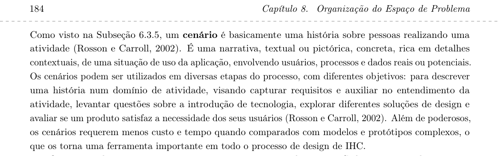
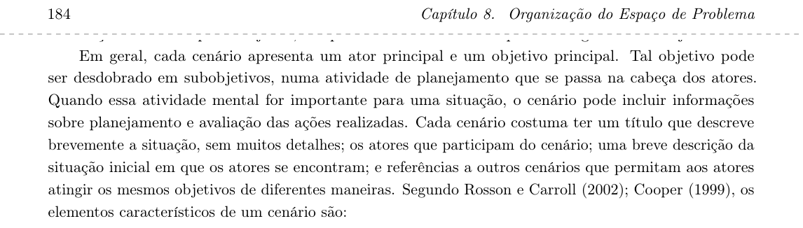
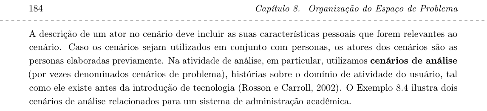
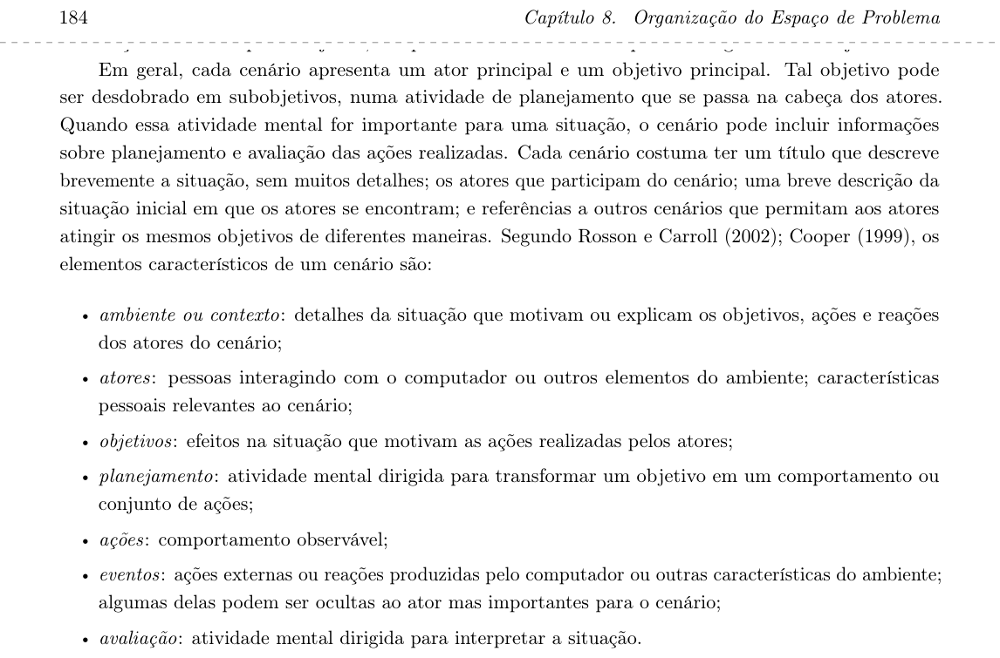
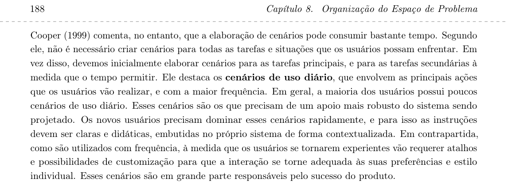

<b>Tabela de Contribuição</b>

| Membro | Contribuição |
| :--- | :--- |
| **Daniel da Silva Batista** | Elaboração dos itens CE-01 a CE-05, recortes do livro. |
| **Arthur Sismene Carvalho** | Elaboração dos itens CE-06 a CE-10 *(pendente)*. |
| **Leonardo da Silva Lopes Júnior** | Elaboração dos itens CE-11 a CE-15 *(pendente)*. |
| **Pedro Rocha Ferreira Lima** | Elaboração dos itens CE-16 a CE-20 *(pendente)*. |
| **Claude (Anthropic)** | Apoio na organização da página e na extração dos recortes do livro (conforme Política de IA). |

<b>Fonte:</b> Daniel da Silva Batista (2026).

# Lista de Verificação de Cenários

## 1. Introdução

Um **cenário** é uma narrativa concreta sobre pessoas realizando uma atividade: uma pequena história que descreve uma situação de uso do sistema, com atores, objetivos, ações e acontecimentos (BARBOSA et al., 2021).

Esta é a **primeira versão (v1)** desta lista, elaborada para a [Verificação da Etapa 8](../index.md), conduzida pelo método de inspeção de Fagan (FAGAN, 1976). Ela será aplicada, no passo de inspeção, aos seguintes artefatos do projeto:

* [Cenários](../../analise-de-requisitos/cenarios.md)

A lista tem **20 itens**, e cada integrante do grupo elabora 5 deles. Cada item é uma pergunta objetiva, com as explicações necessárias entre parênteses, para que possa ser respondida por quem não conhece o artefato. Cada item indica o autor e a fonte. A [Seção 3](#3-itens-de-verificacao) consolida todos os itens em uma tabela, e a [Seção 4](#4-detalhamento-dos-itens) detalha cada um, com a pergunta e, logo abaixo, o recorte do livro que a fundamenta.

## 2. Critérios de Julgamento

Cada item admite uma única resposta:

* **Sim** — o artefato atende integralmente ao que a pergunta descreve;
* **Não** — o artefato não atende ao que a pergunta descreve ou não apresenta a informação;
* **Incompleto** — o artefato atende apenas em parte (por exemplo, em alguns quadros, tarefas ou participantes, mas não em todos).

## 3. Itens de Verificação

A Tabela 1 consolida os 20 itens de verificação da Lista de Verificação de Cenários:

<b>Tabela 1: Itens da Lista de Verificação de Cenários</b>

| ID | Pergunta de verificação | Autor | Fonte |
| :---: | :--- | :--- | :--- |
| **CE-01** | Cada cenário é uma narrativa concreta (uma pequena história) sobre uma pessoa usando, ou tentando usar, o sistema em uma situação específica? | Daniel da Silva Batista | BARBOSA et al. (2021, p. 184) |
| **CE-02** | Cada cenário tem título, atores (as pessoas da história) e a descrição da situação inicial em que eles se encontram? | Daniel da Silva Batista | BARBOSA et al. (2021, p. 184) |
| **CE-03** | O ator principal de cada cenário (a pessoa central da história) é uma das personas do projeto? | Daniel da Silva Batista | BARBOSA et al. (2021, p. 184) |
| **CE-04** | O cenário mostra o objetivo do ator (a pessoa da história), as ações que ele realiza e os eventos (reações do sistema ou do ambiente) que ajudam ou atrapalham esse objetivo? | Daniel da Silva Batista | BARBOSA et al. (2021, p. 184) |
| **CE-05** | Há pelo menos um cenário para cada tarefa principal do projeto (as tarefas mais frequentes ou mais importantes para os usuários)? | Daniel da Silva Batista | BARBOSA et al. (2021, p. 188) |
| **CE-06** | *(a elaborar)* | Arthur Sismene Carvalho | — |
| **CE-07** | *(a elaborar)* | Arthur Sismene Carvalho | — |
| **CE-08** | *(a elaborar)* | Arthur Sismene Carvalho | — |
| **CE-09** | *(a elaborar)* | Arthur Sismene Carvalho | — |
| **CE-10** | *(a elaborar)* | Arthur Sismene Carvalho | — |
| **CE-11** | *(a elaborar)* | Leonardo da Silva Lopes Júnior | — |
| **CE-12** | *(a elaborar)* | Leonardo da Silva Lopes Júnior | — |
| **CE-13** | *(a elaborar)* | Leonardo da Silva Lopes Júnior | — |
| **CE-14** | *(a elaborar)* | Leonardo da Silva Lopes Júnior | — |
| **CE-15** | *(a elaborar)* | Leonardo da Silva Lopes Júnior | — |
| **CE-16** | *(a elaborar)* | Pedro Rocha Ferreira Lima | — |
| **CE-17** | *(a elaborar)* | Pedro Rocha Ferreira Lima | — |
| **CE-18** | *(a elaborar)* | Pedro Rocha Ferreira Lima | — |
| **CE-19** | *(a elaborar)* | Pedro Rocha Ferreira Lima | — |
| **CE-20** | *(a elaborar)* | Pedro Rocha Ferreira Lima | — |

<b>Fonte:</b> Daniel da Silva Batista, Arthur Sismene Carvalho, Leonardo da Silva Lopes Júnior e Pedro Rocha Ferreira Lima (2026), conforme o autor de cada item.

## 4. Detalhamento dos Itens

### 4.1 CE-01 — Cenário como narrativa

A Tabela 2 apresenta o item CE-01:

<b>Tabela 2: Item CE-01 — Cenário como narrativa</b>

| Campo | Registro |
| :--- | :--- |
| **Pergunta** | Cada cenário é uma narrativa concreta (uma pequena história) sobre uma pessoa usando, ou tentando usar, o sistema em uma situação específica? |
| **Autor** | Daniel da Silva Batista |
| **Fonte** | BARBOSA et al. (2021, p. 184) |

<b>Fonte:</b> Daniel da Silva Batista (2026).

A Figura 1 reproduz o trecho do livro que fundamenta o item CE-01:

<b>Figura 1: Referência Bibliográfica — Item CE-01 (Cenário como narrativa)</b>

<b>Fonte:</b> BARBOSA et al. (2021, p. 184).

### 4.2 CE-02 — Título, atores e situação inicial

A Tabela 3 apresenta o item CE-02:

<b>Tabela 3: Item CE-02 — Título, atores e situação inicial</b>

| Campo | Registro |
| :--- | :--- |
| **Pergunta** | Cada cenário tem título, atores (as pessoas da história) e a descrição da situação inicial em que eles se encontram? |
| **Autor** | Daniel da Silva Batista |
| **Fonte** | BARBOSA et al. (2021, p. 184) |

<b>Fonte:</b> Daniel da Silva Batista (2026).

A Figura 2 reproduz o trecho do livro que fundamenta o item CE-02:

<b>Figura 2: Referência Bibliográfica — Item CE-02 (Título, atores e situação inicial)</b>

<b>Fonte:</b> BARBOSA et al. (2021, p. 184).

### 4.3 CE-03 — Personas como atores

A Tabela 4 apresenta o item CE-03:

<b>Tabela 4: Item CE-03 — Personas como atores</b>

| Campo | Registro |
| :--- | :--- |
| **Pergunta** | O ator principal de cada cenário (a pessoa central da história) é uma das personas do projeto? |
| **Autor** | Daniel da Silva Batista |
| **Fonte** | BARBOSA et al. (2021, p. 184) |

<b>Fonte:</b> Daniel da Silva Batista (2026).

A Figura 3 reproduz o trecho do livro que fundamenta o item CE-03:

<b>Figura 3: Referência Bibliográfica — Item CE-03 (Personas como atores)</b>

<b>Fonte:</b> BARBOSA et al. (2021, p. 184).

### 4.4 CE-04 — Elementos do cenário

A Tabela 5 apresenta o item CE-04:

<b>Tabela 5: Item CE-04 — Elementos do cenário</b>

| Campo | Registro |
| :--- | :--- |
| **Pergunta** | O cenário mostra o objetivo do ator (a pessoa da história), as ações que ele realiza e os eventos (reações do sistema ou do ambiente) que ajudam ou atrapalham esse objetivo? |
| **Autor** | Daniel da Silva Batista |
| **Fonte** | BARBOSA et al. (2021, p. 184) |

<b>Fonte:</b> Daniel da Silva Batista (2026).

A Figura 4 reproduz o trecho do livro que fundamenta o item CE-04:

<b>Figura 4: Referência Bibliográfica — Item CE-04 (Elementos do cenário)</b>

<b>Fonte:</b> BARBOSA et al. (2021, p. 184).

### 4.5 CE-05 — Cenários para as tarefas principais

A Tabela 6 apresenta o item CE-05:

<b>Tabela 6: Item CE-05 — Cenários para as tarefas principais</b>

| Campo | Registro |
| :--- | :--- |
| **Pergunta** | Há pelo menos um cenário para cada tarefa principal do projeto (as tarefas mais frequentes ou mais importantes para os usuários)? |
| **Autor** | Daniel da Silva Batista |
| **Fonte** | BARBOSA et al. (2021, p. 188) |

<b>Fonte:</b> Daniel da Silva Batista (2026).

A Figura 5 reproduz o trecho do livro que fundamenta o item CE-05:

<b>Figura 5: Referência Bibliográfica — Item CE-05 (Cenários para as tarefas principais)</b>

<b>Fonte:</b> BARBOSA et al. (2021, p. 188).

> *Os itens CE-06 a CE-20 serão detalhados pelos respectivos autores neste mesmo formato: pergunta, autor, fonte e recorte do livro.*

## 5. Referências Bibliográficas

> [1] BARBOSA, Simone D. J.; SILVA, Bruno S. da; SILVEIRA, Milene S.; GASPARINI, Isabela; DARIN, Ticianne; BARBOSA, Gabriel D. J. *Interação Humano-Computador e Experiência do Usuário*. 1. ed. Autopublicação, 2021. ISBN: 978-65-00-19677-1.  
> [2] FAGAN, Michael E. Design and code inspections to reduce errors in program development. *IBM Systems Journal*, v. 15, n. 3, p. 182-211, 1976.  
> [3] SALES, André Barros de. *Plano de ensino FIHC 022026 – Turma 01*. Brasília: FCTE/UnB, 2026.

## 6. Histórico de Versões

| Versão | Data | Descrição | Autor(es) | Revisor(es) |
| :---: | :---: | :--- | :---: | :---: |
| `1.0` | 21/11/2026 | Criação da lista (v1): itens CE-01 a CE-05, com fonte por página e recorte do livro; itens CE-06 a CE-20 reservados aos demais integrantes. | Daniel da Silva Batista | — |

