

<b>Tabela de Contribuição</b>

| Membro | Contribuição |
| :--- | :--- |
| **Daniel da Silva Batista** | Elaboração dos itens CTT-01 a CTT-05, revisão dos itens da v1 e recortes do livro ([Itens 01–05](#41-ctt-01-os-quatro-tipos-de-tarefa-do-ctt)). |
| **Arthur Sismene Carvalho** | Elaboração dos itens CTT-06 a CTT-10, reescritos a partir dos itens da v1 (Etapa 4) que não foram reaproveitados nos itens 01–05, com fonte por página ([Itens 01–05](#41-ctt-01-os-quatro-tipos-de-tarefa-do-ctt)). |
| **Pedro Rocha Ferreira Lima** | Elaboração dos itens CTT-11 a CTT-15, recortes do livro ([Itens 11–15](#411-ctt-11-leitura-hierarquica-da-arvore)). |
| **Claude (Anthropic)** | Apoio na organização da página e na extração dos recortes do livro (conforme Política de IA). |

<b>Fonte:</b> Daniel da Silva Batista, Arthur Sismene Carvalho e Pedro Rocha Ferreira Lima (2026).

# Lista de Verificação de CTT — v2

## 1. Introdução

A **Árvore de Tarefas Concorrentes (CTT)** é o diagrama em árvore que mostra quem executa cada tarefa (a pessoa, o sistema ou os dois) e a relação de tempo entre elas, por meio de operadores como `>>` ou `[>` (BARBOSA et al., 2021).

Esta lista é a **versão 2 (v2)** da [Lista de Verificação para CTT (v1, Etapa 4)](../../design-avaliacao-desenvolvimento/listas-verificacao-etapa-4.md#3-lista-de-verificacao-para-ctt-10-itens-em-3-blocos) e faz parte da [Verificação da Etapa 8](../index.md), conduzida pelo método de inspeção de Fagan (FAGAN, 1976). Ela será aplicada, no passo de inspeção, aos seguintes artefatos do projeto:

* [Análise de Tarefas — CTT](../../analise-de-requisitos/analise-de-tarefas/ctt.md)

A lista tem **15 itens**, e cada integrante do grupo elabora 5 deles. Cada item é uma pergunta objetiva, com as explicações necessárias entre parênteses, para que possa ser respondida por quem não conhece o artefato. Cada item indica o autor e a fonte. A [Seção 3](#3-itens-de-verificacao) consolida todos os itens em uma tabela, e a [Seção 4](#4-detalhamento-dos-itens) detalha cada um, com a pergunta e, logo abaixo, o recorte do livro que a fundamenta.

## 2. Critérios de Julgamento

Cada item admite uma única resposta:

* **Sim** — o artefato atende integralmente ao que a pergunta descreve;
* **Não** — o artefato não atende ao que a pergunta descreve ou não apresenta a informação;
* **Incompleto** — o artefato atende apenas em parte (por exemplo, em alguns quadros, tarefas ou participantes, mas não em todos).

## 3. Itens de Verificação

A Tabela 1 consolida os 15 itens de verificação da Lista de Verificação de CTT — v2:

<b>Tabela 1: Itens da Lista de Verificação de CTT — v2</b>

| ID | Pergunta de verificação | Autor | Fonte |
| :---: | :--- | :--- | :--- |
| **CTT-01** | Cada tarefa do diagrama usa o ícone do seu tipo: usuário (feita fora do sistema, como ler um edital impresso), sistema (o sistema processa sozinho), interativa (diálogo entre a pessoa e a tela) ou abstrata (apenas agrupa outras tarefas)? | Daniel da Silva Batista | BARBOSA et al. (2021, p. 199) |
| **CTT-02** | Toda tarefa que tem outras tarefas abaixo dela é do tipo abstrata (ícone de nuvem), e nenhuma tarefa abstrata ficou no último nível, sem tarefas abaixo? | Daniel da Silva Batista | BARBOSA et al. (2021, p. 199) |
| **CTT-03** | As tarefas vizinhas (lado a lado, no mesmo nível da árvore) estão ligadas por um operador que indica a relação de tempo entre elas (por exemplo, ">>": a segunda só começa quando a primeira termina)? | Daniel da Silva Batista | BARBOSA et al. (2021, p. 200) |
| **CTT-04** | Quando uma tarefa entrega dados para a seguinte (por exemplo, os filtros escolhidos são usados na busca), o diagrama usa "[]>>" (ativação com passagem de informação) em vez de apenas ">>"? | Daniel da Silva Batista | BARBOSA et al. (2021, p. 200) |
| **CTT-05** | O cancelamento definitivo de uma tarefa usa "[>" (desativação: a tarefa interrompida não volta) e a pausa com retorno usa "|>" (suspensão/retomada: a tarefa continua de onde parou)? | Daniel da Silva Batista | BARBOSA et al. (2021, p. 200) |
| **CTT-06** | Quando o usuário pode seguir por caminhos alternativos (uma opção ou outra), as tarefas estão ligadas pelo operador de escolha "[ ]" (ao iniciar uma, a outra deixa de estar disponível naquele ciclo)? | Arthur Sismene Carvalho | BARBOSA et al. (2021, p. 200) |
| **CTT-07** | Tarefas que podem ser feitas ao mesmo tempo ou em qualquer ordem, sem depender de dados uma da outra, estão ligadas pelo operador de concorrência "\|\|\|"? | Arthur Sismene Carvalho | BARBOSA et al. (2021, p. 200) |
| **CTT-08** | Quando tarefas paralelas precisam trocar informação entre si durante a execução, essa troca está indicada pelo operador de concorrência com comunicação "\|[ ]\|"? | Arthur Sismene Carvalho | BARBOSA et al. (2021, p. 200) |
| **CTT-09** | Tarefas que podem ser feitas em qualquer ordem, mas não ao mesmo tempo (uma vez iniciada, termina antes de a outra começar), usam o operador de independência "\|=\|"? | Arthur Sismene Carvalho | BARBOSA et al. (2021, p. 200) |
| **CTT-10** | Como a notação do CTT não detalha bem a prevenção e o tratamento de erros, esses casos de exceção estão registrados em um material complementar (tabela analítica, HTA ou cenários)? | Arthur Sismene Carvalho | BARBOSA et al. (2021, p. 201) |
| **CTT-11** | A árvore pode ser lida de cima para baixo de modo que cada tarefa só seja considerada concluída quando as tarefas abaixo dela também forem? | Pedro Rocha Ferreira Lima | BARBOSA et al. (2021, p. 199) |
| **CTT-12** | O modelo mostra como o sistema proposto apoiará a tarefa, deixando claro quais passos são feitos pela pessoa, quais pelo sistema e quais em diálogo entre os dois? | Pedro Rocha Ferreira Lima | BARBOSA et al. (2021, p. 200) |
| **CTT-13** | O diagrama usa os ícones e os símbolos de operadores exatamente como a notação os define, sem símbolos inventados ou trocados? | Pedro Rocha Ferreira Lima | BARBOSA et al. (2021, p. 200) |
| **CTT-14** | Cada operador de tempo aparece entre as duas tarefas que ele relaciona, e não solto no diagrama ou apenas na legenda? | Pedro Rocha Ferreira Lima | BARBOSA et al. (2021, p. 200) |
| **CTT-15** | O nome de cada tarefa descreve uma ação clara (verbo mais objeto, como "Escolher data"), e não um rótulo genérico como "Etapa 2"? | Pedro Rocha Ferreira Lima | BARBOSA et al. (2021, p. 201) |

<b>Fonte:</b> Daniel da Silva Batista, Arthur Sismene Carvalho e Pedro Rocha Ferreira Lima (2026), conforme o autor de cada item.

## 4. Detalhamento dos Itens

### 4.1 CTT-01 — Os quatro tipos de tarefa do CTT

A Tabela 2 apresenta o item CTT-01:

<b>Tabela 2: Item CTT-01 — Os quatro tipos de tarefa do CTT</b>

| Campo | Registro |
| :--- | :--- |
| **Pergunta** | Cada tarefa do diagrama usa o ícone do seu tipo: usuário (feita fora do sistema, como ler um edital impresso), sistema (o sistema processa sozinho), interativa (diálogo entre a pessoa e a tela) ou abstrata (apenas agrupa outras tarefas)? |
| **Autor** | Daniel da Silva Batista |
| **Fonte** | BARBOSA et al. (2021, p. 199) |
| **Origem na v1** | CTT-01 |

<b>Fonte:</b> Daniel da Silva Batista (2026).

A Figura 1 reproduz o trecho do livro que fundamenta o item CTT-01:

<b>Figura 1: Referência Bibliográfica — Item CTT-01 (Os quatro tipos de tarefa do CTT)</b>

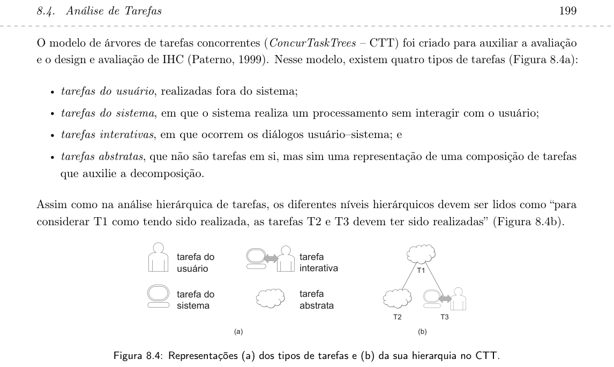

<b>Fonte:</b> BARBOSA et al. (2021, p. 199).

### 4.2 CTT-02 — A tarefa abstrata como composição de outras tarefas

A Tabela 3 apresenta o item CTT-02:

<b>Tabela 3: Item CTT-02 — A tarefa abstrata como composição de outras tarefas</b>

| Campo | Registro |
| :--- | :--- |
| **Pergunta** | Toda tarefa que tem outras tarefas abaixo dela é do tipo abstrata (ícone de nuvem), e nenhuma tarefa abstrata ficou no último nível, sem tarefas abaixo? |
| **Autor** | Daniel da Silva Batista |
| **Fonte** | BARBOSA et al. (2021, p. 199) |
| **Origem na v1** | CTT-02 |

<b>Fonte:</b> Daniel da Silva Batista (2026).

A Figura 2 reproduz o trecho do livro que fundamenta o item CTT-02:

<b>Figura 2: Referência Bibliográfica — Item CTT-02 (A tarefa abstrata como composição de outras tarefas)</b>

<b>Fonte:</b> BARBOSA et al. (2021, p. 199).

### 4.3 CTT-03 — Relações de tempo entre tarefas no CTT

A Tabela 4 apresenta o item CTT-03:

<b>Tabela 4: Item CTT-03 — Relações de tempo entre tarefas no CTT</b>

| Campo | Registro |
| :--- | :--- |
| **Pergunta** | As tarefas vizinhas (lado a lado, no mesmo nível da árvore) estão ligadas por um operador que indica a relação de tempo entre elas (por exemplo, ">>": a segunda só começa quando a primeira termina)? |
| **Autor** | Daniel da Silva Batista |
| **Fonte** | BARBOSA et al. (2021, p. 200) |
| **Origem na v1** | CTT-09 |

<b>Fonte:</b> Daniel da Silva Batista (2026).

A Figura 3 reproduz o trecho do livro que fundamenta o item CTT-03:

<b>Figura 3: Referência Bibliográfica — Item CTT-03 (Relações de tempo entre tarefas no CTT)</b>

<b>Fonte:</b> BARBOSA et al. (2021, p. 200).

### 4.4 CTT-04 — Ativação com passagem de informação

A Tabela 5 apresenta o item CTT-04:

<b>Tabela 5: Item CTT-04 — Ativação com passagem de informação</b>

| Campo | Registro |
| :--- | :--- |
| **Pergunta** | Quando uma tarefa entrega dados para a seguinte (por exemplo, os filtros escolhidos são usados na busca), o diagrama usa "[]>>" (ativação com passagem de informação) em vez de apenas ">>"? |
| **Autor** | Daniel da Silva Batista |
| **Fonte** | BARBOSA et al. (2021, p. 200) |
| **Origem na v1** | CTT-03 |

<b>Fonte:</b> Daniel da Silva Batista (2026).

A Figura 4 reproduz o trecho do livro que fundamenta o item CTT-04:

<b>Figura 4: Referência Bibliográfica — Item CTT-04 (Ativação com passagem de informação)</b>

<b>Fonte:</b> BARBOSA et al. (2021, p. 200).

### 4.5 CTT-05 — Desativação e suspensão/retomada

A Tabela 6 apresenta o item CTT-05:

<b>Tabela 6: Item CTT-05 — Desativação e suspensão/retomada</b>

| Campo | Registro |
| :--- | :--- |
| **Pergunta** | O cancelamento definitivo de uma tarefa usa "[>" (desativação: a tarefa interrompida não volta) e a pausa com retorno usa "|>" (suspensão/retomada: a tarefa continua de onde parou)? |
| **Autor** | Daniel da Silva Batista |
| **Fonte** | BARBOSA et al. (2021, p. 200) |
| **Origem na v1** | CTT-08 |

<b>Fonte:</b> Daniel da Silva Batista (2026).

A Figura 5 reproduz o trecho do livro que fundamenta o item CTT-05:

<b>Figura 5: Referência Bibliográfica — Item CTT-05 (Desativação e suspensão/retomada)</b>

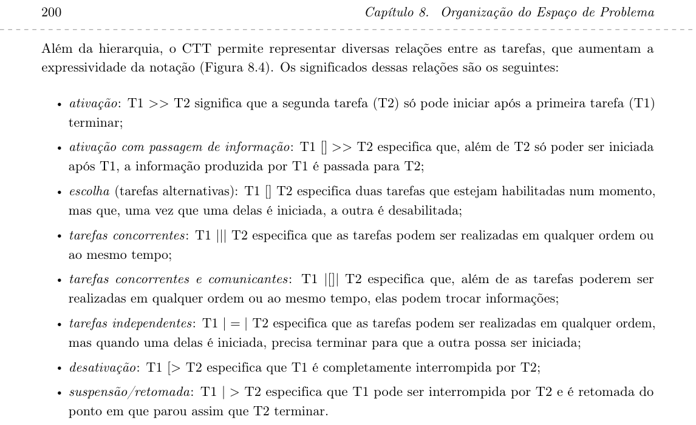

<b>Fonte:</b> BARBOSA et al. (2021, p. 200).

### 4.6 CTT-06 — Operador de escolha entre caminhos alternativos

A Tabela 7 apresenta o item CTT-06:

<b>Tabela 7: Item CTT-06 — Operador de escolha entre caminhos alternativos</b>

| Campo | Registro |
| :--- | :--- |
| **Pergunta** | Quando o usuário pode seguir por caminhos alternativos (uma opção ou outra), as tarefas estão ligadas pelo operador de escolha "[ ]" (ao iniciar uma, a outra deixa de estar disponível naquele ciclo)? |
| **Autor** | Arthur Sismene Carvalho |
| **Fonte** | BARBOSA et al. (2021, p. 200) |
| **Origem na v1** | CTT-04 |

<b>Fonte:</b> Arthur Sismene Carvalho (2026).

A Figura 6 reproduz o trecho do livro que fundamenta o item CTT-06:

<b>Figura 6: Referência Bibliográfica — Item CTT-06 (Operador de escolha entre caminhos alternativos)</b>

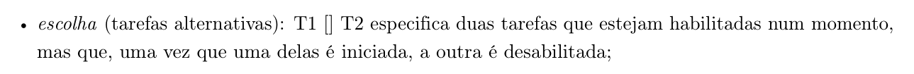

<b>Fonte:</b> BARBOSA et al. (2021, p. 200).

### 4.7 CTT-07 — Operador de concorrência sem comunicação

A Tabela 8 apresenta o item CTT-07:

<b>Tabela 8: Item CTT-07 — Operador de concorrência sem comunicação</b>

| Campo | Registro |
| :--- | :--- |
| **Pergunta** | Tarefas que podem ser feitas ao mesmo tempo ou em qualquer ordem, sem depender de dados uma da outra, estão ligadas pelo operador de concorrência "\|\|\|"? |
| **Autor** | Arthur Sismene Carvalho |
| **Fonte** | BARBOSA et al. (2021, p. 200) |
| **Origem na v1** | CTT-05 |

<b>Fonte:</b> Arthur Sismene Carvalho (2026).

A Figura 7 reproduz o trecho do livro que fundamenta o item CTT-07:

<b>Figura 7: Referência Bibliográfica — Item CTT-07 (Operador de concorrência sem comunicação)</b>

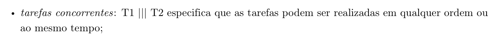

<b>Fonte:</b> BARBOSA et al. (2021, p. 200).

### 4.8 CTT-08 — Operador de concorrência com comunicação

A Tabela 9 apresenta o item CTT-08:

<b>Tabela 9: Item CTT-08 — Operador de concorrência com comunicação</b>

| Campo | Registro |
| :--- | :--- |
| **Pergunta** | Quando tarefas paralelas precisam trocar informação entre si durante a execução, essa troca está indicada pelo operador de concorrência com comunicação "\|[ ]\|"? |
| **Autor** | Arthur Sismene Carvalho |
| **Fonte** | BARBOSA et al. (2021, p. 200) |
| **Origem na v1** | CTT-06 |

<b>Fonte:</b> Arthur Sismene Carvalho (2026).

A Figura 8 reproduz o trecho do livro que fundamenta o item CTT-08:

<b>Figura 8: Referência Bibliográfica — Item CTT-08 (Operador de concorrência com comunicação)</b>

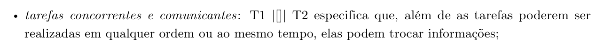

<b>Fonte:</b> BARBOSA et al. (2021, p. 200).

### 4.9 CTT-09 — Operador de independência de ordem

A Tabela 10 apresenta o item CTT-09:

<b>Tabela 10: Item CTT-09 — Operador de independência de ordem</b>

| Campo | Registro |
| :--- | :--- |
| **Pergunta** | Tarefas que podem ser feitas em qualquer ordem, mas não ao mesmo tempo (uma vez iniciada, termina antes de a outra começar), usam o operador de independência "\|=\|"? |
| **Autor** | Arthur Sismene Carvalho |
| **Fonte** | BARBOSA et al. (2021, p. 200) |
| **Origem na v1** | CTT-07 |

<b>Fonte:</b> Arthur Sismene Carvalho (2026).

A Figura 9 reproduz o trecho do livro que fundamenta o item CTT-09:

<b>Figura 9: Referência Bibliográfica — Item CTT-09 (Operador de independência de ordem)</b>

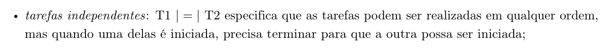

<b>Fonte:</b> BARBOSA et al. (2021, p. 200).

### 4.10 CTT-10 — Exceções e erros em material complementar

A Tabela 11 apresenta o item CTT-10:

<b>Tabela 11: Item CTT-10 — Exceções e erros em material complementar</b>

| Campo | Registro |
| :--- | :--- |
| **Pergunta** | Como a notação do CTT não detalha bem a prevenção e o tratamento de erros, esses casos de exceção estão registrados em um material complementar (tabela analítica, HTA ou cenários)? |
| **Autor** | Arthur Sismene Carvalho |
| **Fonte** | BARBOSA et al. (2021, p. 201) |
| **Origem na v1** | CTT-10 |

<b>Fonte:</b> Arthur Sismene Carvalho (2026).

A Figura 10 reproduz o trecho do livro que fundamenta o item CTT-10:

<b>Figura 10: Referência Bibliográfica — Item CTT-10 (Exceções e erros em material complementar)</b>

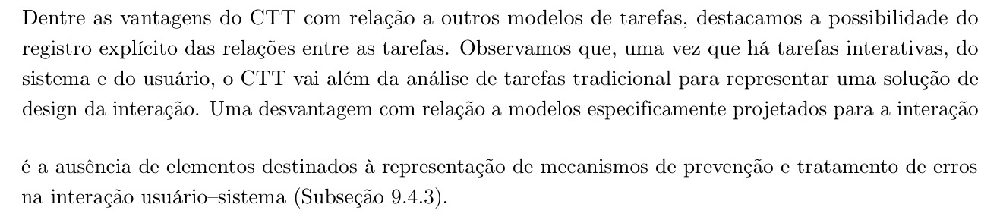

<b>Fonte:</b> BARBOSA et al. (2021, p. 201).

### 4.11 CTT-11 — Leitura hierárquica da árvore

A Tabela 12 apresenta o item CTT-11:

<b>Tabela 12: Item CTT-11 — Leitura hierárquica da árvore</b>

| Campo | Registro |
| :--- | :--- |
| **Pergunta** | A árvore pode ser lida de cima para baixo de modo que cada tarefa só seja considerada concluída quando as tarefas abaixo dela também forem? |
| **Autor** | Pedro Rocha Ferreira Lima |
| **Fonte** | BARBOSA et al. (2021, p. 199) |
| **Origem na v1** | Item novo |

<b>Fonte:</b> Pedro Rocha Ferreira Lima (2026).

A Figura 11 reproduz o trecho do livro que fundamenta o item CTT-11:

<b>Figura 11: Referência Bibliográfica — Item CTT-11 (Leitura hierárquica da árvore)</b>

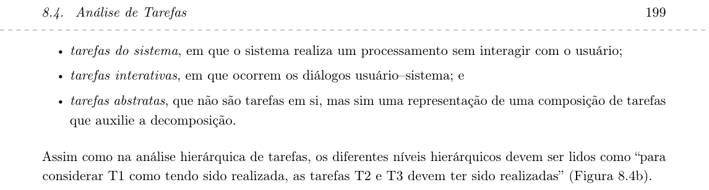

<b>Fonte:</b> BARBOSA et al. (2021, p. 199).

### 4.12 CTT-12 — Divisão de papéis entre pessoa e sistema

A Tabela 13 apresenta o item CTT-12:

<b>Tabela 13: Item CTT-12 — Divisão de papéis entre pessoa e sistema</b>

| Campo | Registro |
| :--- | :--- |
| **Pergunta** | O modelo mostra como o sistema proposto apoiará a tarefa, deixando claro quais passos são feitos pela pessoa, quais pelo sistema e quais em diálogo entre os dois? |
| **Autor** | Pedro Rocha Ferreira Lima |
| **Fonte** | BARBOSA et al. (2021, p. 200) |
| **Origem na v1** | Item novo |

<b>Fonte:</b> Pedro Rocha Ferreira Lima (2026).

A Figura 12 reproduz o trecho do livro que fundamenta o item CTT-12:

<b>Figura 12: Referência Bibliográfica — Item CTT-12 (Divisão de papéis entre pessoa e sistema)</b>

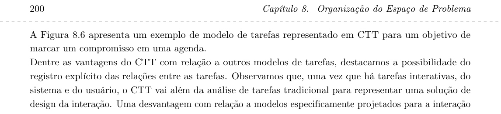

<b>Fonte:</b> BARBOSA et al. (2021, p. 200).

### 4.13 CTT-13 — Fidelidade à notação

A Tabela 14 apresenta o item CTT-13:

<b>Tabela 14: Item CTT-13 — Fidelidade à notação</b>

| Campo | Registro |
| :--- | :--- |
| **Pergunta** | O diagrama usa os ícones e os símbolos de operadores exatamente como a notação os define, sem símbolos inventados ou trocados? |
| **Autor** | Pedro Rocha Ferreira Lima |
| **Fonte** | BARBOSA et al. (2021, p. 200) |
| **Origem na v1** | Item novo |

<b>Fonte:</b> Pedro Rocha Ferreira Lima (2026).

A Figura 13 reproduz o trecho do livro que fundamenta o item CTT-13:

<b>Figura 13: Referência Bibliográfica — Item CTT-13 (Fidelidade à notação)</b>

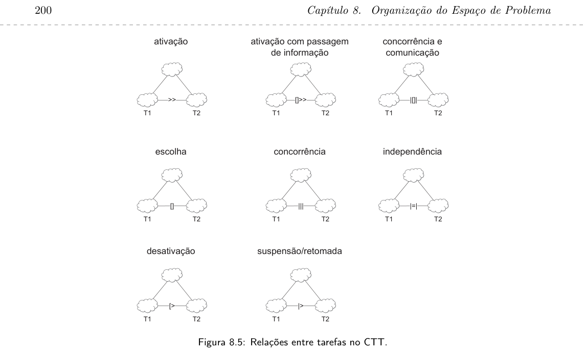

<b>Fonte:</b> BARBOSA et al. (2021, p. 200).

### 4.14 CTT-14 — Posição dos operadores

A Tabela 15 apresenta o item CTT-14:

<b>Tabela 15: Item CTT-14 — Posição dos operadores</b>

| Campo | Registro |
| :--- | :--- |
| **Pergunta** | Cada operador de tempo aparece entre as duas tarefas que ele relaciona, e não solto no diagrama ou apenas na legenda? |
| **Autor** | Pedro Rocha Ferreira Lima |
| **Fonte** | BARBOSA et al. (2021, p. 200) |
| **Origem na v1** | Item novo |

<b>Fonte:</b> Pedro Rocha Ferreira Lima (2026).

A Figura 14 reproduz o trecho do livro que fundamenta o item CTT-14:

<b>Figura 14: Referência Bibliográfica — Item CTT-14 (Posição dos operadores)</b>

<b>Fonte:</b> BARBOSA et al. (2021, p. 200).

### 4.15 CTT-15 — Nome das tarefas

A Tabela 16 apresenta o item CTT-15:

<b>Tabela 16: Item CTT-15 — Nome das tarefas</b>

| Campo | Registro |
| :--- | :--- |
| **Pergunta** | O nome de cada tarefa descreve uma ação clara (verbo mais objeto, como "Escolher data"), e não um rótulo genérico como "Etapa 2"? |
| **Autor** | Pedro Rocha Ferreira Lima |
| **Fonte** | BARBOSA et al. (2021, p. 201) |
| **Origem na v1** | Item novo |

<b>Fonte:</b> Pedro Rocha Ferreira Lima (2026).

A Figura 15 reproduz o trecho do livro que fundamenta o item CTT-15:

<b>Figura 15: Referência Bibliográfica — Item CTT-15 (Nome das tarefas)</b>

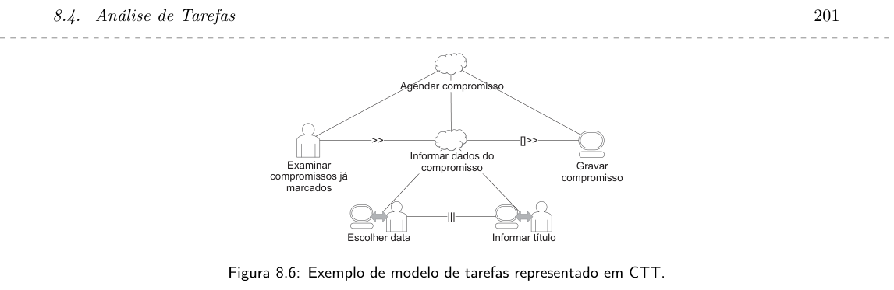

<b>Fonte:</b> BARBOSA et al. (2021, p. 201).

## 5. Correspondência com a v1

A Tabela 17 apresenta, para cada item da v2 já elaborado, o item de origem na v1 e o que mudou na redação:

<b>Tabela 17: Correspondência entre os Itens da v1 e da v2</b>

| Item v2 | Origem na v1 | O que mudou |
| :---: | :---: | :--- |
| **CTT-01** | [CTT-01](../../design-avaliacao-desenvolvimento/listas-verificacao-etapa-4.md#3-lista-de-verificacao-para-ctt-10-itens-em-3-blocos) | Cada tipo vem com um exemplo; a figura citada foi corrigida (é a Figura 8.4 do livro, não a 8.3). |
| **CTT-02** | [CTT-02](../../design-avaliacao-desenvolvimento/listas-verificacao-etapa-4.md#3-lista-de-verificacao-para-ctt-10-itens-em-3-blocos) | Frase dividida em duas condições objetivas. |
| **CTT-03** | [CTT-09](../../design-avaliacao-desenvolvimento/listas-verificacao-etapa-4.md#3-lista-de-verificacao-para-ctt-10-itens-em-3-blocos) | Mantida só a exigência do operador entre tarefas vizinhas; a parte de opcionalidade e iteração saiu por não estar no livro. |
| **CTT-04** | [CTT-03](../../design-avaliacao-desenvolvimento/listas-verificacao-etapa-4.md#3-lista-de-verificacao-para-ctt-10-itens-em-3-blocos) | Foco em um único operador, com exemplo do projeto. |
| **CTT-05** | [CTT-08](../../design-avaliacao-desenvolvimento/listas-verificacao-etapa-4.md#3-lista-de-verificacao-para-ctt-10-itens-em-3-blocos) | Significado de cada operador entre parênteses. |
| **CTT-06** | [CTT-04](../../design-avaliacao-desenvolvimento/listas-verificacao-etapa-4.md#3-lista-de-verificacao-para-ctt-10-itens-em-3-blocos) | Explica o operador de escolha e o seu efeito. |
| **CTT-07** | [CTT-05](../../design-avaliacao-desenvolvimento/listas-verificacao-etapa-4.md#3-lista-de-verificacao-para-ctt-10-itens-em-3-blocos) | Explica o operador de concorrência em linguagem simples. |
| **CTT-08** | [CTT-06](../../design-avaliacao-desenvolvimento/listas-verificacao-etapa-4.md#3-lista-de-verificacao-para-ctt-10-itens-em-3-blocos) | Explica a concorrência com comunicação e quando usá-la. |
| **CTT-09** | [CTT-07](../../design-avaliacao-desenvolvimento/listas-verificacao-etapa-4.md#3-lista-de-verificacao-para-ctt-10-itens-em-3-blocos) | Explica o operador de independência (ordem livre, sem sobreposição). |
| **CTT-10** | [CTT-10](../../design-avaliacao-desenvolvimento/listas-verificacao-etapa-4.md#3-lista-de-verificacao-para-ctt-10-itens-em-3-blocos) | Mantém a exigência de documentar erros/exceções em material complementar. |
| **CTT-11** | Item novo | Item novo, elaborado na v2. |
| **CTT-12** | Item novo | Item novo, elaborado na v2. |
| **CTT-13** | Item novo | Item novo, elaborado na v2. |
| **CTT-14** | Item novo | Item novo, elaborado na v2. |
| **CTT-15** | Item novo | Item novo, elaborado na v2. |

<b>Fonte:</b> Daniel da Silva Batista (2026).

Na v1, os tipos de tarefa eram atribuídos à "Figura 8.3" e as relações à "Figura 8.4"; no livro, a Figura 8.3 é do CPM-GOMS, os tipos estão na Figura 8.4 e as relações na Figura 8.5 (pp. 199-200).

## 6. Referências Bibliográficas

> [1] BARBOSA, Simone D. J.; SILVA, Bruno S. da; SILVEIRA, Milene S.; GASPARINI, Isabela; DARIN, Ticianne; BARBOSA, Gabriel D. J. *Interação Humano-Computador e Experiência do Usuário*. 1. ed. Autopublicação, 2021. ISBN: 978-65-00-19677-1.  
> [2] FAGAN, Michael E. Design and code inspections to reduce errors in program development. *IBM Systems Journal*, v. 15, n. 3, p. 182-211, 1976.  
> [3] SALES, André Barros de. *Plano de ensino FIHC 022026 – Turma 01*. Brasília: FCTE/UnB, 2026.

## 7. Histórico de Versões

| Versão | Data | Descrição | Autor(es) | Revisor(es) |
| :---: | :---: | :--- | :---: | :---: |
| `1.0` | 21/11/2026 | Criação da v2 da lista: itens CTT-01 a CTT-05 reescritos a partir da v1, com fonte por página e recorte do livro; itens CTT-06 a CTT-20 reservados aos demais integrantes. | Daniel da Silva Batista | — |
| `1.1` | 22/11/2026 | Elaboração dos itens CTT-06 a CTT-10, reescritos a partir dos itens v1 CTT-04, 05, 06, 07 e 10; recortes do livro adicionados. | Arthur Sismene Carvalho | — |
| `1.2` | 22/11/2026 | Elaboração dos itens CTT-11 a CTT-15, com fonte por página e recorte do livro. | Pedro Rocha Ferreira Lima | — |

