

<b>Tabela de Contribuição</b>

| Membro | Contribuição |
| :--- | :--- |
| **Daniel da Silva Batista** | Elaboração dos itens HTA-01 a HTA-05, revisão dos itens da v1 e recortes do livro ([Itens 01–05](#41-hta-01-o-objetivo-do-usuario-como-ponto-de-partida-da-hta)). |
| **Arthur Sismene Carvalho** | Elaboração dos itens HTA-06 a HTA-10, reescritos a partir dos itens da v1 (Etapa 4) que não foram reaproveitados nos itens 01–05, com fonte por página ([Itens 06–10](#46-hta-06-decomposicao-hierarquica-por-niveis)). |
| **Pedro Rocha Ferreira Lima** | Elaboração dos itens HTA-11 a HTA-15, recortes do livro ([Itens 11–15](#411-hta-11-proposito-da-analise)). |
| **Claude (Anthropic)** | Apoio na organização da página e na extração dos recortes do livro (conforme Política de IA). |

<b>Fonte:</b> Daniel da Silva Batista, Arthur Sismene Carvalho e Pedro Rocha Ferreira Lima (2026).

# Lista de Verificação de HTA — v2

## 1. Introdução

A **Análise Hierárquica de Tarefas (HTA)** é o diagrama que parte de um objetivo do usuário e o divide em partes menores (subobjetivos) até chegar aos passos concretos (operações), indicando em que ordem cada parte é feita (BARBOSA et al., 2021).

Esta lista é a **versão 2 (v2)** da [Lista de Verificação para HTA (v1, Etapa 4)](../../design-avaliacao-desenvolvimento/listas-verificacao-etapa-4.md#2-lista-de-verificacao-para-hta-10-itens) e faz parte da [Verificação da Etapa 8](../index.md), conduzida pelo método de inspeção de Fagan (FAGAN, 1976). Ela será aplicada, no passo de inspeção, aos seguintes artefatos do projeto:

* [Análise de Tarefas — HTA](../../analise-de-requisitos/analise-de-tarefas/hta.md)

A lista tem **15 itens**, e cada integrante do grupo elabora 5 deles. Cada item é uma pergunta objetiva, com as explicações necessárias entre parênteses, para que possa ser respondida por quem não conhece o artefato. Cada item indica o autor e a fonte. A [Seção 3](#3-itens-de-verificacao) consolida todos os itens em uma tabela, e a [Seção 4](#4-detalhamento-dos-itens) detalha cada um, com a pergunta e, logo abaixo, o recorte do livro que a fundamenta.

## 2. Critérios de Julgamento

Cada item admite uma única resposta:

* **Sim** — o artefato atende integralmente ao que a pergunta descreve;
* **Não** — o artefato não atende ao que a pergunta descreve ou não apresenta a informação;
* **Incompleto** — o artefato atende apenas em parte (por exemplo, em alguns quadros, tarefas ou participantes, mas não em todos).

## 3. Itens de Verificação

A Tabela 1 consolida os 15 itens de verificação da Lista de Verificação de HTA — v2:

<b>Tabela 1: Itens da Lista de Verificação de HTA — v2</b>

| ID | Pergunta de verificação | Autor | Fonte |
| :---: | :--- | :--- | :--- |
| **HTA-01** | O diagrama começa pelo objetivo do usuário (o resultado que a pessoa quer alcançar, por exemplo "Comparar editais"), e não por uma lista de cliques ou de telas? | Daniel da Silva Batista | BARBOSA et al. (2021, p. 191) |
| **HTA-02** | Todo objetivo que foi dividido em partes menores (subobjetivos) tem um plano (a regra que diz em que ordem essas partes devem ser feitas)? | Daniel da Silva Batista | BARBOSA et al. (2021, p. 191) |
| **HTA-03** | Os planos usam apenas as três relações previstas na HTA: sequência ("1>2": uma parte depois da outra), seleção ("1/2": uma ou outra, conforme a situação) e paralelo ("1+2": as duas ao mesmo tempo)? | Daniel da Silva Batista | BARBOSA et al. (2021, p. 191) |
| **HTA-04** | Cada operação (passo do nível mais baixo, que não é mais dividido) informa o que dispara o passo (entrada), o que a pessoa faz (ação) e como ela sabe que concluiu (feedback)? | Daniel da Silva Batista | BARBOSA et al. (2021, p. 191) |
| **HTA-05** | O artefato explica até onde a tarefa foi dividida e por que parou ali (por exemplo, porque o risco de erro naquele passo já é aceitável ou porque o problema já foi identificado)? | Daniel da Silva Batista | BARBOSA et al. (2021, p. 192) |
| **HTA-06** | A tarefa é dividida em camadas — do objetivo geral (nível 0) para subobjetivos (1, 2, 3…) e destes para os passos concretos (1.1, 1.2…) —, de modo que cada nível detalha o nível acima? | Arthur Sismene Carvalho | BARBOSA et al. (2021, p. 191) |
| **HTA-07** | Os subobjetivos de um mesmo objetivo não se sobrepõem (cada um trata de uma parte diferente) e, juntos, cobrem o objetivo inteiro, sem deixar etapas de fora? | Arthur Sismene Carvalho | BARBOSA et al. (2021, p. 191) |
| **HTA-08** | O diagrama diferencia visualmente os objetivos (que ainda se desdobram) das operações (os passos finais, que não se dividem mais e, no livro, são marcadas com um traço na base da caixa)? | Arthur Sismene Carvalho | BARBOSA et al. (2021, p. 191) |
| **HTA-09** | Cada caixa recebe um número que corresponde à sua posição na árvore (0 na raiz; 1, 2… no primeiro nível; 1.1, 1.2… abaixo da caixa 1; 1.2.1… abaixo da 1.2)? | Arthur Sismene Carvalho | BARBOSA et al. (2021, p. 193) |
| **HTA-10** | Além do diagrama, a tarefa é apresentada também em uma tabela que reúne os objetivos/operações, os planos, a entrada, o feedback e os problemas e recomendações identificados? | Arthur Sismene Carvalho | BARBOSA et al. (2021, p. 191) |
| **HTA-11** | O artefato informa para que a análise da tarefa foi feita (por exemplo, para reprojetar o portal ou descobrir onde os usuários erram) antes de apresentar o diagrama? | Pedro Rocha Ferreira Lima | BARBOSA et al. (2021, p. 192) |
| **HTA-12** | A decomposição da tarefa foi conferida com usuários ou outras partes interessadas (por exemplo, em entrevista), para confirmar que corresponde ao modo como a tarefa é feita na prática? | Pedro Rocha Ferreira Lima | BARBOSA et al. (2021, p. 193) |
| **HTA-13** | O artefato destaca quais operações são mais críticas (as que têm maior chance de erro ou cujo erro causa maior prejuízo ao usuário)? | Pedro Rocha Ferreira Lima | BARBOSA et al. (2021, p. 193) |
| **HTA-14** | Quando um mesmo objetivo pode ser alcançado de maneiras diferentes, o diagrama mostra essas alternativas, em vez de registrar um único caminho? | Pedro Rocha Ferreira Lima | BARBOSA et al. (2021, p. 192) |
| **HTA-15** | Para cada problema identificado na tarefa, o artefato indica o tipo de erro do usuário (por exemplo, descuido na execução, aplicação de uma regra errada ou falta de conhecimento)? | Pedro Rocha Ferreira Lima | BARBOSA et al. (2021, p. 193) |

<b>Fonte:</b> Daniel da Silva Batista, Arthur Sismene Carvalho e Pedro Rocha Ferreira Lima (2026), conforme o autor de cada item.

## 4. Detalhamento dos Itens

### 4.1 HTA-01 — O objetivo do usuário como ponto de partida da HTA

A Tabela 2 apresenta o item HTA-01:

<b>Tabela 2: Item HTA-01 — O objetivo do usuário como ponto de partida da HTA</b>

| Campo | Registro |
| :--- | :--- |
| **Pergunta** | O diagrama começa pelo objetivo do usuário (o resultado que a pessoa quer alcançar, por exemplo "Comparar editais"), e não por uma lista de cliques ou de telas? |
| **Autor** | Daniel da Silva Batista |
| **Fonte** | BARBOSA et al. (2021, p. 191) |
| **Origem na v1** | HTA-01 |

<b>Fonte:</b> Daniel da Silva Batista (2026).

A Figura 1 reproduz o trecho do livro que fundamenta o item HTA-01:

<b>Figura 1: Referência Bibliográfica — Item HTA-01 (O objetivo do usuário como ponto de partida da HTA)</b>

<b>Fonte:</b> BARBOSA et al. (2021, p. 191).

### 4.2 HTA-02 — O plano como regra de ordem entre os subobjetivos

A Tabela 3 apresenta o item HTA-02:

<b>Tabela 3: Item HTA-02 — O plano como regra de ordem entre os subobjetivos</b>

| Campo | Registro |
| :--- | :--- |
| **Pergunta** | Todo objetivo que foi dividido em partes menores (subobjetivos) tem um plano (a regra que diz em que ordem essas partes devem ser feitas)? |
| **Autor** | Daniel da Silva Batista |
| **Fonte** | BARBOSA et al. (2021, p. 191) |
| **Origem na v1** | HTA-06 |

<b>Fonte:</b> Daniel da Silva Batista (2026).

A Figura 2 reproduz o trecho do livro que fundamenta o item HTA-02:

<b>Figura 2: Referência Bibliográfica — Item HTA-02 (O plano como regra de ordem entre os subobjetivos)</b>

<b>Fonte:</b> BARBOSA et al. (2021, p. 191).

### 4.3 HTA-03 — Relações entre subobjetivos nos planos da HTA

A Tabela 4 apresenta o item HTA-03:

<b>Tabela 4: Item HTA-03 — Relações entre subobjetivos nos planos da HTA</b>

| Campo | Registro |
| :--- | :--- |
| **Pergunta** | Os planos usam apenas as três relações previstas na HTA: sequência ("1>2": uma parte depois da outra), seleção ("1/2": uma ou outra, conforme a situação) e paralelo ("1+2": as duas ao mesmo tempo)? |
| **Autor** | Daniel da Silva Batista |
| **Fonte** | BARBOSA et al. (2021, p. 191) |
| **Origem na v1** | HTA-07 |

<b>Fonte:</b> Daniel da Silva Batista (2026).

A Figura 3 reproduz o trecho do livro que fundamenta o item HTA-03:

<b>Figura 3: Referência Bibliográfica — Item HTA-03 (Relações entre subobjetivos nos planos da HTA)</b>

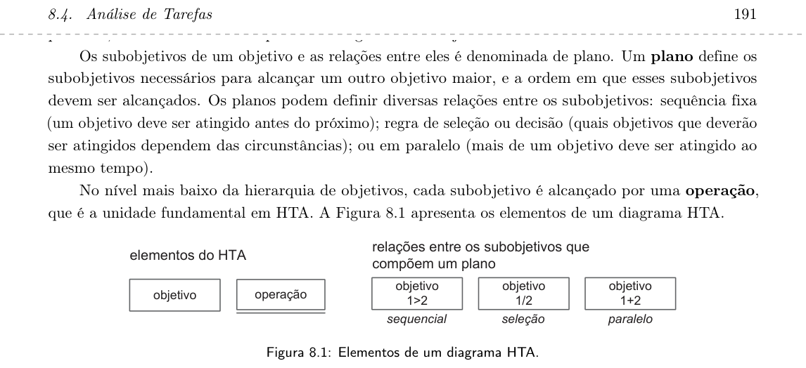

<b>Fonte:</b> BARBOSA et al. (2021, p. 191).

### 4.4 HTA-04 — Entrada, ação e feedback de uma operação

A Tabela 5 apresenta o item HTA-04:

<b>Tabela 5: Item HTA-04 — Entrada, ação e feedback de uma operação</b>

| Campo | Registro |
| :--- | :--- |
| **Pergunta** | Cada operação (passo do nível mais baixo, que não é mais dividido) informa o que dispara o passo (entrada), o que a pessoa faz (ação) e como ela sabe que concluiu (feedback)? |
| **Autor** | Daniel da Silva Batista |
| **Fonte** | BARBOSA et al. (2021, p. 191) |
| **Origem na v1** | HTA-09 |

<b>Fonte:</b> Daniel da Silva Batista (2026).

A Figura 4 reproduz o trecho do livro que fundamenta o item HTA-04:

<b>Figura 4: Referência Bibliográfica — Item HTA-04 (Entrada, ação e feedback de uma operação)</b>

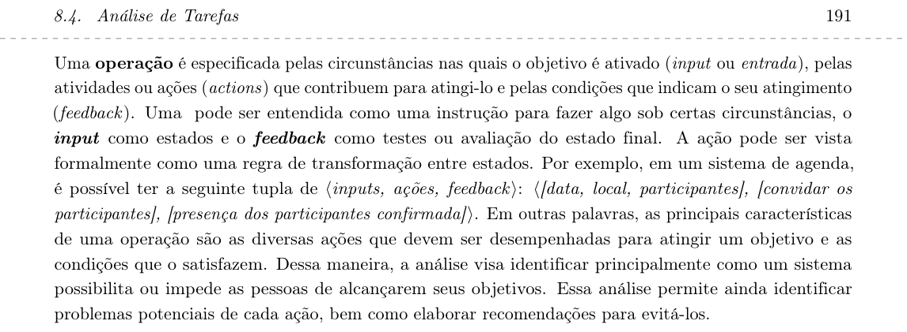

<b>Fonte:</b> BARBOSA et al. (2021, p. 191).

### 4.5 HTA-05 — Critério de parada da decomposição

A Tabela 6 apresenta o item HTA-05:

<b>Tabela 6: Item HTA-05 — Critério de parada da decomposição</b>

| Campo | Registro |
| :--- | :--- |
| **Pergunta** | O artefato explica até onde a tarefa foi dividida e por que parou ali (por exemplo, porque o risco de erro naquele passo já é aceitável ou porque o problema já foi identificado)? |
| **Autor** | Daniel da Silva Batista |
| **Fonte** | BARBOSA et al. (2021, p. 192) |
| **Origem na v1** | HTA-08 |

<b>Fonte:</b> Daniel da Silva Batista (2026).

A Figura 5 reproduz o trecho do livro que fundamenta o item HTA-05:

<b>Figura 5: Referência Bibliográfica — Item HTA-05 (Critério de parada da decomposição)</b>

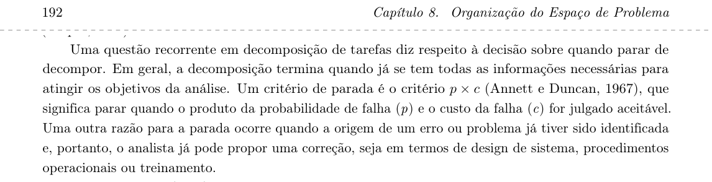

<b>Fonte:</b> BARBOSA et al. (2021, p. 192).

### 4.6 HTA-06 — Decomposição hierárquica por níveis

A Tabela 7 apresenta o item HTA-06:

<b>Tabela 7: Item HTA-06 — Decomposição hierárquica por níveis</b>

| Campo | Registro |
| :--- | :--- |
| **Pergunta** | A tarefa é dividida em camadas — do objetivo geral (nível 0) para subobjetivos (1, 2, 3…) e destes para os passos concretos (1.1, 1.2…) —, de modo que cada nível detalha o nível acima? |
| **Autor** | Arthur Sismene Carvalho |
| **Fonte** | BARBOSA et al. (2021, p. 191) |
| **Origem na v1** | HTA-02 |

<b>Fonte:</b> Arthur Sismene Carvalho (2026).

A Figura 6 reproduz o trecho do livro que fundamenta o item HTA-06:

<b>Figura 6: Referência Bibliográfica — Item HTA-06 (Decomposição hierárquica por níveis)</b>

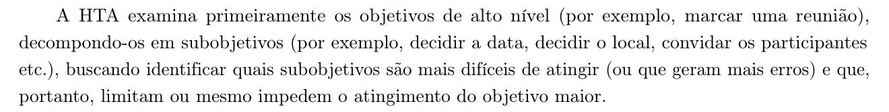

<b>Fonte:</b> BARBOSA et al. (2021, p. 191).

### 4.7 HTA-07 — Cobertura e exclusividade dos subobjetivos

A Tabela 8 apresenta o item HTA-07:

<b>Tabela 8: Item HTA-07 — Cobertura e exclusividade dos subobjetivos</b>

| Campo | Registro |
| :--- | :--- |
| **Pergunta** | Os subobjetivos de um mesmo objetivo não se sobrepõem (cada um trata de uma parte diferente) e, juntos, cobrem o objetivo inteiro, sem deixar etapas de fora? |
| **Autor** | Arthur Sismene Carvalho |
| **Fonte** | BARBOSA et al. (2021, p. 191) |
| **Origem na v1** | HTA-03 |

<b>Fonte:</b> Arthur Sismene Carvalho (2026).

A Figura 7 reproduz o trecho do livro que fundamenta o item HTA-07:

<b>Figura 7: Referência Bibliográfica — Item HTA-07 (Cobertura e exclusividade dos subobjetivos)</b>

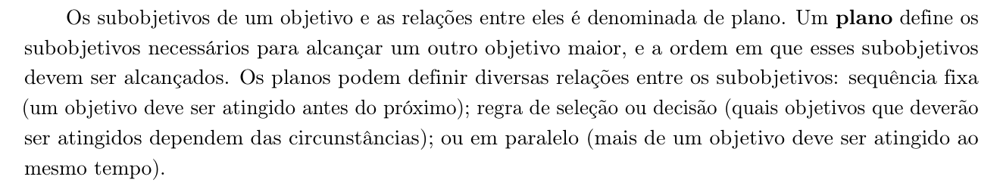

<b>Fonte:</b> BARBOSA et al. (2021, p. 191).

### 4.8 HTA-08 — Distinção visual entre objetivos e operações

A Tabela 9 apresenta o item HTA-08:

<b>Tabela 9: Item HTA-08 — Distinção visual entre objetivos e operações</b>

| Campo | Registro |
| :--- | :--- |
| **Pergunta** | O diagrama diferencia visualmente os objetivos (que ainda se desdobram) das operações (os passos finais, que não se dividem mais e, no livro, são marcadas com um traço na base da caixa)? |
| **Autor** | Arthur Sismene Carvalho |
| **Fonte** | BARBOSA et al. (2021, p. 191) |
| **Origem na v1** | HTA-04 |

<b>Fonte:</b> Arthur Sismene Carvalho (2026).

A Figura 8 reproduz o trecho do livro que fundamenta o item HTA-08:

<b>Figura 8: Referência Bibliográfica — Item HTA-08 (Distinção visual entre objetivos e operações)</b>

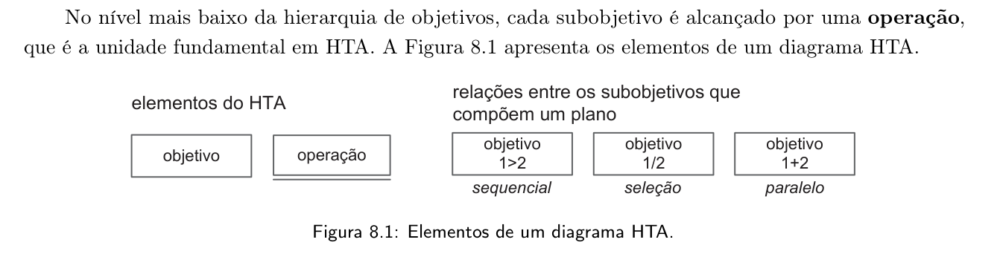

<b>Fonte:</b> BARBOSA et al. (2021, p. 191).

### 4.9 HTA-09 — Numeração posicional das caixas

A Tabela 10 apresenta o item HTA-09:

<b>Tabela 10: Item HTA-09 — Numeração posicional das caixas</b>

| Campo | Registro |
| :--- | :--- |
| **Pergunta** | Cada caixa recebe um número que corresponde à sua posição na árvore (0 na raiz; 1, 2… no primeiro nível; 1.1, 1.2… abaixo da caixa 1; 1.2.1… abaixo da 1.2)? |
| **Autor** | Arthur Sismene Carvalho |
| **Fonte** | BARBOSA et al. (2021, p. 193) |
| **Origem na v1** | HTA-05 |

<b>Fonte:</b> Arthur Sismene Carvalho (2026).

A Figura 9 reproduz o trecho do livro que fundamenta o item HTA-09:

<b>Figura 9: Referência Bibliográfica — Item HTA-09 (Numeração posicional das caixas)</b>

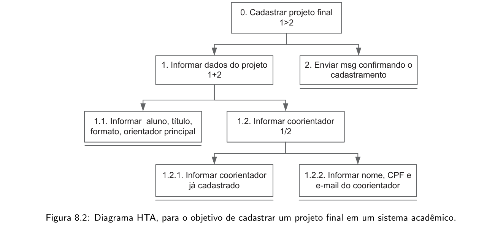

<b>Fonte:</b> BARBOSA et al. (2021, p. 193).

### 4.10 HTA-10 — Representação complementar em tabela

A Tabela 11 apresenta o item HTA-10:

<b>Tabela 11: Item HTA-10 — Representação complementar em tabela</b>

| Campo | Registro |
| :--- | :--- |
| **Pergunta** | Além do diagrama, a tarefa é apresentada também em uma tabela que reúne os objetivos/operações, os planos, a entrada, o feedback e os problemas e recomendações identificados? |
| **Autor** | Arthur Sismene Carvalho |
| **Fonte** | BARBOSA et al. (2021, p. 191) |
| **Origem na v1** | HTA-10 |

<b>Fonte:</b> Arthur Sismene Carvalho (2026).

A Figura 10 reproduz o trecho do livro que fundamenta o item HTA-10:

<b>Figura 10: Referência Bibliográfica — Item HTA-10 (Representação complementar em tabela)</b>

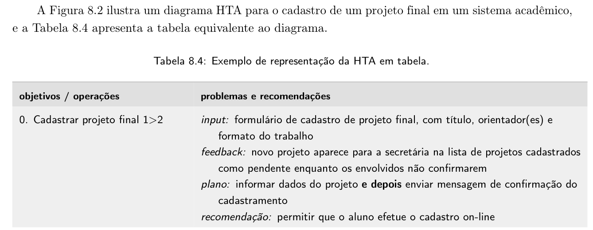

<b>Fonte:</b> BARBOSA et al. (2021, p. 191).

### 4.11 HTA-11 — Propósito da análise

A Tabela 12 apresenta o item HTA-11:

<b>Tabela 12: Item HTA-11 — Propósito da análise</b>

| Campo | Registro |
| :--- | :--- |
| **Pergunta** | O artefato informa para que a análise da tarefa foi feita (por exemplo, para reprojetar o portal ou descobrir onde os usuários erram) antes de apresentar o diagrama? |
| **Autor** | Pedro Rocha Ferreira Lima |
| **Fonte** | BARBOSA et al. (2021, p. 192) |
| **Origem na v1** | Item novo |

<b>Fonte:</b> Pedro Rocha Ferreira Lima (2026).

A Figura 11 reproduz o trecho do livro que fundamenta o item HTA-11:

<b>Figura 11: Referência Bibliográfica — Item HTA-11 (Propósito da análise)</b>

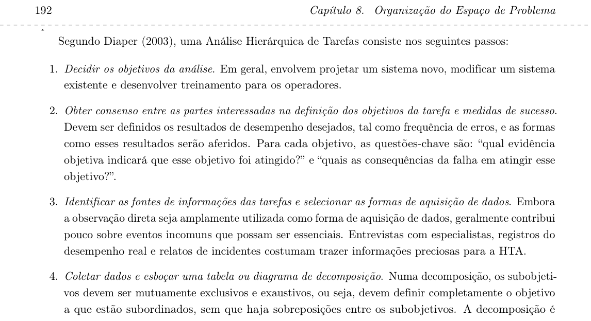

<b>Fonte:</b> BARBOSA et al. (2021, p. 192).

### 4.12 HTA-12 — Validação da decomposição

A Tabela 13 apresenta o item HTA-12:

<b>Tabela 13: Item HTA-12 — Validação da decomposição</b>

| Campo | Registro |
| :--- | :--- |
| **Pergunta** | A decomposição da tarefa foi conferida com usuários ou outras partes interessadas (por exemplo, em entrevista), para confirmar que corresponde ao modo como a tarefa é feita na prática? |
| **Autor** | Pedro Rocha Ferreira Lima |
| **Fonte** | BARBOSA et al. (2021, p. 193) |
| **Origem na v1** | Item novo |

<b>Fonte:</b> Pedro Rocha Ferreira Lima (2026).

A Figura 12 reproduz o trecho do livro que fundamenta o item HTA-12:

<b>Figura 12: Referência Bibliográfica — Item HTA-12 (Validação da decomposição)</b>

<b>Fonte:</b> BARBOSA et al. (2021, p. 193).

### 4.13 HTA-13 — Operações críticas

A Tabela 14 apresenta o item HTA-13:

<b>Tabela 14: Item HTA-13 — Operações críticas</b>

| Campo | Registro |
| :--- | :--- |
| **Pergunta** | O artefato destaca quais operações são mais críticas (as que têm maior chance de erro ou cujo erro causa maior prejuízo ao usuário)? |
| **Autor** | Pedro Rocha Ferreira Lima |
| **Fonte** | BARBOSA et al. (2021, p. 193) |
| **Origem na v1** | Item novo |

<b>Fonte:</b> Pedro Rocha Ferreira Lima (2026).

A Figura 13 reproduz o trecho do livro que fundamenta o item HTA-13:

<b>Figura 13: Referência Bibliográfica — Item HTA-13 (Operações críticas)</b>

<b>Fonte:</b> BARBOSA et al. (2021, p. 193).

### 4.14 HTA-14 — Caminhos alternativos para o mesmo objetivo

A Tabela 15 apresenta o item HTA-14:

<b>Tabela 15: Item HTA-14 — Caminhos alternativos para o mesmo objetivo</b>

| Campo | Registro |
| :--- | :--- |
| **Pergunta** | Quando um mesmo objetivo pode ser alcançado de maneiras diferentes, o diagrama mostra essas alternativas, em vez de registrar um único caminho? |
| **Autor** | Pedro Rocha Ferreira Lima |
| **Fonte** | BARBOSA et al. (2021, p. 192) |
| **Origem na v1** | Item novo |

<b>Fonte:</b> Pedro Rocha Ferreira Lima (2026).

A Figura 14 reproduz o trecho do livro que fundamenta o item HTA-14:

<b>Figura 14: Referência Bibliográfica — Item HTA-14 (Caminhos alternativos para o mesmo objetivo)</b>

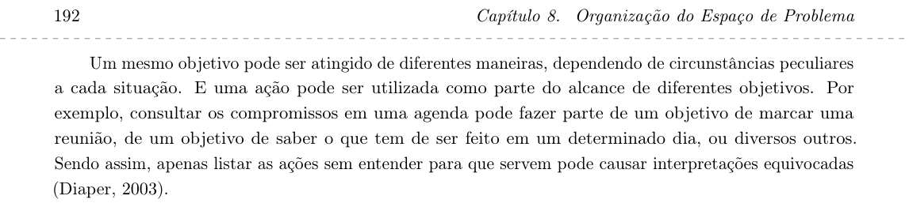

<b>Fonte:</b> BARBOSA et al. (2021, p. 192).

### 4.15 HTA-15 — Tipo de erro humano

A Tabela 16 apresenta o item HTA-15:

<b>Tabela 16: Item HTA-15 — Tipo de erro humano</b>

| Campo | Registro |
| :--- | :--- |
| **Pergunta** | Para cada problema identificado na tarefa, o artefato indica o tipo de erro do usuário (por exemplo, descuido na execução, aplicação de uma regra errada ou falta de conhecimento)? |
| **Autor** | Pedro Rocha Ferreira Lima |
| **Fonte** | BARBOSA et al. (2021, p. 193) |
| **Origem na v1** | Item novo |

<b>Fonte:</b> Pedro Rocha Ferreira Lima (2026).

A Figura 15 reproduz o trecho do livro que fundamenta o item HTA-15:

<b>Figura 15: Referência Bibliográfica — Item HTA-15 (Tipo de erro humano)</b>

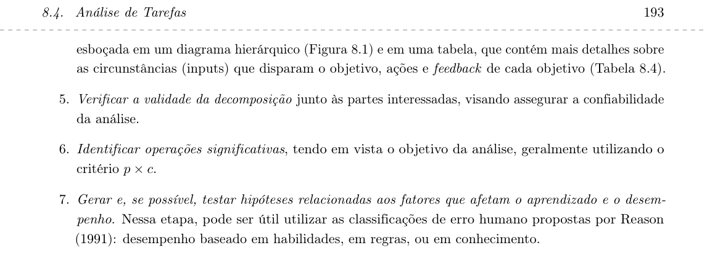

<b>Fonte:</b> BARBOSA et al. (2021, p. 193).

## 5. Correspondência com a v1

A Tabela 17 apresenta, para cada item da v2 já elaborado, o item de origem na v1 e o que mudou na redação:

<b>Tabela 17: Correspondência entre os Itens da v1 e da v2</b>

| Item v2 | Origem na v1 | O que mudou |
| :---: | :---: | :--- |
| **HTA-01** | [HTA-01](../../design-avaliacao-desenvolvimento/listas-verificacao-etapa-4.md#2-lista-de-verificacao-para-hta-10-itens) | Reescrito sem termos técnicos ("nível 0", "verbo no infinitivo") e com exemplo. |
| **HTA-02** | [HTA-06](../../design-avaliacao-desenvolvimento/listas-verificacao-etapa-4.md#2-lista-de-verificacao-para-hta-10-itens) | Explica o que é "plano" e retira a notação `p:`. |
| **HTA-03** | [HTA-07](../../design-avaliacao-desenvolvimento/listas-verificacao-etapa-4.md#2-lista-de-verificacao-para-hta-10-itens) | Cada operador passa a vir com o seu significado. |
| **HTA-04** | [HTA-09](../../design-avaliacao-desenvolvimento/listas-verificacao-etapa-4.md#2-lista-de-verificacao-para-hta-10-itens) | Define "operação" e traduz *input* e *feedback*. |
| **HTA-05** | [HTA-08](../../design-avaliacao-desenvolvimento/listas-verificacao-etapa-4.md#2-lista-de-verificacao-para-hta-10-itens) | Substitui a fórmula "P × C" sem explicação por exemplos do próprio livro. |
| **HTA-06** | [HTA-02](../../design-avaliacao-desenvolvimento/listas-verificacao-etapa-4.md#2-lista-de-verificacao-para-hta-10-itens) | Explica a decomposição por níveis, com exemplo de numeração. |
| **HTA-07** | [HTA-03](../../design-avaliacao-desenvolvimento/listas-verificacao-etapa-4.md#2-lista-de-verificacao-para-hta-10-itens) | Troca "mutuamente exclusivos / coletivamente exaustivos" por linguagem simples. |
| **HTA-08** | [HTA-04](../../design-avaliacao-desenvolvimento/listas-verificacao-etapa-4.md#2-lista-de-verificacao-para-hta-10-itens) | Explica o que são objetivo e operação e descreve a marcação no diagrama. |
| **HTA-09** | [HTA-05](../../design-avaliacao-desenvolvimento/listas-verificacao-etapa-4.md#2-lista-de-verificacao-para-hta-10-itens) | Mantém a numeração posicional, com exemplo. |
| **HTA-10** | [HTA-10](../../design-avaliacao-desenvolvimento/listas-verificacao-etapa-4.md#2-lista-de-verificacao-para-hta-10-itens) | Mantém a representação complementar em tabela, listando os campos. |
| **HTA-11** | Item novo | Item novo, elaborado na v2. |
| **HTA-12** | Item novo | Item novo, elaborado na v2. |
| **HTA-13** | Item novo | Item novo, elaborado na v2. |
| **HTA-14** | Item novo | Item novo, elaborado na v2. |
| **HTA-15** | Item novo | Item novo, elaborado na v2. |

<b>Fonte:</b> Daniel da Silva Batista (2026).

Na v1, a tabela da HTA era citada como "Tabela 8.1"; no livro ela é a Tabela 8.4 (p. 193). As fontes da v2 indicam a página exata.

## 6. Referências Bibliográficas

> [1] BARBOSA, Simone D. J.; SILVA, Bruno S. da; SILVEIRA, Milene S.; GASPARINI, Isabela; DARIN, Ticianne; BARBOSA, Gabriel D. J. *Interação Humano-Computador e Experiência do Usuário*. 1. ed. Autopublicação, 2021. ISBN: 978-65-00-19677-1.  
> [2] FAGAN, Michael E. Design and code inspections to reduce errors in program development. *IBM Systems Journal*, v. 15, n. 3, p. 182-211, 1976.  
> [3] SALES, André Barros de. *Plano de ensino FIHC 022026 – Turma 01*. Brasília: FCTE/UnB, 2026.

## 7. Histórico de Versões

| Versão | Data | Descrição | Autor(es) | Revisor(es) |
| :---: | :---: | :--- | :---: | :---: |
| `1.0` | 21/11/2026 | Criação da v2 da lista: itens HTA-01 a HTA-05 reescritos a partir da v1, com fonte por página e recorte do livro; itens HTA-06 a HTA-20 reservados aos demais integrantes. | Daniel da Silva Batista | — |
| `1.1` | 22/11/2026 | Elaboração dos itens HTA-06 a HTA-10, reescritos a partir dos itens v1 HTA-02, 03, 04, 05 e 10; recortes do livro adicionados. | Arthur Sismene Carvalho | — |
| `1.2` | 22/11/2026 | Elaboração dos itens HTA-11 a HTA-15, com fonte por página e recorte do livro. | Pedro Rocha Ferreira Lima | — |

