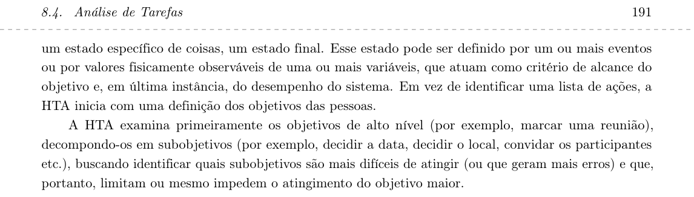
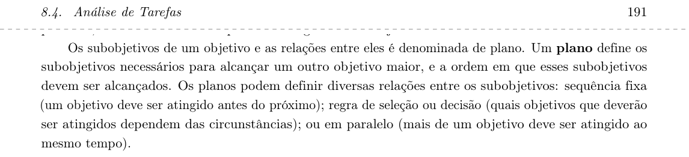

<b>Tabela de Contribuição</b>

| Membro | Contribuição |
| :--- | :--- |
| **Daniel da Silva Batista** | Elaboração dos itens HTA-01 a HTA-05, revisão dos itens da v1 e recortes do livro. |
| **Arthur Sismene Carvalho** | Elaboração dos itens HTA-06 a HTA-10 *(pendente)*. |
| **Leonardo da Silva Lopes Júnior** | Elaboração dos itens HTA-11 a HTA-15 *(pendente)*. |
| **Pedro Rocha Ferreira Lima** | Elaboração dos itens HTA-16 a HTA-20 *(pendente)*. |
| **Claude (Anthropic)** | Apoio na organização da página e na extração dos recortes do livro (conforme Política de IA). |

<b>Fonte:</b> Daniel da Silva Batista (2026).

# Lista de Verificação de HTA — v2

## 1. Introdução

A **Análise Hierárquica de Tarefas (HTA)** é o diagrama que parte de um objetivo do usuário e o divide em partes menores (subobjetivos) até chegar aos passos concretos (operações), indicando em que ordem cada parte é feita (BARBOSA et al., 2021).

Esta lista é a **versão 2 (v2)** da [Lista de Verificação para HTA (v1, Etapa 4)](../../design-avaliacao-desenvolvimento/listas-verificacao-etapa-4.md#2-lista-de-verificacao-para-hta-10-itens) e faz parte da [Verificação da Etapa 8](../index.md), conduzida pelo método de inspeção de Fagan (FAGAN, 1976). Ela será aplicada, no passo de inspeção, aos seguintes artefatos do projeto:

* [Análise de Tarefas — HTA](../../analise-de-requisitos/analise-de-tarefas/hta.md)

A lista tem **20 itens**, e cada integrante do grupo elabora 5 deles. Cada item é uma pergunta objetiva, com as explicações necessárias entre parênteses, para que possa ser respondida por quem não conhece o artefato. Cada item indica o autor e a fonte. A [Seção 3](#3-itens-de-verificacao) consolida todos os itens em uma tabela, e a [Seção 4](#4-detalhamento-dos-itens) detalha cada um, com a pergunta e, logo abaixo, o recorte do livro que a fundamenta.

## 2. Critérios de Julgamento

Cada item admite uma única resposta:

* **Sim** — o artefato atende integralmente ao que a pergunta descreve;
* **Não** — o artefato não atende ao que a pergunta descreve ou não apresenta a informação;
* **Incompleto** — o artefato atende apenas em parte (por exemplo, em alguns quadros, tarefas ou participantes, mas não em todos).

## 3. Itens de Verificação

A Tabela 1 consolida os 20 itens de verificação da Lista de Verificação de HTA — v2:

<b>Tabela 1: Itens da Lista de Verificação de HTA — v2</b>

| ID | Pergunta de verificação | Autor | Fonte |
| :---: | :--- | :--- | :--- |
| **HTA-01** | O diagrama começa pelo objetivo do usuário (o resultado que a pessoa quer alcançar, por exemplo "Comparar editais"), e não por uma lista de cliques ou de telas? | Daniel da Silva Batista | BARBOSA et al. (2021, p. 191) |
| **HTA-02** | Todo objetivo que foi dividido em partes menores (subobjetivos) tem um plano (a regra que diz em que ordem essas partes devem ser feitas)? | Daniel da Silva Batista | BARBOSA et al. (2021, p. 191) |
| **HTA-03** | Os planos usam apenas as três relações previstas na HTA: sequência ("1>2": uma parte depois da outra), seleção ("1/2": uma ou outra, conforme a situação) e paralelo ("1+2": as duas ao mesmo tempo)? | Daniel da Silva Batista | BARBOSA et al. (2021, p. 191) |
| **HTA-04** | Cada operação (passo do nível mais baixo, que não é mais dividido) informa o que dispara o passo (entrada), o que a pessoa faz (ação) e como ela sabe que concluiu (feedback)? | Daniel da Silva Batista | BARBOSA et al. (2021, p. 191) |
| **HTA-05** | O artefato explica até onde a tarefa foi dividida e por que parou ali (por exemplo, porque o risco de erro naquele passo já é aceitável ou porque o problema já foi identificado)? | Daniel da Silva Batista | BARBOSA et al. (2021, p. 192) |
| **HTA-06** | *(a elaborar)* | Arthur Sismene Carvalho | — |
| **HTA-07** | *(a elaborar)* | Arthur Sismene Carvalho | — |
| **HTA-08** | *(a elaborar)* | Arthur Sismene Carvalho | — |
| **HTA-09** | *(a elaborar)* | Arthur Sismene Carvalho | — |
| **HTA-10** | *(a elaborar)* | Arthur Sismene Carvalho | — |
| **HTA-11** | *(a elaborar)* | Leonardo da Silva Lopes Júnior | — |
| **HTA-12** | *(a elaborar)* | Leonardo da Silva Lopes Júnior | — |
| **HTA-13** | *(a elaborar)* | Leonardo da Silva Lopes Júnior | — |
| **HTA-14** | *(a elaborar)* | Leonardo da Silva Lopes Júnior | — |
| **HTA-15** | *(a elaborar)* | Leonardo da Silva Lopes Júnior | — |
| **HTA-16** | *(a elaborar)* | Pedro Rocha Ferreira Lima | — |
| **HTA-17** | *(a elaborar)* | Pedro Rocha Ferreira Lima | — |
| **HTA-18** | *(a elaborar)* | Pedro Rocha Ferreira Lima | — |
| **HTA-19** | *(a elaborar)* | Pedro Rocha Ferreira Lima | — |
| **HTA-20** | *(a elaborar)* | Pedro Rocha Ferreira Lima | — |

<b>Fonte:</b> Daniel da Silva Batista, Arthur Sismene Carvalho, Leonardo da Silva Lopes Júnior e Pedro Rocha Ferreira Lima (2026), conforme o autor de cada item.

## 4. Detalhamento dos Itens

### 4.1 HTA-01 — O objetivo do usuário como ponto de partida da HTA

A Tabela 2 apresenta o item HTA-01:

<b>Tabela 2: Item HTA-01 — O objetivo do usuário como ponto de partida da HTA</b>

| Campo | Registro |
| :--- | :--- |
| **Pergunta** | O diagrama começa pelo objetivo do usuário (o resultado que a pessoa quer alcançar, por exemplo "Comparar editais"), e não por uma lista de cliques ou de telas? |
| **Autor** | Daniel da Silva Batista |
| **Fonte** | BARBOSA et al. (2021, p. 191) |
| **Origem na v1** | HTA-01 |

<b>Fonte:</b> Daniel da Silva Batista (2026).

A Figura 1 reproduz o trecho do livro que fundamenta o item HTA-01:

<b>Figura 1: Referência Bibliográfica — Item HTA-01 (O objetivo do usuário como ponto de partida da HTA)</b>

<b>Fonte:</b> BARBOSA et al. (2021, p. 191).

### 4.2 HTA-02 — O plano como regra de ordem entre os subobjetivos

A Tabela 3 apresenta o item HTA-02:

<b>Tabela 3: Item HTA-02 — O plano como regra de ordem entre os subobjetivos</b>

| Campo | Registro |
| :--- | :--- |
| **Pergunta** | Todo objetivo que foi dividido em partes menores (subobjetivos) tem um plano (a regra que diz em que ordem essas partes devem ser feitas)? |
| **Autor** | Daniel da Silva Batista |
| **Fonte** | BARBOSA et al. (2021, p. 191) |
| **Origem na v1** | HTA-06 |

<b>Fonte:</b> Daniel da Silva Batista (2026).

A Figura 2 reproduz o trecho do livro que fundamenta o item HTA-02:

<b>Figura 2: Referência Bibliográfica — Item HTA-02 (O plano como regra de ordem entre os subobjetivos)</b>

<b>Fonte:</b> BARBOSA et al. (2021, p. 191).

### 4.3 HTA-03 — Relações entre subobjetivos nos planos da HTA

A Tabela 4 apresenta o item HTA-03:

<b>Tabela 4: Item HTA-03 — Relações entre subobjetivos nos planos da HTA</b>

| Campo | Registro |
| :--- | :--- |
| **Pergunta** | Os planos usam apenas as três relações previstas na HTA: sequência ("1>2": uma parte depois da outra), seleção ("1/2": uma ou outra, conforme a situação) e paralelo ("1+2": as duas ao mesmo tempo)? |
| **Autor** | Daniel da Silva Batista |
| **Fonte** | BARBOSA et al. (2021, p. 191) |
| **Origem na v1** | HTA-07 |

<b>Fonte:</b> Daniel da Silva Batista (2026).

A Figura 3 reproduz o trecho do livro que fundamenta o item HTA-03:

<b>Figura 3: Referência Bibliográfica — Item HTA-03 (Relações entre subobjetivos nos planos da HTA)</b>

<b>Fonte:</b> BARBOSA et al. (2021, p. 191).

### 4.4 HTA-04 — Entrada, ação e feedback de uma operação

A Tabela 5 apresenta o item HTA-04:

<b>Tabela 5: Item HTA-04 — Entrada, ação e feedback de uma operação</b>

| Campo | Registro |
| :--- | :--- |
| **Pergunta** | Cada operação (passo do nível mais baixo, que não é mais dividido) informa o que dispara o passo (entrada), o que a pessoa faz (ação) e como ela sabe que concluiu (feedback)? |
| **Autor** | Daniel da Silva Batista |
| **Fonte** | BARBOSA et al. (2021, p. 191) |
| **Origem na v1** | HTA-09 |

<b>Fonte:</b> Daniel da Silva Batista (2026).

A Figura 4 reproduz o trecho do livro que fundamenta o item HTA-04:

<b>Figura 4: Referência Bibliográfica — Item HTA-04 (Entrada, ação e feedback de uma operação)</b>

<b>Fonte:</b> BARBOSA et al. (2021, p. 191).

### 4.5 HTA-05 — Critério de parada da decomposição

A Tabela 6 apresenta o item HTA-05:

<b>Tabela 6: Item HTA-05 — Critério de parada da decomposição</b>

| Campo | Registro |
| :--- | :--- |
| **Pergunta** | O artefato explica até onde a tarefa foi dividida e por que parou ali (por exemplo, porque o risco de erro naquele passo já é aceitável ou porque o problema já foi identificado)? |
| **Autor** | Daniel da Silva Batista |
| **Fonte** | BARBOSA et al. (2021, p. 192) |
| **Origem na v1** | HTA-08 |

<b>Fonte:</b> Daniel da Silva Batista (2026).

A Figura 5 reproduz o trecho do livro que fundamenta o item HTA-05:

<b>Figura 5: Referência Bibliográfica — Item HTA-05 (Critério de parada da decomposição)</b>

<b>Fonte:</b> BARBOSA et al. (2021, p. 192).

> *Os itens HTA-06 a HTA-20 serão detalhados pelos respectivos autores neste mesmo formato: pergunta, autor, fonte e recorte do livro.*

## 5. Correspondência com a v1

A Tabela 7 apresenta, para cada item da v2 já elaborado, o item de origem na v1 e o que mudou na redação:

<b>Tabela 7: Correspondência entre os Itens da v1 e da v2</b>

| Item v2 | Origem na v1 | O que mudou |
| :---: | :---: | :--- |
| **HTA-01** | [HTA-01](../../design-avaliacao-desenvolvimento/listas-verificacao-etapa-4.md#2-lista-de-verificacao-para-hta-10-itens) | Reescrito sem termos técnicos ("nível 0", "verbo no infinitivo") e com exemplo. |
| **HTA-02** | [HTA-06](../../design-avaliacao-desenvolvimento/listas-verificacao-etapa-4.md#2-lista-de-verificacao-para-hta-10-itens) | Explica o que é "plano" e retira a notação `p:`. |
| **HTA-03** | [HTA-07](../../design-avaliacao-desenvolvimento/listas-verificacao-etapa-4.md#2-lista-de-verificacao-para-hta-10-itens) | Cada operador passa a vir com o seu significado. |
| **HTA-04** | [HTA-09](../../design-avaliacao-desenvolvimento/listas-verificacao-etapa-4.md#2-lista-de-verificacao-para-hta-10-itens) | Define "operação" e traduz *input* e *feedback*. |
| **HTA-05** | [HTA-08](../../design-avaliacao-desenvolvimento/listas-verificacao-etapa-4.md#2-lista-de-verificacao-para-hta-10-itens) | Substitui a fórmula "P × C" sem explicação por exemplos do próprio livro. |

<b>Fonte:</b> Daniel da Silva Batista (2026).

Na v1, a tabela da HTA era citada como "Tabela 8.1"; no livro ela é a Tabela 8.4 (p. 193). As fontes da v2 indicam a página exata.

## 6. Referências Bibliográficas

> [1] BARBOSA, Simone D. J.; SILVA, Bruno S. da; SILVEIRA, Milene S.; GASPARINI, Isabela; DARIN, Ticianne; BARBOSA, Gabriel D. J. *Interação Humano-Computador e Experiência do Usuário*. 1. ed. Autopublicação, 2021. ISBN: 978-65-00-19677-1.  
> [2] FAGAN, Michael E. Design and code inspections to reduce errors in program development. *IBM Systems Journal*, v. 15, n. 3, p. 182-211, 1976.  
> [3] SALES, André Barros de. *Plano de ensino FIHC 022026 – Turma 01*. Brasília: FCTE/UnB, 2026.

## 7. Histórico de Versões

| Versão | Data | Descrição | Autor(es) | Revisor(es) |
| :---: | :---: | :--- | :---: | :---: |
| `1.0` | 21/11/2026 | Criação da v2 da lista: itens HTA-01 a HTA-05 reescritos a partir da v1, com fonte por página e recorte do livro; itens HTA-06 a HTA-20 reservados aos demais integrantes. | Daniel da Silva Batista | — |

