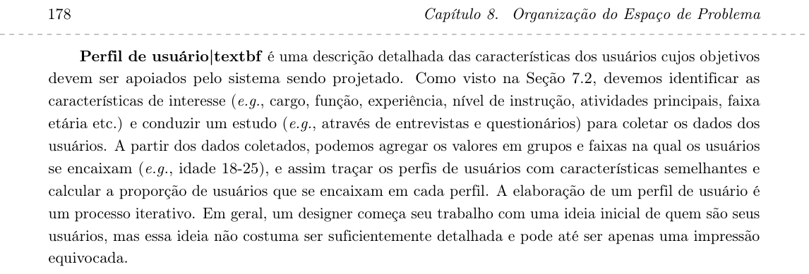
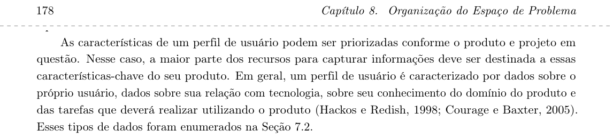
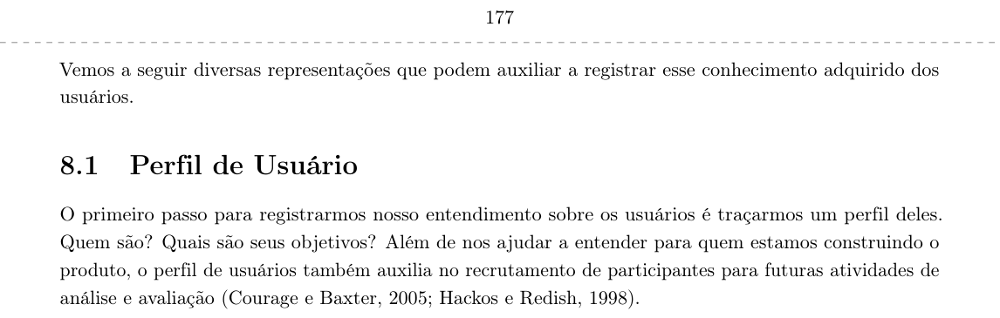
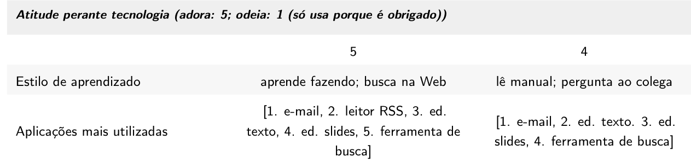
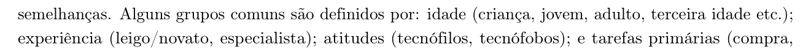
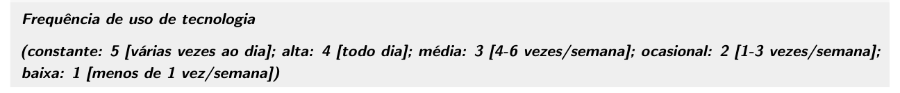
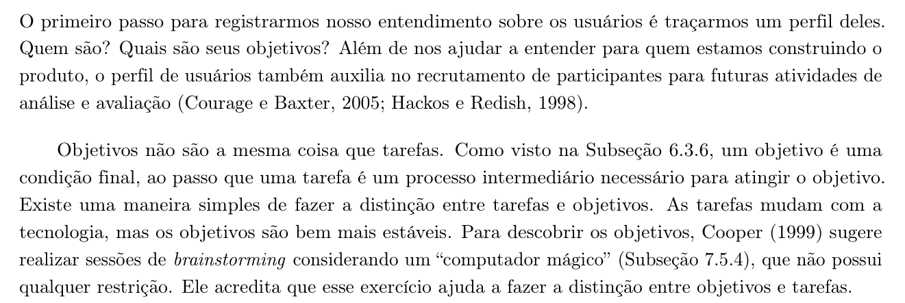

<b>Tabela de Contribuição</b>

| Membro | Contribuição |
| :--- | :--- |
| **Daniel da Silva Batista** | Elaboração dos itens PU-01 a PU-05, recortes do livro. |
| **Arthur Sismene Carvalho** | Elaboração dos itens PU-06 a PU-10, recortes do livro. |
| **Leonardo da Silva Lopes Júnior** | Elaboração dos itens PU-11 a PU-15 *(pendente)*. |
| **Pedro Rocha Ferreira Lima** | Elaboração dos itens PU-16 a PU-20 *(pendente)*. |
| **Claude (Anthropic)** | Apoio na organização da página e na extração dos recortes do livro (conforme Política de IA). |

<b>Fonte:</b> Daniel da Silva Batista e Arthur Sismene Carvalho (2026).

# Lista de Verificação de Perfil de Usuário

## 1. Introdução

O **perfil de usuário** é a descrição detalhada das características dos usuários do sistema, construída a partir de dados coletados com usuários reais, por exemplo em entrevistas e questionários (BARBOSA et al., 2021).

Esta é a **primeira versão (v1)** desta lista, elaborada para a [Verificação da Etapa 8](../index.md), conduzida pelo método de inspeção de Fagan (FAGAN, 1976). Ela será aplicada, no passo de inspeção, aos seguintes artefatos do projeto:

* [Perfil do Usuário](../../analise-de-requisitos/perfil-de-usuario.md)

A lista tem **20 itens**, e cada integrante do grupo elabora 5 deles. Cada item é uma pergunta objetiva, com as explicações necessárias entre parênteses, para que possa ser respondida por quem não conhece o artefato. Cada item indica o autor e a fonte. A [Seção 3](#3-itens-de-verificacao) consolida todos os itens em uma tabela, e a [Seção 4](#4-detalhamento-dos-itens) detalha cada um, com a pergunta e, logo abaixo, o recorte do livro que a fundamenta.

## 2. Critérios de Julgamento

Cada item admite uma única resposta:

* **Sim** — o artefato atende integralmente ao que a pergunta descreve;
* **Não** — o artefato não atende ao que a pergunta descreve ou não apresenta a informação;
* **Incompleto** — o artefato atende apenas em parte (por exemplo, em alguns quadros, tarefas ou participantes, mas não em todos).

## 3. Itens de Verificação

A Tabela 1 consolida os 20 itens de verificação da Lista de Verificação de Perfil de Usuário:

<b>Tabela 1: Itens da Lista de Verificação de Perfil de Usuário</b>

| ID | Pergunta de verificação | Autor | Fonte |
| :---: | :--- | :--- | :--- |
| **PU-01** | O perfil descreve os usuários por meio de características objetivas (por exemplo, faixa etária, escolaridade, profissão e experiência)? | Daniel da Silva Batista | BARBOSA et al. (2021, p. 178) |
| **PU-02** | Os dados do perfil foram coletados diretamente com usuários reais, por meio de entrevistas ou questionários? | Daniel da Silva Batista | BARBOSA et al. (2021, p. 178) |
| **PU-03** | Os usuários foram agrupados em perfis por características semelhantes, e o artefato informa a proporção (porcentagem) de usuários em cada perfil? | Daniel da Silva Batista | BARBOSA et al. (2021, p. 178) |
| **PU-04** | O perfil informa a relação dos usuários com a tecnologia (com que frequência a usam, quanta experiência têm e se gostam ou evitam usá-la)? | Daniel da Silva Batista | BARBOSA et al. (2021, p. 178) |
| **PU-05** | O perfil é usado para definir quem será recrutado nas avaliações (os participantes das entrevistas e dos testes têm as características do perfil)? | Daniel da Silva Batista | BARBOSA et al. (2021, p. 177) |
| **PU-06** | O perfil registra a atitude dos usuários em relação à tecnologia — se a veem de forma positiva, negativa ou neutra — e quais tecnologias (além do sistema) eles utilizam com maior frequência? | Arthur Sismene Carvalho | BARBOSA et al. (2021, p. 179) |
| **PU-07** | O perfil indica o grau de experiência dos usuários com o sistema ou com sistemas similares — se são iniciantes, intermediários ou experientes — e há quanto tempo o utilizam? | Arthur Sismene Carvalho | BARBOSA et al. (2021, p. 178) |
| **PU-08** | O perfil registra com que frequência os usuários realizam cada uma das tarefas principais que o sistema suporta? | Arthur Sismene Carvalho | BARBOSA et al. (2021, p. 178) |
| **PU-09** | O perfil indica o nível de alfabetização em informática dos usuários: com que proficiência eles utilizam computadores em geral, além do sistema em questão? | Arthur Sismene Carvalho | BARBOSA et al. (2021, p. 179) |
| **PU-10** | O perfil descreve os objetivos principais dos usuários ao usar o sistema — o que eles querem alcançar — distinguindo-os das tarefas que executam para chegar a esses objetivos? | Arthur Sismene Carvalho | BARBOSA et al. (2021, p. 178) |
| **PU-11** | *(a elaborar)* | Leonardo da Silva Lopes Júnior | — |
| **PU-12** | *(a elaborar)* | Leonardo da Silva Lopes Júnior | — |
| **PU-13** | *(a elaborar)* | Leonardo da Silva Lopes Júnior | — |
| **PU-14** | *(a elaborar)* | Leonardo da Silva Lopes Júnior | — |
| **PU-15** | *(a elaborar)* | Leonardo da Silva Lopes Júnior | — |
| **PU-16** | *(a elaborar)* | Pedro Rocha Ferreira Lima | — |
| **PU-17** | *(a elaborar)* | Pedro Rocha Ferreira Lima | — |
| **PU-18** | *(a elaborar)* | Pedro Rocha Ferreira Lima | — |
| **PU-19** | *(a elaborar)* | Pedro Rocha Ferreira Lima | — |
| **PU-20** | *(a elaborar)* | Pedro Rocha Ferreira Lima | — |

<b>Fonte:</b> Daniel da Silva Batista, Arthur Sismene Carvalho, Leonardo da Silva Lopes Júnior e Pedro Rocha Ferreira Lima (2026), conforme o autor de cada item.

## 4. Detalhamento dos Itens

### 4.1 PU-01 — Características descritas no perfil

A Tabela 2 apresenta o item PU-01:

<b>Tabela 2: Item PU-01 — Características descritas no perfil</b>

| Campo | Registro |
| :--- | :--- |
| **Pergunta** | O perfil descreve os usuários por meio de características objetivas (por exemplo, faixa etária, escolaridade, profissão e experiência)? |
| **Autor** | Daniel da Silva Batista |
| **Fonte** | BARBOSA et al. (2021, p. 178) |

<b>Fonte:</b> Daniel da Silva Batista (2026).

A Figura 1 reproduz o trecho do livro que fundamenta o item PU-01:

<b>Figura 1: Referência Bibliográfica — Item PU-01 (Características descritas no perfil)</b>

<b>Fonte:</b> BARBOSA et al. (2021, p. 178).

### 4.2 PU-02 — Coleta de dados com usuários

A Tabela 3 apresenta o item PU-02:

<b>Tabela 3: Item PU-02 — Coleta de dados com usuários</b>

| Campo | Registro |
| :--- | :--- |
| **Pergunta** | Os dados do perfil foram coletados diretamente com usuários reais, por meio de entrevistas ou questionários? |
| **Autor** | Daniel da Silva Batista |
| **Fonte** | BARBOSA et al. (2021, p. 178) |

<b>Fonte:</b> Daniel da Silva Batista (2026).

A Figura 2 reproduz o trecho do livro que fundamenta o item PU-02:

<b>Figura 2: Referência Bibliográfica — Item PU-02 (Coleta de dados com usuários)</b>

<b>Fonte:</b> BARBOSA et al. (2021, p. 178).

### 4.3 PU-03 — Agrupamento e proporção dos perfis

A Tabela 4 apresenta o item PU-03:

<b>Tabela 4: Item PU-03 — Agrupamento e proporção dos perfis</b>

| Campo | Registro |
| :--- | :--- |
| **Pergunta** | Os usuários foram agrupados em perfis por características semelhantes, e o artefato informa a proporção (porcentagem) de usuários em cada perfil? |
| **Autor** | Daniel da Silva Batista |
| **Fonte** | BARBOSA et al. (2021, p. 178) |

<b>Fonte:</b> Daniel da Silva Batista (2026).

A Figura 3 reproduz o trecho do livro que fundamenta o item PU-03:

<b>Figura 3: Referência Bibliográfica — Item PU-03 (Agrupamento e proporção dos perfis)</b>

<b>Fonte:</b> BARBOSA et al. (2021, p. 178).

### 4.4 PU-04 — Relação dos usuários com a tecnologia

A Tabela 5 apresenta o item PU-04:

<b>Tabela 5: Item PU-04 — Relação dos usuários com a tecnologia</b>

| Campo | Registro |
| :--- | :--- |
| **Pergunta** | O perfil informa a relação dos usuários com a tecnologia (com que frequência a usam, quanta experiência têm e se gostam ou evitam usá-la)? |
| **Autor** | Daniel da Silva Batista |
| **Fonte** | BARBOSA et al. (2021, p. 178) |

<b>Fonte:</b> Daniel da Silva Batista (2026).

A Figura 4 reproduz o trecho do livro que fundamenta o item PU-04:

<b>Figura 4: Referência Bibliográfica — Item PU-04 (Relação dos usuários com a tecnologia)</b>

<b>Fonte:</b> BARBOSA et al. (2021, p. 178).

### 4.5 PU-05 — Perfil como base do recrutamento

A Tabela 6 apresenta o item PU-05:

<b>Tabela 6: Item PU-05 — Perfil como base do recrutamento</b>

| Campo | Registro |
| :--- | :--- |
| **Pergunta** | O perfil é usado para definir quem será recrutado nas avaliações (os participantes das entrevistas e dos testes têm as características do perfil)? |
| **Autor** | Daniel da Silva Batista |
| **Fonte** | BARBOSA et al. (2021, p. 177) |

<b>Fonte:</b> Daniel da Silva Batista (2026).

A Figura 5 reproduz o trecho do livro que fundamenta o item PU-05:

<b>Figura 5: Referência Bibliográfica — Item PU-05 (Perfil como base do recrutamento)</b>

<b>Fonte:</b> BARBOSA et al. (2021, p. 177).

### 4.6 PU-06 — Atitude em relação à tecnologia

A Tabela 7 apresenta o item PU-06:

<b>Tabela 7: Item PU-06 — Atitude em relação à tecnologia</b>

| Campo | Registro |
| :--- | :--- |
| **Pergunta** | O perfil registra a atitude dos usuários em relação à tecnologia — se a veem de forma positiva, negativa ou neutra — e quais tecnologias (além do sistema) eles utilizam com maior frequência? |
| **Autor** | Arthur Sismene Carvalho |
| **Fonte** | BARBOSA et al. (2021, p. 179) |

<b>Fonte:</b> Arthur Sismene Carvalho (2026).

A Figura 6 reproduz o trecho do livro que fundamenta o item PU-06:

<b>Figura 6: Referência Bibliográfica — Item PU-06 (Atitude em relação à tecnologia)</b>

<b>Fonte:</b> BARBOSA et al. (2021, p. 179).

### 4.7 PU-07 — Domínio com o sistema

A Tabela 8 apresenta o item PU-07:

<b>Tabela 8: Item PU-07 — Domínio com o sistema</b>

| Campo | Registro |
| :--- | :--- |
| **Pergunta** | O perfil indica o grau de experiência dos usuários com o sistema ou com sistemas similares — se são iniciantes, intermediários ou experientes — e há quanto tempo o utilizam? |
| **Autor** | Arthur Sismene Carvalho |
| **Fonte** | BARBOSA et al. (2021, p. 178) |

<b>Fonte:</b> Arthur Sismene Carvalho (2026).

A Figura 7 reproduz o trecho do livro que fundamenta o item PU-07:

<b>Figura 7: Referência Bibliográfica — Item PU-07 (Domínio com o sistema)</b>

<b>Fonte:</b> BARBOSA et al. (2021, p. 178).

### 4.8 PU-08 — Frequência de uso das tarefas

A Tabela 9 apresenta o item PU-08:

<b>Tabela 9: Item PU-08 — Frequência de uso das tarefas</b>

| Campo | Registro |
| :--- | :--- |
| **Pergunta** | O perfil registra com que frequência os usuários realizam cada uma das tarefas principais que o sistema suporta? |
| **Autor** | Arthur Sismene Carvalho |
| **Fonte** | BARBOSA et al. (2021, p. 178) |

<b>Fonte:</b> Arthur Sismene Carvalho (2026).

A Figura 8 reproduz o trecho do livro que fundamenta o item PU-08:

<b>Figura 8: Referência Bibliográfica — Item PU-08 (Frequência de uso das tarefas)</b>

<b>Fonte:</b> BARBOSA et al. (2021, p. 178).

### 4.9 PU-09 — Domínio com o computador

A Tabela 10 apresenta o item PU-09:

<b>Tabela 10: Item PU-09 — Domínio com o computador</b>

| Campo | Registro |
| :--- | :--- |
| **Pergunta** | O perfil indica o nível de alfabetização em informática dos usuários: com que proficiência eles utilizam computadores em geral, além do sistema em questão? |
| **Autor** | Arthur Sismene Carvalho |
| **Fonte** | BARBOSA et al. (2021, p. 179) |

<b>Fonte:</b> Arthur Sismene Carvalho (2026).

A Figura 9 reproduz o trecho do livro que fundamenta o item PU-09:

<b>Figura 9: Referência Bibliográfica — Item PU-09 (Domínio com o computador)</b>

<b>Fonte:</b> BARBOSA et al. (2021, p. 179).

### 4.10 PU-10 — Objetivos dos usuários

A Tabela 11 apresenta o item PU-10:

<b>Tabela 11: Item PU-10 — Objetivos dos usuários</b>

| Campo | Registro |
| :--- | :--- |
| **Pergunta** | O perfil descreve os objetivos principais dos usuários ao usar o sistema — o que eles querem alcançar — distinguindo-os das tarefas que executam para chegar a esses objetivos? |
| **Autor** | Arthur Sismene Carvalho |
| **Fonte** | BARBOSA et al. (2021, p. 178) |

<b>Fonte:</b> Arthur Sismene Carvalho (2026).

A Figura 10 reproduz o trecho do livro que fundamenta o item PU-10:

<b>Figura 10: Referência Bibliográfica — Item PU-10 (Objetivos dos usuários)</b>

<b>Fonte:</b> BARBOSA et al. (2021, p. 178).

> *Os itens PU-11 a PU-20 serão detalhados pelos respectivos autores neste mesmo formato: pergunta, autor, fonte e recorte do livro.*

## 5. Referências Bibliográficas

> [1] BARBOSA, Simone D. J.; SILVA, Bruno S. da; SILVEIRA, Milene S.; GASPARINI, Isabela; DARIN, Ticianne; BARBOSA, Gabriel D. J. *Interação Humano-Computador e Experiência do Usuário*. 1. ed. Autopublicação, 2021. ISBN: 978-65-00-19677-1.  
> [2] FAGAN, Michael E. Design and code inspections to reduce errors in program development. *IBM Systems Journal*, v. 15, n. 3, p. 182-211, 1976.  
> [3] SALES, André Barros de. *Plano de ensino FIHC 022026 – Turma 01*. Brasília: FCTE/UnB, 2026.

## 6. Histórico de Versões

| Versão | Data | Descrição | Autor(es) | Revisor(es) |
| :---: | :---: | :--- | :---: | :---: |
| `1.0` | 21/11/2026 | Criação da lista (v1): itens PU-01 a PU-05, com fonte por página e recorte do livro; itens PU-06 a PU-20 reservados aos demais integrantes. | Daniel da Silva Batista | — |
| `1.1` | 22/11/2026 | Adição dos itens PU-06 a PU-10: perguntas de verificação, fontes e recortes do livro. | Arthur Sismene Carvalho | — |

