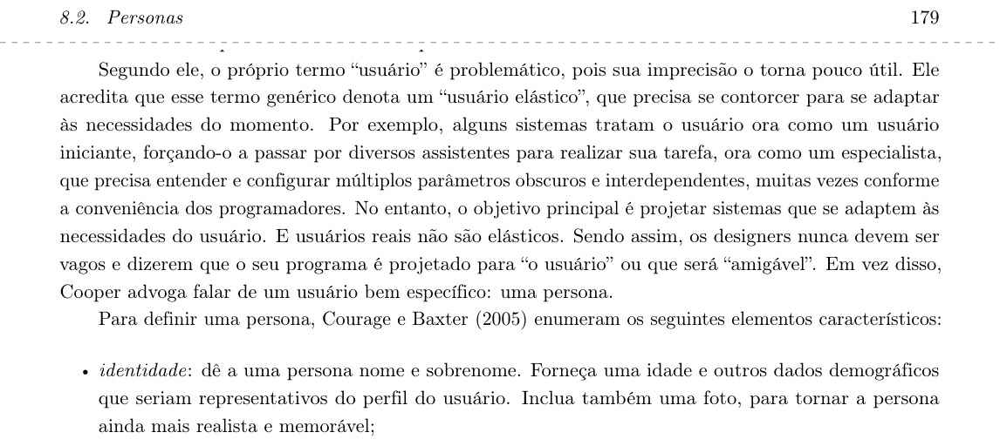
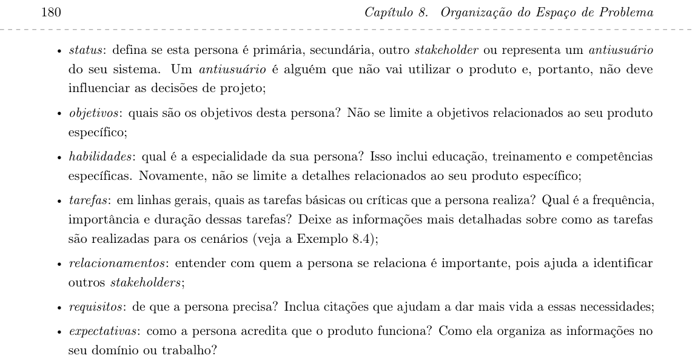
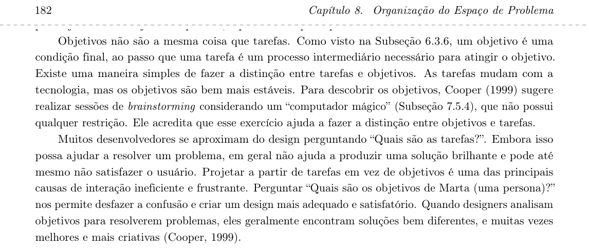
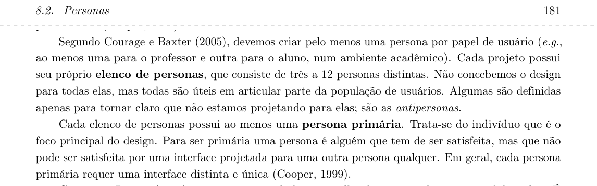
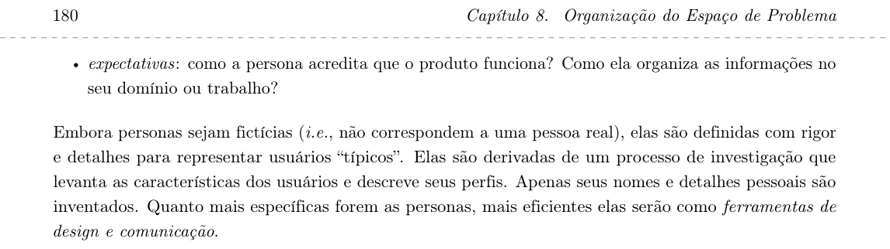
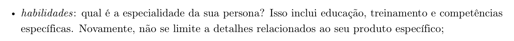
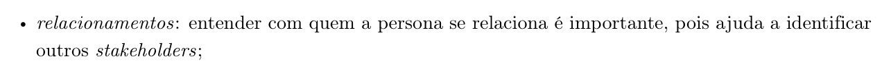
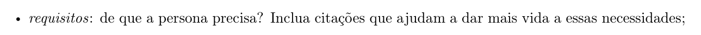
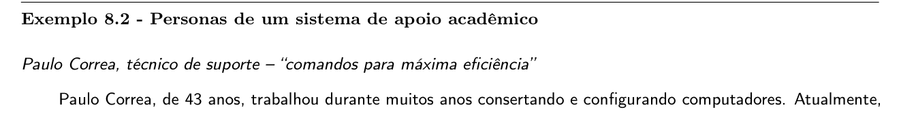
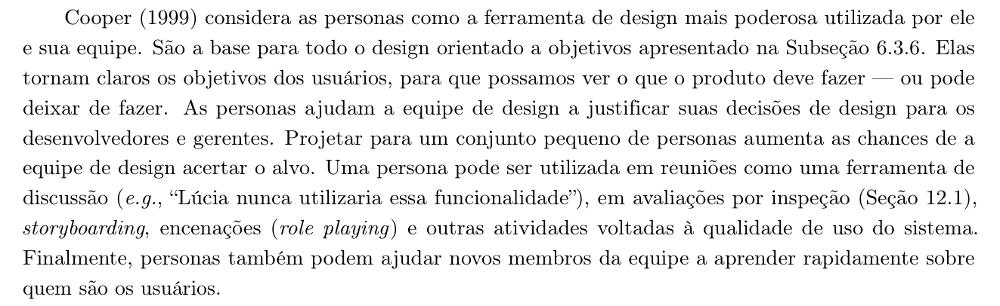

<b>Tabela de Contribuição</b>

| Membro | Contribuição |
| :--- | :--- |
| **Daniel da Silva Batista** | Elaboração dos itens PE-01 a PE-05, recortes do livro. |
| **Arthur Sismene Carvalho** | Elaboração dos itens PE-06 a PE-10, recortes do livro. |
| **Pedro Rocha Ferreira Lima** | Elaboração dos itens PE-11 a PE-15 *(pendente)*. |
| **Claude (Anthropic)** | Apoio na organização da página e na extração dos recortes do livro (conforme Política de IA). |

<b>Fonte:</b> Daniel da Silva Batista e Arthur Sismene Carvalho (2026).

# Lista de Verificação de Personas

## 1. Introdução

Uma **persona** é um personagem fictício que representa um grupo de usuários reais com características semelhantes. É usada para manter a equipe focada em um usuário concreto durante as decisões de design (BARBOSA et al., 2021).

Esta é a **primeira versão (v1)** desta lista, elaborada para a [Verificação da Etapa 8](../index.md), conduzida pelo método de inspeção de Fagan (FAGAN, 1976). Ela será aplicada, no passo de inspeção, aos seguintes artefatos do projeto:

* [Personas](../../analise-de-requisitos/personas.md)

A lista tem **15 itens**, e cada integrante do grupo elabora 5 deles. Cada item é uma pergunta objetiva, com as explicações necessárias entre parênteses, para que possa ser respondida por quem não conhece o artefato. Cada item indica o autor e a fonte. A [Seção 3](#3-itens-de-verificacao) consolida todos os itens em uma tabela, e a [Seção 4](#4-detalhamento-dos-itens) detalha cada um, com a pergunta e, logo abaixo, o recorte do livro que a fundamenta.

## 2. Critérios de Julgamento

Cada item admite uma única resposta:

* **Sim** — o artefato atende integralmente ao que a pergunta descreve;
* **Não** — o artefato não atende ao que a pergunta descreve ou não apresenta a informação;
* **Incompleto** — o artefato atende apenas em parte (por exemplo, em alguns quadros, tarefas ou participantes, mas não em todos).

## 3. Itens de Verificação

A Tabela 1 consolida os 15 itens de verificação da Lista de Verificação de Personas:

<b>Tabela 1: Itens da Lista de Verificação de Personas</b>

| ID | Pergunta de verificação | Autor | Fonte |
| :---: | :--- | :--- | :--- |
| **PE-01** | Cada persona tem identidade completa: nome e sobrenome, idade, outros dados demográficos (como profissão e cidade) e uma foto? | Daniel da Silva Batista | BARBOSA et al. (2021, p. 179) |
| **PE-02** | Cada persona indica o seu status: primária (foco principal do design), secundária, outro stakeholder (pessoa afetada pelo sistema) ou antiusuário (quem não vai usar o sistema)? | Daniel da Silva Batista | BARBOSA et al. (2021, p. 180) |
| **PE-03** | Cada persona descreve os seus objetivos (o resultado que ela quer alcançar) separados das tarefas (os passos que executa para isso)? | Daniel da Silva Batista | BARBOSA et al. (2021, p. 182) |
| **PE-04** | O elenco (o conjunto de personas do projeto) tem entre 3 e 12 personas, e pelo menos uma delas é primária (a persona para quem o design é feito em primeiro lugar)? | Daniel da Silva Batista | BARBOSA et al. (2021, p. 181) |
| **PE-05** | As personas foram construídas a partir dos dados do perfil de usuário (pesquisa com usuários reais), e apenas o nome e os detalhes pessoais foram inventados? | Daniel da Silva Batista | BARBOSA et al. (2021, p. 180) |
| **PE-06** | Cada persona descreve suas habilidades relacionadas ao domínio do sistema: o quanto sabe sobre o tema, que ferramentas e tecnologias usa e há quanto tempo executa as tarefas relacionadas? | Arthur Sismene Carvalho | BARBOSA et al. (2021, p. 180) |
| **PE-07** | Cada persona descreve seus relacionamentos relevantes: com quem trabalha, de quem depende e a quem reporta ao realizar as tarefas que o sistema suporta? | Arthur Sismene Carvalho | BARBOSA et al. (2021, p. 180) |
| **PE-08** | Cada persona lista suas necessidades do ponto de vista do usuário: o que ela precisaria que o sistema fornecesse para alcançar seus objetivos com eficiência e satisfação? | Arthur Sismene Carvalho | BARBOSA et al. (2021, p. 180) |
| **PE-09** | Cada persona inclui uma citação direta representativa — uma frase que sintetiza sua atitude em relação ao sistema ou ao domínio — para ajudar a equipe a lembrar do ponto de vista dessa persona? | Arthur Sismene Carvalho | BARBOSA et al. (2021, p. 180) |
| **PE-10** | As personas são usadas nas decisões de design: a equipe as consulta ao comparar alternativas de solução, ao priorizar funcionalidades e ao avaliar se as propostas atendem às necessidades do usuário alvo? | Arthur Sismene Carvalho | BARBOSA et al. (2021, p. 181) |
| **PE-11** | *(a elaborar)* | Pedro Rocha Ferreira Lima | — |
| **PE-12** | *(a elaborar)* | Pedro Rocha Ferreira Lima | — |
| **PE-13** | *(a elaborar)* | Pedro Rocha Ferreira Lima | — |
| **PE-14** | *(a elaborar)* | Pedro Rocha Ferreira Lima | — |
| **PE-15** | *(a elaborar)* | Pedro Rocha Ferreira Lima | — |

<b>Fonte:</b> Daniel da Silva Batista, Arthur Sismene Carvalho e Pedro Rocha Ferreira Lima (2026), conforme o autor de cada item.

## 4. Detalhamento dos Itens

### 4.1 PE-01 — Identidade da persona

A Tabela 2 apresenta o item PE-01:

<b>Tabela 2: Item PE-01 — Identidade da persona</b>

| Campo | Registro |
| :--- | :--- |
| **Pergunta** | Cada persona tem identidade completa: nome e sobrenome, idade, outros dados demográficos (como profissão e cidade) e uma foto? |
| **Autor** | Daniel da Silva Batista |
| **Fonte** | BARBOSA et al. (2021, p. 179) |

<b>Fonte:</b> Daniel da Silva Batista (2026).

A Figura 1 reproduz o trecho do livro que fundamenta o item PE-01:

<b>Figura 1: Referência Bibliográfica — Item PE-01 (Identidade da persona)</b>

<b>Fonte:</b> BARBOSA et al. (2021, p. 179).

### 4.2 PE-02 — Status da persona

A Tabela 3 apresenta o item PE-02:

<b>Tabela 3: Item PE-02 — Status da persona</b>

| Campo | Registro |
| :--- | :--- |
| **Pergunta** | Cada persona indica o seu status: primária (foco principal do design), secundária, outro stakeholder (pessoa afetada pelo sistema) ou antiusuário (quem não vai usar o sistema)? |
| **Autor** | Daniel da Silva Batista |
| **Fonte** | BARBOSA et al. (2021, p. 180) |

<b>Fonte:</b> Daniel da Silva Batista (2026).

A Figura 2 reproduz o trecho do livro que fundamenta o item PE-02:

<b>Figura 2: Referência Bibliográfica — Item PE-02 (Status da persona)</b>

<b>Fonte:</b> BARBOSA et al. (2021, p. 180).

### 4.3 PE-03 — Objetivos diferentes de tarefas

A Tabela 4 apresenta o item PE-03:

<b>Tabela 4: Item PE-03 — Objetivos diferentes de tarefas</b>

| Campo | Registro |
| :--- | :--- |
| **Pergunta** | Cada persona descreve os seus objetivos (o resultado que ela quer alcançar) separados das tarefas (os passos que executa para isso)? |
| **Autor** | Daniel da Silva Batista |
| **Fonte** | BARBOSA et al. (2021, p. 182) |

<b>Fonte:</b> Daniel da Silva Batista (2026).

A Figura 3 reproduz o trecho do livro que fundamenta o item PE-03:

<b>Figura 3: Referência Bibliográfica — Item PE-03 (Objetivos diferentes de tarefas)</b>

<b>Fonte:</b> BARBOSA et al. (2021, p. 182).

### 4.4 PE-04 — Tamanho do elenco de personas

A Tabela 5 apresenta o item PE-04:

<b>Tabela 5: Item PE-04 — Tamanho do elenco de personas</b>

| Campo | Registro |
| :--- | :--- |
| **Pergunta** | O elenco (o conjunto de personas do projeto) tem entre 3 e 12 personas, e pelo menos uma delas é primária (a persona para quem o design é feito em primeiro lugar)? |
| **Autor** | Daniel da Silva Batista |
| **Fonte** | BARBOSA et al. (2021, p. 181) |

<b>Fonte:</b> Daniel da Silva Batista (2026).

A Figura 4 reproduz o trecho do livro que fundamenta o item PE-04:

<b>Figura 4: Referência Bibliográfica — Item PE-04 (Tamanho do elenco de personas)</b>

<b>Fonte:</b> BARBOSA et al. (2021, p. 181).

### 4.5 PE-05 — Personas baseadas em dados reais

A Tabela 6 apresenta o item PE-05:

<b>Tabela 6: Item PE-05 — Personas baseadas em dados reais</b>

| Campo | Registro |
| :--- | :--- |
| **Pergunta** | As personas foram construídas a partir dos dados do perfil de usuário (pesquisa com usuários reais), e apenas o nome e os detalhes pessoais foram inventados? |
| **Autor** | Daniel da Silva Batista |
| **Fonte** | BARBOSA et al. (2021, p. 180) |

<b>Fonte:</b> Daniel da Silva Batista (2026).

A Figura 5 reproduz o trecho do livro que fundamenta o item PE-05:

<b>Figura 5: Referência Bibliográfica — Item PE-05 (Personas baseadas em dados reais)</b>

<b>Fonte:</b> BARBOSA et al. (2021, p. 180).

### 4.6 PE-06 — Habilidades e experiência

A Tabela 7 apresenta o item PE-06:

<b>Tabela 7: Item PE-06 — Habilidades e experiência</b>

| Campo | Registro |
| :--- | :--- |
| **Pergunta** | Cada persona descreve suas habilidades relacionadas ao domínio do sistema: o quanto sabe sobre o tema, que ferramentas e tecnologias usa e há quanto tempo executa as tarefas relacionadas? |
| **Autor** | Arthur Sismene Carvalho |
| **Fonte** | BARBOSA et al. (2021, p. 180) |

<b>Fonte:</b> Arthur Sismene Carvalho (2026).

A Figura 6 reproduz o trecho do livro que fundamenta o item PE-06:

<b>Figura 6: Referência Bibliográfica — Item PE-06 (Habilidades e experiência)</b>

<b>Fonte:</b> BARBOSA et al. (2021, p. 180).

### 4.7 PE-07 — Relacionamentos

A Tabela 8 apresenta o item PE-07:

<b>Tabela 8: Item PE-07 — Relacionamentos</b>

| Campo | Registro |
| :--- | :--- |
| **Pergunta** | Cada persona descreve seus relacionamentos relevantes: com quem trabalha, de quem depende e a quem reporta ao realizar as tarefas que o sistema suporta? |
| **Autor** | Arthur Sismene Carvalho |
| **Fonte** | BARBOSA et al. (2021, p. 180) |

<b>Fonte:</b> Arthur Sismene Carvalho (2026).

A Figura 7 reproduz o trecho do livro que fundamenta o item PE-07:

<b>Figura 7: Referência Bibliográfica — Item PE-07 (Relacionamentos)</b>

<b>Fonte:</b> BARBOSA et al. (2021, p. 180).

### 4.8 PE-08 — Necessidades da persona

A Tabela 9 apresenta o item PE-08:

<b>Tabela 9: Item PE-08 — Necessidades da persona</b>

| Campo | Registro |
| :--- | :--- |
| **Pergunta** | Cada persona lista suas necessidades do ponto de vista do usuário: o que ela precisaria que o sistema fornecesse para alcançar seus objetivos com eficiência e satisfação? |
| **Autor** | Arthur Sismene Carvalho |
| **Fonte** | BARBOSA et al. (2021, p. 180) |

<b>Fonte:</b> Arthur Sismene Carvalho (2026).

A Figura 8 reproduz o trecho do livro que fundamenta o item PE-08:

<b>Figura 8: Referência Bibliográfica — Item PE-08 (Necessidades da persona)</b>

<b>Fonte:</b> BARBOSA et al. (2021, p. 180).

### 4.9 PE-09 — Citação representativa

A Tabela 10 apresenta o item PE-09:

<b>Tabela 10: Item PE-09 — Citação representativa</b>

| Campo | Registro |
| :--- | :--- |
| **Pergunta** | Cada persona inclui uma citação direta representativa — uma frase que sintetiza sua atitude em relação ao sistema ou ao domínio — para ajudar a equipe a lembrar do ponto de vista dessa persona? |
| **Autor** | Arthur Sismene Carvalho |
| **Fonte** | BARBOSA et al. (2021, p. 180) |

<b>Fonte:</b> Arthur Sismene Carvalho (2026).

A Figura 9 reproduz o trecho do livro que fundamenta o item PE-09:

<b>Figura 9: Referência Bibliográfica — Item PE-09 (Citação representativa)</b>

<b>Fonte:</b> BARBOSA et al. (2021, p. 180).

### 4.10 PE-10 — Uso nas decisões de design

A Tabela 11 apresenta o item PE-10:

<b>Tabela 11: Item PE-10 — Uso nas decisões de design</b>

| Campo | Registro |
| :--- | :--- |
| **Pergunta** | As personas são usadas nas decisões de design: a equipe as consulta ao comparar alternativas de solução, ao priorizar funcionalidades e ao avaliar se as propostas atendem às necessidades do usuário alvo? |
| **Autor** | Arthur Sismene Carvalho |
| **Fonte** | BARBOSA et al. (2021, p. 181) |

<b>Fonte:</b> Arthur Sismene Carvalho (2026).

A Figura 10 reproduz o trecho do livro que fundamenta o item PE-10:

<b>Figura 10: Referência Bibliográfica — Item PE-10 (Uso nas decisões de design)</b>

<b>Fonte:</b> BARBOSA et al. (2021, p. 181).

> *Os itens PE-11 a PE-15 serão detalhados pelos respectivos autores neste mesmo formato: pergunta, autor, fonte e recorte do livro.*

## 5. Referências Bibliográficas

> [1] BARBOSA, Simone D. J.; SILVA, Bruno S. da; SILVEIRA, Milene S.; GASPARINI, Isabela; DARIN, Ticianne; BARBOSA, Gabriel D. J. *Interação Humano-Computador e Experiência do Usuário*. 1. ed. Autopublicação, 2021. ISBN: 978-65-00-19677-1.  
> [2] FAGAN, Michael E. Design and code inspections to reduce errors in program development. *IBM Systems Journal*, v. 15, n. 3, p. 182-211, 1976.  
> [3] SALES, André Barros de. *Plano de ensino FIHC 022026 – Turma 01*. Brasília: FCTE/UnB, 2026.

## 6. Histórico de Versões

| Versão | Data | Descrição | Autor(es) | Revisor(es) |
| :---: | :---: | :--- | :---: | :---: |
| `1.0` | 21/11/2026 | Criação da lista (v1): itens PE-01 a PE-05, com fonte por página e recorte do livro; itens PE-06 a PE-20 reservados aos demais integrantes. | Daniel da Silva Batista | — |
| `1.1` | 22/11/2026 | Adição dos itens PE-06 a PE-10: perguntas de verificação, fontes e recortes do livro. | Arthur Sismene Carvalho | — |

