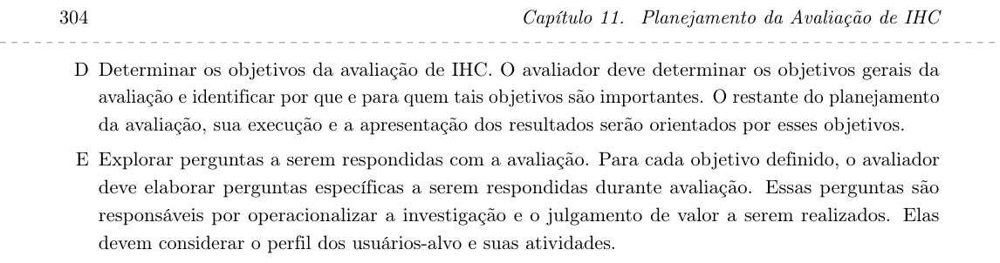
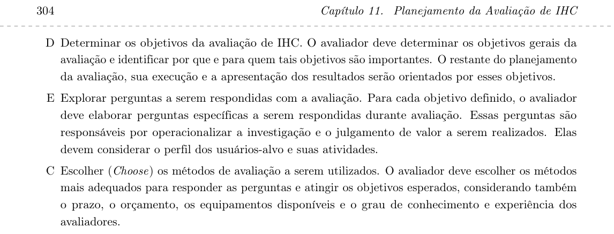
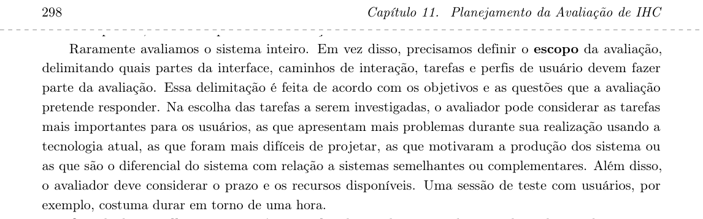
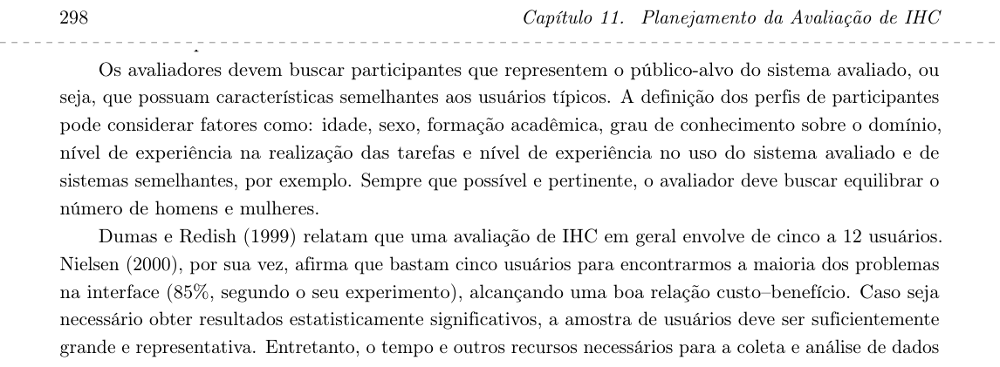
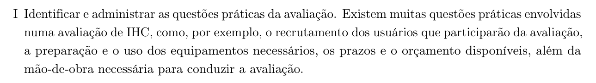
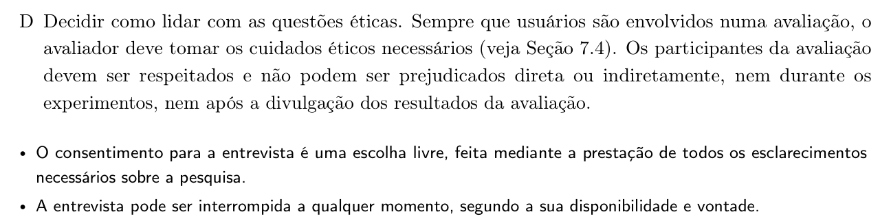
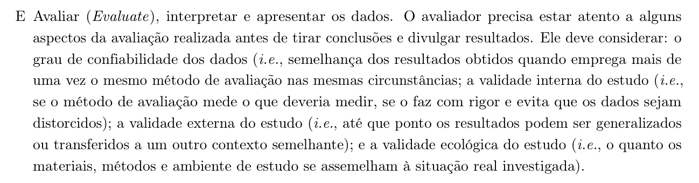
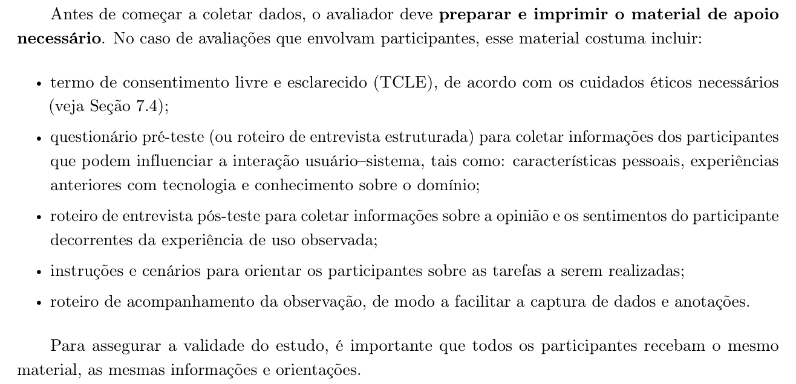
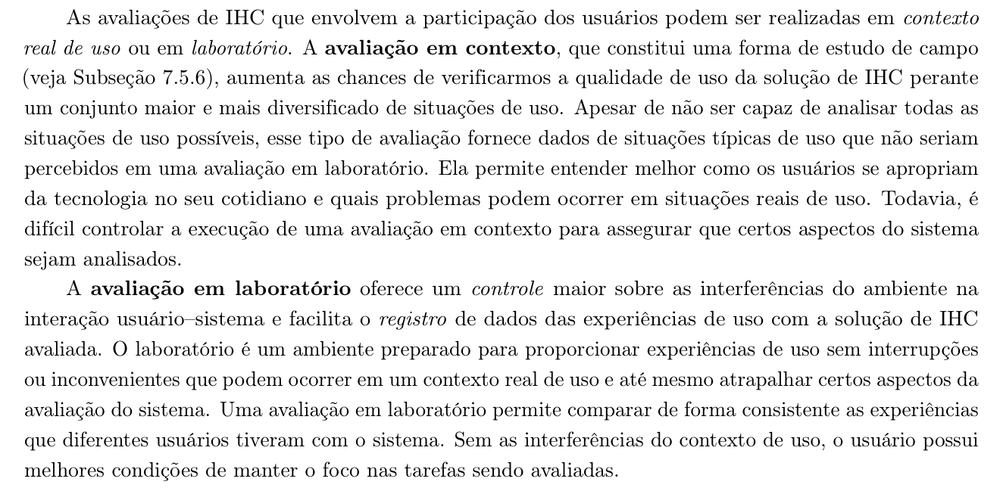

<b>Tabela de Contribuição</b>

| Membro | Contribuição |
| :--- | :--- |
| **Daniel da Silva Batista** | Elaboração dos itens PA-01 a PA-05, recortes do livro. |
| **Arthur Sismene Carvalho** | Elaboração dos itens PA-06 a PA-10, recortes do livro. |
| **Pedro Rocha Ferreira Lima** | Elaboração dos itens PA-11 a PA-15 *(pendente)*. |
| **Claude (Anthropic)** | Apoio na organização da página e na extração dos recortes do livro (conforme Política de IA). |

<b>Fonte:</b> Daniel da Silva Batista e Arthur Sismene Carvalho (2026).

# Lista de Verificação de Planejamento da Avaliação

## 1. Introdução

O **planejamento da avaliação** define, antes de qualquer sessão com usuários, o que será avaliado, com quais perguntas, por qual método, com quem e em que condições. O framework **DECIDE** organiza esse planejamento em seis atividades: Determinar objetivos, Explorar perguntas, Escolher métodos, Identificar questões práticas, Decidir sobre questões éticas e Avaliar os dados (BARBOSA et al., 2021).

Esta é a **primeira versão (v1)** desta lista, elaborada para a [Verificação da Etapa 8](../index.md), conduzida pelo método de inspeção de Fagan (FAGAN, 1976). Ela será aplicada, no passo de inspeção, aos seguintes artefatos do projeto:

* [Planejamento da Avaliação da Análise de Tarefas](../../design-avaliacao-desenvolvimento/planejamento-avaliacao-analise-de-tarefas.md)
* [Planejamento da Avaliação do Storyboard](../../avaliacao/planejamento-avaliacao-storyboard.md)
* [Planejamento da Avaliação do Protótipo de Papel](../../design-avaliacao-desenvolvimento/etapa-5/planejamento-avaliacao-prototipo-papel.md)
* [Planejamento da Avaliação do Protótipo de Alta Fidelidade](../../design-avaliacao-desenvolvimento/etapa-5/planejamento-avaliacao-alta-fidelidade.md)

A lista tem **15 itens**, e cada integrante do grupo elabora 5 deles. Cada item é uma pergunta objetiva, com as explicações necessárias entre parênteses, para que possa ser respondida por quem não conhece o artefato. Cada item indica o autor e a fonte. A [Seção 3](#3-itens-de-verificacao) consolida todos os itens em uma tabela, e a [Seção 4](#4-detalhamento-dos-itens) detalha cada um, com a pergunta e, logo abaixo, o recorte do livro que a fundamenta.

## 2. Critérios de Julgamento

Cada item admite uma única resposta:

* **Sim** — o artefato atende integralmente ao que a pergunta descreve;
* **Não** — o artefato não atende ao que a pergunta descreve ou não apresenta a informação;
* **Incompleto** — o artefato atende apenas em parte (por exemplo, em alguns quadros, tarefas ou participantes, mas não em todos).

## 3. Itens de Verificação

A Tabela 1 consolida os 15 itens de verificação da Lista de Verificação de Planejamento da Avaliação:

<b>Tabela 1: Itens da Lista de Verificação de Planejamento da Avaliação</b>

| ID | Pergunta de verificação | Autor | Fonte |
| :---: | :--- | :--- | :--- |
| **PA-01** | O planejamento define os objetivos da avaliação e explica por que e para quem eles são importantes (atividade "D — Determinar os objetivos" do DECIDE, roteiro de seis atividades usado para planejar avaliações)? | Daniel da Silva Batista | BARBOSA et al. (2021, p. 304) |
| **PA-02** | Cada objetivo da avaliação foi desdobrado em perguntas concretas, que os dados coletados vão ajudar a responder (atividade "E — Explorar as perguntas" do DECIDE)? | Daniel da Silva Batista | BARBOSA et al. (2021, p. 304) |
| **PA-03** | O planejamento escolhe os métodos de avaliação (por exemplo, inspeção, entrevista ou teste com usuários) e justifica a escolha considerando prazo, custo, equipamentos e experiência dos avaliadores (atividade "C — Escolher os métodos" do DECIDE)? | Daniel da Silva Batista | BARBOSA et al. (2021, p. 304) |
| **PA-04** | O planejamento deixa claro o que entra na avaliação e o que fica de fora (quais telas, tarefas e tipos de usuário) e explica o motivo dessa escolha? | Daniel da Silva Batista | BARBOSA et al. (2021, p. 298) |
| **PA-05** | O planejamento diz quantas pessoas vão participar, com que perfil, e por que esse número basta (por exemplo, citando Nielsen, segundo quem cinco usuários já revelam a maior parte dos problemas)? | Daniel da Silva Batista | BARBOSA et al. (2021, p. 298) |
| **PA-06** | O planejamento identifica as questões práticas da avaliação — como recrutar participantes, em que ambiente conduzir as sessões e quais equipamentos usar — (atividade "I — Identificar questões práticas" do DECIDE)? | Arthur Sismene Carvalho | BARBOSA et al. (2021, p. 304) |
| **PA-07** | O planejamento prevê a obtenção do consentimento informado dos participantes e garante que eles podem encerrar a participação a qualquer momento sem qualquer penalidade — (atividade "D — Decidir como lidar com questões éticas" do DECIDE)? | Arthur Sismene Carvalho | BARBOSA et al. (2021, p. 304) |
| **PA-08** | O planejamento define como os dados coletados serão interpretados e apresentados: de que forma os resultados responderão às perguntas da avaliação — (atividade "E — Avaliar, interpretar e apresentar os dados" do DECIDE)? | Arthur Sismene Carvalho | BARBOSA et al. (2021, p. 304) |
| **PA-09** | O planejamento inclui o roteiro das tarefas que o participante realizará durante a avaliação, com as instruções padronizadas que o avaliador usará no início de cada sessão? | Arthur Sismene Carvalho | BARBOSA et al. (2021, p. 299) |
| **PA-10** | O planejamento informa onde a avaliação será conduzida (laboratório de usabilidade ou ambiente natural de uso) e justifica essa escolha, levando em conta os benefícios e os custos de cada opção? | Arthur Sismene Carvalho | BARBOSA et al. (2021, p. 292) |
| **PA-11** | *(a elaborar)* | Pedro Rocha Ferreira Lima | — |
| **PA-12** | *(a elaborar)* | Pedro Rocha Ferreira Lima | — |
| **PA-13** | *(a elaborar)* | Pedro Rocha Ferreira Lima | — |
| **PA-14** | *(a elaborar)* | Pedro Rocha Ferreira Lima | — |
| **PA-15** | *(a elaborar)* | Pedro Rocha Ferreira Lima | — |

<b>Fonte:</b> Daniel da Silva Batista, Arthur Sismene Carvalho e Pedro Rocha Ferreira Lima (2026), conforme o autor de cada item.

## 4. Detalhamento dos Itens

### 4.1 PA-01 — Determinar os objetivos

A Tabela 2 apresenta o item PA-01:

<b>Tabela 2: Item PA-01 — Determinar os objetivos</b>

| Campo | Registro |
| :--- | :--- |
| **Pergunta** | O planejamento define os objetivos da avaliação e explica por que e para quem eles são importantes (atividade "D — Determinar os objetivos" do DECIDE, roteiro de seis atividades usado para planejar avaliações)? |
| **Autor** | Daniel da Silva Batista |
| **Fonte** | BARBOSA et al. (2021, p. 304) |

<b>Fonte:</b> Daniel da Silva Batista (2026).

A Figura 1 reproduz o trecho do livro que fundamenta o item PA-01:

<b>Figura 1: Referência Bibliográfica — Item PA-01 (Determinar os objetivos)</b>

<b>Fonte:</b> BARBOSA et al. (2021, p. 304).

### 4.2 PA-02 — Explorar as perguntas

A Tabela 3 apresenta o item PA-02:

<b>Tabela 3: Item PA-02 — Explorar as perguntas</b>

| Campo | Registro |
| :--- | :--- |
| **Pergunta** | Cada objetivo da avaliação foi desdobrado em perguntas concretas, que os dados coletados vão ajudar a responder (atividade "E — Explorar as perguntas" do DECIDE)? |
| **Autor** | Daniel da Silva Batista |
| **Fonte** | BARBOSA et al. (2021, p. 304) |

<b>Fonte:</b> Daniel da Silva Batista (2026).

A Figura 2 reproduz o trecho do livro que fundamenta o item PA-02:

<b>Figura 2: Referência Bibliográfica — Item PA-02 (Explorar as perguntas)</b>

<b>Fonte:</b> BARBOSA et al. (2021, p. 304).

### 4.3 PA-03 — Escolher os métodos

A Tabela 4 apresenta o item PA-03:

<b>Tabela 4: Item PA-03 — Escolher os métodos</b>

| Campo | Registro |
| :--- | :--- |
| **Pergunta** | O planejamento escolhe os métodos de avaliação (por exemplo, inspeção, entrevista ou teste com usuários) e justifica a escolha considerando prazo, custo, equipamentos e experiência dos avaliadores (atividade "C — Escolher os métodos" do DECIDE)? |
| **Autor** | Daniel da Silva Batista |
| **Fonte** | BARBOSA et al. (2021, p. 304) |

<b>Fonte:</b> Daniel da Silva Batista (2026).

A Figura 3 reproduz o trecho do livro que fundamenta o item PA-03:

<b>Figura 3: Referência Bibliográfica — Item PA-03 (Escolher os métodos)</b>

<b>Fonte:</b> BARBOSA et al. (2021, p. 304).

### 4.4 PA-04 — Escopo da avaliação

A Tabela 5 apresenta o item PA-04:

<b>Tabela 5: Item PA-04 — Escopo da avaliação</b>

| Campo | Registro |
| :--- | :--- |
| **Pergunta** | O planejamento deixa claro o que entra na avaliação e o que fica de fora (quais telas, tarefas e tipos de usuário) e explica o motivo dessa escolha? |
| **Autor** | Daniel da Silva Batista |
| **Fonte** | BARBOSA et al. (2021, p. 298) |

<b>Fonte:</b> Daniel da Silva Batista (2026).

A Figura 4 reproduz o trecho do livro que fundamenta o item PA-04:

<b>Figura 4: Referência Bibliográfica — Item PA-04 (Escopo da avaliação)</b>

<b>Fonte:</b> BARBOSA et al. (2021, p. 298).

### 4.5 PA-05 — Perfil e número de participantes

A Tabela 6 apresenta o item PA-05:

<b>Tabela 6: Item PA-05 — Perfil e número de participantes</b>

| Campo | Registro |
| :--- | :--- |
| **Pergunta** | O planejamento diz quantas pessoas vão participar, com que perfil, e por que esse número basta (por exemplo, citando Nielsen, segundo quem cinco usuários já revelam a maior parte dos problemas)? |
| **Autor** | Daniel da Silva Batista |
| **Fonte** | BARBOSA et al. (2021, p. 298) |

<b>Fonte:</b> Daniel da Silva Batista (2026).

A Figura 5 reproduz o trecho do livro que fundamenta o item PA-05:

<b>Figura 5: Referência Bibliográfica — Item PA-05 (Perfil e número de participantes)</b>

<b>Fonte:</b> BARBOSA et al. (2021, p. 298).

### 4.6 PA-06 — Questões práticas (DECIDE-I)

A Tabela 7 apresenta o item PA-06:

<b>Tabela 7: Item PA-06 — Questões práticas (DECIDE-I)</b>

| Campo | Registro |
| :--- | :--- |
| **Pergunta** | O planejamento identifica as questões práticas da avaliação — como recrutar participantes, em que ambiente conduzir as sessões e quais equipamentos usar — (atividade "I — Identificar questões práticas" do DECIDE)? |
| **Autor** | Arthur Sismene Carvalho |
| **Fonte** | BARBOSA et al. (2021, p. 304) |

<b>Fonte:</b> Arthur Sismene Carvalho (2026).

A Figura 6 reproduz o trecho do livro que fundamenta o item PA-06:

<b>Figura 6: Referência Bibliográfica — Item PA-06 (Questões práticas — DECIDE-I)</b>

<b>Fonte:</b> BARBOSA et al. (2021, p. 304).

### 4.7 PA-07 — Questões éticas (DECIDE-D)

A Tabela 8 apresenta o item PA-07:

<b>Tabela 8: Item PA-07 — Questões éticas (DECIDE-D)</b>

| Campo | Registro |
| :--- | :--- |
| **Pergunta** | O planejamento prevê a obtenção do consentimento informado dos participantes e garante que eles podem encerrar a participação a qualquer momento sem qualquer penalidade — (atividade "D — Decidir como lidar com questões éticas" do DECIDE)? |
| **Autor** | Arthur Sismene Carvalho |
| **Fonte** | BARBOSA et al. (2021, p. 304) |

<b>Fonte:</b> Arthur Sismene Carvalho (2026).

A Figura 7 reproduz o trecho do livro que fundamenta o item PA-07:

<b>Figura 7: Referência Bibliográfica — Item PA-07 (Questões éticas — DECIDE-D)</b>

<b>Fonte:</b> BARBOSA et al. (2021, p. 304).

### 4.8 PA-08 — Avaliação e interpretação (DECIDE-E)

A Tabela 9 apresenta o item PA-08:

<b>Tabela 9: Item PA-08 — Avaliação e interpretação (DECIDE-E)</b>

| Campo | Registro |
| :--- | :--- |
| **Pergunta** | O planejamento define como os dados coletados serão interpretados e apresentados: de que forma os resultados responderão às perguntas da avaliação — (atividade "E — Avaliar, interpretar e apresentar os dados" do DECIDE)? |
| **Autor** | Arthur Sismene Carvalho |
| **Fonte** | BARBOSA et al. (2021, p. 304) |

<b>Fonte:</b> Arthur Sismene Carvalho (2026).

A Figura 8 reproduz o trecho do livro que fundamenta o item PA-08:

<b>Figura 8: Referência Bibliográfica — Item PA-08 (Avaliação e interpretação — DECIDE-E)</b>

<b>Fonte:</b> BARBOSA et al. (2021, p. 304).

### 4.9 PA-09 — Roteiro de tarefas

A Tabela 10 apresenta o item PA-09:

<b>Tabela 10: Item PA-09 — Roteiro de tarefas</b>

| Campo | Registro |
| :--- | :--- |
| **Pergunta** | O planejamento inclui o roteiro das tarefas que o participante realizará durante a avaliação, com as instruções padronizadas que o avaliador usará no início de cada sessão? |
| **Autor** | Arthur Sismene Carvalho |
| **Fonte** | BARBOSA et al. (2021, p. 299) |

<b>Fonte:</b> Arthur Sismene Carvalho (2026).

A Figura 9 reproduz o trecho do livro que fundamenta o item PA-09:

<b>Figura 9: Referência Bibliográfica — Item PA-09 (Roteiro de tarefas)</b>

<b>Fonte:</b> BARBOSA et al. (2021, p. 299).

### 4.10 PA-10 — Local da avaliação

A Tabela 11 apresenta o item PA-10:

<b>Tabela 11: Item PA-10 — Local da avaliação</b>

| Campo | Registro |
| :--- | :--- |
| **Pergunta** | O planejamento informa onde a avaliação será conduzida (laboratório de usabilidade ou ambiente natural de uso) e justifica essa escolha, levando em conta os benefícios e os custos de cada opção? |
| **Autor** | Arthur Sismene Carvalho |
| **Fonte** | BARBOSA et al. (2021, p. 292) |

<b>Fonte:</b> Arthur Sismene Carvalho (2026).

A Figura 10 reproduz o trecho do livro que fundamenta o item PA-10:

<b>Figura 10: Referência Bibliográfica — Item PA-10 (Local da avaliação)</b>

<b>Fonte:</b> BARBOSA et al. (2021, p. 292).

> *Os itens PA-11 a PA-15 serão detalhados pelos respectivos autores neste mesmo formato: pergunta, autor, fonte e recorte do livro.*

## 5. Referências Bibliográficas

> [1] BARBOSA, Simone D. J.; SILVA, Bruno S. da; SILVEIRA, Milene S.; GASPARINI, Isabela; DARIN, Ticianne; BARBOSA, Gabriel D. J. *Interação Humano-Computador e Experiência do Usuário*. 1. ed. Autopublicação, 2021. ISBN: 978-65-00-19677-1.  
> [2] FAGAN, Michael E. Design and code inspections to reduce errors in program development. *IBM Systems Journal*, v. 15, n. 3, p. 182-211, 1976.  
> [3] SALES, André Barros de. *Plano de ensino FIHC 022026 – Turma 01*. Brasília: FCTE/UnB, 2026.

## 6. Histórico de Versões

| Versão | Data | Descrição | Autor(es) | Revisor(es) |
| :---: | :---: | :--- | :---: | :---: |
| `1.0` | 21/11/2026 | Criação da lista (v1): itens PA-01 a PA-05, com fonte por página e recorte do livro; itens PA-06 a PA-20 reservados aos demais integrantes. | Daniel da Silva Batista | — |
| `1.1` | 22/11/2026 | Adição dos itens PA-06 a PA-10: perguntas de verificação, fontes e recortes do livro. | Arthur Sismene Carvalho | — |

