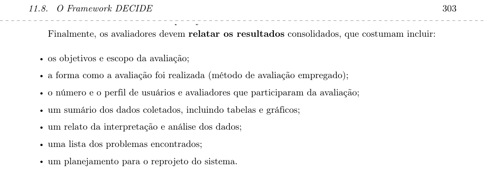
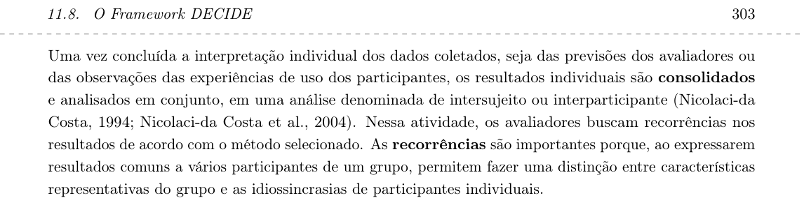
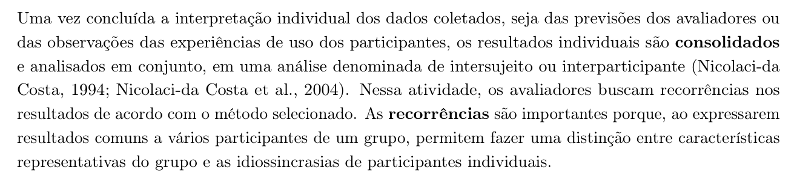
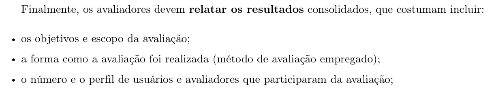
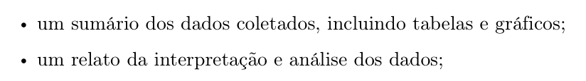
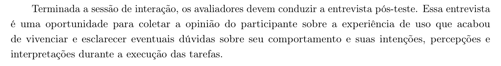
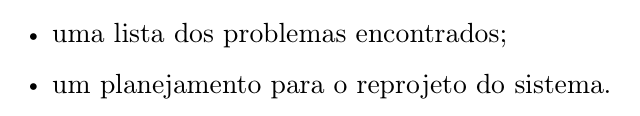

<b>Tabela de Contribuição</b>

| Membro | Contribuição |
| :--- | :--- |
| **Daniel da Silva Batista** | Elaboração dos itens RL-01 a RL-05, recortes do livro. |
| **Arthur Sismene Carvalho** | Elaboração dos itens RL-06 a RL-10, recortes do livro. |
| **Leonardo da Silva Lopes Júnior** | Elaboração dos itens RL-11 a RL-15 *(pendente)*. |
| **Pedro Rocha Ferreira Lima** | Elaboração dos itens RL-16 a RL-20 *(pendente)*. |
| **Claude (Anthropic)** | Apoio na organização da página e na extração dos recortes do livro (conforme Política de IA). |

<b>Fonte:</b> Daniel da Silva Batista e Arthur Sismene Carvalho (2026).

# Lista de Verificação de Planejamento do Relato dos Resultados

## 1. Introdução

O **planejamento do relato dos resultados** define, antes da avaliação, como os resultados serão consolidados e apresentados: quais informações o relato vai conter, como os problemas serão listados e priorizados e como o reprojeto será planejado (BARBOSA et al., 2021).

Esta é a **primeira versão (v1)** desta lista, elaborada para a [Verificação da Etapa 8](../index.md), conduzida pelo método de inspeção de Fagan (FAGAN, 1976). Ela será aplicada, no passo de inspeção, aos seguintes artefatos do projeto:

* [Planejamento do Relato da Análise de Tarefas](../../design-avaliacao-desenvolvimento/resultado-analise-de-tarefas.md)
* [Planejamento do Relato dos Resultados do Storyboard](../../design-avaliacao-desenvolvimento/planejamento-relato-resultados-storyboard.md)
* [Planejamento do Relato do Protótipo de Papel](../../design-avaliacao-desenvolvimento/etapa-5/planejamento-relato-prototipo-papel.md)
* [Planejamento do Relato do Protótipo de Alta Fidelidade](../../design-avaliacao-desenvolvimento/etapa-5/planejamento-relato-alta-fidelidade.md)

A lista tem **20 itens**, e cada integrante do grupo elabora 5 deles. Cada item é uma pergunta objetiva, com as explicações necessárias entre parênteses, para que possa ser respondida por quem não conhece o artefato. Cada item indica o autor e a fonte. A [Seção 3](#3-itens-de-verificacao) consolida todos os itens em uma tabela, e a [Seção 4](#4-detalhamento-dos-itens) detalha cada um, com a pergunta e, logo abaixo, o recorte do livro que a fundamenta.

## 2. Critérios de Julgamento

Cada item admite uma única resposta:

* **Sim** — o artefato atende integralmente ao que a pergunta descreve;
* **Não** — o artefato não atende ao que a pergunta descreve ou não apresenta a informação;
* **Incompleto** — o artefato atende apenas em parte (por exemplo, em alguns quadros, tarefas ou participantes, mas não em todos).

## 3. Itens de Verificação

A Tabela 1 consolida os 20 itens de verificação da Lista de Verificação de Planejamento do Relato dos Resultados:

<b>Tabela 1: Itens da Lista de Verificação de Planejamento do Relato dos Resultados</b>

| ID | Pergunta de verificação | Autor | Fonte |
| :---: | :--- | :--- | :--- |
| **RL-01** | O planejamento prevê que o relato comece dizendo o que foi avaliado e com qual finalidade? | Daniel da Silva Batista | BARBOSA et al. (2021, p. 303) |
| **RL-02** | O planejamento prevê que o relato descreva como a avaliação foi feita (o método), quantas pessoas participaram, quem eram (perfil) e quem conduziu as sessões? | Daniel da Silva Batista | BARBOSA et al. (2021, p. 303) |
| **RL-03** | O planejamento prevê um resumo dos dados coletados em tabelas ou gráficos (por exemplo, tempo e sucesso de cada participante em cada tarefa)? | Daniel da Silva Batista | BARBOSA et al. (2021, p. 303) |
| **RL-04** | O planejamento prevê uma lista dos problemas encontrados e um plano de reprojeto (as mudanças que serão feitas no artefato por causa desses problemas)? | Daniel da Silva Batista | BARBOSA et al. (2021, p. 303) |
| **RL-05** | O planejamento prevê consolidar os resultados de todos os participantes, destacando os problemas que se repetiram entre eles (e não apenas casos isolados de um participante)? | Daniel da Silva Batista | BARBOSA et al. (2021, p. 303) |
| **RL-06** | O planejamento prevê que o relato registre os dados de cada participante individualmente (e não apenas médias ou totais agregados), para que seja possível identificar padrões e exceções entre os participantes? | Arthur Sismene Carvalho | BARBOSA et al. (2021, p. 303) |
| **RL-07** | O planejamento prevê que o relato apresente o perfil de cada participante, para que o leitor possa verificar se ele é representativo do perfil de usuário alvo do sistema? | Arthur Sismene Carvalho | BARBOSA et al. (2021, p. 303) |
| **RL-08** | O planejamento prevê que o relato apresente a interpretação dos avaliadores sobre os dados — o que eles significam para a qualidade do artefato — e não apenas os números e observações brutas? | Arthur Sismene Carvalho | BARBOSA et al. (2021, p. 303) |
| **RL-09** | O planejamento prevê que o relato registre sugestões de melhoria colhidas dos próprios participantes durante ou após as sessões, distinguindo-as das análises dos avaliadores? | Arthur Sismene Carvalho | BARBOSA et al. (2021, p. 303) |
| **RL-10** | O planejamento prevê que os problemas sejam agrupados por tarefa ou por tela, indicando em quais partes do artefato há maior concentração de dificuldades? | Arthur Sismene Carvalho | BARBOSA et al. (2021, p. 303) |
| **RL-11** | *(a elaborar)* | Leonardo da Silva Lopes Júnior | — |
| **RL-12** | *(a elaborar)* | Leonardo da Silva Lopes Júnior | — |
| **RL-13** | *(a elaborar)* | Leonardo da Silva Lopes Júnior | — |
| **RL-14** | *(a elaborar)* | Leonardo da Silva Lopes Júnior | — |
| **RL-15** | *(a elaborar)* | Leonardo da Silva Lopes Júnior | — |
| **RL-16** | *(a elaborar)* | Pedro Rocha Ferreira Lima | — |
| **RL-17** | *(a elaborar)* | Pedro Rocha Ferreira Lima | — |
| **RL-18** | *(a elaborar)* | Pedro Rocha Ferreira Lima | — |
| **RL-19** | *(a elaborar)* | Pedro Rocha Ferreira Lima | — |
| **RL-20** | *(a elaborar)* | Pedro Rocha Ferreira Lima | — |

<b>Fonte:</b> Daniel da Silva Batista, Arthur Sismene Carvalho, Leonardo da Silva Lopes Júnior e Pedro Rocha Ferreira Lima (2026), conforme o autor de cada item.

## 4. Detalhamento dos Itens

### 4.1 RL-01 — Objetivos e escopo no relato

A Tabela 2 apresenta o item RL-01:

<b>Tabela 2: Item RL-01 — Objetivos e escopo no relato</b>

| Campo | Registro |
| :--- | :--- |
| **Pergunta** | O planejamento prevê que o relato comece dizendo o que foi avaliado e com qual finalidade? |
| **Autor** | Daniel da Silva Batista |
| **Fonte** | BARBOSA et al. (2021, p. 303) |

<b>Fonte:</b> Daniel da Silva Batista (2026).

A Figura 1 reproduz o trecho do livro que fundamenta o item RL-01:

<b>Figura 1: Referência Bibliográfica — Item RL-01 (Objetivos e escopo no relato)</b>

<b>Fonte:</b> BARBOSA et al. (2021, p. 303).

### 4.2 RL-02 — Método e participantes no relato

A Tabela 3 apresenta o item RL-02:

<b>Tabela 3: Item RL-02 — Método e participantes no relato</b>

| Campo | Registro |
| :--- | :--- |
| **Pergunta** | O planejamento prevê que o relato descreva como a avaliação foi feita (o método), quantas pessoas participaram, quem eram (perfil) e quem conduziu as sessões? |
| **Autor** | Daniel da Silva Batista |
| **Fonte** | BARBOSA et al. (2021, p. 303) |

<b>Fonte:</b> Daniel da Silva Batista (2026).

A Figura 2 reproduz o trecho do livro que fundamenta o item RL-02:

<b>Figura 2: Referência Bibliográfica — Item RL-02 (Método e participantes no relato)</b>

<b>Fonte:</b> BARBOSA et al. (2021, p. 303).

### 4.3 RL-03 — Resumo dos dados coletados

A Tabela 4 apresenta o item RL-03:

<b>Tabela 4: Item RL-03 — Resumo dos dados coletados</b>

| Campo | Registro |
| :--- | :--- |
| **Pergunta** | O planejamento prevê um resumo dos dados coletados em tabelas ou gráficos (por exemplo, tempo e sucesso de cada participante em cada tarefa)? |
| **Autor** | Daniel da Silva Batista |
| **Fonte** | BARBOSA et al. (2021, p. 303) |

<b>Fonte:</b> Daniel da Silva Batista (2026).

A Figura 3 reproduz o trecho do livro que fundamenta o item RL-03:

<b>Figura 3: Referência Bibliográfica — Item RL-03 (Resumo dos dados coletados)</b>

<b>Fonte:</b> BARBOSA et al. (2021, p. 303).

### 4.4 RL-04 — Lista de problemas e reprojeto

A Tabela 5 apresenta o item RL-04:

<b>Tabela 5: Item RL-04 — Lista de problemas e reprojeto</b>

| Campo | Registro |
| :--- | :--- |
| **Pergunta** | O planejamento prevê uma lista dos problemas encontrados e um plano de reprojeto (as mudanças que serão feitas no artefato por causa desses problemas)? |
| **Autor** | Daniel da Silva Batista |
| **Fonte** | BARBOSA et al. (2021, p. 303) |

<b>Fonte:</b> Daniel da Silva Batista (2026).

A Figura 4 reproduz o trecho do livro que fundamenta o item RL-04:

<b>Figura 4: Referência Bibliográfica — Item RL-04 (Lista de problemas e reprojeto)</b>

<b>Fonte:</b> BARBOSA et al. (2021, p. 303).

### 4.5 RL-05 — Consolidação e recorrências

A Tabela 6 apresenta o item RL-05:

<b>Tabela 6: Item RL-05 — Consolidação e recorrências</b>

| Campo | Registro |
| :--- | :--- |
| **Pergunta** | O planejamento prevê consolidar os resultados de todos os participantes, destacando os problemas que se repetiram entre eles (e não apenas casos isolados de um participante)? |
| **Autor** | Daniel da Silva Batista |
| **Fonte** | BARBOSA et al. (2021, p. 303) |

<b>Fonte:</b> Daniel da Silva Batista (2026).

A Figura 5 reproduz o trecho do livro que fundamenta o item RL-05:

<b>Figura 5: Referência Bibliográfica — Item RL-05 (Consolidação e recorrências)</b>

<b>Fonte:</b> BARBOSA et al. (2021, p. 303).

### 4.6 RL-06 — Dados por participante

A Tabela 7 apresenta o item RL-06:

<b>Tabela 7: Item RL-06 — Dados por participante</b>

| Campo | Registro |
| :--- | :--- |
| **Pergunta** | O planejamento prevê que o relato registre os dados de cada participante individualmente (e não apenas médias ou totais agregados), para que seja possível identificar padrões e exceções entre os participantes? |
| **Autor** | Arthur Sismene Carvalho |
| **Fonte** | BARBOSA et al. (2021, p. 303) |

<b>Fonte:</b> Arthur Sismene Carvalho (2026).

A Figura 6 reproduz o trecho do livro que fundamenta o item RL-06:

<b>Figura 6: Referência Bibliográfica — Item RL-06 (Dados por participante)</b>

<b>Fonte:</b> BARBOSA et al. (2021, p. 303).

### 4.7 RL-07 — Perfil dos participantes no relato

A Tabela 8 apresenta o item RL-07:

<b>Tabela 8: Item RL-07 — Perfil dos participantes no relato</b>

| Campo | Registro |
| :--- | :--- |
| **Pergunta** | O planejamento prevê que o relato apresente o perfil de cada participante, para que o leitor possa verificar se ele é representativo do perfil de usuário alvo do sistema? |
| **Autor** | Arthur Sismene Carvalho |
| **Fonte** | BARBOSA et al. (2021, p. 303) |

<b>Fonte:</b> Arthur Sismene Carvalho (2026).

A Figura 7 reproduz o trecho do livro que fundamenta o item RL-07:

<b>Figura 7: Referência Bibliográfica — Item RL-07 (Perfil dos participantes no relato)</b>

<b>Fonte:</b> BARBOSA et al. (2021, p. 303).

### 4.8 RL-08 — Interpretação dos avaliadores

A Tabela 9 apresenta o item RL-08:

<b>Tabela 9: Item RL-08 — Interpretação dos avaliadores</b>

| Campo | Registro |
| :--- | :--- |
| **Pergunta** | O planejamento prevê que o relato apresente a interpretação dos avaliadores sobre os dados — o que eles significam para a qualidade do artefato — e não apenas os números e observações brutas? |
| **Autor** | Arthur Sismene Carvalho |
| **Fonte** | BARBOSA et al. (2021, p. 303) |

<b>Fonte:</b> Arthur Sismene Carvalho (2026).

A Figura 8 reproduz o trecho do livro que fundamenta o item RL-08:

<b>Figura 8: Referência Bibliográfica — Item RL-08 (Interpretação dos avaliadores)</b>

<b>Fonte:</b> BARBOSA et al. (2021, p. 303).

### 4.9 RL-09 — Sugestões dos participantes

A Tabela 10 apresenta o item RL-09:

<b>Tabela 10: Item RL-09 — Sugestões dos participantes</b>

| Campo | Registro |
| :--- | :--- |
| **Pergunta** | O planejamento prevê que o relato registre sugestões de melhoria colhidas dos próprios participantes durante ou após as sessões, distinguindo-as das análises dos avaliadores? |
| **Autor** | Arthur Sismene Carvalho |
| **Fonte** | BARBOSA et al. (2021, p. 303) |

<b>Fonte:</b> Arthur Sismene Carvalho (2026).

A Figura 9 reproduz o trecho do livro que fundamenta o item RL-09:

<b>Figura 9: Referência Bibliográfica — Item RL-09 (Sugestões dos participantes)</b>

<b>Fonte:</b> BARBOSA et al. (2021, p. 303).

### 4.10 RL-10 — Problemas por tarefa

A Tabela 11 apresenta o item RL-10:

<b>Tabela 11: Item RL-10 — Problemas por tarefa</b>

| Campo | Registro |
| :--- | :--- |
| **Pergunta** | O planejamento prevê que os problemas sejam agrupados por tarefa ou por tela, indicando em quais partes do artefato há maior concentração de dificuldades? |
| **Autor** | Arthur Sismene Carvalho |
| **Fonte** | BARBOSA et al. (2021, p. 303) |

<b>Fonte:</b> Arthur Sismene Carvalho (2026).

A Figura 10 reproduz o trecho do livro que fundamenta o item RL-10:

<b>Figura 10: Referência Bibliográfica — Item RL-10 (Problemas por tarefa)</b>

<b>Fonte:</b> BARBOSA et al. (2021, p. 303).

> *Os itens RL-11 a RL-20 serão detalhados pelos respectivos autores neste mesmo formato: pergunta, autor, fonte e recorte do livro.*

## 5. Referências Bibliográficas

> [1] BARBOSA, Simone D. J.; SILVA, Bruno S. da; SILVEIRA, Milene S.; GASPARINI, Isabela; DARIN, Ticianne; BARBOSA, Gabriel D. J. *Interação Humano-Computador e Experiência do Usuário*. 1. ed. Autopublicação, 2021. ISBN: 978-65-00-19677-1.  
> [2] FAGAN, Michael E. Design and code inspections to reduce errors in program development. *IBM Systems Journal*, v. 15, n. 3, p. 182-211, 1976.  
> [3] SALES, André Barros de. *Plano de ensino FIHC 022026 – Turma 01*. Brasília: FCTE/UnB, 2026.

## 6. Histórico de Versões

| Versão | Data | Descrição | Autor(es) | Revisor(es) |
| :---: | :---: | :--- | :---: | :---: |
| `1.0` | 21/11/2026 | Criação da lista (v1): itens RL-01 a RL-05, com fonte por página e recorte do livro; itens RL-06 a RL-20 reservados aos demais integrantes. | Daniel da Silva Batista | — |
| `1.1` | 22/11/2026 | Adição dos itens RL-06 a RL-10: perguntas de verificação, fontes e recortes do livro. | Arthur Sismene Carvalho | — |

