

<b>Tabela de Contribuição</b>

| Membro | Contribuição |
| :--- | :--- |
| **Daniel da Silva Batista** | Elaboração dos itens AF-01 a AF-05, revisão dos itens da v1 e recortes do livro ([Itens 01–05](#41-af-01-definicao-de-prototipo-de-alta-fidelidade)). |
| **Arthur Sismene Carvalho** | Elaboração dos itens AF-06 a AF-10, reescritos a partir das heurísticas da autoinspeção do protótipo de alta fidelidade não reaproveitadas nos itens 01–05, com fonte por página ([Itens 01–05](#41-af-01-definicao-de-prototipo-de-alta-fidelidade)). |
| **Pedro Rocha Ferreira Lima** | Elaboração dos itens AF-11 a AF-15, recortes do livro ([Itens 11–15](#411-af-11-aderencia-ao-guia-de-estilo)). |
| **Claude (Anthropic)** | Apoio na organização da página e na extração dos recortes do livro (conforme Política de IA). |

<b>Fonte:</b> Daniel da Silva Batista, Arthur Sismene Carvalho e Pedro Rocha Ferreira Lima (2026).

# Lista de Verificação de Protótipo de Alta Fidelidade — v2

## 1. Introdução

O **protótipo de alta fidelidade** apresenta o desenho completo das telas, com as decisões de tamanho, posição, cores e fontes, e pode permitir a navegação entre elas como no sistema real (BARBOSA et al., 2021).

Esta lista é a **versão 2 (v2)** das listas de autoinspeção dos relatos individuais ([Daniel](../../design-avaliacao-desenvolvimento/etapa-5/daniel-batista-alta-fidelidade.md#3-autoinspecao-analitica-previa-do-prototipo-de-alta-fidelidade), [Arthur](../../design-avaliacao-desenvolvimento/etapa-5/arthur-carvalho-alta-fidelidade.md#3-autoinspecao-analitica-previa-do-prototipo-de-alta-fidelidade), [Leonardo](../../design-avaliacao-desenvolvimento/etapa-5/leonardo-lopes-alta-fidelidade.md#3-autoinspecao-analitica-previa-do-prototipo-de-alta-fidelidade) e [Pedro](../../design-avaliacao-desenvolvimento/etapa-5/pedro-rocha-alta-fidelidade.md#3-autoinspecao-analitica-previa-do-prototipo-de-alta-fidelidade)) e faz parte da [Verificação da Etapa 8](../index.md), conduzida pelo método de inspeção de Fagan (FAGAN, 1976). Ela será aplicada, no passo de inspeção, aos seguintes artefatos do projeto:

* [Relato do protótipo de alta fidelidade — Daniel da Silva Batista](../../design-avaliacao-desenvolvimento/etapa-5/daniel-batista-alta-fidelidade.md)
* [Relato do protótipo de alta fidelidade — Arthur Sismene Carvalho](../../design-avaliacao-desenvolvimento/etapa-5/arthur-carvalho-alta-fidelidade.md)
* [Relato do protótipo de alta fidelidade — Leonardo da Silva Lopes Júnior](../../design-avaliacao-desenvolvimento/etapa-5/leonardo-lopes-alta-fidelidade.md)
* [Relato do protótipo de alta fidelidade — Pedro Rocha Ferreira Lima](../../design-avaliacao-desenvolvimento/etapa-5/pedro-rocha-alta-fidelidade.md)

A lista tem **15 itens**, e cada integrante do grupo elabora 5 deles. Cada item é uma pergunta objetiva, com as explicações necessárias entre parênteses, para que possa ser respondida por quem não conhece o artefato. Cada item indica o autor e a fonte. A [Seção 3](#3-itens-de-verificacao) consolida todos os itens em uma tabela, e a [Seção 4](#4-detalhamento-dos-itens) detalha cada um, com a pergunta e, logo abaixo, o recorte do livro que a fundamenta.

## 2. Critérios de Julgamento

Cada item admite uma única resposta:

* **Sim** — o artefato atende integralmente ao que a pergunta descreve;
* **Não** — o artefato não atende ao que a pergunta descreve ou não apresenta a informação;
* **Incompleto** — o artefato atende apenas em parte (por exemplo, em alguns quadros, tarefas ou participantes, mas não em todos).

## 3. Itens de Verificação

A Tabela 1 consolida os 15 itens de verificação da Lista de Verificação de Protótipo de Alta Fidelidade — v2:

<b>Tabela 1: Itens da Lista de Verificação de Protótipo de Alta Fidelidade — v2</b>

| ID | Pergunta de verificação | Autor | Fonte |
| :---: | :--- | :--- | :--- |
| **AF-01** | O protótipo mostra o desenho completo das telas, já com as decisões de tamanho, posição, cores e fontes de cada elemento (e não apenas um rascunho)? | Daniel da Silva Batista | BARBOSA et al. (2021, p. 249) |
| **AF-02** | O protótipo é navegável (os botões e links levam às telas correspondentes, como no sistema real)? | Daniel da Silva Batista | BARBOSA et al. (2021, p. 249) |
| **AF-03** | O protótipo foi testado com participantes que executaram tarefas enquanto eram observados (teste de usabilidade), e não apenas inspecionado pela equipe? | Daniel da Silva Batista | BARBOSA et al. (2021, p. 129) |
| **AF-04** | O artefato mostra quais problemas encontrados no protótipo de papel foram corrigidos no protótipo de alta fidelidade (por exemplo, uma tabela "problema do papel → solução na alta fidelidade")? | Daniel da Silva Batista | BARBOSA et al. (2021, p. 129) |
| **AF-05** | O artefato registra as principais decisões de design do protótipo e o motivo de cada uma (design rationale: a justificativa de cada escolha)? | Daniel da Silva Batista | BARBOSA et al. (2021, p. 129) |
| **AF-06** | O protótipo mostra o estado atual do sistema de forma visível (por exemplo, indica claramente quantos itens foram selecionados ou em que etapa a pessoa está)? | Arthur Sismene Carvalho | BARBOSA et al. (2021, p. 306) |
| **AF-07** | O protótipo oferece saídas claras para o usuário desfazer ações ou voltar atrás (por exemplo, limpar uma seleção, alterar filtros ou voltar à tela anterior)? | Arthur Sismene Carvalho | BARBOSA et al. (2021, p. 306) |
| **AF-08** | Os rótulos e critérios do protótipo usam o vocabulário habitual do usuário (termos que o público reconhece), e não termos técnicos internos? | Arthur Sismene Carvalho | BARBOSA et al. (2021, p. 306) |
| **AF-09** | O protótipo previne erros em ações críticas e dá feedback claro (por exemplo, pede confirmação antes de uma ação importante e avisa quando ela é concluída)? | Arthur Sismene Carvalho | BARBOSA et al. (2021, p. 306) |
| **AF-10** | O protótipo evita ruído visual, mostrando apenas o necessário para a tarefa (sem excesso de informação ou elementos que distraem)? | Arthur Sismene Carvalho | BARBOSA et al. (2021, p. 306) |
| **AF-11** | O protótipo segue as cores, as fontes e os componentes definidos no guia de estilo do projeto? | Pedro Rocha Ferreira Lima | BARBOSA et al. (2021, p. 129) |
| **AF-12** | O protótipo usa sempre o mesmo termo para a mesma coisa em todas as telas (por exemplo, não chama de "edital" numa tela e de "concurso" em outra)? | Pedro Rocha Ferreira Lima | BARBOSA et al. (2021, p. 249) |
| **AF-13** | O artefato compara os resultados dos testes com as metas de usabilidade do projeto (por exemplo, o tempo ou a taxa de sucesso esperados)? | Pedro Rocha Ferreira Lima | BARBOSA et al. (2021, p. 129) |
| **AF-14** | Os dados exibidos no protótipo são plausíveis (nomes de órgãos, datas e valores realistas), mesmo sendo fictícios? | Pedro Rocha Ferreira Lima | BARBOSA et al. (2021, p. 129) |
| **AF-15** | O artefato informa se o protótipo cobre o sistema em largura (muitas telas com pouca função) ou em profundidade (poucas telas funcionando por completo)? | Pedro Rocha Ferreira Lima | BARBOSA et al. (2021, p. 128) |

<b>Fonte:</b> Daniel da Silva Batista, Arthur Sismene Carvalho e Pedro Rocha Ferreira Lima (2026), conforme o autor de cada item.

## 4. Detalhamento dos Itens

### 4.1 AF-01 — Definição de protótipo de alta fidelidade

A Tabela 2 apresenta o item AF-01:

<b>Tabela 2: Item AF-01 — Definição de protótipo de alta fidelidade</b>

| Campo | Registro |
| :--- | :--- |
| **Pergunta** | O protótipo mostra o desenho completo das telas, já com as decisões de tamanho, posição, cores e fontes de cada elemento (e não apenas um rascunho)? |
| **Autor** | Daniel da Silva Batista |
| **Fonte** | BARBOSA et al. (2021, p. 249) |
| **Origem na v1** | Item 1 |

<b>Fonte:</b> Daniel da Silva Batista (2026).

A Figura 1 reproduz o trecho do livro que fundamenta o item AF-01:

<b>Figura 1: Referência Bibliográfica — Item AF-01 (Definição de protótipo de alta fidelidade)</b>

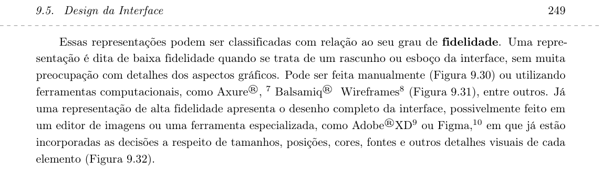

<b>Fonte:</b> BARBOSA et al. (2021, p. 249).

### 4.2 AF-02 — Grau de funcionalidade do protótipo

A Tabela 3 apresenta o item AF-02:

<b>Tabela 3: Item AF-02 — Grau de funcionalidade do protótipo</b>

| Campo | Registro |
| :--- | :--- |
| **Pergunta** | O protótipo é navegável (os botões e links levam às telas correspondentes, como no sistema real)? |
| **Autor** | Daniel da Silva Batista |
| **Fonte** | BARBOSA et al. (2021, p. 249) |
| **Origem na v1** | Novo |

<b>Fonte:</b> Daniel da Silva Batista (2026).

A Figura 2 reproduz o trecho do livro que fundamenta o item AF-02:

<b>Figura 2: Referência Bibliográfica — Item AF-02 (Grau de funcionalidade do protótipo)</b>

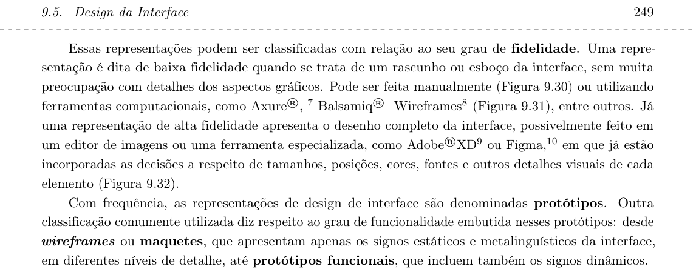

<b>Fonte:</b> BARBOSA et al. (2021, p. 249).

### 4.3 AF-03 — Testes empíricos com o protótipo

A Tabela 4 apresenta o item AF-03:

<b>Tabela 4: Item AF-03 — Testes empíricos com o protótipo</b>

| Campo | Registro |
| :--- | :--- |
| **Pergunta** | O protótipo foi testado com participantes que executaram tarefas enquanto eram observados (teste de usabilidade), e não apenas inspecionado pela equipe? |
| **Autor** | Daniel da Silva Batista |
| **Fonte** | BARBOSA et al. (2021, p. 129) |
| **Origem na v1** | Novo |

<b>Fonte:</b> Daniel da Silva Batista (2026).

A Figura 3 reproduz o trecho do livro que fundamenta o item AF-03:

<b>Figura 3: Referência Bibliográfica — Item AF-03 (Testes empíricos com o protótipo)</b>

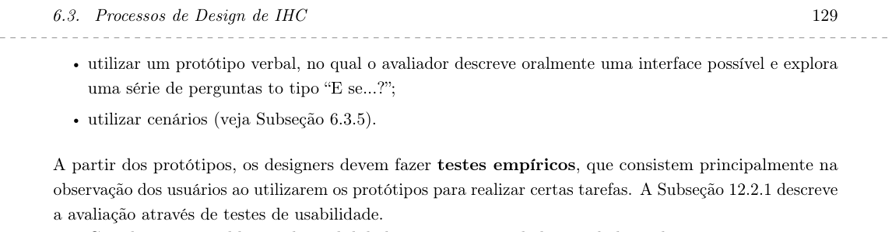

<b>Fonte:</b> BARBOSA et al. (2021, p. 129).

### 4.4 AF-04 — Design iterativo entre os níveis

A Tabela 5 apresenta o item AF-04:

<b>Tabela 5: Item AF-04 — Design iterativo entre os níveis</b>

| Campo | Registro |
| :--- | :--- |
| **Pergunta** | O artefato mostra quais problemas encontrados no protótipo de papel foram corrigidos no protótipo de alta fidelidade (por exemplo, uma tabela "problema do papel → solução na alta fidelidade")? |
| **Autor** | Daniel da Silva Batista |
| **Fonte** | BARBOSA et al. (2021, p. 129) |
| **Origem na v1** | Novo |

<b>Fonte:</b> Daniel da Silva Batista (2026).

A Figura 4 reproduz o trecho do livro que fundamenta o item AF-04:

<b>Figura 4: Referência Bibliográfica — Item AF-04 (Design iterativo entre os níveis)</b>

<b>Fonte:</b> BARBOSA et al. (2021, p. 129).

### 4.5 AF-05 — Registro das decisões de design

A Tabela 6 apresenta o item AF-05:

<b>Tabela 6: Item AF-05 — Registro das decisões de design</b>

| Campo | Registro |
| :--- | :--- |
| **Pergunta** | O artefato registra as principais decisões de design do protótipo e o motivo de cada uma (design rationale: a justificativa de cada escolha)? |
| **Autor** | Daniel da Silva Batista |
| **Fonte** | BARBOSA et al. (2021, p. 129) |
| **Origem na v1** | Novo |

<b>Fonte:</b> Daniel da Silva Batista (2026).

A Figura 5 reproduz o trecho do livro que fundamenta o item AF-05:

<b>Figura 5: Referência Bibliográfica — Item AF-05 (Registro das decisões de design)</b>

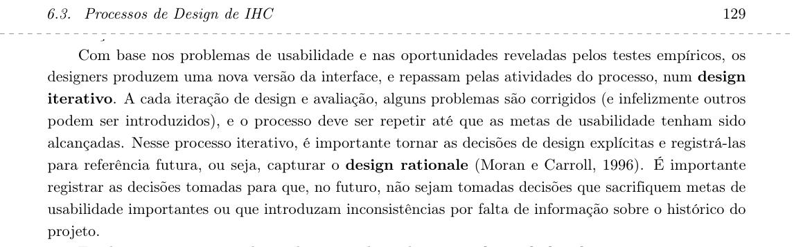

<b>Fonte:</b> BARBOSA et al. (2021, p. 129).

### 4.6 AF-06 — Visibilidade do estado do sistema

A Tabela 7 apresenta o item AF-06:

<b>Tabela 7: Item AF-06 — Visibilidade do estado do sistema</b>

| Campo | Registro |
| :--- | :--- |
| **Pergunta** | O protótipo mostra o estado atual do sistema de forma visível (por exemplo, indica claramente quantos itens foram selecionados ou em que etapa a pessoa está)? |
| **Autor** | Arthur Sismene Carvalho |
| **Fonte** | BARBOSA et al. (2021, p. 306) |
| **Origem na v1** | Autoinspeção — item 2 |

<b>Fonte:</b> Arthur Sismene Carvalho (2026).

A Figura 6 reproduz o trecho do livro que fundamenta o item AF-06:

<b>Figura 6: Referência Bibliográfica — Item AF-06 (Visibilidade do estado do sistema)</b>

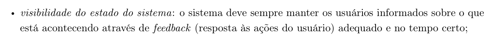

<b>Fonte:</b> BARBOSA et al. (2021, p. 306).

### 4.7 AF-07 — Controle e liberdade do usuário

A Tabela 8 apresenta o item AF-07:

<b>Tabela 8: Item AF-07 — Controle e liberdade do usuário</b>

| Campo | Registro |
| :--- | :--- |
| **Pergunta** | O protótipo oferece saídas claras para o usuário desfazer ações ou voltar atrás (por exemplo, limpar uma seleção, alterar filtros ou voltar à tela anterior)? |
| **Autor** | Arthur Sismene Carvalho |
| **Fonte** | BARBOSA et al. (2021, p. 306) |
| **Origem na v1** | Autoinspeção — item 3 |

<b>Fonte:</b> Arthur Sismene Carvalho (2026).

A Figura 7 reproduz o trecho do livro que fundamenta o item AF-07:

<b>Figura 7: Referência Bibliográfica — Item AF-07 (Controle e liberdade do usuário)</b>

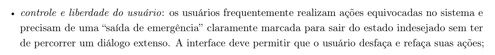

<b>Fonte:</b> BARBOSA et al. (2021, p. 306).

### 4.8 AF-08 — Correspondência com o mundo real

A Tabela 9 apresenta o item AF-08:

<b>Tabela 9: Item AF-08 — Correspondência com o mundo real</b>

| Campo | Registro |
| :--- | :--- |
| **Pergunta** | Os rótulos e critérios do protótipo usam o vocabulário habitual do usuário (termos que o público reconhece), e não termos técnicos internos? |
| **Autor** | Arthur Sismene Carvalho |
| **Fonte** | BARBOSA et al. (2021, p. 306) |
| **Origem na v1** | Autoinspeção — item 4 |

<b>Fonte:</b> Arthur Sismene Carvalho (2026).

A Figura 8 reproduz o trecho do livro que fundamenta o item AF-08:

<b>Figura 8: Referência Bibliográfica — Item AF-08 (Correspondência com o mundo real)</b>

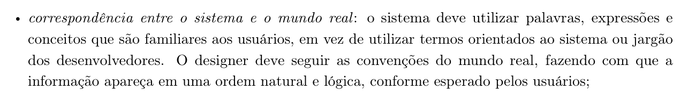

<b>Fonte:</b> BARBOSA et al. (2021, p. 306).

### 4.9 AF-09 — Prevenção de erros e feedback

A Tabela 10 apresenta o item AF-09:

<b>Tabela 10: Item AF-09 — Prevenção de erros e feedback</b>

| Campo | Registro |
| :--- | :--- |
| **Pergunta** | O protótipo previne erros em ações críticas e dá feedback claro (por exemplo, pede confirmação antes de uma ação importante e avisa quando ela é concluída)? |
| **Autor** | Arthur Sismene Carvalho |
| **Fonte** | BARBOSA et al. (2021, p. 306) |
| **Origem na v1** | Autoinspeção — item 5 |

<b>Fonte:</b> Arthur Sismene Carvalho (2026).

A Figura 9 reproduz o trecho do livro que fundamenta o item AF-09:

<b>Figura 9: Referência Bibliográfica — Item AF-09 (Prevenção de erros e feedback)</b>

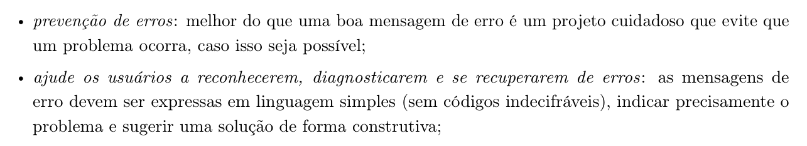

<b>Fonte:</b> BARBOSA et al. (2021, p. 306).

### 4.10 AF-10 — Estética e design minimalista

A Tabela 11 apresenta o item AF-10:

<b>Tabela 11: Item AF-10 — Estética e design minimalista</b>

| Campo | Registro |
| :--- | :--- |
| **Pergunta** | O protótipo evita ruído visual, mostrando apenas o necessário para a tarefa (sem excesso de informação ou elementos que distraem)? |
| **Autor** | Arthur Sismene Carvalho |
| **Fonte** | BARBOSA et al. (2021, p. 306) |
| **Origem na v1** | Autoinspeção — item 6 |

<b>Fonte:</b> Arthur Sismene Carvalho (2026).

A Figura 10 reproduz o trecho do livro que fundamenta o item AF-10:

<b>Figura 10: Referência Bibliográfica — Item AF-10 (Estética e design minimalista)</b>

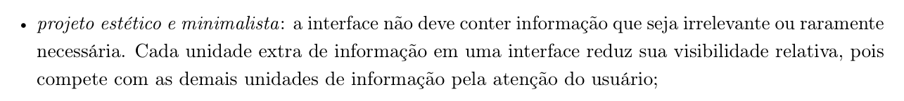

<b>Fonte:</b> BARBOSA et al. (2021, p. 306).

### 4.11 AF-11 — Aderência ao guia de estilo

A Tabela 12 apresenta o item AF-11:

<b>Tabela 12: Item AF-11 — Aderência ao guia de estilo</b>

| Campo | Registro |
| :--- | :--- |
| **Pergunta** | O protótipo segue as cores, as fontes e os componentes definidos no guia de estilo do projeto? |
| **Autor** | Pedro Rocha Ferreira Lima |
| **Fonte** | BARBOSA et al. (2021, p. 129) |
| **Origem na v1** | Item novo |

<b>Fonte:</b> Pedro Rocha Ferreira Lima (2026).

A Figura 11 reproduz o trecho do livro que fundamenta o item AF-11:

<b>Figura 11: Referência Bibliográfica — Item AF-11 (Aderência ao guia de estilo)</b>

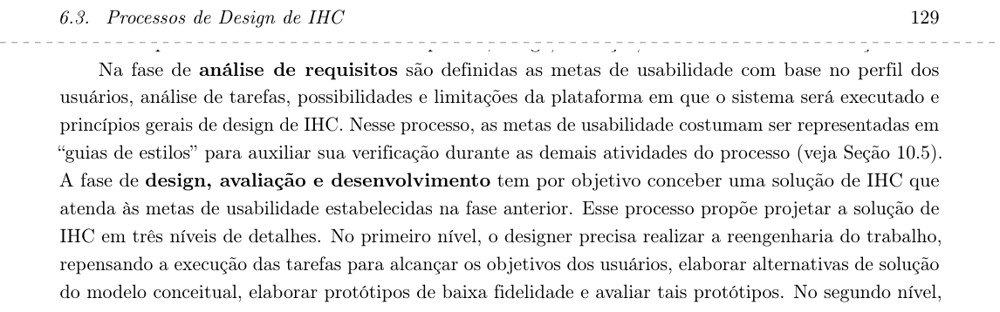

<b>Fonte:</b> BARBOSA et al. (2021, p. 129).

### 4.12 AF-12 — Vocabulário consistente

A Tabela 13 apresenta o item AF-12:

<b>Tabela 13: Item AF-12 — Vocabulário consistente</b>

| Campo | Registro |
| :--- | :--- |
| **Pergunta** | O protótipo usa sempre o mesmo termo para a mesma coisa em todas as telas (por exemplo, não chama de "edital" numa tela e de "concurso" em outra)? |
| **Autor** | Pedro Rocha Ferreira Lima |
| **Fonte** | BARBOSA et al. (2021, p. 249) |
| **Origem na v1** | Item novo |

<b>Fonte:</b> Pedro Rocha Ferreira Lima (2026).

A Figura 12 reproduz o trecho do livro que fundamenta o item AF-12:

<b>Figura 12: Referência Bibliográfica — Item AF-12 (Vocabulário consistente)</b>

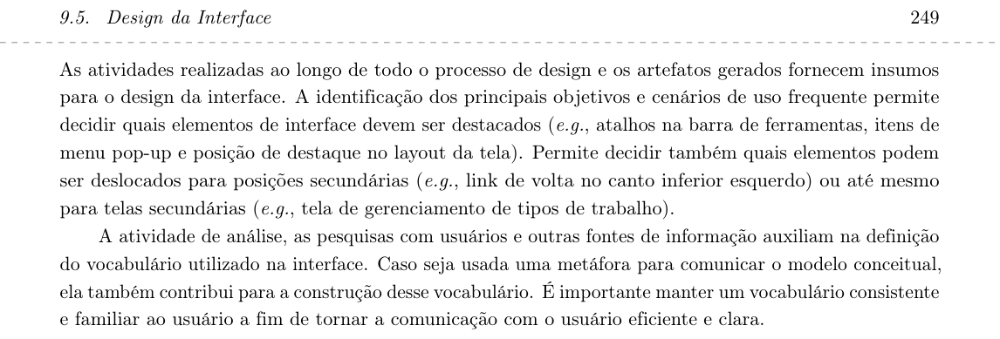

<b>Fonte:</b> BARBOSA et al. (2021, p. 249).

### 4.13 AF-13 — Comparação com as metas de usabilidade

A Tabela 14 apresenta o item AF-13:

<b>Tabela 14: Item AF-13 — Comparação com as metas de usabilidade</b>

| Campo | Registro |
| :--- | :--- |
| **Pergunta** | O artefato compara os resultados dos testes com as metas de usabilidade do projeto (por exemplo, o tempo ou a taxa de sucesso esperados)? |
| **Autor** | Pedro Rocha Ferreira Lima |
| **Fonte** | BARBOSA et al. (2021, p. 129) |
| **Origem na v1** | Item novo |

<b>Fonte:</b> Pedro Rocha Ferreira Lima (2026).

A Figura 13 reproduz o trecho do livro que fundamenta o item AF-13:

<b>Figura 13: Referência Bibliográfica — Item AF-13 (Comparação com as metas de usabilidade)</b>

<b>Fonte:</b> BARBOSA et al. (2021, p. 129).

### 4.14 AF-14 — Dados plausíveis

A Tabela 15 apresenta o item AF-14:

<b>Tabela 15: Item AF-14 — Dados plausíveis</b>

| Campo | Registro |
| :--- | :--- |
| **Pergunta** | Os dados exibidos no protótipo são plausíveis (nomes de órgãos, datas e valores realistas), mesmo sendo fictícios? |
| **Autor** | Pedro Rocha Ferreira Lima |
| **Fonte** | BARBOSA et al. (2021, p. 129) |
| **Origem na v1** | Item novo |

<b>Fonte:</b> Pedro Rocha Ferreira Lima (2026).

A Figura 14 reproduz o trecho do livro que fundamenta o item AF-14:

<b>Figura 14: Referência Bibliográfica — Item AF-14 (Dados plausíveis)</b>

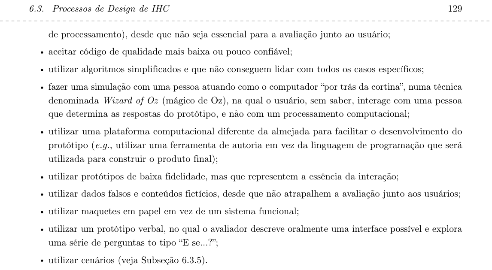

<b>Fonte:</b> BARBOSA et al. (2021, p. 129).

### 4.15 AF-15 — Largura ou profundidade do protótipo

A Tabela 16 apresenta o item AF-15:

<b>Tabela 16: Item AF-15 — Largura ou profundidade do protótipo</b>

| Campo | Registro |
| :--- | :--- |
| **Pergunta** | O artefato informa se o protótipo cobre o sistema em largura (muitas telas com pouca função) ou em profundidade (poucas telas funcionando por completo)? |
| **Autor** | Pedro Rocha Ferreira Lima |
| **Fonte** | BARBOSA et al. (2021, p. 128) |
| **Origem na v1** | Item novo |

<b>Fonte:</b> Pedro Rocha Ferreira Lima (2026).

A Figura 15 reproduz o trecho do livro que fundamenta o item AF-15:

<b>Figura 15: Referência Bibliográfica — Item AF-15 (Largura ou profundidade do protótipo)</b>

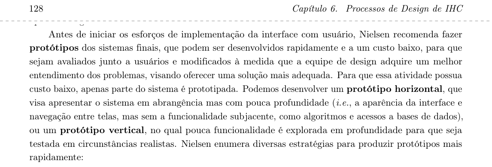

<b>Fonte:</b> BARBOSA et al. (2021, p. 128).

## 5. Correspondência com a v1

A Tabela 17 apresenta, para cada item da v2 já elaborado, o item de origem na v1 e o que mudou na redação:

<b>Tabela 17: Correspondência entre os Itens da v1 e da v2</b>

| Item v2 | Origem na v1 | O que mudou |
| :---: | :---: | :--- |
| **AF-01** | [Item 1](../../design-avaliacao-desenvolvimento/etapa-5/daniel-batista-alta-fidelidade.md#3-autoinspecao-analitica-previa-do-prototipo-de-alta-fidelidade) | O item 1 das autoinspeções ("Consistência e Padrões") passa a verificar se o desenho está completo (tamanhos, posições, cores e fontes). |
| **AF-02** | Item novo | Item novo: a v1 não verificava a navegação. |
| **AF-03** | Item novo | Item novo: a v1 não verificava o teste com usuários. |
| **AF-04** | Item novo | Item novo: a v1 não verificava a ligação com o protótipo de papel. |
| **AF-05** | Item novo | Item novo: a v1 não verificava o registro das decisões. |
| **AF-06** | [Autoinspeção — item 2](../../design-avaliacao-desenvolvimento/etapa-5/daniel-batista-alta-fidelidade.md#3-autoinspecao-analitica-previa-do-prototipo-de-alta-fidelidade) | Heurística "Visibilidade do estado do sistema" reescrita como pergunta objetiva, com exemplo. |
| **AF-07** | [Autoinspeção — item 3](../../design-avaliacao-desenvolvimento/etapa-5/daniel-batista-alta-fidelidade.md#3-autoinspecao-analitica-previa-do-prototipo-de-alta-fidelidade) | Heurística "Controle e liberdade do usuário" reescrita, com exemplos de saída. |
| **AF-08** | [Autoinspeção — item 4](../../design-avaliacao-desenvolvimento/etapa-5/daniel-batista-alta-fidelidade.md#3-autoinspecao-analitica-previa-do-prototipo-de-alta-fidelidade) | Heurística "Correspondência com o mundo real" reescrita. |
| **AF-09** | [Autoinspeção — item 5](../../design-avaliacao-desenvolvimento/etapa-5/daniel-batista-alta-fidelidade.md#3-autoinspecao-analitica-previa-do-prototipo-de-alta-fidelidade) | Heurística "Prevenção de erros e feedback" reescrita. |
| **AF-10** | [Autoinspeção — item 6](../../design-avaliacao-desenvolvimento/etapa-5/daniel-batista-alta-fidelidade.md#3-autoinspecao-analitica-previa-do-prototipo-de-alta-fidelidade) | Heurística "Estética e design minimalista" reescrita. |
| **AF-11** | Item novo | Item novo, elaborado na v2. |
| **AF-12** | Item novo | Item novo, elaborado na v2. |
| **AF-13** | Item novo | Item novo, elaborado na v2. |
| **AF-14** | Item novo | Item novo, elaborado na v2. |
| **AF-15** | Item novo | Item novo, elaborado na v2. |

<b>Fonte:</b> Daniel da Silva Batista (2026).

As listas v1 eram as autoinspeções analíticas feitas em cada relato individual, baseadas nas heurísticas de Nielsen (1993). A v2 é uma lista única para os quatro relatos e verifica o protótipo como artefato: fidelidade, navegação, teste com usuários e rastreabilidade com o protótipo de papel.

## 6. Referências Bibliográficas

> [1] BARBOSA, Simone D. J.; SILVA, Bruno S. da; SILVEIRA, Milene S.; GASPARINI, Isabela; DARIN, Ticianne; BARBOSA, Gabriel D. J. *Interação Humano-Computador e Experiência do Usuário*. 1. ed. Autopublicação, 2021. ISBN: 978-65-00-19677-1.  
> [2] FAGAN, Michael E. Design and code inspections to reduce errors in program development. *IBM Systems Journal*, v. 15, n. 3, p. 182-211, 1976.  
> [3] SALES, André Barros de. *Plano de ensino FIHC 022026 – Turma 01*. Brasília: FCTE/UnB, 2026.

## 7. Histórico de Versões

| Versão | Data | Descrição | Autor(es) | Revisor(es) |
| :---: | :---: | :--- | :---: | :---: |
| `1.0` | 21/11/2026 | Criação da v2 da lista: itens AF-01 a AF-05 reescritos a partir da v1, com fonte por página e recorte do livro; itens AF-06 a AF-20 reservados aos demais integrantes. | Daniel da Silva Batista | — |
| `1.1` | 22/11/2026 | Elaboração dos itens AF-06 a AF-10, reescritos a partir das heurísticas 2 a 6 da autoinspeção; recortes do livro adicionados. | Arthur Sismene Carvalho | — |
| `1.2` | 22/11/2026 | Elaboração dos itens AF-11 a AF-15, com fonte por página e recorte do livro. | Pedro Rocha Ferreira Lima | — |

