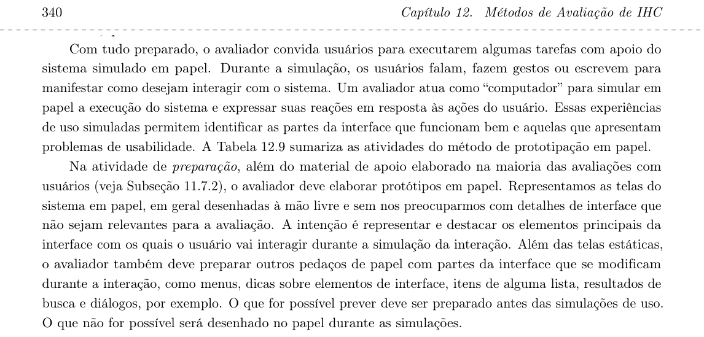
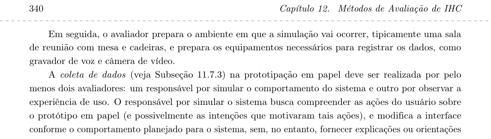
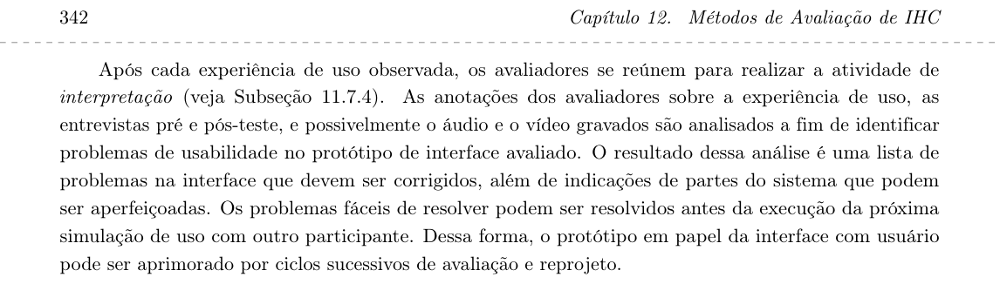
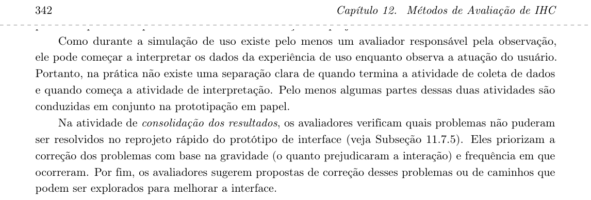
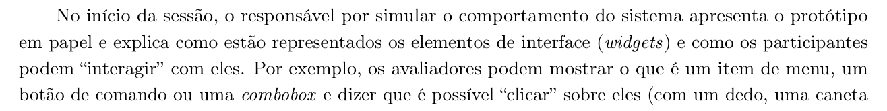
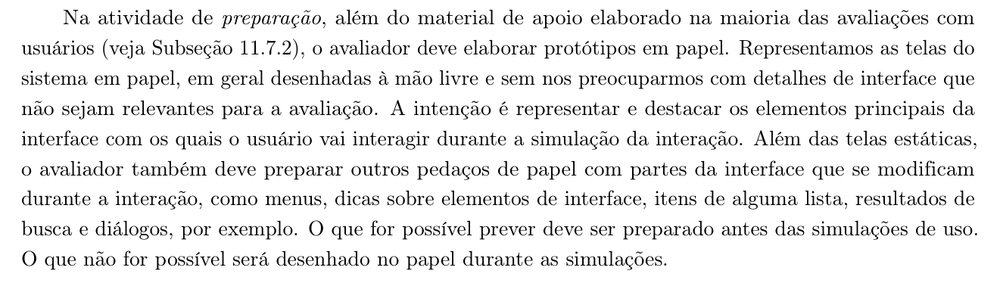
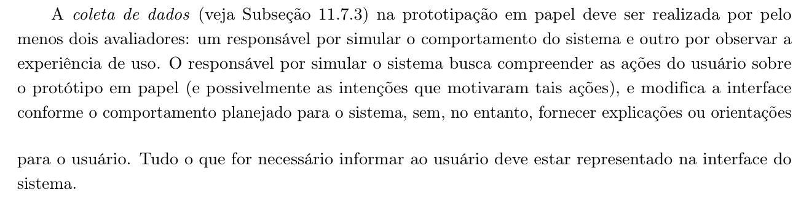
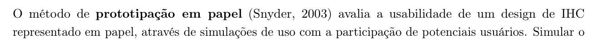
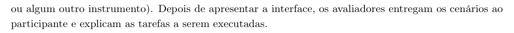

<b>Tabela de Contribuição</b>

| Membro | Contribuição |
| :--- | :--- |
| **Daniel da Silva Batista** | Elaboração dos itens PP-01 a PP-05, revisão dos itens da v1 e recortes do livro. |
| **Arthur Sismene Carvalho** | Elaboração dos itens PP-06 a PP-10 (reaproveitando itens da autoinspeção do protótipo de papel e dois itens complementares do livro), com fonte por página. |
| **Pedro Rocha Ferreira Lima** | Elaboração dos itens PP-11 a PP-15 *(pendente)*. |
| **Claude (Anthropic)** | Apoio na organização da página e na extração dos recortes do livro (conforme Política de IA). |

<b>Fonte:</b> Daniel da Silva Batista (2026).

# Lista de Verificação de Protótipo de Papel — v2

## 1. Introdução

O **protótipo de papel** representa as telas do sistema desenhadas em papel. Na avaliação, um avaliador simula o comportamento do sistema trocando os papéis conforme as ações do participante, enquanto outro observa os problemas de uso (BARBOSA et al., 2021).

Esta lista é a **versão 2 (v2)** das listas de autoinspeção dos relatos individuais ([Daniel](../../design-avaliacao-desenvolvimento/etapa-5/daniel-batista-prototipo-papel.md#3-autoinspecao-analitica-do-prototipo-de-papel), [Arthur](../../design-avaliacao-desenvolvimento/etapa-5/arthur-carvalho-prototipo-papel.md#3-autoinspecao-analitica-do-prototipo-de-papel) e [Pedro](../../design-avaliacao-desenvolvimento/etapa-5/pedro-rocha-prototipo-papel.md#3-autoinspecao-analitica-do-prototipo-de-papel)) e faz parte da [Verificação da Etapa 8](../index.md), conduzida pelo método de inspeção de Fagan (FAGAN, 1976). Ela será aplicada, no passo de inspeção, aos seguintes artefatos do projeto:

* [Relato do protótipo de papel — Daniel da Silva Batista](../../design-avaliacao-desenvolvimento/etapa-5/daniel-batista-prototipo-papel.md)
* [Relato do protótipo de papel — Arthur Sismene Carvalho](../../design-avaliacao-desenvolvimento/etapa-5/arthur-carvalho-prototipo-papel.md)
* [Relato do protótipo de papel — Leonardo da Silva Lopes Júnior](../../design-avaliacao-desenvolvimento/etapa-5/leonardo-lopes-prototipo-papel.md)
* [Relato do protótipo de papel — Pedro Rocha Ferreira Lima](../../design-avaliacao-desenvolvimento/etapa-5/pedro-rocha-prototipo-papel.md)

A lista tem **15 itens**, e cada integrante do grupo elabora 5 deles. Cada item é uma pergunta objetiva, com as explicações necessárias entre parênteses, para que possa ser respondida por quem não conhece o artefato. Cada item indica o autor e a fonte. A [Seção 3](#3-itens-de-verificacao) consolida todos os itens em uma tabela, e a [Seção 4](#4-detalhamento-dos-itens) detalha cada um, com a pergunta e, logo abaixo, o recorte do livro que a fundamenta.

## 2. Critérios de Julgamento

Cada item admite uma única resposta:

* **Sim** — o artefato atende integralmente ao que a pergunta descreve;
* **Não** — o artefato não atende ao que a pergunta descreve ou não apresenta a informação;
* **Incompleto** — o artefato atende apenas em parte (por exemplo, em alguns quadros, tarefas ou participantes, mas não em todos).

## 3. Itens de Verificação

A Tabela 1 consolida os 15 itens de verificação da Lista de Verificação de Protótipo de Papel — v2:

<b>Tabela 1: Itens da Lista de Verificação de Protótipo de Papel — v2</b>

| ID | Pergunta de verificação | Autor | Fonte |
| :---: | :--- | :--- | :--- |
| **PP-01** | As telas foram desenhadas em papel (à mão livre ou impressas), mostrando apenas os elementos com que o usuário vai interagir, sem detalhes visuais desnecessários (como cores definitivas ou imagens finais)? | Daniel da Silva Batista | BARBOSA et al. (2021, p. 340) |
| **PP-02** | Além das telas, o protótipo tem peças de papel separadas para as partes que mudam durante o uso (por exemplo, menus abertos, listas, mensagens e resultados de busca)? | Daniel da Silva Batista | BARBOSA et al. (2021, p. 340) |
| **PP-03** | Durante as sessões, uma pessoa da equipe simulou o sistema (trocando as folhas e as peças de papel a cada ação do participante, sem orientá-lo) enquanto outra pessoa apenas observava e anotava os problemas? | Daniel da Silva Batista | BARBOSA et al. (2021, p. 340) |
| **PP-04** | O relato lista os problemas encontrados em cada sessão e as correções simples feitas no protótipo antes da sessão seguinte? | Daniel da Silva Batista | BARBOSA et al. (2021, p. 342) |
| **PP-05** | Os problemas que não foram corrigidos estão priorizados pela gravidade (o quanto atrapalharam a tarefa) e pela frequência (quantos participantes tiveram o problema), com uma sugestão de correção para cada um? | Daniel da Silva Batista | BARBOSA et al. (2021, p. 342) |
| **PP-06** | Os elementos interativos do protótipo (campos, botões e caixas de seleção) deixam claro, pela aparência, o que a pessoa pode fazer com cada um (a forma do elemento sugere a ação)? | Arthur Sismene Carvalho | BARBOSA et al. (2021, p. 341) |
| **PP-07** | A sequência de telas em papel cobre o fluxo completo das tarefas principais do projeto, do início ao fim (por exemplo, da busca à exportação), sem telas faltando? | Arthur Sismene Carvalho | BARBOSA et al. (2021, p. 340) |
| **PP-08** | O protótipo foi construído de forma que a interface se comunique sozinha — tudo o que o usuário precisa saber para completar as tarefas está representado nas telas, sem que o avaliador precise dar explicações durante a sessão? | Arthur Sismene Carvalho | BARBOSA et al. (2021, p. 341) |
| **PP-09** | Os participantes das sessões têm o perfil do público-alvo do sistema e não fizeram parte da criação do protótipo? | Arthur Sismene Carvalho | BARBOSA et al. (2021, p. 340) |
| **PP-10** | As tarefas foram apresentadas ao participante como situações de uso (cenários) para ele realizar por conta própria, sem que o avaliador ensinasse o caminho? | Arthur Sismene Carvalho | BARBOSA et al. (2021, p. 341) |
| **PP-11** | *(a elaborar)* | Pedro Rocha Ferreira Lima | — |
| **PP-12** | *(a elaborar)* | Pedro Rocha Ferreira Lima | — |
| **PP-13** | *(a elaborar)* | Pedro Rocha Ferreira Lima | — |
| **PP-14** | *(a elaborar)* | Pedro Rocha Ferreira Lima | — |
| **PP-15** | *(a elaborar)* | Pedro Rocha Ferreira Lima | — |

<b>Fonte:</b> Daniel da Silva Batista, Arthur Sismene Carvalho e Pedro Rocha Ferreira Lima (2026), conforme o autor de cada item.

## 4. Detalhamento dos Itens

### 4.1 PP-01 — Telas desenhadas em papel

A Tabela 2 apresenta o item PP-01:

<b>Tabela 2: Item PP-01 — Telas desenhadas em papel</b>

| Campo | Registro |
| :--- | :--- |
| **Pergunta** | As telas foram desenhadas em papel (à mão livre ou impressas), mostrando apenas os elementos com que o usuário vai interagir, sem detalhes visuais desnecessários (como cores definitivas ou imagens finais)? |
| **Autor** | Daniel da Silva Batista |
| **Fonte** | BARBOSA et al. (2021, p. 340) |
| **Origem na v1** | Item 1 |

<b>Fonte:</b> Daniel da Silva Batista (2026).

A Figura 1 reproduz o trecho do livro que fundamenta o item PP-01:

<b>Figura 1: Referência Bibliográfica — Item PP-01 (Telas desenhadas em papel)</b>

<b>Fonte:</b> BARBOSA et al. (2021, p. 340).

### 4.2 PP-02 — Peças móveis do protótipo

A Tabela 3 apresenta o item PP-02:

<b>Tabela 3: Item PP-02 — Peças móveis do protótipo</b>

| Campo | Registro |
| :--- | :--- |
| **Pergunta** | Além das telas, o protótipo tem peças de papel separadas para as partes que mudam durante o uso (por exemplo, menus abertos, listas, mensagens e resultados de busca)? |
| **Autor** | Daniel da Silva Batista |
| **Fonte** | BARBOSA et al. (2021, p. 340) |
| **Origem na v1** | Item 4 |

<b>Fonte:</b> Daniel da Silva Batista (2026).

A Figura 2 reproduz o trecho do livro que fundamenta o item PP-02:

<b>Figura 2: Referência Bibliográfica — Item PP-02 (Peças móveis do protótipo)</b>

<b>Fonte:</b> BARBOSA et al. (2021, p. 340).

### 4.3 PP-03 — Papéis dos avaliadores na simulação

A Tabela 4 apresenta o item PP-03:

<b>Tabela 4: Item PP-03 — Papéis dos avaliadores na simulação</b>

| Campo | Registro |
| :--- | :--- |
| **Pergunta** | Durante as sessões, uma pessoa da equipe simulou o sistema (trocando as folhas e as peças de papel a cada ação do participante, sem orientá-lo) enquanto outra pessoa apenas observava e anotava os problemas? |
| **Autor** | Daniel da Silva Batista |
| **Fonte** | BARBOSA et al. (2021, p. 340) |
| **Origem na v1** | Novo |

<b>Fonte:</b> Daniel da Silva Batista (2026).

A Figura 3 reproduz o trecho do livro que fundamenta o item PP-03:

<b>Figura 3: Referência Bibliográfica — Item PP-03 (Papéis dos avaliadores na simulação)</b>

<b>Fonte:</b> BARBOSA et al. (2021, p. 340).

### 4.4 PP-04 — Problemas e correções entre sessões

A Tabela 5 apresenta o item PP-04:

<b>Tabela 5: Item PP-04 — Problemas e correções entre sessões</b>

| Campo | Registro |
| :--- | :--- |
| **Pergunta** | O relato lista os problemas encontrados em cada sessão e as correções simples feitas no protótipo antes da sessão seguinte? |
| **Autor** | Daniel da Silva Batista |
| **Fonte** | BARBOSA et al. (2021, p. 342) |
| **Origem na v1** | Novo |

<b>Fonte:</b> Daniel da Silva Batista (2026).

A Figura 4 reproduz o trecho do livro que fundamenta o item PP-04:

<b>Figura 4: Referência Bibliográfica — Item PP-04 (Problemas e correções entre sessões)</b>

<b>Fonte:</b> BARBOSA et al. (2021, p. 342).

### 4.5 PP-05 — Priorização dos problemas não resolvidos

A Tabela 6 apresenta o item PP-05:

<b>Tabela 6: Item PP-05 — Priorização dos problemas não resolvidos</b>

| Campo | Registro |
| :--- | :--- |
| **Pergunta** | Os problemas que não foram corrigidos estão priorizados pela gravidade (o quanto atrapalharam a tarefa) e pela frequência (quantos participantes tiveram o problema), com uma sugestão de correção para cada um? |
| **Autor** | Daniel da Silva Batista |
| **Fonte** | BARBOSA et al. (2021, p. 342) |
| **Origem na v1** | Novo |

<b>Fonte:</b> Daniel da Silva Batista (2026).

A Figura 5 reproduz o trecho do livro que fundamenta o item PP-05:

<b>Figura 5: Referência Bibliográfica — Item PP-05 (Priorização dos problemas não resolvidos)</b>

<b>Fonte:</b> BARBOSA et al. (2021, p. 342).

### 4.6 PP-06 — Affordances dos elementos interativos

A Tabela 7 apresenta o item PP-06:

<b>Tabela 7: Item PP-06 — Affordances dos elementos interativos</b>

| Campo | Registro |
| :--- | :--- |
| **Pergunta** | Os elementos interativos do protótipo (campos, botões e caixas de seleção) deixam claro, pela aparência, o que a pessoa pode fazer com cada um (a forma do elemento sugere a ação)? |
| **Autor** | Arthur Sismene Carvalho |
| **Fonte** | BARBOSA et al. (2021, p. 341) |
| **Origem na v1** | Item 2 |

<b>Fonte:</b> Arthur Sismene Carvalho (2026).

A Figura 6 reproduz o trecho do livro que fundamenta o item PP-06:

<b>Figura 6: Referência Bibliográfica — Item PP-06 (Affordances dos elementos interativos)</b>

<b>Fonte:</b> BARBOSA et al. (2021, p. 341).

### 4.7 PP-07 — Cobertura do fluxo completo de tarefas

A Tabela 8 apresenta o item PP-07:

<b>Tabela 8: Item PP-07 — Cobertura do fluxo completo de tarefas</b>

| Campo | Registro |
| :--- | :--- |
| **Pergunta** | A sequência de telas em papel cobre o fluxo completo das tarefas principais do projeto, do início ao fim (por exemplo, da busca à exportação), sem telas faltando? |
| **Autor** | Arthur Sismene Carvalho |
| **Fonte** | BARBOSA et al. (2021, p. 340) |
| **Origem na v1** | Item 3 |

<b>Fonte:</b> Arthur Sismene Carvalho (2026).

A Figura 7 reproduz o trecho do livro que fundamenta o item PP-07:

<b>Figura 7: Referência Bibliográfica — Item PP-07 (Cobertura do fluxo completo de tarefas)</b>

<b>Fonte:</b> BARBOSA et al. (2021, p. 340).

### 4.8 PP-08 — Interface autoexplicativa na sessão

A Tabela 9 apresenta o item PP-08:

<b>Tabela 9: Item PP-08 — Interface autoexplicativa na sessão</b>

| Campo | Registro |
| :--- | :--- |
| **Pergunta** | O protótipo foi construído de forma que a interface se comunique sozinha — tudo o que o usuário precisa saber para completar as tarefas está representado nas telas, sem que o avaliador precise dar explicações durante a sessão? |
| **Autor** | Arthur Sismene Carvalho |
| **Fonte** | BARBOSA et al. (2021, p. 341) |
| **Origem na v1** | Item 5 |

<b>Fonte:</b> Arthur Sismene Carvalho (2026).

A Figura 8 reproduz o trecho do livro que fundamenta o item PP-08:

<b>Figura 8: Referência Bibliográfica — Item PP-08 (Interface autoexplicativa na sessão)</b>

<b>Fonte:</b> BARBOSA et al. (2021, p. 341).

### 4.9 PP-09 — Perfil dos participantes das sessões

A Tabela 10 apresenta o item PP-09:

<b>Tabela 10: Item PP-09 — Perfil dos participantes das sessões</b>

| Campo | Registro |
| :--- | :--- |
| **Pergunta** | Os participantes das sessões têm o perfil do público-alvo do sistema e não fizeram parte da criação do protótipo? |
| **Autor** | Arthur Sismene Carvalho |
| **Fonte** | BARBOSA et al. (2021, p. 340) |
| **Origem na v1** | Item novo |

<b>Fonte:</b> Arthur Sismene Carvalho (2026).

A Figura 9 reproduz o trecho do livro que fundamenta o item PP-09:

<b>Figura 9: Referência Bibliográfica — Item PP-09 (Perfil dos participantes das sessões)</b>

<b>Fonte:</b> BARBOSA et al. (2021, p. 340).

### 4.10 PP-10 — Tarefas apresentadas como cenários

A Tabela 11 apresenta o item PP-10:

<b>Tabela 11: Item PP-10 — Tarefas apresentadas como cenários</b>

| Campo | Registro |
| :--- | :--- |
| **Pergunta** | As tarefas foram apresentadas ao participante como situações de uso (cenários) para ele realizar por conta própria, sem que o avaliador ensinasse o caminho? |
| **Autor** | Arthur Sismene Carvalho |
| **Fonte** | BARBOSA et al. (2021, p. 341) |
| **Origem na v1** | Item novo |

<b>Fonte:</b> Arthur Sismene Carvalho (2026).

A Figura 10 reproduz o trecho do livro que fundamenta o item PP-10:

<b>Figura 10: Referência Bibliográfica — Item PP-10 (Tarefas apresentadas como cenários)</b>

<b>Fonte:</b> BARBOSA et al. (2021, p. 341).

> *Os itens PP-11 a PP-15 serão detalhados pelos respectivos autores neste mesmo formato: pergunta, autor, fonte e recorte do livro.*

## 5. Correspondência com a v1

A Tabela 12 apresenta, para cada item da v2 já elaborado, o item de origem na v1 e o que mudou na redação:

<b>Tabela 12: Correspondência entre os Itens da v1 e da v2</b>

| Item v2 | Origem na v1 | O que mudou |
| :---: | :---: | :--- |
| **PP-01** | [Item 1](../../design-avaliacao-desenvolvimento/etapa-5/daniel-batista-prototipo-papel.md#3-autoinspecao-analitica-do-prototipo-de-papel) | O item 1 das autoinspeções ("baixa fidelidade autêntica em papel") passa a dizer o que se espera ver: telas em papel só com os elementos de interação. |
| **PP-02** | [Item 4](../../design-avaliacao-desenvolvimento/etapa-5/daniel-batista-prototipo-papel.md#3-autoinspecao-analitica-do-prototipo-de-papel) | O item 4 das autoinspeções ("peças móveis") ganha exemplos do que deve ser peça separada. |
| **PP-03** | Item novo | Item novo: a v1 não verificava a condução da simulação. |
| **PP-04** | Item novo | Item novo: a v1 não verificava o registro dos problemas. |
| **PP-05** | Item novo | Item novo: a v1 não verificava a priorização. |
| **PP-06** | [Item 2](../../design-avaliacao-desenvolvimento/etapa-5/daniel-batista-prototipo-papel.md#3-autoinspecao-analitica-do-prototipo-de-papel) | A autoinspeção ("affordances") vira pergunta objetiva, explicando o termo. |
| **PP-07** | [Item 3](../../design-avaliacao-desenvolvimento/etapa-5/daniel-batista-prototipo-papel.md#3-autoinspecao-analitica-do-prototipo-de-papel) | Generaliza a cobertura do fluxo para as tarefas principais, com exemplo. |
| **PP-08** | [Item 5](../../design-avaliacao-desenvolvimento/etapa-5/daniel-batista-prototipo-papel.md#3-autoinspecao-analitica-do-prototipo-de-papel) | Reescrito para o conceito que p.341 efetivamente registra: a interface deve ser autoexplicativa (o avaliador não dá explicações durante a sessão). |
| **PP-09** | Item novo | Item novo: a v1 não verificava o perfil dos participantes. |
| **PP-10** | Item novo | Item novo: a v1 não verificava como as tarefas eram apresentadas. |

<b>Fonte:</b> Daniel da Silva Batista (2026).

As listas v1 eram as autoinspeções feitas em cada relato individual, baseadas nas heurísticas de Nielsen (1993) e voltadas à interface desenhada. O relato de Leonardo da Silva Lopes Júnior não tinha lista de autoinspeção. A v2 é uma lista única para os quatro relatos e verifica também como o protótipo foi construído e avaliado, conforme o método de prototipação em papel descrito por Barbosa et al. (2021, pp. 340-343).

## 6. Referências Bibliográficas

> [1] BARBOSA, Simone D. J.; SILVA, Bruno S. da; SILVEIRA, Milene S.; GASPARINI, Isabela; DARIN, Ticianne; BARBOSA, Gabriel D. J. *Interação Humano-Computador e Experiência do Usuário*. 1. ed. Autopublicação, 2021. ISBN: 978-65-00-19677-1.  
> [2] FAGAN, Michael E. Design and code inspections to reduce errors in program development. *IBM Systems Journal*, v. 15, n. 3, p. 182-211, 1976.  
> [3] SALES, André Barros de. *Plano de ensino FIHC 022026 – Turma 01*. Brasília: FCTE/UnB, 2026.

## 7. Histórico de Versões

| Versão | Data | Descrição | Autor(es) | Revisor(es) |
| :---: | :---: | :--- | :---: | :---: |
| `1.0` | 21/11/2026 | Criação da v2 da lista: itens PP-01 a PP-05 reescritos a partir da v1, com fonte por página e recorte do livro; itens PP-06 a PP-20 reservados aos demais integrantes. | Daniel da Silva Batista | — |
| `1.1` | 22/11/2026 | Elaboração dos itens PP-06 a PP-10 (autoinspeção itens 2, 3 e 5 + dois itens complementares); recortes do livro adicionados. | Arthur Sismene Carvalho | — |

