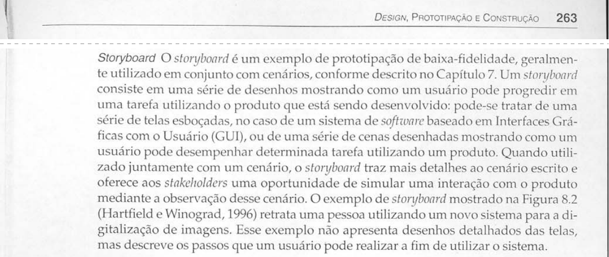
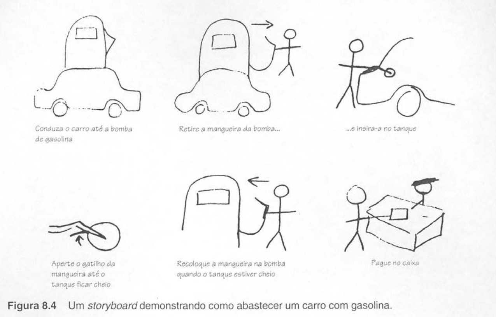
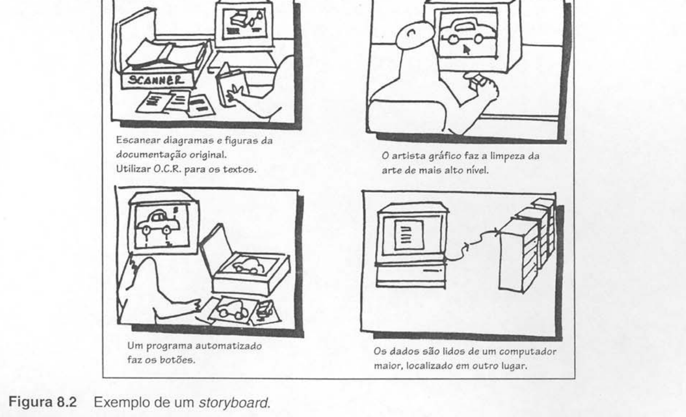
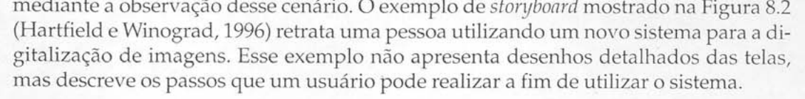
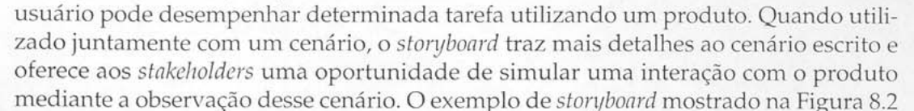
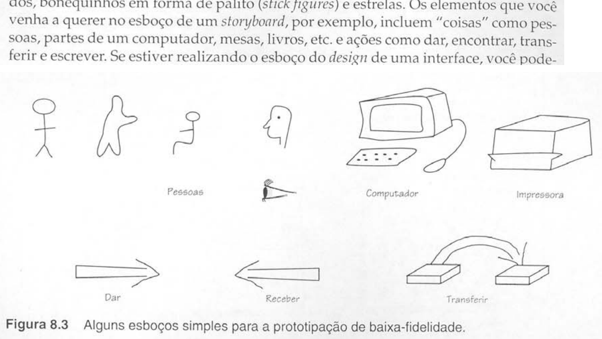
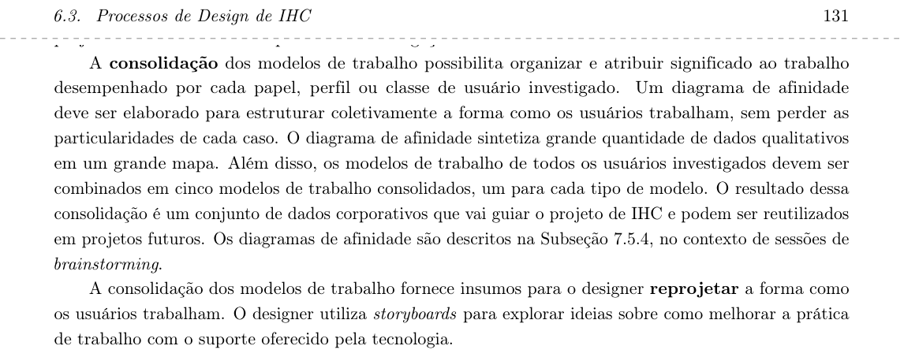
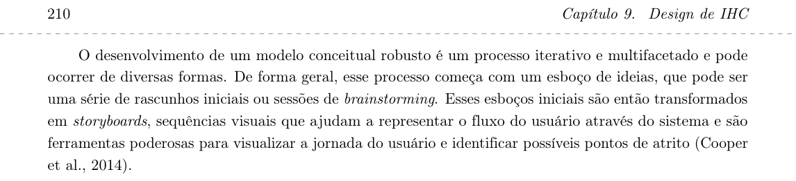
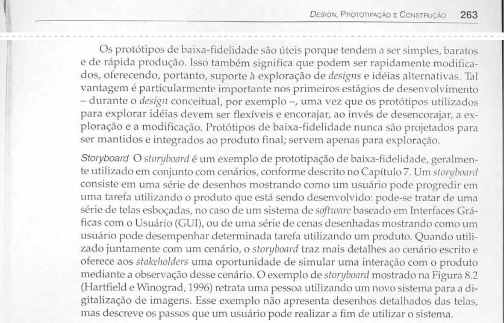

<b>Tabela de Contribuição</b>

| Membro | Contribuição |
| :--- | :--- |
| **Daniel da Silva Batista** | Elaboração dos itens SB-01 a SB-05, revisão dos itens da v1 e recortes do livro ([Itens 01–05](#41-sb-01-definicao-de-storyboard)). |
| **Arthur Sismene Carvalho** | Elaboração dos itens SB-06 a SB-10, reescritos a partir de itens da v1 (Etapa 4) que não foram reaproveitados nos itens 01–05, com fonte por página ([Itens 06–10](#46-sb-06-arco-completo-da-historia)). |
| **Pedro Rocha Ferreira Lima** | Elaboração dos itens SB-11 a SB-15, recortes do livro ([Itens 11–15](#411-sb-11-exploracao-de-melhorias)). |
| **Claude (Anthropic)** | Apoio na organização da página e na extração dos recortes do livro (conforme Política de IA). |

<b>Fonte:</b> Daniel da Silva Batista, Arthur Sismene Carvalho e Pedro Rocha Ferreira Lima (2026).

# Lista de Verificação de Storyboard — v2

## 1. Introdução

O **storyboard** é uma sequência de desenhos que conta, quadro a quadro, como uma pessoa usa o sistema para realizar uma tarefa. É um protótipo de baixa fidelidade, normalmente feito junto com um cenário escrito (PREECE; ROGERS; SHARP, 2005).

Esta lista é a **versão 2 (v2)** da [Lista de Verificação para Storyboard (v1, Etapa 4)](../../design-avaliacao-desenvolvimento/listas-verificacao-etapa-4.md#4-lista-de-verificacao-para-storyboard-20-itens-em-5-blocos) e faz parte da [Verificação da Etapa 8](../index.md), conduzida pelo método de inspeção de Fagan (FAGAN, 1976). Ela será aplicada, no passo de inspeção, aos seguintes artefatos do projeto:

* [Storyboard SB-01 — Daniel da Silva Batista](../../design-avaliacao-desenvolvimento/etapa-5/daniel-batista.md)
* [Storyboard SB-02 — Pedro Rocha Ferreira Lima](../../design-avaliacao-desenvolvimento/etapa-5/pedro-rocha.md)
* [Storyboard SB-03 — Arthur Sismene Carvalho](../../design-avaliacao-desenvolvimento/etapa-5/arthur-carvalho.md)
* [Storyboard SB-04 — Leonardo da Silva Lopes Júnior](../../design-avaliacao-desenvolvimento/etapa-5/leonardo-lopes.md)

A lista tem **15 itens**, e cada integrante do grupo elabora 5 deles. Cada item é uma pergunta objetiva, com as explicações necessárias entre parênteses, para que possa ser respondida por quem não conhece o artefato. Cada item indica o autor e a fonte. A [Seção 3](#3-itens-de-verificacao) consolida todos os itens em uma tabela, e a [Seção 4](#4-detalhamento-dos-itens) detalha cada um, com a pergunta e, logo abaixo, o recorte do livro que a fundamenta.

## 2. Critérios de Julgamento

Cada item admite uma única resposta:

* **Sim** — o artefato atende integralmente ao que a pergunta descreve;
* **Não** — o artefato não atende ao que a pergunta descreve ou não apresenta a informação;
* **Incompleto** — o artefato atende apenas em parte (por exemplo, em alguns quadros, tarefas ou participantes, mas não em todos).

## 3. Itens de Verificação

A Tabela 1 consolida os 15 itens de verificação da Lista de Verificação de Storyboard — v2:

<b>Tabela 1: Itens da Lista de Verificação de Storyboard — v2</b>

| ID | Pergunta de verificação | Autor | Fonte |
| :---: | :--- | :--- | :--- |
| **SB-01** | O storyboard é uma sequência de desenhos (quadros) que mostra, passo a passo, uma pessoa realizando uma tarefa com o sistema proposto? | Daniel da Silva Batista | PREECE, ROGERS e SHARP (2005, p. 263) |
| **SB-02** | O storyboard indica qual cenário do projeto ele ilustra (cenário: o texto que narra uma situação de uso) e segue os mesmos acontecimentos desse texto? | Daniel da Silva Batista | PREECE, ROGERS e SHARP (2005, p. 263) |
| **SB-03** | Os desenhos mostram detalhes que o cenário escrito não traz, como onde a pessoa está, qual aparelho usa e como reage? | Daniel da Silva Batista | PREECE, ROGERS e SHARP (2005, p. 263) |
| **SB-04** | Os desenhos são simples e rápidos de fazer (bonecos, setas e telas rabiscadas), sem telas prontas do sistema nem acabamento artístico? | Daniel da Silva Batista | PREECE, ROGERS e SHARP (2005, p. 263) |
| **SB-05** | O storyboard foi mostrado a usuários (pessoas com o perfil do público do sistema) para que eles simulassem a interação e apontassem problemas? | Daniel da Silva Batista | PREECE, ROGERS e SHARP (2005, p. 263) |
| **SB-06** | O storyboard preserva o arco completo da história: início (a situação ou necessidade da pessoa), meio (a interação passo a passo com a solução) e fim (o desfecho, com a necessidade atendida)? | Arthur Sismene Carvalho | PREECE, ROGERS e SHARP (2005, p. 263) |
| **SB-07** | Cada quadro tem uma legenda descritiva clara (um texto curto) que permite entender o passo retratado mesmo sem ver os outros quadros? | Arthur Sismene Carvalho | PREECE, ROGERS e SHARP (2005, p. 263) |
| **SB-08** | Cada quadro retrata um passo específico da tarefa, sem pular etapas essenciais nem acrescentar passos que não fazem parte da sequência? | Arthur Sismene Carvalho | PREECE, ROGERS e SHARP (2005, p. 263) |
| **SB-09** | Os quadros trazem elementos suficientes para que alguém consiga percorrer mentalmente a sequência e simular a interação com o produto (walkthrough)? | Arthur Sismene Carvalho | PREECE, ROGERS e SHARP (2005, p. 263) |
| **SB-10** | Os quadros mostram esboços de tela ligados à ação da pessoa (o que ela faz e o que vê), e não um fluxograma abstrato nem telas isoladas, sem ninguém usando? | Arthur Sismene Carvalho | PREECE, ROGERS e SHARP (2005, p. 263) |
| **SB-11** | O storyboard foi usado para explorar ideias de como melhorar o jeito atual de realizar a tarefa, e não apenas para ilustrar uma solução já decidida? | Pedro Rocha Ferreira Lima | BARBOSA et al. (2021, p. 131) |
| **SB-12** | O artefato aponta os momentos da história em que o usuário pode encontrar dificuldade (pontos de atrito na jornada)? | Pedro Rocha Ferreira Lima | BARBOSA et al. (2021, p. 210) |
| **SB-13** | O artefato registra o que foi mudado no storyboard depois da avaliação com usuários e o motivo de cada mudança? | Pedro Rocha Ferreira Lima | PREECE, ROGERS e SHARP (2005, p. 263) |
| **SB-14** | O storyboard foi feito antes do protótipo de papel, como etapa inicial de exploração da ideia, e não depois, só para documentar? | Pedro Rocha Ferreira Lima | PREECE, ROGERS e SHARP (2005, p. 263) |
| **SB-15** | O artefato deixa claro que o storyboard serve para explorar ideias e não será aproveitado como parte do produto final? | Pedro Rocha Ferreira Lima | PREECE, ROGERS e SHARP (2005, p. 263) |

<b>Fonte:</b> Daniel da Silva Batista, Arthur Sismene Carvalho e Pedro Rocha Ferreira Lima (2026), conforme o autor de cada item.

## 4. Detalhamento dos Itens

### 4.1 SB-01 — Definição de storyboard

A Tabela 2 apresenta o item SB-01:

<b>Tabela 2: Item SB-01 — Definição de storyboard</b>

| Campo | Registro |
| :--- | :--- |
| **Pergunta** | O storyboard é uma sequência de desenhos (quadros) que mostra, passo a passo, uma pessoa realizando uma tarefa com o sistema proposto? |
| **Autor** | Daniel da Silva Batista |
| **Fonte** | PREECE, ROGERS e SHARP (2005, p. 263) |
| **Origem na v1** | SB-02 |

<b>Fonte:</b> Daniel da Silva Batista (2026).

A Figura 1 reproduz o trecho do livro que fundamenta o item SB-01:

<b>Figura 1: Referência Bibliográfica — Item SB-01 (Definição de storyboard)</b>

<b>Fonte:</b> PREECE, ROGERS e SHARP (2005, p. 263).

### 4.2 SB-02 — O storyboard usado em conjunto com o cenário

A Tabela 3 apresenta o item SB-02:

<b>Tabela 3: Item SB-02 — O storyboard usado em conjunto com o cenário</b>

| Campo | Registro |
| :--- | :--- |
| **Pergunta** | O storyboard indica qual cenário do projeto ele ilustra (cenário: o texto que narra uma situação de uso) e segue os mesmos acontecimentos desse texto? |
| **Autor** | Daniel da Silva Batista |
| **Fonte** | PREECE, ROGERS e SHARP (2005, p. 263) |
| **Origem na v1** | SB-05 |

<b>Fonte:</b> Daniel da Silva Batista (2026).

A Figura 2 reproduz o trecho do livro que fundamenta o item SB-02:

<b>Figura 2: Referência Bibliográfica — Item SB-02 (O storyboard usado em conjunto com o cenário)</b>

<b>Fonte:</b> PREECE, ROGERS e SHARP (2005, p. 263).

### 4.3 SB-03 — Detalhes que o storyboard acrescenta ao cenário

A Tabela 4 apresenta o item SB-03:

<b>Tabela 4: Item SB-03 — Detalhes que o storyboard acrescenta ao cenário</b>

| Campo | Registro |
| :--- | :--- |
| **Pergunta** | Os desenhos mostram detalhes que o cenário escrito não traz, como onde a pessoa está, qual aparelho usa e como reage? |
| **Autor** | Daniel da Silva Batista |
| **Fonte** | PREECE, ROGERS e SHARP (2005, p. 263) |
| **Origem na v1** | SB-06 |

<b>Fonte:</b> Daniel da Silva Batista (2026).

A Figura 3 reproduz o trecho do livro que fundamenta o item SB-03:

<b>Figura 3: Referência Bibliográfica — Item SB-03 (Detalhes que o storyboard acrescenta ao cenário)</b>

<b>Fonte:</b> PREECE, ROGERS e SHARP (2005, p. 263).

### 4.4 SB-04 — Baixa fidelidade e esboços

A Tabela 5 apresenta o item SB-04:

<b>Tabela 5: Item SB-04 — Baixa fidelidade e esboços</b>

| Campo | Registro |
| :--- | :--- |
| **Pergunta** | Os desenhos são simples e rápidos de fazer (bonecos, setas e telas rabiscadas), sem telas prontas do sistema nem acabamento artístico? |
| **Autor** | Daniel da Silva Batista |
| **Fonte** | PREECE, ROGERS e SHARP (2005, p. 263) |
| **Origem na v1** | SB-01 e SB-10 |

<b>Fonte:</b> Daniel da Silva Batista (2026).

A Figura 4 reproduz o trecho do livro que fundamenta o item SB-04:

<b>Figura 4: Referência Bibliográfica — Item SB-04 (Baixa fidelidade e esboços)</b>

<b>Fonte:</b> PREECE, ROGERS e SHARP (2005, p. 263).

### 4.5 SB-05 — Simulação da interação com os usuários

A Tabela 6 apresenta o item SB-05:

<b>Tabela 6: Item SB-05 — Simulação da interação com os usuários</b>

| Campo | Registro |
| :--- | :--- |
| **Pergunta** | O storyboard foi mostrado a usuários (pessoas com o perfil do público do sistema) para que eles simulassem a interação e apontassem problemas? |
| **Autor** | Daniel da Silva Batista |
| **Fonte** | PREECE, ROGERS e SHARP (2005, p. 263) |
| **Origem na v1** | SB-14 |

<b>Fonte:</b> Daniel da Silva Batista (2026).

A Figura 5 reproduz o trecho do livro que fundamenta o item SB-05:

<b>Figura 5: Referência Bibliográfica — Item SB-05 (Simulação da interação com os usuários)</b>

<b>Fonte:</b> PREECE, ROGERS e SHARP (2005, p. 263).

### 4.6 SB-06 — Arco completo da história

A Tabela 7 apresenta o item SB-06:

<b>Tabela 7: Item SB-06 — Arco completo da história</b>

| Campo | Registro |
| :--- | :--- |
| **Pergunta** | O storyboard preserva o arco completo da história: início (a situação ou necessidade da pessoa), meio (a interação passo a passo com a solução) e fim (o desfecho, com a necessidade atendida)? |
| **Autor** | Arthur Sismene Carvalho |
| **Fonte** | PREECE, ROGERS e SHARP (2005, p. 263) |
| **Origem na v1** | SB-08 |

<b>Fonte:</b> Arthur Sismene Carvalho (2026).

A Figura 6 reproduz o trecho do livro que fundamenta o item SB-06:

<b>Figura 6: Referência Bibliográfica — Item SB-06 (Arco completo da história)</b>

<b>Fonte:</b> PREECE, ROGERS e SHARP (2005, p. 263).

### 4.7 SB-07 — Legenda descritiva em cada quadro

A Tabela 8 apresenta o item SB-07:

<b>Tabela 8: Item SB-07 — Legenda descritiva em cada quadro</b>

| Campo | Registro |
| :--- | :--- |
| **Pergunta** | Cada quadro tem uma legenda descritiva clara (um texto curto) que permite entender o passo retratado mesmo sem ver os outros quadros? |
| **Autor** | Arthur Sismene Carvalho |
| **Fonte** | PREECE, ROGERS e SHARP (2005, p. 263) |
| **Origem na v1** | SB-12 |

<b>Fonte:</b> Arthur Sismene Carvalho (2026).

A Figura 7 reproduz o trecho do livro que fundamenta o item SB-07:

<b>Figura 7: Referência Bibliográfica — Item SB-07 (Legenda descritiva em cada quadro)</b>

<b>Fonte:</b> PREECE, ROGERS e SHARP (2005, p. 263).

### 4.8 SB-08 — Um passo por quadro

A Tabela 9 apresenta o item SB-08:

<b>Tabela 9: Item SB-08 — Um passo por quadro</b>

| Campo | Registro |
| :--- | :--- |
| **Pergunta** | Cada quadro retrata um passo específico da tarefa, sem pular etapas essenciais nem acrescentar passos que não fazem parte da sequência? |
| **Autor** | Arthur Sismene Carvalho |
| **Fonte** | PREECE, ROGERS e SHARP (2005, p. 263) |
| **Origem na v1** | SB-09 |

<b>Fonte:</b> Arthur Sismene Carvalho (2026).

A Figura 8 reproduz o trecho do livro que fundamenta o item SB-08:

<b>Figura 8: Referência Bibliográfica — Item SB-08 (Um passo por quadro)</b>

<b>Fonte:</b> PREECE, ROGERS e SHARP (2005, p. 263).

### 4.9 SB-09 — Walkthrough com os quadros

A Tabela 10 apresenta o item SB-09:

<b>Tabela 10: Item SB-09 — Walkthrough com os quadros</b>

| Campo | Registro |
| :--- | :--- |
| **Pergunta** | Os quadros trazem elementos suficientes para que alguém consiga percorrer mentalmente a sequência e simular a interação com o produto (walkthrough)? |
| **Autor** | Arthur Sismene Carvalho |
| **Fonte** | PREECE, ROGERS e SHARP (2005, p. 263) |
| **Origem na v1** | SB-15 |

<b>Fonte:</b> Arthur Sismene Carvalho (2026).

A Figura 9 reproduz o trecho do livro que fundamenta o item SB-09:

<b>Figura 9: Referência Bibliográfica — Item SB-09 (Walkthrough com os quadros)</b>

<b>Fonte:</b> PREECE, ROGERS e SHARP (2005, p. 263).

### 4.10 SB-10 — Esboço de ação, não fluxograma

A Tabela 11 apresenta o item SB-10:

<b>Tabela 11: Item SB-10 — Esboço de ação, não fluxograma</b>

| Campo | Registro |
| :--- | :--- |
| **Pergunta** | Os quadros mostram esboços de tela ligados à ação da pessoa (o que ela faz e o que vê), e não um fluxograma abstrato nem telas isoladas, sem ninguém usando? |
| **Autor** | Arthur Sismene Carvalho |
| **Fonte** | PREECE, ROGERS e SHARP (2005, p. 263) |
| **Origem na v1** | SB-04 |

<b>Fonte:</b> Arthur Sismene Carvalho (2026).

A Figura 10 reproduz o trecho do livro que fundamenta o item SB-10:

<b>Figura 10: Referência Bibliográfica — Item SB-10 (Esboço de ação, não fluxograma)</b>

<b>Fonte:</b> PREECE, ROGERS e SHARP (2005, p. 263).

### 4.11 SB-11 — Exploração de melhorias

A Tabela 12 apresenta o item SB-11:

<b>Tabela 12: Item SB-11 — Exploração de melhorias</b>

| Campo | Registro |
| :--- | :--- |
| **Pergunta** | O storyboard foi usado para explorar ideias de como melhorar o jeito atual de realizar a tarefa, e não apenas para ilustrar uma solução já decidida? |
| **Autor** | Pedro Rocha Ferreira Lima |
| **Fonte** | BARBOSA et al. (2021, p. 131) |
| **Origem na v1** | Item novo |

<b>Fonte:</b> Pedro Rocha Ferreira Lima (2026).

A Figura 11 reproduz o trecho do livro que fundamenta o item SB-11:

<b>Figura 11: Referência Bibliográfica — Item SB-11 (Exploração de melhorias)</b>

<b>Fonte:</b> BARBOSA et al. (2021, p. 131).

### 4.12 SB-12 — Pontos de atrito

A Tabela 13 apresenta o item SB-12:

<b>Tabela 13: Item SB-12 — Pontos de atrito</b>

| Campo | Registro |
| :--- | :--- |
| **Pergunta** | O artefato aponta os momentos da história em que o usuário pode encontrar dificuldade (pontos de atrito na jornada)? |
| **Autor** | Pedro Rocha Ferreira Lima |
| **Fonte** | BARBOSA et al. (2021, p. 210) |
| **Origem na v1** | Item novo |

<b>Fonte:</b> Pedro Rocha Ferreira Lima (2026).

A Figura 12 reproduz o trecho do livro que fundamenta o item SB-12:

<b>Figura 12: Referência Bibliográfica — Item SB-12 (Pontos de atrito)</b>

<b>Fonte:</b> BARBOSA et al. (2021, p. 210).

### 4.13 SB-13 — Registro das mudanças

A Tabela 14 apresenta o item SB-13:

<b>Tabela 14: Item SB-13 — Registro das mudanças</b>

| Campo | Registro |
| :--- | :--- |
| **Pergunta** | O artefato registra o que foi mudado no storyboard depois da avaliação com usuários e o motivo de cada mudança? |
| **Autor** | Pedro Rocha Ferreira Lima |
| **Fonte** | PREECE, ROGERS e SHARP (2005, p. 263) |
| **Origem na v1** | Item novo |

<b>Fonte:</b> Pedro Rocha Ferreira Lima (2026).

A Figura 13 reproduz o trecho do livro que fundamenta o item SB-13:

<b>Figura 13: Referência Bibliográfica — Item SB-13 (Registro das mudanças)</b>

<b>Fonte:</b> PREECE, ROGERS e SHARP (2005, p. 263).

### 4.14 SB-14 — Momento de elaboração

A Tabela 15 apresenta o item SB-14:

<b>Tabela 15: Item SB-14 — Momento de elaboração</b>

| Campo | Registro |
| :--- | :--- |
| **Pergunta** | O storyboard foi feito antes do protótipo de papel, como etapa inicial de exploração da ideia, e não depois, só para documentar? |
| **Autor** | Pedro Rocha Ferreira Lima |
| **Fonte** | PREECE, ROGERS e SHARP (2005, p. 263) |
| **Origem na v1** | Item novo |

<b>Fonte:</b> Pedro Rocha Ferreira Lima (2026).

A Figura 14 reproduz o trecho do livro que fundamenta o item SB-14:

<b>Figura 14: Referência Bibliográfica — Item SB-14 (Momento de elaboração)</b>

<b>Fonte:</b> PREECE, ROGERS e SHARP (2005, p. 263).

### 4.15 SB-15 — Caráter exploratório

A Tabela 16 apresenta o item SB-15:

<b>Tabela 16: Item SB-15 — Caráter exploratório</b>

| Campo | Registro |
| :--- | :--- |
| **Pergunta** | O artefato deixa claro que o storyboard serve para explorar ideias e não será aproveitado como parte do produto final? |
| **Autor** | Pedro Rocha Ferreira Lima |
| **Fonte** | PREECE, ROGERS e SHARP (2005, p. 263) |
| **Origem na v1** | Item novo |

<b>Fonte:</b> Pedro Rocha Ferreira Lima (2026).

A Figura 15 reproduz o trecho do livro que fundamenta o item SB-15:

<b>Figura 15: Referência Bibliográfica — Item SB-15 (Caráter exploratório)</b>

<b>Fonte:</b> PREECE, ROGERS e SHARP (2005, p. 263).

## 5. Correspondência com a v1

A Tabela 17 apresenta, para cada item da v2 já elaborado, o item de origem na v1 e o que mudou na redação:

<b>Tabela 17: Correspondência entre os Itens da v1 e da v2</b>

| Item v2 | Origem na v1 | O que mudou |
| :---: | :---: | :--- |
| **SB-01** | [SB-02](../../design-avaliacao-desenvolvimento/listas-verificacao-etapa-4.md#4-lista-de-verificacao-para-storyboard-20-itens-em-5-blocos) | Frase mais curta, sem "na ordem esperada", que dependia de interpretação. |
| **SB-02** | [SB-05](../../design-avaliacao-desenvolvimento/listas-verificacao-etapa-4.md#4-lista-de-verificacao-para-storyboard-20-itens-em-5-blocos) | Explica o que é cenário e troca "fidelidade à situação-problema" por uma condição verificável. |
| **SB-03** | [SB-06](../../design-avaliacao-desenvolvimento/listas-verificacao-etapa-4.md#4-lista-de-verificacao-para-storyboard-20-itens-em-5-blocos) | Exemplos em linguagem simples. |
| **SB-04** | [SB-01 e SB-10](../../design-avaliacao-desenvolvimento/listas-verificacao-etapa-4.md#4-lista-de-verificacao-para-storyboard-20-itens-em-5-blocos) | Une dois itens da v1 que verificavam a mesma coisa (baixa fidelidade e traço simples). |
| **SB-05** | [SB-14](../../design-avaliacao-desenvolvimento/listas-verificacao-etapa-4.md#4-lista-de-verificacao-para-storyboard-20-itens-em-5-blocos) | Retira o "ou está planejado", que deixava o item sem resposta objetiva. |
| **SB-06** | [SB-08](../../design-avaliacao-desenvolvimento/listas-verificacao-etapa-4.md#4-lista-de-verificacao-para-storyboard-20-itens-em-5-blocos) | Explica "início / meio / fim" com o que cada parte contém. |
| **SB-07** | [SB-12](../../design-avaliacao-desenvolvimento/listas-verificacao-etapa-4.md#4-lista-de-verificacao-para-storyboard-20-itens-em-5-blocos) | Mantém a exigência de legenda, dita de forma objetiva. |
| **SB-08** | [SB-09](../../design-avaliacao-desenvolvimento/listas-verificacao-etapa-4.md#4-lista-de-verificacao-para-storyboard-20-itens-em-5-blocos) | Retira a referência técnica a "HTA/CTT" e foca em um passo por quadro. |
| **SB-09** | [SB-15](../../design-avaliacao-desenvolvimento/listas-verificacao-etapa-4.md#4-lista-de-verificacao-para-storyboard-20-itens-em-5-blocos) | Explica "percorrer / simular" (walkthrough) em linguagem simples. |
| **SB-10** | [SB-04](../../design-avaliacao-desenvolvimento/listas-verificacao-etapa-4.md#4-lista-de-verificacao-para-storyboard-20-itens-em-5-blocos) | Explica o contraste com "fluxograma abstrato" e "telas isoladas". |
| **SB-11** | Item novo | Item novo, elaborado na v2. |
| **SB-12** | Item novo | Item novo, elaborado na v2. |
| **SB-13** | Item novo | Item novo, elaborado na v2. |
| **SB-14** | Item novo | Item novo, elaborado na v2. |
| **SB-15** | Item novo | Item novo, elaborado na v2. |

<b>Fonte:</b> Daniel da Silva Batista (2026).

Na v1, o exemplo de storyboard era citado como "Figura 8.3" e a seção como "8.2.1"; no livro, o exemplo é a Figura 8.2 e o trecho está na p. 263. Na v1, os 20 itens eram de um único autor; na v2, cada integrante elabora 5.

## 6. Referências Bibliográficas

> [1] PREECE, Jennifer; ROGERS, Yvonne; SHARP, Helen. *Design de Interação: além da interação homem-computador*. Porto Alegre: Bookman, 2005.  
> [2] FAGAN, Michael E. Design and code inspections to reduce errors in program development. *IBM Systems Journal*, v. 15, n. 3, p. 182-211, 1976.  
> [3] SALES, André Barros de. *Plano de ensino FIHC 022026 – Turma 01*. Brasília: FCTE/UnB, 2026.  
> [4] BARBOSA, Simone D. J.; SILVA, Bruno S. da; SILVEIRA, Milene S.; GASPARINI, Isabela; DARIN, Ticianne; BARBOSA, Gabriel D. J. *Interação Humano-Computador e Experiência do Usuário*. 1. ed. Autopublicação, 2021. ISBN: 978-65-00-19677-1.

## 7. Histórico de Versões

| Versão | Data | Descrição | Autor(es) | Revisor(es) |
| :---: | :---: | :--- | :---: | :---: |
| `1.0` | 21/11/2026 | Criação da v2 da lista: itens SB-01 a SB-05 reescritos a partir da v1, com fonte por página e recorte do livro; itens SB-06 a SB-20 reservados aos demais integrantes. | Daniel da Silva Batista | — |
| `1.1` | 22/11/2026 | Elaboração dos itens SB-06 a SB-10, reescritos a partir dos itens v1 SB-08, 12, 09, 15 e 04; recortes do livro adicionados. | Arthur Sismene Carvalho | — |
| `1.2` | 22/11/2026 | Elaboração dos itens SB-11 a SB-15, com fonte por página e recorte do livro. | Pedro Rocha Ferreira Lima | — |

