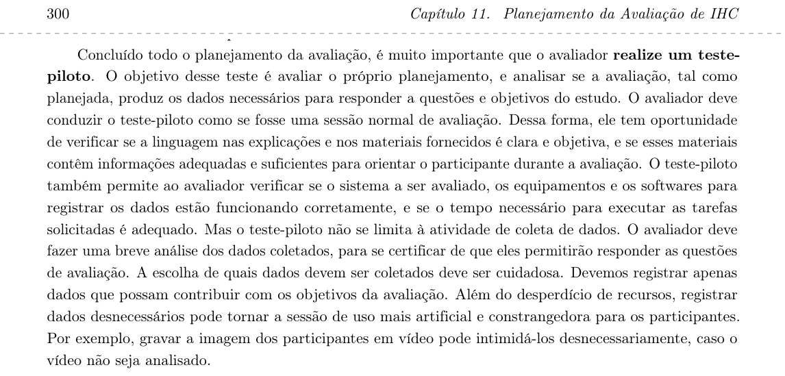
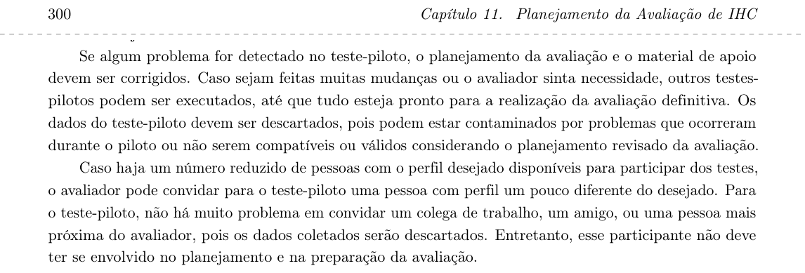

<b>Tabela de Contribuição</b>

| Membro | Contribuição |
| :--- | :--- |
| **Daniel da Silva Batista** | Elaboração dos itens TP-01 a TP-05, recortes do livro. |
| **Arthur Sismene Carvalho** | Elaboração dos itens TP-06 a TP-10 *(pendente)*. |
| **Leonardo da Silva Lopes Júnior** | Elaboração dos itens TP-11 a TP-15 *(pendente)*. |
| **Pedro Rocha Ferreira Lima** | Elaboração dos itens TP-16 a TP-20 *(pendente)*. |
| **Claude (Anthropic)** | Apoio na organização da página e na extração dos recortes do livro (conforme Política de IA). |

<b>Fonte:</b> Daniel da Silva Batista (2026).

# Lista de Verificação de Teste-Piloto

## 1. Introdução

O **teste-piloto** é um ensaio da avaliação feito antes das sessões oficiais. Ele avalia o próprio planejamento: se as instruções são claras, se os equipamentos funcionam e se o tempo previsto é suficiente (BARBOSA et al., 2021).

Esta é a **primeira versão (v1)** desta lista, elaborada para a [Verificação da Etapa 8](../index.md), conduzida pelo método de inspeção de Fagan (FAGAN, 1976). Ela será aplicada, no passo de inspeção, aos seguintes artefatos do projeto:

* [Planejamento e Execução do Teste-Piloto (Nível 1)](../../design-avaliacao-desenvolvimento/teste-piloto.md)
* Seções de teste-piloto dos relatos individuais dos protótipos de papel e de alta fidelidade

A lista tem **20 itens**, e cada integrante do grupo elabora 5 deles. Cada item é uma pergunta objetiva, com as explicações necessárias entre parênteses, para que possa ser respondida por quem não conhece o artefato. Cada item indica o autor e a fonte. A [Seção 3](#3-itens-de-verificacao) consolida todos os itens em uma tabela, e a [Seção 4](#4-detalhamento-dos-itens) detalha cada um, com a pergunta e, logo abaixo, o recorte do livro que a fundamenta.

## 2. Critérios de Julgamento

Cada item admite uma única resposta:

* **Sim** — o artefato atende integralmente ao que a pergunta descreve;
* **Não** — o artefato não atende ao que a pergunta descreve ou não apresenta a informação;
* **Incompleto** — o artefato atende apenas em parte (por exemplo, em alguns quadros, tarefas ou participantes, mas não em todos).

## 3. Itens de Verificação

A Tabela 1 consolida os 20 itens de verificação da Lista de Verificação de Teste-Piloto:

<b>Tabela 1: Itens da Lista de Verificação de Teste-Piloto</b>

| ID | Pergunta de verificação | Autor | Fonte |
| :---: | :--- | :--- | :--- |
| **TP-01** | O teste-piloto foi feito antes das sessões oficiais e conduzido como uma sessão completa (do termo de consentimento até a última pergunta)? | Daniel da Silva Batista | BARBOSA et al. (2021, p. 300) |
| **TP-02** | O artefato informa o que o teste-piloto verificou: se as instruções e os materiais estão claros, se os equipamentos e a gravação funcionam e se o tempo previsto para as tarefas é suficiente? | Daniel da Silva Batista | BARBOSA et al. (2021, p. 300) |
| **TP-03** | O artefato registra os problemas encontrados no teste-piloto e as correções feitas no planejamento ou no material antes das sessões oficiais? | Daniel da Silva Batista | BARBOSA et al. (2021, p. 300) |
| **TP-04** | O artefato declara que os dados do teste-piloto foram descartados e não entram nos resultados da avaliação? | Daniel da Silva Batista | BARBOSA et al. (2021, p. 300) |
| **TP-05** | O participante do teste-piloto é alguém de fora da equipe que planejou a avaliação (não ajudou a planejá-la nem a prepará-la)? | Daniel da Silva Batista | BARBOSA et al. (2021, p. 300) |
| **TP-06** | *(a elaborar)* | Arthur Sismene Carvalho | — |
| **TP-07** | *(a elaborar)* | Arthur Sismene Carvalho | — |
| **TP-08** | *(a elaborar)* | Arthur Sismene Carvalho | — |
| **TP-09** | *(a elaborar)* | Arthur Sismene Carvalho | — |
| **TP-10** | *(a elaborar)* | Arthur Sismene Carvalho | — |
| **TP-11** | *(a elaborar)* | Leonardo da Silva Lopes Júnior | — |
| **TP-12** | *(a elaborar)* | Leonardo da Silva Lopes Júnior | — |
| **TP-13** | *(a elaborar)* | Leonardo da Silva Lopes Júnior | — |
| **TP-14** | *(a elaborar)* | Leonardo da Silva Lopes Júnior | — |
| **TP-15** | *(a elaborar)* | Leonardo da Silva Lopes Júnior | — |
| **TP-16** | *(a elaborar)* | Pedro Rocha Ferreira Lima | — |
| **TP-17** | *(a elaborar)* | Pedro Rocha Ferreira Lima | — |
| **TP-18** | *(a elaborar)* | Pedro Rocha Ferreira Lima | — |
| **TP-19** | *(a elaborar)* | Pedro Rocha Ferreira Lima | — |
| **TP-20** | *(a elaborar)* | Pedro Rocha Ferreira Lima | — |

<b>Fonte:</b> Daniel da Silva Batista, Arthur Sismene Carvalho, Leonardo da Silva Lopes Júnior e Pedro Rocha Ferreira Lima (2026), conforme o autor de cada item.

## 4. Detalhamento dos Itens

### 4.1 TP-01 — Realização do teste-piloto

A Tabela 2 apresenta o item TP-01:

<b>Tabela 2: Item TP-01 — Realização do teste-piloto</b>

| Campo | Registro |
| :--- | :--- |
| **Pergunta** | O teste-piloto foi feito antes das sessões oficiais e conduzido como uma sessão completa (do termo de consentimento até a última pergunta)? |
| **Autor** | Daniel da Silva Batista |
| **Fonte** | BARBOSA et al. (2021, p. 300) |

<b>Fonte:</b> Daniel da Silva Batista (2026).

A Figura 1 reproduz o trecho do livro que fundamenta o item TP-01:

<b>Figura 1: Referência Bibliográfica — Item TP-01 (Realização do teste-piloto)</b>

<b>Fonte:</b> BARBOSA et al. (2021, p. 300).

### 4.2 TP-02 — O que o teste-piloto verifica

A Tabela 3 apresenta o item TP-02:

<b>Tabela 3: Item TP-02 — O que o teste-piloto verifica</b>

| Campo | Registro |
| :--- | :--- |
| **Pergunta** | O artefato informa o que o teste-piloto verificou: se as instruções e os materiais estão claros, se os equipamentos e a gravação funcionam e se o tempo previsto para as tarefas é suficiente? |
| **Autor** | Daniel da Silva Batista |
| **Fonte** | BARBOSA et al. (2021, p. 300) |

<b>Fonte:</b> Daniel da Silva Batista (2026).

A Figura 2 reproduz o trecho do livro que fundamenta o item TP-02:

<b>Figura 2: Referência Bibliográfica — Item TP-02 (O que o teste-piloto verifica)</b>

<b>Fonte:</b> BARBOSA et al. (2021, p. 300).

### 4.3 TP-03 — Correções após o teste-piloto

A Tabela 4 apresenta o item TP-03:

<b>Tabela 4: Item TP-03 — Correções após o teste-piloto</b>

| Campo | Registro |
| :--- | :--- |
| **Pergunta** | O artefato registra os problemas encontrados no teste-piloto e as correções feitas no planejamento ou no material antes das sessões oficiais? |
| **Autor** | Daniel da Silva Batista |
| **Fonte** | BARBOSA et al. (2021, p. 300) |

<b>Fonte:</b> Daniel da Silva Batista (2026).

A Figura 3 reproduz o trecho do livro que fundamenta o item TP-03:

<b>Figura 3: Referência Bibliográfica — Item TP-03 (Correções após o teste-piloto)</b>

<b>Fonte:</b> BARBOSA et al. (2021, p. 300).

### 4.4 TP-04 — Descarte dos dados do piloto

A Tabela 5 apresenta o item TP-04:

<b>Tabela 5: Item TP-04 — Descarte dos dados do piloto</b>

| Campo | Registro |
| :--- | :--- |
| **Pergunta** | O artefato declara que os dados do teste-piloto foram descartados e não entram nos resultados da avaliação? |
| **Autor** | Daniel da Silva Batista |
| **Fonte** | BARBOSA et al. (2021, p. 300) |

<b>Fonte:</b> Daniel da Silva Batista (2026).

A Figura 4 reproduz o trecho do livro que fundamenta o item TP-04:

<b>Figura 4: Referência Bibliográfica — Item TP-04 (Descarte dos dados do piloto)</b>

<b>Fonte:</b> BARBOSA et al. (2021, p. 300).

### 4.5 TP-05 — Participante do teste-piloto

A Tabela 6 apresenta o item TP-05:

<b>Tabela 6: Item TP-05 — Participante do teste-piloto</b>

| Campo | Registro |
| :--- | :--- |
| **Pergunta** | O participante do teste-piloto é alguém de fora da equipe que planejou a avaliação (não ajudou a planejá-la nem a prepará-la)? |
| **Autor** | Daniel da Silva Batista |
| **Fonte** | BARBOSA et al. (2021, p. 300) |

<b>Fonte:</b> Daniel da Silva Batista (2026).

A Figura 5 reproduz o trecho do livro que fundamenta o item TP-05:

<b>Figura 5: Referência Bibliográfica — Item TP-05 (Participante do teste-piloto)</b>

<b>Fonte:</b> BARBOSA et al. (2021, p. 300).

> *Os itens TP-06 a TP-20 serão detalhados pelos respectivos autores neste mesmo formato: pergunta, autor, fonte e recorte do livro.*

## 5. Referências Bibliográficas

> [1] BARBOSA, Simone D. J.; SILVA, Bruno S. da; SILVEIRA, Milene S.; GASPARINI, Isabela; DARIN, Ticianne; BARBOSA, Gabriel D. J. *Interação Humano-Computador e Experiência do Usuário*. 1. ed. Autopublicação, 2021. ISBN: 978-65-00-19677-1.  
> [2] FAGAN, Michael E. Design and code inspections to reduce errors in program development. *IBM Systems Journal*, v. 15, n. 3, p. 182-211, 1976.  
> [3] SALES, André Barros de. *Plano de ensino FIHC 022026 – Turma 01*. Brasília: FCTE/UnB, 2026.

## 6. Histórico de Versões

| Versão | Data | Descrição | Autor(es) | Revisor(es) |
| :---: | :---: | :--- | :---: | :---: |
| `1.0` | 21/11/2026 | Criação da lista (v1): itens TP-01 a TP-05, com fonte por página e recorte do livro; itens TP-06 a TP-20 reservados aos demais integrantes. | Daniel da Silva Batista | — |

