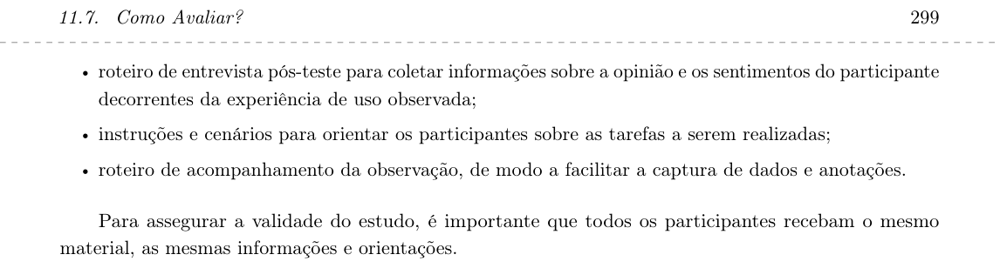
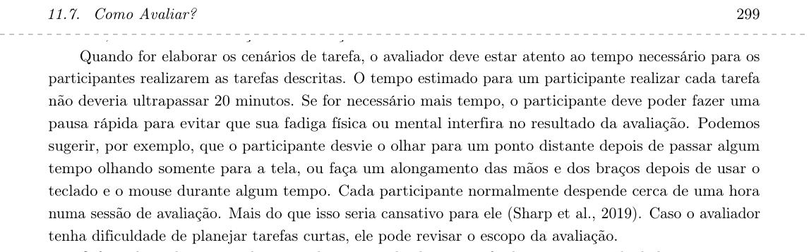
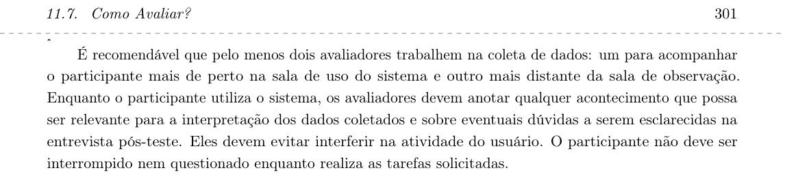
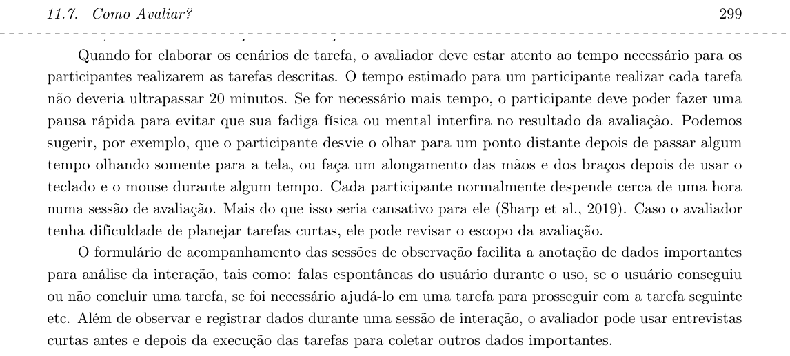
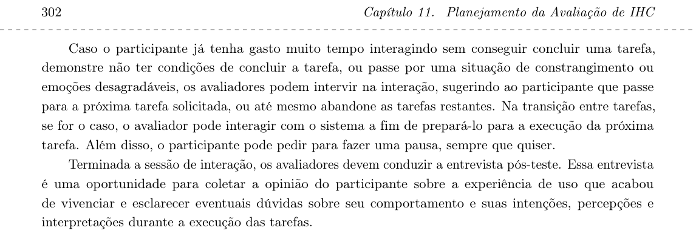
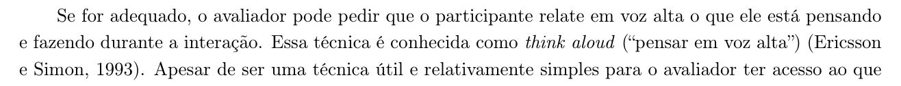
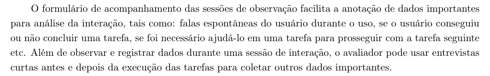
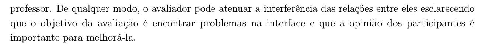
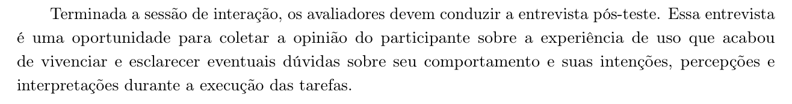
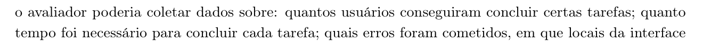

<b>Tabela de Contribuição</b>

| Membro | Contribuição |
| :--- | :--- |
| **Daniel da Silva Batista** | Elaboração dos itens TU-01 a TU-05, recortes do livro. |
| **Arthur Sismene Carvalho** | Elaboração dos itens TU-06 a TU-10, recortes do livro. |
| **Leonardo da Silva Lopes Júnior** | Elaboração dos itens TU-11 a TU-15 *(pendente)*. |
| **Pedro Rocha Ferreira Lima** | Elaboração dos itens TU-16 a TU-20 *(pendente)*. |
| **Claude (Anthropic)** | Apoio na organização da página e na extração dos recortes do livro (conforme Política de IA). |

<b>Fonte:</b> Daniel da Silva Batista e Arthur Sismene Carvalho (2026).

# Lista de Verificação de Teste de Usabilidade

## 1. Introdução

O **teste de usabilidade** é a sessão em que participantes com o perfil dos usuários executam tarefas com o protótipo enquanto são observados, para revelar problemas de uso (BARBOSA et al., 2021). Esta lista verifica como as sessões foram conduzidas e registradas.

Esta é a **primeira versão (v1)** desta lista, elaborada para a [Verificação da Etapa 8](../index.md), conduzida pelo método de inspeção de Fagan (FAGAN, 1976). Ela será aplicada, no passo de inspeção, aos seguintes artefatos do projeto:

* [Relato do protótipo de papel — Daniel da Silva Batista](../../design-avaliacao-desenvolvimento/etapa-5/daniel-batista-prototipo-papel.md)
* [Relato do protótipo de papel — Arthur Sismene Carvalho](../../design-avaliacao-desenvolvimento/etapa-5/arthur-carvalho-prototipo-papel.md)
* [Relato do protótipo de papel — Leonardo da Silva Lopes Júnior](../../design-avaliacao-desenvolvimento/etapa-5/leonardo-lopes-prototipo-papel.md)
* [Relato do protótipo de papel — Pedro Rocha Ferreira Lima](../../design-avaliacao-desenvolvimento/etapa-5/pedro-rocha-prototipo-papel.md)
* [Relato do protótipo de alta fidelidade — Daniel da Silva Batista](../../design-avaliacao-desenvolvimento/etapa-5/daniel-batista-alta-fidelidade.md)
* [Relato do protótipo de alta fidelidade — Arthur Sismene Carvalho](../../design-avaliacao-desenvolvimento/etapa-5/arthur-carvalho-alta-fidelidade.md)
* [Relato do protótipo de alta fidelidade — Leonardo da Silva Lopes Júnior](../../design-avaliacao-desenvolvimento/etapa-5/leonardo-lopes-alta-fidelidade.md)
* [Relato do protótipo de alta fidelidade — Pedro Rocha Ferreira Lima](../../design-avaliacao-desenvolvimento/etapa-5/pedro-rocha-alta-fidelidade.md)

A lista tem **20 itens**, e cada integrante do grupo elabora 5 deles. Cada item é uma pergunta objetiva, com as explicações necessárias entre parênteses, para que possa ser respondida por quem não conhece o artefato. Cada item indica o autor e a fonte. A [Seção 3](#3-itens-de-verificacao) consolida todos os itens em uma tabela, e a [Seção 4](#4-detalhamento-dos-itens) detalha cada um, com a pergunta e, logo abaixo, o recorte do livro que a fundamenta.

## 2. Critérios de Julgamento

Cada item admite uma única resposta:

* **Sim** — o artefato atende integralmente ao que a pergunta descreve;
* **Não** — o artefato não atende ao que a pergunta descreve ou não apresenta a informação;
* **Incompleto** — o artefato atende apenas em parte (por exemplo, em alguns quadros, tarefas ou participantes, mas não em todos).

## 3. Itens de Verificação

A Tabela 1 consolida os 20 itens de verificação da Lista de Verificação de Teste de Usabilidade:

<b>Tabela 1: Itens da Lista de Verificação de Teste de Usabilidade</b>

| ID | Pergunta de verificação | Autor | Fonte |
| :---: | :--- | :--- | :--- |
| **TU-01** | Todos os participantes receberam as mesmas instruções e o mesmo material (termo de consentimento, questionário inicial e descrição das tarefas), para que as sessões possam ser comparadas? | Daniel da Silva Batista | BARBOSA et al. (2021, p. 299) |
| **TU-02** | Cada tarefa pedida ao participante pode ser feita em até 20 minutos, e a sessão inteira dura cerca de uma hora ou menos? | Daniel da Silva Batista | BARBOSA et al. (2021, p. 299) |
| **TU-03** | Enquanto o participante realizava as tarefas, o avaliador apenas observou e anotou, sem interrompê-lo nem lhe fazer perguntas? | Daniel da Silva Batista | BARBOSA et al. (2021, p. 301) |
| **TU-04** | O relato registra, para cada tarefa, se o participante conseguiu concluí-la, se precisou de ajuda e os comentários que ele fez espontaneamente (sem ser perguntado)? | Daniel da Silva Batista | BARBOSA et al. (2021, p. 299) |
| **TU-05** | Depois de terminar as tarefas, o participante foi entrevistado sobre o que achou de usar o protótipo (entrevista pós-teste)? | Daniel da Silva Batista | BARBOSA et al. (2021, p. 302) |
| **TU-06** | O participante foi encorajado a verbalizar seus pensamentos durante as tarefas (técnica "pensar em voz alta"), descrevendo o que estava fazendo e o que estava pensando a cada momento? | Arthur Sismene Carvalho | BARBOSA et al. (2021, p. 301) |
| **TU-07** | O avaliador registrou, para cada tarefa, onde o participante parou, o que tentou, o que disse espontaneamente e as expressões ou gestos que indicaram frustração, confusão ou satisfação? | Arthur Sismene Carvalho | BARBOSA et al. (2021, p. 299) |
| **TU-08** | O participante foi informado de que o objeto da avaliação é o protótipo (ou o sistema), não ele próprio — e essa distinção foi reforçada nos momentos em que demonstrou frustração ou constrangimento? | Arthur Sismene Carvalho | BARBOSA et al. (2021, p. 300) |
| **TU-09** | A entrevista pós-teste incluiu perguntas abertas sobre a experiência geral do participante, sobre as tarefas que ele achou mais difíceis e sobre o que ele mudaria no sistema? | Arthur Sismene Carvalho | BARBOSA et al. (2021, p. 302) |
| **TU-10** | O avaliador registrou o tempo de cada tarefa: desde o instante em que o participante começou a tentar realizá-la até o momento em que declarou ter terminado ou desistiu? | Arthur Sismene Carvalho | BARBOSA et al. (2021, p. 293) |
| **TU-11** | *(a elaborar)* | Leonardo da Silva Lopes Júnior | — |
| **TU-12** | *(a elaborar)* | Leonardo da Silva Lopes Júnior | — |
| **TU-13** | *(a elaborar)* | Leonardo da Silva Lopes Júnior | — |
| **TU-14** | *(a elaborar)* | Leonardo da Silva Lopes Júnior | — |
| **TU-15** | *(a elaborar)* | Leonardo da Silva Lopes Júnior | — |
| **TU-16** | *(a elaborar)* | Pedro Rocha Ferreira Lima | — |
| **TU-17** | *(a elaborar)* | Pedro Rocha Ferreira Lima | — |
| **TU-18** | *(a elaborar)* | Pedro Rocha Ferreira Lima | — |
| **TU-19** | *(a elaborar)* | Pedro Rocha Ferreira Lima | — |
| **TU-20** | *(a elaborar)* | Pedro Rocha Ferreira Lima | — |

<b>Fonte:</b> Daniel da Silva Batista, Arthur Sismene Carvalho, Leonardo da Silva Lopes Júnior e Pedro Rocha Ferreira Lima (2026), conforme o autor de cada item.

## 4. Detalhamento dos Itens

### 4.1 TU-01 — Mesmo material para todos

A Tabela 2 apresenta o item TU-01:

<b>Tabela 2: Item TU-01 — Mesmo material para todos</b>

| Campo | Registro |
| :--- | :--- |
| **Pergunta** | Todos os participantes receberam as mesmas instruções e o mesmo material (termo de consentimento, questionário inicial e descrição das tarefas), para que as sessões possam ser comparadas? |
| **Autor** | Daniel da Silva Batista |
| **Fonte** | BARBOSA et al. (2021, p. 299) |

<b>Fonte:</b> Daniel da Silva Batista (2026).

A Figura 1 reproduz o trecho do livro que fundamenta o item TU-01:

<b>Figura 1: Referência Bibliográfica — Item TU-01 (Mesmo material para todos)</b>

<b>Fonte:</b> BARBOSA et al. (2021, p. 299).

### 4.2 TU-02 — Duração das tarefas e da sessão

A Tabela 3 apresenta o item TU-02:

<b>Tabela 3: Item TU-02 — Duração das tarefas e da sessão</b>

| Campo | Registro |
| :--- | :--- |
| **Pergunta** | Cada tarefa pedida ao participante pode ser feita em até 20 minutos, e a sessão inteira dura cerca de uma hora ou menos? |
| **Autor** | Daniel da Silva Batista |
| **Fonte** | BARBOSA et al. (2021, p. 299) |

<b>Fonte:</b> Daniel da Silva Batista (2026).

A Figura 2 reproduz o trecho do livro que fundamenta o item TU-02:

<b>Figura 2: Referência Bibliográfica — Item TU-02 (Duração das tarefas e da sessão)</b>

<b>Fonte:</b> BARBOSA et al. (2021, p. 299).

### 4.3 TU-03 — Não interferir durante as tarefas

A Tabela 4 apresenta o item TU-03:

<b>Tabela 4: Item TU-03 — Não interferir durante as tarefas</b>

| Campo | Registro |
| :--- | :--- |
| **Pergunta** | Enquanto o participante realizava as tarefas, o avaliador apenas observou e anotou, sem interrompê-lo nem lhe fazer perguntas? |
| **Autor** | Daniel da Silva Batista |
| **Fonte** | BARBOSA et al. (2021, p. 301) |

<b>Fonte:</b> Daniel da Silva Batista (2026).

A Figura 3 reproduz o trecho do livro que fundamenta o item TU-03:

<b>Figura 3: Referência Bibliográfica — Item TU-03 (Não interferir durante as tarefas)</b>

<b>Fonte:</b> BARBOSA et al. (2021, p. 301).

### 4.4 TU-04 — Registro do acompanhamento das sessões

A Tabela 5 apresenta o item TU-04:

<b>Tabela 5: Item TU-04 — Registro do acompanhamento das sessões</b>

| Campo | Registro |
| :--- | :--- |
| **Pergunta** | O relato registra, para cada tarefa, se o participante conseguiu concluí-la, se precisou de ajuda e os comentários que ele fez espontaneamente (sem ser perguntado)? |
| **Autor** | Daniel da Silva Batista |
| **Fonte** | BARBOSA et al. (2021, p. 299) |

<b>Fonte:</b> Daniel da Silva Batista (2026).

A Figura 4 reproduz o trecho do livro que fundamenta o item TU-04:

<b>Figura 4: Referência Bibliográfica — Item TU-04 (Registro do acompanhamento das sessões)</b>

<b>Fonte:</b> BARBOSA et al. (2021, p. 299).

### 4.5 TU-05 — Entrevista pós-teste

A Tabela 6 apresenta o item TU-05:

<b>Tabela 6: Item TU-05 — Entrevista pós-teste</b>

| Campo | Registro |
| :--- | :--- |
| **Pergunta** | Depois de terminar as tarefas, o participante foi entrevistado sobre o que achou de usar o protótipo (entrevista pós-teste)? |
| **Autor** | Daniel da Silva Batista |
| **Fonte** | BARBOSA et al. (2021, p. 302) |

<b>Fonte:</b> Daniel da Silva Batista (2026).

A Figura 5 reproduz o trecho do livro que fundamenta o item TU-05:

<b>Figura 5: Referência Bibliográfica — Item TU-05 (Entrevista pós-teste)</b>

<b>Fonte:</b> BARBOSA et al. (2021, p. 302).

### 4.6 TU-06 — Pensar em voz alta

A Tabela 7 apresenta o item TU-06:

<b>Tabela 7: Item TU-06 — Pensar em voz alta</b>

| Campo | Registro |
| :--- | :--- |
| **Pergunta** | O participante foi encorajado a verbalizar seus pensamentos durante as tarefas (técnica "pensar em voz alta"), descrevendo o que estava fazendo e o que estava pensando a cada momento? |
| **Autor** | Arthur Sismene Carvalho |
| **Fonte** | BARBOSA et al. (2021, p. 301) |

<b>Fonte:</b> Arthur Sismene Carvalho (2026).

A Figura 6 reproduz o trecho do livro que fundamenta o item TU-06:

<b>Figura 6: Referência Bibliográfica — Item TU-06 (Pensar em voz alta)</b>

<b>Fonte:</b> BARBOSA et al. (2021, p. 301).

### 4.7 TU-07 — Registro de dificuldades

A Tabela 8 apresenta o item TU-07:

<b>Tabela 8: Item TU-07 — Registro de dificuldades</b>

| Campo | Registro |
| :--- | :--- |
| **Pergunta** | O avaliador registrou, para cada tarefa, onde o participante parou, o que tentou, o que disse espontaneamente e as expressões ou gestos que indicaram frustração, confusão ou satisfação? |
| **Autor** | Arthur Sismene Carvalho |
| **Fonte** | BARBOSA et al. (2021, p. 299) |

<b>Fonte:</b> Arthur Sismene Carvalho (2026).

A Figura 7 reproduz o trecho do livro que fundamenta o item TU-07:

<b>Figura 7: Referência Bibliográfica — Item TU-07 (Registro de dificuldades)</b>

<b>Fonte:</b> BARBOSA et al. (2021, p. 299).

### 4.8 TU-08 — Objeto da avaliação

A Tabela 9 apresenta o item TU-08:

<b>Tabela 9: Item TU-08 — Objeto da avaliação</b>

| Campo | Registro |
| :--- | :--- |
| **Pergunta** | O participante foi informado de que o objeto da avaliação é o protótipo (ou o sistema), não ele próprio — e essa distinção foi reforçada nos momentos em que demonstrou frustração ou constrangimento? |
| **Autor** | Arthur Sismene Carvalho |
| **Fonte** | BARBOSA et al. (2021, p. 300) |

<b>Fonte:</b> Arthur Sismene Carvalho (2026).

A Figura 8 reproduz o trecho do livro que fundamenta o item TU-08:

<b>Figura 8: Referência Bibliográfica — Item TU-08 (Objeto da avaliação)</b>

<b>Fonte:</b> BARBOSA et al. (2021, p. 300).

### 4.9 TU-09 — Perguntas abertas pós-teste

A Tabela 10 apresenta o item TU-09:

<b>Tabela 10: Item TU-09 — Perguntas abertas pós-teste</b>

| Campo | Registro |
| :--- | :--- |
| **Pergunta** | A entrevista pós-teste incluiu perguntas abertas sobre a experiência geral do participante, sobre as tarefas que ele achou mais difíceis e sobre o que ele mudaria no sistema? |
| **Autor** | Arthur Sismene Carvalho |
| **Fonte** | BARBOSA et al. (2021, p. 302) |

<b>Fonte:</b> Arthur Sismene Carvalho (2026).

A Figura 9 reproduz o trecho do livro que fundamenta o item TU-09:

<b>Figura 9: Referência Bibliográfica — Item TU-09 (Perguntas abertas pós-teste)</b>

<b>Fonte:</b> BARBOSA et al. (2021, p. 302).

### 4.10 TU-10 — Tempo por tarefa

A Tabela 11 apresenta o item TU-10:

<b>Tabela 11: Item TU-10 — Tempo por tarefa</b>

| Campo | Registro |
| :--- | :--- |
| **Pergunta** | O avaliador registrou o tempo de cada tarefa: desde o instante em que o participante começou a tentar realizá-la até o momento em que declarou ter terminado ou desistiu? |
| **Autor** | Arthur Sismene Carvalho |
| **Fonte** | BARBOSA et al. (2021, p. 293) |

<b>Fonte:</b> Arthur Sismene Carvalho (2026).

A Figura 10 reproduz o trecho do livro que fundamenta o item TU-10:

<b>Figura 10: Referência Bibliográfica — Item TU-10 (Tempo por tarefa)</b>

<b>Fonte:</b> BARBOSA et al. (2021, p. 293).

> *Os itens TU-11 a TU-20 serão detalhados pelos respectivos autores neste mesmo formato: pergunta, autor, fonte e recorte do livro.*

## 5. Referências Bibliográficas

> [1] BARBOSA, Simone D. J.; SILVA, Bruno S. da; SILVEIRA, Milene S.; GASPARINI, Isabela; DARIN, Ticianne; BARBOSA, Gabriel D. J. *Interação Humano-Computador e Experiência do Usuário*. 1. ed. Autopublicação, 2021. ISBN: 978-65-00-19677-1.  
> [2] FAGAN, Michael E. Design and code inspections to reduce errors in program development. *IBM Systems Journal*, v. 15, n. 3, p. 182-211, 1976.  
> [3] SALES, André Barros de. *Plano de ensino FIHC 022026 – Turma 01*. Brasília: FCTE/UnB, 2026.

## 6. Histórico de Versões

| Versão | Data | Descrição | Autor(es) | Revisor(es) |
| :---: | :---: | :--- | :---: | :---: |
| `1.0` | 21/11/2026 | Criação da lista (v1): itens TU-01 a TU-05, com fonte por página e recorte do livro; itens TU-06 a TU-20 reservados aos demais integrantes. | Daniel da Silva Batista | — |
| `1.1` | 22/11/2026 | Adição dos itens TU-06 a TU-10: perguntas de verificação, fontes e recortes do livro. | Arthur Sismene Carvalho | — |

